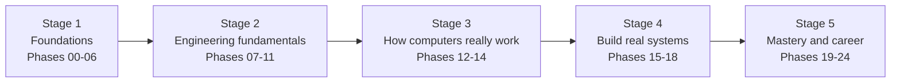

<!-- nav:top -->
[🏠 Start](../START-HERE.md) · [← Phase 00 — Getting started](README.md) · [📋 Phase 00](README.md) · [00.2 What programming is →](02-what-is-programming.md) · [📖 Glossary](../GLOSSARY.md) · [🇷🇺 Русский](../../ru/00-getting-started/01-how-to-use-this-course.md) <!-- nav -->

# Lesson 00.1 — How to use this course

> **Phase 00 — Getting started** · Lesson 1 of 8 · ⏱ about 90 minutes

## What you will learn

- What this course teaches, who it is for, and where it takes you.
- The map of the course: 5 stages and 25 phases, and how long each part takes.
- How every lesson is built, and what each block (words, exercises, quiz, hidden answers) is for.
- How to organise your time, your folders and your work, including how to use an AI assistant without cheating yourself.
- Why version control (Git) is the first real skill you learn, even before the Rust language itself.

## Before you start

- You have a Mac with macOS and an internet connection (you need the internet only to install tools and to open links).
- The course folder `~/projects/rust` exists and contains this course. In this folder, `~` is a short way to write "your home folder"; you will learn this properly in [Lesson 00.4 — The terminal: your first commands](04-terminal-basics.md).
- You do not need any programming knowledge. This is the very first lesson.

## New words

| Word | Meaning |
|---|---|
| **course** | The whole set of lessons in this folder, from zero to a working systems engineer. |
| **stage** | A big group of phases with one common goal. The course has 5 stages. |
| **phase** | A part of the course about one topic, for example "Git and version control". The phases are numbered 00 to 24. |
| **lesson** | One text file you study in one session (30–150 minutes). Numbered like `02.4` = phase 02, lesson 4. |
| **project** | A lesson where you build a small program yourself, with a list of requirements but without a ready solution. |
| **checkpoint** | A lesson at the end of a phase with a self-test, so you can check whether you are ready to move on. |
| **systems engineer** | A programmer who builds and looks after the "lower" layers of software: servers, databases, tools, parts of operating systems. They care about speed, memory use and reliability. |
| **Rust** | A programming language made for fast and safe programs. It is the language of this course. |
| **IDE** (Integrated Development Environment) | A program for writing code that combines an editor, a way to run programs and many helpers. We use **RustRover**. |
| **Git** | A tool that remembers the history of your files. Phase 01 teaches it. |
| **VC** (Version Control) | The general idea behind Git: keeping every version of your files, so you can look back and undo mistakes. |
| **terminal** | A window where you control the computer by typing commands. Lesson 00.4 teaches it. |
| **compiler** | A program that translates the code you write into something the computer can run. Lesson 00.3 explains it. |
| **Markdown** | A simple way to write formatted text (headings, lists, code) in a plain file. All lessons are Markdown files. Lesson 00.8 teaches it. |
| **AI** (Artificial Intelligence) assistant | A program such as Claude that answers questions in natural language. It can be a good tutor if you use it carefully. |

## 1. What this course is for

The goal of this course is simple to say and takes time to reach: **to turn you from a beginner into a
systems engineer**.

A *systems engineer* does not usually build the buttons and colours that users see. They build what
sits under them: the program that stores your data (a database), the program that answers requests
on the internet (a server), the tools that other programmers use every day, and the pieces that talk
directly to the operating system. These programs must be **fast**, must not waste **memory**, and
must keep working for months without a crash. Because of this, a systems engineer needs to
understand how a computer really works, not only how to write code.

The language we use is **Rust**. Rust was designed so that fast programs can also be safe: the
compiler (the program that translates your code) checks many kinds of mistakes before your
program ever runs. Companies use Rust for operating-system parts, network services, browsers and
command-line tools. Learning Rust also forces you to learn how memory works, which is exactly what
a systems engineer needs.

Be honest with yourself about the size of the road. The whole course is about 113–147 weeks
at about 10 hours per week (roughly two to three years of part-time study). You do not have to finish
everything to be useful. After Stage 1 (about 17–22 weeks) you can already write real programs and
use Git like a professional. Every later stage adds depth.

> 💡 **Tip:** Think of the course as learning a craft, not memorising facts. A carpenter learns by
> making many small things with their hands. You will learn by typing code, running it, breaking it
> and fixing it.

## 2. The map of the course

The course has **5 stages**, and every stage has several **phases**. Each phase is a folder with
a `README.md` (an overview) and a number of lessons.



Here is every phase with the time it needs (at about 10 hours per week):

| Phase | Title | Weeks |
|---|---|---|
| **Stage 1 — Foundations: tools, Git and the Rust language** | | |
| 00 | Getting started | 1 |
| 01 | Git and version control | 1–2 |
| 02 | Programming basics in Rust | 2–3 |
| 03 | Ownership and borrowing | 2 |
| 04 | Structs, enums, collections and errors | 3–4 |
| 05 | Rust intermediate | 4–5 |
| 06 | Rust advanced | 4–5 |
| **Stage 2 — Engineering fundamentals** | | |
| 07 | Algorithms and data structures | 6–8 |
| 08 | Software design: principles, patterns and conventions | 3–4 |
| 09 | Testing, debugging and benchmarking | 3–4 |
| 10 | Security fundamentals | 3–4 |
| 11 | Linux, the shell and containers | 3–4 |
| **Stage 3 — How computers really work** | | |
| 12 | Computer systems | 6–8 |
| 13 | Operating systems from the inside | 8–10 |
| 14 | Concurrency and async in depth | 6–8 |
| **Stage 4 — Build real systems** | | |
| 15 | Networking | 6–8 |
| 16 | Backend services | 5–6 |
| 17 | Storage and database internals | 7–9 |
| 18 | Distributed systems | 8–10 |
| **Stage 5 — Mastery and career** | | |
| 19 | Performance and profiling | 4–5 |
| 20 | Reliability and hardening | 4–5 |
| 21 | Cloud-native infrastructure | 4–6 |
| 22 | Specializations | 10–12 |
| 23 | Capstone projects | 10–14 |
| 24 | Career and open source | ongoing |

Some of these words (ownership, concurrency, async) mean nothing to you yet. That is normal. Each one
is explained from zero in its own phase.

## 3. Where Git fits in

Look at the order: **Phase 01 is Git and version control, and the Rust language starts only in
Phase 02.** This is on purpose.

*Version control* answers a very practical question: "What did my files look like yesterday, and how do I
get that version back?" Without it, people save files as `program-final.rs`, `program-final2.rs`,
`program-really-final.rs`. With it, you keep one clean folder and a complete history behind it. Every
professional team in the world uses version control, and **Git** is the tool almost all of them use.

In this course Git is not a side topic:

- From Phase 01 on, every project asks you to make a Git **commit** (a saved snapshot of your work) at each milestone.
- Your learning repository (a folder tracked by Git) will hold all your code and notes, so your progress is safe and visible.
- In [Lesson 00.5 — Installing Rust and RustRover](05-install-rust-and-rustrover.md) you will only check that Git is installed. In [Lesson 00.6 — Your first Rust program](06-your-first-rust-program.md) you will see that Cargo (the Rust build tool) already prepares a Git repository for you. The real teaching starts in Phase 01.

> 💡 **Tip:** Phase 00 is preparation. You will not write "real" programs yet. Its job is to make
> sure that your computer, your tools and your habits are ready, so that the later phases feel smooth.

## 4. How a lesson is built

Every lesson has the same shape. Once you know it, you always know where you are.

| Block | What it is | How to use it |
|---|---|---|
| **What you will learn** | 3–5 goals. | Read first. At the end, check that you can do each one. |
| **Before you start** | What you must have done earlier. | Follow the links if something is missing. |
| **New words** | A table of the new terms and abbreviations. | Read it before the lesson, return to it when a word is unclear. |
| **Numbered sections** | The teaching itself: first a simple explanation, then the exact rule, then a small example. | Read slowly. Type the examples. |
| **What happens:** | A numbered, line-by-line explanation after each example. | Compare it with your own guess. |
| **Common mistakes** | The typical errors, with the real error message and the fix. | Make these mistakes on purpose once. |
| **Try it yourself** | A guided mini task with exact commands. | Do it with the lesson open next to your terminal. |
| **Exercises** | 3–6 tasks, marked easy, medium or hard. | Try first. Use the hint only when stuck. Open the answer last. |
| **Quiz** | 4–8 short questions. | Answer in your head or on paper, then check. |
| **Summary** | The key ideas in a few lines. | Copy the ones you want into your notes. |
| **Sources and further reading** | Official documentation and books. | Optional. Use it to check a fact or go deeper. |

Everything you need is **inside the lesson**. The links at the end are for checking and for going
deeper; you never *have to* open them to understand the lesson.

### Hidden hints and answers

Hints and answers are hidden so that you do not read them by accident. Click the line to open it:

<details>
<summary>Click me to open a hidden block</summary>

This is what an answer looks like. In a real exercise, you should try to solve the task *before* you
open this.

</details>

If a hidden block does not open in your viewer, open the file in RustRover (it shows Markdown) or in
a web browser.

### Note boxes

Short notes with an icon appear in the text:

| Icon | Meaning |
|---|---|
| 💡 **Tip** | Practical advice that saves time. |
| ⚠️ **Common mistake** | Something beginners often get wrong. |
| 📏 **Convention** | How professionals usually name, format or organise things. |
| 🧪 **Testing** | How to check that the code works. |
| 🔒 **Security** | A safety rule (for example: never put a password into Git). |
| ⚡ **Performance** | Something that affects speed or memory. |

### Three kinds of lesson

- **Normal lessons** teach one topic and end with exercises and a quiz.
- **Project lessons** (the file name contains `project`) ask you to build a small program. You get a
  *contract* (exactly what the program must do) and a plan with milestones M1, M2 and so on. There is
  no complete solution on purpose: the learning is in the building. Every project must have tests, pass
  `cargo clippy` and `cargo fmt` (Rust's checking and formatting tools), have a short README, and, from Phase 01, a Git commit per milestone.
- **Checkpoint lessons** finish a phase. You answer a self-test, do a few practical tasks, and the lesson tells
  you which earlier lessons to repeat if something went wrong.

## 5. Your folders

All your work lives under `~/projects/rust`. After this course is set up, it looks like this:

```text
~/projects/rust
├── START-HERE.md      ← the first page of the course
├── GLOSSARY.md        ← every new word and abbreviation, in one place
├── course/            ← the English lessons (this file is here)
├── ru/
│   └── course/        ← the same lessons in Russian
├── code/              ← YOUR code: one folder per project
│   ├── p00-hello/
│   └── p02-guessing-game/
└── notes/             ← YOUR notes (you create this in Lesson 00.4)
```

`code/` holds one folder per project. The name always starts with `p` and the phase number:
`p02-guessing-game` is a project from Phase 02. You will create `code/p00-hello` in
[Lesson 00.6](06-your-first-rust-program.md).

> 📏 **Convention:** Never edit the lesson files in `course/` (`course/en/` and `course/ru/`) with
> your own notes; the only change you make there is ticking boxes in `PROGRESS.md`. Keep your own
> text in `notes/` and your own programs in `code/`. If you want to update the course later, your
> work will not be overwritten.

The two reference files are:

- [START-HERE.md](../START-HERE.md) — the entry page: how to begin and where everything is.
- [GLOSSARY.md](../GLOSSARY.md) — every new word and abbreviation from every lesson. When a word is unclear, search here first.

## 6. How to work

### Read with your hands on the keyboard

Reading about programming does not teach programming, just like reading about swimming does not
teach swimming. For each example:

1. **Predict** what the program will print or do.
2. **Type** the code yourself. Do not copy and paste; typing makes you notice every character.
3. **Run** it and compare the real result with your prediction.
4. **Change** something and run it again. Break it on purpose and read the error.

### The "stuck" ladder

When an exercise does not work, go up the ladder one step at a time:

1. Re-read the error message slowly, from the top. Lesson 00.7 teaches you how.
2. Wait 15 minutes of real effort. Take a short walk if you are frustrated.
3. Open the **Hint** only.
4. Look at the **Answer**, then close it and write the solution yourself without looking.
5. Ask a person or an AI assistant (see below), with the exact error and your code.

### Time

The plan assumes about **10 hours per week**. A good rhythm is 4–5 sessions of about 2 hours
rather than one 10-hour marathon. Short regular sessions beat long rare ones, because the brain
needs sleep to store new things. Lesson 00.8 gives you a full routine.

### English and Russian

Every lesson exists in English and in Russian with the same structure. A good method: read the
language you understand better first, then skim the other one. The *code* and the *commands* are
identical in both versions. Technical words are given in English too, because documentation,
error messages and other programmers speak English. In Russian files you see the English word in
brackets the first time, for example "владение (ownership)".

### Using an AI assistant

An AI assistant such as Claude can explain a concept in another way, review your code, or suggest
what to try next. Use it like a patient tutor:

- **Good:** "Explain this compiler error in simple words." "Why does this line print 5?" "Give me a hint, not the solution."
- **Bad:** "Write the whole project for me." If you do this, you get working code and learn nothing.
- Always **check the answer** by running the code. An assistant can be confidently wrong.
- Always try yourself for at least 15 minutes before you ask.

> 🔒 **Security:** Never paste passwords, access tokens, private keys or private company code into a chat
> with any assistant or into a public forum. Lesson 00.7 repeats this rule.

## Common mistakes

1. **Skipping the "boring" lessons.** Phase 00 looks easy, but the terminal and the error-reading
   habit save you hours later. *Fix:* do all eight lessons, even fast ones.
2. **Copy-pasting code.** The program runs, but your fingers and eyes learned nothing. *Fix:* type everything.
3. **Opening the answer at once.** You feel that you understood, but you only recognised. *Fix:* use the stuck ladder.
4. **Studying in one huge session.** After 3 hours the quality drops sharply. *Fix:* several shorter sessions.
5. **Not keeping notes.** You will forget details in a week. *Fix:* write 5 lines after each lesson (Lesson 00.8).

## Try it yourself

1. Open Finder and go to the folder `~/projects/rust` (in Finder: menu **Go → Home**, then open `projects`, then `rust`). Find the folders `course` and `ru`.
2. Open this lesson file in RustRover if it is installed, or in any text editor. If you only have a plain editor, the text is still readable.
3. Open the hidden block in section 4 above.
4. Take a piece of paper or any note app. Write down which days and hours of the next week you will study. Be realistic: 4–5 sessions of about 2 hours.
5. Open [Lesson 00.2 — What programming is](02-what-is-programming.md) when you are ready.

## Exercises

### Exercise 1 — Find the phase (easy)

In which phase would you look for each topic? Use the table in section 2.

1. How to undo a mistake in your files.
2. How to write a server that answers requests from the internet.
3. How the operating system shares one processor between many programs.

<details>
<summary>Hint</summary>

Look at the phase titles. Version control, networking and "operating systems" are all in the titles.

</details>

<details>
<summary>Answer</summary>

1. Phase 01 — Git and version control.
2. Phase 16 — Backend services (and Phase 15 — Networking for the lower layers).
3. Phase 13 — Operating systems from the inside.

Why it works: phase titles name the main topic, so a quick scan of the table finds the right place.

</details>

### Exercise 2 — Plan your week (medium)

Write a plan for the next 7 days. It must have: the number of study sessions, the length of each,
the day and time of each, and the lesson you will study in each one. Phase 00 has 600 minutes of
lessons in total (10 hours). Finish it in one week.

<details>
<summary>Hint</summary>

Lessons take 30, 60, 90, 120, 60, 90, 60 and 90 minutes (Lesson 00.1 to 00.8 in this order). A session of 2 hours fits two short lessons or one long lesson plus its exercises.

</details>

<details>
<summary>Answer</summary>

One possible plan (5 sessions of 2 hours = 10 hours):

| Day | Time | Lessons |
|---|---|---|
| Monday | 19:00–21:00 | 00.1 (30 min) + 00.2 (60 min) |
| Tuesday | 19:00–21:00 | 00.3 (90 min) |
| Wednesday | 19:00–21:00 | 00.4 (120 min) |
| Thursday | 19:00–21:00 | 00.5 (60 min) + 00.6 first half |
| Saturday | 10:00–13:00 | 00.6 second half, 00.7 (60 min), 00.8 (90 min) |

Why it works: no session is longer than about three hours, hard topics are not packed together, and
there is one rest day. Your plan can differ. What matters is that it has fixed days and times.

</details>

### Exercise 3 — Name the folders (hard)

You are in Phase 04 and you will build a project called "phone book", and in Phase 09 a project
called "benchmark runner". Using the naming convention of the course, write the folder names and
the full path (with `~`) for both.

<details>
<summary>Hint</summary>

The pattern is `p` + two-digit phase number + `-` + a short name in lowercase with dashes between words.

</details>

<details>
<summary>Answer</summary>

- `~/projects/rust/code/p04-phone-book`
- `~/projects/rust/code/p09-benchmark-runner`

Why it works: the phase number in the name tells you when you made the project, and lowercase words
with dashes are the usual style for folder names of Rust projects.

</details>

## Quiz

1. What is a systems engineer?

<details>
<summary>Answer</summary>

A programmer who builds and looks after the lower layers of software (servers, databases, tools, parts of operating systems), where speed, memory use and reliability matter.

</details>

2. Why does the course teach Git before the Rust language?

<details>
<summary>Answer</summary>

Because from Phase 01 on every project is saved in Git with a commit per milestone. Version control keeps the history of your files and protects your work.

</details>

3. What does a project lesson give you, and what does it not give you?

<details>
<summary>Answer</summary>

It gives a contract (what the program must do) and a plan with milestones and hints. It does not give a complete solution, because the learning is in building it yourself.

</details>

4. Where do you keep your own code and your own notes?

<details>
<summary>Answer</summary>

Code in `~/projects/rust/code/` (one folder per project, named like `p02-guessing-game`), notes in `~/projects/rust/notes/`. The lesson files in `course/` stay untouched (you only tick boxes in `PROGRESS.md`).

</details>

5. Name two good ways and one bad way to use an AI assistant.

<details>
<summary>Answer</summary>

Good: ask it to explain an error in simple words; ask for a hint instead of a solution. Bad: ask it to write the whole project, because then you learn nothing. Always check its answers by running the code.

</details>

## Summary

- The course takes you from zero to a systems engineer in 5 stages and 25 phases, about 113–147 weeks at ~10 hours per week.
- Stage 1 (Phases 00–06) gives you tools, Git and the Rust language.
- Git comes first (Phase 01) because every later project is saved with commits.
- A lesson always has: goals, new words, sections with "What happens:", mistakes, exercises, quiz, summary, sources.
- Type every example, predict the result, then run it.
- Use the stuck ladder: error message, 15 minutes, hint, answer, ask.
- Keep your code in `code/` and your notes in `notes/`.
- An AI assistant is a tutor, not a replacement for your own work.

## Sources and further reading

- [Rust — Getting Started](https://www.rust-lang.org/learn/get-started) — the official page that points to the main learning resources of the Rust project.
- [The Rust Programming Language ("the Book")](https://doc.rust-lang.org/book/) — the official free book; this course follows its order of ideas but explains everything from zero.
- [Rust by Example](https://doc.rust-lang.org/rust-by-example/) — short official examples you can run; useful as a second explanation.
- [Pro Git](https://git-scm.com/book/en/v2) — the free official book about Git; Phase 01 uses it as the main reference.
- [CommonMark help](https://commonmark.org/help/) — a quick guide to Markdown, the format of all the lessons.

---

[🏠 Start](../START-HERE.md) · [← Phase 00 — Getting started](README.md) · [📋 Phase 00](README.md) · [00.2 What programming is →](02-what-is-programming.md) · [📖 Glossary](../GLOSSARY.md) <!-- nav -->
<!-- nav:bottom -->
