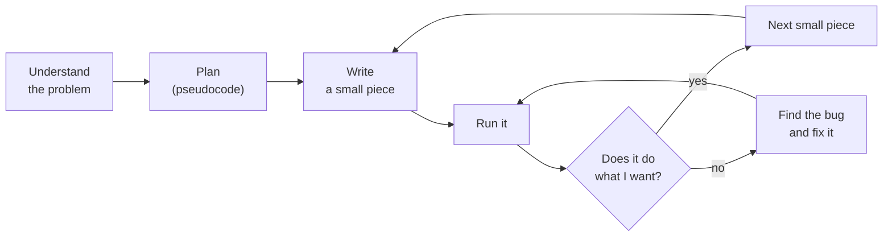

<!-- nav:top -->
[🏠 Start](../START-HERE.md) · [← 00.1 How to use this course](01-how-to-use-this-course.md) · [📋 Phase 00](README.md) · [00.3 How a computer runs a program →](03-how-a-computer-runs-a-program.md) · [📖 Glossary](../GLOSSARY.md) · [🇷🇺 Русский](../../ru/00-getting-started/02-what-is-programming.md) <!-- nav -->

# Lesson 00.2 — What programming is

> **Phase 00 — Getting started** · Lesson 2 of 8 · ⏱ about 105 minutes

## What you will learn

- What a program is, and why a computer needs instructions that are exact.
- What an algorithm is, and how to describe one in plain words (pseudocode).
- The six building blocks that every program is made from.
- The everyday loop of a programmer: plan, write, run, test, fix.
- What kinds of bugs exist, and which tools a programmer uses (including version control).

## Before you start

- You finished [Lesson 00.1 — How to use this course](01-how-to-use-this-course.md).
- You do not need to install anything. This lesson uses only words and a few tiny pieces of Rust code that you only *read*.

## New words

| Word | Meaning |
|---|---|
| **program** | A list of instructions that tells a computer what to do. |
| **instruction** | One small, exact step, for example "add these two numbers". |
| **algorithm** | A finite list of steps that solves a problem. A recipe is an algorithm for food. |
| **pseudocode** | An algorithm written in plain words, in an organised way, without the strict rules of a real programming language. |
| **source code** | The text of a program, written by a person in a programming language. |
| **programming language** | A strict, small language in which people write programs. Rust is one. |
| **input / output** | Input is the data a program receives (a key press, a file). Output is what it produces (text on the screen, a file). |
| **variable** | A named place that holds a value, such as `width` holding the number 5. Lesson 02.1 teaches it. |
| **condition** | A yes/no question inside a program: "is the age below 18?". |
| **loop** | A way to repeat steps many times. |
| **function** | A named group of steps that you can reuse. |
| **bug** | A mistake in a program that makes it do something other than what you wanted. |
| **debugging** | Finding and fixing bugs. |
| **compiler** | A program that translates source code into instructions the computer can run. Lesson 00.3 explains this. |
| **editor** | A program for writing and changing text files. An **IDE** (Integrated Development Environment) is an editor with many extra helpers. |
| **version control** | A tool that records every version of your files, so you can see the history and undo mistakes. Phase 01 teaches it. |

## 1. A program is a list of instructions

Imagine that you give a very strict helper a piece of paper with a recipe. The helper:

- does exactly what is written, in the written order;
- never guesses what you "probably meant";
- never gets tired and works incredibly fast;
- does not know anything that is not on the paper.

This helper is a computer. The paper is a **program**.

Because the helper cannot guess, a human instruction such as "make me a sandwich" is not enough.
What kind of bread? How many slices? Where is the knife? When do I stop? A computer needs every one
of these answers written down. Compare:

| Human version | Computer version |
|---|---|
| Make me a sandwich. | 1. Take 2 slices of bread from the bag. 2. Put them on the plate. 3. Open the butter. 4. Spread butter on one slice with the knife. 5. Put 2 slices of cheese on the buttered slice. 6. Put the second slice on top. 7. Stop. |

Even this list is not complete (what if the bag is empty?), and finding what is missing is a big
part of programming.

> 💡 **Tip:** When you are learning, speak like the strict helper. Ask yourself "what exactly happens,
> step by step, if I read this line literally?"

## 2. Algorithms and pseudocode

An **algorithm** is a finite list of steps that solves a problem. "Finite" means it ends. Before
we write real code, we often write the algorithm in plain words. This is called **pseudocode**
("pseudo" means "not real"). There is no official format; the goal is a clear plan that a person can follow.

Problem: *find the largest number in a list*.

```pseudocode
Take the first number of the list. Call it "best".
For each of the other numbers in the list:
    If the number is bigger than "best":
        Make "best" equal to this number.
When there are no more numbers, the answer is "best".
```

What happens when we follow it with the list `4, 17, 9, 2`? We keep a **trace**: a table that shows the
value of each name after each step. Tracing by hand is one of the most useful skills in programming.

| Step | Number we look at | Is it bigger than "best"? | "best" after the step |
|---|---|---|---|
| start | (first number) 4 | — | 4 |
| 1 | 17 | yes (17 > 4) | 17 |
| 2 | 9 | no (9 < 17) | 17 |
| 3 | 2 | no (2 < 17) | 17 |

The answer is 17. Notice that the algorithm did not need to know *which* numbers are in the list; it works
for any list. This is the power of an algorithm: the same steps solve a whole family of problems.

## 3. Source code and programming languages

Pseudocode is for people. A computer needs the plan written in a **programming language**, which has
strict rules about spelling, symbols and order. The text you write is called **source code**.
Here is a small program in Rust. Do not try to understand every word yet; you will learn them in
Phase 02. Just read it like a story:

```rust
fn main() {
    let width = 5;
    let height = 3;
    println!("The area is {}", width * height);
}
```

What happens:

1. `fn main() {` — "here starts the main part of the program". Every Rust program starts running from `main`.
2. `let width = 5;` — create a **variable** (a named box) called `width` and put the number 5 into it.
3. `let height = 3;` — the same for `height` with the number 3.
4. `println!(...)` — print a line of text on the screen. The `{}` inside the quotes is a hole; the value after the comma (`width * height`, which is 5 times 3) fills it.
5. `}` — here the main part ends, so the program ends.

Output (this is the real output of this program):

```text
The area is 15
```

The computer does **exactly what the code says, not what you meant**. Change one symbol, `*` to `+`:

```rust
fn main() {
    let width = 5;
    let height = 3;
    println!("The area is {}", width + height);
}
```

Output:

```text
The area is 8
```

Nothing complained. The program is valid, it just does not compute an area any more. The computer
cannot know that you wanted the area. Mistakes like this one are the hardest to find, and
we call them *logic bugs* (more on this in section 5).

> ⚠️ **Common mistake:** Believing "the computer will understand what I meant". It never does. Say
> exactly what you mean.

## 4. The six building blocks

Almost every program you will ever write is made from the same small set of ideas. Learn
to recognise them, and big programs stop looking scary.

| Block | Everyday example | In a program | Taught in |
|---|---|---|---|
| **Input** | Someone tells you their age. | Read a number typed on the keyboard, or from a file. | Lesson 02.7 |
| **Output** | You say the result aloud. | Print text on the screen, write a file. | Lesson 00.6 and 02.6 |
| **Storing** | You remember the age. | A variable holds a value. | Lesson 02.1 |
| **Decisions** | If the age is under 18, say "too young". | A condition (`if`). | Lesson 02.5 |
| **Repetition** | Ask again until the answer is a number. | A loop. | Lesson 02.5 |
| **Reuse** | "Do the tea routine" as one phrase. | A function. | Lesson 02.4 |

Here is a program in pseudocode that uses all six:

```pseudocode
Ask the user for their age.                      (input)
Store the answer in "age".                       (storing)
Repeat while the answer is not a number:         (repetition)
    Tell the user to type a number.              (output)
    Ask again.                                   (input)
If age is below 18:                              (decision)
    Show "Too young".                            (output)
Otherwise:
    Show "Welcome".                              (output)
```

Reuse (functions) would appear if we put the "ask for a number" steps in a named group and used it in
many places.

## 5. The programmer's loop, and bugs

Nobody writes a correct program in one go. Professionals work in a small loop all day:



The key habit is **small steps**. Write 5 lines, run, check. If you write 200 lines and then run
them for the first time, you will have 20 mistakes at once and no idea which is which.

There are three kinds of bugs. You will meet all three in Lesson 00.7.

| Kind | When it shows up | Example |
|---|---|---|
| **Compile-time error** | You try to build the program. The compiler refuses and explains. | A missing semicolon, a misspelled name. |
| **Run-time error** | The program starts and then stops with an error message (a "crash" or *panic*). | The program tries to read something that does not exist. |
| **Logic bug** | The program runs happily and gives a wrong result. | `+` instead of `*` in the area example. |

Compile-time errors are the friendliest: Rust finds them *before* the program runs and
tells you exactly where they are. Much of the power of Rust is that it turns many run-time
errors and logic bugs into compile-time errors.

## 6. What a programmer uses

A programmer's desk has more than one tool. You will meet all of these in the next lessons:

- **A terminal** — a window where you type commands (Lesson 00.4).
- **An editor or IDE** — where you write source code. We use RustRover (Lesson 00.5).
- **A compiler and a build tool** — `rustc` and Cargo translate and run your program (Lessons 00.5 and 00.6).
- **Version control** — Git records the history of your files (Phase 01).
- **Documentation** — official descriptions of the language and its library (Lesson 00.7).
- **Tests** — small programs that check the main program (Phase 02).

A word about version control, because beginners often skip it: imagine that you changed your
program for two hours, and now it is broken, and you cannot remember what it looked like
before. With version control you save a named snapshot ("commit") at every good moment. Then you can
always go back to the last working snapshot, compare two versions line by line, and see
*when* a bug appeared. It also lets many people work on one project without overwriting each other. That is why the
course teaches it first.

## 7. What kind of programmer you are becoming

Many programs can be written in any language. A **systems engineer** works on the ones where
the *machine* matters: how much memory is used, how many requests per second a server survives,
what happens when a disk is full or a network cable is pulled out. Examples of such software: a
database, a web server, the part of a browser that draws pages, a program that copies files, parts of an operating
system.

For this reason the course teaches you two things together: **the language** (Rust) and **the
machine** (how a computer really works). The next lesson starts with the machine.

## Common mistakes

1. **Writing code before thinking.** You type for an hour and have a mess. *Fix:* write 3–5 lines of
   pseudocode first. If you cannot explain the steps in words, you cannot write them in code.
2. **Trying to learn the whole language first.** Nobody remembers 300 rules. *Fix:* learn one idea,
   use it in a small program, then move on.
3. **Writing a lot of code before the first run.** *Fix:* run after every few lines.
4. **Copying code you do not understand.** It works once and then you cannot change it. *Fix:* after
   copying any line, explain it aloud, line by line.
5. **Comparing yourself with experienced programmers.** They have seen the same errors 10,000 times.
   *Fix:* compare yourself with yourself last week.

## Try it yourself

This exercise needs only paper and a friend, or two roles played by you.

1. Choose a tiny task, for example "make a cup of tea".
2. Write the instructions as numbered steps. Do not look at the kitchen while you write.
3. Now be the strict helper. Go to the kitchen and follow **only what is written, literally**. If the
   step says "pour water" and does not say "into the kettle", pour it on the table (in your mind!).
4. Every time the instructions fail, fix them. Count how many versions you needed.
5. Keep your final version. You just practised debugging.

## Exercises

### Exercise 1 — Name the block (easy)

For each sentence, say which building block it is: input, output, storing, decision or repetition.

1. "Read a number from the keyboard."
2. "Remember the result in the name `total`."
3. "If the number is negative, stop."
4. "Do the next three steps ten times."
5. "Show the word `Done` on the screen."

<details>
<summary>Hint</summary>

Ask: does it bring data in (input), send data out (output), keep data (storing), choose between ways (decision) or do something again (repetition)?

</details>

<details>
<summary>Answer</summary>

1. Input.
2. Storing.
3. Decision (a condition, "if").
4. Repetition (a loop).
5. Output.

Why it works: each sentence has one main verb that matches one block: read = input, remember = storing, if = decision, "do it N times" = repetition, show = output.

</details>

### Exercise 2 — Count the even numbers (medium)

Write pseudocode that counts how many numbers in a list are even (can be divided by 2 without a
remainder). Trace it with the list `3, 8, 5, 10, 12`.

<details>
<summary>Hint</summary>

You need a counter that starts at 0. Look at each number; if it is even, add 1 to the counter.

</details>

<details>
<summary>Answer</summary>

```pseudocode
Set "count" to 0.
For each number in the list:
    If the number divided by 2 has remainder 0:
        Add 1 to "count".
The answer is "count".
```

Trace for `3, 8, 5, 10, 12`:

| Number | Even? | count after |
|---|---|---|
| (start) | — | 0 |
| 3 | no | 0 |
| 8 | yes | 1 |
| 5 | no | 1 |
| 10 | yes | 2 |
| 12 | yes | 3 |

The answer is 3.

Why it works: the counter stores progress between the steps, the condition chooses which numbers
count, and the repetition visits every number once.

</details>

### Exercise 3 — Find the bug (medium)

This pseudocode should add up all numbers of a list. For the list `2, 4, 6` it gives 6 instead of
12. Find the bug and fix it.

```pseudocode
Set "total" to 0.
For each number in the list:
    Set "total" to the number.
The answer is "total".
```

<details>
<summary>Hint</summary>

Trace it by hand. What is "total" after each number?

</details>

<details>
<summary>Answer</summary>

Trace of the buggy version: after 2 → total is 2; after 4 → total is 4; after 6 → total is 6. Each step *replaces* the total instead of adding to it, so only the last number survives.

Fixed version:

```pseudocode
Set "total" to 0.
For each number in the list:
    Set "total" to "total" plus the number.
The answer is "total".
```

New trace: 0 → 2 → 6 → 12. The answer is 12.

Why it works: the new value of `total` is calculated from the old value of `total`. This is the same pattern as the counter in the previous exercise. It is a logic bug: nothing "crashes", only the result is wrong, which is why tracing is so valuable.

</details>

### Exercise 4 — A guessing game in pseudocode (hard)

Write pseudocode for a game. The computer secretly picks a number from 1 to 100. The player guesses.
After each guess the program says "higher" or "lower" or "correct". At the end it tells how many guesses
were used. Mark which lines are input, output, storing, decision and repetition.

<details>
<summary>Hint</summary>

You need two stored values: the secret number and the number of guesses. The repetition ends when the
guess is correct.

</details>

<details>
<summary>Answer</summary>

```pseudocode
Pick a secret number from 1 to 100.              (storing)
Set "guesses" to 0.                              (storing)
Repeat:                                          (repetition)
    Ask the player for a number.                 (input)
    Add 1 to "guesses".                          (storing)
    If the guess is below the secret:            (decision)
        Show "higher".                           (output)
    Otherwise, if the guess is above the secret: (decision)
        Show "lower".                            (output)
    Otherwise:
        Show "correct".                          (output)
        Stop repeating.
Show "You needed" and the value of "guesses".   (output)
```

Why it works: it uses all building blocks. You will write exactly this program in Rust in
Lesson 02.10, the guessing game project.

</details>

## Quiz

1. Why can't you tell a computer "make it nicer"?

<details>
<summary>Answer</summary>

A computer does exactly what the instructions say and cannot guess what you meant. "Nicer" is not an exact instruction.

</details>

2. What is the difference between an algorithm and pseudocode?

<details>
<summary>Answer</summary>

An algorithm is the idea: a finite list of steps that solves a problem. Pseudocode is one way to write that idea down in plain words, without the strict rules of a real language.

</details>

3. Name the six building blocks of a program.

<details>
<summary>Answer</summary>

Input, output, storing (variables), decisions (conditions), repetition (loops) and reuse (functions).

</details>

4. What is the difference between a compile-time error and a logic bug?

<details>
<summary>Answer</summary>

A compile-time error stops the build: the compiler refuses the program and explains where. A logic bug lets the program run, but it produces a wrong result, so it is much harder to notice.

</details>

5. Why do we write and run code in small steps?

<details>
<summary>Answer</summary>

Because with a few new lines a mistake is easy to locate. With hundreds of untested lines there are many mistakes at once and it is unclear which line caused which problem.

</details>

6. Give two reasons to use version control.

<details>
<summary>Answer</summary>

Any two of: return to an earlier working version; see what changed and when a bug appeared; keep a history without copying files by hand; let several people work on the same project.

</details>

## Summary

- A program is a list of exact instructions; the computer follows it literally and cannot guess.
- An algorithm is a finite list of steps that solves a problem; pseudocode writes it in plain words.
- Tracing by hand (a table of values after each step) is the best way to understand and debug an algorithm.
- Programs are made from six blocks: input, output, storing, decisions, repetition, reuse.
- The programmer's loop is small steps: plan, write, run, check, fix.
- Bugs are compile-time errors, run-time errors and logic bugs. The last kind is the hardest.
- A systems engineer cares about the machine: memory, speed and reliability.
- Version control saves the history of your files; the course teaches it first.

## Sources and further reading

- [The Rust Programming Language — Chapter 1: Getting Started](https://doc.rust-lang.org/book/ch01-00-getting-started.html) — the official book's start; you will use it in Lessons 00.5 and 00.6.
- [The Rust Programming Language — Chapter 3: Common Programming Concepts](https://doc.rust-lang.org/book/ch03-00-common-programming-concepts.html) — variables, types, functions, control flow; the topics of Phase 02.
- [CS50: Introduction to Computer Science](https://cs50.harvard.edu/x/) — a free university course with a very gentle start; a good second view on what programming is.
- [Pro Git — About Version Control](https://git-scm.com/book/en/v2/Getting-Started-About-Version-Control) — the official Git book's short explanation of why version control exists.

---

[🏠 Start](../START-HERE.md) · [← 00.1 How to use this course](01-how-to-use-this-course.md) · [📋 Phase 00](README.md) · [00.3 How a computer runs a program →](03-how-a-computer-runs-a-program.md) · [📖 Glossary](../GLOSSARY.md) <!-- nav -->
<!-- nav:bottom -->
