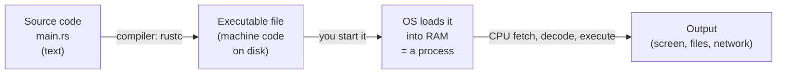

<!-- nav:top -->
[🏠 Start](../START-HERE.md) · [← 00.2 What programming is](02-what-is-programming.md) · [📋 Phase 00](README.md) · [00.4 The terminal: your first commands →](04-terminal-basics.md) · [📖 Glossary](../GLOSSARY.md) · [🇷🇺 Русский](../../ru/00-getting-started/03-how-a-computer-runs-a-program.md) <!-- nav -->

# Lesson 00.3 — How a computer runs a program

> **Phase 00 — Getting started** · Lesson 3 of 8 · ⏱ about 120 minutes

## What you will learn

- The main parts of a computer (processor, memory, storage) and what each is for.
- How information is stored as bits and bytes, and how to read binary numbers.
- How the processor runs instructions one by one, with a tiny toy computer you can follow by hand.
- What machine code is, and how source code becomes machine code through a compiler.
- What happens, step by step, between "I start a program" and "the program prints something".

## Before you start

- You finished [Lesson 00.2 — What programming is](02-what-is-programming.md).
- This lesson has a few "look, don't run" demos. They show real output that I produced on an Apple M4 Mac. You do **not** type them yet: you will learn the terminal in [Lesson 00.4](04-terminal-basics.md) and install Rust in [Lesson 00.5](05-install-rust-and-rustrover.md). You can come back and repeat them afterwards.

## New words

| Word | Meaning |
|---|---|
| **CPU** (Central Processing Unit) | The chip that runs the instructions of programs. Also called the *processor*. |
| **RAM** (Random Access Memory) | Fast working memory. Programs and their data live here while they run. It is emptied when the power goes off. |
| **storage** | Memory that keeps data when the power is off, for example an **SSD** (Solid-State Drive). Files live here. |
| **bit** | The smallest piece of information: 0 or 1. |
| **byte** | A group of 8 bits. It can hold one of 256 different values (0 to 255). |
| **binary** | Counting with only two digits, 0 and 1. |
| **hexadecimal (hex)** | Counting with 16 digits: 0–9 and then a–f. Two hex digits describe exactly one byte. Numbers in hex start with `0x`. |
| **instruction** | One tiny command for the CPU, such as "add two numbers". |
| **register** | A very small, very fast storage place inside the CPU. |
| **memory address** | The number of a byte in RAM, like a house number on a street. |
| **machine code** | The instructions of a program as numbers, in the exact form the CPU understands. |
| **assembly language** | Machine code written in readable short words, such as `add` and `ret`. |
| **architecture** (instruction set) | The "language" a family of CPUs understands. Your Mac's M4 chip uses **arm64** (also called AArch64). Many other computers use **x86-64**. |
| **compiler** | A program that translates source code into machine code. Rust's compiler is called `rustc`. |
| **executable** | A file that contains a ready-to-run program in machine code. |
| **OS** (Operating System) | The main program (here macOS) that starts other programs and gives them memory, files and the screen. |
| **process** | A program that is currently running. One program can run as several processes. |
| **I/O** (Input/Output) | Everything that moves data into or out of the computer: keyboard, screen, disk, network. |
| **PC** (Personal Computer) | An ordinary desktop or laptop computer, for example a Windows PC. |

## 1. The main parts of a computer

Think of a kitchen:

- The **CPU** is the cook. It does the actual work, one small step after another, extremely fast.
- **RAM** is the work table. Things you are using right now lie on it, within reach. When you leave the kitchen for the night, the table is cleared.
- **Storage** (the SSD) is the pantry. It holds everything for a long time, but fetching from it is slow compared to the table.
- **I/O devices** (keyboard, screen, network) are the doors and windows: orders come in, dishes go out.

```text
        +-------------+         +-------------+         +----------------+
        |     CPU     | <-----> |     RAM     | <-----> |  Storage (SSD) |
        |   (cook)    |  fast   | (work table)|  slower |    (pantry)    |
        +------+------+         +-------------+         +----------------+
               |
               |   keyboard, screen, network ... (I/O)
               v
```

Rough speeds (they vary between computers, but the *ratios* are important):

| Action | Rough time | If one CPU step were 1 second |
|---|---|---|
| One CPU step | about 1 nanosecond (a billionth of a second) | 1 second |
| Reading one value from RAM | about 100 nanoseconds | about 2 minutes |
| Reading one value from an SSD | about 100 000 nanoseconds (100 microseconds) | more than a day |

> ⚡ **Performance:** This table is why systems engineers care about *where* data lives. A program
> that keeps asking RAM or the disk for data spends most of its time waiting. You will measure this in
> later phases (Phase 12 and Phase 19). For now, remember: **CPU is fast, RAM is slower, disk is much slower.**

You can see your own numbers: click the Apple menu in the top-left corner, choose **About This
Mac**. You will see the chip (for example "Apple M4") and the amount of memory (RAM).

## 2. Bits, bytes and binary

Everything in a computer is stored as numbers, and every number is stored using **bits**. A bit is
like a light switch: off is 0, on is 1.

A **byte** is 8 switches in a row. With 8 switches you can make 2 × 2 × 2 × 2 × 2 × 2 × 2 × 2 = 256
different patterns, that is, the numbers from 0 to 255.

### Reading binary

In the decimal system we use ten digits, and each place is worth 10 times the place to its right
(ones, tens, hundreds). In **binary** there are two digits, and each place is worth **2 times** the place to
its right: 1, 2, 4, 8, 16, 32, 64, 128.

```text
Place value:    128   64   32   16    8    4    2    1
Bits:             0    0    0    0    1    1    0    1
                                      8  + 4       + 1  = 13
```

So the binary number `00001101` is 13. To read a binary number, add up the place values where there is a 1.

| Decimal | Binary (8 bits) |
|---|---|
| 0 | 00000000 |
| 1 | 00000001 |
| 2 | 00000010 |
| 3 | 00000011 |
| 4 | 00000100 |
| 5 | 00000101 |
| 8 | 00001000 |
| 13 | 00001101 |
| 200 | 11001000 |
| 255 | 11111111 |

To write a decimal number in binary, take the biggest place value that fits, write 1, subtract it, and
continue. For 37: 32 fits (37 − 32 = 5), 16 does not, 8 does not, 4 fits (5 − 4 = 1), 2 does not, 1 fits.
The bits are `00100101`.

### Text, pictures and everything else are numbers too

How do we store the letter `A`? By agreement: the number 65 stands for `A`, 66 for `B`, and so on. This
agreement is a table called **ASCII** (American Standard Code for Information Interchange) for English
letters; a larger table, **Unicode**, covers all the languages of the world, and the **UTF-8**
(Unicode Transformation Format, 8-bit) encoding stores Unicode as bytes. A colour is three numbers
(red, green, blue). A song is a long list of numbers. A program is a list of numbers too, as we will see.

*Look, don't run.* There is a small tool called `xxd` that shows the bytes of any data. Here it shows the bytes of the two letters `Hi`. You will learn how to run commands in Lesson 00.4. The output is real:

```text
00000000: 4869                                     Hi
```

The number after the colon, `4869`, is the two bytes written in **hexadecimal**. Hex is a shorter way to
write binary: one hex digit stands for 4 bits, so two hex digits are exactly one byte. `48` hex = 72 =
the letter `H`, and `69` hex = 105 = the letter `i`. In binary, `H` is `01001000` and `i` is `01101001`.

> 💡 **Tip:** You do not need to convert big numbers by hand. You need to understand that "a byte holds
> 0–255" and "everything is numbers". Later, when you meet types like `u8` (a number from 0 to 255) in
> Lesson 02.2, this will make sense at once.

Sizes you will see often: 1 **KB** (kilobyte) is about a thousand bytes, 1 **MB** (megabyte) about a
million, 1 **GB** (gigabyte) about a billion. (Exact counting with powers of 2 exists too; Phase 12 explains it.)

## 3. How the CPU runs instructions

The CPU does one very simple thing, over and over, billions of times per second:

1. **Fetch** — read the next instruction from RAM.
2. **Decode** — find out what it means.
3. **Execute** — do it (for example, add two numbers).
4. Move to the next instruction and go to step 1.

The CPU has a few very fast places to store numbers inside itself, called **registers**. It also has
one special register that remembers *which instruction comes next*. It is called the **program counter**.

RAM is a long row of bytes. Each byte has a number, its **memory address**: byte 0, byte 1, byte 2 ...

Let us build a **toy computer** to make this concrete. It is invented, but real CPUs work on
the same principle. It has two registers, `A` and `B`, and these instructions:

| Instruction | Meaning |
|---|---|
| `LOAD A, 7` | put the number 7 into register A |
| `ADD A, B` | A becomes A + B |
| `STORE A, 100` | write the value of A into memory cell number 100 |
| `HALT` | stop |

A program for the toy computer:

```text
line 1:  LOAD A, 7
line 2:  LOAD B, 5
line 3:  ADD A, B
line 4:  STORE A, 100
line 5:  HALT
```

What happens, step by step (this table is the "trace" you learned in Lesson 00.2):

| Step | Program counter | Instruction | A | B | Memory cell 100 |
|---|---|---|---|---|---|
| start | 1 | — | 0 | 0 | 0 |
| 1 | 1 → 2 | `LOAD A, 7` | 7 | 0 | 0 |
| 2 | 2 → 3 | `LOAD B, 5` | 7 | 5 | 0 |
| 3 | 3 → 4 | `ADD A, B` | 12 | 5 | 0 |
| 4 | 4 → 5 | `STORE A, 100` | 12 | 5 | 12 |
| 5 | 5 | `HALT` | 12 | 5 | 12 |

The result 12 was computed in a register and then saved into memory. A real program is the same
thing, only with millions of lines, and the CPU does each line in a fraction of a nanosecond.

Where do loops and decisions come from? From *jump* instructions: "set the program counter to line
4 if this value is not zero". You will use one in Exercise 6.

## 4. Machine code: what the CPU really reads

A real CPU does not read words like `LOAD`. It reads numbers. Each instruction is encoded as a
number of bits. This is **machine code**. For people, there is a readable form of it called
**assembly language**.

Here is a real example. This tiny Rust function adds two numbers (do not worry about the syntax,
you will learn it in Lesson 02.4). The first line and the words `pub extern "C"` are special settings that only make sure the function keeps a readable name in the output; ignore them.

```rust
#[unsafe(no_mangle)]
pub extern "C" fn add(a: i32, b: i32) -> i32 {
    a + b
}
```

I compiled it for the Apple M4 (arm64), asking the compiler to optimise. The compiler produced this assembly:

```text
_add:
	add	w0, w1, w0
	ret
```

What happens:

1. `_add:` is a label: the name of this piece of code.
2. `add w0, w1, w0` — add the numbers in registers `w1` and `w0` and put the result in `w0`. (By the rules of this CPU, the two arguments arrive in `w0` and `w1`, and the answer is returned in `w0`.)
3. `ret` — return to the code that called the function.

And this is the machine code of those two instructions, as the CPU sees it. Each instruction is 32 bits
(4 bytes) long:

```text
0b000020 d65f03c0
```

`0b000020` in hex is the binary number `00001011000000000000000000100000`. These 32 bits *are* the
instruction `add w0, w1, w0`. And `d65f03c0` is `ret`. When the compiler writes the program file, it
puts exactly these bytes into the file (`20 00 00 0b c0 03 5f d6`; the order of bytes inside a number is a
detail that Phase 12 explains).

The same function without optimisation is many more lines of assembly, because in the default
"debug" mode Rust adds a check that stops the program if the sum is too big for the number type. You will
see this in Lesson 02.2. The key point: **the compiler decides what machine code is produced.**

### Different CPUs, different machine code

Machine code depends on the CPU family. Your Mac's M4 chip uses the **arm64** instruction set.
Older Macs and most Windows and Linux PCs use **x86-64**. The bytes for "add two numbers" are different on
each, so a program built for arm64 cannot run on an x86-64 CPU. The compiler is told which
**target** (CPU family + operating system) to build for. On your Mac, Rust's default target is called
`aarch64-apple-darwin` (aarch64 = arm64, darwin = the core of macOS). You will see this name in Lesson 00.5.

## 5. From source code to a running program

Humans write source code; CPUs need machine code. The translator is the **compiler**.



Rust is a **compiled** language: the translation into machine code happens *once, before* the
program runs. After that, the CPU runs your machine code directly, with nothing in between, and that is
one reason Rust programs are fast. (Some other languages are translated line by line while the
program runs, by a helper program called an *interpreter*. That is usually slower to run, but it does
not need the separate translation step.)

*Look, don't run.* Here is a real small Rust program and what the file looks like after compiling:

```rust
fn main() {
    println!("Hello, world!");
}
```

I compiled this with `rustc hello.rs` and asked three questions about the result.

1. Run it:

```text
Hello, world!
```

2. What kind of file is it? The tool `file` looks inside a file and tells its type:

```text
hello: Mach-O 64-bit executable arm64
```

**Mach-O** is the format of executable files on macOS, and "arm64" is the CPU family. The file is
472 296 bytes, which is quite big for a one-line program because it also contains parts of Rust's
standard library that print text.

3. What are the first bytes of the file? (`xxd` again shows them.)

```text
00000000: cffa edfe 0c00 0001 0000 0000 0200 0000  ................
00000010: 1100 0000 3808 0000 8500 a000 0000 0000  ....8...........
```

The first four bytes, `cf fa ed fe`, are a "magic number": a fixed signature that tells the OS, "this
is a 64-bit Mach-O file". After the header come the machine code and the data. This is what a
"program" really is: a file with a header, numbers for the CPU, and data.

## 6. What the operating system does

When you start the file, you do not talk to the CPU. You talk to the **operating system** (macOS).
It does these things:

1. **Reads** the executable file from the storage.
2. **Copies** the needed parts into RAM and creates a **process**, a running instance of the program with its own protected part of memory.
3. **Points** the program counter at the first instruction of your program and lets the CPU go.
4. **Shares** the CPU between all processes: dozens or hundreds run at the same time, and the OS switches between them so fast that it looks simultaneous.
5. **Handles** I/O for the program. A program cannot touch the screen or the disk directly. Instead it asks the OS ("please print this text", "please open this file"). Such a request is called a **system call**; Phase 13 teaches this in depth.
6. **Cleans up** when the program ends: it takes back the memory and closes the files.

You can see your processes: open **Activity Monitor** (press `Cmd + Space`, type "Activity Monitor",
press Enter). The **CPU** tab shows how much of the processor each process uses; the **Memory** tab shows RAM.

### What is inside a process

The memory of a running program is divided into regions. Two of them are very important for Rust,
and Phase 03 will teach them in detail:

```text
 high addresses
 +----------------------+
 |        stack         |  fast, small, automatic: local values of functions
 +----------------------+
 |          ...         |
 +----------------------+
 |         heap         |  flexible, bigger: data whose size grows while running
 +----------------------+
 |  data and constants  |
 +----------------------+
 |    machine code      |  your instructions
 +----------------------+
 low addresses
```

You do not need to remember this now. You only need to know that "a running program" is *code +
memory*, and that Rust gives you a lot of control over how that memory is used.

## Common mistakes

1. **Mixing up RAM and storage.** "I saved the file, so it is in RAM" is wrong. The file is on the SSD. RAM holds the *copy* a program is currently working with. *Fix:* RAM = temporary work table, SSD = long-term pantry.
2. **Thinking the compiler runs the program.** The compiler only translates. Running is a separate step: the OS starts the executable. (In Lesson 00.6, `cargo run` does both steps for you, one after another.)
3. **Thinking "program" = "process".** A program is a file on disk. A process is that program alive in memory. You can start the same program three times and get three processes.
4. **Thinking binary is magic.** It is just counting with two digits. If you can add place values (1, 2, 4, 8 ...), you can read it.
5. **Thinking a program built on one computer works everywhere.** The machine code is built for one target. Your M4 build will not run on an x86-64 PC.

## Try it yourself

This is a no-terminal exercise.

1. Click the Apple menu and choose **About This Mac**. Write down the chip name and the RAM size.
2. Open **Activity Monitor**. In the **CPU** tab click the "% CPU" column to sort. Which process uses the most processor right now? Open the **Memory** tab and find the process that uses the most memory.
3. On paper, convert these decimal numbers to binary: 6, 19 and 100. Check with the place-value table. (Answers: `00000110`, `00010011`, `01100100`.)
4. Write in your own words, in 4–5 lines, what happens between double-clicking a program and seeing its window.

## Exercises

### Exercise 1 — Read binary (easy)

Convert to decimal: `1010`, `101101`, `11111111`.

<details>
<summary>Hint</summary>

Write the place values 1, 2, 4, 8, 16, 32, 64, 128 from right to left under the bits, and add the ones where the bit is 1.

</details>

<details>
<summary>Answer</summary>

- `1010` = 8 + 2 = **10**
- `101101` = 32 + 8 + 4 + 1 = **45**
- `11111111` = 128 + 64 + 32 + 16 + 8 + 4 + 2 + 1 = **255**

Why it works: each bit means "include this place value or not", and the sum of the included values is the number. `11111111` is the biggest value that fits into one byte.

</details>

### Exercise 2 — Write binary (easy)

Write 13 and 37 in binary using 8 bits.

<details>
<summary>Hint</summary>

Use the method from section 2: take the biggest place value that fits, write 1, subtract, continue.

</details>

<details>
<summary>Answer</summary>

- 13 = 8 + 4 + 1 → `00001101`
- 37 = 32 + 4 + 1 → `00100101`

Why it works: you choose which place values add up to the number; the chosen places get a 1, all others a 0.

</details>

### Exercise 3 — Which part is it? (easy)

For each statement, say CPU, RAM or storage.

1. It keeps your photos after the computer is switched off.
2. It runs the instructions of programs.
3. The running program and its data are held here, close to the CPU.
4. It is the slowest of the three, but the biggest and cheapest per byte.

<details>
<summary>Hint</summary>

Use the kitchen picture: cook, work table, pantry.

</details>

<details>
<summary>Answer</summary>

1. Storage (SSD).
2. CPU.
3. RAM.
4. Storage.

Why it works: only storage keeps data without power; only the CPU executes instructions; RAM is the fast working space.

</details>

### Exercise 4 — Trace the toy computer (medium)

Trace this program on the toy computer from section 3 (there is a new instruction `SUB A, B`, which
means A becomes A − B). What are A, B and memory cell 50 at the end?

```text
line 1:  LOAD A, 20
line 2:  LOAD B, 6
line 3:  SUB A, B
line 4:  STORE A, 50
line 5:  HALT
```

<details>
<summary>Hint</summary>

Make a table like the one in section 3, with one row per instruction.

</details>

<details>
<summary>Answer</summary>

| Step | Instruction | A | B | Memory cell 50 |
|---|---|---|---|---|
| start | — | 0 | 0 | 0 |
| 1 | `LOAD A, 20` | 20 | 0 | 0 |
| 2 | `LOAD B, 6` | 20 | 6 | 0 |
| 3 | `SUB A, B` | 14 | 6 | 0 |
| 4 | `STORE A, 50` | 14 | 6 | 14 |
| 5 | `HALT` | 14 | 6 | 14 |

At the end A = 14, B = 6 and memory cell 50 holds 14.

Why it works: the CPU changes only one thing per instruction, so a row-by-row table always gives the right answer.

</details>

### Exercise 5 — Put the steps in order (medium)

Put these steps in the correct order: (a) the OS creates a process and loads the code into RAM,
(b) you write the source code, (c) the CPU executes the machine code, (d) the compiler creates an executable file,
(e) you start the executable.

<details>
<summary>Hint</summary>

Follow the diagram in section 5 from left to right.

</details>

<details>
<summary>Answer</summary>

(b) → (d) → (e) → (a) → (c).

Why it works: the code must exist before it is compiled; the executable must exist before it can be started; the OS must load it before the CPU can execute it.

</details>

### Exercise 6 — A loop with a jump (hard)

Add two new instructions to the toy computer: `DEC C` (C becomes C − 1) and `JNZ C, 4` (JNZ means
"jump if not zero": if C is not 0, the next instruction is line 4; otherwise continue with the next line). Trace
this program. What does it compute?

```text
line 1:  LOAD A, 0
line 2:  LOAD B, 3
line 3:  LOAD C, 4
line 4:  ADD A, B
line 5:  DEC C
line 6:  JNZ C, 4
line 7:  STORE A, 100
line 8:  HALT
```

<details>
<summary>Hint</summary>

Lines 4–6 repeat. After each pass C is smaller by 1. The loop ends when C reaches 0.

</details>

<details>
<summary>Answer</summary>

| Pass over lines 4–6 | A after `ADD A, B` | C after `DEC C` | `JNZ C, 4` |
|---|---|---|---|
| 1 | 3 | 3 | C is not 0, jump to line 4 |
| 2 | 6 | 2 | jump to line 4 |
| 3 | 9 | 1 | jump to line 4 |
| 4 | 12 | 0 | C is 0, go on to line 7 |

Line 7 stores 12 into cell 100, then `HALT`. The program computes 4 × 3 by adding 3 four times.

Why it works: a jump changes the program counter, so the CPU goes back to earlier instructions. That is
how loops (and `if` decisions) exist at the machine level; the Rust `for` and `while` loops you will
learn in Lesson 02.5 are translated into instructions like these.

</details>

## Quiz

1. What is the difference between RAM and storage?

<details>
<summary>Answer</summary>

RAM is fast working memory for running programs and is cleared when the power goes off. Storage (SSD) is slower but keeps data permanently, for example your files.

</details>

2. How many different values can one byte hold, and which?

<details>
<summary>Answer</summary>

256 values, from 0 to 255 (8 bits, 2⁸).

</details>

3. What are the three basic steps the CPU repeats?

<details>
<summary>Answer</summary>

Fetch the next instruction, decode it, execute it. Then it moves on to the next instruction.

</details>

4. What is machine code, and why can't an arm64 program run on an x86-64 CPU?

<details>
<summary>Answer</summary>

Machine code is the instructions of a program as numbers, in the form the CPU understands. Each CPU family has its own instruction set, so the numbers for the same operation differ between arm64 and x86-64.

</details>

5. What does the compiler do, and when?

<details>
<summary>Answer</summary>

It translates source code into machine code (an executable file). For Rust it does this once, before the program runs.

</details>

6. What is the difference between a program and a process?

<details>
<summary>Answer</summary>

A program is a file on disk with machine code. A process is a running instance of it in RAM, created by the OS. One program can have several processes.

</details>

7. Why does a program ask the OS to print text instead of drawing on the screen itself?

<details>
<summary>Answer</summary>

Programs do not get direct access to hardware. The OS controls the screen, disk and network, shares them between programs and keeps them safe. A program asks through a system call.

</details>

## Summary

- A computer has a CPU (does the work), RAM (fast, temporary memory) and storage (slow, permanent).
- Everything is numbers made of bits; a byte is 8 bits and holds 0–255. Hex is a short way to write bytes.
- The CPU repeats fetch, decode, execute, with the program counter pointing at the next instruction.
- Machine code is the numbers the CPU reads; assembly is the readable form. It depends on the CPU family (arm64 on your Mac).
- A compiler (`rustc`) turns Rust source code into an executable file once, before running.
- The OS loads the executable into RAM as a process, shares the CPU, and handles I/O for it.
- A running program is code plus memory; Rust gives you control over that memory (Phase 03).

## Sources and further reading

- [The Rust Programming Language — Hello, World!](https://doc.rust-lang.org/book/ch01-02-hello-world.html) — the official book explains that compiling and running are two separate steps.
- [The rustc book — What is rustc?](https://doc.rust-lang.org/rustc/what-is-rustc.html) — the official description of the Rust compiler.
- [The rustc book — Platform Support](https://doc.rust-lang.org/rustc/platform-support.html) — the list of targets (CPU + OS combinations) that Rust can build for, including `aarch64-apple-darwin`.
- [The Rust Programming Language — What Is Ownership?](https://doc.rust-lang.org/book/ch04-01-what-is-ownership.html) — explains the stack and the heap; you will study this in Phase 03.
- [Nand to Tetris](https://www.nand2tetris.org/) — a free course in which you build a simple computer from the ground up; excellent if you want to go deeper into this lesson's topic.

---

[🏠 Start](../START-HERE.md) · [← 00.2 What programming is](02-what-is-programming.md) · [📋 Phase 00](README.md) · [00.4 The terminal: your first commands →](04-terminal-basics.md) · [📖 Glossary](../GLOSSARY.md) <!-- nav -->
<!-- nav:bottom -->
