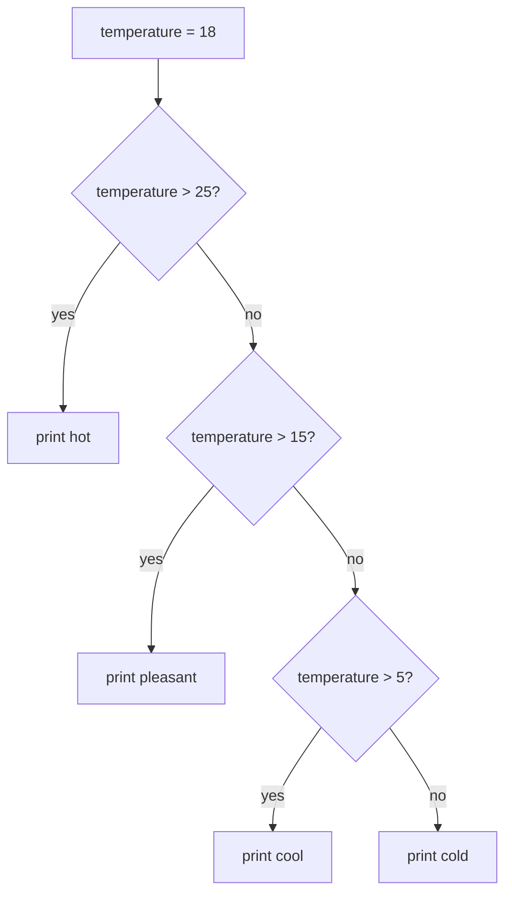

<!-- nav:top -->
[🏠 Start](../START-HERE.md) · [← 02.4 Functions](04-functions.md) · [📋 Phase 02](README.md) · [02.6 Printing, formatting and comments →](06-printing-formatting-and-comments.md) · [📖 Glossary](../GLOSSARY.md) · [🇷🇺 Русский](../../ru/02-programming-basics/05-control-flow.md) <!-- nav -->

# Lesson 02.5 — Control flow: conditions and loops

> **Phase 02 — Programming basics in Rust** · Lesson 5 of 11 · ⏱ about 3 hours (2 sittings)

## What you will learn

- How to make decisions with `if`, `else if` and `else`, and why `if` is an expression.
- How to repeat code with `loop`, `while` and `for`.
- How to stop or skip a repetition with `break` and `continue`, and how to leave nested loops with labels.
- How `match` chooses between many cases (a first look).
- How to pick the right kind of loop, and how to avoid endless loops and off-by-one mistakes.

## Before you start

- You finished [Lesson 02.4 — Functions](04-functions.md).
- You remember that comparisons such as `n % 2 == 0` give a `bool` ([Lesson 02.3](03-operators-and-expressions.md)).

## New words

| Word | Meaning |
|---|---|
| **control flow** | The order in which the lines of a program run. Conditions and loops change it. |
| **condition** | An expression of type `bool` that decides what happens next. |
| **branch** | One of the possible paths of an `if`: the `if` part, an `else if` part, or the `else` part. |
| **loop** | Code that runs again and again. |
| **iteration** | One run of the body of a loop. |
| **infinite loop** | A loop that never ends. Stop it with `Ctrl+C` in the terminal. |
| **range** | A sequence of whole numbers: `1..5` (1, 2, 3, 4) or `1..=5` (1, 2, 3, 4, 5). |
| **iterator** | Something that gives items one at a time. A range is an iterator. Phase 05 explains iterators in depth. |
| **loop label** | A name such as `'outer` written before a loop so that `break` and `continue` can target it. |
| **off-by-one error** | A bug where a loop runs one time too many or too few, or an index is one too big or too small. |
| **pattern** | A shape that a value is compared with, for example `0`, `2 \| 3` or `4..=9`. Phase 04 teaches patterns fully. |
| **match** | An expression that compares a value with several patterns and runs the first one that fits. |
| **exhaustive** | Covering every possible value. The compiler requires `match` to be exhaustive. |
| **DoS** (Denial of Service) | An attack or bug that makes a service unusable, for example by making it loop forever. |

## 1. Making decisions: `if`

Programs must react to data. The keyword `if` runs a block of code only when a **condition** is true.

```rust
fn main() {
    let temperature = 18;

    if temperature > 25 {
        println!("hot");
    } else if temperature > 15 {
        println!("pleasant");
    } else if temperature > 5 {
        println!("cool");
    } else {
        println!("cold");
    }
}
```

What happens:

1. Rust evaluates `temperature > 25`. It is `false` (18 is not bigger than 25), so the first block is skipped.
2. Next, `temperature > 15` is `true`. Its block runs and prints `pleasant`.
3. The rest (`else if temperature > 5` and `else`) is skipped: **only the first branch with a true condition runs**.
4. If none of the conditions were true, the `else` block would run. The `else` part is optional.

```text
pleasant
```



The condition does not need parentheses (`if x > 5`, not `if (x > 5)`), but the curly braces `{ }` are **required**, even for one line.

**The condition must be a `bool`.** Rust does not treat numbers as true/false:

```rust
fn main() {
    let number = 3;
    if number {
        println!("number was three");
    }
}
```

```text
error[E0308]: mismatched types
 --> src/main.rs:3:8
  |
3 |     if number {
  |        ^^^^^^ expected `bool`, found integer
```

Write what you mean: `if number != 0 { … }`.

## 2. `if` is an expression

Because `if` is an expression (Lesson 02.3), it has a value. This lets you choose a value in one line:

```rust
fn main() {
    let n = 7;
    let kind = if n % 2 == 0 { "even" } else { "odd" };
    println!("{n} is {kind}");

    let bigger = if n > 10 { n } else { 10 };
    println!("bigger = {bigger}");
}
```

```text
7 is odd
bigger = 10
```

What happens: each branch is a block whose last expression has **no semicolon**; that is the value of the branch. Then the whole `if` has the value of the branch that ran.

Two rules protect you:

- **All branches must have the same type.** The compiler cannot know the type of `x` otherwise:

```text
error[E0308]: `if` and `else` have incompatible types
 --> src/main.rs:3:35
  |
3 |     let x = if n > 5 { 1 } else { "small" };
  |                        -          ^^^^^^^ expected integer, found `&str`
  |                        |
  |                        expected because of this
```

- **An `if` that is used as a value needs an `else`.** Without it, the missing branch would be `()`:

```text
error[E0317]: `if` may be missing an `else` clause
 --> src/main.rs:3:13
  |
3 |     let x = if n > 5 { 1 };
  |             ^^^^^^^^^^^-^^
  |             |          |
  |             |          found here
  |             expected integer, found `()`
  |
  = note: `if` expressions without `else` evaluate to `()`
```

> 📏 **Convention:** Use `let x = if … else …;` when you only need to choose a value. Use a plain `if` with statements inside when you need to do actions.

## 3. Repeating forever: `loop`

`loop` repeats its block until you leave it with `break`.

```rust
fn main() {
    let mut counter = 0;
    let result = loop {
        counter += 1;
        if counter == 5 {
            break counter * 10;
        }
    };
    println!("result = {result}");
}
```

What happens:

1. `counter` starts at 0. Each **iteration** adds 1.
2. When `counter` becomes 5, `break counter * 10;` leaves the loop **and gives a value**: `50`. A `loop` is an expression, so this value goes into `result`.
3. Without the `break`, the loop would be an **infinite loop**. If you ever make one by mistake, press `Ctrl+C` in the terminal to stop the program.

```text
result = 50
```

`loop` is the right choice when you do not know how many times you will repeat (for example, "ask until the answer is valid" in Lesson 02.7).

## 4. Repeating while a condition holds: `while`

```rust
fn main() {
    let mut n = 3;
    while n > 0 {
        println!("{n}...");
        n -= 1;
    }
    println!("Liftoff!");
}
```

What happens:

1. Before **every** iteration, Rust checks `n > 0`. If it is false, the loop ends.
2. Inside, the program prints `n` and subtracts 1. This step is essential: if you forget `n -= 1;`, the condition stays true forever, and you get an infinite loop.
3. After the loop ends, the program continues with the next line.

```text
3...
2...
1...
Liftoff!
```

If the condition is false at the very start, the body runs zero times.

## 5. Repeating over a sequence: `for`

`for` takes items one by one from a sequence. It is the loop you will use most, because it cannot run past the end by mistake.

```rust
fn main() {
    for i in 1..5 {
        print!("{i} ");
    }
    println!();
    for i in 1..=5 {
        print!("{i} ");
    }
    println!();
    for i in (1..=5).rev() {
        print!("{i} ");
    }
    println!();
    for i in (0..=20).step_by(5) {
        print!("{i} ");
    }
    println!();
}
```

What happens:

1. `1..5` is a **range**: it starts at 1 and stops **before** 5 (1, 2, 3, 4). The first number is included, the last is not. `1..=5` has `=` and **includes** 5.
2. `print!` is like `println!` but does not add a new line, so everything stays on one line. `println!()` with nothing inside prints just a new line. (Lesson 02.6 explains printing.)
3. `.rev()` reverses a range. The parentheses are needed: `(1..=5).rev()`.
4. `.step_by(5)` takes every fifth number.
5. In `for i in …`, a new variable `i` is created for each iteration. You do not need `mut`.

```text
1 2 3 4 
1 2 3 4 5 
5 4 3 2 1 
0 5 10 15 20 
```

You can also loop over an array:

```rust
fn main() {
    let fruits = ["apple", "banana", "cherry"];
    for fruit in fruits {
        println!("I like {fruit}");
    }
    for (index, fruit) in fruits.iter().enumerate() {
        println!("{index}: {fruit}");
    }
}
```

```text
I like apple
I like banana
I like cherry
0: apple
1: banana
2: cherry
```

`fruits.iter()` goes through the items without taking them away (Phase 03 explains why that matters), and `.enumerate()` pairs each item with its index, as a tuple `(index, fruit)`. The `for (index, fruit) in …` line destructures that tuple, as in Lesson 02.2.

> 💡 **Tip:** Prefer `for item in collection` to `for i in 0..collection.len()` with `collection[i]`. It is shorter, there are no index mistakes, and Rust does not have to check each index.

## 6. `break`, `continue` and labels

- `break` leaves the loop at once.
- `continue` skips the rest of this iteration and goes to the next one.
- In nested loops, `break` and `continue` affect only the **inner** loop. A **label** (a name that starts with `'`) lets you target an outer loop.

```rust
fn main() {
    for i in 1..=6 {
        if i % 2 == 0 {
            continue;
        }
        println!("odd: {i}");
    }

    'outer: for a in 1..=5 {
        for b in 1..=5 {
            if a * b == 12 {
                println!("found a = {a}, b = {b}");
                break 'outer;
            }
        }
    }
    println!("done");
}
```

What happens:

1. For even `i`, `continue` jumps to the next number, so only odd numbers are printed.
2. The nested loops try pairs `(a, b)`. The first pair with `a * b == 12` is `(3, 4)`. `break 'outer;` stops **both** loops. A plain `break` would stop only the inner one, and the outer loop would continue with `a = 4`.

```text
odd: 1
odd: 3
odd: 5
found a = 3, b = 4
done
```

## 7. A first look at `match`

When you have many cases, a long `if / else if` chain is hard to read. `match` compares one value with several **patterns** and runs the first one that fits:

```rust
fn main() {
    for n in [0, 1, 3, 7, 100] {
        let word = match n {
            0 => "zero",
            1 => "one",
            2 | 3 => "two or three",
            4..=9 => "a few",
            _ => "many",
        };
        println!("{n}: {word}");
    }
}
```

What happens:

1. `match n { … }` tests `n` against each **arm** from top to bottom. An arm is `pattern => value,`.
2. `2 | 3` means "2 or 3". `4..=9` means "any number from 4 to 9".
3. `_` matches anything. It is the "everything else" arm.
4. `match` is an expression: the value of the arm that fits goes into `word`. All arms must have the same type.

```text
0: zero
1: one
3: two or three
7: a few
100: many
```

The compiler requires `match` to be **exhaustive**: every possible value must be covered. If you forget the `_` arm, you get a precise error:

```text
error[E0004]: non-exhaustive patterns: `i32::MIN..=-1_i32` and `10_i32..=i32::MAX` not covered
 --> src/main.rs:3:22
  |
3 |     let word = match n {
  |                      ^ patterns `i32::MIN..=-1_i32` and `10_i32..=i32::MAX` not covered
  |
  = note: the matched value is of type `i32`
help: ensure that all possible cases are being handled by adding a match arm with a wildcard pattern, ...
```

This is a great safety feature: when you later add a new case to your data, the compiler shows every `match` that needs updating. You can match on a pair, too — the classic FizzBuzz:

```rust
fn main() {
    for n in 1..=15 {
        match (n % 3, n % 5) {
            (0, 0) => println!("FizzBuzz"),
            (0, _) => println!("Fizz"),
            (_, 0) => println!("Buzz"),
            _ => println!("{n}"),
        }
    }
}
```

```text
1
2
Fizz
4
Buzz
Fizz
7
8
Fizz
Buzz
11
Fizz
13
14
FizzBuzz
```

Here the value is a tuple of two remainders, and the patterns are tuples too: `(0, _)` means "the first is 0, the second is anything". Phase 04 (Lessons 4 and 5) teaches `match` and patterns in full, together with enums and `Option`.

## 8. Which loop should I use?

| Situation | Use |
|---|---|
| Go through a range of numbers or the items of an array | `for` |
| Repeat while something is true, and you do not know how many times | `while` |
| Repeat until some event inside the loop, and maybe return a value | `loop` with `break value` |
| Choose between many values of one variable | `match` |
| Choose between a few conditions | `if / else if / else` |

A counting example with all the pieces:

```rust
fn main() {
    let mut sum = 0;
    for i in 1..=100 {
        sum += i;
    }
    println!("sum of 1..=100 = {sum}");
    assert_eq!(sum, 100 * 101 / 2);
}
```

```text
sum of 1..=100 = 5050
```

The `assert_eq!` compares the loop result with the school formula `n * (n + 1) / 2`. Two different ways to get the same answer is a very good test.

A longer example, with `while` and `if` together — the Collatz sequence. Start with a number. If it is even, halve it. If it is odd, multiply by 3 and add 1. Repeat until you reach 1. How many steps does it take?

```rust
fn collatz_steps(start: u64) -> u32 {
    let mut n = start;
    let mut steps = 0;
    while n != 1 {
        if n % 2 == 0 {
            n /= 2;
        } else {
            n = 3 * n + 1;
        }
        steps += 1;
    }
    steps
}

fn main() {
    println!("6 -> {} steps", collatz_steps(6));
    println!("27 -> {} steps", collatz_steps(27));
}
```

```text
6 -> 8 steps
27 -> 111 steps
```

For 6 the path is 6, 3, 10, 5, 16, 8, 4, 2, 1 — eight steps. Nobody has proved that every starting number reaches 1, but nobody has found one that does not.

## Common mistakes

**1. A number as a condition.** `if number { … }` gives `E0308 expected bool`. Write the comparison.

**2. Branches of different types, or `if` as a value without `else`.** `E0308` and `E0317` (section 2).

**3. An off-by-one error.** Using `0..=days.len()` instead of `0..days.len()` goes one past the end:

```rust
fn main() {
    let days = [31, 28, 31, 30];
    let mut total = 0;
    for i in 0..=days.len() {
        total += days[i];
    }
    println!("total = {total}");
}
```

```text
thread 'main' (4005449) panicked at src/main.rs:5:18:
index out of bounds: the len is 4 but the index is 4
```

Remember: `a..b` stops before `b`; `a..=b` includes `b`. The best fix is `for day in days { total += day; }`.

**4. Forgetting to change the variable in a `while`.** The condition never becomes false, and the program hangs. Press `Ctrl+C`.

**5. A missing `_` arm in `match`.** `E0004 non-exhaustive patterns`.

**6. A semicolon in the wrong place in an `if` that gives a value.** `if c { 1; } else { 2; }` has the type `()`, not a number.

> 🔒 **Security:** A loop whose number of iterations comes from outside (a file, a network request) can be abused. If a client can make your server loop for a billion iterations, that is a **DoS** (Denial of Service). Always put a limit on loops and recursion that depend on input.

> 🧪 **Testing:** For code with conditions and loops, test every branch and the boundaries. For `is_prime` you should try `0`, `1`, `2` (the smallest prime), a prime, a square of a prime such as `9`, and a big number. The tests in Exercise 3 do exactly that.

> ⚡ **Performance:** A `for` loop over a range or an array compiles, in an optimized build (`cargo run --release`), to the same simple machine code as a hand-written counter: it costs nothing extra. Repeating work that does not change inside the loop is the usual waste: calculate it once before the loop.

## Try it yourself

1. Create `src/bin/05_control_flow.rs`. Write a program that sets `let score = 73;` and prints a grade: `A` for 90 and up, `B` for 80 and up, `C` for 70 and up, `F` otherwise. Use `if / else if / else`. Try scores 95, 85, 73 and 10.
2. Rewrite it so the grade is a `let grade = if … ;` value, and print it once.
3. Write a `for` loop that prints the multiplication table of 7 from `7 * 1` to `7 * 10`, in the form `7 x 3 = 21`.
4. Write a `while` loop that doubles a number starting from 1 until it passes 1000, and prints each value.
5. Make an infinite loop on purpose (`loop {}`), run it, and stop it with `Ctrl+C`.
6. Run `cargo fmt` and `cargo clippy`. Commit:

```bash
cd ~/projects/rust
git add code/p02-basics
git commit -m "feat(p02): add control flow examples"
```

## Exercises

### Exercise 1 — FizzBuzz with `if` (easy)

Print the numbers from 1 to 15. For multiples of 3 print `Fizz`, for multiples of 5 print `Buzz`, for multiples of both print `FizzBuzz`. Use `if / else if / else` (not `match`).

<details>
<summary>Hint</summary>

Check the "both" case first: a number divisible by 3 and by 5 is divisible by 15. If you check `n % 3 == 0` first, `15` would print `Fizz`.

</details>

<details>
<summary>Answer</summary>

```rust
fn main() {
    for n in 1..=15 {
        if n % 15 == 0 {
            println!("FizzBuzz");
        } else if n % 3 == 0 {
            println!("Fizz");
        } else if n % 5 == 0 {
            println!("Buzz");
        } else {
            println!("{n}");
        }
    }
}
```

Why it works: the branches are checked from top to bottom and only the first true one runs, so the most specific case must come first. The output is the same as in section 7.

</details>

### Exercise 2 — Sum with a test (easy)

Write `fn sum_to(n: u32) -> u32` that adds the numbers from 1 to `n` with a `for` loop. In `main`, check `sum_to(0) == 0`, `sum_to(1) == 1`, `sum_to(100) == 5050`, and then, in a loop over `0..=50`, that `sum_to(n)` equals `n * (n + 1) / 2`.

<details>
<summary>Hint</summary>

`1..=0` is an empty range (it has no numbers), so the loop does not run and the sum stays `0`.

</details>

<details>
<summary>Answer</summary>

```rust
fn sum_to(n: u32) -> u32 {
    let mut sum = 0;
    for i in 1..=n {
        sum += i;
    }
    sum
}

fn main() {
    assert_eq!(sum_to(0), 0);
    assert_eq!(sum_to(1), 1);
    assert_eq!(sum_to(100), 5050);
    for n in 0..=50 {
        assert_eq!(sum_to(n), n * (n + 1) / 2);
    }
    println!("sum_to: all checks passed");
}
```

Why it works: the loop gives the same answer as the formula for every `n` from 0 to 50. The output is `sum_to: all checks passed`.

</details>

### Exercise 3 — Prime numbers (medium)

Write `fn is_prime(n: u32) -> bool`. A prime number is bigger than 1 and has no divisors except 1 and itself. Use a `while` loop: try the divisors 2, 3, 4, … while `divisor * divisor <= n`. Test `0`, `1`, `2`, `9`, `97`, `100`. Then print all primes up to 30.

<details>
<summary>Hint</summary>

Handle `n < 2` first with an early `return false;`. If a number has a divisor, it has one that is not bigger than its square root, so you can stop when `divisor * divisor > n`.

</details>

<details>
<summary>Answer</summary>

```rust
fn is_prime(n: u32) -> bool {
    if n < 2 {
        return false;
    }
    let mut divisor = 2;
    while divisor * divisor <= n {
        if n % divisor == 0 {
            return false;
        }
        divisor += 1;
    }
    true
}

fn main() {
    assert_eq!(is_prime(0), false);
    assert_eq!(is_prime(1), false);
    assert_eq!(is_prime(2), true);
    assert_eq!(is_prime(9), false);
    assert_eq!(is_prime(97), true);
    assert_eq!(is_prime(100), false);
    for n in 1..=30 {
        if is_prime(n) {
            print!("{n} ");
        }
    }
    println!();
    println!("is_prime: all checks passed");
}
```

```text
2 3 5 7 11 13 17 19 23 29 
is_prime: all checks passed
```

Why it works: for `2`, the loop condition `2 * 2 <= 2` is false at once, so we return `true`. For `9`, the divisor `3` gives `9 % 3 == 0` and we return `false`. `return` inside a loop leaves the whole function.

</details>

### Exercise 4 — Collatz with tests (medium)

Type the function `collatz_steps` from section 8 yourself, and add assertions: `collatz_steps(1) == 0`, `collatz_steps(2) == 1`, `collatz_steps(6) == 8`, `collatz_steps(27) == 111`.

<details>
<summary>Hint</summary>

A `u64` is used so that the numbers in the middle of the sequence (which can become large) do not overflow. For `start = 1`, the `while` loop does not run at all.

</details>

<details>
<summary>Answer</summary>

```rust
fn collatz_steps(start: u64) -> u32 {
    let mut n = start;
    let mut steps = 0;
    while n != 1 {
        if n % 2 == 0 {
            n /= 2;
        } else {
            n = 3 * n + 1;
        }
        steps += 1;
    }
    steps
}

fn main() {
    assert_eq!(collatz_steps(1), 0);
    assert_eq!(collatz_steps(2), 1);
    assert_eq!(collatz_steps(6), 8);
    assert_eq!(collatz_steps(27), 111);
    println!("collatz: all checks passed");
}
```

Why it works: `collatz_steps(2)` is one step (`2 → 1`). The test for `27` is the famous long one: 111 steps. The output is `collatz: all checks passed`.

</details>

### Exercise 5 — `loop` with a value, and a labelled `break` (hard)

(a) Using `loop` and `break value`, find the smallest `n` such that `1 + 2 + … + n` is bigger than 1000. (b) Using nested `for` loops and `break 'outer`, find `a < b`, both in `1..=20`, with `a * b == 91`. Store the pair in a tuple. Check both results with assertions.

<details>
<summary>Hint</summary>

For (a), keep two variables, `n` and `sum`, add 1 to `n` and then add `n` to `sum` in each iteration, and `break n;` when `sum > 1000`. For (b), the inner loop can start at `(a + 1)`: `for b in (a + 1)..=20`. Declare `let mut found = (0, 0);` before the loops.

</details>

<details>
<summary>Answer</summary>

```rust
fn main() {
    // part 1: the smallest n with 1 + 2 + ... + n > 1000
    let mut n = 0;
    let mut sum = 0;
    let answer = loop {
        n += 1;
        sum += n;
        if sum > 1000 {
            break n;
        }
    };
    println!("n = {answer}, sum = {sum}");
    assert_eq!(answer, 45);

    // part 2: find a < b in 1..=20 with a * b == 91
    let mut found = (0, 0);
    'outer: for a in 1..=20 {
        for b in (a + 1)..=20 {
            if a * b == 91 {
                found = (a, b);
                break 'outer;
            }
        }
    }
    println!("found = {:?}", found);
    assert_eq!(found, (7, 13));
}
```

```text
n = 45, sum = 1035
found = (7, 13)
```

Why it works: after 44 steps the sum is 990, after 45 it is 1035. In part 2, `91 = 7 * 13`; the label stops both loops as soon as the pair is found.

</details>

## Quiz

1. What type must the condition of an `if` have?

<details>
<summary>Answer</summary>

`bool`. Rust does not accept numbers or other types as conditions.

</details>

2. What is the value of `let x = if false { 1 } else { 2 };`?

<details>
<summary>Answer</summary>

`2`. The `if` is an expression, and the `else` branch ran.

</details>

3. What is the difference between `1..5` and `1..=5`?

<details>
<summary>Answer</summary>

`1..5` is 1, 2, 3, 4 (the end is excluded). `1..=5` is 1, 2, 3, 4, 5 (the end is included).

</details>

4. What does `break 'outer;` do?

<details>
<summary>Answer</summary>

It leaves the loop labelled `'outer` — even if you are inside an inner loop.

</details>

5. Which loop can return a value with `break`?

<details>
<summary>Answer</summary>

Only `loop`: `let x = loop { … break value; };`.

</details>

6. Why must a `match` have a `_` arm for an integer?

<details>
<summary>Answer</summary>

`match` must be exhaustive, and an integer has far too many values to list. `_` covers all the remaining ones.

</details>

7. What is wrong with `while n > 0 { println!("{n}"); }`?

<details>
<summary>Answer</summary>

`n` is never changed, so the condition stays true forever: an infinite loop. Add `n -= 1;` (and `let mut n`).

</details>

## Summary

- `if / else if / else` chooses a branch. The condition must be a `bool`; the braces are required.
- `if` and `match` are expressions: `let x = if c { a } else { b };`. All branches have the same type.
- `loop` repeats until `break` (and can give a value), `while` repeats while a condition is true, `for` goes through a range or a collection.
- `a..b` excludes `b`; `a..=b` includes `b`.
- `break` leaves a loop, `continue` skips to the next iteration, labels (`'outer`) target an outer loop.
- `match` compares with patterns and must be exhaustive; `_` means "anything else".
- Prefer `for` over index loops. Beware of off-by-one errors and of loops whose end depends on untrusted input.

## Sources and further reading

- [The Rust Programming Language — 3.5 Control Flow](https://doc.rust-lang.org/book/ch03-05-control-flow.html) — the official book chapter on this topic.
- [The Rust Programming Language — 6.2 The match Control Flow Construct](https://doc.rust-lang.org/book/ch06-02-match.html) — more about `match`, which Phase 04 returns to.
- [Rust by Example — Flow of Control](https://doc.rust-lang.org/rust-by-example/flow_control.html) — runnable examples of `if`, loops and `match`.
- [The Rust Reference — Loop expressions](https://doc.rust-lang.org/reference/expressions/loop-expr.html) — the exact rules for `loop`, `while`, `for` and labels.
- [Collatz conjecture (Wikipedia)](https://en.wikipedia.org/wiki/Collatz_conjecture) — the history of the sequence from section 8.

---

[🏠 Start](../START-HERE.md) · [← 02.4 Functions](04-functions.md) · [📋 Phase 02](README.md) · [02.6 Printing, formatting and comments →](06-printing-formatting-and-comments.md) · [📖 Glossary](../GLOSSARY.md) <!-- nav -->
<!-- nav:bottom -->
