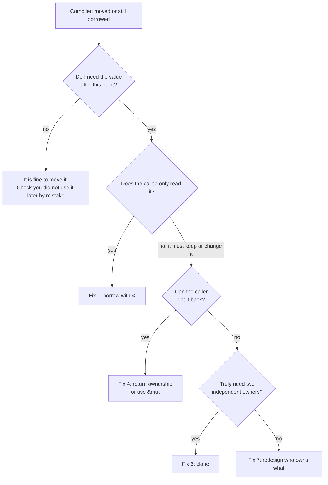

<!-- nav:top -->
[🏠 Start](../START-HERE.md) · [← 03.6 Slices and string types](06-slices-and-string-types.md) · [📋 Phase 03](README.md) · [03.8 Project: word counter, and checkpoint →](08-project-word-counter-and-checkpoint.md) · [📖 Glossary](../GLOSSARY.md) · [🇷🇺 Русский](../../ru/03-ownership-and-borrowing/07-fixing-common-ownership-errors.md) <!-- nav -->

# Lesson 03.7 — Fixing common ownership errors

> **Phase 03 — Ownership and borrowing** · Lesson 7 of 8 · ⏱ about 3 hours (2 sittings)

## What you will learn

- How to read a borrow-checker error from top to bottom.
- A ranked toolbox of fixes: borrow, reorder, clone, return ownership, change the design.
- A field guide to the nine errors you will meet most often, each with a broken program, the real message and the fixes.
- How to use `rustc --explain`, `cargo clippy` and Git to fix errors calmly and safely.
- The habits that separate "fighting the compiler" from "working with it".

## Before you start

- You finished [Lesson 03.6 — Slices and string types](06-slices-and-string-types.md). You know moves, `Copy`, `clone`, `&`, `&mut`, slices and the borrowing rules.
- You know the basic Git commands from [Phase 01](../01-git-and-version-control/03-your-first-repository-and-commits.md): `git status`, `git add`, `git commit`, and (from [Lesson 01.5](../01-git-and-version-control/05-undoing-changes-safely.md)) `git restore`.
- Create a project: `cargo new code/p03-fixing-errors` (from `~/projects/rust`). Paste each broken program, read the error, then apply the fix.

## New words

| Word | Meaning |
|---|---|
| **diagnostic** | The compiler's full message about a problem: the error code, the code snippet, labels and suggestions. |
| **error code** | A short name like `E0382` that identifies one kind of error. Each has an official page in the *error index*. |
| **label** | A short note the compiler prints under or beside a piece of your code, like `value moved here`. |
| **lint** | A check for code that compiles but is probably wrong or untidy. The tool that runs many lints is **Clippy**. |
| **Clippy** | The official collection of lints for Rust. Run it with `cargo clippy`. |
| **temporary** | A value that the compiler creates for part of an expression and drops at the end of the statement. |
| **diff** | A listing of the exact lines that changed between two versions of a file. `git diff` prints it. |

## 1. How to read a borrow-checker error

You have already seen many errors. Now let us read one slowly, as a method. Take this program:

```rust
fn describe(name: String) -> usize {
    println!("name: {name}");
    name.len()
}

fn main() {
    let name = String::from("Grace");
    let n = describe(name);
    println!("{name} has {n} bytes");
}
```

```text
error[E0382]: borrow of moved value: `name`
 --> src/main.rs:9:16
  |
7 |     let name = String::from("Grace");
  |         ---- move occurs because `name` has type `String`, which does not implement the `Copy` trait
8 |     let n = describe(name);
  |                      ---- value moved here
9 |     println!("{name} has {n} bytes");
  |                ^^^^ value borrowed here after move
  |
note: consider changing this parameter type in function `describe` to borrow instead if owning the value isn't necessary
 --> src/main.rs:1:19
  |
1 | fn describe(name: String) -> usize {
  |    --------       ^^^^^^ this parameter takes ownership of the value
  |    |
  |    in this function
help: consider cloning the value if the performance cost is acceptable
  |
8 |     let n = describe(name.clone());
  |                          ++++++++
```

Read it in this order:

1. **The first line:** `error[E0382]: borrow of moved value: name`. The code (`E0382`) and a headline. Together they name the problem.
2. **The arrow `-->`:** file, line and column of the main spot.
3. **The labels** (`----` and `^^^^`). They tell the story in time order: where the variable was born (line 7), where the bad thing happened (line 8, "moved here"), and where you hit the problem (line 9, "used after move"). **Find these three places.** Almost every ownership error has this shape: *creation → conflict → later use*.
4. **`note:`** gives extra context. Here it says the function's parameter takes ownership and suggests borrowing instead.
5. **`help:`** gives a concrete suggestion. Treat it as an idea, not an order. The suggestion `name.clone()` compiles, but it is not the best fix here — the `note` is.

> 💡 **Tip:** always fix the **first** error in the list. Later errors are often consequences of the first one, and they disappear when it is fixed. Run `cargo check` (it checks without building the program, so it is faster) after each fix.

For a longer explanation of any code, ask the compiler:

```bash
rustc --explain E0382
```

```text
A variable was used after its contents have been moved elsewhere.
...
```

(It prints a page with examples. The same text is in the online *error index*, linked at the end of this lesson.) In RustRover you can also press **Alt+Enter** (or **Option+Enter** on a Mac) on the red underline to see quick fixes.

## 2. The toolbox: ranked fixes

When the compiler says a value was moved or is still borrowed, try these in order. The earlier ones are cheaper and usually better:

| # | Fix | Use it when | Cost |
|---|---|---|---|
| 1 | **Borrow instead of move.** Change a parameter from `T` to `&T`, and the call to `&x`. | The function only reads. | none |
| 2 | **Reorder.** Move the use of a reference before the conflicting action, or end its life sooner. | A borrow overlaps with a change or a move. | none |
| 3 | **Narrow the scope.** Put the borrow in a `{ }` block. | A short borrow blocks a later action. | none |
| 4 | **Return ownership.** Return the value (or return an owned `String` instead of a reference). | A function creates data and must hand it out. | a move |
| 5 | **Split the work.** Collect changes in a second variable, then apply them after the loop. | You change a collection while reading it. | a small buffer |
| 6 | **Clone.** `.clone()` the value. | Two independent owners are truly needed. | allocation + copy |
| 7 | **Redesign.** Change who owns what; use indexes; store owned data. | None of the above feels right. | thinking time |
| 8 | Reference counting and interior mutability (`Rc`, `RefCell`). | After you really know why you need them (Lessons 05.9 and 06.4). | run-time checks |



> ⚠️ **Common mistake:** jumping straight to fix 6 (`.clone()`) or 8 because it makes the error disappear. A program full of clones works but is slower, and it hides design problems. Climb the ladder from the top.

## 3. Field guide: nine errors

Each case below has: the **broken** program, the **message** (key lines), **why** it happens, and the **fixes**.

### Case 1 — `E0382` moved into a function (the example above)

*Why:* `describe` takes `String`, so `main` gave away `name`.

*Fix 1 — borrow* (the best one): the function only reads, so take `&str`.

```rust
fn describe(name: &str) -> usize {
    println!("name: {name}");
    name.len()
}

fn main() {
    let name = String::from("Grace");
    let n = describe(&name);
    println!("{name} has {n} bytes");
}
```

```text
name: Grace
Grace has 5 bytes
```

### Case 2 — `E0382` moved in a loop

```rust
fn main() {
    let word = String::from("hi");
    let mut list = Vec::new();
    for _ in 0..3 {
        list.push(word);
    }
    println!("{:?}", list);
}
```

```text
error[E0382]: use of moved value: `word`
 --> src/main.rs:5:19
  |
2 |     let word = String::from("hi");
  |         ---- move occurs because `word` has type `String`, which does not implement the `Copy` trait
3 |     let mut list = Vec::new();
4 |     for _ in 0..3 {
  |     ------------- inside of this loop
5 |         list.push(word);
  |                   ^^^^ value moved here, in previous iteration of loop
```

*Why:* the vector must own each item, and a `String` can be moved only once.

*Fix:* here the program really needs three independent strings, so cloning in each pass is correct:

```rust
fn main() {
    let word = String::from("hi");
    let mut list = Vec::new();
    for _ in 0..3 {
        list.push(word.clone());
    }
    println!("{:?}", list);
}
```

```text
["hi", "hi", "hi"]
```

### Case 3 — `E0502` the same value borrowed two ways in one call

```rust
fn copy_into(dst: &mut Vec<i32>, src: &Vec<i32>) {
    for i in 0..src.len() {
        dst.push(src[i]);
    }
}

fn main() {
    let mut numbers = vec![1, 2, 3];
    copy_into(&mut numbers, &numbers);
    println!("{:?}", numbers);
}
```

```text
error[E0502]: cannot borrow `numbers` as immutable because it is also borrowed as mutable
 --> src/main.rs:9:29
  |
9 |     copy_into(&mut numbers, &numbers);
  |     --------- ------------  ^^^^^^^^ immutable borrow occurs here
  |     |         |
  |     |         mutable borrow occurs here
  |     mutable borrow later used by call
```

*Why:* the function would read `src` while pushing to the very same vector. If a push moved the buffer, `src` would dangle. This is the "aliasing" problem from Lesson 03.5.

*Fix 6 — one deliberate copy* (the function really needs a stable source):

```rust
fn copy_into(dst: &mut Vec<i32>, src: &[i32]) {
    for i in 0..src.len() {
        dst.push(src[i]);
    }
}

fn main() {
    let mut numbers = vec![1, 2, 3];
    let snapshot = numbers.clone(); // one deliberate copy
    copy_into(&mut numbers, &snapshot);
    println!("{:?}", numbers);
}
```

```text
[1, 2, 3, 1, 2, 3]
```

(We also changed `&Vec<i32>` to `&[i32]`, as Lesson 03.6 recommends.)

### Case 4 — `E0505` moving or dropping a value that is borrowed

```rust
fn main() {
    let numbers = vec![10, 20, 30];
    let first = &numbers[0];
    drop(numbers);
    println!("first = {first}");
}
```

```text
error[E0505]: cannot move out of `numbers` because it is borrowed
 --> src/main.rs:4:10
  |
2 |     let numbers = vec![10, 20, 30];
  |         ------- binding `numbers` declared here
3 |     let first = &numbers[0];
  |                  ------- borrow of `numbers` occurs here
4 |     drop(numbers);
  |          ^^^^^^^ move out of `numbers` occurs here
5 |     println!("first = {first}");
  |                        ----- borrow later used here
```

*Why:* `first` points inside `numbers`; dropping `numbers` would leave `first` dangling.

*Fix 2 — reorder:* use `first` before the `drop`.

```rust
fn main() {
    let numbers = vec![10, 20, 30];
    let first = &numbers[0];
    println!("first = {first}");
    drop(numbers); // after the last use of `first`
}
```

```text
first = 10
```

### Case 5 — `E0507` moving out of a borrow or an index

```rust
fn first_name(names: &Vec<String>) -> String {
    names[0]
}

fn main() {
    let names = vec![String::from("Ada"), String::from("Grace")];
    println!("{}", first_name(&names));
}
```

```text
error[E0507]: cannot move out of index of `Vec<String>`
 --> src/main.rs:2:5
  |
2 |     names[0]
  |     ^^^^^^^^ move occurs because value has type `String`, which does not implement the `Copy` trait
```

*Why:* the function only *borrows* the vector, so it may not take a `String` out of it (Lesson 03.3, section 5).

*Fix A — return a borrowed slice* (no copy at all):

```rust
fn first_name(names: &[String]) -> &str {
    &names[0]
}

fn main() {
    let names = vec![String::from("Ada"), String::from("Grace")];
    println!("{}", first_name(&names));
}
```

```text
Ada
```

*Fix B — clone,* if the caller must own the result and change it:

```rust
fn first_name(names: &[String]) -> String {
    names[0].clone()
}

fn main() {
    let names = vec![String::from("Ada"), String::from("Grace")];
    let mut mine = first_name(&names);
    mine.push_str(" Lovelace");
    println!("{mine}");
    println!("{:?}", names);
}
```

```text
Ada Lovelace
["Ada", "Grace"]
```

### Case 6 — `E0515` returning a reference to a local variable

```rust
fn shout(text: &str) -> &str {
    let upper = text.to_uppercase();
    &upper
}

fn main() {
    println!("{}", shout("hello"));
}
```

```text
error[E0515]: cannot return reference to local variable `upper`
 --> src/main.rs:3:5
  |
3 |     &upper
  |     ^^^^^^ returns a reference to data owned by the current function
```

*Why:* `upper` is built inside the function and dropped at its end. A reference to it would dangle. `to_uppercase` creates *new* text, so a slice of the input cannot be returned either.

*Fix 4 — return ownership:*

```rust
fn shout(text: &str) -> String {
    text.to_uppercase()
}

fn main() {
    println!("{}", shout("hello"));
}
```

```text
HELLO
```

> 📏 **Convention:** if a function *creates* text, it returns `String`. If it only *finds* a part of its input, it returns `&str` (a slice of the input).

### Case 7 — `E0597` a reference outlives its data

```rust
fn main() {
    let text = "short\na much longer line\nmid";
    let mut longest = "";
    for line in text.lines() {
        let cleaned = line.to_lowercase();
        if cleaned.len() > longest.len() {
            longest = &cleaned;
        }
    }
    println!("longest: {longest}");
}
```

```text
error[E0597]: `cleaned` does not live long enough
  --> src/main.rs:7:23
   |
 5 |         let cleaned = line.to_lowercase();
   |             ------- binding `cleaned` declared here
 6 |         if cleaned.len() > longest.len() {
 7 |             longest = &cleaned;
   |                       ^^^^^^^^ borrowed value does not live long enough
 8 |         }
 9 |     }
   |     - `cleaned` dropped here while still borrowed
10 |     println!("longest: {longest}");
   |                         ------- borrow later used here
```

*Why:* `cleaned` is created anew on every pass and dropped at the end of it, but `longest` keeps a reference to it after the loop.

*Fix 7 — change what you keep:* keep a slice of `text`, which outlives the loop, and lowercase only at the end.

```rust
fn main() {
    let text = "short\na much longer line\nmid";
    let mut longest = "";
    for line in text.lines() {
        if line.len() > longest.len() {
            longest = line; // `line` borrows from `text`, which outlives the loop
        }
    }
    println!("longest: {}", longest.to_lowercase());
}
```

```text
longest: a much longer line
```

(Another valid fix: make `longest` a `String` and store a clone, `longest = cleaned;`, which *moves* the string out of the loop.)

### Case 8 — `E0716` a temporary dropped while borrowed

```rust
fn main() {
    let word = String::from("  padded  ").trim();
    println!("[{word}]");
}
```

```text
error[E0716]: temporary value dropped while borrowed
 --> src/main.rs:2:16
  |
2 |     let word = String::from("  padded  ").trim();
  |                ^^^^^^^^^^^^^^^^^^^^^^^^^^       - temporary value is freed at the end of this statement
  |                |
  |                creates a temporary value which is freed while still in use
3 |     println!("[{word}]");
  |                 ---- borrow later used here
  |
help: consider using a `let` binding to create a longer lived value
  |
2 ~     let binding = String::from("  padded  ");
3 ~     let word = binding.trim();
```

*Why:* `String::from(...)` creates a **temporary** value. Nobody owns it, so it is dropped at the end of the line. `trim()` returned a slice into it, which would dangle.

*Fix 3 — give the value an owner:*

```rust
fn main() {
    let padded = String::from("  padded  ");
    let word = padded.trim();
    println!("[{word}]");
}
```

```text
[padded]
```

### Case 9 — `E0596` changing something that is not `mut`

```rust
fn exclaim(s: String) -> String {
    s.push('!');
    s
}

fn main() {
    println!("{}", exclaim(String::from("hey")));
}
```

```text
error[E0596]: cannot borrow `s` as mutable, as it is not declared as mutable
 --> src/main.rs:2:5
  |
2 |     s.push('!');
  |     ^ cannot borrow as mutable
  |
help: consider changing this to be mutable
  |
1 | fn exclaim(mut s: String) -> String {
  |            +++
```

*Why:* a parameter is a variable, and variables are read-only unless declared `mut`. Owning a value does not allow you to change it; `mut` does.

*Fix:* add `mut` to the parameter (`mut s: String`).

### Other codes you know

| Code | You met it in | The usual fix |
|---|---|---|
| `E0499` two `&mut` at once | Lesson 03.5 | end the first before the second (reorder or block) |
| `E0502` `&mut` while `&` is alive | Lesson 03.5 | use the shared reference first; or collect changes and apply them later |
| `E0506` assigning to a borrowed value | Lesson 03.5 | assign after the last use of the reference |
| `E0106` missing lifetime specifier | Lesson 03.4 | return an owned value (lifetimes: Lesson 05.3) |
| `E0368` `+=` on `&mut i32` | Lesson 03.5 | write `*n += 1` |

## 4. Let Clippy teach you

The compiler stops at errors. **Clippy** also finds code that compiles but is not idiomatic. Run it with `cargo clippy`. This program compiles, but look at what Clippy says:

```rust
fn count_a(text: &String) -> usize {
    text.chars().filter(|c| *c == 'a').count()
}

fn total(numbers: &Vec<i32>) -> i32 {
    numbers.iter().sum()
}

fn main() {
    let text = String::from("banana");
    let n = 5;
    let m = n.clone();
    println!("{} {} {}", count_a(&text), total(&vec![1, 2, 3]), m);
}
```

```text
warning: writing `&String` instead of `&str` involves a new object where a slice will do
 --> src/main.rs:1:18
  |
1 | fn count_a(text: &String) -> usize {
  |                  ^^^^^^^
  |
  = note: `#[warn(clippy::ptr_arg)]` on by default
help: change this to
  |
1 - fn count_a(text: &String) -> usize {
1 + fn count_a(text: &str) -> usize {

warning: writing `&Vec` instead of `&[_]` involves a new object where a slice will do
 --> src/main.rs:5:19
  |
5 | fn total(numbers: &Vec<i32>) -> i32 {
  |                   ^^^^^^^^^
  |
help: change this to
  |
5 - fn total(numbers: &Vec<i32>) -> i32 {
5 + fn total(numbers: &[i32]) -> i32 {

warning: using `clone` on type `i32` which implements the `Copy` trait
  --> src/main.rs:12:13
   |
12 |     let m = n.clone();
   |             ^^^^^^^^^ help: try removing the `clone` call: `n`
   |
   = note: `#[warn(clippy::clone_on_copy)]` on by default
```

Clippy repeats the advice of Lesson 03.6 (`&str` and `&[T]`) and notices a pointless `clone` on an `i32`. (The filter part, `|c| *c == 'a'`, is a *closure*, a small unnamed function; Lesson 05.4.) From now on, every project in this course must be **clippy-clean**: `cargo clippy` shows no warnings.

> 🧪 **Testing:** an error fix is not finished until a test pins it down. After you fix a function, write a test that calls it twice or uses the argument afterwards — that is a test of "did not consume my input", which the compiler already checks, and of the behaviour, which it does not.

## 5. Fix errors with Git as your safety net

When a fix means rewriting several lines, work like this:

1. **Start from a clean commit.** `git status` shows nothing to commit, or you commit what you have: `git commit -am "before fixing the borrow errors"`.
2. Try the fix. Run `cargo check`.
3. If it works, look at exactly what you changed with `git diff`:

   ```text
   diff --git a/code/p03-demo/src/main.rs b/code/p03-demo/src/main.rs
   --- a/code/p03-demo/src/main.rs
   +++ b/code/p03-demo/src/main.rs
   @@ -1,10 +1,10 @@
   -fn describe(name: String) -> usize {
   +fn describe(name: &str) -> usize {
        println!("name: {name}");
        name.len()
    }

    fn main() {
        let name = String::from("Grace");
   -    let n = describe(name);
   +    let n = describe(&name);
        println!("{name} has {n} bytes");
    }
   ```

   Lines with `-` were removed and lines with `+` were added. Reading your own diff is a very good way to see what a fix really was: here, two small changes.
4. Commit with a message that says *what* and *why*: `git commit -am "describe: borrow the name instead of taking it"`.
5. If the experiment went wrong and you want to go back to the last commit, `git restore src/main.rs` (Lesson 01.5) throws away your uncommitted changes in that file. Use it carefully: it cannot be undone.

> 💡 **Tip:** one fix, one commit. Then `git log --oneline` reads like a story of how the program got better (Lesson 01.4).

## Common mistakes

**1. Fixing the last error instead of the first.** Later errors may disappear by themselves.

**2. Applying the `help:` suggestion without reading it.** `.clone()` is only one option, and often not the best.

**3. Making everything `String` and `.clone()`.** The program works, but you learned nothing, and it is slower. Prefer references.

**4. Reaching for `unsafe`, `'static` or `Rc<RefCell<…>>` because the borrow checker is "in the way".** They are tools for special cases, with their own costs. A beginner who needs them almost always needs a simpler design instead.

**5. Changing five things at once.** Make one change, run `cargo check`, then the next. Then you know which change fixed what.

**6. Not reading the labels.** The three labels (birth, conflict, later use) contain the answer.

## Try it yourself

1. In `code/p03-fixing-errors`, paste Case 2 (`list.push(word)` in a loop). Run `cargo check` and find the three labels in the message.
2. Run `rustc --explain E0382` and read the first screen.
3. Apply the fix. Run `cargo clippy`; the output should be empty.
4. Make a commit: `git add code/p03-fixing-errors && git commit -m "p03: fixing errors playground"`. Then paste Case 8 (the temporary) and fix it. Run `git diff` to read your own change, then commit again.
5. Choose one case from section 3 and break it again on purpose in a different way (for example, in Case 4 use `numbers.push(1)` instead of `drop(numbers)`). Which error code do you get now?

## Exercises

### Exercise 1 — Greeting (easy)

This program does not compile. Fix it by changing the function to borrow:

```rust
fn make_greeting(name: String) -> String {
    format!("Hello, {name}!")
}

fn main() {
    let name = String::from("Ada");
    let greeting = make_greeting(name);
    println!("{greeting}");
    println!("(sent to {name})");
}
```

<details>
<summary>Hint</summary>

The function only reads `name`. Change the parameter type to `&str` and pass `&name` in `main`.

</details>

<details>
<summary>Answer</summary>

```rust
fn make_greeting(name: &str) -> String {
    format!("Hello, {name}!")
}

fn main() {
    let name = String::from("Ada");
    let greeting = make_greeting(&name);
    println!("{greeting}");
    println!("(sent to {name})");
}
```

```text
Hello, Ada!
(sent to Ada)
```

Why it works: `format!` creates a new `String`, so the function returns an owned value. The parameter is only borrowed, so `name` stays valid.

</details>

### Exercise 2 — Grow while reading (medium)

This program should print `[1, 2, 3, 10, 20, 30]` (every item followed, at the end, by its value times ten). It fails with `E0502`. Fix it.

```rust
fn main() {
    let mut numbers = vec![1, 2, 3];
    for n in &numbers {
        numbers.push(n * 10);
    }
    println!("{:?}", numbers);
}
```

<details>
<summary>Hint</summary>

Do not hold a borrow of the vector while pushing to it. Loop over the *positions* `0..count` where `count` is the length before the loop, and read `numbers[i]` inside.

</details>

<details>
<summary>Answer</summary>

```rust
fn main() {
    let mut numbers = vec![1, 2, 3];
    let count = numbers.len();
    for i in 0..count {
        let bigger = numbers[i] * 10;
        numbers.push(bigger);
    }
    println!("{:?}", numbers);
}
```

```text
[1, 2, 3, 10, 20, 30]
```

Why it works: `numbers.len()` is read once, before the loop. Inside the loop, `numbers[i]` is a short-lived read and `push` a short-lived write, and they do not overlap. Without the `count` variable, `0..numbers.len()` would also work, as the range is created once before the loop starts.

</details>

### Exercise 3 — Which is longer? (medium)

This fails with `E0106` (missing lifetime specifier). Fix it **without** lifetimes, by returning an owned `String`, and add two tests (a clear winner and a tie, where the first wins).

```rust
fn longer(a: &str, b: &str) -> &str {
    if a.len() >= b.len() { a } else { b }
}

fn main() {
    println!("{}", longer("tiny", "enormous"));
}
```

<details>
<summary>Hint</summary>

The compiler cannot tell whether the result borrows from `a` or from `b`. Return `String` and convert with `.to_string()`.

</details>

<details>
<summary>Answer</summary>

```rust
fn longer(a: &str, b: &str) -> String {
    if a.len() >= b.len() { a.to_string() } else { b.to_string() }
}

fn main() {
    println!("{}", longer("tiny", "enormous"));
}

#[cfg(test)]
mod tests {
    use super::*;

    #[test]
    fn picks_the_longer() {
        assert_eq!(longer("tiny", "enormous"), "enormous");
    }

    #[test]
    fn tie_picks_the_first() {
        assert_eq!(longer("ab", "cd"), "ab");
    }
}
```

```text
enormous
```

Why it works: an owned `String` has no connection to the inputs, so no lifetime is needed. The compiler's own suggestion for the original error was `fn longer<'a>(a: &'a str, b: &'a str) -> &'a str`. That keeps the function allocation-free; Lesson 05.3 explains how to read it.

</details>

### Exercise 4 — Three errors, three commits (hard)

Put this program into `code/p03-fixing-errors` and commit it as it is. It has three different ownership errors. Fix them **one at a time**, running `cargo check` after each, and make **one Git commit per fix** (use clear messages). Then add two tests for `shout`. Finish with `git log --oneline`.

```rust
fn shout(text: String) -> String {
    text.push('!');
    text.to_uppercase()
}

fn main() {
    let mut words = vec![String::from("hello"), String::from("world")];
    let first = &words[0];
    words.push(String::from("again"));
    println!("first word: {first}");

    let message = String::from("done");
    let loud = shout(message);
    println!("{loud} / {message}");
}
```

<details>
<summary>Hint</summary>

The compiler reports all three errors together (`E0596`, `E0502`, `E0382`). Fix them in the order they appear. Error 1: `shout` changes a parameter that is not `mut`; but better, make `shout` take `&str` and build a new `String`. Error 2: print `first` before the `push`. Error 3 disappears when `shout` borrows.

</details>

<details>
<summary>Answer</summary>

A possible result:

```rust
fn shout(text: &str) -> String {
    let mut loud = text.to_uppercase();
    loud.push('!');
    loud
}

fn main() {
    let mut words = vec![String::from("hello"), String::from("world")];
    let first = &words[0];
    println!("first word: {first}");
    words.push(String::from("again"));

    let message = String::from("done");
    let loud = shout(&message);
    println!("{loud} / {message}");
}

#[cfg(test)]
mod tests {
    use super::*;

    #[test]
    fn shout_makes_loud_text() {
        assert_eq!(shout("hey"), "HEY!");
    }

    #[test]
    fn shout_keeps_the_input() {
        let original = String::from("quiet");
        let _ = shout(&original);
        assert_eq!(original, "quiet");
    }
}
```

```text
first word: hello
DONE! / done
```

The original program reports, in this order: `E0596` (cannot borrow `text` as mutable, as it is not declared as mutable), `E0502` (cannot borrow `words` as mutable because it is also borrowed as immutable) and `E0382` (borrow of moved value: `message`).

A good commit history looks like this (your hashes differ):

```text
f3a91c2 shout: borrow the text and build a new String
b72d4e0 main: read `first` before pushing to the vector
0c15a8d Add p03 fixing-errors playground (does not compile yet)
```

Why it works: fix 1 (`&str` parameter plus a new `String`) cures both the `mut` error and the move error at once; fix 2 only reorders two lines. Small commits show exactly which change cured which error.

</details>

## Quiz

1. In an ownership error, which three places do the labels usually point to?

<details>
<summary>Answer</summary>

Where the value or borrow was created, where the conflicting action happened (move, mutable borrow, drop), and where the value is used later.

</details>

2. Which error do you fix first when several are reported?

<details>
<summary>Answer</summary>

The first one. Later ones may be consequences of it.

</details>

3. Name the first three fixes in the toolbox, from cheapest to most expensive.

<details>
<summary>Answer</summary>

Borrow instead of move; reorder the code; narrow the scope with a block. (Then return ownership, split the work, clone, redesign.)

</details>

4. When is `.clone()` the right fix?

<details>
<summary>Answer</summary>

When you truly need two independent owners of the data, for example storing a copy in a vector while keeping the original.

</details>

5. What does `E0515` mean, and how do you fix it?

<details>
<summary>Answer</summary>

You returned a reference to a local variable that is dropped when the function ends. Return the owned value (for example `String`) instead.

</details>

6. How does `git diff` help when fixing errors?

<details>
<summary>Answer</summary>

It shows exactly which lines you changed, so you can check the fix is small and correct before you commit it.

</details>

7. What does Clippy add that the compiler does not?

<details>
<summary>Answer</summary>

Lints for code that compiles but is unidiomatic or probably wrong, such as `&String` parameters or a useless `clone`.

</details>

## Summary

- Read an error top to bottom: code and headline, location, then the labels (creation → conflict → later use), then `note` and `help`.
- Fix the first error first, one change at a time, with `cargo check` in between.
- Climb the toolbox from the top: borrow, reorder, narrow the scope, return ownership, split the work, clone, redesign.
- Nine frequent errors: `E0382` (twice), `E0502`, `E0505`, `E0507`, `E0515`, `E0597`, `E0716`, `E0596`.
- `rustc --explain CODE` gives a long explanation; `cargo clippy` finds unidiomatic code. Your projects should stay clippy-clean.
- Use Git as a safety net: a clean commit before, `git diff` after, one fix per commit.

## Sources and further reading

- [Rust compiler error index](https://doc.rust-lang.org/error_codes/E0382.html) — the official page for `E0382`; change the code in the address (`E0499`, `E0502`, `E0505`, `E0507`, `E0515`, `E0597`, `E0716`) for the others.
- [The Rust Programming Language — 4.2 References and Borrowing](https://doc.rust-lang.org/book/ch04-02-references-and-borrowing.html) — the rules behind most of these errors.
- [Clippy lints](https://rust-lang.github.io/rust-clippy/master/index.html) — the full list of Clippy checks, with explanations and examples.
- [Pro Git — Recording Changes to the Repository](https://git-scm.com/book/en/v2/Git-Basics-Recording-Changes-to-the-Repository) — `git diff`, `git commit` and friends in depth.
- [git restore](https://git-scm.com/docs/git-restore) — the official manual page of the command used to discard local changes.

---

[🏠 Start](../START-HERE.md) · [← 03.6 Slices and string types](06-slices-and-string-types.md) · [📋 Phase 03](README.md) · [03.8 Project: word counter, and checkpoint →](08-project-word-counter-and-checkpoint.md) · [📖 Glossary](../GLOSSARY.md) <!-- nav -->
<!-- nav:bottom -->
