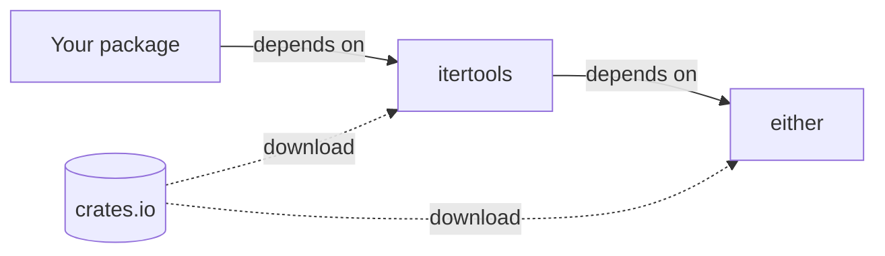

<!-- nav:top -->
[🏠 Start](../START-HERE.md) · [← 05.7 Documentation](07-documentation.md) · [📋 Phase 05](README.md) · [05.9 Smart pointers →](09-smart-pointers.md) · [📖 Glossary](../GLOSSARY.md) · [🇷🇺 Русский](../../ru/05-rust-intermediate/08-cargo-dependencies-and-versions.md) <!-- nav -->

# Lesson 05.8 — Cargo: dependencies and versions

> **Phase 05 — Rust intermediate** · Lesson 8 of 14 · ⏱ about 3 hours (2 sittings)

## What you will learn

- What a dependency is, where crates come from, and how to add one with `cargo add`.
- How version numbers work (semantic versioning) and how to write a version requirement such as `"0.15"` or `"1.2.3"`.
- What `Cargo.lock` is, why it exists, and when to save it in Git.
- How to look inside your dependencies with `cargo tree`, and how to update them with `cargo update`.
- How to switch crate features on and off, and how to use dev-dependencies, path dependencies and Git dependencies.
- How to choose a crate you can trust.

## Before you start

- You finished [Lesson 05.7 — Documentation](07-documentation.md).
- You know what a crate and a package are: [Lesson 04.6 — Modules, crates and packages](../04-structs-enums-collections-errors/06-modules-crates-and-packages.md).
- You know how to commit in Git: [Lesson 01.3 — Your first repository and commits](../01-git-and-version-control/03-your-first-repository-and-commits.md).
- Make a folder for experiments: `mkdir -p ~/projects/rust/code/p05-cargo-lab && cd ~/projects/rust/code/p05-cargo-lab`. Your computer must be online for this lesson, because Cargo downloads crates.

## New words

| Word | Meaning |
|---|---|
| **dependency** | Code written by someone else that your program uses. In Rust, a dependency is a crate. |
| **crates.io** | The public website and server where the Rust community publishes crates. |
| **registry** | A server that stores published crates and their versions. The default registry is crates.io. |
| **TOML** (Tom's Obvious Minimal Language) | A simple text format for settings. `Cargo.toml` is written in TOML. |
| **semver** (Semantic Versioning) | A set of rules for version numbers of the form `MAJOR.MINOR.PATCH`. |
| **version requirement** | The text after the crate name in `Cargo.toml` (for example `"0.15"`). It tells Cargo which versions are allowed. |
| **lock file** (`Cargo.lock`) | A file made by Cargo that records the exact version of every crate used in a build. |
| **transitive dependency** | A dependency of your dependency. You did not ask for it directly, but you get it. |
| **feature** | An optional part of a crate. You switch it on in `Cargo.toml` only if you need it. |
| **dev-dependency** | A dependency used only by tests, examples and benchmarks, not by the final program. |
| **path dependency** | A dependency that lives in a folder on your own computer. |
| **Git dependency** | A dependency that Cargo downloads from a Git repository. |
| **yanked version** | A published version that its author has marked "do not use for new projects". |
| **MSRV** (Minimum Supported Rust Version) | The oldest Rust compiler version that a crate promises to work with. |
| **supply chain** | All the code from other people that ends up inside your program. |
| **UUID** (Universally Unique Identifier) | A 128-bit number, written as 36 characters, that is practically unique in the world. |
| **SHA** (Secure Hash Algorithm) | A way to turn data into a short fingerprint. Git uses it for commit IDs. |

## 1. What a dependency is

Until now you wrote every line of your program yourself, and you used the standard library (`std`), which comes with Rust. Real programs also use code written by other people: a library that reads JSON (JavaScript Object Notation, a popular text format for data), a library that parses command-line arguments, a library that creates random numbers.

Think about building a house. You do not make your own bricks and pipes. You buy them from a shop. A **dependency** is a "brick" that you buy (for free) from a shop for code. The shop is called a **registry**, and the main one for Rust is **crates.io**.



You never copy the code by hand. You write the name and the version in `Cargo.toml`, and Cargo (the Rust build tool) downloads the code, compiles it, and links it to your program.

### Adding a dependency

Create a project and add a crate named `itertools`. It gives extra tools for working with sequences of items.

```bash
cargo new word-tools
cd word-tools
cargo add itertools@0.15
```

`cargo add` edits `Cargo.toml` for you. After the command, the file looks like this:

```toml
[package]
name = "word-tools"
version = "0.1.0"
edition = "2024"

[dependencies]
itertools = "0.15"
```

Now use the crate. Replace `src/main.rs`:

```rust
use itertools::Itertools;

fn main() {
    let words = ["rust", "is", "fun"];
    let line = words.iter().join("-");
    println!("{line}");
}
```

Run it:

```bash
cargo run
```

```text
   Compiling either v1.19.0
   Compiling itertools v0.15.0
   Compiling word-tools v0.1.0 (/home/you/projects/rust/code/p05-cargo-lab/word-tools)
    Finished `dev` profile [unoptimized + debuginfo] target(s) in 1.00s
     Running `target/debug/word-tools`
rust-is-fun
```

**What happens:**

1. `use itertools::Itertools;` brings the trait `Itertools` into scope. A **trait** (you learned it in [Lesson 05.2 — Traits](02-traits.md)) adds methods to existing types; `join` is one of the methods that this trait adds to iterators.
2. `words.iter()` makes an iterator over the three words.
3. `.join("-")` glues all items together with `-` between them and returns a `String`.
4. Cargo first downloaded two crates: `itertools` (the one you asked for) and `either` (the one that `itertools` needs). It compiled both, then compiled your package.

> 💡 **Tip:** `cargo add` is the easiest way, but you can also type the line into `[dependencies]` yourself. Both ways give the same result. To remove a dependency, run `cargo remove itertools`.

### Where does the code go?

Cargo downloads crates once into a cache folder in your home directory (`~/.cargo/registry`). Every project on your computer shares that cache. Compiled files of your project go into the `target` folder of that project, as you already know.

### Common mistake: using a crate that is not in Cargo.toml

If you write `use itertools::Itertools;` but forget to add the dependency, the compiler stops:

```text
error[E0432]: unresolved import `itertools`
 --> src/main.rs:1:5
  |
1 | use itertools::Itertools;
  |     ^^^^^^^^^ use of unresolved module or unlinked crate `itertools`
  |
  = help: if you wanted to use a crate named `itertools`, use `cargo add itertools` to add it to your `Cargo.toml`

error[E0599]: no method named `join` found for struct `std::slice::Iter<'a, T>` in the current scope
```

The first error is the real one. The second is only a result of it (the `join` method comes from the missing crate). The help line tells you the fix: run `cargo add itertools`. **Always fix the first error first.**

## 2. Versions and version requirements

### Semantic versioning

Every crate version is three numbers: `MAJOR.MINOR.PATCH`, for example `1.4.2`. The rules, called **semantic versioning** or **semver**, are:

| Number | Changes when… | Safe to update? |
|---|---|---|
| **PATCH** (`1.4.2` → `1.4.3`) | The author fixes a bug. Nothing new, nothing removed. | Yes. |
| **MINOR** (`1.4.2` → `1.5.0`) | The author adds new things. Old code still works. | Yes. |
| **MAJOR** (`1.4.2` → `2.0.0`) | The author changes or removes something. Old code may break. | Only when you are ready to fix your code. |

There is one special rule for versions that start with `0`. While the major number is `0`, the crate says "I am still changing a lot". For `0.x.y`, a change in the **minor** number (`0.14` → `0.15`) may break your code, just like a major change does.

### Writing a version requirement

In `Cargo.toml`, `itertools = "0.15"` does not mean "exactly 0.15". It is a **version requirement**: a rule about which versions Cargo may choose. The default rule is the **caret** rule (`^`): "any version that is compatible with this one, according to semver".

| You write | Cargo accepts | Notes |
|---|---|---|
| `"1.2.3"` (same as `"^1.2.3"`) | `1.2.3` up to, but not including, `2.0.0` | The usual choice. |
| `"1.2"` | `1.2.0` up to, but not including, `2.0.0` | Same idea, shorter. |
| `"0.15"` | `0.15.0` up to, but not including, `0.16.0` | For `0.x`, the minor number is the "breaking" number. |
| `"0.0.3"` | only `0.0.3` | For `0.0.x`, every change may break. |
| `"~1.2.3"` | `1.2.3` up to, but not including, `1.3.0` | Tilde: only patch updates. |
| `"=1.2.3"` | exactly `1.2.3` | Use rarely. It makes it hard to combine crates. |
| `">=1.2, <1.5"` | a range | Rare. |
| `"*"` | any version | Do not use it. crates.io refuses to publish packages that use it. |

> 📏 **Convention:** Write the version requirement the short way that `cargo add` gives you (`"0.15"`, `"1"`). It allows all compatible updates and still protects you from breaking changes.

### A version that does not exist

```toml
[dependencies]
itertools = "99.0"
```

```text
error: failed to select a version for the requirement `itertools = "^99.0"`
candidate versions found which didn't match: 0.15.0, 0.14.0, 0.13.0, ...
location searched: crates.io index
required by package `word-tools v0.1.0 (...)`
```

What it means: Cargo asked crates.io for a version `99.x` of `itertools`, and none exists. It shows the newest versions that do exist. Fix: use one of them.

### Which crate version supports which Rust?

Each crate may declare its **MSRV**, the oldest Rust version it works with, in a field called `rust-version`. You can read it with `cargo info`:

```bash
cargo info itertools
```

```text
itertools #iterator #data-structure #zip #product
Extra iterator adaptors, iterator methods, free functions, and macros.
version: 0.15.0
license: MIT OR Apache-2.0
rust-version: 1.63.0
documentation: https://docs.rs/itertools/
repository: https://github.com/rust-itertools/itertools
crates.io: https://crates.io/crates/itertools/0.15.0
features:
 +default   = [use_std]
  use_alloc = []
  use_std   = [use_alloc, either/use_std]
note: to see how you depend on itertools, run `cargo tree --invert itertools@0.15.0`
```

You see the newest version, the license, the minimum Rust version, links to the documentation and the source code, and the list of features (more about them in section 5).

## 3. Cargo.lock: the exact versions

When you ran `cargo run`, Cargo created a new file next to `Cargo.toml`. Open it:

```toml
# This file is automatically @generated by Cargo.
# It is not intended for manual editing.
version = 4

[[package]]
name = "either"
version = "1.19.0"
source = "registry+https://github.com/rust-lang/crates.io-index"
checksum = "0e9c71c2167ca323c882b99918929403426e2373ea17242ff5653e0d5e1058be"

[[package]]
name = "itertools"
version = "0.15.0"
source = "registry+https://github.com/rust-lang/crates.io-index"
checksum = "8b4baf93f58d4425749ca49a51c50ebab072c5df6994d08fed93541c331481dc"
dependencies = [
 "either",
]

[[package]]
name = "word-tools"
version = "0.1.0"
dependencies = [
 "itertools",
]
```

**What happens:**

1. `Cargo.toml` says what you **allow**: "any `0.15.x`".
2. Cargo picked the newest allowed version today: `0.15.0`, and wrote that exact choice in `Cargo.lock`.
3. Every package gets its exact version, where it came from (`source`), and a `checksum`: a fingerprint of the downloaded files. If someone swaps the files on the network, the fingerprint will not match and Cargo will refuse to build. This protects you.
4. On the next build, Cargo reads `Cargo.lock` and uses **the same versions**, even if newer ones were published. Your build is the same today, next month, and on your colleague's computer.

> 📏 **Convention:** Never edit `Cargo.lock` by hand. Cargo owns it.

### Should Cargo.lock go into Git?

Remember Git from [Phase 01](../01-git-and-version-control/01-what-is-version-control.md): version control saves the history of your files. Which files belong in it? The rule:

| Kind of package | Commit `Cargo.lock`? | Why |
|---|---|---|
| **Program** (has `src/main.rs`) | **Yes** | Everyone who builds the program gets the same versions. |
| **Library** (has `src/lib.rs`, others will depend on it) | Optional. Many teams commit it too. | Users of your library have their own `Cargo.lock`; yours is ignored by them. Committing it still makes your own tests repeatable. |
| The `target` folder | **Never** | It is big and can be rebuilt at any time. |

When you run `cargo new` outside any repository, Cargo also creates a Git repository and a `.gitignore` file with a single line, `/target`. Inside an existing repository (your learning repository, `~/projects/rust`) Cargo creates neither, so the ignore rule for `target` must already be in the `.gitignore` at the root of your repository (you set it up in [Lesson 05.1](01-generics.md)). Either way, the `target` folder is ignored and `Cargo.lock` is not.

Here is the real work flow when you add a dependency. The commands are the same in your learning repository; Git only shows longer paths there (`code/p05-cargo-lab/word-tools/Cargo.toml` instead of `Cargo.toml`):

```bash
git status --short
```

```text
 M Cargo.toml
?? Cargo.lock
```

`M` means "modified" and `??` means "new file, Git does not know it yet". Look at the exact change:

```bash
git diff Cargo.toml
```

```text
@@ -4,3 +4,4 @@ version = "0.1.0"
 edition = "2024"
 
 [dependencies]
+itertools = "0.15"
```

Commit both files together, because they belong to one change:

```bash
git add Cargo.toml Cargo.lock
git commit -m "chore(p05): add itertools 0.15"
git log --oneline -2
```

```text
e92cbb1 chore(p05): add itertools 0.15
70ad873 chore(p05): start the project
```

(Your commit IDs will be different.) Now the history answers the question "when did we start using this crate, and in which version?". This is a real benefit of version control.

> 📏 **Convention:** Make one commit per dependency change, with a message in the style of this phase, like `chore(p05): add itertools 0.15` or `chore(p05): update serde to 1.0.229`. When something breaks after an update, `git log` and `git diff Cargo.lock` show you what changed, and you can go back (see [Lesson 01.5 — Undoing changes safely](../01-git-and-version-control/05-undoing-changes-safely.md)).

## 4. Looking inside and updating

### cargo tree

Your dependencies have their own dependencies. `cargo tree` draws the whole **dependency tree**:

```bash
cargo tree
```

```text
word-tools v0.1.0 (/home/you/projects/rust/code/p05-cargo-lab/word-tools)
└── itertools v0.15.0
    └── either v1.19.0
```

`either` is a **transitive dependency**: you never wrote it, but it is in your program. You can also ask the opposite question, "who needs `either`?", with `-i` (invert):

```bash
cargo tree -i either
```

```text
either v1.19.0
└── itertools v0.15.0
    └── word-tools v0.1.0 (/home/you/projects/rust/code/p05-cargo-lab/word-tools)
```

Use `cargo tree --depth 1` to show only the crates you wrote in `Cargo.toml`. Use `cargo tree -d` to find crates that appear in **two different versions** (this makes the program bigger and slower to compile). For a quick demonstration, this `Cargo.toml` asks for `itertools` twice, under two names:

```toml
[dependencies]
itertools = "0.14"
itertools_new = { package = "itertools", version = "0.15" }
```

```text
itertools v0.14.0
└── dup-demo v0.1.0 (/home/you/projects/rust/code/p05-cargo-lab/dup-demo)

itertools v0.15.0
└── dup-demo v0.1.0 (/home/you/projects/rust/code/p05-cargo-lab/dup-demo)
```

The `package = "..."` key lets you give a crate another local name. Cargo allows two incompatible versions of one crate in one program, because from the compiler's point of view they are two different crates.

### cargo update

`Cargo.lock` keeps old versions on purpose. To move to newer versions that your `Cargo.toml` still allows, run `cargo update`. To see the effect, here is a project where `serde` was locked to an older version on purpose (with `cargo update serde --precise 1.0.200`):

```bash
cargo update
```

```text
    Updating crates.io index
     Locking 4 packages to highest Rust 1.100.0 compatible versions
    Updating serde v1.0.200 -> v1.0.229
      Adding serde_core v1.0.229
    Updating serde_derive v1.0.200 -> v1.0.229
    Updating syn v2.0.119 -> v3.0.10
```

**What happens:**

1. Cargo contacts the registry and looks for newer versions that satisfy every requirement.
2. It changes only `Cargo.lock`. `Cargo.toml` stays the same.
3. It also updates the crates that `serde` itself needs. The new `serde_derive` needs a newer major version of the helper crate `syn`, so `syn` moved from 2 to 3. That is fine: `syn` is a transitive dependency, and its other users keep their own version if they need it.
4. The phrase "Rust 1.100.0 compatible" shows that Cargo respects `rust-version` fields: it avoids versions that need a newer compiler than yours.

Useful variants:

| Command | What it does |
|---|---|
| `cargo update` | Update everything that is allowed. |
| `cargo update serde` | Update only `serde` (and what it needs). |
| `cargo update serde --precise 1.0.200` | Put `serde` on one exact version (also downgrades). |
| `cargo update --dry-run` | Show what would change; change nothing. |
| `cargo build --locked` | Fail if `Cargo.lock` would need to change. |
| `cargo build --offline` | Do not use the network; use the local cache only. |

`--locked` is for automation, for example a build server. If the lock file is outdated, the build stops instead of silently choosing new versions:

```text
error: cannot update the lock file .../Cargo.lock because --locked was passed to prevent this
help: to generate the lock file without accessing the network, remove the --locked flag and use --offline instead.
```

> 🔒 **Security:** Updating is a security tool as well. Old versions can have known bugs that attackers use. The Rust community collects such reports in the RustSec advisory database. The tool `cargo-audit` (install with `cargo install cargo-audit`) reads your `Cargo.lock` and tells you if any locked version has a known problem. Run `cargo audit` from time to time, and expect much more about security in Phase 10 (Security fundamentals).

> 💡 **Tip:** Recent Cargo versions (such as the 1.100 used in this course) warn when a dependency in `Cargo.toml` is never used (`warning: unused dependency`). If you see it, remove the line with `cargo remove`. Fewer dependencies mean faster builds and fewer risks.

## 5. Features

Many crates are big. A crate author does not want you to compile 20 parts when you need only 2. So the author puts optional parts behind **features**. A feature is a named switch.

Try to create a random identifier (UUID) with the `uuid` crate:

```bash
cargo new feat-demo && cd feat-demo
cargo add uuid@1
```

```rust
use uuid::Uuid;

fn main() {
    let id = Uuid::new_v4();
    println!("length of text form: {}", id.to_string().len());
}
```

```text
error[E0599]: no associated function or constant named `new_v4` found for struct `Uuid` in the current scope
 --> src/main.rs:4:20
  |
4 |     let id = Uuid::new_v4();
  |                    ^^^^^^ associated function or constant not found in `Uuid`
```

What it means: the function `new_v4` exists in the crate, but only when the feature `v4` is on. (Version 4 UUIDs are made from random numbers, and not everybody needs that code.) The documentation of the crate lists its features. Switch it on:

```bash
cargo add uuid --features v4
```

```toml
[dependencies]
uuid = { version = "1", features = ["v4"] }
```

```text
   Compiling feat-demo v0.1.0 (/home/you/projects/rust/code/p05-cargo-lab/feat-demo)
    Finished `dev` profile [unoptimized + debuginfo] target(s) in 0.82s
     Running `target/debug/feat-demo`
length of text form: 36
```

**What happens:**

1. `uuid = { version = "1", features = ["v4"] }` is the long form of a dependency. It is a small table with a `version` and a list of features.
2. With `v4` on, Cargo also switches on the other features that `v4` needs (`rng`), and compiles the extra code and the extra dependencies (`getrandom`, `libc`).
3. `Uuid::new_v4()` now exists. A UUID in text form always has 36 characters, for example `67e55044-10b1-426f-9247-bb680e5fe0c8`.

Things to know about features:

- Features are **additive**: turning one on only adds code. Two crates that need different features of the same dependency get the union of both.
- Most crates have a `default` feature set that is on automatically. In the `cargo info` output above, `+default = [use_std]` means that `use_std` is on by default.
- `default-features = false` turns the defaults off. You will need this in embedded and very small programs: `serde = { version = "1", default-features = false }`.
- `cargo tree -e features` shows which features are really on.

> ⚡ **Performance:** Every feature that you switch on adds compile time, and maybe program size. Turn on only what you use. A clean build of a big project is often slow just because of unused features.

## 6. Other kinds of dependencies

### dev-dependencies

Some crates help only while you test. Put them into `[dev-dependencies]`. They are compiled for `cargo test`, but they are **not** part of your program. Add one with `--dev`:

```bash
cargo add --dev pretty_assertions@1
```

```toml
[dependencies]
itertools = "0.15"

[dev-dependencies]
pretty_assertions = "1"
```

`pretty_assertions` gives a version of `assert_eq!` that shows a colored difference when the values are not equal. Use it in a test:

```rust
use itertools::Itertools;

fn join_words(words: &[&str]) -> String {
    words.iter().join("-")
}

fn main() {
    let words = ["rust", "is", "fun"];
    println!("{}", join_words(&words));
}

#[cfg(test)]
mod tests {
    use super::*;
    use pretty_assertions::assert_eq;

    #[test]
    fn joins_with_dashes() {
        assert_eq!(join_words(&["a", "b"]), "a-b");
    }

    #[test]
    fn empty_list_gives_empty_text() {
        assert_eq!(join_words(&[]), "");
    }
}
```

```text
running 2 tests
test tests::empty_list_gives_empty_text ... ok
test tests::joins_with_dashes ... ok

test result: ok. 2 passed; 0 failed; 0 ignored; 0 measured; 0 filtered out; finished in 0.00s
```

**What happens:**

1. `#[cfg(test)]` means "compile this module only for `cargo test`" (you saw this in [Lesson 02.8 — Your first tests](../02-programming-basics/08-your-first-tests.md)).
2. `use pretty_assertions::assert_eq;` replaces the standard `assert_eq!` inside the module with the colored version.
3. `cargo build` does not compile `pretty_assertions` for the final program; only `cargo test` does.

> 🧪 **Testing:** Put test helpers in `[dev-dependencies]`. If you put them in `[dependencies]`, every user of your program or library must compile them too. You learn more test tools in [Lesson 05.6 — Testing in depth](06-testing-in-depth.md).

A third table, `[build-dependencies]`, is for crates used by a build script (`build.rs`), a program that runs before the compiler. You will see it when you call C code in [Lesson 06.10 — FFI: calling C code](../06-rust-advanced/10-ffi-calling-c.md).

### Path dependencies

A **path dependency** is a crate in a folder on your computer. It is useful when you split one big project into several packages that live side by side:

```toml
[dependencies]
greeter = { path = "../greeter" }
```

If `../greeter` is a library with `pub fn hello(name: &str) -> String`, then `greeter::hello("Rust")` works in your code. A path dependency has no version to download. Cargo just compiles the folder.

### Git dependencies

A **Git dependency** is a crate that Cargo clones from a Git repository. You use it for a crate that is not on crates.io, or when you need a fix that is not released yet.

```toml
[dependencies]
greeter = { git = "https://github.com/your-name/greeter", tag = "v0.1.0" }
```

You choose what to take from the repository with one of three keys:

| Key | Meaning | Stability |
|---|---|---|
| `tag = "v0.1.0"` | A named, fixed point in the history. | Stable. |
| `rev = "18b9654"` | One exact commit. | Most stable. |
| `branch = "main"` | The newest commit of a branch. | Moves every time the branch moves. |

Cargo writes the exact commit into `Cargo.lock`. This is the real output from a test with a local repository (the path is shortened):

```text
[[package]]
name = "greeter"
version = "0.1.0"
source = "git+file://<path>/greeter?tag=v0.1.0#18b9654df6bb7dd470ad8567b18d770ca6c75b4a"
```

The long hexadecimal number after `#` is the **SHA** (Secure Hash Algorithm) fingerprint of the commit, the same ID that `git log` shows. Even if someone moves the tag later, your lock file still points at the first commit.

> ⚠️ **Common mistake:** Using `branch = "main"` in a project that you share. Two people can build on different days and get different code. Prefer `tag` or `rev`.

> 🔒 **Security:** Crates published on crates.io cannot be deleted or changed. If a version is wrong or dangerous, the author can only **yank** it: Cargo will not choose it for new `Cargo.lock` files, but existing lock files keep working. A Git dependency has no such protection. Use Git dependencies only from sources you trust.

## 7. How to choose a crate

Every crate you add is code that you run on your computer, and that your users run. This is your **supply chain**. Before you add a crate, check:

| Question | Where to look |
|---|---|
| Does the standard library already do this? | The `std` documentation. |
| Is it popular and maintained? | The crate page on crates.io: download count, last release date. |
| Is it documented? | The docs.rs page: examples, a clear API. |
| Which license? | `cargo info`. `MIT OR Apache-2.0` is the most common and friendly one. |
| How big is its tree? | `cargo tree` after adding it. Ten new crates for one small function is a bad trade. |
| Does it use a lot of `unsafe`? | Look at the repository. |
| Is it the one everybody uses? | Search the crate name together with "Rust". The ecosystem has well-known choices (you will meet `serde`, `clap`, `rand`, `regex`, `tokio`). |

> 📏 **Convention:** Follow KISS (Keep It Simple, Stupid): do not add a dependency for three lines of code. Follow DRY (Don't Repeat Yourself): do not rewrite JSON parsing by hand either.

## Common mistakes

1. **Forgetting `cargo add`** – error `E0432` (see section 1). Fix: add the dependency.
2. **Wrong feature** – error `E0599` "no function found" for something the documentation shows (see section 5). Fix: read the feature list on docs.rs or in `cargo info`, and add `features = [...]`.
3. **Asking for a version that does not exist** – "failed to select a version" (section 2). Fix: look at the candidate versions in the message.
4. **Putting `Cargo.lock` in `.gitignore` for a program.** Your colleague then builds with other versions and sees a bug that you cannot reproduce. Commit the lock file for programs.
5. **Committing the `target` folder.** It has hundreds of megabytes of generated files. Keep `/target` in `.gitignore`. If it is already committed, ask for help before you try to remove it from history.
6. **Using `"*"` as the version.** crates.io refuses to publish a package like that, and your builds are not predictable. Write a real requirement.
7. **Editing `Cargo.lock` by hand.** Use `cargo update` instead.

## Try it yourself

Do this in `~/projects/rust/code/p05-cargo-lab`.

1. Run `cargo new greeter-app && cd greeter-app`.
2. Look at the files with `ls -a`. Because you are inside your learning repository, there is no `.git` folder here; Git's data lives at the root (`ls -a ~/projects/rust`). Run `cat ~/projects/rust/.gitignore` and check that it contains a rule for `target`.
3. Run `cargo add uuid --features v4` and `cargo add itertools@0.15`.
4. Replace `src/main.rs` with this program:

```rust
use itertools::Itertools;
use uuid::Uuid;

fn main() {
    let ids: Vec<String> = (0..3).map(|_| Uuid::new_v4().to_string()).collect();
    let lengths = ids.iter().map(|id| id.len()).join(", ");
    println!("lengths: {lengths}");
}
```

5. Run `cargo run`. Expected output (the last line):

```text
lengths: 36, 36, 36
```

6. Run `cargo tree` and find `uuid`, `itertools`, `either` and `getrandom`.
7. Run `cargo tree -i getrandom` and read who needs it.
8. Run `git status --short`, then `git add .` (this stages only the current folder) and `git commit -m "chore(p05): add uuid and itertools"`.
9. Run `cargo update --dry-run`. Nothing changes: you just installed fresh versions.

## Exercises

### Exercise 1 — Add and use a dependency (easy)

Create a new package `shout`. Add `itertools` 0.15. Write a program that joins the words `["cargo", "is", "great"]` with a space and prints it. Expected output: `cargo is great`.

<details>
<summary>Hint</summary>

Use `cargo add itertools@0.15`, `use itertools::Itertools;` and `.join(" ")` on `words.iter()`.

</details>

<details>
<summary>Answer</summary>

```rust
use itertools::Itertools;

fn main() {
    let words = ["cargo", "is", "great"];
    println!("{}", words.iter().join(" "));
}
```

```text
cargo is great
```

Why it works: `join` is a method that the trait `Itertools` adds to every iterator. Without the `use` line the method would not be found, because traits must be in scope before their methods can be called.

</details>

### Exercise 2 — Read the dependency tree (easy)

In the project `greeter-app` from "Try it yourself", find out which crates need `getrandom`, and which one of **your own direct dependencies** pulls it in. Write down the command that answers this.

<details>
<summary>Hint</summary>

The `-i` (invert) option of `cargo tree` starts from one crate and draws the path back to your package.

</details>

<details>
<summary>Answer</summary>

```bash
cargo tree -i getrandom
```

The output ends at `greeter-app` and the line just below `getrandom` shows `uuid`. So `uuid` is the direct dependency that pulls `getrandom` in (because the `v4` feature needs random numbers). Your exact version numbers may differ.

Why it works: the tree is built from `Cargo.lock`, which records which package depends on which. Inverting the tree answers "who needs this?" in one command.

</details>

### Exercise 3 — Write a test with a dependency (medium)

In a new package, write a function `fn shout(words: &[&str]) -> String` that joins the words with a space (use `itertools`) and turns the result into upper case. Write **two tests**: one for the normal case (`["a", "b"]` gives `"A B"`) and one for an empty list (gives `""`). Run `cargo test`.

<details>
<summary>Hint</summary>

Upper case: the method `to_uppercase()` on `str` returns a new `String`. Put the tests in `#[cfg(test)] mod tests` with `use super::*;`.

</details>

<details>
<summary>Answer</summary>

```rust
use itertools::Itertools;

fn shout(words: &[&str]) -> String {
    words.iter().join(" ").to_uppercase()
}

fn main() {
    println!("{}", shout(&["cargo", "is", "great"]));
}

#[cfg(test)]
mod tests {
    use super::*;

    #[test]
    fn joins_and_uppercases() {
        assert_eq!(shout(&["a", "b"]), "A B");
    }

    #[test]
    fn empty_list_gives_empty_text() {
        assert_eq!(shout(&[]), "");
    }
}
```

`cargo run` prints `CARGO IS GREAT`. `cargo test` reports `2 passed`.

Why it works: `join` returns a `String`; `to_uppercase()` creates another `String` with every letter in upper case. Joining an empty list gives an empty string, and upper-casing an empty string gives an empty string.

</details>

### Exercise 4 — Features in a test (medium)

Write a test `uuid_text_has_36_chars` that checks the length of `Uuid::new_v4().to_string()`. Which line must be in `Cargo.toml` so that it compiles? What happens if the `v4` feature is missing?

<details>
<summary>Hint</summary>

`cargo add uuid --features v4`. The error without the feature is the one from section 5.

</details>

<details>
<summary>Answer</summary>

`Cargo.toml` must contain:

```toml
uuid = { version = "1", features = ["v4"] }
```

```rust
#[cfg(test)]
mod tests {
    use uuid::Uuid;

    #[test]
    fn uuid_text_has_36_chars() {
        assert_eq!(Uuid::new_v4().to_string().len(), 36);
    }
}
```

Without the feature, the compiler stops with `error[E0599]: no associated function or constant named `new_v4` found for struct `Uuid``.

Why it works: the feature `v4` compiles the function `new_v4` into the crate. A UUID in text form is 32 hexadecimal digits plus 4 dashes, which is 36 characters.

</details>

### Exercise 5 — A path dependency (hard)

Make a folder `lab` with two packages next to each other: a library `greeter` with `pub fn hello(name: &str) -> String` that returns `Hello, <name>!`, and a program `app` that depends on it through a path dependency and prints `Hello, Rust!`. Add a test to `greeter`.

<details>
<summary>Hint</summary>

`cargo new --lib greeter` and `cargo new app`. In `app/Cargo.toml` write `greeter = { path = "../greeter" }`.

</details>

<details>
<summary>Answer</summary>

`greeter/src/lib.rs`:

```rust
pub fn hello(name: &str) -> String {
    format!("Hello, {name}!")
}

#[cfg(test)]
mod tests {
    use super::*;

    #[test]
    fn says_hello() {
        assert_eq!(hello("Rust"), "Hello, Rust!");
    }
}
```

`app/Cargo.toml` (the end of the file):

```toml
[dependencies]
greeter = { path = "../greeter" }
```

`app/src/main.rs`:

```rust
fn main() {
    println!("{}", greeter::hello("Rust"));
}
```

`cargo run` inside `app` prints `Hello, Rust!`. `cargo test` inside `greeter` reports `1 passed`.

Why it works: a path dependency is compiled from the folder, so you can change `greeter` and see the effect in `app` at once, without publishing anything.

</details>

## Quiz

1. What is the difference between `Cargo.toml` and `Cargo.lock`?

<details>
<summary>Answer</summary>

`Cargo.toml` says what you allow (for example "any `0.15.x`"). `Cargo.lock` records the exact versions that Cargo really chose. You edit the first; Cargo writes the second.

</details>

2. Which versions does `serde = "1.0.200"` accept?

<details>
<summary>Answer</summary>

Every version from `1.0.200` up to, but not including, `2.0.0`. A requirement without an operator means "caret": compatible updates are allowed.

</details>

3. Which versions does `itertools = "0.15"` accept, and why is it different from `"1.5"`?

<details>
<summary>Answer</summary>

Versions from `0.15.0` up to, but not including, `0.16.0`. For crates whose major number is `0`, the minor number plays the role of the "breaking" number, so `0.16` may break code that works with `0.15`.

</details>

4. Should the `Cargo.lock` of a program be committed to Git? And the `target` folder?

<details>
<summary>Answer</summary>

Yes for `Cargo.lock` of a program: it keeps builds repeatable. No for `target`: it is generated, big, and listed in `.gitignore`.

</details>

5. What does `cargo tree -i either` show?

<details>
<summary>Answer</summary>

The inverted tree: it starts at `either` and shows all packages that depend on it, up to your own package. It answers "why is this crate in my program?".

</details>

6. A function from a crate's documentation is "not found" although the crate is in `Cargo.toml`. What is the most likely reason?

<details>
<summary>Answer</summary>

The function is behind a feature that is not switched on. Add `features = ["name"]` to the dependency.

</details>

7. When do you use a dev-dependency?

<details>
<summary>Answer</summary>

For crates that only tests, examples or benchmarks need. They are not compiled into the final program.

</details>

8. Why is `branch = "main"` a risky way to write a Git dependency?

<details>
<summary>Answer</summary>

The branch moves. Two builds on different days can get different code. A `tag` or `rev` always points to the same commit.

</details>

## Summary

- A dependency is a crate from outside your package. You declare it in `[dependencies]` in `Cargo.toml` with `cargo add`.
- Versions follow semver: `MAJOR.MINOR.PATCH`. For `0.x` crates, the minor number is the breaking one.
- A requirement such as `"0.15"` is a rule ("compatible with 0.15"), not an exact version.
- `Cargo.lock` stores exact versions and checksums. Commit it for programs; never commit `target`.
- `cargo tree` shows the dependency tree (`-i` inverts it, `-d` finds duplicates); `cargo update` moves the lock file forward.
- Features are optional parts of a crate; switch on only what you need.
- Use `[dev-dependencies]` for test helpers, `path` for local crates, and `tag` or `rev` for Git dependencies.
- Choose crates carefully: they are part of your supply chain.

## Sources and further reading

- [The Cargo Book — Specifying Dependencies](https://doc.rust-lang.org/cargo/reference/specifying-dependencies.html) — all forms of dependencies and version requirements.
- [The Cargo Book — Cargo.toml vs Cargo.lock](https://doc.rust-lang.org/cargo/guide/cargo-toml-vs-cargo-lock.html) — when to commit the lock file.
- [The Cargo Book — Features](https://doc.rust-lang.org/cargo/reference/features.html) — how features work, including `default-features`.
- [The Cargo Book — cargo tree](https://doc.rust-lang.org/cargo/commands/cargo-tree.html) — every option of `cargo tree`.
- [Semantic Versioning 2.0.0](https://semver.org/) — the official text of the versioning rules.
- [The Rust Programming Language — Chapter 14: More about Cargo and Crates.io](https://doc.rust-lang.org/book/ch14-00-more-about-cargo.html) — profiles, publishing and workspaces.
- [RustSec Advisory Database](https://rustsec.org/) — known security problems in crates.

---

[🏠 Start](../START-HERE.md) · [← 05.7 Documentation](07-documentation.md) · [📋 Phase 05](README.md) · [05.9 Smart pointers →](09-smart-pointers.md) · [📖 Glossary](../GLOSSARY.md) <!-- nav -->
<!-- nav:bottom -->
