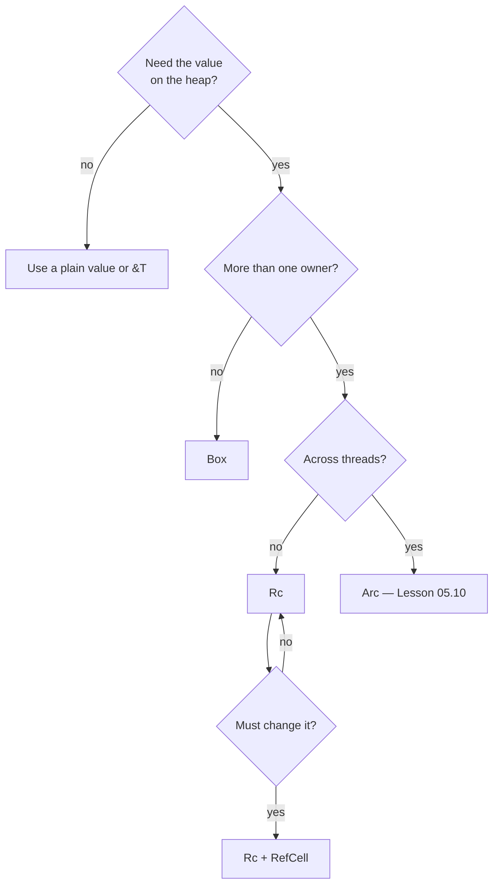

<!-- nav:top -->
[🏠 Start](../START-HERE.md) · [← 05.8 Cargo: dependencies and versions](08-cargo-dependencies-and-versions.md) · [📋 Phase 05](README.md) · [05.10 Threads, channels and shared state →](10-threads-channels-and-shared-state.md) · [📖 Glossary](../GLOSSARY.md) · [🇷🇺 Русский](../../ru/05-rust-intermediate/09-smart-pointers.md) <!-- nav -->

# Lesson 05.9 — Smart pointers

> **Phase 05 — Rust intermediate** · Lesson 9 of 14 · ⏱ about 3 hours (2 sittings)

## What you will learn

- What a smart pointer is and how it differs from a plain reference.
- How to put a value on the heap with `Box<T>`, and why a recursive type needs it.
- How `Deref` lets a smart pointer act like a reference, and how `Drop` runs code when a value dies.
- How to share one value between several owners with `Rc<T>`, and how to change shared data with `RefCell<T>`.
- How `Weak<T>` prevents reference cycles, and how to choose the right pointer.

## Before you start

- You finished [Lesson 05.8 — Cargo: dependencies and versions](08-cargo-dependencies-and-versions.md).
- You remember the stack and the heap: [Lesson 03.1 — Memory: the stack and the heap](../03-ownership-and-borrowing/01-memory-stack-and-heap.md).
- You remember ownership and borrowing: [Lesson 03.4 — References and borrowing](../03-ownership-and-borrowing/04-references-and-borrowing.md) and [Lesson 03.5 — Mutable references and the borrowing rules](../03-ownership-and-borrowing/05-mutable-references-and-the-borrow-rules.md).
- You know traits ([Lesson 05.2](02-traits.md)) and generics ([Lesson 05.1](01-generics.md)).
- Create a project: `cd ~/projects/rust/code && cargo new p05-smart-pointers && cd p05-smart-pointers`. In this lesson, put each example into its own file `src/bin/<name>.rs` and run it with `cargo run --bin <name>`, or just replace `src/main.rs` each time.

## New words

| Word | Meaning |
|---|---|
| **pointer** | A value that holds the address of other data in memory. |
| **smart pointer** | A pointer-like type that also has extra abilities and rules. It usually **owns** the data it points to. Examples: `Box`, `Rc`, `RefCell` (strictly, `RefCell` is a wrapper, but it is used with the others). |
| **`Box<T>`** | A smart pointer that stores a `T` on the heap. It has one owner. |
| **dereference** | To follow a pointer to the value behind it. You write `*pointer`. |
| **`Deref`** | A trait that tells Rust how to follow your type to its inner value. |
| **deref coercion** | An automatic conversion of `&Box<String>` (and similar) to `&str` (and similar) when you call a function. |
| **`Drop`** | A trait whose method `drop` runs automatically when a value goes out of scope. |
| **recursive type** | A type that contains a value of its own type. |
| **indirection** | Storing something "at an address" instead of "inside". A `Box` is indirection. |
| **`Rc<T>`** (Reference Counted) | A smart pointer that lets several owners share one value. The value lives until the last owner is gone. |
| **reference count** | The number of owners of an `Rc`. Also called the **strong count**. |
| **`Weak<T>`** | A pointer to an `Rc` value that does **not** keep the value alive. |
| **`RefCell<T>`** | A wrapper that allows changing the inside value through a shared reference. The borrowing rules are checked while the program runs. |
| **interior mutability** | Changing data that sits behind a shared (`&`) reference. `RefCell` gives it to you. More in [Lesson 06.4](../06-rust-advanced/04-interior-mutability.md). |
| **reference cycle** | Values that own each other in a circle, so none of them can ever be freed. |
| **memory leak** | Memory that is never freed although the program does not use it anymore. |
| **RAII** (Resource Acquisition Is Initialization) | A design idea: a value takes a resource (memory, a file, a lock) when it is created and gives it back when it is dropped. |

## 1. What is a smart pointer?

A **pointer** is a value that holds an address in memory. A reference (`&T`) is the simplest pointer: it points to data and only **borrows** it. A reference has no extra abilities and never owns anything.

A **smart pointer** is a type that behaves like a pointer, but has more: it usually **owns** the data it points to, and it runs code when it is created or dropped. You have already used two smart pointers without calling them that: `String` (it owns text on the heap) and `Vec<T>` (it owns items on the heap).

In this lesson you learn the four most important ones:

| Type | One-line summary | Owners | Checks borrowing rules |
|---|---|---|---|
| `Box<T>` | A value on the heap. | one | at compile time |
| `Rc<T>` | A value on the heap with many owners. | many (single thread) | at compile time (only `&T` access) |
| `RefCell<T>` | A value that can be changed behind `&`. | one | **while the program runs** |
| `Weak<T>` | A non-owning link to an `Rc` value. | none | — |

## 2. Box: a value on the heap

`Box::new(value)` moves a value to the heap and gives you a box that points to it. The box itself (just an address, 8 bytes on your Mac) lives where you put it, usually on the stack.

```rust
fn main() {
    let b = Box::new(5);
    println!("b = {b}");
    println!("b + 1 = {}", *b + 1);

    let big = Box::new([0u8; 1_000_000]);
    println!("array length = {}", big.len());
}
```

```text
b = 5
b + 1 = 6
array length = 1000000
```

**What happens:**

1. `Box::new(5)` asks the allocator (see [Lesson 03.1](../03-ownership-and-borrowing/01-memory-stack-and-heap.md)) for room on the heap, writes `5` there, and returns the box.
2. `println!("b = {b}")` prints the value behind the box: a box can be printed just like the value inside.
3. `*b` is the **dereference**: it follows the address to the number `5`. So `*b + 1` is `6`.
4. `big` is a box that points to one million bytes on the heap. Methods of the inner array (`len`) work on the box directly.
5. At the end of `main`, both boxes are dropped, and the heap memory is freed automatically.

```text
  stack                heap
 ┌────────┐          ┌───────┐
 │ b ─────┼─────────▶│   5   │
 └────────┘          └───────┘
 ┌────────┐          ┌─────────────────────┐
 │ big ───┼─────────▶│ 0 0 0 0 ... (1 MB)  │
 └────────┘          └─────────────────────┘
```

When is `Box` useful?

1. **A recursive type** (section 3): the compiler must know a type's size, and `Box` has a fixed size.
2. **A big value that you want to move cheaply.** Moving a `Box` copies only the 8-byte address, not the whole data.
3. **A value whose exact type you do not know** but whose behavior you do. `Box<dyn Trait>` (a *trait object*) is explained in [Lesson 06.1 — Trait objects and dynamic dispatch](../06-rust-advanced/01-trait-objects-and-dynamic-dispatch.md).

> ⚡ **Performance:** A box costs one heap allocation and one extra step to reach the data. Do not wrap every value in a `Box`. Use it when you have one of the three reasons above.

## 3. Recursive types

A **recursive type** contains a value of its own type. The classic example is a **list** where every item holds a number and the rest of the list.

```rust
enum List {
    Item(i32, List),
    End,
}

fn main() {
    let _list = List::Item(1, List::Item(2, List::End));
}
```

```text
error[E0072]: recursive type `List` has infinite size
 --> src/main.rs:1:1
  |
1 | enum List {
  | ^^^^^^^^^
2 |     Item(i32, List),
  |               ---- recursive without indirection
  |
help: insert some indirection (e.g., a `Box`, `Rc`, or `&`) to break the cycle
  |
2 |     Item(i32, Box<List>),
  |               ++++    +
```

What it means: the compiler needs to know how many bytes a `List` takes. An `Item` holds an `i32` **and a whole `List`**, which holds an `i32` and a whole `List`, and so on without end. The size would be infinite. The fix is **indirection**: store the rest of the list on the heap and keep only its address (8 bytes) inside.

```rust
#[derive(Debug)]
enum List {
    Item(i32, Box<List>),
    End,
}

use List::{End, Item};

fn sum(list: &List) -> i32 {
    match list {
        Item(value, rest) => value + sum(rest),
        End => 0,
    }
}

fn main() {
    let list = Item(1, Box::new(Item(2, Box::new(Item(3, Box::new(End))))));
    println!("{list:?}");
    println!("sum = {}", sum(&list));
    println!("size of List = {} bytes", std::mem::size_of::<List>());
}
```

```text
Item(1, Item(2, Item(3, End)))
sum = 6
size of List = 16 bytes
```

**What happens:**

1. `Item(i32, Box<List>)` stores a number and the address of the next item. The size of every `List` value is now fixed: 16 bytes (a number, an address, and a tag that tells `Item` from `End`).
2. `Box::new(...)` is called from the inside out: first `End` is boxed, then `Item(3, ...)`, then `Item(2, ...)`, then the outer `Item(1, ...)`.
3. `sum` calls itself on the rest of the list. This is **recursion**: a function that calls itself. `End` stops it with `0`.
4. `rest` has type `&Box<List>`, but `sum` wants `&List`. This works because of deref coercion (next section).

```text
 stack            heap          heap          heap
 ┌─────────┐    ┌─────────┐   ┌─────────┐   ┌───────┐
 │Item(1,●)│───▶│Item(2,●)│──▶│Item(3,●)│──▶│  End  │
 └─────────┘    └─────────┘   └─────────┘   └───────┘
```

> 📏 **Convention:** In real programs you almost never write your own list. `Vec<T>` is faster and simpler. Recursive types with `Box` are used for **trees** (a node that owns its children) and for the syntax trees of programming languages.

## 4. Deref: acting like a reference

The `*` operator works on references. How does it work on a `Box`? Because `Box` implements the trait `Deref`. You can implement it too. Here is a tiny box of our own, `MyBox`:

```rust
use std::ops::Deref;

struct MyBox<T>(T);

impl<T> MyBox<T> {
    fn new(value: T) -> MyBox<T> {
        MyBox(value)
    }
}

impl<T> Deref for MyBox<T> {
    type Target = T;

    fn deref(&self) -> &T {
        &self.0
    }
}

fn greet(name: &str) {
    println!("Hello, {name}!");
}

fn main() {
    let x = 5;
    let y = MyBox::new(x);
    assert_eq!(5, *y);

    let name = MyBox::new(String::from("Rust"));
    greet(&name);
}
```

```text
Hello, Rust!
```

**What happens:**

1. `struct MyBox<T>(T);` is a **tuple struct** with one field. (It does not use the heap; it is only to show the trait.)
2. `impl<T> Deref for MyBox<T>` says: "to follow a `MyBox<T>`, give a reference `&T` to the inner field". `type Target = T;` names the type behind the pointer.
3. `*y` is rewritten by the compiler to `*(y.deref())`: first call `deref` to get a plain reference, then follow it. So `5 == *y` is true.
4. `greet(&name)` passes `&MyBox<String>`, but `greet` wants `&str`. The compiler tries `deref` again and again: `&MyBox<String>` → `&String` → `&str`. This automatic chain is **deref coercion**. It happens at compile time and costs nothing at run time.

> 💡 **Tip:** Deref coercion is the reason why you can pass `&String` or `&Box<String>` where a function asks for `&str`. Prefer `&str` for function parameters.

There is a second trait, `DerefMut`, that does the same for mutable references. `Box` has both.

## 5. Drop: code that runs when a value dies

You know that Rust frees memory automatically at the end of a scope. The trait `Drop` lets you add your own code to that moment: close a file, release a lock, print a message. This idea is called **RAII** (Resource Acquisition Is Initialization): a value takes a resource when it is created and gives it back when it is dropped, so you cannot forget.

```rust
struct Noisy(&'static str);

impl Drop for Noisy {
    fn drop(&mut self) {
        println!("drop {}", self.0);
    }
}

fn main() {
    let _a = Noisy("a");
    let b = Noisy("b");
    let _c = Noisy("c");
    println!("created a, b, c");
    drop(b);
    println!("b dropped early");
    {
        let _inner = Noisy("inner");
        println!("inside the block");
    }
    println!("end of main");
}
```

```text
created a, b, c
drop b
b dropped early
inside the block
drop inner
end of main
drop c
drop a
```

**What happens:**

1. `impl Drop for Noisy` defines what happens when a `Noisy` is dropped. Rust calls `drop` for you.
2. `drop(b)` is the standard function `std::mem::drop`. It takes ownership of `b` and ends its life at once. That is why `drop b` is printed before `b dropped early`.
3. `_inner` dies at the closing `}` of the inner block, so `drop inner` is printed there.
4. At the end of `main`, the variables that are still alive are dropped in **reverse order of creation**: `c`, then `a`. (`b` is already gone.) The last one created is the first one dropped.

You cannot call the `drop` **method** yourself, because then the value could be dropped twice:

```rust
fn main() {
    let a = Noisy("a");
    a.drop();
}
```

```text
error[E0040]: explicit use of destructor method
  --> src/main.rs:11:7
   |
11 |     a.drop();
   |       ^^^^ explicit destructor calls not allowed
   |
help: consider using `drop` function
   |
11 -     a.drop();
11 +     drop(a);
   |
```

The compiler tells you the fix: use the function `drop(a)`, which takes ownership, so `a` can never be used or dropped again.

> 🔒 **Security:** Drop-based cleanup is how Rust closes files and unlocks mutexes even when a function returns early with `?`. Never rely on `Drop` for something that **must** happen, such as saving the only copy of data: a program that crashes hard or calls `std::process::exit` does not run drops.

> 🧪 **Testing:** You can test drop order by letting the value write into a shared log (see Exercise 4).

## 6. Rc: many owners

Normally a value has exactly one owner. Sometimes that is not enough. Think of a graph, where several nodes point to the same node, or of a shared setting that three parts of your program read. Which one should own it, and drop it?

`Rc<T>` (Reference Counted) is the answer. It keeps a hidden number, the **reference count**: how many owners exist now. `Rc::clone(&rc)` does **not** copy the data. It only adds one to the count and gives you another pointer to the same data. When an owner is dropped, the count goes down. When it reaches zero, the data is freed.

```rust
use std::rc::Rc;

fn main() {
    let shared = Rc::new(String::from("shared text"));
    println!("count after creating: {}", Rc::strong_count(&shared));

    let a = Rc::clone(&shared);
    println!("count after a: {}", Rc::strong_count(&shared));

    {
        let b = Rc::clone(&shared);
        println!("count after b: {} ({b})", Rc::strong_count(&shared));
    }
    println!("count after the block: {}", Rc::strong_count(&shared));

    drop(a);
    println!("count after drop(a): {}", Rc::strong_count(&shared));
}
```

```text
count after creating: 1
count after a: 2
count after b: 3 (shared text)
count after the block: 2
count after drop(a): 1
```

**What happens:**

1. `Rc::new` puts the string on the heap together with the counter, and the count is 1.
2. `Rc::clone(&shared)` makes a new pointer and raises the count. The text is **not** copied.
3. At the end of the inner block, `b` dies and the count goes back down to 2.
4. `drop(a)` lowers it to 1. When `shared` dies at the end of `main`, the count becomes 0 and the string is freed.

```text
 shared ─┐
 a ──────┼──────▶ ┌──────────────────────────┐
 b ──────┘        │ strong count: 3          │
                  │ "shared text"            │
                  └──────────────────────────┘
```

> 📏 **Convention:** Write `Rc::clone(&x)` and not `x.clone()`. Both work, but the first form shows the reader that this is a cheap count update, not a deep copy of the data.

Two limits of `Rc`:

- **It gives only shared (`&`) access.** You cannot change the data through an `Rc`:

```rust
use std::rc::Rc;

fn main() {
    let numbers = Rc::new(vec![1, 2, 3]);
    numbers.push(4);
    println!("{numbers:?}");
}
```

```text
error[E0596]: cannot borrow data in an `Rc` as mutable
 --> src/main.rs:5:5
  |
5 |     numbers.push(4);
  |     ^^^^^^^ cannot borrow as mutable
  |
  = help: trait `DerefMut` is required to modify through a dereference, but it is not implemented for `Rc<Vec<i32>>`
```

This is the borrowing rule from [Lesson 03.5](../03-ownership-and-borrowing/05-mutable-references-and-the-borrow-rules.md) at work: if many owners could change the data at once, it would be unsafe. The next section shows the way out.

- **It works only inside one thread.** The counter of `Rc` is a plain number. If two threads changed it at the same moment, the count could become wrong. The compiler forbids sending an `Rc` to another thread. For threads, Rust has `Arc` ("atomic Rc"); you will use it in [Lesson 05.10 — Threads, channels and shared state](10-threads-channels-and-shared-state.md).

## 7. RefCell: changing data behind a shared reference

The borrowing rules say: either many `&T` or one `&mut T`, never both at the same time. The compiler checks this when it compiles. Sometimes your code is correct, but the compiler cannot prove it. For these cases, Rust offers `RefCell<T>`. It moves the same check to the time the program **runs**.

You ask a `RefCell` for access with two methods:

- `borrow()` gives a shared reference (a `Ref<T>`).
- `borrow_mut()` gives a mutable reference (a `RefMut<T>`).

The cell counts the active borrows. If you break the rules, it does not refuse to compile; it **panics** (stops the program).

`Rc<RefCell<T>>` is a very common pair: many owners (`Rc`), and each can change the value (`RefCell`).

```rust
use std::cell::RefCell;
use std::rc::Rc;

fn main() {
    let log = Rc::new(RefCell::new(Vec::<String>::new()));

    let writer_one = Rc::clone(&log);
    let writer_two = Rc::clone(&log);

    writer_one.borrow_mut().push(String::from("first"));
    writer_two.borrow_mut().push(String::from("second"));

    println!("log = {:?}", log.borrow());
    println!("owners = {}", Rc::strong_count(&log));
}
```

```text
log = ["first", "second"]
owners = 3
```

**What happens:**

1. `RefCell::new(Vec::new())` wraps an empty vector. `Rc::new(...)` puts the cell on the heap with a counter.
2. `writer_one` and `writer_two` are two more owners (the count is 3).
3. `writer_one.borrow_mut()` gives temporary mutable access; `.push(...)` adds an item. The mutable borrow ends at the end of the statement.
4. `log.borrow()` gives shared access to read the result. Both writers changed the same vector.

If the rules are broken while the program runs, you get a panic:

```rust
use std::cell::RefCell;

fn main() {
    let cell = RefCell::new(10);
    let first = cell.borrow_mut();
    let second = cell.borrow_mut();
    println!("{first} {second}");
}
```

```text
thread 'main' (3899889) panicked at src/main.rs:6:23:
RefCell already borrowed
note: run with `RUST_BACKTRACE=1` environment variable to display a backtrace
```

(The number in parentheses is a thread ID (identifier, a number that names one thread) and will be different on your computer.) Two live mutable borrows of the same cell are not allowed, so the second `borrow_mut()` panics. The compiler could not see this problem, because it does not track what happens inside a `RefCell`.

> ⚠️ **Common mistake:** Using `RefCell` to "silence" the borrow checker without understanding the problem. A panic at run time is worse than an error at compile time. Use `RefCell` only when you really need shared ownership with changes, and keep each borrow short (do not store the `Ref` or `RefMut` in a variable for long). `RefCell` is explained in more depth, with `Cell` and `Mutex` in [Lesson 06.4 — Interior mutability](../06-rust-advanced/04-interior-mutability.md).

## 8. Weak and reference cycles

`Rc` has a danger: if two values own each other, their counts never reach zero.

```rust
use std::cell::RefCell;
use std::rc::Rc;

struct Node {
    name: &'static str,
    next: RefCell<Option<Rc<Node>>>,
}

impl Drop for Node {
    fn drop(&mut self) {
        println!("drop {}", self.name);
    }
}

fn main() {
    let a = Rc::new(Node { name: "a", next: RefCell::new(None) });
    let b = Rc::new(Node { name: "b", next: RefCell::new(Some(Rc::clone(&a))) });
    *a.next.borrow_mut() = Some(Rc::clone(&b));

    println!("a strong = {}", Rc::strong_count(&a));
    println!("b strong = {}", Rc::strong_count(&b));
    println!("end of main");
}
```

```text
a strong = 2
b strong = 2
end of main
```

**What happens:**

1. `a` starts with no next node. `b` points to `a` (the count of `a` becomes 2).
2. The line `*a.next.borrow_mut() = Some(Rc::clone(&b));` makes `a` point back to `b` (the count of `b` becomes 2). Now `a` and `b` own each other in a **reference cycle**.
3. At the end of `main`, the variables `a` and `b` die, and each count goes from 2 to 1, not to 0. Nobody owns the nodes except each other. The message `drop a` is **never printed**: the memory is leaked.

A leak is not "unsafe" in Rust's sense (no crash, no corrupt memory), but a long-running program that leaks in a loop will eventually run out of memory.

The fix is `Weak<T>`: a pointer that does **not** count as an owner. You make it with `Rc::downgrade(&rc)`. To use it, you call `.upgrade()`, which returns `Option<Rc<T>>`: `Some` if the value is still alive, `None` if it was already freed.

A good use is a tree where a parent **owns** its children (strong `Rc`) and a child only **knows** its parent (`Weak`):

```rust
use std::cell::RefCell;
use std::rc::{Rc, Weak};

struct Node {
    name: String,
    parent: RefCell<Weak<Node>>,
    children: RefCell<Vec<Rc<Node>>>,
}

fn main() {
    let leaf = Rc::new(Node {
        name: String::from("leaf"),
        parent: RefCell::new(Weak::new()),
        children: RefCell::new(vec![]),
    });
    println!("leaf parent = {:?}", leaf.parent.borrow().upgrade().map(|p| p.name.clone()));

    {
        let branch = Rc::new(Node {
            name: String::from("branch"),
            parent: RefCell::new(Weak::new()),
            children: RefCell::new(vec![Rc::clone(&leaf)]),
        });
        *leaf.parent.borrow_mut() = Rc::downgrade(&branch);

        println!("leaf parent = {:?}", leaf.parent.borrow().upgrade().map(|p| p.name.clone()));
        println!("branch: strong = {}, weak = {}", Rc::strong_count(&branch), Rc::weak_count(&branch));
        println!("leaf: strong = {}, weak = {}", Rc::strong_count(&leaf), Rc::weak_count(&leaf));
        println!("branch has {} child", branch.children.borrow().len());
    }

    println!("leaf parent = {:?}", leaf.parent.borrow().upgrade().map(|p| p.name.clone()));
    println!("leaf: strong = {}, weak = {}", Rc::strong_count(&leaf), Rc::weak_count(&leaf));
}
```

```text
leaf parent = None
leaf parent = Some("branch")
branch: strong = 1, weak = 1
leaf: strong = 2, weak = 0
branch has 1 child
leaf parent = None
leaf: strong = 1, weak = 0
```

**What happens:**

1. A new `leaf` has `Weak::new()` as its parent: an empty weak pointer. `upgrade()` gives `None`, and `.map(...)` over a `None` gives `None`.
2. Inside the block, `branch` is created and owns `leaf` (the strong count of `leaf` is 2: the variable and the branch's list).
3. `Rc::downgrade(&branch)` makes a weak pointer and stores it in `leaf.parent`. Now `branch` has strong = 1 (only the variable) and weak = 1 (the leaf's pointer). A weak pointer does not add to the strong count.
4. `leaf.parent.borrow().upgrade()` now returns `Some(Rc<Node>)`, so we can read the parent's name.
5. At the end of the block, `branch` is dropped. Its strong count was 1, so it is freed, and its list of children is freed with it (the strong count of `leaf` goes back to 1). The weak pointer does not keep `branch` alive, so `upgrade()` now returns `None`. No cycle, no leak.

> 📏 **Convention:** Owners point down (`Rc`), back-links point up (`Weak`). If you cannot decide which direction owns, think about "who must keep whom alive".

## 9. Choosing a pointer



How big are these pointers? You can ask the compiler with `std::mem::size_of`:

```rust
use std::cell::RefCell;
use std::mem::size_of;
use std::rc::Rc;

fn main() {
    println!("&i32          = {} bytes", size_of::<&i32>());
    println!("Box<i32>      = {} bytes", size_of::<Box<i32>>());
    println!("Rc<i32>       = {} bytes", size_of::<Rc<i32>>());
    println!("Option<Box<i32>> = {} bytes", size_of::<Option<Box<i32>>>());
    println!("i32           = {} bytes", size_of::<i32>());
    println!("RefCell<i32>  = {} bytes", size_of::<RefCell<i32>>());
    println!("[u8; 1000]    = {} bytes", size_of::<[u8; 1000]>());
    println!("Box<[u8; 1000]> = {} bytes", size_of::<Box<[u8; 1000]>>());
}
```

```text
&i32          = 8 bytes
Box<i32>      = 8 bytes
Rc<i32>       = 8 bytes
Option<Box<i32>> = 8 bytes
i32           = 4 bytes
RefCell<i32>  = 16 bytes
[u8; 1000]    = 1000 bytes
Box<[u8; 1000]> = 8 bytes
```

**What happens:**

1. `Box`, `Rc` and `&` are all one address: 8 bytes on a 64-bit Mac. The count of an `Rc` lives on the heap next to the data, not in the pointer.
2. `Option<Box<i32>>` is also 8 bytes. A box can never be a null address, so Rust uses the null address to mean `None`. No extra space is needed.
3. `RefCell<i32>` is 16 bytes: the `i32` plus a counter of active borrows (rounded up for alignment).
4. Moving a `Box<[u8; 1000]>` copies 8 bytes, but moving the array itself copies 1000. This is the "cheap move" reason from section 2.

> ⚡ **Performance:** `Rc::clone` is cheap (add one to a number), but each `Rc` allocation costs the same as a `Box` allocation. `RefCell` adds a small run-time check on every borrow. Measure before you worry; you learn how in [Lesson 05.12 — Benchmarking basics](12-benchmarking-basics.md).

## Common mistakes

1. **Recursive type without `Box`** – `error[E0072]: recursive type has infinite size` (section 3). Put the recursive part in a `Box`.
2. **Calling `x.drop()`** – `error[E0040]: explicit use of destructor method` (section 5). Use `drop(x)`.
3. **Changing data inside an `Rc`** – `error[E0596]: cannot borrow data in an `Rc` as mutable` (section 6). Use `Rc<RefCell<T>>`.
4. **Two `borrow_mut()` alive at once** – the program panics with `RefCell already borrowed` (section 7). Keep borrows short, in one statement or a small block.
5. **Cycles of `Rc`** – the memory is never freed (section 8). Make one direction a `Weak`.
6. **Using `Rc` in threads** – the compiler refuses. Use `Arc` (next lessons).
7. **`Box` everywhere "to be safe".** Rust values on the stack are already safe and faster. Use `Box` for the three reasons from section 2.

## Try it yourself

1. In `src/bin/`, create the file `shared.rs` with this program, then run `cargo run --bin shared`:

```rust
use std::cell::RefCell;
use std::rc::Rc;

fn main() {
    let counter = Rc::new(RefCell::new(0));
    let a = Rc::clone(&counter);
    let b = Rc::clone(&counter);

    *a.borrow_mut() += 10;
    *b.borrow_mut() += 5;

    println!("counter = {}", counter.borrow());
    println!("owners = {}", Rc::strong_count(&counter));
}
```

Expected output:

```text
counter = 15
owners = 3
```

2. Change `*b.borrow_mut() += 5;` to the two lines `let _guard = a.borrow_mut();` and `*b.borrow_mut() += 5;` (the variable `_guard` stays alive until the end of `main`). Run again. You should see the panic `RefCell already borrowed`. Then remove the `_guard` line again.
3. Replace `Rc::clone(&counter)` with `counter.clone()`. The program still works. Read the convention in section 6 and decide which form you prefer.

## Exercises

### Exercise 1 — A box and a dereference (easy)

Write a program that puts the number `41` in a `Box<i32>`, adds `1` to the **value inside** (through the box), and prints `42`.

<details>
<summary>Hint</summary>

The box must be mutable: `let mut b = Box::new(41);`. Then `*b += 1;`.

</details>

<details>
<summary>Answer</summary>

```rust
fn main() {
    let mut b = Box::new(41);
    *b += 1;
    println!("{b}");
}
```

```text
42
```

Why it works: `*b` follows the box to the `i32` on the heap, and `+= 1` changes it there. The variable `b` must be `mut` because the content of the box belongs to the box.

</details>

### Exercise 2 — Count the owners (easy)

Write a test that creates `Rc::new(String::from("hi"))`, makes a second owner with `Rc::clone`, checks that `Rc::strong_count` is 2, drops the second owner, and checks that the count is 1.

<details>
<summary>Hint</summary>

Use `assert_eq!(Rc::strong_count(&text), 2);` and `drop(other);`.

</details>

<details>
<summary>Answer</summary>

```rust
#[cfg(test)]
mod tests {
    use std::rc::Rc;

    #[test]
    fn rc_counts_owners() {
        let text = Rc::new(String::from("hi"));
        let other = Rc::clone(&text);
        assert_eq!(Rc::strong_count(&text), 2);
        drop(other);
        assert_eq!(Rc::strong_count(&text), 1);
    }
}
```

Why it works: the count goes up with `Rc::clone` and down when an owner is dropped.

</details>

### Exercise 3 — A list with a test (medium)

Using the `List` enum from section 3 (`Item(i32, Box<List>)` and `End`), write `fn length(list: &List) -> usize` and write a **test** that checks a list of two items has length 2 and `End` has length 0.

<details>
<summary>Hint</summary>

Use `match`. An `Item` is `1 +` the length of the rest. `End` is `0`. Put the test in `#[cfg(test)] mod tests` with `use super::*;`.

</details>

<details>
<summary>Answer</summary>

```rust
pub enum List {
    Item(i32, Box<List>),
    End,
}

pub fn length(list: &List) -> usize {
    match list {
        List::Item(_, rest) => 1 + length(rest),
        List::End => 0,
    }
}

#[cfg(test)]
mod tests {
    use super::*;

    #[test]
    fn list_length() {
        let list = List::Item(1, Box::new(List::Item(2, Box::new(List::End))));
        assert_eq!(length(&list), 2);
        assert_eq!(length(&List::End), 0);
    }
}
```

`cargo test` reports `1 passed` (put the code in `src/lib.rs`).

Why it works: `length(rest)` receives `&Box<List>`, and deref coercion turns it into `&List`. The recursion ends at `End`.

</details>

### Exercise 4 — Test the drop order (medium)

Write a struct `Guard` that holds a name and a shared log `Rc<RefCell<Vec<String>>>`. When a `Guard` is dropped, it pushes `"drop <name>"` to the log. Write a **test** that creates `first` and then `second` in a block and checks that the log is `["drop second", "drop first"]`.

<details>
<summary>Hint</summary>

Implement `Drop for Guard`. In the test, create the log with `Rc::new(RefCell::new(Vec::new()))` and give every guard `Rc::clone(&log)`. Compare with `assert_eq!(*log.borrow(), vec![...])`.

</details>

<details>
<summary>Answer</summary>

```rust
use std::cell::RefCell;
use std::rc::Rc;

pub struct Guard {
    name: &'static str,
    log: Rc<RefCell<Vec<String>>>,
}

impl Guard {
    pub fn new(name: &'static str, log: &Rc<RefCell<Vec<String>>>) -> Guard {
        Guard { name, log: Rc::clone(log) }
    }
}

impl Drop for Guard {
    fn drop(&mut self) {
        self.log.borrow_mut().push(format!("drop {}", self.name));
    }
}

#[cfg(test)]
mod tests {
    use super::*;

    #[test]
    fn drops_in_reverse_order() {
        let log = Rc::new(RefCell::new(Vec::new()));
        {
            let _first = Guard::new("first", &log);
            let _second = Guard::new("second", &log);
        }
        assert_eq!(*log.borrow(), vec!["drop second", "drop first"]);
    }
}
```

Why it works: variables are dropped in reverse order of creation, so `second` is dropped before `first`. The log is shared through `Rc`, so the test can read it after the guards are gone.

</details>

### Exercise 5 — A tree with parent links (hard)

Build the `Node` type from section 8 (name, `parent: RefCell<Weak<Node>>`, `children: RefCell<Vec<Rc<Node>>>`). Write `fn add_child(parent: &Rc<Node>, child: &Rc<Node>)` and `fn depth(node: &Rc<Node>) -> usize` that walks up through the parents and counts steps (the root has depth 0). Write a **test** with `root -> mid -> leaf`: `depth(&root) == 0`, `depth(&leaf) == 2`, and `Rc::weak_count(&root) == 1`.

<details>
<summary>Hint</summary>

In `add_child`, set the child's parent with `Rc::downgrade(parent)` and push `Rc::clone(child)` to the parent's children. In `depth`, loop: `current.parent.borrow().upgrade()` gives `Option<Rc<Node>>`; stop on `None`.

</details>

<details>
<summary>Answer</summary>

```rust
use std::cell::RefCell;
use std::rc::{Rc, Weak};

pub struct Node {
    pub name: String,
    pub parent: RefCell<Weak<Node>>,
    pub children: RefCell<Vec<Rc<Node>>>,
}

impl Node {
    pub fn new(name: &str) -> Rc<Node> {
        Rc::new(Node {
            name: name.to_string(),
            parent: RefCell::new(Weak::new()),
            children: RefCell::new(Vec::new()),
        })
    }
}

pub fn add_child(parent: &Rc<Node>, child: &Rc<Node>) {
    *child.parent.borrow_mut() = Rc::downgrade(parent);
    parent.children.borrow_mut().push(Rc::clone(child));
}

pub fn depth(node: &Rc<Node>) -> usize {
    let mut depth = 0;
    let mut current = Rc::clone(node);
    loop {
        let parent = current.parent.borrow().upgrade();
        match parent {
            Some(p) => {
                depth += 1;
                current = p;
            }
            None => return depth,
        }
    }
}

#[cfg(test)]
mod tests {
    use super::*;

    #[test]
    fn depth_of_nodes() {
        let root = Node::new("root");
        let mid = Node::new("mid");
        let leaf = Node::new("leaf");
        add_child(&root, &mid);
        add_child(&mid, &leaf);
        assert_eq!(depth(&root), 0);
        assert_eq!(depth(&leaf), 2);
        assert_eq!(Rc::weak_count(&root), 1);
    }
}
```

Why it works: each child stores only a `Weak` to its parent, so there is no cycle. `upgrade()` gives a temporary strong pointer while we walk up. The test finishes without leaking: every node is freed when its owner goes away. Note that `let parent = ...;` is a separate statement, so the `Ref` returned by `borrow()` ends before we assign `current`.

</details>

## Quiz

1. What is the difference between a reference `&T` and a `Box<T>`?

<details>
<summary>Answer</summary>

A reference only borrows data that somebody else owns. A `Box<T>` **owns** its data, which lives on the heap, and frees it when the box is dropped.

</details>

2. Why does `enum List { Item(i32, List), End }` not compile?

<details>
<summary>Answer</summary>

The type would contain itself without end, so its size would be infinite (`E0072`). A `Box<List>` has a fixed size (one address), which breaks the endless chain.

</details>

3. In which order are local variables dropped?

<details>
<summary>Answer</summary>

In reverse order of creation: the last variable created is dropped first.

</details>

4. What does `Rc::clone(&a)` copy?

<details>
<summary>Answer</summary>

Only the pointer, and it adds one to the reference count. The data is not copied.

</details>

5. When does `RefCell` check the borrowing rules, and what happens if you break them?

<details>
<summary>Answer</summary>

While the program runs. If you break them (for example two active `borrow_mut()`), the program panics.

</details>

6. How do two `Rc` values create a memory leak, and how do you prevent it?

<details>
<summary>Answer</summary>

If they point to each other (a reference cycle), their strong counts never reach zero, so the memory is never freed. Make one direction a `Weak<T>`, which does not count as an owner.

</details>

7. What does `weak.upgrade()` return?

<details>
<summary>Answer</summary>

`Option<Rc<T>>`: `Some(rc)` if the value is still alive, `None` if it was already freed.

</details>

8. Why is `Rc` not allowed in another thread?

<details>
<summary>Answer</summary>

Its counter is not safe against two threads changing it at the same time. Use `Arc`, which uses atomic operations for the counter.

</details>

## Summary

- A smart pointer owns the data it points to and has extra abilities: `Box`, `Rc`, `RefCell`.
- `Box<T>` puts a value on the heap; it is needed for recursive types and for cheap moves of big values.
- `Deref` lets a smart pointer act like a reference; deref coercion converts `&Box<String>` to `&str` automatically.
- `Drop` runs code when a value dies; values are dropped in reverse order of creation. Call `drop(x)`, never `x.drop()`.
- `Rc<T>` gives many owners in one thread, with a reference count; `Rc::clone` is cheap.
- `RefCell<T>` checks the borrowing rules at run time; breaking them panics. `Rc<RefCell<T>>` means "shared and changeable".
- `Weak<T>` does not own; use it for back-links to avoid reference cycles.
- Start with plain values and references; reach for smart pointers only when you need them.
- Git habit: commit working code before a risky change (for example, turning a `Box` design into `Rc<RefCell<…>>`). If the compiler or a panic defeats you, `git restore .` takes you back to the last good state, and `git diff` shows what you changed.

## Sources and further reading

- [The Rust Programming Language — Chapter 15: Smart Pointers](https://doc.rust-lang.org/book/ch15-00-smart-pointers.html) — the full official chapter: Box, Deref, Drop, Rc, RefCell and reference cycles.
- [std::boxed::Box](https://doc.rust-lang.org/std/boxed/struct.Box.html) — the API documentation of `Box`.
- [std::rc](https://doc.rust-lang.org/std/rc/index.html) — `Rc` and `Weak`, with notes about cycles.
- [std::cell](https://doc.rust-lang.org/std/cell/index.html) — `Cell` and `RefCell`, and when to choose each.
- [Rust by Example — Box, stack and heap](https://doc.rust-lang.org/rust-by-example/std/box.html) — a short example-based view.

---

[🏠 Start](../START-HERE.md) · [← 05.8 Cargo: dependencies and versions](08-cargo-dependencies-and-versions.md) · [📋 Phase 05](README.md) · [05.10 Threads, channels and shared state →](10-threads-channels-and-shared-state.md) · [📖 Glossary](../GLOSSARY.md) <!-- nav -->
<!-- nav:bottom -->
