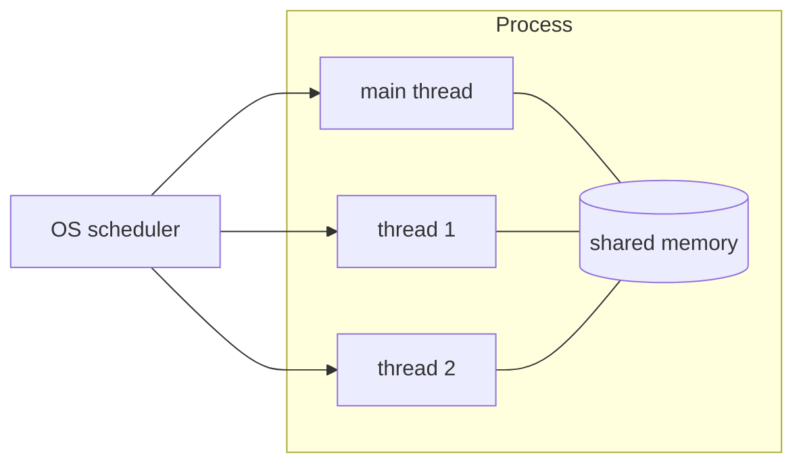

<!-- nav:top -->
[🏠 Start](../START-HERE.md) · [← 05.9 Smart pointers](09-smart-pointers.md) · [📋 Phase 05](README.md) · [05.11 Practical crates: serde, clap, thiserror and anyhow →](11-practical-crates-serde-clap-errors.md) · [📖 Glossary](../GLOSSARY.md) · [🇷🇺 Русский](../../ru/05-rust-intermediate/10-threads-channels-and-shared-state.md) <!-- nav -->

# Lesson 05.10 — Threads, channels and shared state

> **Phase 05 — Rust intermediate** · Lesson 10 of 14 · ⏱ about 3 hours (2 sittings)

## What you will learn

- What a thread is, and how to start one and wait for it with `std::thread`.
- Why threads need `move` closures, and how scoped threads let you borrow instead.
- How threads talk to each other by sending messages through a channel.
- How threads share data safely with `Arc<Mutex<T>>`, and what deadlock and poisoning are.
- What the traits `Send` and `Sync` mean, and how Rust prevents data races at compile time.

## Before you start

- You finished [Lesson 05.9 — Smart pointers](09-smart-pointers.md). You need `Rc`, `RefCell` and the idea of reference counting.
- You know closures and the `move` keyword: [Lesson 05.4 — Closures](04-closures.md).
- You know iterators: [Lesson 05.5 — Iterators](05-iterators.md).
- Create a project: `cd ~/projects/rust/code && cargo new p05-threads && cd p05-threads`. Put each example into `src/bin/<name>.rs` and run it with `cargo run --bin <name>`, or replace `src/main.rs` each time.

## New words

| Word | Meaning |
|---|---|
| **process** | A running program. It has its own memory, which other processes cannot touch. |
| **thread** | One line of execution inside a process. All threads of a process share its memory. |
| **concurrency** | Several tasks making progress during the same period of time (they may take turns on one CPU core). |
| **parallelism** | Several tasks running at the very same moment on different CPU cores. |
| **CPU** (Central Processing Unit) | The chip that runs program instructions. A modern CPU has several **cores**; each core runs one thread at a time. |
| **OS** (Operating System) | The program (macOS, Linux, Windows) that starts other programs and decides which thread runs on which core. |
| **`JoinHandle`** | A value returned by `thread::spawn`. You call `join()` on it to wait for the thread and get its result. |
| **scoped thread** | A thread that is guaranteed to finish before a given block ends, so it may borrow local variables. |
| **channel** | A pipe between threads. One end sends values, the other end receives them. |
| **mpsc** (multiple producer, single consumer) | The kind of channel in the standard library: many senders, one receiver. |
| **message passing** | Sharing information between threads by sending values, not by sharing memory. |
| **mutex** (mutual exclusion) | A lock that lets only one thread at a time use the data inside. |
| **guard** (`MutexGuard`) | The value you get from `lock()`. While you hold it, you hold the lock. When it is dropped, the lock opens. |
| **`Arc<T>`** (Atomically Reference Counted) | Like `Rc<T>`, but its counter is safe to use from many threads. |
| **data race** | Two threads use the same memory at the same time, at least one writes, and nothing orders them. The result is undefined. Safe Rust cannot have data races. |
| **race condition** | A bug where the result depends on the timing of threads. It can happen even without a data race. |
| **deadlock** | Two or more threads wait for each other forever. |
| **poisoning** | A mutex is marked "poisoned" when a thread panics while holding its lock. |
| **`Send`** | A marker trait: values of this type can be moved to another thread. |
| **`Sync`** | A marker trait: a shared reference `&T` can be used from many threads. |
| **marker trait** | A trait with no methods. It only labels a type with a property. |
| **atomic** | A number type (such as `AtomicUsize`) whose operations are done in one indivisible step, so threads can use it without a lock. |

## 1. Why threads?

Your computer has several CPU cores. Run `cargo run --bin cpus` with this program to see how many threads your computer can run at the same time:

```rust
use std::thread;

fn main() {
    let n = thread::available_parallelism().map(|n| n.get()).unwrap_or(1);
    println!("this computer can run {n} threads at the same time");
}
```

```text
this computer can run 12 threads at the same time
```

(Your number will be different; it depends on your CPU.) A program with only one thread uses one core and leaves the others idle. If you split the work into several threads, the OS can run them at the same moment on different cores, and the program finishes sooner. Threads are also used to wait for slow things (a network, a disk) without freezing the rest of the program.

Threads are powerful and dangerous. When two threads change the same data at the same time, the result is a **data race**, and the program can crash or give wrong answers in a way you cannot repeat. Many languages do not stop you from writing such bugs. Rust's ownership rules turn most of these mistakes into **compile-time errors**. This is sometimes called *fearless concurrency*.



## 2. Starting a thread

`thread::spawn` takes a closure and runs it in a new thread. It returns a `JoinHandle`. Calling `join()` waits for the thread to finish and gives you its return value.

```rust
use std::thread;

fn main() {
    let handle = thread::spawn(|| {
        println!("hello from the new thread");
        6 * 7
    });

    println!("hello from the main thread");
    let answer = handle.join().unwrap();
    println!("the thread returned {answer}");
}
```

```text
hello from the main thread
hello from the new thread
the thread returned 42
```

**What happens:**

1. `thread::spawn(|| { ... })` asks the OS for a new thread and runs the closure there. The closure returns `42` (the value of `6 * 7`).
2. The main thread does not wait. It prints its own line at once. The order of the first two lines is **not guaranteed**: in this run the main line came first, but on another run, or another computer, it can be the other way round.
3. `handle.join()` blocks the main thread until the new thread ends. It returns a `Result`: `Ok(value)` when the thread finished normally, `Err(...)` when it panicked.
4. `.unwrap()` takes the `Ok` value. `answer` is `42`.

> ⚠️ **Common mistake:** Forgetting `join()`. When `main` returns, the program ends, and threads that are still running are stopped in the middle. If you need the thread's work, `join` it.

If a thread panics, the other threads continue, and `join` tells you about it:

```rust
use std::thread;

fn main() {
    let handle = thread::spawn(|| {
        let v: Vec<i32> = Vec::new();
        v[0]
    });

    match handle.join() {
        Ok(value) => println!("value = {value}"),
        Err(_) => println!("the thread panicked, but main is still running"),
    }
}
```

```text
thread '<unnamed>' (3960248) panicked at src/main.rs:6:10:
index out of bounds: the len is 0 but the index is 0
note: run with `RUST_BACKTRACE=1` environment variable to display a backtrace
the thread panicked, but main is still running
```

The first three lines are the panic message of the thread (printed to the error stream; the number is a thread ID, an identifier that names the thread, and will differ). The last line comes from `main`: it got an `Err` from `join` and decided what to do.

## 3. Moving data into a thread

A thread can run longer than the function that started it. So Rust does not allow a thread to **borrow** local variables by default:

```rust
use std::thread;

fn main() {
    let numbers = vec![1, 2, 3];
    let handle = thread::spawn(|| {
        println!("{numbers:?}");
    });
    handle.join().unwrap();
}
```

```text
error[E0373]: closure may outlive the current function, but it borrows `numbers`, which is owned by the current function
 --> src/main.rs:5:32
  |
5 |     let handle = thread::spawn(|| {
  |                                ^^ may outlive borrowed value `numbers`
6 |         println!("{numbers:?}");
  |                    ------- `numbers` is borrowed here
  |
note: function requires argument type to outlive `'static`
...
help: to force the closure to take ownership of `numbers` (and any other referenced variables), use the `move` keyword
  |
5 |     let handle = thread::spawn(move || {
  |                                ++++
```

What it means: the closure only borrows `numbers`. But the new thread might still be running after `main` has ended and `numbers` has been freed. Then the thread would read freed memory. The note `function requires argument type to outlive 'static` says: a spawned closure must not hold borrows that can end (you learned `'static` in [Lesson 05.3 — Lifetimes](03-lifetimes.md)). The compiler's help gives the fix: `move`, which moves ownership of the variables into the closure.

```rust
use std::thread;

fn main() {
    let numbers = vec![1, 2, 3];
    let handle = thread::spawn(move || {
        let total: i32 = numbers.iter().sum();
        println!("sum = {total}");
    });
    handle.join().unwrap();
}
```

```text
sum = 6
```

**What happens:** `move` makes the closure the owner of `numbers`. The vector now lives inside the thread. The main thread cannot use `numbers` any more (it was moved). When the thread ends, the vector is freed.

### Scoped threads: borrowing without move

Often you want to split a job over local data and wait for the result anyway. For this, `thread::scope` creates threads that are **guaranteed to finish before the scope ends**. So they may borrow:

```rust
use std::thread;

fn main() {
    let numbers = vec![1, 2, 3, 4, 5, 6, 7, 8];
    let (left, right) = numbers.split_at(4);

    let (a, b) = thread::scope(|s| {
        let h1 = s.spawn(|| left.iter().sum::<i32>());
        let h2 = s.spawn(|| right.iter().sum::<i32>());
        (h1.join().unwrap(), h2.join().unwrap())
    });

    println!("left = {a}, right = {b}, total = {}", a + b);
    println!("numbers is still ours: {}", numbers.len());
}
```

```text
left = 10, right = 26, total = 36
numbers is still ours: 8
```

**What happens:**

1. `numbers.split_at(4)` cuts the vector into two slices: `[1, 2, 3, 4]` and `[5, 6, 7, 8]`. They only **borrow** from `numbers`.
2. `thread::scope(|s| { ... })` opens a scope. Inside it, `s.spawn(...)` starts threads. No `move` is needed, because the scope will not return until every thread in it has ended.
3. Each thread sums its half at the same time. Because they only **read** the data, sharing is safe.
4. After the scope, the borrows have ended, so `numbers` is fully ours again.

> 💡 **Tip:** Use `thread::scope` when you split a calculation over data you already have. Use `thread::spawn` for work that must outlive the current function.

> ⚡ **Performance:** A thread costs real resources (a few kilobytes to megabytes of stack, and time to start). Starting a thread for a tiny job is slower than doing the job. Split work into as many pieces as you have cores, not thousands. Always measure ([Lesson 05.12](12-benchmarking-basics.md)).

## 4. Channels: sharing by sending

A **channel** has two ends: a **sender** (`tx`, "transmit") and a **receiver** (`rx`, "receive"). One thread puts values in with `send`; another takes them out with `recv`. The standard library channel is `std::sync::mpsc`: **m**ultiple **p**roducer, **s**ingle **c**onsumer. You can have many senders, but one receiver.

The motto is: *"Do not communicate by sharing memory; share memory by communicating."* Instead of two threads touching the same data, one thread **sends** the data to the other, and the ownership moves with it.

```rust
use std::sync::mpsc;
use std::thread;

fn main() {
    let (tx, rx) = mpsc::channel();

    thread::spawn(move || {
        for word in ["one", "two", "three"] {
            tx.send(String::from(word)).unwrap();
        }
    });

    for received in rx {
        println!("got: {received}");
    }
    println!("channel closed");
}
```

```text
got: one
got: two
got: three
channel closed
```

**What happens:**

1. `mpsc::channel()` returns a pair `(tx, rx)`. The type of the messages (`String` here) is found by the compiler from the later `send` call.
2. The new thread owns `tx` (because of `move`). It sends three strings, one by one.
3. The main thread loops over `rx`. A `for` loop on a receiver waits for each message, gives it to the loop body, and **stops when the channel is closed**.
4. The channel closes when **all senders are dropped**. Here the only `tx` is dropped when the thread's closure ends. That is why the loop ends and `channel closed` is printed.

The main methods:

| Method | What it does |
|---|---|
| `tx.send(value)` | Sends a value. Returns `Err` if the receiver is already gone. |
| `rx.recv()` | Waits for a value. Returns `Err` when the channel is closed and empty. |
| `rx.try_recv()` | Does not wait. Returns `Err` at once if there is nothing now. |
| `rx.recv_timeout(duration)` | Waits at most for the given time. |
| `for x in rx` or `rx.iter()` | Receives until the channel is closed. |
| `tx.clone()` | Makes another sender for the same channel. |

`send` **moves** the value. After sending, you cannot use it, and the compiler checks that:

```rust
use std::sync::mpsc;
use std::thread;

fn main() {
    let (tx, rx) = mpsc::channel();

    thread::spawn(move || {
        let text = String::from("hi");
        tx.send(text).unwrap();
        println!("sent {text}");
    });

    println!("{}", rx.recv().unwrap());
}
```

```text
error[E0382]: borrow of moved value: `text`
  --> src/main.rs:10:25
   |
 8 |         let text = String::from("hi");
   |             ---- move occurs because `text` has type `String`, which does not implement the `Copy` trait
 9 |         tx.send(text).unwrap();
   |                 ---- value moved here
10 |         println!("sent {text}");
   |                         ^^^^ value borrowed here after move
```

Why this protects you: after `send`, the other thread owns the text and may change or free it. If the sender could still use it, we would have a data race. The ownership rules from [Phase 03](../03-ownership-and-borrowing/02-ownership-rules.md) stop it.

### Many producers

To have several senders, clone `tx` and give each thread its own copy:

```rust
use std::sync::mpsc;
use std::thread;

fn main() {
    let (tx, rx) = mpsc::channel();

    let mut handles = Vec::new();
    for id in 1..=3 {
        let tx = tx.clone();
        handles.push(thread::spawn(move || {
            for n in 0..2 {
                tx.send((id, n)).unwrap();
            }
        }));
    }
    drop(tx);

    let mut all: Vec<(i32, i32)> = rx.iter().collect();
    all.sort();
    println!("{all:?}");

    for h in handles {
        h.join().unwrap();
    }
}
```

```text
[(1, 0), (1, 1), (2, 0), (2, 1), (3, 0), (3, 1)]
```

**What happens:**

1. Each of the 3 threads gets its own clone of `tx` and sends two messages `(thread id, number)`.
2. `drop(tx)` drops the **original** sender. This is important: the channel closes only when **all** senders are gone, including the one in `main`. If you forget this line, `rx.iter()` waits forever.
3. `rx.iter().collect()` gathers all messages into a vector. The order in which messages arrive depends on timing, so we call `all.sort()` to get a stable result. A test must never depend on the arrival order of threads.
4. `join` on each handle makes sure the threads are finished.

> ⚠️ **Common mistake:** The program hangs forever at `for x in rx`. Almost always some sender is still alive (often the original `tx` that you forgot to `drop`).

## 5. Shared state with Mutex and Arc

Sometimes message passing is awkward: many threads must update one counter or one table. Then you share memory, but with a lock. A **mutex** ("mutual exclusion") allows only one thread at a time to use the data inside it.

### Mutex alone

```rust
use std::sync::Mutex;

fn main() {
    let m = Mutex::new(5);

    {
        let mut guard = m.lock().unwrap();
        *guard += 1;
    }

    println!("m = {:?}", m);
    println!("value = {}", *m.lock().unwrap());
}
```

```text
m = Mutex { data: 6, poisoned: false, .. }
value = 6
```

**What happens:**

1. `Mutex::new(5)` wraps the number `5`. The data lives **inside** the mutex; you cannot reach it without locking.
2. `m.lock()` waits until the lock is free, takes it, and returns `Result<MutexGuard<i32>, ...>`. `unwrap()` takes the guard (the error case is explained below).
3. The guard acts like a `&mut i32`. `*guard += 1` changes the number to 6.
4. At the end of the inner block, the guard is **dropped** and the lock is released automatically (this is `Drop` from [Lesson 05.9](09-smart-pointers.md) at work). You cannot forget to unlock.

### Sharing a mutex between threads: Arc<Mutex<T>>

To use one mutex from several threads, they must all **own** it. `Rc` would be perfect, but it is not safe for threads. The thread-safe version is `Arc<T>` (Atomically Reference Counted): same idea, but the counter is changed with atomic operations that are correct even when threads do it at the same time.

```rust
use std::sync::{Arc, Mutex};
use std::thread;

fn main() {
    let counter = Arc::new(Mutex::new(0));
    let mut handles = Vec::new();

    for _ in 0..8 {
        let counter = Arc::clone(&counter);
        handles.push(thread::spawn(move || {
            for _ in 0..1000 {
                *counter.lock().unwrap() += 1;
            }
        }));
    }

    for h in handles {
        h.join().unwrap();
    }

    println!("counter = {}", *counter.lock().unwrap());
}
```

```text
counter = 8000
```

**What happens:**

1. `Arc::new(Mutex::new(0))` creates the counter inside a mutex inside an `Arc`.
2. In the loop, `Arc::clone(&counter)` makes a new owner for each thread. The inner variable `counter` **shadows** the outer one; the `move` closure takes the inner one.
3. Each thread adds 1 to the number 1000 times. Each `lock()` gives exclusive access for one statement; the guard is a temporary value that is dropped at the end of the statement.
4. After all `join`s, the total is exactly 8 × 1000 = 8000. Without the mutex, this would be a data race, and the compiler would not let you write it.

```text
 thread 1 ─┐
 thread 2 ─┤        ┌─────────────────────────┐
   ...     ├──Arc──▶│ Mutex ── lock ── i32    │
 thread 8 ─┘        └─────────────────────────┘
 (only one thread inside the lock at a time)
```

What if you use `Rc` instead of `Arc`? The compiler stops you:

```rust
use std::rc::Rc;
use std::thread;

fn main() {
    let shared = Rc::new(5);
    let handle = thread::spawn(move || {
        println!("{shared}");
    });
    handle.join().unwrap();
}
```

```text
error[E0277]: `Rc<i32>` cannot be sent between threads safely
 --> src/main.rs:6:32
  |
6 |       let handle = thread::spawn(move || {
  |                    ------------- ^------
  |                    |             |
  |  __________________|_____________within this `{closure@src/main.rs:6:32: 6:39}`
  | |                  |
  | |                  required by a bound introduced by this call
7 | |         println!("{shared}");
8 | |     });
  | |_____^ `Rc<i32>` cannot be sent between threads safely
  |
  = help: within `{closure@src/main.rs:6:32: 6:39}`, the trait `Send` is not implemented for `Rc<i32>`
```

The key sentence: *the trait `Send` is not implemented for `Rc<i32>`*. Section 7 explains `Send`.

### Poisoning

What if a thread panics while it holds a lock? The data might be half-changed. Rust marks the mutex as **poisoned**, and later calls of `lock()` return `Err`:

```rust
use std::sync::{Arc, Mutex};
use std::thread;

fn main() {
    let data = Arc::new(Mutex::new(1));
    let d = Arc::clone(&data);
    let r = thread::spawn(move || {
        let _guard = d.lock().unwrap();
        panic!("oops while holding the lock");
    })
    .join();
    println!("thread result is_err = {}", r.is_err());
    println!("is poisoned = {}", data.is_poisoned());
    match data.lock() {
        Ok(_) => println!("lock ok"),
        Err(e) => println!("lock error: {e}"),
    }
}
```

```text
thread '<unnamed>' (3960473) panicked at src/main.rs:9:9:
oops while holding the lock
note: run with `RUST_BACKTRACE=1` environment variable to display a backtrace
thread result is_err = true
is poisoned = true
lock error: poisoned lock: another task failed inside
```

That is why you see `.lock().unwrap()` everywhere: `unwrap` turns a poisoned lock into a panic in the current thread. In simple programs this is the right choice: if another thread died in the middle of an update, the data cannot be trusted.

### Deadlock

A **deadlock** happens when thread 1 holds lock A and waits for lock B, while thread 2 holds lock B and waits for lock A. Neither can go on. This program does exactly that (with a short sleep to make it happen every time):

```rust
use std::sync::{Arc, Mutex};
use std::thread;
use std::time::Duration;

fn main() {
    let a = Arc::new(Mutex::new(0));
    let b = Arc::new(Mutex::new(0));

    let (a1, b1) = (Arc::clone(&a), Arc::clone(&b));
    let t1 = thread::spawn(move || {
        let _x = a1.lock().unwrap();
        thread::sleep(Duration::from_millis(100));
        let _y = b1.lock().unwrap();
        println!("thread 1 got both locks");
    });

    let (a2, b2) = (Arc::clone(&a), Arc::clone(&b));
    let t2 = thread::spawn(move || {
        let _y = b2.lock().unwrap();
        thread::sleep(Duration::from_millis(100));
        let _x = a2.lock().unwrap();
        println!("thread 2 got both locks");
    });

    t1.join().unwrap();
    t2.join().unwrap();
}
```

It prints nothing and never ends (when run under a 3-second `timeout`, it was killed with exit code 124). Press `Ctrl+C` to stop it if you try it.

```text
 thread 1: holds A ──waits for──▶ B
 thread 2: holds B ──waits for──▶ A      (a circle: nobody can move)
```

The compiler **cannot** prevent deadlocks. How to avoid them:

- Hold locks for as short a time as possible.
- If you need two locks, **always take them in the same order** in every thread.
- Do not call unknown code (callbacks, I/O) while holding a lock.
- Prefer channels when the design allows it.

> 📏 **Convention:** Keep the critical section (the code between `lock()` and the end of the guard) small. Do the heavy work first, then lock, update and unlock.

### Atomics

For a simple counter you do not need a mutex. An **atomic** number does `fetch_add` in one indivisible step:

```rust
use std::sync::atomic::{AtomicUsize, Ordering};
use std::sync::Arc;
use std::thread;

fn main() {
    let hits = Arc::new(AtomicUsize::new(0));
    let mut handles = Vec::new();

    for _ in 0..4 {
        let hits = Arc::clone(&hits);
        handles.push(thread::spawn(move || {
            for _ in 0..1000 {
                hits.fetch_add(1, Ordering::Relaxed);
            }
        }));
    }
    for h in handles {
        h.join().unwrap();
    }
    println!("hits = {}", hits.load(Ordering::Relaxed));
}
```

```text
hits = 4000
```

`Ordering::Relaxed` means "I only need this one number to be correct; I do not need it to order other memory operations". The other orderings (`Acquire`, `Release`, `SeqCst`) are subtle. Use atomics for plain counters and flags; the deep story is in Phase 14 (Concurrency and async in depth).

## 6. Which tool to use?

| Situation | Tool |
|---|---|
| Split a calculation over data you have, then collect results | `thread::scope` + `join` |
| A worker that runs for a long time | `thread::spawn` + `move` |
| Pass work or results between threads | a channel (`mpsc`) |
| Many threads update one value or table | `Arc<Mutex<T>>` |
| Many readers, few writers | `Arc<RwLock<T>>` (a lock that allows many readers *or* one writer) |
| A simple counter or flag | an atomic (`AtomicUsize`, `AtomicBool`) |
| A value shared and never changed | `Arc<T>` alone (no lock needed) |

## 7. Send and Sync: how Rust knows

Two marker traits make the thread rules work. You almost never implement them yourself; the compiler adds them automatically when all fields of your type have them.

| Trait | Meaning | Example |
|---|---|---|
| `Send` | A value of this type can be **moved** to another thread. | `i32`, `String`, `Vec<T>`, `Arc<T>`, `Mutex<T>`. **Not** `Rc<T>`. |
| `Sync` | A **shared reference** `&T` can be used by several threads. (`T` is `Sync` if `&T` is `Send`.) | `i32`, `String`, `Arc<T>`, `Mutex<T>`. **Not** `Rc<T>`, **not** `RefCell<T>`. |

`thread::spawn` requires that the closure is `Send` and `'static`. When you captured an `Rc`, the closure became not `Send`, and you saw `E0277`. The same check explains why `RefCell` (from [Lesson 05.9](09-smart-pointers.md)) cannot be shared between threads: its borrow counter is not thread-safe. `Mutex` is the thread-safe sibling of `RefCell`.

So the whole system is: **threads can only receive types marked `Send`, and the compiler decides the marks.** A data race needs shared memory plus mutation without a lock; the type system forbids exactly that combination in safe code.

> 🔒 **Security:** Data races are a classic source of security holes in programs written in languages that do not check them. Safe Rust cannot have them. Only `unsafe` code (Phase 06) can break the rules, and then the responsibility is yours.

## Common mistakes

1. **Forgetting `move`** – `E0373: closure may outlive the current function` (section 3). Add `move`, or use `thread::scope`.
2. **Using a value after `send`** – `E0382: borrow of moved value` (section 4). Clone it before sending, or do not use it.
3. **Using `Rc` or `RefCell` across threads** – `E0277: cannot be sent between threads safely` (section 5). Use `Arc` and `Mutex`.
4. **A program that hangs at `for x in rx`** – a sender is still alive. `drop` the original `tx`.
5. **A program that hangs on two locks** – a deadlock. Lock in the same order everywhere.
6. **Not joining threads** – their work may be lost when `main` ends.
7. **Holding a lock while doing slow work** – other threads wait. Lock, update, unlock.
8. **Relying on the order of output between threads** – it changes from run to run. In tests, collect the results and sort them, or compare sets.

> 🧪 **Testing:** A good thread test does not depend on timing. Start the threads, `join` them, then check the final result (a sum, a sorted list, a count). If a test fails once in 100 runs, there is a race condition in your code or in your test.

## Try it yourself

1. Create `src/bin/parallel.rs`:

```rust
use std::thread;

fn main() {
    let numbers: Vec<u64> = (1..=1_000).collect();
    let (left, right) = numbers.split_at(numbers.len() / 2);

    let total = thread::scope(|s| {
        let a = s.spawn(|| left.iter().sum::<u64>());
        let b = s.spawn(|| right.iter().sum::<u64>());
        a.join().unwrap() + b.join().unwrap()
    });

    println!("total = {total}");
}
```

2. Run `cargo run --bin parallel`. Expected output:

```text
total = 500500
```

3. Change `1_000` to `1_000_000`. Run again. The answer is `500000500000`. Both halves were summed in parallel.
4. Replace `thread::scope` with `thread::spawn` (and add `move` and `.to_vec()` for the slices). Read the compiler messages you get when you forget something. Which of the errors in this lesson do you recognize?

## Exercises

### Exercise 1 — Spawn and join (easy)

Start a thread that computes the sum of the numbers `1..=100` and returns it. In `main`, `join` the thread and print the result. Expected output: `5050`.

<details>
<summary>Hint</summary>

`thread::spawn(|| (1..=100).sum::<i32>())` returns a `JoinHandle<i32>`. Call `.join().unwrap()`.

</details>

<details>
<summary>Answer</summary>

```rust
use std::thread;

fn main() {
    let handle = thread::spawn(|| (1..=100).sum::<i32>());
    println!("{}", handle.join().unwrap());
}
```

```text
5050
```

Why it works: the closure's last expression is its return value. `join` hands it back as `Ok(5050)`.

</details>

### Exercise 2 — A channel from a worker (easy)

Start a thread that sends the numbers `1`, `2`, `3` (as `i32`) through a channel. In `main`, receive them with a `for` loop and print their sum (`6`).

<details>
<summary>Hint</summary>

`let (tx, rx) = mpsc::channel();`, send in a `move` closure, and `let sum: i32 = rx.iter().sum();`.

</details>

<details>
<summary>Answer</summary>

```rust
use std::sync::mpsc;
use std::thread;

fn main() {
    let (tx, rx) = mpsc::channel();

    thread::spawn(move || {
        for n in 1..=3 {
            tx.send(n).unwrap();
        }
    });

    let sum: i32 = rx.iter().sum();
    println!("{sum}");
}
```

```text
6
```

Why it works: the only sender lives in the thread. When the thread ends, the sender is dropped, the channel closes, and `rx.iter()` stops.

</details>

### Exercise 3 — Parallel sum with a test (medium)

Write `pub fn parallel_sum(numbers: &[u64], parts: usize) -> u64` that splits the slice into about `parts` chunks, sums each chunk in a scoped thread, and adds the results. Write a **test** that checks the sum of `1..=1000` (which is `500500`) with 4 and with 7 parts, and the sum of an empty slice (`0`).

The answers to Exercises 3–5 have no `main`, because only the tests use the function. Put each one into its own file in `src/bin/` and run it with `cargo test --bin <name>`. (`cargo run --bin <name>` would stop with `error[E0601]: main function not found`; add an empty `fn main() {}` if you also want to run the file.)

<details>
<summary>Hint</summary>

`numbers.chunks(size)` gives slices. The size is `numbers.len().div_ceil(parts).max(1)` (the `max(1)` avoids a size of 0 for an empty slice, because `chunks(0)` panics). Start one `s.spawn(move || chunk.iter().sum::<u64>())` per chunk and add the `join` results.

</details>

<details>
<summary>Answer</summary>

```rust
use std::thread;

pub fn parallel_sum(numbers: &[u64], parts: usize) -> u64 {
    let chunk_size = numbers.len().div_ceil(parts).max(1);
    thread::scope(|s| {
        let handles: Vec<_> = numbers
            .chunks(chunk_size)
            .map(|chunk| s.spawn(move || chunk.iter().sum::<u64>()))
            .collect();
        handles.into_iter().map(|h| h.join().unwrap()).sum()
    })
}

#[cfg(test)]
mod tests {
    use super::*;

    #[test]
    fn parallel_sum_matches_sequential() {
        let numbers: Vec<u64> = (1..=1000).collect();
        assert_eq!(parallel_sum(&numbers, 4), 500_500);
        assert_eq!(parallel_sum(&numbers, 7), 500_500);
        assert_eq!(parallel_sum(&[], 3), 0);
    }
}
```

Why it works: every chunk is a borrowed slice, which is fine inside `thread::scope`. The `collect()` into a `Vec` starts **all** threads first; only then do we `join`. (If we joined inside the `map`, we would wait for each thread before starting the next.) One more edge case: `parts` must be at least 1, because `div_ceil(0)` divides by zero and panics. A real library function would check this first, for example with `let parts = parts.max(1);`.

</details>

### Exercise 4 — A worker pipeline (medium)

Write `pub fn squares(input: Vec<u32>) -> Vec<u32>`. It starts a worker thread that reads numbers from one channel and sends their squares to another channel. The function sends all input numbers, closes the first channel, collects the squares from the second channel and returns them in order. Write a **test**: `vec![1, 2, 3, 4]` gives `vec![1, 4, 9, 16]`.

<details>
<summary>Hint</summary>

Two channels: `(tx_in, rx_in)` and `(tx_out, rx_out)`. The worker owns `rx_in` and `tx_out`. After sending, `drop(tx_in)`; otherwise the worker never stops, and `rx_out.iter()` never ends.

</details>

<details>
<summary>Answer</summary>

```rust
use std::sync::mpsc;
use std::thread;

pub fn squares(input: Vec<u32>) -> Vec<u32> {
    let (tx_in, rx_in) = mpsc::channel::<u32>();
    let (tx_out, rx_out) = mpsc::channel::<u32>();

    let worker = thread::spawn(move || {
        for n in rx_in {
            tx_out.send(n * n).unwrap();
        }
    });

    for n in input {
        tx_in.send(n).unwrap();
    }
    drop(tx_in);

    let result: Vec<u32> = rx_out.iter().collect();
    worker.join().unwrap();
    result
}

#[cfg(test)]
mod tests {
    use super::*;

    #[test]
    fn squares_in_order() {
        assert_eq!(squares(vec![1, 2, 3, 4]), vec![1, 4, 9, 16]);
    }
}
```

Why it works: there is one worker, so messages stay in order. When `tx_in` is dropped, the worker's `for` loop ends, the worker returns, and its `tx_out` is dropped. Then `rx_out.iter()` ends too.

</details>

### Exercise 5 — Count words with several threads (hard)

Write `pub fn count_words(texts: Vec<String>) -> HashMap<String, usize>`. Start one thread per text. All threads add their words to **one shared** `HashMap` protected by `Arc<Mutex<...>>`. At the end, return the plain `HashMap`. Write a **test** with the texts `"a b a"`, `"b c"` and `"a"`: expect `a` = 3, `b` = 2, `c` = 1.

<details>
<summary>Hint</summary>

Use `*counts.lock().unwrap().entry(word.to_string()).or_insert(0) += 1;` inside each thread. To get the map back from the `Arc`, use `Arc::try_unwrap(counts).unwrap().into_inner().unwrap()` after all threads were joined (only one owner is left).

</details>

<details>
<summary>Answer</summary>

```rust
use std::collections::HashMap;
use std::sync::{Arc, Mutex};
use std::thread;

pub fn count_words(texts: Vec<String>) -> HashMap<String, usize> {
    let counts = Arc::new(Mutex::new(HashMap::new()));
    let mut handles = Vec::new();

    for text in texts {
        let counts = Arc::clone(&counts);
        handles.push(thread::spawn(move || {
            for word in text.split_whitespace() {
                *counts.lock().unwrap().entry(word.to_string()).or_insert(0) += 1;
            }
        }));
    }
    for h in handles {
        h.join().unwrap();
    }

    Arc::try_unwrap(counts).unwrap().into_inner().unwrap()
}

#[cfg(test)]
mod tests {
    use super::*;

    #[test]
    fn counts_words_across_threads() {
        let texts = vec![
            String::from("a b a"),
            String::from("b c"),
            String::from("a"),
        ];
        let counts = count_words(texts);
        assert_eq!(counts["a"], 3);
        assert_eq!(counts["b"], 2);
        assert_eq!(counts["c"], 1);
        assert_eq!(counts.len(), 3);
    }
}
```

Why it works: each `lock()` gives one thread exclusive access for one statement, so two threads never change the map at the same moment. `Arc::try_unwrap` succeeds only when there is exactly one owner; after the joins, the clones inside the threads are gone. `into_inner()` takes the map out of the mutex (it returns a `Result` because of poisoning). The test does not depend on the thread order, because the final counts are the same in every order.

</details>

## Quiz

1. What does `join()` return, and why?

<details>
<summary>Answer</summary>

A `Result`. `Ok(value)` holds the value the thread returned. `Err` means the thread panicked. This way a panic in one thread does not crash the others, and you decide what to do.

</details>

2. Why does `thread::spawn` need `move` for a closure that uses a local `Vec`?

<details>
<summary>Answer</summary>

The thread can outlive the function, so it cannot borrow local data that will be freed. `move` gives the closure ownership of the data.

</details>

3. What makes `thread::scope` different from `thread::spawn`?

<details>
<summary>Answer</summary>

All scoped threads are guaranteed to finish before the scope ends, so they may borrow local variables without `move`.

</details>

4. When does a `for x in rx` loop end?

<details>
<summary>Answer</summary>

When the channel is closed: all senders (including clones) are dropped, and the queue is empty.

</details>

5. Why do we write `Arc<Mutex<T>>` and not `Rc<RefCell<T>>` for threads?

<details>
<summary>Answer</summary>

`Rc` and `RefCell` are not thread-safe: they are not `Send`/`Sync`, and the compiler refuses them. `Arc` has an atomic counter, and `Mutex` provides exclusive access with a real lock.

</details>

6. What is a deadlock and how do you avoid it?

<details>
<summary>Answer</summary>

Threads waiting for each other's locks forever. Avoid it by taking locks in the same order everywhere, holding them briefly, and not calling unknown code while holding a lock.

</details>

7. What do `Send` and `Sync` mean?

<details>
<summary>Answer</summary>

`Send`: a value can be moved to another thread. `Sync`: a shared reference `&T` can be used from several threads. They are marker traits that the compiler adds automatically.

</details>

8. Does Rust prevent race conditions?

<details>
<summary>Answer</summary>

It prevents **data races** (in safe code), but not every race condition. A bug where the result depends on timing (for example, checking a value and then acting on it in two separate locks) is still possible. You must design for it.

</details>

## Summary

- A thread is a line of execution inside a process. `thread::spawn` starts one; `join` waits and returns a `Result`.
- A spawned closure must own its data (`move`). `thread::scope` allows borrowing, because the threads end inside the scope.
- A channel (`mpsc`) sends values between threads. `send` moves the value. The receiver loop ends when all senders are dropped.
- `Arc<Mutex<T>>` shares changeable data. `lock()` gives a guard, and dropping the guard unlocks.
- Poisoned mutexes (a panic while locked) return `Err`; `.lock().unwrap()` is the common reaction.
- Deadlocks are not caught by the compiler. Lock in the same order, and keep locks short.
- `Send` and `Sync` are the marker traits that let the compiler reject `Rc` and `RefCell` in threads. Safe Rust cannot have data races.
- Tests for threaded code must not depend on timing.
- Git habit: a test that fails "sometimes" is a bug report. Run it many times before you commit (for example `for i in $(seq 1 20); do cargo test -q || break; done`), and write what you found in the commit message.

## Sources and further reading

- [The Rust Programming Language — Chapter 16: Fearless Concurrency](https://doc.rust-lang.org/book/ch16-00-concurrency.html) — the official chapter: threads, channels, `Mutex`, `Arc`, `Send` and `Sync`.
- [std::thread](https://doc.rust-lang.org/std/thread/index.html) — `spawn`, `scope`, `JoinHandle`, `available_parallelism`.
- [std::sync::mpsc](https://doc.rust-lang.org/std/sync/mpsc/index.html) — the channel API.
- [std::sync::Mutex](https://doc.rust-lang.org/std/sync/struct.Mutex.html) — locking, poisoning and examples.
- [std::sync::atomic](https://doc.rust-lang.org/std/sync/atomic/index.html) — atomic types and memory orderings.
- Mara Bos, *Rust Atomics and Locks* (O'Reilly, free online at [marabos.nl/atomics](https://marabos.nl/atomics/)) — the best book for the deep version of this topic; read it in Phase 14.

---

[🏠 Start](../START-HERE.md) · [← 05.9 Smart pointers](09-smart-pointers.md) · [📋 Phase 05](README.md) · [05.11 Practical crates: serde, clap, thiserror and anyhow →](11-practical-crates-serde-clap-errors.md) · [📖 Glossary](../GLOSSARY.md) <!-- nav -->
<!-- nav:bottom -->
