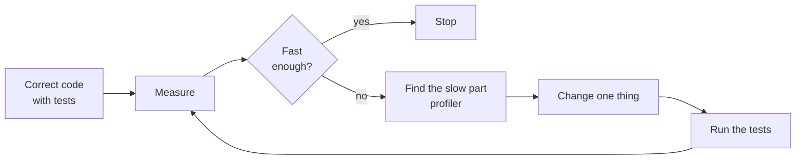

<!-- nav:top -->
[🏠 Start](../START-HERE.md) · [← 05.11 Practical crates: serde, clap, thiserror and anyhow](11-practical-crates-serde-clap-errors.md) · [📋 Phase 05](README.md) · [05.13 Project: minigrep →](13-project-minigrep.md) · [📖 Glossary](../GLOSSARY.md) · [🇷🇺 Русский](../../ru/05-rust-intermediate/12-benchmarking-basics.md) <!-- nav -->

# Lesson 05.12 — Benchmarking basics

> **Phase 05 — Rust intermediate** · Lesson 12 of 14 · ⏱ about 3 hours (2 sittings)

## What you will learn

- Why you measure speed before you try to improve it, and what "slow" even means.
- Why you must always measure in release mode, and how much it matters.
- How to time code by hand with `std::time::Instant`, and why one measurement is not enough.
- How the compiler can "cheat" a benchmark, and how `black_box` stops it.
- How to write proper benchmarks with `criterion`, compare two versions, and measure a whole program with `hyperfine`.
- How to record results with Git, so you can prove that a change really helped.

## Before you start

- You finished [Lesson 05.11 — Practical crates: serde, clap, thiserror and anyhow](11-practical-crates-serde-clap-errors.md).
- You know dev-dependencies and `Cargo.lock`: [Lesson 05.8 — Cargo: dependencies and versions](08-cargo-dependencies-and-versions.md).
- You know iterators ([Lesson 05.5](05-iterators.md)) and tests ([Lesson 05.6](06-testing-in-depth.md)).
- You know Git commits and branches: [Lesson 01.6 — Branches and merging](../01-git-and-version-control/06-branches-and-merging.md).
- Close heavy programs (video, games, big builds) while you measure. Plug in your laptop.

## New words

| Word | Meaning |
|---|---|
| **benchmark** | A program or test that measures how fast (or how memory-hungry) some code is. |
| **micro-benchmark** | A benchmark of one small function or operation. |
| **wall-clock time** | Time as a clock on the wall shows it: from the start to the end, including any waiting. |
| **latency** | How long one operation takes, from its start to its result. |
| **throughput** | How many operations are done per unit of time (for example, requests per second). |
| **ns**, **µs**, **ms**, **s** | Nanosecond (one billionth of a second), microsecond (one millionth), millisecond (one thousandth), second. |
| **optimization** | Changing code (or compiler settings) to make it faster or smaller. |
| **release profile** | The Cargo build settings used by `cargo build --release`: the compiler works hard to make the program fast. |
| **debug profile** | The default Cargo build settings: fast to compile, slow to run, easy to debug. |
| **LLVM** | The compiler backend that Rust uses to produce machine code and to optimize it. |
| **dead-code elimination** | An optimization that removes code whose result is never used. |
| **`black_box`** | A function (`std::hint::black_box`) that hides a value from the optimizer, so the compiler cannot remove or simplify the work around it. |
| **warm-up** | Running the code a few times before measuring, so caches are filled and the CPU is at full speed. |
| **noise** | Random variation between measurements, caused by the OS (Operating System), other programs, temperature and so on. |
| **outlier** | A measurement far away from the others. |
| **mean / median** | The average of the values / the middle value after sorting. The median is less affected by outliers. |
| **standard deviation** (σ, "sigma") | A number that says how much the measurements spread around the mean. |
| **baseline** | A saved set of results that you compare with later. |
| **regression** | A change that makes the program slower (or worse in another way) than before. |
| **profiler** | A tool that shows *where* a program spends its time. (You will use one in Phase 19.) |
| **CPU** (Central Processing Unit) | The chip that runs program instructions. |
| **RAM** (Random Access Memory) | The fast working memory of the computer. |

## 1. Measure first

> "Premature optimization is the root of all evil." — a famous saying by Donald Knuth, a computer scientist.

"Premature" means *too early*, before you know what is slow. Programmers are very bad at guessing where the time goes. The cure is simple:

1. **Make it correct** (with tests, [Lesson 05.6](06-testing-in-depth.md)).
2. **Measure** it. Is it really too slow for what you need? Which part?
3. **Change one thing.**
4. **Measure again.** Compare. Keep the change only if the numbers prove it helped.



Two words you will hear all the time:

- **Latency**: how long *one* thing takes. "This request took 12 ms."
- **Throughput**: how many things per second. "The server handles 5,000 requests per second."

They are not the same. A program can have good throughput and bad latency, and the other way round. A benchmark must say which one it measures. This lesson measures latency of small pieces of code.

> 📏 **Convention:** Optimize for the reader first. Clear code that is fast enough is better than clever code that is a little faster. KISS (Keep It Simple, Stupid) and measure before you break it.

## 2. Release mode: the first rule

Rust has two main build profiles. `cargo run` uses **debug**. `cargo run --release` uses **release**. The difference is huge. Try this program:

```rust
use std::time::Instant;

fn sum_of_squares(n: u64) -> u64 {
    let mut total = 0;
    for i in 0..n {
        total += i * i % 7;
    }
    total
}

fn main() {
    let start = Instant::now();
    let result = sum_of_squares(100_000_000);
    let elapsed = start.elapsed();
    println!("result = {result}");
    println!("took {:?}", elapsed);
}
```

```bash
cargo run
cargo run --release
```

```text
result = 199999997
took 757.635667ms
result = 199999997
took 32.388708ms
```

**What happens:**

1. `Instant::now()` reads a clock that only goes forward ("monotonic"). `start.elapsed()` gives the time that passed since then, as a `Duration`. `{:?}` prints it with a unit.
2. The same code, the same result, but release mode is about **23 times faster** on this computer (your numbers will differ, the ratio will be large).
3. In debug mode, the compiler does almost no optimization. It keeps every variable in memory, checks every overflow, and does not simplify loops. It prepares for the debugger, not for speed. In release mode, LLVM rewrites the code: it removes checks that it can prove unnecessary, keeps values in CPU registers, unrolls loops and more.

The release profile is controlled in `Cargo.toml`. These are the settings you meet most often (the values shown are for the sake of explanation, not a recommendation to copy):

```toml
[profile.release]
opt-level = 3        # 0 = no optimization ... 3 = most; "s"/"z" = small size
lto = "fat"          # optimize across all crates (slower build, faster program)
codegen-units = 1    # slower build, sometimes faster program
debug = true         # keep debug symbols (needed for profilers)
panic = "abort"      # no stack unwinding: smaller and a bit faster
```

> ⚠️ **Common mistake:** Benchmarking in debug mode and drawing conclusions. A debug benchmark measures how slow an unoptimized program is, which has almost nothing to do with the real speed. **Always measure with `--release`** (and `cargo bench` already does).

> 🔒 **Security:** In debug mode, integer overflow panics; in release mode it wraps silently (unless you set `overflow-checks = true`). Remember that a release build may behave differently from the debug build you tested. Use `checked_add`, `wrapping_add` or `saturating_add` ([Lesson 02.3](../02-programming-basics/03-operators-and-expressions.md)) when overflow is possible, so that the behavior is the same in both.

## 3. Timing by hand

`Instant` is the quickest tool. Always time more than once, because the first run is usually slower and any single run can be disturbed:

```rust
use std::hint::black_box;
use std::time::{Duration, Instant};

fn work(n: u64) -> u64 {
    let mut x: u64 = 1;
    for _ in 0..n {
        x = x.wrapping_mul(6364136223846793005).wrapping_add(1442695040888963407);
        x ^= x >> 33;
    }
    x
}

fn main() {
    let mut times: Vec<Duration> = Vec::new();
    for _ in 0..11 {
        let start = Instant::now();
        black_box(work(black_box(20_000_000)));
        times.push(start.elapsed());
    }
    times.sort();
    println!("min    = {:?}", times[0]);
    println!("median = {:?}", times[times.len() / 2]);
    println!("max    = {:?}", times[times.len() - 1]);
}
```

```text
min    = 26.906083ms
median = 27.152708ms
max    = 43.216292ms
```

(Second run on the same computer: min 27.07 ms, median 27.25 ms, max 38.67 ms.)

**What happens:**

1. `work` is a small loop of arithmetic on one number (a simple pseudo-random mixer). It is a stand-in for "some code that we want to measure".
2. We time it 11 times and keep every `Duration` in a vector. `sort()` orders them from the smallest to the largest.
3. The **min** is the best case (least disturbed). The **median** is the middle value: a typical run. The **max** is the worst, usually the result of some disturbance (here the first run or another program using the CPU).
4. Two runs of the whole program give almost the same min and median, but a different max. That is **noise**. A good report uses the median (or the min), not the max, and not a single run.

## 4. When the compiler cheats

The optimizer is clever. If the result of your code is never used, it may remove the code completely. Then you "measure" nothing:

```rust
use std::hint::black_box;
use std::time::Instant;

fn mix(n: u64) -> u64 {
    let mut x: u64 = 1;
    for _ in 0..n {
        x = x.wrapping_mul(6364136223846793005).wrapping_add(1442695040888963407);
        x ^= x >> 33;
    }
    x
}

fn main() {
    let start = Instant::now();
    let _ = mix(200_000_000);
    println!("result not used : {:?}", start.elapsed());

    let start = Instant::now();
    let r = mix(200_000_000);
    println!("result printed  : {:?} (result {r})", start.elapsed());

    let start = Instant::now();
    let r = black_box(mix(black_box(200_000_000)));
    println!("with black_box  : {:?} (result {r})", start.elapsed());
}
```

```bash
cargo run --release
```

```text
result not used : 41ns
result printed  : 293.468791ms (result 12760341528350204533)
with black_box  : 293.270584ms (result 12760341528350204533)
```

**What happens:**

1. In the first block, `let _ = mix(...)` throws the answer away. `mix` has no other effect (it does not print, write or change anything outside), so the optimizer deletes the whole call. 41 nanoseconds is the cost of reading the clock, not of the work. 200 million iterations in 41 ns would mean 5 billion iterations per nanosecond: impossible.
2. In the second block, the result is printed, so the work must happen: about 293 ms.
3. In the third block, `black_box` wraps the input and the output. `black_box(x)` returns `x`, but the compiler must assume it can be anything, and that it is used. So it cannot precompute or delete the work. Here the time is the same as when printing, which shows that the work was really done.

> 💡 **Tip:** A simple warning sign: if a benchmark reports a time that is impossibly small (nanoseconds for a big loop), the compiler removed your code. Use `std::hint::black_box` on the inputs and on the result.

The same trap exists when the compiler can compute the answer at compile time. For example, a plain sum of `i * 3 + 1` over a range is turned into a formula by LLVM, so even a large `n` takes almost no time. Keep your test inputs unpredictable for the optimizer (read them from `black_box` or from the outside).

## 5. criterion: proper benchmarks

Hand timing is fine for a quick look. For decisions you need statistics: many samples, warm-up, outlier detection and comparison with earlier results. The `criterion` crate does this. (Rust has a built-in `#[bench]`, but it works only on the unstable nightly compiler, so everybody uses `criterion` or the newer `divan`.)

We will compare ways to fill a vector with the numbers `0..n`, and two ways to sum a slice.

### The project

```bash
cd ~/projects/rust/code
cargo new --lib fast-fill
cd fast-fill
cargo add --dev criterion@0.8
```

Add this to the end of `Cargo.toml`:

```toml
[[bench]]
name = "fill"
harness = false
```

**What happens:** `[[bench]]` (double brackets: a list entry) declares a benchmark program that lives in `benches/fill.rs`. `harness = false` switches off the built-in test harness, because `criterion` brings its own `main` function.

`src/lib.rs`:

```rust
/// Builds `0, 1, 2, ... n-1` by pushing into an empty vector.
pub fn fill_push(n: usize) -> Vec<usize> {
    let mut v = Vec::new();
    for i in 0..n {
        v.push(i);
    }
    v
}

/// The same, but reserves the room first.
pub fn fill_with_capacity(n: usize) -> Vec<usize> {
    let mut v = Vec::with_capacity(n);
    for i in 0..n {
        v.push(i);
    }
    v
}

/// The same, with an iterator.
pub fn fill_collect(n: usize) -> Vec<usize> {
    (0..n).collect()
}

/// Sum with an index loop.
pub fn sum_index(data: &[u64]) -> u64 {
    let mut total = 0;
    for i in 0..data.len() {
        total += data[i];
    }
    total
}

/// Sum with an iterator.
pub fn sum_iter(data: &[u64]) -> u64 {
    data.iter().sum()
}

#[cfg(test)]
mod tests {
    use super::*;

    #[test]
    fn all_fills_agree() {
        for n in [0, 1, 10, 1000] {
            assert_eq!(fill_push(n), fill_with_capacity(n));
            assert_eq!(fill_push(n), fill_collect(n));
        }
    }

    #[test]
    fn both_sums_agree() {
        let data: Vec<u64> = (1..=100).collect();
        assert_eq!(sum_index(&data), 5050);
        assert_eq!(sum_iter(&data), 5050);
        assert_eq!(sum_index(&[]), 0);
        assert_eq!(sum_iter(&[]), 0);
    }
}
```

`benches/fill.rs`:

```rust
use criterion::{criterion_group, criterion_main, Criterion};
use fast_fill::{fill_collect, fill_push, fill_with_capacity, sum_index, sum_iter};
use std::hint::black_box;

fn bench_fill(c: &mut Criterion) {
    let mut group = c.benchmark_group("fill 10_000");
    group.bench_function("push", |b| b.iter(|| fill_push(black_box(10_000))));
    group.bench_function("with_capacity", |b| {
        b.iter(|| fill_with_capacity(black_box(10_000)))
    });
    group.bench_function("collect", |b| b.iter(|| fill_collect(black_box(10_000))));
    group.finish();
}

fn bench_sum(c: &mut Criterion) {
    let data: Vec<u64> = (0..10_000).collect();
    let mut group = c.benchmark_group("sum 10_000");
    group.bench_function("index loop", |b| b.iter(|| sum_index(black_box(&data))));
    group.bench_function("iterator", |b| b.iter(|| sum_iter(black_box(&data))));
    group.finish();
}

criterion_group!(benches, bench_fill, bench_sum);
criterion_main!(benches);
```

**What happens:**

1. The crate name `fast-fill` becomes `fast_fill` in code (dashes turn into underscores). `benches/` is a separate crate that can use only the `pub` items of your library, like an outside user.
2. `c.benchmark_group("...")` groups related benchmarks, so the report compares them. `bench_function("name", |b| b.iter(|| ...))` registers one benchmark. `b.iter` runs the closure over and over, and `criterion` decides how many times.
3. `black_box(10_000)` hides the input from the optimizer, and `criterion` automatically hides the result of the closure, so the work cannot be removed.
4. The unit tests check that all versions produce the same result. **A faster function that gives a wrong answer is worthless**, so always keep the correctness test next to the benchmark. `cargo test` runs it.
5. `criterion_group!` and `criterion_main!` are macros that make the `main` function of the benchmark program.

Run the benchmarks (they take about a minute; `cargo bench` builds with the optimized `bench` profile, which is like release):

```bash
cargo bench
```

```text
fill 10_000/push        time:   [4.6474 µs 4.7347 µs 4.8594 µs]
Found 2 outliers among 100 measurements (2.00%)
  1 (1.00%) high mild
  1 (1.00%) high severe
fill 10_000/with_capacity
                        time:   [3.4094 µs 3.4901 µs 3.5752 µs]
Found 4 outliers among 100 measurements (4.00%)
  1 (1.00%) high mild
  3 (3.00%) high severe
fill 10_000/collect     time:   [785.06 ns 792.68 ns 801.62 ns]
Found 3 outliers among 100 measurements (3.00%)
  3 (3.00%) high mild
sum 10_000/index loop   time:   [613.41 ns 616.35 ns 619.64 ns]
Found 3 outliers among 100 measurements (3.00%)
  2 (2.00%) high mild
  1 (1.00%) high severe
sum 10_000/iterator     time:   [609.91 ns 613.91 ns 620.49 ns]
Found 10 outliers among 100 measurements (10.00%)
  1 (1.00%) low severe
  1 (1.00%) low mild
  5 (5.00%) high mild
  3 (3.00%) high severe
```

(Between these lines criterion prints progress lines such as "Warming up for 3.0000 s" and "Collecting 100 samples"; they are left out here. Your numbers will be different; the ratios between lines matter.)

**How to read it:**

1. `time: [4.6474 µs 4.7347 µs 4.8594 µs]` is a **confidence interval**: the lower estimate, the best estimate, and the upper estimate of the time of **one call**. The narrower the interval, the more reliable the number.
2. `criterion` first **warmed up** for 3 seconds, then collected 100 samples, each made of many calls. It reported **outliers**: samples that were far from the rest (probably the OS doing something else). A few percent is normal; many outliers mean a noisy computer.
3. **Results:** `push` is the slowest (4.7 µs); `with_capacity` is about 26% faster (3.5 µs) because the vector does not need to grow and copy itself several times ([Lesson 04.7 — Vectors](../04-structs-enums-collections-errors/07-vectors.md)); `collect` is much faster still (0.79 µs), because the iterator knows the exact length in advance and the compiler can write the whole thing in one fast loop.
4. **The two sums are equal** (616 ns and 614 ns, inside each other's interval). This is the "zero-cost abstraction" promise: the iterator version is not slower than the hand-written index loop. (The index loop even does a bounds check on every `data[i]` that the compiler must prove away.) You do not need to avoid iterators "for speed".

> ⚡ **Performance:** The lesson from the numbers: knowing the size in advance (`with_capacity`, `collect`) helps; iterators are not slower than loops. But these gains are in microseconds. For a program that runs one time, they do not matter. They matter in code that runs millions of times. This is why we measure *where* time goes before changing anything.

### Comparing before and after with Git

You want to know if a change really helps, with a number. `criterion` can **save a baseline** and compare the next run to it. Git saves the code of each version. Together they give you evidence.

Start from a clean commit (the benchmark code and the functions were committed first):

```bash
git add .
git commit -m "feat(p05): add fill and sum functions with benchmarks"
cargo bench --bench fill -- "fill 10_000/push" --save-baseline before
```

```text
fill 10_000/push        time:   [4.5979 µs 4.6680 µs 4.7442 µs]
```

The text after `--` goes to criterion: first a **filter** (only the benchmark whose name contains this text), then `--save-baseline before` stores the results under the name `before` (in `target/criterion`, which is ignored by Git).

Now make **one** change: `fill_push` starts with `Vec::with_capacity(n)` instead of `Vec::new()`. Run the tests, then compare to the baseline:

```bash
cargo test
cargo bench --bench fill -- "fill 10_000/push" --baseline before
```

```text
fill 10_000/push        time:   [3.3332 µs 3.4298 µs 3.5326 µs]
                        change: [−29.695% −27.197% −24.954%] (p = 0.00 < 0.05)
                        Performance has improved.
Found 2 outliers among 100 measurements (2.00%)
  1 (1.00%) high mild
  1 (1.00%) high severe
```

**What happens:** criterion compares the new samples with the baseline and reports `change: [-29.7% -27.2% -25.0%]`: the function became about 27% faster. The `p = 0.00 < 0.05` is a statistical test: the chance that this difference is only noise is very small. Then it says "Performance has improved". If the p-value were large, you would see "No change in performance detected".

When we ran the *same code twice* (to see the noise), criterion answered `change: [-2.97% -1.70% -0.48%]` and "Change within noise threshold". A difference of 2% between identical runs is the noise level of this computer. Never believe an improvement smaller than the noise.

Now save the evidence in Git, with the numbers in the message:

```bash
git commit -am "perf(p05): reserve capacity in fill_push (4.67 us -> 3.43 us, about -27%)"
git log --oneline -2
```

```text
4defe17 perf(p05): reserve capacity in fill_push (4.67 us -> 3.43 us, about -27%)
6d661af feat(p05): add fill and sum functions with benchmarks
```

(The IDs on your computer will differ.) A performance change should be a **separate commit** with the numbers in the message. If a later change makes the program slower, `git bisect` or a look through `git log` finds the commit ([Lesson 01.4](../01-git-and-version-control/04-viewing-history-and-changes.md)). If you want to try an idea without risk, make a branch (`git switch -c try-faster-parse`), measure, and delete the branch if it did not help.

> 📏 **Convention:** Write down the environment with the numbers: the computer (for example, "Apple M4 Pro, 12 cores"), the Rust version (`rustc --version`), the profile (release) and the date. Numbers without an environment cannot be compared later.

## 6. hyperfine: measuring a whole program

`criterion` measures a function inside your code. `hyperfine` measures a **command**: the whole program, from start to exit, including startup and file reading. Use it when you want to compare two programs, two builds, or two options. Install it once with `cargo install hyperfine` (version 2.0 in this course). Then:

```bash
cargo build --release
hyperfine --warmup 3 './target/release/repeat'
```

```text
Benchmark 1: ./target/release/repeat (10 runs)
                mean     ±       σ          min     …     max
  Wall Time    301.9 ms  ±     1.4 ms     299.6 ms  …   303.6 ms
  Memory         1.9 MiB ±     0.0 MiB      1.9 MiB …     1.9 MiB
```

**What happens:**

1. `--warmup 3` runs the command 3 times before measuring, to fill the file cache.
2. `hyperfine` ran the program 10 times. It shows the mean, the standard deviation (`σ`), and the minimum and maximum of the wall-clock time. A small σ compared to the mean means a stable measurement. It also shows the peak memory (MiB means mebibyte: 1,048,576 bytes). (This program is the 11-run timing example of section 3, repeated; one run of 11 loops takes about 300 ms.)

Compare debug and release in one command:

```bash
hyperfine --warmup 1 --runs 5 './target/debug/repeat' './target/release/repeat'
```

```text
Benchmark 1: ./target/debug/repeat (5 runs)
                mean     ±       σ          min     …     max
  Wall Time    1.183 s   ±   0.010 s      1.168 s   …   1.193 s
  Memory         1.9 MiB ±     0.0 MiB      1.9 MiB …     1.9 MiB

Benchmark 2: ./target/release/repeat (5 runs)
                mean     ±       σ          min     …     max
  Wall Time    0.305 s   ±   0.001 s      0.304 s   …   0.306 s            -74.2%  (3.9x faster)
  Memory         1.9 MiB ±     0.0 MiB      1.9 MiB …     1.9 MiB           -1.6%
```

The second command is marked as 3.9 times faster. (For this program, which spends all its time in arithmetic, release is about 4 times faster; the earlier `sum_of_squares` example was 23 times faster. The factor depends on the code.)

## 7. How to measure honestly: a checklist

1. **Release mode only** (`--release`, `cargo bench`).
2. **Correct first.** Keep a test that proves that the fast version gives the same answer as the simple one.
3. **Use `black_box`** so the compiler cannot remove or precompute your work.
4. **Many runs, warm-up, median.** Never one run. Look at the spread, not only the mean.
5. **Quiet computer.** Close other programs. On a laptop, plug in the power: on battery, the CPU slows down. After a long run, the CPU may heat up and slow down too (thermal throttling).
6. **Realistic input.** A function can be fast for 10 items and slow for 10 million. Test sizes that you will really have. A function that reads a file measures the disk, not the code.
7. **Change one thing at a time**, and compare with a saved baseline.
8. **Record the environment** (computer, Rust version, date) with the numbers, and keep the results in Git.
9. **Distrust small differences.** If the change is smaller than the noise (a few percent on a laptop), there is no change.
10. **Measure the whole thing too.** A function that is 10 times faster but takes 1% of the program's time makes the program 0.9% faster. A *profiler* shows where the time goes (Phase 19 teaches it).

> 🧪 **Testing:** Treat a benchmark like a test: it lives in the repository, is built in the pipeline, and is run before big changes. Some teams run benchmarks automatically in CI (Continuous Integration: a server that builds and tests every commit) to catch regressions. Be careful: shared CI machines are noisy, so compare ratios, not absolute times.

## Common mistakes

1. **Benchmarking in debug mode.** The numbers are meaningless. Use `--release` or `cargo bench`.
2. **A result that is never used.** The compiler deletes the work (section 4: 41 ns for a 300 ms job). Use `black_box`.
3. **Benchmarking one run.** The first run is slow, and any run can be disturbed. Use many runs and the median, or `criterion`.
4. **Including setup in the measurement.** Building the input data inside the timed closure measures the setup too. Build the input outside `b.iter(...)`, as the `data` vector in `bench_sum`.
5. **No correctness test.** The "optimized" version returns a wrong answer fast. Test both versions with the same inputs.
6. **Believing noise.** A 2% "improvement" on a laptop is not an improvement. Run twice; if the same code gives a different answer by that much, you measured the noise.
7. **Optimizing the wrong thing.** A function that is 5% of the runtime cannot give more than a 5% gain. Find the slow part first.
8. **Comparing numbers from different computers or modes.** Compare only measurements made in the same environment.

## Try it yourself

1. Create `~/projects/rust/code/p05-bench` with `cargo new p05-bench`. Put the `sum_of_squares` program of section 2 into `src/main.rs`.
2. Run `cargo run` and `cargo run --release`. Write both times and the ratio.
3. Change `100_000_000` to `1_000` and run in release mode. What time do you see? (Probably a few microseconds or less.) A single run of a tiny task tells you almost nothing. This is why `criterion` runs thousands of iterations.
4. Create `src/bin/dead.rs` with the program from section 4 and run `cargo run --release --bin dead`. Check that the first line shows a few nanoseconds. (Now the package has two programs, so from here on `cargo run` needs `--bin <name>`; the first program is called `p05-bench`.)
5. Make a Git commit: `git add . && git commit -m "perf(p05): time sum_of_squares in debug and release"`.
6. Create the `fast-fill` project of section 5 and run `cargo bench`. Does the order of the results match the lesson?

## Exercises

### Exercise 1 — Time a function by hand (easy)

Write a program that times `fn count_primes(limit: u32) -> u32` (the number of primes below `limit`, by checking divisors up to the square root) with `Instant`. Time it 5 times for `limit = 200_000`, print the median, and use `black_box` so nothing is optimized away. Run it with `--release`.

<details>
<summary>Hint</summary>

Collect the 5 `Duration`s into a vector, `sort()` it and print the element in the middle (`times[2]`). Use `black_box(count_primes(black_box(200_000)))`.

</details>

<details>
<summary>Answer</summary>

```rust
use std::hint::black_box;
use std::time::{Duration, Instant};

fn count_primes(limit: u32) -> u32 {
    let mut count = 0;
    for n in 2..limit {
        let mut is_prime = true;
        let mut d = 2;
        while d * d <= n {
            if n % d == 0 {
                is_prime = false;
                break;
            }
            d += 1;
        }
        if is_prime {
            count += 1;
        }
    }
    count
}

fn main() {
    let mut times: Vec<Duration> = Vec::new();
    for _ in 0..5 {
        let start = Instant::now();
        black_box(count_primes(black_box(200_000)));
        times.push(start.elapsed());
    }
    times.sort();
    println!("primes below 200000: {}", count_primes(200_000));
    println!("median time: {:?}", times[2]);
}
```

The program prints `primes below 200000: 17984` and a median time (it depends on your computer; a few milliseconds in release mode).

Why it works: `black_box` stops the compiler from removing the calls, and the median of 5 runs is less affected by one disturbed run than a single measurement. The 17,984 is the known count of primes below 200,000.

</details>

### Exercise 2 — Explain the suspicious result (easy)

A friend writes a benchmark of a function that sorts a vector of one million numbers and shows you the result: `time: 0.4 ns`. The benchmark calls `v.sort();` on a vector that it created inside the loop and never reads again. Name at least two problems and say how to fix them.

<details>
<summary>Hint</summary>

Think about section 4, and about what a sort of one million numbers should cost. Also think about what happens when the same vector is sorted twice.

</details>

<details>
<summary>Answer</summary>

1. **0.4 ns is impossible** for sorting a million numbers (it would be in the milliseconds). The compiler removed the work because the sorted vector is never used (dead-code elimination). Fix: pass the input through `black_box`, and return or `black_box` the result.
2. The benchmark may build the vector inside the timed code, so the **setup is measured** together with the sort. Fix: create the input outside the measured part. With `criterion`, use `b.iter_batched(|| make_vector(), |mut v| { v.sort(); v }, BatchSize::SmallInput)`, which prepares a fresh vector for each run without timing the preparation.
3. If the same vector were sorted again and again, only the first sort would do real work (sorting a sorted vector is much cheaper). So each run needs a fresh unsorted copy (the same `iter_batched` fix).
4. Missing correctness check: a test that the output is really sorted.

Why it works: every one of these fixes makes the benchmark measure only the work that you want to compare, with real data.

</details>

### Exercise 3 — A criterion benchmark with a test (medium)

Create a library `joiner` with two functions: `join_loop(words: &[&str]) -> String` (a `String::new()` and `push_str` in a loop) and `join_concat(words: &[&str]) -> String` (the standard `words.concat()`). Write a **test** that both give `"rustisfun"` for `["rust", "is", "fun"]` and an empty string for an empty list. Write a `criterion` benchmark that compares them on 1000 copies of `"word"`. Does either one win clearly?

<details>
<summary>Hint</summary>

`cargo new --lib joiner`, `cargo add --dev criterion@0.8`, add the `[[bench]]` section with `name = "join"` and `harness = false`, create `benches/join.rs`. Build the input with `std::iter::repeat_n("word", 1000).collect::<Vec<&str>>()` outside the `b.iter` closure.

</details>

<details>
<summary>Answer</summary>

`src/lib.rs`:

```rust
/// Joins words one by one into a growing `String`.
pub fn join_loop(words: &[&str]) -> String {
    let mut out = String::new();
    for w in words {
        out.push_str(w);
    }
    out
}

/// Joins words with the standard `concat` method.
pub fn join_concat(words: &[&str]) -> String {
    words.concat()
}

#[cfg(test)]
mod tests {
    use super::*;

    #[test]
    fn both_ways_give_the_same_text() {
        let words = ["rust", "is", "fun"];
        assert_eq!(join_loop(&words), "rustisfun");
        assert_eq!(join_concat(&words), "rustisfun");
        assert_eq!(join_loop(&[]), "");
        assert_eq!(join_concat(&[]), "");
    }
}
```

`benches/join.rs`:

```rust
use criterion::{criterion_group, criterion_main, Criterion};
use joiner::{join_concat, join_loop};
use std::hint::black_box;

fn bench_join(c: &mut Criterion) {
    let words: Vec<&str> = std::iter::repeat_n("word", 1000).collect();
    let mut group = c.benchmark_group("join 1000 words");
    group.bench_function("loop", |b| b.iter(|| join_loop(black_box(&words))));
    group.bench_function("concat", |b| b.iter(|| join_concat(black_box(&words))));
    group.finish();
}

criterion_group!(benches, bench_join);
criterion_main!(benches);
```

And in `Cargo.toml`:

```toml
[dev-dependencies]
criterion = "0.8"

[[bench]]
name = "join"
harness = false
```

On the author's computer: `loop` 2.39 µs, `concat` 2.31 µs. The intervals are close (about 3% apart), so there is no clear winner. `concat` calculates the final length first and allocates once, while the loop grows its buffer, but for this size the difference is small.

Why it works: the benchmark builds the input once, outside the timed closure, and hides it with `black_box`. The test makes sure that both functions agree. The honest conclusion is "no meaningful difference": choose the clearer code (`concat`).

</details>

### Exercise 4 — Compare two builds with hyperfine (medium)

Use the `repeat` program from section 3 (or any program of yours). Compare the debug and release builds with `hyperfine`. Report the mean times and the ratio. Then explain why the ratio is not the same for every program.

<details>
<summary>Hint</summary>

`cargo build` and `cargo build --release` make two executables in `target/debug` and `target/release`. Give both paths to one `hyperfine` command, with `--warmup 1 --runs 5`.

</details>

<details>
<summary>Answer</summary>

```bash
cargo build
cargo build --release
hyperfine --warmup 1 --runs 5 './target/debug/repeat' './target/release/repeat'
```

On the author's computer: debug 1.183 s, release 0.305 s, so release is 3.9 times faster (your numbers will differ).

Why the ratio is different for every program: release mode helps most where the optimizer can simplify the code (small loops, iterator chains, small functions that can be inlined). It helps little when the program spends its time waiting for the disk or the network, or in code that is already optimized (such as the standard library functions, which are always compiled in release mode). The earlier `sum_of_squares` loop was about 23 times faster in release mode, while this program is about 4 times faster.

</details>

### Exercise 5 — Prove an optimization with Git and a baseline (hard)

In `fast-fill`, the function `fill_push` starts with `Vec::new()`. Prove with numbers and Git that `Vec::with_capacity(n)` makes it faster. Do all the steps: commit the clean code, save a baseline named `before`, make the change, run the tests, compare with the baseline, and commit with the numbers in the message. Then run the comparison a second time without any change and explain what you see.

<details>
<summary>Hint</summary>

Use `cargo bench --bench fill -- "fill 10_000/push" --save-baseline before` first. After the change use `--baseline before`. The second comparison on unchanged code should print "within noise threshold" or "No change in performance detected".

</details>

<details>
<summary>Answer</summary>

```bash
git add .
git commit -m "feat(p05): add fill and sum functions with benchmarks"
cargo bench --bench fill -- "fill 10_000/push" --save-baseline before
```

Edit `src/lib.rs`: in `fill_push`, change `let mut v = Vec::new();` to `let mut v = Vec::with_capacity(n);`.

```bash
cargo test
cargo bench --bench fill -- "fill 10_000/push" --baseline before
git commit -am "perf(p05): reserve capacity in fill_push (4.67 us -> 3.43 us, about -27%)"
```

The comparison shows `change: [-29.695% -27.197% -24.954%] (p = 0.00 < 0.05)` and "Performance has improved". (Your percentages will be different, but the sign and the size should be similar.)

If you run the same comparison again without any change, you get a small number (a percent or two) and "Change within noise threshold" or "No change in performance detected".

Why it works: the baseline stores the old samples, so criterion can run a statistical test on old against new. Two runs of identical code show the noise level of the computer: any claimed gain must be clearly bigger than that. The test run before the benchmark proves that the faster version still gives the same answer. The commit message keeps the evidence in the history, so nobody has to repeat the experiment to know why the change was made.

</details>

## Quiz

1. Why must you benchmark in release mode?

<details>
<summary>Answer</summary>

Debug mode turns almost all optimizations off, so it can be many times slower and does not show the real speed of the program. Real users run release builds.

</details>

2. A benchmark reports 41 ns for a loop of 200 million iterations. What happened?

<details>
<summary>Answer</summary>

The compiler removed the code because the result was never used (dead-code elimination), or it computed the answer at compile time. Use `std::hint::black_box` on the inputs and the result.

</details>

3. Why do you run a benchmark many times and use the median?

<details>
<summary>Answer</summary>

Single runs are noisy (the OS, other programs, caches, temperature). Many runs show the spread, and the median is not much affected by a few outliers.

</details>

4. What does `harness = false` mean in a `[[bench]]` section?

<details>
<summary>Answer</summary>

It switches off Rust's built-in test harness for that benchmark, because `criterion` provides its own `main` function.

</details>

5. What does `change: [-29.7% -27.2% -25.0%] (p = 0.00 < 0.05)` tell you?

<details>
<summary>Answer</summary>

Compared with the saved baseline, the code is about 27% faster (the interval is from 25% to 30%), and the statistical test says that the chance of this being only noise is very small.

</details>

6. When do you use `hyperfine` instead of `criterion`?

<details>
<summary>Answer</summary>

When you want to measure a whole program or command (start to exit, including file reading and startup), or to compare two builds or two programs. `criterion` measures a function inside your code.

</details>

7. Why should a performance change be its own Git commit with the numbers in the message?

<details>
<summary>Answer</summary>

It records the evidence and the reason. Later you can find the commit that made the program slower, revert only that change, and nobody has to repeat the measurement to understand the history.

</details>

8. A function takes 2% of a program's run time. You make it 10 times faster. How much faster is the program?

<details>
<summary>Answer</summary>

About 1.8% faster (the 2% part becomes 0.2%, so the total goes from 100% to 98.2%). Optimizing something small cannot give a big gain; find the slow part first with a profiler.

</details>

## Summary

- Make it correct, then measure, then change one thing, then measure again. Do not guess where the time goes.
- Always measure in release mode: it can be 4 to 25 times faster than debug, or more.
- Time by hand with `Instant`, many runs, and the median. One run is noise.
- The optimizer removes work whose result is unused. `std::hint::black_box` keeps your benchmark honest. A time of a few nanoseconds for a big job is a warning sign.
- `criterion` gives warm-up, many samples, confidence intervals, outlier detection and comparison with a saved baseline. `hyperfine` measures whole commands.
- Keep a correctness test next to every benchmark. A fast wrong answer is useless.
- Record results in Git: one commit per optimization, with the numbers and the environment.
- Ignore changes smaller than the noise.

## Sources and further reading

- [The Cargo Book — Profiles](https://doc.rust-lang.org/cargo/reference/profiles.html) — all settings of the `dev` and `release` profiles (`opt-level`, `lto`, `debug`, `panic`).
- [std::hint::black_box](https://doc.rust-lang.org/std/hint/fn.black_box.html) — what `black_box` does and does not promise.
- [std::time::Instant](https://doc.rust-lang.org/std/time/struct.Instant.html) — the monotonic clock.
- [The Criterion.rs book](https://bheisler.github.io/criterion.rs/book/) — the user guide: groups, baselines, `iter_batched`, reports.
- [criterion on docs.rs](https://docs.rs/criterion/) — the API documentation.
- [hyperfine on GitHub](https://github.com/sharkdp/hyperfine) — the command-line benchmarking tool, with all options.
- [The Rust Performance Book](https://nnethercote.github.io/perf-book/) — a practical guide to making Rust programs fast, including benchmarking and profiling.

---

[🏠 Start](../START-HERE.md) · [← 05.11 Practical crates: serde, clap, thiserror and anyhow](11-practical-crates-serde-clap-errors.md) · [📋 Phase 05](README.md) · [05.13 Project: minigrep →](13-project-minigrep.md) · [📖 Glossary](../GLOSSARY.md) <!-- nav -->
<!-- nav:bottom -->
