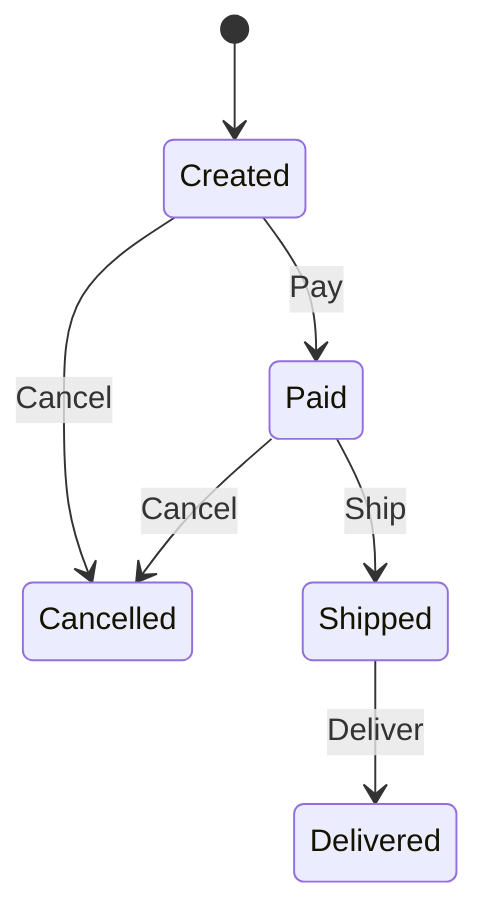

<!-- nav:top -->
[🏠 Start](../START-HERE.md) · [← 08.7 RAII and guards](07-raii-and-guards.md) · [📋 Phase 08](README.md) · [08.9 Strategy and dependency injection →](09-strategy-and-dependency-injection.md) · [📖 Glossary](../GLOSSARY.md) · [🇷🇺 Русский](../../ru/08-software-design/08-state-machines-and-typestate.md) <!-- nav -->

# Lesson 08.8 — State machines and the typestate pattern

> **Phase 08 — Software design: principles, patterns and conventions** · Lesson 8 of 17 · ⏱ about 2.5 hours (2 sittings)

## What you will learn

- What a **state machine** is: states, events and transitions.
- How to write one with an `enum` and a `match`, and how to test every transition.
- The **typestate** pattern: making each state its own type, so that a wrong order of operations does not compile.
- How `PhantomData` and generic marker types give typestate at no run-time cost.
- How to choose between the enum and the typestate approach.

## Before you start

- You finished [Lesson 08.7 — RAII and guards](07-raii-and-guards.md).
- You know enums and `match` ([Lessons 04.3 to 04.5](../04-structs-enums-collections-errors/03-enums.md)), ownership and moves ([Lesson 03.3](../03-ownership-and-borrowing/03-move-copy-and-clone.md)) and generics ([Lesson 05.1](../05-rust-intermediate/01-generics.md)).
- You remember "make invalid states impossible" ([Lesson 08.5](05-type-driven-design.md)) and the builder ([Lesson 08.6](06-builder-pattern.md)).

## New words

| Word | Meaning |
|---|---|
| **state machine** (FSM: Finite State Machine) | A model of something that is always in exactly one of a fixed list of **states**, and moves between them when **events** happen. |
| **state** | A situation the thing can be in: `Created`, `Paid`, `Shipped`. |
| **event** | Something that happens and may change the state: `Pay`, `Ship`. |
| **transition** | A move from one state to another, caused by an event. A transition table lists which ones are allowed. |
| **typestate** | A pattern in which the state is part of the *type* of a value (`Door<Open>`, `Door<Closed>`). Operations that are not allowed in a state do not exist for that type. |
| **marker type** | An empty struct (`struct Open;`) used only as a name for a state. It carries no data. |
| **`PhantomData<T>`** | A standard type with no data and no size. It tells the compiler "this struct is tied to the type `T`", although no field of type `T` exists. |
| **zero-sized type** | A type whose values take no memory, like `struct Open;` or `PhantomData<T>`. |

## 1. State machines in plain words

Many things in programs have a life with stages. An online order is created, then paid, then shipped, then delivered. A network connection is closed, connecting, open, closed again. A door is open, closed or locked. These are **state machines**:

- The thing is in exactly **one state** at a time.
- **Events** cause **transitions** to another state.
- Some transitions are **not allowed**: you cannot ship an unpaid order or deliver an order that was cancelled.

A diagram is the best way to design one:



Each arrow is an allowed transition. Every pair (state, event) that has **no arrow** is forbidden. In Lesson 08.5 you saw that a pile of `bool` flags (`paid`, `shipped`, `cancelled`) allows impossible combinations, such as paid and cancelled and shipped. A state machine replaces the flags with one value that says exactly where you are.

## 2. A state machine as an enum

The simplest way to write it in Rust: an `enum` for the states, an `enum` for the events, and a function that takes the current state and an event, and returns the next state.

```rust
#[derive(Debug, Clone, PartialEq)]
enum Order {
    Created,
    Paid { amount_cents: u64 },
    Shipped { tracking: String },
    Delivered,
    Cancelled,
}

#[derive(Debug)]
enum Event {
    Pay(u64),
    Ship(String),
    Deliver,
    Cancel,
}

impl Order {
    fn next(&self, event: Event) -> Result<Order, String> {
        match (self, event) {
            (Order::Created, Event::Pay(amount_cents)) => Ok(Order::Paid { amount_cents }),
            (Order::Created | Order::Paid { .. }, Event::Cancel) => Ok(Order::Cancelled),
            (Order::Paid { .. }, Event::Ship(tracking)) => Ok(Order::Shipped { tracking }),
            (Order::Shipped { .. }, Event::Deliver) => Ok(Order::Delivered),
            (state, event) => Err(format!("cannot apply {event:?} to {state:?}")),
        }
    }
}

fn main() {
    let order = Order::Created;
    println!("{:?}", order.next(Event::Ship("X1".to_string())));

    let order = order.next(Event::Pay(1500)).unwrap();
    println!("{order:?}");
    let order = order.next(Event::Ship("X1".to_string())).unwrap();
    println!("{order:?}");
    let order = order.next(Event::Deliver).unwrap();
    println!("{order:?}");
    println!("{:?}", order.next(Event::Cancel));
}
```

**What happens:**

1. `Order` has one variant per state. Data that belongs to a state lives **inside** that variant: the paid amount exists only in `Paid`, the tracking number only in `Shipped` (Lesson 08.5).
2. `Event` lists what can happen. `Pay` and `Ship` carry data.
3. `next` matches on the **pair** `(self, event)`. Each allowed transition is one arm. The pattern `Order::Created | Order::Paid { .. }` allows `Cancel` from two states.
4. The last arm `(state, event)` catches every other pair and returns an `Err` that names both. That is the "forbidden" part.
5. `next` takes `&self` and returns a new `Order`, so the old value stays unchanged if the transition fails.
6. `main` tries to ship a new order (error), then walks through the happy path, then tries to cancel a delivered order (error).

```text
Err("cannot apply Ship(\"X1\") to Created")
Paid { amount_cents: 1500 }
Shipped { tracking: "X1" }
Delivered
Err("cannot apply Cancel to Delivered")
```

> ⚠️ **Common mistake:** The catch-all arm is convenient, but it hides new combinations. If you add a state `Refunded` later, the compiler will not remind you to decide what each event does there, because the last arm already covers it. In a machine with many states, list the forbidden pairs explicitly, or add a test that checks the whole table (see below).

> 🧪 **Testing:** A state machine is a table, so test it as a table. Write one test for the happy path, one that loops over all states and checks that a forbidden event returns `Err`, and one for the states that must be final.

## 3. Typestate: one type per state

The enum has a limit: the check happens **when the program runs**. The call `order.next(Event::Ship(..))` on a new order compiles fine and returns `Err`. But often the order of operations is known **while you write the code**. In that case the compiler can check it for you.

The idea of **typestate**: make every state its own type. A method that moves to the next state **takes `self` by value** and **returns the next type**. Methods exist only on the types where they are allowed.

```rust
struct Draft {
    items: Vec<String>,
}

struct Paid {
    items: Vec<String>,
    amount_cents: u64,
}

struct Shipped {
    tracking: String,
}

impl Draft {
    fn new() -> Draft {
        Draft { items: Vec::new() }
    }

    fn add(&mut self, item: &str) {
        self.items.push(item.to_string());
    }

    // Takes `self` by value: the Draft is gone after this call.
    fn pay(self, amount_cents: u64) -> Paid {
        Paid {
            items: self.items,
            amount_cents,
        }
    }
}

impl Paid {
    fn ship(self, tracking: &str) -> Shipped {
        println!(
            "shipping {} items, paid {}",
            self.items.len(),
            self.amount_cents
        );
        Shipped {
            tracking: tracking.to_string(),
        }
    }
}

impl Shipped {
    fn tracking(&self) -> &str {
        &self.tracking
    }
}

fn main() {
    let mut draft = Draft::new();
    draft.add("tea");
    draft.add("cake");
    let paid = draft.pay(650);
    let shipped = paid.ship("X1");
    println!("tracking: {}", shipped.tracking());
}
```

**What happens:**

1. `Draft`, `Paid` and `Shipped` are three different types. Each holds only the data that makes sense in its state.
2. `Draft::pay(self, ...)` consumes the draft and returns a `Paid`. The `items` are moved into the new value.
3. `ship` exists only on `Paid`, and `tracking` only on `Shipped`.
4. `main` can only follow the legal path: `draft.pay(650)`, then `.ship("X1")`, then `.tracking()`.

```text
shipping 2 items, paid 650
tracking: X1
```

Now the mistakes. Shipping an unpaid order is not just an `Err` at run time, it does not compile:

```rust
struct Draft;
struct Paid;

impl Draft {
    fn pay(self) -> Paid {
        Paid
    }
}

impl Paid {
    fn ship(self) {}
}

fn main() {
    let draft = Draft;
    draft.ship(); // shipping an unpaid order
}
```

```text
error[E0599]: no method named `ship` found for struct `Draft` in the current scope
  --> src/main.rs:16:11
   |
 1 | struct Draft;
   | ------------ method `ship` not found for this struct
...
16 |     draft.ship(); // shipping an unpaid order
   |           ^^^^ method not found in `Draft`

For more information about this error, try `rustc --explain E0599`.
error: could not compile `demo` (bin "demo") due to 1 previous error
```

And because `pay` takes `self` by value, the old state cannot be used again:

```rust
struct Draft;
struct Paid;

impl Draft {
    fn pay(self) -> Paid {
        Paid
    }
}

fn main() {
    let draft = Draft;
    let _paid = draft.pay();
    let _again = draft.pay(); // paying the same draft twice
}
```

```text
error[E0382]: use of moved value: `draft`
  --> src/main.rs:13:18
   |
11 |     let draft = Draft;
   |         ----- move occurs because `draft` has type `Draft`, which does not implement the `Copy` trait
12 |     let _paid = draft.pay();
   |                       ----- `draft` moved due to this method call
13 |     let _again = draft.pay(); // paying the same draft twice
   ...

For more information about this error, try `rustc --explain E0382`.
error: could not compile `demo` (bin "demo") due to 1 previous error
```

The ownership rules of Rust (Lesson 03.3) do the hard work: after a transition, the old value is **gone**. Without that rule you would need run-time flags to prevent "use after transition".

## 4. Typestate with generics and `PhantomData`

With three or four states that share most of their fields, repeating the fields in every struct is boring. The common solution is one generic struct, with the state as a type parameter:

```rust
use std::marker::PhantomData;

struct Open;
struct Closed;
struct Locked;

struct Door<State> {
    times_opened: u32,
    _state: PhantomData<State>,
}

impl Door<Closed> {
    fn new() -> Door<Closed> {
        Door {
            times_opened: 0,
            _state: PhantomData,
        }
    }
    fn open(self) -> Door<Open> {
        Door {
            times_opened: self.times_opened + 1,
            _state: PhantomData,
        }
    }
    fn lock(self) -> Door<Locked> {
        Door {
            times_opened: self.times_opened,
            _state: PhantomData,
        }
    }
}

impl Door<Open> {
    fn close(self) -> Door<Closed> {
        Door {
            times_opened: self.times_opened,
            _state: PhantomData,
        }
    }
}

impl Door<Locked> {
    fn unlock(self) -> Door<Closed> {
        Door {
            times_opened: self.times_opened,
            _state: PhantomData,
        }
    }
}

// Methods that work in every state.
impl<State> Door<State> {
    fn times_opened(&self) -> u32 {
        self.times_opened
    }
}

fn main() {
    let door = Door::new(); // Door<Closed>
    let door = door.open(); // Door<Open>
    let door = door.close(); // Door<Closed>
    let door = door.lock(); // Door<Locked>
    println!("locked after {} opening(s)", door.times_opened());
    let door = door.unlock().open();
    println!("opened {} times", door.times_opened());
    println!(
        "size of Door<Open>: {} bytes",
        std::mem::size_of::<Door<Open>>()
    );
}
```

**What happens:**

1. `Open`, `Closed` and `Locked` are **marker types**: empty structs, used only as names.
2. `Door<State>` has a type parameter `State`, but no field of that type. Rust insists that a type parameter must be used, so we add `_state: PhantomData<State>`. It takes no memory.
3. Each `impl Door<Closed>` / `Door<Open>` / `Door<Locked>` block holds the methods allowed in that state. `open` consumes a `Door<Closed>` and returns a `Door<Open>`, so there is no `lock` on an open door.
4. `impl<State> Door<State>` has methods that work in **every** state, like `times_opened`.
5. `main` walks through the legal transitions. The last line prints the size of a `Door<Open>`: 4 bytes, exactly the size of the `u32`. The state costs nothing at run time.

```text
locked after 1 opening(s)
opened 2 times
size of Door<Open>: 4 bytes
```

Trying `Door::new().lock().open()` is a compile error (`open` does not exist for `Door<Locked>`), in the same way as in Section 3.

> ⚡ **Performance:** Typestate is a compile-time idea. After compilation, the marker types and `PhantomData` are gone; the program has no state checks, because the checks were already done by the compiler.

> 🧪 **Testing:** For typestate the compiler is the test. You only test the code *inside* each transition (does `open` count correctly?). If you write a library and want to prove that a forbidden call does not compile, put an example marked `compile_fail` in a documentation comment, and `cargo test` will check that it fails (Lesson 05.7 introduced doc tests).

## 5. Enum or typestate?

| | Enum state machine | Typestate |
|---|---|---|
| When are wrong transitions found? | At run time (`Err`) | At compile time |
| State decided by... | Data that arrives while running (network messages, user input, a file) | The order of calls written in your code |
| Can you keep objects in different states in one `Vec`? | Yes, they are the same type | No (different types), unless you wrap them in an enum |
| Code size | One type, one `match` | One type (or `impl` block) per state |
| Error messages | Your own `Err` values | Compiler messages (E0599, E0382) |
| Best for | Parsers, protocols driven by incoming messages, workflows stored in a database | Builders, protocol handshakes in your own code, resource lifecycles (open, use, close) |

You can combine them. When a connection's state arrives from outside, keep an enum whose variants hold the typestate values: `enum AnyDoor { Open(Door<Open>), Closed(Door<Closed>), Locked(Door<Locked>) }`. The code that handles one state still enjoys the compile-time checks, and the enum handles the part that is decided at run time.

**When NOT to use typestate:**

- The state changes because of **data you read at run time**. The compiler cannot know it.
- There are many states, or transitions that go in cycles in many ways. Each state needs a type, and the code grows fast.
- The types leak into public signatures and make an API (Application Programming Interface: the functions and types a library offers) hard to use: `fn run(door: Door<Open>)` is fine, but a generic `fn process<S>(door: Door<S>)` with many bounds is not pleasant.
- The ordering rule is not important enough. An enum with a test is simpler (KISS, "Keep It Simple, Stupid", Lesson 08.1).

## Common mistakes

**Mistake 1: a state machine made of `bool`s.** `paid: bool, shipped: bool, cancelled: bool` allows eight combinations when only four make sense. Use one enum.

**Mistake 2: transition methods that take `&mut self` in typestate.** Without `self` by value, the old state value stays alive and usable after the transition, and the pattern loses its main benefit. Typestate transitions consume `self`.

**Mistake 3: forgetting that the catch-all arm swallows new states.** See the warning in Section 2.

**Mistake 4: one big `impl` for all states.** In typestate, put each method in the `impl` block of the state where it is valid. A method in `impl<State> Door<State>` is available in every state.

## Try it yourself

1. Create the package:

```bash
cd ~/projects/rust
cargo new code/p08-typestate
cd code/p08-typestate
```

2. Copy the enum state machine of Section 2 (`Order`, `Event`, `next` and `main`) into `src/main.rs` and run it.

3. Add a state `Order::Refunded`, an event `Event::Refund`, and the transition "a delivered order can be refunded" (`Delivered` + `Refund` gives `Refunded`). Change `main` to walk the happy path to `Delivered` and then refund it, and to try cancelling a new order.

4. Add a test module with these three tests, then run `cargo test`:

```rust
#[cfg(test)]
mod tests {
    use super::*;

    #[test]
    fn the_happy_path_ends_in_delivered() {
        let order = Order::Created
            .next(Event::Pay(100))
            .and_then(|o| o.next(Event::Ship("T".to_string())))
            .and_then(|o| o.next(Event::Deliver));
        assert_eq!(order, Ok(Order::Delivered));
    }

    #[test]
    fn only_delivered_orders_can_be_refunded() {
        let others = [
            Order::Created,
            Order::Paid { amount_cents: 1 },
            Order::Shipped {
                tracking: "T".to_string(),
            },
            Order::Cancelled,
        ];
        for state in others {
            assert!(
                state.next(Event::Refund).is_err(),
                "{state:?} must not be refundable"
            );
        }
        assert_eq!(Order::Delivered.next(Event::Refund), Ok(Order::Refunded));
    }

    #[test]
    fn finished_orders_accept_no_more_events() {
        for state in [Order::Delivered, Order::Cancelled, Order::Refunded] {
            assert!(state.next(Event::Cancel).is_err());
            assert!(state.next(Event::Pay(1)).is_err());
        }
    }
}
```

```text
running 3 tests
test tests::finished_orders_accept_no_more_events ... ok
test tests::only_delivered_orders_can_be_refunded ... ok
test tests::the_happy_path_ends_in_delivered ... ok

test result: ok. 3 passed; 0 failed; 0 ignored; 0 measured; 0 filtered out; finished in 0.00s
```

5. Save:

```bash
cargo fmt
cargo clippy
git add .
git commit -m "feat(p08): order state machine"
```

**What happens:** The second test is the important one. It walks through every other state and checks that `Refund` fails, which a human reader of the `match` could easily miss.

## Exercises

### Exercise 1 — Draw the table (easy)

A vending machine has the states `Idle`, `HasCoin` and `Dispensing`. The events are `InsertCoin`, `PressButton`, `TakeItem` and `RefundCoin`. Draw a transition table (which events are allowed in which state, and what is the next state). Make the machine realistic: you cannot press the button without a coin.

<details>
<summary>Hint</summary>

Start from `Idle`. Which single event is meaningful there? Then ask the same of `HasCoin` and `Dispensing`.

</details>

<details>
<summary>Answer</summary>

| State | Event | Next state |
|---|---|---|
| `Idle` | `InsertCoin` | `HasCoin` |
| `HasCoin` | `PressButton` | `Dispensing` |
| `HasCoin` | `RefundCoin` | `Idle` |
| `Dispensing` | `TakeItem` | `Idle` |

Every pair that is not in the table is forbidden (for example `Idle` + `PressButton`).

Why it works: a table of allowed transitions is the specification; the code and its tests are a translation of the table.

</details>

### Exercise 2 — A document in typestate (medium)

Write `Document<State>` with the states `Draft`, `InReview` and `Published`. A draft can be `submit`ted (becomes `InReview`). A document in review can be `approve`d (becomes `Published`) or `reject`ed (back to `Draft`). Only a published document has a `text()` method. **Write tests**.

<details>
<summary>Hint</summary>

Copy the structure of `Door<State>`: marker structs, `PhantomData<State>`, and one `impl` block per state. Every transition takes `self` and builds a new `Document` with the same `text`.

</details>

<details>
<summary>Answer</summary>

```rust
use std::marker::PhantomData;

struct Draft;
struct InReview;
struct Published;

struct Document<State> {
    text: String,
    _state: PhantomData<State>,
}

impl Document<Draft> {
    fn new(text: &str) -> Document<Draft> {
        Document {
            text: text.to_string(),
            _state: PhantomData,
        }
    }
    fn submit(self) -> Document<InReview> {
        Document {
            text: self.text,
            _state: PhantomData,
        }
    }
}

impl Document<InReview> {
    fn approve(self) -> Document<Published> {
        Document {
            text: self.text,
            _state: PhantomData,
        }
    }
    fn reject(self) -> Document<Draft> {
        Document {
            text: self.text,
            _state: PhantomData,
        }
    }
}

impl Document<Published> {
    fn text(&self) -> &str {
        &self.text
    }
}

fn main() {
    let doc = Document::new("hello").submit().approve();
    println!("{}", doc.text());

    // A rejected document goes back to the draft state and can be sent again.
    let again = Document::new("second try")
        .submit()
        .reject()
        .submit()
        .approve();
    println!("{}", again.text());
}

#[cfg(test)]
mod tests {
    use super::*;

    #[test]
    fn a_document_is_published_only_after_review() {
        let published = Document::new("hi").submit().approve();
        assert_eq!(published.text(), "hi");
    }

    #[test]
    fn a_rejected_document_goes_back_to_draft() {
        let draft_again = Document::new("hi").submit().reject();
        let published = draft_again.submit().approve();
        assert_eq!(published.text(), "hi");
    }
}
```

Why it works: `text()` exists only in `impl Document<Published>`, so reading an unpublished document does not compile. The second test shows that the cycle draft, review, draft, review, published works.

</details>

### Exercise 3 — A builder that cannot forget the host (hard)

In Lesson 08.6 a missing host was found by `build()` at run time. Make it a compile-time check: `ServerBuilder<NoHost>` has `host(self, ..) -> ServerBuilder<HasHost>`, `port` works in both states, and `build` exists only for `ServerBuilder<HasHost>` and does not need to return a `Result`. **Write a test** for the happy path.

<details>
<summary>Hint</summary>

The state parameter marks whether the host is set. Put `port` in `impl<HostState> ServerBuilder<HostState>`, `host` in `impl ServerBuilder<NoHost>` and `build` in `impl ServerBuilder<HasHost>`.

</details>

<details>
<summary>Answer</summary>

```rust
use std::marker::PhantomData;

struct NoHost;
struct HasHost;

#[allow(dead_code)] // the fields are only printed with {:?}
#[derive(Debug)]
struct Server {
    host: String,
    port: u16,
}

struct ServerBuilder<HostState> {
    host: Option<String>,
    port: u16,
    _state: PhantomData<HostState>,
}

impl ServerBuilder<NoHost> {
    fn new() -> ServerBuilder<NoHost> {
        ServerBuilder {
            host: None,
            port: 8080,
            _state: PhantomData,
        }
    }

    fn host(self, host: &str) -> ServerBuilder<HasHost> {
        ServerBuilder {
            host: Some(host.to_string()),
            port: self.port,
            _state: PhantomData,
        }
    }
}

impl<HostState> ServerBuilder<HostState> {
    fn port(mut self, port: u16) -> ServerBuilder<HostState> {
        self.port = port;
        self
    }
}

impl ServerBuilder<HasHost> {
    // Only exists when the host is set: no Result needed.
    fn build(self) -> Server {
        Server {
            host: self.host.unwrap_or_default(),
            port: self.port,
        }
    }
}

fn main() {
    let server = ServerBuilder::new().port(9000).host("localhost").build();
    println!("{server:?}");
}

#[cfg(test)]
mod tests {
    use super::*;

    #[test]
    fn build_after_setting_the_host() {
        let server = ServerBuilder::new().host("h").port(1).build();
        assert_eq!((server.host.as_str(), server.port), ("h", 1));
    }
}
```

Why it works: `ServerBuilder::new().port(1).build()` is a compile error, because `build` does not exist for `ServerBuilder<NoHost>`. The price: three impl blocks and two marker types instead of one `if` in `build`. Use this only for really important required fields.

</details>

## Quiz

1. What three things make up a state machine?

<details>
<summary>Answer</summary>

States, events, and transitions between states (with a table of which transitions are allowed).

</details>

2. Why does a typestate transition method take `self` by value?

<details>
<summary>Answer</summary>

So that the old value is moved away and cannot be used after the transition; only the new type can be used.

</details>

3. What does `PhantomData<State>` do?

<details>
<summary>Answer</summary>

It ties the struct to the type parameter `State` without storing any data. It has zero size.

</details>

4. When is an enum a better choice than typestate?

<details>
<summary>Answer</summary>

When the state is decided by data that arrives at run time, when many objects in different states must live in one collection, or when the number of states is large.

</details>

5. How do you test a typestate API?

<details>
<summary>Answer</summary>

You test the code inside the transitions; the compiler already checks the order. A `compile_fail` doc test can prove that a forbidden call does not compile.

</details>

## Summary

- A **state machine** has states, events and transitions; draw the diagram and write the table first.
- Write it as an `enum` for the states and a `next` function with `match (state, event)`; put data inside the variant that needs it; test the whole table.
- **Typestate** gives each state its own type; transitions take `self` and return the next type; wrong orders become compile errors (E0599 and E0382).
- `Door<State>` with marker structs and `PhantomData<State>` shares fields between states and costs nothing at run time.
- Use an enum when the state comes from run-time data; use typestate when the order of calls is written in your code. Combine them by wrapping typestate values in an enum.
- Typestate is powerful but heavy: use it for required builder fields, handshakes and resource lifecycles, not for everything.

## Sources and further reading

- [The Rust Programming Language — 18.3 Implementing an Object-Oriented Design Pattern](https://doc.rust-lang.org/book/ch18-03-oo-design-patterns.html) — the state pattern, and how the book encodes states as types.
- [Cliffle — The Typestate Pattern in Rust](http://cliffle.com/blog/rust-typestate/) — a well-known article with practical examples.
- [std::marker::PhantomData](https://doc.rust-lang.org/std/marker/struct.PhantomData.html) — the standard documentation, with examples of unused type parameters.
- [Rust API Guidelines — Type safety](https://rust-lang.github.io/api-guidelines/type-safety.html) — static distinctions and builders.

---

[🏠 Start](../START-HERE.md) · [← 08.7 RAII and guards](07-raii-and-guards.md) · [📋 Phase 08](README.md) · [08.9 Strategy and dependency injection →](09-strategy-and-dependency-injection.md) · [📖 Glossary](../GLOSSARY.md) <!-- nav -->
<!-- nav:bottom -->
