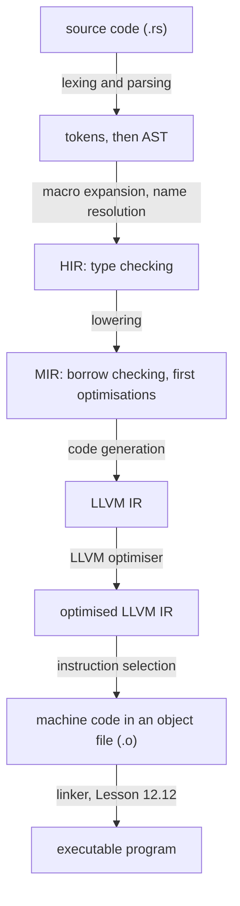

<!-- nav:top -->
[🏠 Start](../START-HERE.md) · [← 12.7 Reading assembly: arm64 and x86-64](07-reading-assembly.md) · [📋 Phase 12](README.md) · [12.9 The memory hierarchy and caches →](09-memory-hierarchy-and-caches.md) · [📖 Glossary](../GLOSSARY.md) · [🇷🇺 Русский](../../ru/12-computer-systems/08-from-rust-to-machine-code.md) <!-- nav -->

# Lesson 12.8 — From Rust to machine code

> **Phase 12 — Computer systems** · Lesson 8 of 15 · ⏱ about 135 minutes

## What you will learn

- The stages a Rust program passes through inside the compiler: tokens, syntax tree, HIR, MIR, LLVM IR and machine code.
- How to look at MIR and LLVM IR yourself, and what they tell you.
- What the optimiser does: constant folding, inlining, turning multiplications into shifts, vectorisation.
- How generics are compiled (monomorphisation) and what that costs.
- Where bounds checks and overflow checks appear in machine code, and how to write code that does not need them.

## Before you start

- You finished [Lesson 12.7 — Reading assembly](07-reading-assembly.md). Keep working in the library `code/p12-asm`, and keep `cargo asm` installed.
- You know generics and trait bounds ([Lesson 05.1 — Generics](../05-rust-intermediate/01-generics.md)) and iterators ([Lesson 05.5 — Iterators](../05-rust-intermediate/05-iterators.md)).
- Lesson 05.1 used the word *monomorphisation*; this lesson shows it in machine code.

## New words

| Word | Meaning |
|---|---|
| **compiler front end / back end** | The front end understands the language (parsing, types, borrow checking). The back end turns the result into machine code for one CPU. |
| **token** | One "word" of source code: a name, a number, a symbol like `{` or `+=`. Cutting text into tokens is called *lexing*. |
| **AST** (Abstract Syntax Tree) | A tree that shows the structure of the code: this function contains this loop, which contains this addition. |
| **IR** (Intermediate Representation) | A form of the program between source code and machine code, made for analysis and optimisation. |
| **HIR** (High-level Intermediate Representation) | The compiler's tree form of your code after macros are expanded and names are resolved. Type checking works on it. |
| **MIR** (Mid-level Intermediate Representation) | A simple form made of small *basic blocks* and jumps. The borrow checker works on it. |
| **LLVM** | A large open-source compiler back end used by Rust (and others). The name was once short for "Low Level Virtual Machine"; today it is just a name. |
| **LLVM IR** | LLVM's own intermediate representation, a typed assembly-like language that does not depend on the CPU. |
| **optimiser** | The part of the compiler that rewrites the program into a faster equivalent one. |
| **constant folding** | Computing at compile time what can be known at compile time (`24 * 60 * 60` becomes `86400`). |
| **inlining** | Copying the body of a called function into the caller, removing the call. It also opens the way for more optimisations. |
| **monomorphisation** | Making a separate copy of a generic function for each concrete type it is used with. |
| **vectorisation** | Rewriting a loop so that SIMD (Single Instruction, Multiple Data) instructions process several elements at once. |
| **bounds check** | The test `index < len` before an indexing operation; if it fails, the program panics instead of reading wrong memory. |

## 1. The journey of a program

When you run `cargo build`, `rustc` sends your code through a chain of forms. Each form is simpler and closer to the machine than the one before:



| Stage | Who does it | What is checked or changed there |
|---|---|---|
| Tokens and AST | `rustc` front end | Syntax errors ("expected `;`") |
| HIR | `rustc` front end | Names, types, trait bounds (`error[E0308]: mismatched types`) |
| MIR | `rustc` | Borrow checking (`error[E0502]`), overflow and bounds checks are inserted, some optimisations |
| LLVM IR | LLVM | Most optimisations: inlining, constant folding, vectorisation |
| Machine code | LLVM back end for one target | Instructions for arm64 or x86-64, registers chosen |

The split explains two things you have seen. **Compile errors** come from the front end: the borrow checker never sees machine code. And **one front end serves many CPUs**: up to LLVM IR, the program is the same for your Mac and for an x86-64 server; only the last step differs, which is why `--target` was all you needed in Lesson 12.7.

## 2. Looking at MIR and LLVM IR

`rustc` can write every intermediate form to a file. In `code/p12-asm`, start again with these two functions in `src/lib.rs`:

```rust
#[inline(never)]
pub fn add(a: u64, b: u64) -> u64 {
    a + b
}

#[inline(never)]
pub fn max_of(a: i64, b: i64) -> i64 {
    if a > b { a } else { b }
}
```

```bash
cargo rustc --release -- --emit=llvm-ir,mir
find target/release -name '*.mir' -o -name '*.ll'
```

```text
target/release/build/p12-asm/23f927fa6bcefef6/out/p12_asm-23f927fa6bcefef6.mir
target/release/build/p12-asm/23f927fa6bcefef6/out/p12_asm-23f927fa6bcefef6.ll
```

The `.mir` file starts with a friendly warning: the format is for humans and may change at any time. Here is `max_of` in MIR:

```text
fn max_of(_1: i64, _2: i64) -> i64 {
    debug a => _1;
    debug b => _2;
    let mut _0: i64;
    let mut _3: bool;

    bb0: {
        StorageLive(_3);
        _3 = Gt(copy _1, copy _2);
        switchInt(move _3) -> [0: bb2, otherwise: bb1];
    }

    bb1: {
        _0 = copy _1;
        goto -> bb3;
    }

    bb2: {
        _0 = copy _2;
        goto -> bb3;
    }

    bb3: {
        StorageDead(_3);
        return;
    }
}
```

**What happens:**

1. Variables have numbers: `_0` is always the return value, `_1` and `_2` are the arguments (`debug a => _1` connects them to your names), `_3` is a temporary for the condition.
2. The code is cut into **basic blocks** `bb0` to `bb3`: straight lines of statements that end with a jump. `switchInt` jumps to `bb2` if `_3` is 0 (false) and to `bb1` otherwise. Your `if` became an explicit branch.
3. `StorageLive` / `StorageDead` mark when `_3` exists; the borrow checker uses such information.

MIR still has the branch. Now look at the same function in the `.ll` file (LLVM IR) after optimisation:

```text
define noundef i64 @_RNvCs6NKwHiZURaG_7p12_asm6max_of(i64 noundef %a, i64 noundef %b) unnamed_addr #0 !guid !5 {
start:
  %a.b = tail call i64 @llvm.smax.i64(i64 %a, i64 %b)
  ret i64 %a.b
}
```

LLVM recognised the pattern "the bigger of two signed numbers" and replaced the whole `if` with its built-in operation `llvm.smax` (signed maximum). Values in LLVM IR have types (`i64` is a 64-bit integer; LLVM does not care about signed or unsigned, the *operation* decides) and names starting with `%`. In the last step, the arm64 back end turned `smax` into the `cmp` + `csel` you saw in Lesson 12.7, and the x86-64 back end into `cmp` + `cmov`.

`add` in LLVM IR is one line, `%_0 = add i64 %b, %a`, which became `add x0, x1, x0`.

> 💡 **Tip:** You will rarely read MIR or LLVM IR. But when you wonder "is this the compiler's fault or mine?", the order of the stages tells you where to look: an error message comes from the front end; a surprising slow loop is usually visible in the assembly first, and in LLVM IR if you need to know why.

## 3. Debug and release: two different programs

`cargo build` and `cargo build --release` use different **profiles**. The settings that matter most here:

| Setting | `dev` profile (`cargo build`) | `release` profile (`cargo build --release`) |
|---|---|---|
| `opt-level` | `0` (no optimisation) | `3` (full optimisation) |
| `debug-assertions` | on (`debug_assert!` runs) | off |
| `overflow-checks` | on (panic on overflow) | off (wrap) |
| `debug` | full debug information | none |

Here is `add` in a debug build. `cargo asm` has the option `--dev` for that:

```bash
cargo asm --lib --dev p12_asm::add
```

```text
p12_asm::add:
	sub sp, sp, #48
	stp x29, x30, [sp, #32]
	add x29, sp, #32
	str x0, [sp, #16]
	stur x1, [x29, #-8]
	add x8, x0, x1
	str x8, [sp, #8]
	subs x8, x8, x0
	b.lo LBB0_2
	b LBB0_1
LBB0_1:
	ldr x0, [sp, #8]
	ldp x29, x30, [sp, #32]
	add sp, sp, #48
	ret
LBB0_2:
	adrp x0, l_anon.f577d3d8f76b8b9f77c080ae11dfbdf2.1@PAGE
	add x0, x0, l_anon.f577d3d8f76b8b9f77c080ae11dfbdf2.1@PAGEOFF
	bl core::panicking::panic_const::panic_const_add_overflow
```

**What happens:**

1. Without optimisation, every value gets a home on the stack (`str x0, [sp, #16]` and so on), so that a debugger can always show it. That is why debug builds are slow, and why they are easy to debug.
2. `add x8, x0, x1` is the real addition. Then comes the **overflow check**: `subs x8, x8, x0` compares the sum with `a` (it computes `sum − a` and sets the flags). For unsigned numbers, adding `b` can make the result *smaller* than `a` only if it wrapped around. So `b.lo` ("branch if lower", an unsigned condition from Lesson 12.7) jumps to `LBB0_2` exactly when the addition overflowed.
3. `LBB0_2` loads the address of a message (`adrp` + `add` build a 64-bit address in two steps) and calls the function that panics with "attempt to add with overflow".

In MIR (debug), you can see where this check came from. The front end itself wrote it into the program:

```text
fn add(_1: u64, _2: u64) -> u64 {
    debug a => _1;
    debug b => _2;
    let mut _0: u64;
    let mut _3: (u64, bool);

    bb0: {
        _3 = AddWithOverflow(copy _1, copy _2);
        assert(!move (_3.1: bool), "attempt to compute `{} + {}`, which would overflow", copy _1, copy _2) -> [success: bb1, unwind continue];
    }

    bb1: {
        _0 = move (_3.0: u64);
        return;
    }
}
```

`AddWithOverflow` returns the pair (wrapped result, overflow flag) — exactly `overflowing_add` from Lesson 12.2 — and `assert` panics if the flag is set. In the release MIR this check is simply not generated, because `overflow-checks` is off.

> ⚡ **Performance:** You can change profile settings in `Cargo.toml`. A common one for projects with slow debug builds is `[profile.dev] opt-level = 1`: a little optimisation, still debuggable. `opt-level = "s"` or `"z"` optimises for small size instead of speed. Lesson 19.8 covers LTO (Link-Time Optimisation) and other build settings for speed.

## 4. Four optimisations you can see

Add these functions to `src/lib.rs`. Note that `square` has **no** `#[inline(never)]` this time:

```rust
fn square(x: u64) -> u64 {
    x.wrapping_mul(x)
}

#[inline(never)]
pub fn sum_of_squares(a: u64, b: u64) -> u64 {
    square(a).wrapping_add(square(b))
}

#[inline(never)]
pub fn sum_to_ten() -> u64 {
    (1..=10).sum()
}

#[inline(never)]
pub fn sum_first_slice(values: &[u64], n: usize) -> u64 {
    values[..n].iter().sum()
}
```

**Inlining.** In Lesson 12.7, `sum_of_squares` called `square` twice with `bl`, and needed a prologue to save registers. Now:

```text
p12_asm::sum_of_squares:
	mul x8, x0, x0
	madd x0, x1, x1, x8
	ret
```

The body of `square` was copied into the caller, the calls and the stack frame disappeared, and the second multiplication was merged with the addition into one `madd`. Inlining is often the most important optimisation, because it lets the optimiser see the caller and the callee together.

**Constant folding.** The sum of 1 to 10 does not depend on any input:

```text
p12_asm::sum_to_ten:
	mov w0, #55
	ret
```

The iterator, the range and the loop were all evaluated during compilation. Nothing of them is left.

**Strength reduction.** You saw it in Lesson 12.7: `x * 8` became `lsl x0, x0, #3`, a cheap shift instead of a multiplication.

**Vectorisation.** `sum_first_slice` is about 50 instructions. Its main loop is this:

```text
LBB2_6:
	ldp q4, q5, [x8, #-32]
	ldp q6, q7, [x8], #64
	add.2d v0, v4, v0
	add.2d v1, v5, v1
	add.2d v2, v6, v2
	add.2d v3, v7, v3
	subs x10, x10, #8
	b.ne LBB2_6
```

**What happens:**

1. `ldp q4, q5, [x8, #-32]` loads a pair of 128-bit registers (`q4`, `q5` are the vector registers `v4`, `v5` seen as one 128-bit value): four `u64` at once. Two such loads read **eight** numbers per round.
2. `add.2d v0, v4, v0` adds two pairs of `u64` in one instruction (`.2d` = 2 lanes of 64 bits).
3. There are **four** independent accumulators, `v0` to `v3`. This is the trick from Lesson 12.6, which you wrote by hand for floats. For integers the compiler is allowed to reorder the additions, so it did it alone — and with vectors, eight numbers per round.

After the loop, the four accumulators are added together, and a small scalar loop handles the last 0–7 numbers.

## 5. Generics: one copy per type

A generic function is not machine code yet: the compiler does not know the size of `T` or which comparison instruction to use. So it makes a copy for each type you use it with. This is **monomorphisation**:

```rust
#[inline(never)]
fn largest<T: PartialOrd + Copy>(a: T, b: T) -> T {
    if a > b { a } else { b }
}

#[inline(never)]
pub fn largest_byte(a: u8, b: u8) -> u8 {
    largest(a, b)
}

#[inline(never)]
pub fn largest_float(a: f64, b: f64) -> f64 {
    largest(a, b)
}
```

`cargo asm --lib` without a name lists the functions. There are now two `largest`:

```text
0 "p12_asm::add" [9]
1 "p12_asm::largest::<f64>" [10]
2 "p12_asm::largest::<u8>" [16]
3 "p12_asm::largest_byte" [6]
4 "p12_asm::largest_float" [6]
5 "p12_asm::max_of" [10]
6 "p12_asm::sum_first_slice" [119]
7 "p12_asm::sum_of_squares" [13]
8 "p12_asm::sum_to_ten" [7]
```

Each copy uses the instructions of its own type. Without the `#[inline(never)]` on `largest`, the copies are inlined into the callers. Then `largest_byte` and `largest_float` look like this:

```text
p12_asm::largest_byte:
	and w8, w1, #0xff
	and w9, w0, #0xff
	cmp w9, w8
	csel w0, w9, w8, hi
	ret
```

```text
p12_asm::largest_float:
	fcmp d0, d1
	fcsel d0, d0, d1, gt
	ret
```

**What happens:**

1. For `u8`, the arguments arrive in 32-bit registers, so the code first masks them to 8 bits (`& 0xff`, Lesson 12.4) and compares them as **unsigned** (`hi`).
2. For `f64`, the arguments arrive in the **floating-point registers** `d0` and `d1` (the calling convention uses separate registers for floats), and `fcmp` / `fcsel` are the float versions of compare and select.

Monomorphisation is why generic Rust code is as fast as code written for one type: each copy is optimised for its type. The price is **code size** and **compile time**: a generic function used with 20 types exists 20 times. (A trait object, `&dyn Trait` from Lesson 06.1, makes the opposite trade: one copy, and a call through a table of function pointers at run time.)

## 6. Bounds checks

Indexing a slice, `v[i]`, has to check `i < v.len()`. The question is whether the check costs anything. Often the compiler can prove the check unnecessary (you saw that in Lesson 12.7's Exercise 3). Sometimes it cannot. Compare three versions of "add two slices element by element":

```rust
#[inline(never)]
pub fn add_into(out: &mut [u64], a: &[u64], b: &[u64]) {
    for i in 0..out.len() {
        out[i] = a[i] + b[i];
    }
}

#[inline(never)]
pub fn add_into_asserted(out: &mut [u64], a: &[u64], b: &[u64]) {
    assert!(a.len() >= out.len() && b.len() >= out.len());
    for i in 0..out.len() {
        out[i] = a[i] + b[i];
    }
}

#[inline(never)]
pub fn add_into_zip(out: &mut [u64], a: &[u64], b: &[u64]) {
    for ((o, x), y) in out.iter_mut().zip(a).zip(b) {
        *o = x + y;
    }
}
```

Search the assembly for calls to panic functions:

```bash
cargo asm --lib p12_asm::add_into 0 | grep panic
cargo asm --lib p12_asm::add_into_asserted | grep panic
cargo asm --lib p12_asm::add_into_zip | grep panic
```

(`add_into` is also the beginning of the other two names, so `cargo asm` asks which one you mean; the `0` picks the first one in its list.)

```text
	bl core::panicking::panic_bounds_check
	bl core::panicking::panic_bounds_check
```

```text
	bl core::panicking::panic
```

The third command prints nothing.

**What happens:**

1. In `add_into`, nothing says that `a` and `b` are as long as `out`. If `a` is shorter, the program must panic **at exactly the right index**, after writing all the elements before it. So the compiler keeps checks for `a[i]` and `b[i]` (it is clever enough to use a fast vector loop when it sees that everything fits, but it still needs the checked path).
2. In `add_into_asserted`, the single `assert!` at the start proves to the compiler that every `a[i]` and `b[i]` in the loop is in bounds. Both bounds checks disappear; only the one `panic` of the assert remains.
3. `add_into_zip` has no indexes at all. `zip` stops at the end of the shortest slice, so there is nothing to check. Note that this is a **different behaviour**: with a too-short `a`, it silently does fewer elements instead of panicking. Choose the behaviour you want first, then the code.

> 🔒 **Security:** Bounds checks are the reason why a wrong index in safe Rust is a panic and not a security hole. Do not remove them with `get_unchecked` (which is `unsafe`, Lesson 06.6) to gain speed. Use iterators or an `assert!` up front: they give the compiler the proof it needs, and your code stays safe.

> 🧪 **Testing:** When you rewrite a function to be faster (for example from indexes to `zip`), keep the old version in the tests as the reference, and compare both on many inputs, including empty and unequal lengths. Exercise 3 does this.

## Common mistakes

> ⚠️ **Common mistake: "iterators are slow, loops are fast".** After optimisation, iterator code like `values.iter().sum()` compiles to the same or better machine code than a hand-written index loop, often without bounds checks. Rust's iterators are a **zero-cost abstraction**: you do not pay at run time for the nicer code. In a debug build iterators *are* slower, because nothing is inlined; that is one more reason never to measure debug builds.

> ⚠️ **Common mistake: trusting a micro-change without looking.** "I added `#[inline]`, so it must be faster" is a guess. `#[inline]` is only a hint, and inlining a big function into many callers can make the program larger and slower. Look at the assembly or measure.

> ⚠️ **Common mistake: depending on MIR or LLVM IR details.** Their formats change between compiler versions, and the optimiser's decisions change too. Read them to understand; never build tools or tests that compare their exact text.

## Try it yourself

1. Look at the release LLVM IR of `sum_to_ten` in the `.ll` file. Find the line `ret i64 55`.
2. Add `[profile.release] opt-level = 1` to `Cargo.toml` and look at `sum_first_slice` again. Is it still vectorised? Then remove the setting.
3. Make `largest` generic over a third type (`i16`) by adding one more caller, and check the list from `cargo asm --lib`.

## Exercises

### Exercise 1 — An unexpected constant (easy)

What do you expect for this function? Check with `cargo asm`, and explain the two instructions you get.

```rust
#[inline(never)]
pub fn seconds_per_day() -> u64 {
    24 * 60 * 60
}
```

<details>
<summary>Hint</summary>

An arm64 instruction is 4 bytes long, so a constant inside it cannot be very big. `movk` means "move with keep": it writes 16 bits at a position and keeps the other bits.

</details>

<details>
<summary>Answer</summary>

```text
p12_asm::seconds_per_day:
	mov w0, #20864
	movk w0, #1, lsl #16
	ret
```

Why it works: constant folding computed 86,400 at compile time. But 86,400 needs 17 bits, and a `mov` can only carry 16 bits. So the value is built in two steps: `mov` writes the low 16 bits (20,864), `movk` writes `1` into bits 16–31 and keeps the rest: 1 × 65,536 + 20,864 = 86,400. On x86-64, whose instructions can carry 32-bit constants, it is one `mov eax, 86400`.

</details>

### Exercise 2 — Find the copies, test the behaviour (medium)

Write a generic `pub fn clamp_value<T: PartialOrd>(x: T, lo: T, hi: T) -> T` (with `#[inline(never)]`) and two callers, `clamp_percent(x: i32) -> i32` (range 0 to 100) and `clamp_unit(x: f32) -> f32` (range 0.0 to 1.0). Write a test for both callers, including values below, inside and above the range. Then find both copies of `clamp_value` in the `cargo asm --lib` list.

<details>
<summary>Hint</summary>

`clamp_value` needs only `PartialOrd`, because it returns one of its arguments by value without copying. In the list, look for `clamp_value::<`.

</details>

<details>
<summary>Answer</summary>

```rust
#[inline(never)]
pub fn clamp_value<T: PartialOrd>(x: T, lo: T, hi: T) -> T {
    if x < lo {
        lo
    } else if x > hi {
        hi
    } else {
        x
    }
}

#[inline(never)]
pub fn clamp_percent(x: i32) -> i32 {
    clamp_value(x, 0, 100)
}

#[inline(never)]
pub fn clamp_unit(x: f32) -> f32 {
    clamp_value(x, 0.0, 1.0)
}

#[cfg(test)]
mod tests {
    use super::*;

    #[test]
    fn clamps_integers_and_floats() {
        assert_eq!(clamp_percent(-5), 0);
        assert_eq!(clamp_percent(50), 50);
        assert_eq!(clamp_percent(150), 100);
        assert_eq!(clamp_unit(0.25), 0.25);
        assert_eq!(clamp_unit(-1.0), 0.0);
        assert_eq!(clamp_unit(7.5), 1.0);
    }
}
```

Part of the `cargo asm --lib` list (the numbers in front depend on the other functions in your file):

```text
 4 "p12_asm::clamp_percent" [8]
 5 "p12_asm::clamp_unit" [8]
 6 "p12_asm::clamp_value::<f32>" [13]
 7 "p12_asm::clamp_value::<i32>" [17]
```

Why it works: the library contains no copy of `clamp_value` for an unknown `T`; only the two concrete uses produce machine code. Using `assert_eq!` with the floats here is safe, because no arithmetic happens: the function returns one of its inputs unchanged. (The standard library already has `Ord::clamp` and `f32::clamp`; this exercise is about seeing the copies.)

</details>

### Exercise 3 — Remove a bounds check, keep the meaning (medium)

Write `pub fn dot_index(a: &[i32], b: &[i32]) -> i32` with an index loop `for i in 0..a.len()`, and `pub fn dot_zip` with `a.iter().zip(b).map(|(x, y)| x * y).sum()`. Write a test that both give the same result for two slices of 1000 numbers, for empty slices and for `[1, 2, 3]` · `[4, 5, 6]` = 32. Then `grep` both assemblies for `panic`. Which inputs make the two functions behave differently?

<details>
<summary>Hint</summary>

Fill test slices with a formula such as `(i * 7 % 13) - 6`, so that the values are small (no overflow) and include negative numbers. Think about what each version does when `b` is shorter than `a`.

</details>

<details>
<summary>Answer</summary>

```rust
#[inline(never)]
pub fn dot_index(a: &[i32], b: &[i32]) -> i32 {
    let mut sum = 0;
    for i in 0..a.len() {
        sum += a[i] * b[i];
    }
    sum
}

#[inline(never)]
pub fn dot_zip(a: &[i32], b: &[i32]) -> i32 {
    a.iter().zip(b).map(|(x, y)| x * y).sum()
}

#[cfg(test)]
mod tests {
    use super::*;

    #[test]
    fn dot_versions_agree() {
        let a: Vec<i32> = (0..1000).map(|i| (i * 7 % 13) - 6).collect();
        let b: Vec<i32> = (0..1000).map(|i| (i * 5 % 11) - 5).collect();
        assert_eq!(dot_index(&a, &b), dot_zip(&a, &b));
        assert_eq!(dot_index(&[], &[]), 0);
        assert_eq!(dot_zip(&[1, 2, 3], &[4, 5, 6]), 32);
    }
}
```

```bash
cargo asm --lib p12_asm::dot_index | grep panic
cargo asm --lib p12_asm::dot_zip | grep panic
```

```text
	bl core::panicking::panic_bounds_check
```

The second command prints nothing.

Why it works: `dot_index` checks `b[i]`, because nothing promises that `b` is as long as `a` (`a[i]` needs no check: the loop runs to `a.len()`). `dot_zip` has no indexes. They differ when `b` is shorter: `dot_index` panics, `dot_zip` returns the sum of the common part. If unequal lengths are a bug in your program, add `assert_eq!(a.len(), b.len());` at the start of `dot_zip` and get the safety of the first and the speed of the second.

</details>

### Exercise 4 — Read LLVM IR before optimisation (hard)

Emit LLVM IR for a **debug** build (`cargo rustc -- --emit=llvm-ir`) and find `max_of` in the `.ll` file under `target/debug`. Compare it with the release version from Section 2. Name the instructions that do the comparison, the branch and the memory accesses.

<details>
<summary>Hint</summary>

Search for `define` and `max_of`. In LLVM IR, `alloca` reserves space on the stack, `store` / `load` write and read memory, `icmp` compares integers, and `br` branches. Ignore the `#dbg_declare` lines and the `!dbg` notes: they are debug information.

</details>

<details>
<summary>Answer</summary>

```text
define i64 @_RNvCs9aE0p4A2PHt_7p12_asm6max_of(i64 %a, i64 %b) unnamed_addr #0 !dbg !1247 !guid !1254 {
start:
  %b.dbg.spill = alloca [8 x i8], align 8
  %a.dbg.spill = alloca [8 x i8], align 8
  %_0 = alloca [8 x i8], align 8
  store i64 %a, ptr %a.dbg.spill, align 8
    #dbg_declare(ptr %a.dbg.spill, !1252, !DIExpression(), !1255)
  store i64 %b, ptr %b.dbg.spill, align 8
    #dbg_declare(ptr %b.dbg.spill, !1253, !DIExpression(), !1256)
  %_3 = icmp sgt i64 %a, %b, !dbg !1257
  br i1 %_3, label %bb1, label %bb2, !dbg !1257

bb2:                                              ; preds = %start
  store i64 %b, ptr %_0, align 8, !dbg !1258
  br label %bb3, !dbg !1259

bb1:                                              ; preds = %start
  store i64 %a, ptr %_0, align 8, !dbg !1260
  br label %bb3, !dbg !1259

bb3:                                              ; preds = %bb1, %bb2
  %0 = load i64, ptr %_0, align 8, !dbg !1261
  ret i64 %0, !dbg !1261
}
```

Why it works: this is almost a word-for-word copy of the MIR. `alloca` reserves three 8-byte stack slots (two "spill" slots so that a debugger can show `a` and `b`, and `_0` for the result). `icmp sgt` is "integer compare, signed greater than", `br i1 %_3, label %bb1, label %bb2` is the branch of the `if`, and the `store` / `load` instructions move the result through memory. The optimiser later removed every memory access, the branch and the blocks, and recognised `llvm.smax`. (The mangled name differs from the release one because debug and release builds are separate compilations with a different hash.)

</details>

## Quiz

1. In which stage does the borrow checker run, and in which stage do most optimisations happen?

<details>
<summary>Answer</summary>

The borrow checker runs on MIR, inside `rustc`. Most optimisations happen in LLVM, on LLVM IR.

</details>

2. Why can one Rust front end produce code for both arm64 and x86-64?

<details>
<summary>Answer</summary>

Everything up to LLVM IR does not depend on the CPU. Only the last step, the LLVM back end for the chosen target, produces CPU-specific instructions.

</details>

3. Where do overflow checks come from, and why are they missing in a release build?

<details>
<summary>Answer</summary>

The front end inserts them into MIR (`AddWithOverflow` plus `assert`) when the profile setting `overflow-checks` is on, which is the default for the `dev` profile and not for `release`.

</details>

4. What did inlining change in `sum_of_squares`?

<details>
<summary>Answer</summary>

The two calls to `square` (with their `bl`, the saved registers and the stack frame) disappeared; the multiplications became part of the function, and one of them was merged with the addition into `madd`.

</details>

5. What is monomorphisation, and what does it cost?

<details>
<summary>Answer</summary>

The compiler makes a separate copy of a generic function for each concrete type it is used with, optimised for that type. It costs code size and compile time.

</details>

6. Why does `add_into_asserted` have no bounds checks in its loop?

<details>
<summary>Answer</summary>

The `assert!` at the start proves that `a` and `b` are at least as long as `out`, so the compiler knows that every `a[i]` and `b[i]` with `i < out.len()` is in bounds.

</details>

7. What does "zero-cost abstraction" mean for iterators?

<details>
<summary>Answer</summary>

After optimisation, iterator code compiles to machine code as good as a hand-written loop, so you pay nothing at run time for using the higher-level code.

</details>

## Summary

- `rustc` turns source into tokens, an AST, HIR (types) and MIR (borrow checking, checks inserted); LLVM optimises LLVM IR and produces machine code for one target; the linker builds the program.
- `cargo rustc --release -- --emit=mir,llvm-ir` writes the intermediate forms; they are for reading, not for depending on.
- Debug and release are different programs: `opt-level`, `overflow-checks` and `debug-assertions` change the machine code.
- The optimiser folds constants, inlines functions, replaces multiplications by shifts and vectorises loops (for integers even with several accumulators).
- Generics are monomorphised: one optimised copy per type, paid for with code size and compile time.
- Bounds checks remain when the compiler cannot prove an index is valid; an `assert!` up front or iterators remove them without `unsafe`. Decide the behaviour first, then optimise, and compare with a reference in tests.

## Sources and further reading

- [Rust Compiler Development Guide: Overview of the compiler](https://rustc-dev-guide.rust-lang.org/overview.html) — the official description of the stages from source to machine code.
- [Rust Compiler Development Guide: The MIR](https://rustc-dev-guide.rust-lang.org/mir/index.html) — basic blocks, statements and how MIR is used.
- [The rustc book: Command-line arguments (`--emit`)](https://doc.rust-lang.org/rustc/command-line-arguments.html) — all the forms `rustc` can write.
- [The Cargo Book: Profiles](https://doc.rust-lang.org/cargo/reference/profiles.html) — `opt-level`, `overflow-checks`, `debug-assertions` and the defaults of `dev` and `release`.
- [LLVM Language Reference Manual](https://llvm.org/docs/LangRef.html) — the reference for every LLVM IR instruction (`icmp`, `br`, `alloca`, …).

---

[🏠 Start](../START-HERE.md) · [← 12.7 Reading assembly: arm64 and x86-64](07-reading-assembly.md) · [📋 Phase 12](README.md) · [12.9 The memory hierarchy and caches →](09-memory-hierarchy-and-caches.md) · [📖 Glossary](../GLOSSARY.md) <!-- nav -->
<!-- nav:bottom -->
