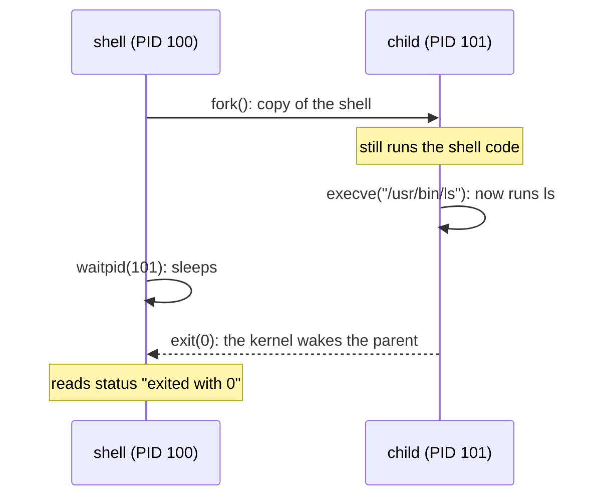

<!-- nav:top -->
[🏠 Start](../START-HERE.md) · [← 13.4 Files and file descriptors](04-files-and-file-descriptors.md) · [📋 Phase 13](README.md) · [13.6 Pipes and redirection from the inside →](06-pipes-and-redirection-inside.md) · [📖 Glossary](../GLOSSARY.md) · [🇷🇺 Русский](../../ru/13-operating-systems/05-fork-exec-and-wait.md) <!-- nav -->

# Lesson 13.5 — Creating processes: fork, exec and wait

> **Phase 13 — Operating systems from the inside** · Lesson 5 of 18 · ⏱ about 135 minutes

## What you will learn

- How Unix starts a new program in two steps: `fork` copies the process, `exec` replaces its program.
- Why `fork` "returns twice", and why `nix::unistd::fork` is an `unsafe` function.
- How a parent waits for a child with `waitpid` and reads its exit code or the signal that killed it.
- What zombies and orphans are, and how to create and remove one.
- What `std::process::Command` does under the hood.

## Before you start

- You finished [Lesson 13.4 — Files and file descriptors](04-files-and-file-descriptors.md).
- You know the process tree, PPIDs (parent process IDs) and the state `Z` from [Lesson 13.2](02-processes-from-the-inside.md), and exit codes and signals from Phase 11.
- You have used `std::process::Command` a little; here you see what it does inside.
- You know threads from [Lesson 05.10 — Threads, channels and shared state](../05-rust-intermediate/10-threads-channels-and-shared-state.md).

## New words

| Word | Meaning |
|---|---|
| **`fork`** | The system call that makes a copy of the calling process. The copy is the **child**, the original the **parent**. |
| **`exec`** (`execve`) | The system call that replaces the program running in a process with another program file. The PID stays the same. |
| **`wait`** / **`waitpid`** | System calls with which a parent waits until a child ends and collects its exit status. |
| **exit status** | What the kernel keeps about an ended process: its exit code (0–255), or the signal that killed it. |
| **zombie** | An ended process whose parent has not yet called `wait`. It uses no memory except its entry in the process table. |
| **orphan** | A process whose parent has ended. The kernel gives it a new parent, normally PID 1. |
| **reap** | To collect a zombie with `wait`; after that it disappears. |
| **copy-on-write** (COW) | A trick of the kernel: after `fork`, parent and child share memory pages until one of them writes; only then is the page copied (Lesson 13.10). |
| **async-signal-safe** | A function that may be called in a signal handler or in a child right after `fork` in a program with threads. `write` and `_exit` are; `malloc` and `println!` are not. |
| **`PATH`** | The environment variable with the list of folders where programs are searched, for example `/usr/local/bin:/usr/bin:/bin`. |
| **CPU**, **VM**, **API** | Known from earlier lessons: Central Processing Unit; Virtual Machine (your VM `dev`); Application Programming Interface, the functions a library or system offers to other code. |

> 📏 **Convention:** In this lesson you add one more `nix` feature: `cargo add nix@0.32 --features signal`. Your
> `Cargo.toml` then contains `features = ["fs", "process", "signal", "user"]`.

## 1. Two steps: copy, then replace

How does your shell start `ls`? You might expect one system call "start program X". Unix does it in two steps:

1. **`fork`** — the shell makes an exact copy of itself. Now two shells run: the parent and the child.
2. **`exec`** — the child replaces its own program with `/usr/bin/ls`. It keeps its PID, its open descriptors and its
   current directory, but its code, data, heap and stack are thrown away and loaded fresh from the `ls` file.

Then the parent calls **`wait`** and sleeps until the child is done.



Why two steps instead of one? Because the gap between `fork` and `exec` is very useful. In it, the child is still your
code, and it can prepare the new program's world: change file descriptors for `> file` or `|` (Lesson 13.6), change
the directory, set signal behaviour (Lesson 13.7), or move into new namespaces (Lesson 13.15). The new program inherits
all of it.

## 2. `fork`: one call, two returns

`fork` is strange: you call it once, and it **returns twice** — once in the parent and once in the child. The return
value tells them apart: the parent gets the child's PID, the child gets 0. In `nix` this is the enum `ForkResult`.
Create `src/bin/fork-basic.rs`:

```rust
use nix::sys::wait::waitpid;
use nix::unistd::{ForkResult, fork, getpid, getppid};

fn main() {
    let mut counter = 100;
    println!("before fork: I am {}", getpid());

    // SAFETY: this program has only one thread, so the child may do anything.
    match unsafe { fork() }.expect("fork failed") {
        ForkResult::Child => {
            counter += 1;
            println!(
                "child:  pid {}, parent {}, counter {counter}",
                getpid(),
                getppid()
            );
            std::process::exit(7);
        }
        ForkResult::Parent { child } => {
            counter -= 1;
            println!("parent: pid {}, child {child}, counter {counter}", getpid());
            let status = waitpid(child, None).expect("waitpid failed");
            println!("parent: child finished: {status:?}");
        }
    }
}
```

```text
before fork: I am 1424
parent: pid 1424, child 1425, counter 99
child:  pid 1425, parent 1424, counter 101
parent: child finished: Exited(Pid(1425), 7)
```

**What happens:**

1. "before fork" is printed once: only one process exists at that point.
2. After `fork` two processes run the **same code** from the same place. The `match` sends each into its arm.
3. Each has its own copy of `counter`: the child sees 101, the parent 99. After `fork` they share nothing writable.
4. The order of the "parent" and "child" lines can change between runs: the scheduler decides who runs first.
5. The child ends with `std::process::exit(7)`. Without that line it would continue after the `match`, and both
   processes would run the rest of `main`.
6. `waitpid(child, None)` puts the parent to sleep until the child ends, then returns `WaitStatus::Exited(pid, 7)`.

Copying a whole process sounds expensive, but the kernel cheats: it copies only the page tables and marks all memory
"read-only, shared". A page is really copied only when one of the two processes writes to it. This is **copy-on-write**,
and Lesson 13.10 shows how it works.

### Why `fork` is `unsafe` in `nix`

If a program has several threads, `fork` copies **only the thread that called it**. The other threads simply do not exist
in the child, but their memory does, including locks they may have been holding at that moment. If another thread was in
the middle of `malloc` and held the allocator's lock, the child's first allocation can wait forever for a lock that no
thread will ever release.

So the rule is: in a program with threads, the child may only call **async-signal-safe** functions (`execve`, `write`,
`dup2`, `_exit` and a few others) until it calls `exec`. No `println!`, no `Vec::new`, no `format!`. The compiler cannot
check this rule, so `fork` is `unsafe` and every call needs a `// SAFETY:` comment. All examples in this lesson have one
thread; Exercise 3 shows the careful version for programs with threads. Also note that `cargo test` runs tests in threads.

> ⚠️ **Common mistake:** Forgetting that the child continues after the `match`. If the child arm does not end with
> `exit` (or `exec`), the child runs the parent's code too: you see lines printed twice, or two processes doing the
> parent's work.

## 3. `exec`: become another program

`execvp(file, args)` replaces the program of the calling process. If it succeeds, it **never returns**, because the code
that called it no longer exists. It returns only on failure. The `p` means "search the `PATH`" like the shell; the `v`
means the arguments come as a list (a vector). Create `src/bin/fork-exec.rs`:

```rust
use nix::sys::wait::{WaitStatus, waitpid};
use nix::unistd::{ForkResult, execvp, fork};
use std::ffi::CString;

fn main() {
    // Prepare the arguments as C strings before fork.
    let args: Vec<CString> = ["ls", "-l", "/etc/hostname"]
        .iter()
        .map(|s| CString::new(*s).unwrap())
        .collect();

    // SAFETY: single-threaded program.
    match unsafe { fork() }.expect("fork failed") {
        ForkResult::Child => {
            // On success execvp never returns: this process becomes `ls`.
            let err = execvp(&args[0], &args).unwrap_err();
            eprintln!("exec failed: {err}");
            std::process::exit(127);
        }
        ForkResult::Parent { child } => match waitpid(child, None) {
            Ok(WaitStatus::Exited(pid, code)) => println!("{pid} exited with code {code}"),
            Ok(WaitStatus::Signaled(pid, sig, _)) => println!("{pid} was killed by {sig}"),
            other => println!("unexpected: {other:?}"),
        },
    }
}
```

```text
-rw-r--r-- 1 root root 13 Nov 18 07:24 /etc/hostname
1427 exited with code 0
```

**What happens:**

1. The arguments become `CString`s (Lesson 06.10): the kernel wants C strings that end with a NUL byte.
2. `args[0]` is both the file to search and the program's own name, `argv[0]`. By convention they are the same.
3. In the child, `execvp` succeeds, so the rest of the child arm never runs. The output line is printed by `ls`,
   which now runs in the child process with the child's PID and inherited standard output.
4. If `ls` did not exist, `execvp` would return `Err(ENOENT)`, and the child would exit with 127 — the code shells use for
   "command not found".
5. The parent matches on the status: a normal exit with a code, or death by a signal.

Watch the whole dance with `strace -f` (follow children):

```bash
strace -f -e trace=clone,execve,wait4,exit_group ./target/debug/fork-exec
```

Real output, shortened:

```text
execve("./target/debug/fork-exec", ["./target/debug/fork-exec"], 0xffffccbaa6b8 /* 11 vars */) = 0
clone(child_stack=NULL, flags=CLONE_CHILD_CLEARTID|CLONE_CHILD_SETTID|SIGCHLDstrace: Process 1433 attached
, child_tidptr=0xffff956300f0) = 1433
[pid  1432] wait4(1433,  <unfinished ...>
[pid  1433] execve("/usr/local/cargo/bin/ls", ["ls", "-l", "/etc/hostname"], 0xfffff83a0db8 /* 11 vars */) = -1 ENOENT (No such file or directory)
...
[pid  1433] execve("/usr/bin/ls", ["ls", "-l", "/etc/hostname"], 0xfffff83a0db8 /* 11 vars */) = 0
[pid  1433] exit_group(0)               = ?
[pid  1433] +++ exited with 0 +++
<... wait4 resumed>[{WIFEXITED(s) && WEXITSTATUS(s) == 0}], 0, NULL) = 1433
--- SIGCHLD {si_signo=SIGCHLD, si_code=CLD_EXITED, si_pid=1433, si_uid=0, si_status=0, si_utime=0, si_stime=0} ---
```

**What happens:**

1. On Linux, `fork` is implemented with the more general system call `clone`, which can also create threads (Lesson 13.9).
2. The parent (1432) goes into `wait4`, the system call behind `waitpid`.
3. The child (1433) tries `execve` with each folder of `PATH` until one works: that is the `p` in `execvp`.
4. When the child exits, the kernel wakes the parent and also sends it the signal `SIGCHLD` ("a child changed state").

## 4. Waiting, exit status, zombies and orphans

When a process ends, the kernel frees its memory and closes its descriptors at once, but it **keeps a small record**:
its PID and its exit status, so the parent can still ask "how did it end?". Until the parent asks with `wait`, the ended
process is a **zombie** (state `Z`). Calling `wait` is called **reaping** it. Create `src/bin/zombie.rs`:

```rust
use nix::sys::wait::waitpid;
use nix::unistd::{ForkResult, fork};
use std::process::Command;
use std::{thread, time::Duration};

fn main() {
    // SAFETY: single-threaded program.
    match unsafe { fork() }.expect("fork failed") {
        ForkResult::Child => std::process::exit(0), // the child ends at once
        ForkResult::Parent { child } => {
            thread::sleep(Duration::from_millis(200));
            let pid = child.to_string();
            let ps = ["-o", "pid,ppid,stat,comm", "-p", pid.as_str()];
            println!("before waitpid:");
            Command::new("ps").args(ps).status().unwrap();
            waitpid(child, None).unwrap();
            println!("after waitpid:");
            Command::new("ps").args(ps).status().unwrap();
        }
    }
}
```

```text
before waitpid:
    PID    PPID STAT COMMAND
   1435    1434 Z    zombie
after waitpid:
    PID    PPID STAT COMMAND
```

The child ended at once, but stayed in the table as `Z` until the parent reaped it; after `waitpid` it is gone. One zombie
is harmless. A long-running program that starts children and never waits fills the process table with them: the number
of PIDs is limited (`cat /proc/sys/kernel/pid_max`), and when they run out, `fork` fails with `EAGAIN`.

The opposite case is an **orphan**: the parent ends first. Create `src/bin/orphan.rs`:

```rust
use nix::unistd::{ForkResult, fork, getppid};
use std::{thread, time::Duration};

fn main() {
    // SAFETY: single-threaded program.
    match unsafe { fork() }.expect("fork failed") {
        ForkResult::Child => {
            println!("child: my parent is {}", getppid());
            thread::sleep(Duration::from_millis(500)); // the parent exits meanwhile
            println!("child: my parent is now {}", getppid());
        }
        ForkResult::Parent { child } => {
            println!("parent: I exit now and leave {child} alone");
        }
    }
}
```

```bash
./target/debug/orphan; sleep 1
```

```text
parent: I exit now and leave 1440 alone
child: my parent is 1439
child: my parent is now 1
```

The kernel gave the orphan a new parent, PID 1, which will reap it when it ends. (On a desktop Linux the new parent can
be a "subreaper" such as `systemd --user` instead of PID 1.) The `sleep 1` keeps your shell from printing its prompt in
the middle of the child's output: the shell only waits for its own child, the parent.

> 💡 **Tip:** This is why PID 1 has a special job: it must reap the orphans of the whole system. In a container, PID 1 is
> your program. If it starts children and never waits for them, zombies pile up. Docker's `--init` option starts a tiny
> init program as PID 1 for exactly this reason.

### Exit codes and signals

`waitpid` tells you one of two things. Rust's `std::process::ExitStatus` gives the same information with `code()` and,
on Unix, `signal()` (from the trait `std::os::unix::process::ExitStatusExt`):

| How the child ended | `nix` | `std` | the shell's `$?` |
|---|---|---|---|
| `exit(3)` or `main` returned 3 | `Exited(pid, 3)` | `code() == Some(3)` | 3 |
| killed by `SIGKILL` (9) | `Signaled(pid, SIGKILL, false)` | `code() == None`, `signal() == Some(9)` | 137 = 128 + 9 |

In Rust, `main` returning `Err(..)` gives exit code 1, and a panic gives 101.

## 5. What `std::process::Command` does

`Command::new("ls").status()` does all of this for you: it searches `PATH`, creates the child, sets up its descriptors,
calls `exec`, waits, and converts the status. Create `src/bin/command.rs`:

```rust
use std::process::Command;

fn main() -> std::io::Result<()> {
    let status = Command::new("ls").args(["-l", "/etc/hostname"]).status()?;
    println!("ls finished: {status}");
    Ok(())
}
```

```bash
strace -f -e trace=clone,clone3,execve,wait4 ./target/debug/command
```

Real output, shortened:

```text
clone3({flags=CLONE_VM|CLONE_VFORK|CLONE_CLEAR_SIGHAND, exit_signal=SIGCHLD, stack=0xffff882d7000, stack_size=0x9000}, 88) = -1 ENOSYS (Function not implemented)
clone(child_stack=0xffff882e0000, flags=CLONE_VM|CLONE_VFORK|SIGCHLDstrace: Process 1445 attached
...
[pid  1445] execve("/usr/bin/ls", ["ls", "-l", "/etc/hostname"], 0xffffe4151f48 /* 11 vars */ <unfinished ...>
...
ls finished: exit status: 0
```

**What happens:**

1. `std` does not use a plain `fork`. It uses the C library's `posix_spawn`, which calls `clone` with `CLONE_VM` (share the
   memory instead of copying it) and `CLONE_VFORK` (pause the parent until the child has called `exec`). This is much
   faster than copying the page tables of a big process.
2. The first attempt, `clone3`, failed with `ENOSYS` only because the checking container's security filter blocks it;
   the C library then fell back to `clone`. In your VM `clone3` succeeds.
3. After that, the same pattern: `execve` in the child, `wait4` in the parent.

> 📏 **Convention:** In real programs use `std::process::Command`. It is safe, fast and handles the tricky details (closing
> descriptors, reporting exec errors to the parent). Use `fork` yourself only when you need something `Command` cannot do,
> as in the shell of Lesson 13.8 and the container runtime of Lesson 13.17.

## Common mistakes

> ⚠️ **Common mistake:** Never calling `wait`. Every child you start must be waited for, or it stays a zombie until your
> program ends. With `Command`, `status()` and `output()` wait for you; `spawn()` gives you a `Child` that you must
> `wait()` on yourself. Dropping a `Child` does **not** wait.

> ⚠️ **Common mistake:** Allocating in the child of a program with threads. It usually works in tests, and then one day
> the child hangs forever. Prepare all `CString`s and argument lists **before** `fork`, as in Exercise 3.

> ⚠️ **Common mistake:** Forgetting that `argv[0]` is the program's name. `execvp("ls", ["-l"])` runs `ls` with the name
> `-l` and **no** arguments. The list must start with the name: `["ls", "-l"]`.

## Try it yourself

1. Run `fork-basic` ten times: `for i in $(seq 10); do ./target/debug/fork-basic | head -3 | tail -2; done`. Does the
   order of "parent" and "child" change?
2. Remove `std::process::exit(7)` from the child arm and run it. Which status does the parent print now? (The child
   leaves the `match`, reaches the end of `main` and exits normally with code 0.)
3. In `fork-exec`, change `"ls"` to `"lss"` and see the message and the exit code.
4. Run `strace -f -c ./target/debug/fork-exec > /dev/null` and find `clone` and `execve` in the summary.

## Exercises

### Exercise 1 — Exit codes and signals with `Command` (easy)

Write `src/bin/exit-codes.rs` that runs `sh -c "<script>"` for the scripts `exit 0`, `exit 3` and `kill -9 $$` and
prints `status.code()` and `status.signal()` for each. (`$$` is the PID of that `sh`, so the last script kills itself.)

<details>
<summary>Hint</summary>

`use std::os::unix::process::ExitStatusExt;` brings the method `signal()` into scope.

</details>

<details>
<summary>Answer</summary>

```rust
use std::os::unix::process::ExitStatusExt;
use std::process::Command;

fn main() -> std::io::Result<()> {
    for script in ["exit 0", "exit 3", "kill -9 $$"] {
        let status = Command::new("sh").args(["-c", script]).status()?;
        println!(
            "{script:<12} -> code {:?}, signal {:?}",
            status.code(),
            status.signal()
        );
    }
    Ok(())
}
```

```text
exit 0       -> code Some(0), signal None
exit 3       -> code Some(3), signal None
kill -9 $$   -> code None, signal Some(9)
```

Why it works: a process that ends normally has an exit code and no signal; a process killed by a signal has no exit code.
`std` keeps the two cases apart instead of mixing them into one number like the shell's `$?`.

</details>

### Exercise 2 — Describe a wait status, with tests (medium)

Write `fn describe(status: WaitStatus) -> (String, i32)` that returns a text and the value a shell would put into `$?`:
`("exited with code 3", 3)` for `Exited(_, 3)` and `("killed by SIGKILL", 137)` for `Signaled(_, SIGKILL, _)`. Test it
with hand-made `WaitStatus` values. In `main`, fork a child that waits forever, kill it with `SIGTERM`, and print the
description.

<details>
<summary>Hint</summary>

You can build test values without any process: `WaitStatus::Exited(Pid::from_raw(42), 3)`. `sig as i32` gives a signal's
number. In the child, `loop { std::thread::park(); }` waits forever without using CPU. `nix::sys::signal::kill(child,
Signal::SIGTERM)` sends the signal.

</details>

<details>
<summary>Answer</summary>

```rust
use nix::sys::signal::Signal;
use nix::sys::wait::{WaitStatus, waitpid};
use nix::unistd::{ForkResult, fork};

/// Turns a wait status into the text a shell would show, plus the shell's `$?` value.
fn describe(status: WaitStatus) -> (String, i32) {
    match status {
        WaitStatus::Exited(_, code) => (format!("exited with code {code}"), code),
        WaitStatus::Signaled(_, sig, _) => (format!("killed by {sig}"), 128 + sig as i32),
        other => (format!("other status: {other:?}"), -1),
    }
}

fn main() {
    // SAFETY: single-threaded program.
    match unsafe { fork() }.expect("fork failed") {
        ForkResult::Child => loop {
            std::thread::park(); // wait forever, until killed
        },
        ForkResult::Parent { child } => {
            nix::sys::signal::kill(child, Signal::SIGTERM).unwrap();
            let (text, code) = describe(waitpid(child, None).unwrap());
            println!("child {child}: {text}; a shell would set $? = {code}");
        }
    }
}

#[cfg(test)]
mod tests {
    use super::*;
    use nix::unistd::Pid;

    #[test]
    fn normal_exit_keeps_the_code() {
        let st = WaitStatus::Exited(Pid::from_raw(42), 3);
        assert_eq!(describe(st), ("exited with code 3".to_string(), 3));
    }

    #[test]
    fn a_signal_gives_128_plus_its_number() {
        let st = WaitStatus::Signaled(Pid::from_raw(42), Signal::SIGKILL, false);
        assert_eq!(describe(st), ("killed by SIGKILL".to_string(), 137));
    }
}
```

```text
child 390: killed by SIGTERM; a shell would set $? = 143
test result: ok. 2 passed; 0 failed; 0 ignored; 0 measured; 0 filtered out; finished in 0.00s
```

Why it works: the logic is a pure function of a `WaitStatus`, so the tests need no real processes. `SIGTERM` is signal 15,
so the shell's value is 128 + 15 = 143. You will need exactly this function for `$?` in the shell of Lesson 13.8.

</details>

### Exercise 3 — `run` that is safe even with threads (hard)

Write `fn run(argv: &[&str]) -> i32` that forks, runs the program in the child and returns the child's exit code (or
128 + signal). If the program cannot be started, the child prints `run: command not found` and exits with 127. The
child must call **only** async-signal-safe functions: build every `CString` and the pointer list before `fork`, and in the
child use `libc::execvp`, `libc::write` and `libc::_exit`. Write tests: `true` gives 0, `false` gives 1, `sh -c "exit 42"`
gives 42, and an unknown program gives 127. Tests run in threads, so this is the situation the rule is about.

<details>
<summary>Hint</summary>

`libc::execvp` wants a `*const *const c_char`: a list of pointers to the C strings, ended by a null pointer. Collect
`c_args.iter().map(|a| a.as_ptr())` into a `Vec`, then push `std::ptr::null()`. Keep `c_args` alive while the pointers are
used. `libc::_exit` ends the process at once, without running Rust or C clean-up code that is not safe after `fork`.

</details>

<details>
<summary>Answer</summary>

```rust
use nix::sys::wait::{WaitStatus, waitpid};
use nix::unistd::{ForkResult, fork};
use std::ffi::{CString, c_char};

/// Runs a program like a shell does and returns its exit code (127 if it cannot be started).
fn run(argv: &[&str]) -> i32 {
    // Everything that allocates memory happens BEFORE fork.
    let c_args: Vec<CString> = argv.iter().map(|a| CString::new(*a).unwrap()).collect();
    let mut ptrs: Vec<*const c_char> = c_args.iter().map(|a| a.as_ptr()).collect();
    ptrs.push(std::ptr::null()); // execvp wants a list that ends with a null pointer
    let msg = b"run: command not found\n";

    // SAFETY: the child only calls execvp, write and _exit, which are async-signal-safe.
    match unsafe { fork() }.expect("fork failed") {
        ForkResult::Child => unsafe {
            libc::execvp(ptrs[0], ptrs.as_ptr());
            // Only reached if execvp failed.
            libc::write(2, msg.as_ptr().cast(), msg.len());
            libc::_exit(127);
        },
        ForkResult::Parent { child } => match waitpid(child, None) {
            Ok(WaitStatus::Exited(_, code)) => code,
            Ok(WaitStatus::Signaled(_, sig, _)) => 128 + sig as i32,
            _ => -1,
        },
    }
}

fn main() {
    let args: Vec<String> = std::env::args().skip(1).collect();
    let argv: Vec<&str> = args.iter().map(String::as_str).collect();
    if argv.is_empty() {
        eprintln!("usage: run <program> [args...]");
        std::process::exit(2);
    }
    let code = run(&argv);
    println!("[exit code {code}]");
}

#[cfg(test)]
mod tests {
    use super::*;

    #[test]
    fn reports_exit_codes() {
        assert_eq!(run(&["true"]), 0);
        assert_eq!(run(&["false"]), 1);
        assert_eq!(run(&["sh", "-c", "exit 42"]), 42);
    }

    #[test]
    fn unknown_program_gives_127() {
        assert_eq!(run(&["no-such-program-xyz"]), 127);
    }
}
```

```bash
./target/debug/run echo hi there
./target/debug/run nope
cargo test -q --bin run
```

```text
hi there
[exit code 0]
run: command not found
[exit code 127]

running 2 tests
..
test result: ok. 2 passed; 0 failed; 0 ignored; 0 measured; 0 filtered out; finished in 0.00s
```

Why it works: all allocations (`CString`, the two `Vec`s, the message) happen in the parent. The child touches only
memory that already exists and calls only functions that take no locks and do not allocate, so it cannot hang on a lock
that another thread held at the moment of `fork`. One honest detail: the official POSIX (Portable Operating System Interface) list in `signal-safety(7)`
contains `execve` and `execv`, but not `execvp`. glibc's `execvp` searches `PATH` using only stack memory, so it is safe in
practice on Linux. Code that must follow the standard to the letter searches `PATH` before `fork` and calls `libc::execv`
with the full path in the child.

</details>

## Quiz

1. What does `fork` return in the parent, and what in the child?

<details>
<summary>Answer</summary>

In the parent it returns the child's PID (`ForkResult::Parent { child }`); in the child it returns 0 (`ForkResult::Child`).

</details>

2. When does `execvp` return?

<details>
<summary>Answer</summary>

Only when it fails, for example when the program is not found. On success the calling program is replaced, so there is
nothing left to return to.

</details>

3. Which things does a program keep across `exec`, and which are replaced?

<details>
<summary>Answer</summary>

It keeps its PID, its parent, its open file descriptors (except those with `FD_CLOEXEC`), its current directory and its
user. Its code, data, heap and stack are replaced by the new program.

</details>

4. What is a zombie, and how do you get rid of one?

<details>
<summary>Answer</summary>

An ended process whose parent has not yet collected its exit status. The parent removes it by calling `wait` or `waitpid`.
If the parent ends, the zombie is adopted by PID 1, which reaps it.

</details>

5. Why is `nix::unistd::fork` an `unsafe` function?

<details>
<summary>Answer</summary>

Because in a program with threads, the child gets only the calling thread but all the memory, including locks held by
other threads. Until `exec`, the child may only call async-signal-safe functions, and the compiler cannot check that.

</details>

6. A child was killed by `SIGTERM` (15). What do `nix`, `std` and the shell report?

<details>
<summary>Answer</summary>

`nix`: `WaitStatus::Signaled(pid, SIGTERM, false)`. `std`: `code()` is `None` and `signal()` is `Some(15)`. The shell:
`$?` is 143 (128 + 15).

</details>

## Summary

- Unix starts programs in two steps: `fork` copies the process, `exec` replaces its program; the gap between them is where the child prepares descriptors, directory and signals.
- `fork` returns twice: the child's PID in the parent, 0 in the child; the copy is cheap thanks to copy-on-write.
- In a program with threads, the child may only call async-signal-safe functions before `exec`; that is why `fork` is `unsafe`.
- `exec` returns only on failure; by convention exit code 127 means "command not found".
- `waitpid` returns `Exited(pid, code)` or `Signaled(pid, signal, core)`; the shell shows a signal as 128 + its number.
- An ended child is a zombie until reaped; an orphan is adopted by PID 1.
- `std::process::Command` does all of this safely, with `posix_spawn` and `clone(CLONE_VM | CLONE_VFORK)`; prefer it in normal code.

## Sources and further reading

- [fork(2) — Linux manual page](https://man7.org/linux/man-pages/man2/fork.2.html) — what is and is not copied.
- [execve(2) — Linux manual page](https://man7.org/linux/man-pages/man2/execve.2.html) — what survives an `exec`.
- [wait(2) — Linux manual page](https://man7.org/linux/man-pages/man2/wait.2.html) — `wait`, `waitpid` and zombies.
- [signal-safety(7) — Linux manual page](https://man7.org/linux/man-pages/man7/signal-safety.7.html) — the list of async-signal-safe functions.
- [std::process::Command — Rust documentation](https://doc.rust-lang.org/std/process/struct.Command.html) — the safe way to start programs.
- [Operating Systems: Three Easy Pieces — Interlude: Process API](https://pages.cs.wisc.edu/~remzi/OSTEP/cpu-api.pdf) — `fork`, `exec` and `wait` explained with small programs.

---

[🏠 Start](../START-HERE.md) · [← 13.4 Files and file descriptors](04-files-and-file-descriptors.md) · [📋 Phase 13](README.md) · [13.6 Pipes and redirection from the inside →](06-pipes-and-redirection-inside.md) · [📖 Glossary](../GLOSSARY.md) <!-- nav -->
<!-- nav:bottom -->
