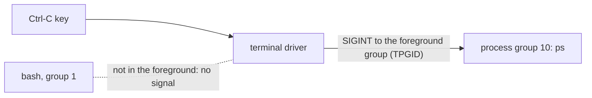

<!-- nav:top -->
[🏠 Start](../START-HERE.md) · [← 13.6 Pipes and redirection from the inside](06-pipes-and-redirection-inside.md) · [📋 Phase 13](README.md) · [13.8 Project: your own shell →](08-project-your-own-shell.md) · [📖 Glossary](../GLOSSARY.md) · [🇷🇺 Русский](../../ru/13-operating-systems/07-signals-in-your-programs.md) <!-- nav -->

# Lesson 13.7 — Signals in your programs

> **Phase 13 — Operating systems from the inside** · Lesson 7 of 18 · ⏱ about 135 minutes

## What you will learn

- What the kernel keeps about signals for every process: the action for each signal, the pending set and the blocked mask.
- Why a signal handler may do almost nothing, and the safe pattern: set a flag, act on it later.
- How to install a handler with `nix::sys::signal::sigaction` once, and why `signal-hook` is the better everyday tool.
- What `EINTR` is and what `SA_RESTART` changes.
- How Ctrl-C really works (process groups, sessions, the terminal), and what happens to signal settings across `fork` and `exec`.

## Before you start

- You finished [Lesson 13.6 — Pipes and redirection from the inside](06-pipes-and-redirection-inside.md).
- You know what signals are, the common ones (`SIGINT`, `SIGTERM`, `SIGKILL`, `SIGHUP`), `kill`, and how to stop a program cleanly with `signal_hook::iterator::Signals` from [Lesson 11.5 — Processes and signals](../11-linux-shell-and-containers/05-processes-and-signals.md). This lesson shows what happens underneath.
- You know atomics such as `AtomicBool` and the shared pointer `Arc` from [Lesson 05.10](../05-rust-intermediate/10-threads-channels-and-shared-state.md), and `unsafe` from [Lesson 06.6](../06-rust-advanced/06-unsafe-rust-and-miri.md).

## New words

| Word | Meaning |
|---|---|
| **disposition** | What a process does when a signal arrives: the default action, ignore it, or run a handler. |
| **signal handler** | A function of your program that the kernel calls when a signal arrives, interrupting whatever the program was doing. |
| **pending signal** | A signal that was sent but not yet delivered. |
| **signal mask** (blocked set) | The set of signals a thread does not want delivered right now; they stay pending until unblocked. |
| **`EINTR`** | "Interrupted system call": the error a blocking call returns when a signal handler ran while it waited. |
| **`SA_RESTART`** | A flag for `sigaction`: after the handler, restart the interrupted system call instead of failing with `EINTR`. |
| **process group** | A set of processes, usually one shell job (all programs of one pipeline), with a common ID, the PGID (Process Group ID). |
| **session** | A set of process groups, usually everything started from one terminal login, with a session ID (SID). |
| **controlling terminal** | The terminal that belongs to a session. It sends Ctrl-C and Ctrl-Z as signals to its **foreground** process group. |
| **TPGID** (Terminal Process Group ID) | The ID of the process group that is currently in the foreground of a terminal. |
| **CPU**, **VM**, **PID** | Known from earlier lessons: Central Processing Unit; Virtual Machine (your VM `dev`); Process IDentifier. |

## 1. What the kernel keeps about signals

A signal is a tiny message from the kernel to a process: just a number, no data. From Phase 11 you know how to *send*
one (`kill -TERM 1234`) and what the common ones mean. Inside, the kernel keeps three things per process (strictly,
the mask is per thread):

```text
 for each process (in task_struct)
 +-----------------------------------------------------------+
 | disposition table: one entry per signal                   |
 |   SIGINT  -> default (terminate)                          |
 |   SIGPIPE -> ignore            (Rust sets this, 13.6)     |
 |   SIGTERM -> handler at 0xaaaa... (your function)         |
 | pending set:  signals that arrived but are not delivered  |
 | blocked mask: signals the thread does not accept now      |
 +-----------------------------------------------------------+
```

Sending a signal only sets a bit in the pending set and wakes the process if it sleeps. **Delivery** happens a moment
later: every time the kernel is about to return to the process in user space (after a system call, an interrupt, or
when the scheduler gives it the CPU), it checks the pending set. For each pending, unblocked signal, it does what the
disposition says:

| Default action | Signals (examples) |
|---|---|
| terminate | `SIGTERM`, `SIGINT`, `SIGHUP`, `SIGPIPE`, `SIGALRM`, `SIGUSR1` |
| terminate and write a core dump | `SIGQUIT`, `SIGSEGV`, `SIGABRT`, `SIGILL` |
| ignore | `SIGCHLD`, `SIGWINCH` (terminal size changed) |
| stop / continue | `SIGSTOP`, `SIGTSTP` (Ctrl-Z) / `SIGCONT` |

Two signals are special: `SIGKILL` and `SIGSTOP` can be neither caught, ignored nor blocked. The kernel acts on them
directly, so an administrator can always stop a process.

You can read the three sets of any process in `/proc/<pid>/status` as hexadecimal bit masks: `SigPnd` (pending),
`SigBlk` (blocked), `SigIgn` (ignored) and `SigCgt` (caught: a handler is installed). Bit 0 stands for signal 1, bit 1
for signal 2, and so on. Exercise 2 decodes them.

## 2. Handlers run at any moment, so they must do almost nothing

When a signal with a handler is delivered, the kernel makes the process jump into the handler function, wherever it was:
in the middle of `println!`, in the middle of `malloc`, holding a lock. When the handler returns, the program continues
where it was interrupted.

```text
 main:    ... let v = vec![1, 2, 3];  -- malloc takes the allocator lock --
                                             |
                                    SIGTERM delivered here
                                             v
 handler:                            println!("bye")  -> needs to allocate -> waits for the lock
                                                         that main holds -> waits forever
```

This is the same danger as in the child after `fork` (Lesson 13.5), and the rule is the same: a handler may only call
**async-signal-safe** functions. In Rust the safe and common pattern is: **the handler only sets an atomic flag; the
main loop checks the flag and does the real work.**

### Once, by hand: `sigaction`

`sigaction` is the system call that sets a disposition. `nix` wraps it; the call is `unsafe` because the compiler cannot
check what your handler does. Create `src/bin/raw-handler.rs`:

```rust
use nix::sys::signal::{SaFlags, SigAction, SigHandler, SigSet, Signal, sigaction};
use std::sync::atomic::{AtomicBool, Ordering};
use std::{thread, time::Duration};

static STOP: AtomicBool = AtomicBool::new(false);

/// The signal handler. It may interrupt `main` at ANY instruction, so it only sets a flag.
extern "C" fn on_sigterm(_signal: i32) {
    STOP.store(true, Ordering::SeqCst);
}

fn main() -> nix::Result<()> {
    let action = SigAction::new(
        SigHandler::Handler(on_sigterm),
        SaFlags::SA_RESTART,
        SigSet::empty(),
    );
    // SAFETY: the handler only touches an atomic, which is async-signal-safe.
    unsafe { sigaction(Signal::SIGTERM, &action) }?;

    println!("pid {}: working; send me SIGTERM", std::process::id());
    let mut done = 0;
    while !STOP.load(Ordering::SeqCst) {
        thread::sleep(Duration::from_millis(100)); // one "unit of work"
        done += 1;
    }
    println!("got SIGTERM after {done} units of work: saving and exiting cleanly");
    Ok(())
}
```

Run it in the background and send `SIGTERM` after one second:

```bash
./target/debug/raw-handler & sleep 1; kill -TERM $!; wait $!; echo "exit code $?"
```

```text
pid 2109: working; send me SIGTERM
got SIGTERM after 11 units of work: saving and exiting cleanly
exit code 0
```

**What happens:**

1. `extern "C" fn on_sigterm(_signal: i32)` has the C calling convention (Lesson 06.10), because the kernel calls it like
   a C function. It receives the signal number.
2. `SigAction::new(handler, flags, mask)` describes the new disposition. `SA_RESTART` is explained in Section 4. The
   `SigSet` is the set of extra signals to block while the handler runs; here none.
3. `sigaction(Signal::SIGTERM, &action)` installs it. From now on `SIGTERM` does not kill the process.
4. The main loop does one unit of work at a time and checks the flag between units. After the signal, it finishes the
   current unit, prints a message and returns normally: exit code 0, not 143.

> ⚠️ **Common mistake:** Doing real work in a handler: printing, allocating, locking a `Mutex`, writing to a log. It works
> in a quick test and deadlocks or corrupts memory one time in a thousand in production. Keep handlers to "store into an
> atomic" — or let `signal-hook` write the handler for you.

### Every day: `signal-hook`

`signal-hook` (Lesson 11.5) installs carefully written handlers for you, without `unsafe` in your code.
`signal_hook::flag::register` is exactly the pattern above. Create `src/bin/graceful.rs`:

```rust
use signal_hook::consts::{SIGINT, SIGTERM};
use std::sync::Arc;
use std::sync::atomic::{AtomicBool, Ordering};
use std::{thread, time::Duration};

fn main() -> std::io::Result<()> {
    let stop = Arc::new(AtomicBool::new(false));
    for signal in [SIGTERM, SIGINT] {
        // signal-hook installs a small, safe handler that only sets the flag.
        signal_hook::flag::register(signal, Arc::clone(&stop))?;
    }

    println!(
        "pid {}: working; press Ctrl-C or send SIGTERM",
        std::process::id()
    );
    let mut done = 0;
    while !stop.load(Ordering::Relaxed) {
        thread::sleep(Duration::from_millis(100));
        done += 1;
    }
    println!("stopping after {done} units of work");
    Ok(())
}
```

Add the crate first with `cargo add signal-hook@0.4`. Then:

```bash
./target/debug/graceful & sleep 0.5; kill -INT $!; wait $!; echo "exit code $?"
```

```text
pid 2112: working; press Ctrl-C or send SIGTERM
stopping after 5 units of work
exit code 0
```

`Signals::forever()` from Lesson 11.5 is the other style: a thread that **waits** for signals and handles them one by
one. Inside, it uses the same trick: its handler only writes one byte into a pipe (Lesson 13.6), and the waiting thread
reads from that pipe. Use the flag when you have a loop anyway; use the iterator when a thread may simply wait.

> 📏 **Convention:** Use `signal-hook` (or `tokio::signal` in async programs, Phase 14) for handlers. Write your own
> `sigaction` handler only when you must, and then keep it to atomics and `write`.

## 3. What you cannot catch

Create `src/bin/cannot-ignore.rs`:

```rust
use nix::sys::signal::{SigHandler, Signal, signal};

fn main() {
    for sig in [Signal::SIGTERM, Signal::SIGKILL, Signal::SIGSTOP] {
        // SAFETY: SIG_IGN installs no code of ours.
        let result = unsafe { signal(sig, SigHandler::SigIgn) };
        match result {
            Ok(_) => println!("{sig}: now ignored"),
            Err(e) => println!("{sig}: {e}"),
        }
    }
}
```

```text
SIGTERM: now ignored
SIGKILL: EINVAL: Invalid argument
SIGSTOP: EINVAL: Invalid argument
```

`nix::sys::signal::signal` is a simpler form of `sigaction`. The kernel refuses any change to `SIGKILL` and `SIGSTOP` with
`EINVAL`. (`signal-hook` checks this for you and panics if you try to register them.) This is why the right way to stop a
service is `SIGTERM` first, and `SIGKILL` only if it does not end after a while: systemd and Kubernetes do exactly that.

## 4. Interrupted system calls: `EINTR`

What happens when a signal with a handler arrives while the program is **blocked in a system call**, for example in a
`read` from an empty pipe? The kernel must run the handler, so it wakes the process and leaves the system call. Then
there are two possibilities, chosen by the flag `SA_RESTART`. Create `src/bin/eintr.rs`:

```rust
use nix::sys::signal::{SaFlags, SigAction, SigHandler, SigSet, Signal, sigaction};
use nix::unistd::{alarm, pipe, read};

extern "C" fn on_alarm(_signal: i32) {} // does nothing; its only job is to exist

fn main() -> nix::Result<()> {
    let restart = std::env::args().any(|a| a == "--restart");
    let flags = if restart {
        SaFlags::SA_RESTART
    } else {
        SaFlags::empty()
    };
    let action = SigAction::new(SigHandler::Handler(on_alarm), flags, SigSet::empty());
    // SAFETY: the handler does nothing at all.
    unsafe { sigaction(Signal::SIGALRM, &action) }?;

    let (reader, _writer) = pipe()?; // nobody will ever write: read blocks
    alarm::set(1); // ask the kernel to send SIGALRM in 1 second
    let mut buf = [0_u8; 16];
    println!("blocking in read() ...");
    match read(&reader, &mut buf) {
        Ok(n) => println!("read returned {n}"),
        Err(e) => println!("read failed: {e:?} ({})", e.desc()),
    }
    Ok(())
}
```

```bash
./target/debug/eintr
timeout 3 ./target/debug/eintr --restart; echo "exit code $?"
```

```text
blocking in read() ...
read failed: EINTR (Interrupted system call)
blocking in read() ...
exit code 124
```

**What happens:**

1. `alarm::set(1)` asks the kernel to send `SIGALRM` to this process after one second. Its default action would
   terminate the process, so we install an empty handler.
2. `read` blocks: the pipe is empty and a write end (`_writer`) is still open.
3. **Without `SA_RESTART`:** after the handler runs, `read` returns the error `EINTR`. The program must decide what to do.
4. **With `SA_RESTART`:** the kernel restarts `read` after the handler, and the program keeps waiting. `timeout` kills it
   after 3 seconds (exit code 124).

`EINTR` is why careful loops retry, like `write_all_fd` in Lesson 13.3. Rust's `std` helps: `read_exact`, `read_to_end`,
`write_all` and `io::copy` retry on `ErrorKind::Interrupted` by themselves, and the handlers installed by `signal-hook` use
`SA_RESTART`. A plain `read` or `write` call can still return `EINTR`, so if you call those, handle it.

## 5. Ctrl-C, process groups and the terminal

Who sends `SIGINT` when you press Ctrl-C? Not the shell. The **terminal driver** in the kernel sees the key and sends
`SIGINT` to the **foreground process group** of that terminal. To understand that, you need three IDs:

- A **process group** is one shell job: all processes of `sleep 30 | sleep 30` share one PGID, usually the PID of the
  first one.
- A **session** is everything started from one terminal login. Its first process, usually your login shell, is the
  **session leader** (the `s` in `ps`'s `Ss` from Lesson 13.2).
- The terminal remembers which process group is in the **foreground** (the TPGID). Keyboard signals go to that group only.

Real output in an interactive bash in a container terminal (in your VM the numbers are larger):

```bash
sleep 30 | sleep 30 &
ps -o pid,ppid,pgid,sid,tpgid,stat,comm
```

```text
[1] 8
    PID    PPID    PGID     SID   TPGID STAT COMMAND
      1       0       1       1      10 Ss   bash
      7       1       7       1      10 S    sleep
      8       1       7       1      10 S    sleep
     10       1      10       1      10 R+   ps
```

**What happens:**

1. Everything is in session 1, whose leader is `bash` (PID 1 here).
2. The background job `sleep 30 | sleep 30` is process group 7: both `sleep`s have PGID 7.
3. `ps` was started in the foreground, so the shell gave it its own group 10 and made 10 the terminal's foreground group:
   TPGID is 10, and the `+` in `R+` marks "in the foreground group". A Ctrl-C now would go to `ps` only — not to the
   `sleep`s, and not to bash.



An interactive shell does this with three system calls for every job: `setpgid` (put the child into a new group),
`tcsetpgrp` (make that group the terminal's foreground) and, when the job ends, `tcsetpgrp` again to take the terminal
back. That is **job control**. A simpler shell — like the one you build in Lesson 13.8 — can keep everything in one group
and still handle Ctrl-C correctly, if it uses the rule of the next section.

### Signal settings across `fork` and `exec`

| | after `fork` (child) | after `exec` (new program) |
|---|---|---|
| a signal set to **default** | default | default |
| a signal set to **ignore** | ignored | **still ignored** |
| a signal with a **handler** | same handler | reset to **default** (your handler's code is gone) |
| the blocked mask | copied | **kept** |
| pending signals | cleared | kept |

The second row is the trap. Create `src/bin/ignore-exec.rs`, which ignores `SIGINT` (only if asked) and then becomes
`sleep 30`:

```rust
use nix::sys::signal::{SigHandler, Signal, signal};
use nix::unistd::execvp;
use std::ffi::CString;

fn main() -> nix::Result<()> {
    let mode = std::env::args().nth(1).unwrap_or_default();
    if mode == "ignore" {
        // SAFETY: SIG_IGN installs no code of ours.
        unsafe { signal(Signal::SIGINT, SigHandler::SigIgn) }?;
    }
    println!(
        "pid {}: becoming `sleep 30` (mode {mode:?})",
        std::process::id()
    );
    let args = [CString::new("sleep").unwrap(), CString::new("30").unwrap()];
    let err = execvp(&args[0], &args).unwrap_err();
    Err(err)
}
```

Run `./target/debug/ignore-exec ignore`, press Ctrl-C, and nothing happens: `sleep` inherited "ignore SIGINT". Stop it
with Ctrl-\ (`SIGQUIT`). With `./target/debug/ignore-exec default`, Ctrl-C ends it at once. From a second terminal you can
see why (real output, the line read from `/proc/<pid of sleep>/status` in each mode):

```text
pid 393: becoming `sleep 30` (mode "ignore")
SigIgn:	0000000000001002
pid 400: becoming `sleep 30` (mode "default")
SigIgn:	0000000000001000
```

`0x1002` has bits 1 and 12 set: signals 2 (`SIGINT`) and 13 (`SIGPIPE`). Even in the default mode, `SIGPIPE` (bit 12,
`0x1000`) is ignored: the Rust runtime set it before `main` (Lesson 13.6), and the raw `execvp` passed it on to `sleep`.
(`std::process::Command` resets `SIGPIPE` to default in its children for exactly this reason.)

This gives the rule for a shell that must survive Ctrl-C:

1. The shell **ignores** (or catches) `SIGINT`, so Ctrl-C does not kill it.
2. Every child, after `fork` and before `exec`, sets `SIGINT` — and `SIGPIPE`, `SIGQUIT`, `SIGTSTP` if the shell changed
   them — back to **default** with `signal(sig, SigHandler::SigDfl)`.
3. Ctrl-C now goes to the whole foreground group: the child dies, the shell ignores it and prints a new prompt.

> 🔒 **Security:** The blocked mask and ignored signals are inherited by every program you start. A service manager or a
> container runtime that forgets to reset them can start programs that cannot be stopped with `SIGTERM`. Reset signal state
> in the child before `exec`.

### `SIGCHLD`

When a child changes state, the kernel sends the parent `SIGCHLD` (you saw it in the `strace` output of Lesson 13.5). Its
default action is "ignore", so a simple parent just calls `waitpid` when it wants. Servers that start many children use a
`SIGCHLD` flag, or `waitpid` with `WaitPidFlag::WNOHANG` in their main loop, to reap zombies without blocking.

## Common mistakes

> ⚠️ **Common mistake:** Expecting a handler to run "right away" while the program is busy in a long computation
> without system calls. Delivery happens when the kernel returns to the process; with a timer interrupt that is at least
> every few milliseconds, so in practice it is fast. But your **flag** is only checked when your loop checks it: a loop
> step that takes 10 seconds makes shutdown take 10 seconds.

> ⚠️ **Common mistake:** Forgetting that the mask and ignored signals survive `exec`. A program that "does not react to
> Ctrl-C" was often started by a parent that ignored `SIGINT`. Check `SigIgn` in `/proc/<pid>/status`.

## Try it yourself

1. Run `graceful` in the foreground and press Ctrl-C. Then run it in the background and stop it with `kill -TERM %1`.
2. Start `sleep 300 &` and read `grep Sig /proc/$!/status`. Which signals does a background job of an **interactive**
   shell ignore?
3. Run `ps -o pid,pgid,sid,tpgid,stat,comm` with `sleep 100 | cat &` running. Which processes share a PGID?
4. Run `eintr` under `strace -e trace=read,rt_sigaction`. Find the `read(...) = ? ERESTARTSYS` line and the signal.

## Exercises

### Exercise 1 — Kill, but cleanly (easy)

Run `raw-handler` in the background and send it, one after another in three runs, `SIGTERM`, `SIGINT` and `SIGKILL`. Write
down the exit code each time and explain it.

<details>
<summary>Hint</summary>

`./target/debug/raw-handler & sleep 1; kill -INT $!; wait $!; echo $?`. Only `SIGTERM` has a handler.

</details>

<details>
<summary>Answer</summary>

`SIGTERM`: the handler sets the flag, the program prints its message and exits with 0. `SIGINT`: no handler, the default
action terminates the process; but a background job of a non-interactive shell (a script, or `bash -c`) ignores `SIGINT`,
so there it keeps running — in an interactive shell you get 130 (128 + 2). `SIGKILL`: cannot be caught; the kernel ends the
process at once, exit code 137 (128 + 9), and the clean-up message is never printed.

</details>

### Exercise 2 — Decode the signal masks, with tests (medium)

Write `src/bin/sigmask.rs` with `fn decode_mask(hex: &str) -> Vec<i32>` that turns a mask such as `0000000000001002` into
the signal numbers `[2, 13]`, and `fn name(number: i32) -> String` that gives `"SIGINT"` for 2. `main` takes an optional PID
(default `self`) and prints the `SigIgn`, `SigCgt` and `SigBlk` lines as names. Test both functions. Then run it on your
interactive shell: `./target/debug/sigmask $$`.

<details>
<summary>Hint</summary>

`u64::from_str_radix(hex.trim(), 16)` parses the mask. Bit `b` set means signal `b + 1`: `(0..64).filter(|bit| bits & (1 <<
bit) != 0)`. `nix::sys::signal::Signal::try_from(number)` gives a `Signal` whose `Display` is its name.

</details>

<details>
<summary>Answer</summary>

```rust
use nix::sys::signal::Signal;

/// Decodes a mask like the `SigIgn:` line of /proc/<pid>/status into signal numbers.
/// Bit 0 is signal 1, bit 1 is signal 2, and so on.
fn decode_mask(hex: &str) -> Vec<i32> {
    let bits = u64::from_str_radix(hex.trim(), 16).unwrap_or(0);
    (0..64)
        .filter(|bit| bits & (1 << bit) != 0)
        .map(|bit| bit + 1)
        .collect()
}

fn name(number: i32) -> String {
    match Signal::try_from(number) {
        Ok(sig) => sig.to_string(),
        Err(_) => format!("signal {number}"),
    }
}

fn main() -> std::io::Result<()> {
    let pid = std::env::args()
        .nth(1)
        .unwrap_or_else(|| "self".to_string());
    let status = std::fs::read_to_string(format!("/proc/{pid}/status"))?;
    for line in status.lines() {
        for key in ["SigIgn:", "SigCgt:", "SigBlk:"] {
            if let Some(hex) = line.strip_prefix(key) {
                let names: Vec<String> = decode_mask(hex).into_iter().map(name).collect();
                println!("{key} {}", names.join(" "));
            }
        }
    }
    Ok(())
}

#[cfg(test)]
mod tests {
    use super::*;

    #[test]
    fn decodes_single_and_multiple_bits() {
        assert_eq!(decode_mask("0000000000000000"), Vec::<i32>::new());
        assert_eq!(decode_mask("0000000000000002"), vec![2]);
        assert_eq!(decode_mask("0000000000001002"), vec![2, 13]);
    }

    #[test]
    fn names_known_signals() {
        assert_eq!(name(2), "SIGINT");
        assert_eq!(name(13), "SIGPIPE");
    }
}
```

Output for an interactive bash (`./target/debug/sigmask $$`):

```text
SigBlk: SIGCHLD
SigIgn: SIGQUIT SIGTERM SIGTSTP SIGTTIN SIGTTOU
SigCgt: SIGHUP SIGINT SIGILL SIGTRAP SIGABRT SIGBUS SIGFPE SIGUSR1 SIGSEGV SIGUSR2 SIGPIPE SIGALRM SIGCHLD SIGXCPU SIGXFSZ SIGVTALRM SIGWINCH SIGSYS
```

Why it works: each mask is a 64-bit number printed in hexadecimal, one bit per signal. The output explains bash's behaviour:
it **ignores** `SIGTERM` (so `kill $$` does not end your login shell), `SIGQUIT` and the job-control stop signals, and it
**catches** `SIGINT` (Ctrl-C at the prompt only clears the line) and `SIGCHLD` (to notice finished jobs).

</details>

### Exercise 3 — Two-stage shutdown (hard)

Write `src/bin/two-stage.rs`: on the first `SIGTERM` or `SIGINT` it starts a slow clean-up (3 seconds) and exits with 0;
if a second signal arrives during the clean-up, it exits **at once** with code 130. Use `signal_hook::flag` only.

<details>
<summary>Hint</summary>

`signal_hook::flag::register_conditional_shutdown(signal, 130, Arc::clone(&stop))` exits with 130 when the signal arrives
**and** `stop` is already true. Register it **before** `flag::register(signal, Arc::clone(&stop))`: actions run in the order
they were registered, so on the first signal the condition is still false, and only then the flag becomes true.

</details>

<details>
<summary>Answer</summary>

```rust
use signal_hook::consts::{SIGINT, SIGTERM};
use std::sync::Arc;
use std::sync::atomic::{AtomicBool, Ordering};
use std::{thread, time::Duration};

fn main() -> std::io::Result<()> {
    let stop = Arc::new(AtomicBool::new(false));
    for signal in [SIGTERM, SIGINT] {
        // Registered FIRST: exit at once with code 130, but only if `stop` is already true.
        signal_hook::flag::register_conditional_shutdown(signal, 130, Arc::clone(&stop))?;
        // Registered SECOND: set `stop` to true.
        signal_hook::flag::register(signal, Arc::clone(&stop))?;
    }

    println!("pid {}: working", std::process::id());
    while !stop.load(Ordering::Relaxed) {
        thread::sleep(Duration::from_millis(100));
    }
    println!("first signal: cleaning up (this takes 3 seconds, signal again to skip it)");
    thread::sleep(Duration::from_secs(3));
    println!("clean-up finished");
    Ok(())
}
```

One signal, then two signals half a second apart:

```text
pid 273: working
first signal: cleaning up (this takes 3 seconds, signal again to skip it)
clean-up finished
exit code 0
pid 278: working
first signal: cleaning up (this takes 3 seconds, signal again to skip it)
exit code 130
```

Why it works: both actions run inside the handler that `signal-hook` installed, in registration order. The shutdown action
calls `_exit`, which is async-signal-safe. This is how many servers behave: the first Ctrl-C asks politely, the second one
insists.

</details>

## Quiz

1. What three things does the kernel keep about signals for each process (or thread)?

<details>
<summary>Answer</summary>

The disposition of every signal (default, ignore or handler), the set of pending signals, and the mask of blocked signals.

</details>

2. Why should a signal handler only set an atomic flag?

<details>
<summary>Answer</summary>

Because it can interrupt the program at any instruction, even while the program holds a lock (for example inside `malloc`).
If the handler needs the same lock, it waits forever. Only async-signal-safe operations, such as storing into an atomic, are safe.

</details>

3. A blocked `read` returns `EINTR`. What happened, and what should the program do?

<details>
<summary>Answer</summary>

A signal with a handler was delivered while the process waited, and the handler was installed without `SA_RESTART`. Usually
the program checks its flags (for example "should I stop?") and, if it should continue, simply calls `read` again.

</details>

4. You press Ctrl-C while `sleep 100 | cat` runs in the foreground of bash. Who sends `SIGINT`, and to which processes?

<details>
<summary>Answer</summary>

The terminal driver in the kernel sends it to the terminal's foreground process group: both `sleep` and `cat`, which form one
job. Bash is in another process group and gets nothing.

</details>

5. A parent ignores `SIGINT`, then forks and execs a program. Does the program react to Ctrl-C? What if the parent had a
   handler instead?

<details>
<summary>Answer</summary>

If the parent ignored `SIGINT`, the new program inherits "ignore" and does **not** react. If the parent had a handler, the
disposition is reset to the default at `exec`, so the program is terminated by Ctrl-C.

</details>

6. Why does `kill -9` always work, while `kill` sometimes does not?

<details>
<summary>Answer</summary>

`kill` sends `SIGTERM`, which a program may catch or ignore. `kill -9` sends `SIGKILL`, which cannot be caught, ignored or
blocked: the kernel ends the process itself. (A process stuck in state `D` dies only when the device call returns.)

</details>

## Summary

- Per process, the kernel keeps a disposition for each signal, a pending set and a blocked mask; `/proc/<pid>/status` shows them as `SigPnd`, `SigBlk`, `SigIgn`, `SigCgt`.
- Signals are delivered when the kernel returns to the process; a handler interrupts the program anywhere, so it may only do async-signal-safe work: set a flag.
- `sigaction` (`nix::sys::signal`) sets dispositions by hand; `signal-hook` gives safe handlers (`flag::register`, `Signals`).
- `SIGKILL` and `SIGSTOP` cannot be caught, ignored or blocked.
- A handler interrupts blocked system calls: they return `EINTR` unless `SA_RESTART` is set; careful loops retry.
- Ctrl-C is sent by the terminal driver to the foreground process group; shells use process groups, sessions and `tcsetpgrp` for job control.
- Handlers are reset to default at `exec`, but ignored signals and the mask are inherited: a child must reset `SIGINT` (and `SIGPIPE`) before `exec`.

## Sources and further reading

- [signal(7) — Linux manual page](https://man7.org/linux/man-pages/man7/signal.7.html) — dispositions, default actions, masks, `EINTR` and `SA_RESTART`.
- [sigaction(2) — Linux manual page](https://man7.org/linux/man-pages/man2/sigaction.2.html) — installing handlers and their flags.
- [credentials(7) — Linux manual page](https://man7.org/linux/man-pages/man7/credentials.7.html) — process groups and sessions.
- [signal-hook — docs.rs](https://docs.rs/signal-hook/0.4.6/signal_hook/) — the safe signal handling crate.
- [GNU C Library — Job Control](https://sourceware.org/glibc/manual/latest/html_node/Job-Control.html) — how a shell uses process groups and the terminal.

---

[🏠 Start](../START-HERE.md) · [← 13.6 Pipes and redirection from the inside](06-pipes-and-redirection-inside.md) · [📋 Phase 13](README.md) · [13.8 Project: your own shell →](08-project-your-own-shell.md) · [📖 Glossary](../GLOSSARY.md) <!-- nav -->
<!-- nav:bottom -->
