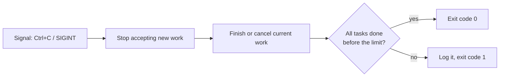

<!-- nav:top -->
[🏠 Start](../START-HERE.md) · [← 14.13 Tokio in depth: tasks and channels](13-tokio-tasks-and-channels.md) · [📋 Phase 14](README.md) · [14.15 Project: a concurrent job queue →](15-project-concurrent-job-queue.md) · [📖 Glossary](../GLOSSARY.md) · [🇷🇺 Русский](../../ru/14-concurrency-and-async/14-cancellation-timeouts-and-graceful-shutdown.md) <!-- nav -->

# Lesson 14.14 — Cancellation, timeouts and graceful shutdown

> **Phase 14 — Concurrency and async in depth** · Lesson 14 of 16 · ⏱ about 2.5 hours (2 sittings)

## What you will learn

- What really happens when a future is cancelled, and why it can only stop at an `.await`.
- What *cancel safety* is, and how a `select!` loop can lose data without any error.
- How to use timeouts and one deadline for several steps, and how to test them instantly with a paused clock.
- How to tell many tasks "stop now" with `CancellationToken`, and how to wait for them with `TaskTracker`.
- The steps of a graceful shutdown on Ctrl+C: stop accepting, finish or cancel the work, wait with a limit, exit with a clear exit code.

## Before you start

- You finished [Lesson 14.13 — Tokio in depth: tasks and channels](13-tokio-tasks-and-channels.md).
- You know `select!` and `timeout` from [Lesson 06.9](../06-rust-advanced/09-async-await-introduction.md), `Drop` from [Lesson 05.9 — Smart pointers](../05-rust-intermediate/09-smart-pointers.md), and signals such as SIGINT from [Lesson 13.7 — Signals in your programs](../13-operating-systems/07-signals-in-your-programs.md).
- Your code for this lesson goes in `~/projects/rust/code/p14-shutdown`:

```bash
cd ~/projects/rust
cargo new --lib code/p14-shutdown
cd code/p14-shutdown
cargo add tokio@1 --features full
cargo add tokio-util@0.7 --features rt
cargo add --dev tokio@1 --features test-util
mkdir src/bin
```

`tokio-util` is a crate from the Tokio project with extra tools; the `rt` feature turns on `TaskTracker`. The development dependency adds Tokio's `test-util` feature, which only tests need: it lets a test pause the clock.

## New words

| Word | Meaning |
|---|---|
| **cancellation** | Stopping a future before it finishes. In Rust this means dropping it. |
| **cancel safety** | A future is *cancel-safe* if dropping it at any `.await` loses nothing: no data that it already took, no half-done change. |
| **deadline** | A fixed moment in time ("at 12:00:05"), as opposed to a duration ("5 seconds"). One deadline can cover several steps. |
| **paused clock** | In Tokio tests with `start_paused = true`, time stands still and jumps forward when every task is waiting for a timer, so sleeps take no real time. |
| **`CancellationToken`** | A shareable flag from `tokio-util`: one place calls `cancel()`, every holder can await `cancelled()`. |
| **child token** | A token made with `child_token()`: cancelling the parent cancels it, cancelling it does not cancel the parent. |
| **`TaskTracker`** | A `tokio-util` type that counts spawned tasks and lets you wait until all of them have finished. |
| **graceful shutdown** | Stopping a program in an orderly way: no new work, the current work finished or cancelled cleanly, then exit. |
| **SIGINT** | The signal (interrupt) that the terminal sends to a program when you press Ctrl+C. |
| **exit code** | The number a program returns to the operating system when it ends: 0 means success, other numbers mean failure. |

## 1. Cancellation means dropping

From Lesson 06.9 you know the rule: to cancel a future, drop it. Let us look at what that means for the code inside. Create `src/bin/drop_cancels.rs`:

```rust
use std::time::Duration;
use tokio::time::{sleep, timeout};

/// Prints a line when it is dropped, so we can see cancellation.
struct Guard(&'static str);

impl Drop for Guard {
    fn drop(&mut self) {
        println!("  drop: {}", self.0);
    }
}

async fn three_steps() {
    let _guard = Guard("three_steps was cancelled or finished");
    for step in 1..=3 {
        println!("  step {step} starts");
        sleep(Duration::from_millis(100)).await;
        println!("  step {step} done");
    }
}

#[tokio::main]
async fn main() {
    println!("with enough time:");
    let result = timeout(Duration::from_millis(500), three_steps()).await;
    println!("  result: {result:?}");

    println!("with 150 ms:");
    let result = timeout(Duration::from_millis(150), three_steps()).await;
    println!("  result: {result:?}");
}
```

`cargo run --bin drop_cancels`:

```text
with enough time:
  step 1 starts
  step 1 done
  step 2 starts
  step 2 done
  step 3 starts
  step 3 done
  drop: three_steps was cancelled or finished
  result: Ok(())
with 150 ms:
  step 1 starts
  step 1 done
  step 2 starts
  drop: three_steps was cancelled or finished
  result: Err(Elapsed(()))
```

**What happens:**

1. With 500 ms, the future runs to the end, `_guard` is dropped when the function returns, and `timeout` gives `Ok(())`.
2. With 150 ms, the future is in the middle of step 2, waiting in `sleep`. When the time is up, `timeout` **drops** the future. Dropping the state machine drops everything stored in it, in this case `_guard`, so its `Drop` runs. "step 2 done" is never printed.
3. Nothing is "interrupted" in the middle of a line of code. A future can only stop where it returned `Pending`, that is, at an `.await`. Code between two `.await`s always runs completely.

This is good news: `Drop` is your cleanup hook, and it runs on cancellation too. It is also a warning: any `.await` is a place where your function may stop forever, and the code after it never runs.

> 🔒 **Security:** If a function changes two things that must stay consistent ("take money from A", `.await`, "give money to B"), cancellation between them leaves the system in a broken state. Keep such pairs without an `.await` between them, or make the change in one step (for example one database transaction), or make it safe to repeat.

## 2. Cancel safety and `select!` loops

`select!` drops every branch that did not win. In a loop, the losing branches are created again in the next round. That is fine for some futures and a silent data loss for others. Here is a loop that reads messages in pairs, while a timer ticks for status updates. Create `src/bin/cancel_unsafe.rs`:

```rust
use std::time::Duration;
use tokio::sync::mpsc;
use tokio::time::{interval, sleep};

/// Reads two messages and returns them as a pair.
async fn read_pair(rx: &mut mpsc::Receiver<u32>) -> Option<(u32, u32)> {
    let first = rx.recv().await?;
    let second = rx.recv().await?; // if we are cancelled here, `first` is lost
    Some((first, second))
}

#[tokio::main]
async fn main() {
    let (tx, mut rx) = mpsc::channel(16);
    tokio::spawn(async move {
        for n in 1..=6 {
            tx.send(n).await.unwrap();
            sleep(Duration::from_millis(30)).await;
        }
    });

    let mut status = interval(Duration::from_millis(20));
    loop {
        tokio::select! {
            pair = read_pair(&mut rx) => match pair {
                Some(pair) => println!("pair: {pair:?}"),
                None => break,
            },
            _ = status.tick() => {} // e.g. print a status line
        }
    }
    println!("channel closed");
}
```

```text
channel closed
```

Six numbers were sent and not one pair was printed. No error, no warning.

**What happens:**

1. In each round, `select!` creates a new `read_pair` future and polls it together with `status.tick()`.
2. `read_pair` receives a number (for example 1) and stores it in `first`, inside the future. Then it waits for the second number.
3. The next message comes only 30 ms later, but the status timer ticks every 20 ms. The timer wins, and `select!` drops the `read_pair` future, **together with the `1` it was holding**.
4. The next round starts a fresh `read_pair`, which takes the next number, and loses it the same way. In the end `recv()` returns `None` and the loop stops.

`rx.recv()` alone is **cancel-safe**: if it is dropped before it returned a message, no message was taken from the channel. `read_pair` is **not** cancel-safe, because it holds data between two `.await`s. The Tokio documentation lists for each method whether it is cancel-safe; for example `mpsc::Receiver::recv` is, and `AsyncReadExt::read_exact` is not.

The fix: put only cancel-safe futures into the `select!`, and keep the "half done" state in the loop, outside any future. `src/bin/cancel_safe.rs`:

```rust
use std::time::Duration;
use tokio::sync::mpsc;
use tokio::time::{interval, sleep};

#[tokio::main]
async fn main() {
    let (tx, mut rx) = mpsc::channel(16);
    tokio::spawn(async move {
        for n in 1..=6 {
            tx.send(n).await.unwrap();
            sleep(Duration::from_millis(30)).await;
        }
    });

    let mut status = interval(Duration::from_millis(20));
    let mut first: Option<u32> = None; // half a pair lives in the loop, not in a future
    loop {
        tokio::select! {
            message = rx.recv() => match message {
                Some(n) => match first.take() {
                    None => first = Some(n),
                    Some(a) => println!("pair: {:?}", (a, n)),
                },
                None => break,
            },
            _ = status.tick() => {}
        }
    }
    println!("channel closed");
}
```

```text
pair: (1, 2)
pair: (3, 4)
pair: (5, 6)
channel closed
```

The other fix, from Lesson 14.12, is to create the non-safe future **once** before the loop, pin it with `pin!`, and pass `&mut` to `select!`: then it is not dropped when another branch wins, and it keeps its progress.

## 3. Timeouts, deadlines and a paused clock

`timeout(duration, future)` limits one operation. When an operation has several steps, giving each step its own timeout lets the whole thing take much longer than you wanted. Use **one deadline** for all steps with `timeout_at`. Create `src/bin/deadline.rs`:

```rust
use std::time::Duration;
use tokio::time::{Instant, sleep, timeout_at};

#[tokio::main]
async fn main() {
    // One deadline for the whole operation, not one timeout per step.
    let deadline = Instant::now() + Duration::from_millis(250);
    for step in 1..=3 {
        match timeout_at(deadline, sleep(Duration::from_millis(100))).await {
            Ok(()) => println!("step {step} done"),
            Err(_) => {
                println!("step {step}: out of time, giving up");
                break;
            }
        }
    }
}
```

```text
step 1 done
step 2 done
step 3: out of time, giving up
```

Each step needs 100 ms. After two steps, 200 ms are used and only 50 ms are left before the deadline, so step 3 is cut. (`tokio::time::Instant` is Tokio's version of `std::time::Instant`; it follows the paused clock in tests.)

**Testing timeouts.** A test for "gives up after 30 seconds" must not wait 30 real seconds. Tokio's `test-util` feature adds `#[tokio::test(start_paused = true)]`: the clock stands still, and whenever every task is waiting for a timer, Tokio moves the clock straight to the next deadline. Put this into `src/lib.rs`:

```rust
//! Helpers for the lesson on cancellation and timeouts.

use std::time::Duration;
use tokio::time::{error::Elapsed, sleep, timeout};

/// Pretends to load a configuration that takes `delay` to arrive.
pub async fn load_config(delay: Duration) -> String {
    sleep(delay).await;
    "port = 8080".to_string()
}

/// Loads the configuration, but waits at most `limit`.
pub async fn load_with_limit(limit: Duration, delay: Duration) -> Result<String, Elapsed> {
    timeout(limit, load_config(delay)).await
}

#[cfg(test)]
mod tests {
    use super::*;

    #[tokio::test(start_paused = true)]
    async fn gives_up_after_the_limit() {
        let real_start = std::time::Instant::now();
        let result = load_with_limit(Duration::from_secs(30), Duration::from_secs(60)).await;
        assert!(result.is_err());
        // The test took no real time: the clock was paused and jumped forward.
        assert!(real_start.elapsed() < Duration::from_secs(1));
    }

    #[tokio::test(start_paused = true)]
    async fn returns_the_config_when_fast_enough() {
        let result = load_with_limit(Duration::from_secs(30), Duration::from_secs(5)).await;
        assert_eq!(result.unwrap(), "port = 8080");
    }
}
```

`cargo test --lib`:

```text
test result: ok. 2 passed; 0 failed; 0 ignored; 0 measured; 0 filtered out; finished in 0.00s
```

A 60-second load and a 30-second limit, tested in 0.00 seconds. The second assertion uses `std::time::Instant` on purpose: the real clock shows that no real time passed.

> 🧪 **Testing:** Paused time makes timing tests fast **and** exact: there is no "a little more than 150 ms" any more. Use it for every test that involves `sleep`, `timeout` or `interval`. It works only with Tokio's timers; `std::thread::sleep` still takes real time.

## 4. Telling many tasks to stop: `CancellationToken`

`abort()` (Lesson 14.13) cancels a task from outside, at whatever `.await` it is waiting. Often you want something gentler: tell the task "please stop", and let it finish its current step, save its state, close its connection. A `CancellationToken` is such a request, shared by many tasks. Create `src/bin/workers.rs`:

```rust
use std::time::Duration;
use tokio::time::sleep;
use tokio_util::sync::CancellationToken;
use tokio_util::task::TaskTracker;

async fn worker(id: u32, token: CancellationToken) {
    let mut jobs = 0;
    loop {
        tokio::select! {
            _ = token.cancelled() => {
                println!("worker {id}: stopping after {jobs} jobs");
                return;
            }
            _ = sleep(Duration::from_millis(100)) => jobs += 1, // one "job"
        }
    }
}

#[tokio::main]
async fn main() {
    let token = CancellationToken::new();
    let tracker = TaskTracker::new();
    for id in 1..=3 {
        tracker.spawn(worker(id, token.child_token()));
    }
    tracker.close(); // no more tasks will be added

    sleep(Duration::from_millis(350)).await;
    println!("main: cancelling");
    token.cancel();
    tracker.wait().await;
    println!("main: all workers stopped");
}
```

```text
main: cancelling
worker 3: stopping after 3 jobs
worker 1: stopping after 3 jobs
worker 2: stopping after 3 jobs
main: all workers stopped
```

**What happens:**

1. Each worker gets a **child token**. `token.cancel()` on the parent cancels all children. A child could also be cancelled alone (for example to stop one worker), without touching the others.
2. Inside the worker, `select!` races the work against `token.cancelled()`. `cancelled()` is cancel-safe, so it can be created again in every round.
3. When the token is cancelled, every worker sees it at its next `select!`, prints its own message and returns normally. This is cooperative: the task decides how to stop.
4. `TaskTracker` counts the tasks spawned through it. `close()` says "no more tasks will be added", and `wait()` finishes when the tracker is closed **and** all its tasks have finished. Unlike a `JoinSet`, it does not keep the results, which makes it the simple tool for "wait for everything before exiting".

## 5. Graceful shutdown

A service that is stopped (with Ctrl+C on your machine, or by a deployment tool that sends a signal) should not just disappear. The usual plan has four steps:



Here is a small service with a job queue: a producer adds a job every 100 ms, two workers take jobs from the queue and need 300 ms per job. On Ctrl+C the producer stops and closes the queue, and the workers finish every job that is already queued. Create `src/bin/service.rs`:

```rust
use std::process::ExitCode;
use std::sync::Arc;
use std::time::Duration;
use tokio::sync::{Mutex, mpsc};
use tokio::time::{sleep, timeout};
use tokio_util::sync::CancellationToken;
use tokio_util::task::TaskTracker;

/// Several workers share one receiver through a Tokio mutex.
type Jobs = Arc<Mutex<mpsc::Receiver<u32>>>;

/// Takes jobs from the queue until the queue is closed and empty.
async fn worker(id: u32, jobs: Jobs) {
    loop {
        let next = jobs.lock().await.recv().await; // the lock is released at `;`
        let Some(job) = next else { break };
        sleep(Duration::from_millis(300)).await; // the work itself
        println!("worker {id}: finished job {job}");
    }
    println!("worker {id}: queue is empty, exiting");
}

#[tokio::main]
async fn main() -> ExitCode {
    let shutdown = CancellationToken::new();
    let tracker = TaskTracker::new();
    let (tx, rx) = mpsc::channel::<u32>(8);
    let rx: Jobs = Arc::new(Mutex::new(rx));

    for id in 1..=2 {
        tracker.spawn(worker(id, Arc::clone(&rx)));
    }

    // The "accept loop": a new job every 100 ms until shutdown starts.
    let producer_token = shutdown.clone();
    tracker.spawn(async move {
        let mut next = 1;
        loop {
            tokio::select! {
                _ = producer_token.cancelled() => break,
                _ = sleep(Duration::from_millis(100)) => {
                    if tx.send(next).await.is_err() {
                        break;
                    }
                    next += 1;
                }
            }
        }
        println!("producer: stopped accepting jobs, queue closed");
        // `tx` is dropped here: workers finish what is queued, then exit.
    });
    tracker.close();

    // 1. Wait for the signal.
    tokio::signal::ctrl_c()
        .await
        .expect("cannot listen for Ctrl+C");
    println!("main: Ctrl+C received, shutting down");
    // 2. Tell everybody.
    shutdown.cancel();
    // 3. Wait, but not forever.
    match timeout(Duration::from_secs(5), tracker.wait()).await {
        Ok(()) => {
            println!("main: clean shutdown");
            ExitCode::SUCCESS
        }
        Err(_) => {
            println!("main: tasks did not stop in 5 s, exiting anyway");
            ExitCode::FAILURE
        }
    }
}
```

Run `cargo build --bin service`, then `./target/debug/service`; wait about a second, press Ctrl+C, and print the exit code with `echo "exit code: $?"`. (The terminal may also show `^C`. From a script you can send the same signal with `kill -INT <pid>`.) Your job numbers will differ a little:

```text
worker 1: finished job 1
worker 2: finished job 2
worker 1: finished job 3
main: Ctrl+C received, shutting down
producer: stopped accepting jobs, queue closed
worker 2: finished job 4
worker 1: finished job 5
worker 2: finished job 6
worker 2: queue is empty, exiting
worker 1: finished job 7
worker 1: queue is empty, exiting
main: clean shutdown
exit code: 0
```

**What happens:**

1. `tokio::signal::ctrl_c()` installs a handler for SIGINT and returns a future that completes when the signal arrives. Without it, Ctrl+C would kill the process at once (Lesson 13.7), in the middle of a job.
2. **Stop accepting.** `shutdown.cancel()` stops the producer loop. The producer drops `tx`, which closes the queue.
3. **Finish the current work.** The workers do not look at the token at all: they keep taking jobs until `recv()` returns `None`, which happens only when the queue is closed **and** empty. Jobs 4 to 7 were already queued and are all finished. (A service that must stop faster would give the workers the token as well, and cancel the queued jobs.)
4. **Wait with a limit.** `timeout(5 s, tracker.wait())` waits for the producer and both workers. If something hangs, the program still ends after 5 seconds, with `ExitCode::FAILURE` (exit code 1) so that whoever stopped it can see that the shutdown was not clean.
5. `main` returns `ExitCode`, which becomes the process exit code: 0 here.
6. In `worker`, the line `let next = jobs.lock().await.recv().await;` ends with `;`, so the mutex guard is dropped before the job runs. With `while let Some(job) = jobs.lock().await.recv().await { … }` the guard would live for the whole loop body (Lesson 14.11), and the two workers would take turns instead of working at the same time.

> 💡 **Tip:** On Linux, service managers (systemd from [Lesson 11.6](../11-linux-shell-and-containers/06-services-with-systemd.md), and Kubernetes later in the course) stop programs with SIGTERM (the "please terminate" signal), not SIGINT. `tokio::signal::unix::signal(SignalKind::terminate())` listens for it; a real service waits for either signal.

## Common mistakes

**1. A non-cancel-safe future inside a `select!` loop.** It loses data without any error (Section 2). Check the "cancel safety" section in the docs of every method you put into `select!`, or keep the state outside the future.

**2. Many timeouts instead of one deadline.** Three steps with `timeout(5 s)` each can take 15 seconds. Use `timeout_at` with one deadline.

**3. Tests that really sleep.** They are slow and flaky. Use `#[tokio::test(start_paused = true)]` with `tokio::time` functions.

**4. Waiting forever during shutdown.** `tracker.wait().await` without a limit hangs if one task ignores the token. Always wrap it in `timeout`, and decide what happens then (Exercise 3: abort the rest).

## Try it yourself

1. Create `code/p14-shutdown` and run `drop_cancels`, `cancel_unsafe` and `cancel_safe`.
2. In `cancel_unsafe.rs`, change the status interval from 20 ms to 50 ms and run it. Now one pair, `(3, 4)`, appears, and four numbers are still lost: the result depends on timing, which makes this bug very hard to find in production.
3. Run the tests with `cargo test --lib` and look at the time.
4. Run `service`, press Ctrl+C early (after about 0.3 s) and later (after 2 s), and compare how many queued jobs are finished after the signal.
5. Run `cargo clippy --all-targets` and `cargo fmt`, then commit: `git add code/p14-shutdown && git commit -m "p14-shutdown: cancellation, timeouts and graceful shutdown"`.

## Exercises

### Exercise 1 — Cancel with a token (easy)

Run `three_steps` (with its `Guard`) inside `tokio::select!` against `token.cancelled()`. Spawn a task that cancels the token after 250 ms. Predict the output, then run it.

<details>
<summary>Hint</summary>

The token must be cloned: one clone goes into the spawned task that calls `cancel()`, the other stays in `main` for `cancelled()`.

</details>

<details>
<summary>Answer</summary>

```rust
use std::time::Duration;
use tokio::time::sleep;
use tokio_util::sync::CancellationToken;

struct Guard(&'static str);

impl Drop for Guard {
    fn drop(&mut self) {
        println!("drop: {}", self.0);
    }
}

async fn three_steps() {
    let _guard = Guard("three_steps");
    for step in 1..=3 {
        println!("step {step} starts");
        sleep(Duration::from_millis(100)).await;
        println!("step {step} done");
    }
}

#[tokio::main]
async fn main() {
    let token = CancellationToken::new();
    let canceller = token.clone();
    tokio::spawn(async move {
        sleep(Duration::from_millis(250)).await;
        canceller.cancel();
    });

    tokio::select! {
        _ = three_steps() => println!("finished"),
        _ = token.cancelled() => println!("cancelled by the token"),
    }
}
```

```text
step 1 starts
step 1 done
step 2 starts
step 2 done
step 3 starts
drop: three_steps
cancelled by the token
```

Why it works: at 250 ms `three_steps` waits in the third `sleep`. The `cancelled()` branch wins, `select!` drops the `three_steps` future, and its `Guard` runs before the winning branch's code.

</details>

### Exercise 2 — Test with a paused clock (medium)

Write an integration test file `tests/steps.rs` with a version of `three_steps` that returns the number of finished steps (each step sleeps 100 ms). Test 1: with `timeout(500 ms)` the result is `Ok(3)`. Test 2: with `timeout(150 ms)` the result is an error, and the paused clock shows **exactly** 150 ms elapsed.

<details>
<summary>Hint</summary>

Use `#[tokio::test(start_paused = true)]`. Measure with `tokio::time::Instant::now()` and `start.elapsed()`: it follows the paused clock. Because the clock jumps exactly to each deadline, `assert_eq!` on a duration is allowed here, which it never is with real time.

</details>

<details>
<summary>Answer</summary>

```rust
use std::time::Duration;
use tokio::time::{sleep, timeout};

async fn three_steps() -> u32 {
    let mut done = 0;
    for _ in 1..=3 {
        sleep(Duration::from_millis(100)).await;
        done += 1;
    }
    done
}

#[tokio::test(start_paused = true)]
async fn three_steps_fit_into_500_ms() {
    let result = timeout(Duration::from_millis(500), three_steps()).await;
    assert_eq!(result.unwrap(), 3);
}

#[tokio::test(start_paused = true)]
async fn three_steps_do_not_fit_into_150_ms() {
    let start = tokio::time::Instant::now();
    let result = timeout(Duration::from_millis(150), three_steps()).await;
    assert!(result.is_err());
    // The paused clock moved exactly to the deadline.
    assert_eq!(start.elapsed(), Duration::from_millis(150));
}
```

`cargo test --test steps` shows `test result: ok. 2 passed; 0 failed; … finished in 0.00s`. Why it works: with a paused clock, Tokio advances time only when all tasks wait for timers, and it advances exactly to the next timer: 100 ms (first sleep), then 150 ms (the timeout), and nothing else happens in between.

</details>

### Exercise 3 — A stubborn task (hard)

Spawn three tasks into a `JoinSet`: two "polite" ones that wait for `token.cancelled()` and print "stopped", and one "stubborn" one that sleeps 60 seconds and ignores the token. After 100 ms, cancel the token and wait at most 1 second for all tasks. If some are still running, print how many, abort them, and print what each aborted task reports. The program must end after about 1.1 seconds, not 60.

<details>
<summary>Hint</summary>

Wrap the "wait for all" loop in an `async` block and give that block to `timeout`. After `timeout` returns `Err`, the block is gone, so you can use the `JoinSet` again: `tasks.len()`, `tasks.abort_all()`, and one more `join_next` loop to collect the aborted results.

</details>

<details>
<summary>Answer</summary>

```rust
use std::time::Duration;
use tokio::task::JoinSet;
use tokio::time::{sleep, timeout};
use tokio_util::sync::CancellationToken;

async fn polite(id: u32, token: CancellationToken) {
    token.cancelled().await;
    println!("worker {id}: stopped");
}

async fn stubborn(id: u32) {
    // Ignores the token: maybe it is stuck in a slow call.
    sleep(Duration::from_secs(60)).await;
    println!("worker {id}: never printed");
}

#[tokio::main]
async fn main() {
    let token = CancellationToken::new();
    let mut tasks = JoinSet::new();
    tasks.spawn(polite(1, token.clone()));
    tasks.spawn(polite(2, token.clone()));
    tasks.spawn(stubborn(3));

    sleep(Duration::from_millis(100)).await;
    println!("main: shutting down");
    token.cancel();

    let all_done = timeout(Duration::from_secs(1), async {
        while tasks.join_next().await.is_some() {}
    })
    .await;
    if all_done.is_err() {
        println!(
            "main: {} task(s) did not stop in time, aborting",
            tasks.len()
        );
        tasks.abort_all();
        while let Some(result) = tasks.join_next().await {
            if let Err(error) = result {
                println!("main: aborted, is_cancelled = {}", error.is_cancelled());
            }
        }
    }
    println!("main: exit");
}
```

```text
main: shutting down
worker 1: stopped
worker 2: stopped
main: 1 task(s) did not stop in time, aborting
main: aborted, is_cancelled = true
main: exit
```

Why it works: the token is a request; the stubborn task never asks for it. `timeout` gives the polite path its chance, then `abort_all` forces the rest: each aborted task's future is dropped at its current `.await` (the long `sleep`), and its `JoinError` reports `is_cancelled`. This "ask first, then force" order is the core of every graceful shutdown.

</details>

## Quiz

1. A future is cancelled while it waits at its second `.await`. Which of its code still runs?

<details>
<summary>Answer</summary>

None of the code after that `.await`. Only the `Drop` implementations of the values stored in the future run, because dropping the future drops them.

</details>

2. What does "cancel-safe" mean? Give one cancel-safe and one non-cancel-safe example.

<details>
<summary>Answer</summary>

Dropping the future at any `.await` loses nothing. `mpsc::Receiver::recv` is cancel-safe (no message is taken until it returns). A future that receives one message and then waits for a second is not: if it is dropped in between, the first message is lost.

</details>

3. Why is one deadline (`timeout_at`) better than a timeout per step?

<details>
<summary>Answer</summary>

Per-step timeouts add up: three steps with 5 seconds each may take 15 seconds in total. One deadline limits the whole operation to the time you really want.

</details>

4. What does `start_paused = true` change in a Tokio test?

<details>
<summary>Answer</summary>

The test's clock is paused; when every task is waiting for a timer, Tokio jumps the clock to the next deadline. Sleeps and timeouts take no real time, and the measured durations are exact.

</details>

5. What is the difference between `token.cancel()` and `handle.abort()`?

<details>
<summary>Answer</summary>

`cancel()` is a request: tasks that watch `cancelled()` see it and stop in their own way, after cleaning up. `abort()` forces a task: its future is dropped at the next `.await`, whatever it was doing.

</details>

## Summary

- Cancelling a future means dropping it; it stops at its current `.await`, the code after it never runs, and `Drop` of its stored values does run.
- A future is cancel-safe if dropping it loses nothing; inside `select!` loops use only cancel-safe futures, or keep partial state outside the future.
- `timeout` limits one operation, `timeout_at` gives several steps one deadline; `#[tokio::test(start_paused = true)]` tests them instantly and exactly.
- `CancellationToken` (with child tokens) asks many tasks to stop; `TaskTracker` waits until all of them have finished.
- Graceful shutdown: signal, stop accepting, finish or cancel the current work, wait with a limit, abort the rest, exit with a meaningful exit code.

## Sources and further reading

- [Tokio — Graceful Shutdown](https://tokio.rs/tokio/topics/shutdown) — the official guide: detecting shutdown, telling tasks, waiting for them.
- [tokio::select! — cancellation safety](https://docs.rs/tokio/1.54.1/tokio/macro.select.html) — the section that lists which Tokio methods are cancel-safe.
- [tokio_util::sync::CancellationToken](https://docs.rs/tokio-util/0.7.20/tokio_util/sync/struct.CancellationToken.html) — tokens, child tokens and `drop_guard`.
- [tokio_util::task::TaskTracker](https://docs.rs/tokio-util/0.7.20/tokio_util/task/task_tracker/struct.TaskTracker.html) — `spawn`, `close` and `wait`.
- [tokio::time::pause](https://docs.rs/tokio/1.54.1/tokio/time/fn.pause.html) — how the paused clock works in tests.
- [tokio::signal](https://docs.rs/tokio/1.54.1/tokio/signal/index.html) — `ctrl_c` and Unix signals such as SIGTERM.

---

[🏠 Start](../START-HERE.md) · [← 14.13 Tokio in depth: tasks and channels](13-tokio-tasks-and-channels.md) · [📋 Phase 14](README.md) · [14.15 Project: a concurrent job queue →](15-project-concurrent-job-queue.md) · [📖 Glossary](../GLOSSARY.md) <!-- nav -->
<!-- nav:bottom -->
