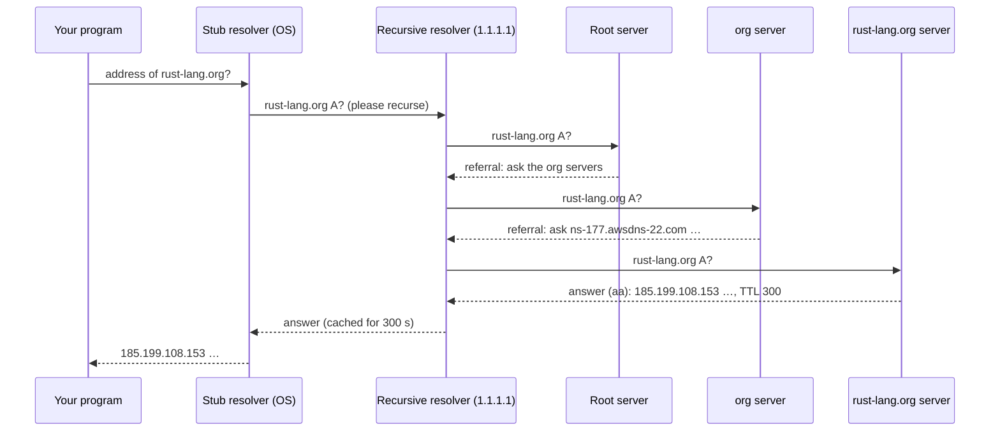

<!-- nav:top -->
[🏠 Start](../START-HERE.md) · [← 15.9 HTTP with hyper and reqwest](09-http-with-hyper-and-reqwest.md) · [📋 Phase 15](README.md) · [15.11 Project: a DNS resolver →](11-project-dns-resolver.md) · [📖 Glossary](../GLOSSARY.md) · [🇷🇺 Русский](../../ru/15-networking/10-dns-how-names-become-addresses.md) <!-- nav -->

# Lesson 15.10 — DNS: how names become addresses

> **Phase 15 — Networking** · Lesson 10 of 16 · ⏱ about 2.5 hours (2 sittings)

## What you will learn

- How DNS names form a tree, and which servers are responsible for which part of it.
- What a stub resolver, a recursive resolver and an authoritative server do, and how caching with TTL works.
- How to follow a lookup by hand with `dig`, from the root servers down to the answer.
- The common record types: A, AAAA, CNAME, MX, NS, TXT and SOA.
- What a DNS message looks like on the wire, byte by byte, from a real packet capture.
- How to resolve names in Rust: the operating system's resolver and the `hickory-resolver` library.

## Before you start

- You finished [Lesson 15.9 — HTTP with hyper and reqwest](09-http-with-hyper-and-reqwest.md).
- You know UDP (User Datagram Protocol) and TCP (Transmission Control Protocol) from [Lesson 15.3 — TCP and UDP](03-tcp-and-udp.md), and UDP sockets from [Lesson 15.5 — UDP sockets in Rust](05-udp-sockets-in-rust.md): a UDP datagram travels alone, without a connection, and can be lost.
- You know the practice package `code/p15-net` and the container image `p15-nettools` from [Lesson 15.1](01-how-the-internet-works.md), and bit masks such as `bits & 0x8000` from [Lesson 12.4](../12-computer-systems/04-bitwise-operations.md).
- `dig` is already on macOS. Check it:

```bash
dig -v
```

```text
DiG 9.10.6
```

## New words

| Word | Meaning |
|---|---|
| **DNS** (Domain Name System) | The worldwide system that turns names such as `rust-lang.org` into IP (Internet Protocol) addresses and other data. |
| **domain name** | A name made of **labels** separated by dots: `www`, `rust-lang`, `org`. Read from right to left, it is a path in a tree. |
| **root** | The top of the name tree, written as an empty label: the final dot in `rust-lang.org.`. |
| **TLD** (Top-Level Domain) | The label right under the root: `org`, `com`, `uz`, `ru`. |
| **FQDN** (Fully Qualified Domain Name) | A complete name that ends with the root dot, such as `rust-lang.org.`. It cannot be completed further. |
| **zone** | The part of the tree that one organisation manages. `org` is a zone; `rust-lang.org` is another zone inside it. |
| **resource record** (RR) | One piece of DNS data: name, type, class, TTL and the value, for example `rust-lang.org. 300 IN A 185.199.108.153`. |
| **TTL** (Time To Live) | How many seconds a record may be kept in a cache before it must be asked again. |
| **stub resolver** | The small resolver inside your operating system. It asks one recursive resolver and waits for the final answer. |
| **recursive resolver** | A server (for example `1.1.1.1`, or one run by your internet provider) that finds the answer for you by asking other servers, and caches the results. |
| **authoritative server** | A server that holds the real records of a zone and answers for it. Its answers carry the `aa` flag. |
| **referral** | An answer that says "I do not know, but these servers are responsible for that part of the tree". |
| **glue record** | An address that comes with a referral, so you can reach the named server without another lookup. |
| **name compression** | A trick in DNS messages: a name can end with a 2-byte **pointer** to an earlier position in the same message instead of repeating the labels. |
| **`dig`** | A command-line tool that sends DNS queries and prints the answers in detail. |
| **UDP / TCP** (User Datagram Protocol / Transmission Control Protocol) | The two transport protocols of Lesson 15.3: single datagrams without a connection / a reliable byte stream over a connection. |
| **OS** (operating system) | Here: macOS or Linux, whose built-in stub resolver your programs use. |
| **CNAME** (Canonical NAME) | A record that says "this name is an alias; the real (canonical) name is that one". |
| **EDNS** (Extension Mechanisms for DNS) | An extra pseudo-record in a message that allows bigger UDP answers and new options. |
| **DNSSEC** (DNS Security Extensions) | Digital signatures on DNS records, so a resolver can check that an answer is genuine. |
| **DoT / DoH** (DNS over TLS / DNS over HTTPS) | DNS messages sent inside an encrypted TLS (Transport Layer Security) connection, directly or as HTTPS requests. |
| **HTTP, HTTPS, ASCII** | HyperText Transfer Protocol (the web, Lesson 15.8); HTTP Secure (HTTP inside TLS); American Standard Code for Information Interchange (the 128 classic characters, Lesson 12.5). |
| **AD** (Authenticated Data) | A DNSSEC flag in the header: in an answer it means "the resolver checked the signatures"; `dig` sets it in a query to ask for that information. |
| **TXT** (text) | A record type that holds free text (Section 4). |

## 1. A tree of names

A domain name is a path in a tree. You read it **from right to left**: `www.rust-lang.org.` means "start at the root, go to `org`, then to `rust-lang`, then to `www`".

```text
                          . (root)
            ┌─────────────┼──────────────┐
           org           com             uz
            │             │
        rust-lang      github
       ┌────┴────┐        │
      www     (A records)  …
```

Each label is at most 63 bytes, and the whole name is at most 253 characters. Labels traditionally use letters, digits and hyphens. Upper and lower case are the same: `Rust-Lang.ORG` and `rust-lang.org` are one name.

The tree is **split into zones**, and each zone is run by someone else. The root zone is run for the whole internet by 13 named server groups (`a.root-servers.net` to `m.root-servers.net`, each really hundreds of machines). The `org` zone is run by the `org` registry. The `rust-lang.org` zone is run by the Rust project, which pays a DNS provider to host it. Nobody holds the whole tree: each zone only knows its own records and **who is responsible for each child zone**.

## 2. Who answers your question

When a program wants the address of `rust-lang.org`, three kinds of software work together:



1. The **stub resolver** in your operating system knows one or two recursive resolvers (on Linux they are listed in `/etc/resolv.conf`). It first looks into `/etc/hosts`, then asks the resolver and waits.
2. The **recursive resolver** does the real work. It walks the tree from the top: the root sends it to the `org` servers, they send it to the servers of `rust-lang.org`, and those give the answer.
3. Every answer has a **TTL**. The recursive resolver keeps answers in its **cache** until the TTL runs out. The next person who asks for `rust-lang.org` within 300 seconds gets the cached answer at once, and the root is not asked again for two days (the TTL of the `org` referral is 172 800 seconds).

You can see the cache at work: ask the same resolver twice, a few seconds apart, and watch the TTL count down.

```bash
dig +noall +answer @1.1.1.1 rust-lang.org | head -1
sleep 6
dig +noall +answer @1.1.1.1 rust-lang.org | head -1
```

```text
rust-lang.org.		300	IN	A	185.199.111.153
rust-lang.org.		294	IN	A	185.199.111.153
```

**What happens:** `@1.1.1.1` sends the query to Cloudflare's public recursive resolver. `+noall +answer` hides everything except the answer section. The first answer came fresh from the authoritative server (TTL 300). The second came from the cache, six seconds older.

> 💡 **Tip:** when you change a DNS record of your own service, the old value can live on in caches for up to the old TTL. Lower the TTL a day *before* a planned change, then change the record.

## 3. Walk the tree yourself

`dig` can play the recursive resolver for you. `+norecurse` says "do not search for me, just tell me what you know". Ask a root server first:

```bash
dig +noall +authority +norecurse @a.root-servers.net rust-lang.org
```

```text
org.			172800	IN	NS	v0n3.pir-ns.org.
org.			172800	IN	NS	v0n0.pir-ns.org.
org.			172800	IN	NS	v2n1.pir-ns.org.
org.			172800	IN	NS	v0n2.pir-ns.org.
org.			172800	IN	NS	v0n1.pir-ns.org.
org.			172800	IN	NS	v2n0.pir-ns.org.
```

The root does not know `rust-lang.org`. It answers with a **referral** in the *authority* section: six NS (name server) records for the zone `org`. (It also sends their addresses, the glue records, in the *additional* section; we hid it.) Ask one of them:

```bash
dig +noall +authority +norecurse @v0n0.pir-ns.org rust-lang.org
```

```text
rust-lang.org.		3600	IN	NS	ns-683.awsdns-21.net.
rust-lang.org.		3600	IN	NS	ns-177.awsdns-22.com.
rust-lang.org.		3600	IN	NS	ns-1800.awsdns-33.co.uk.
rust-lang.org.		3600	IN	NS	ns-1493.awsdns-58.org.
```

Another referral, one level deeper. Now ask a server of the `rust-lang.org` zone itself, and show the header too (`+comments`):

```bash
dig +noall +comments +answer +norecurse @ns-177.awsdns-22.com rust-lang.org
```

```text
;; Got answer:
;; ->>HEADER<<- opcode: QUERY, status: NOERROR, id: 23708
;; flags: qr aa; QUERY: 1, ANSWER: 4, AUTHORITY: 4, ADDITIONAL: 1

;; ANSWER SECTION:
rust-lang.org.		300	IN	A	185.199.108.153
rust-lang.org.		300	IN	A	185.199.109.153
rust-lang.org.		300	IN	A	185.199.110.153
rust-lang.org.		300	IN	A	185.199.111.153
```

(The output also has two lines about EDNS, an extension you will meet in Section 5; we removed them here.)

**What happens:** `flags: qr aa` means "this is a response (`qr`) and I am authoritative for this name (`aa`)". `status: NOERROR` means the name exists. There are four A records: the site has four addresses, and clients may use any of them. This is exactly the walk that `1.1.1.1` did for you in Section 2.

If a name does not exist, the status says so:

```bash
dig +noall +comments no-such-name.rust-lang.org | grep status
```

```text
;; ->>HEADER<<- opcode: QUERY, status: NXDOMAIN, id: 64406
```

`NXDOMAIN` ("non-existent domain") is a real answer, not an error of the network. Resolvers cache it too.

## 4. Record types

A record's **type** says what its value means. These are the ones you meet every day:

| Type | Value | Example from `rust-lang.org` |
|---|---|---|
| **A** | an IPv4 address (4 bytes) | `185.199.108.153` |
| **AAAA** | an IPv6 address (16 bytes) | `2606:50c0:8000::153` |
| **CNAME** (Canonical NAME) | "this name is an alias of another name" | `www.rust-lang.org` → `rust-lang.github.io.` |
| **MX** (Mail eXchange) | a mail server with a preference number (lower is preferred) | `10 mxa.mailgun.org.` |
| **NS** (Name Server) | a server that is authoritative for a zone | `ns-177.awsdns-22.com.` |
| **TXT** | free text, used for checks such as "this domain belongs to us" | `"google-site-verification=…"` |
| **SOA** (Start Of Authority) | administrative data of a zone, including the TTL of negative answers | `ns-683.awsdns-21.net. … 86400` |

A CNAME is followed automatically. Ask for the A record of `www.rust-lang.org`:

```bash
dig +noall +answer www.rust-lang.org
```

```text
www.rust-lang.org.	299	IN	CNAME	rust-lang.github.io.
rust-lang.github.io.	637	IN	A	185.199.109.153
rust-lang.github.io.	637	IN	A	185.199.110.153
rust-lang.github.io.	637	IN	A	185.199.111.153
rust-lang.github.io.	637	IN	A	185.199.108.153
```

**What happens:** the resolver found a CNAME, then looked up the target name and returned both steps in one answer. Note the different TTLs: each record is cached on its own. `+short` prints only the values, which is handy in scripts:

```bash
dig +short rust-lang.org MX
```

```text
10 mxa.mailgun.org.
10 mxb.mailgun.org.
```

`IN` in every line is the **class**, "Internet". Other classes exist but are almost never used.

## 5. A DNS message on the wire

DNS normally uses **UDP on port 53**: the question fits in one datagram and the answer in another, so no connection setup is needed. Let us capture one exchange. Start the container from Lesson 15.1 and install `dig` inside it (only in this throwaway container; `--rm` deletes it afterwards):

```bash
docker run --rm -it --cap-add NET_RAW --cap-add NET_ADMIN p15-nettools bash
```

Inside the container:

```bash
apt-get update -qq && apt-get install -y -qq --no-install-recommends bind9-dnsutils > /dev/null
tcpdump -i eth0 -n -X -c 2 udp port 53 &
sleep 1
dig @1.1.1.1 rust-lang.org A +noedns +noall +answer
```

`+noedns` keeps the query minimal (Section "Common mistakes" explains EDNS). The output, shortened to the two packets:

```text
07:16:03.259104 IP 172.17.0.4.48314 > 1.1.1.1.53: 30871+ A? rust-lang.org. (31)
	0x0000:  4500 003b 0822 0000 4011 c479 ac11 0004  E..;."..@..y....
	0x0010:  0101 0101 bcba 0035 0027 ae4f 7897 0120  .......5.'.Ox...
	0x0020:  0001 0000 0000 0000 0972 7573 742d 6c61  .........rust-la
	0x0030:  6e67 036f 7267 0000 0100 01              ng.org.....
07:16:03.348948 IP 1.1.1.1.53 > 172.17.0.4.48314: 30871 4/0/0 A 185.199.110.153, A 185.199.111.153, A 185.199.109.153, A 185.199.108.153 (95)
	0x0000:  4500 007b 0000 4000 3f11 8d5b 0101 0101  E..{..@.?..[....
	0x0010:  ac11 0004 0035 bcba 0067 0000 7897 8180  .....5...g..x...
	0x0020:  0001 0004 0000 0000 0972 7573 742d 6c61  .........rust-la
	0x0030:  6e67 036f 7267 0000 0100 01c0 0c00 0100  ng.org..........
	0x0040:  0100 0001 0d00 04b9 c76e 99c0 0c00 0100  .........n......
	...
```

As in Lesson 15.1, the first 20 bytes are the IP header and the next 8 bytes the UDP header (ports `bcba` = 48314 and `0035` = 53). The **DNS message** starts at offset `0x1c` (28) with `7897`. Here is the query, all 31 bytes:

```text
 7897      ID (identifier) = 30871 (random; the answer must carry the same ID)
 0120      flags: RD = 1 (recursion desired), AD = 1 (see below)
 0001      QDCOUNT: 1 question
 0000      ANCOUNT: 0 answers
 0000      NSCOUNT: 0 authority records
 0000      ARCOUNT: 0 additional records
 09 72 75 73 74 2d 6c 61 6e 67    length 9, "rust-lang"
 03 6f 72 67                      length 3, "org"
 00                               length 0: the root, end of the name
 0001      QTYPE  = 1 (A)
 0001      QCLASS = 1 (IN)
```

**What happens:**

1. The **header** is always 12 bytes: the ID, 16 bits of flags and four counts. All numbers are big-endian (network byte order, Lesson 15.1).
2. The flags `0x0120` set RD ("please recurse for me") and AD, a bit with which `dig` asks for DNSSEC validation information; you can ignore it.
3. The **question** is a name, a type and a class. The name is written as **labels with a length byte in front**, ending with a zero byte. There are no dots on the wire: the dots are only how people write it.

And the start of the response:

```text
 7897      same ID
 8180      flags: QR = 1 (response), RD = 1, RA = 1 (recursion available), RCODE = 0 (no error)
 0001 0004 0000 0000              1 question, 4 answers, 0, 0
 09 rust-lang 03 org 00 0001 0001 the question, copied back
 c0 0c     NAME: a pointer to offset 12 (the name in the question)
 0001      TYPE  = A
 0001      CLASS = IN
 0000 010d TTL   = 269 seconds
 0004      RDLENGTH = 4 bytes of data follow
 b9 c7 6e 99                      185.199.110.153
 c0 0c 0001 0001 …                the next answer
```

**What happens:**

1. The response repeats the question. A resolver checks that the ID **and** the question match what it sent; otherwise it throws the answer away.
2. Each answer is a **resource record**: name, type, class, a 32-bit TTL, the length of the data, and the data. For type A the data is the 4 bytes of the address.
3. The name of each answer is just `c0 0c`. A length byte never goes above 63 (`0x3f`), so a byte whose top two bits are `11` (`0xc0` and above) means "this is a **pointer**": the remaining 14 bits are an offset from the start of the DNS message. Offset `0x0c` = 12 is where the question's name begins, right after the 12-byte header. This **name compression** saves space: `rust-lang.org` is written once instead of five times.

The flags in the header, bit by bit (bit 15 is the leftmost):

```text
  15  14 13 12 11  10   9   8   7   6  5  4   3  2  1  0
 ┌───┬───────────┬───┬───┬───┬───┬─────────┬───────────┐
 │QR │  OPCODE   │AA │TC │RD │RA │ Z AD CD │   RCODE   │
 └───┴───────────┴───┴───┴───┴───┴─────────┴───────────┘
  QR: 0 query, 1 response        TC: truncated (answer did not fit)
  OPCODE: 0 standard query       RD/RA: recursion desired/available
  AA: authoritative answer       RCODE: 0 no error, 2 server failure, 3 NXDOMAIN
```

If an answer is too big for one UDP datagram, the server sends what fits and sets **TC** (truncated). The client then asks again over **TCP**, port 53, where each message is prefixed with its length in 2 bytes: the same framing idea as in Lesson 15.7.

> 🔒 **Security:** classic DNS is not encrypted and not authenticated. Anyone on the path can read which names you look up, and an attacker who guesses the ID and the source port can send a fake answer first (*DNS spoofing*); if a resolver caches it, everybody behind that resolver is sent to the attacker (*cache poisoning*). Defences: random IDs **and** random source ports (every modern resolver does both), checking that the question matches, DNSSEC (signed records), and encrypted transports such as DoT and DoH.

## 6. Resolving names in Rust

**The operating system's resolver.** Most programs never send DNS packets themselves: they ask the stub resolver of the operating system (the C library function `getaddrinfo`). In Rust, `std::net::ToSocketAddrs` and `tokio::net::lookup_host` do this. Add the example to `code/p15-net` as `src/bin/lookup.rs` (with Tokio in its dependencies: `cargo add tokio@1 --features full`):

```rust
use std::env;

#[tokio::main]
async fn main() -> std::io::Result<()> {
    let name = env::args()
        .nth(1)
        .unwrap_or_else(|| "rust-lang.org".to_string());
    // lookup_host wants "host:port"; the port is not used for the lookup itself.
    for addr in tokio::net::lookup_host(format!("{name}:443")).await? {
        println!("{}", addr.ip());
    }
    Ok(())
}
```

```bash
cargo run -q --bin lookup
cargo run -q --bin lookup localhost
cargo run -q --bin lookup no-such-name.invalid
```

```text
185.199.110.153
185.199.108.153
185.199.111.153
185.199.109.153
::1
127.0.0.1
Error: Custom { kind: Uncategorized, error: "failed to lookup address information: nodename nor servname provided, or not known" }
```

**What happens:**

1. `lookup_host` returns socket addresses (IP plus port), so it needs a port; we only print the IP. It runs the blocking `getaddrinfo` on a helper thread, so it does not block the Tokio runtime.
2. `localhost` was never sent to DNS: the stub resolver found it in `/etc/hosts`. This is why `dig localhost` and your program can give different answers.
3. On a network without IPv6 the OS may return only IPv4 addresses for `rust-lang.org`, even though AAAA records exist. You may see IPv6 addresses too.
4. A name that does not exist gives an `io::Error` with the system's message (on Linux it reads `Name or service not known`).

**A DNS library.** The OS resolver gives only addresses. To read other record types (MX, TXT) or to choose the server, use a DNS library. `hickory-resolver` is a complete resolver written in Rust. Add it with `cargo add hickory-resolver@0.26` and create `src/bin/hickory.rs`:

```rust
use hickory_resolver::Resolver;
use hickory_resolver::config::{CLOUDFLARE, ResolverConfig};
use hickory_resolver::net::runtime::TokioRuntimeProvider;
use hickory_resolver::proto::rr::RecordType;

#[tokio::main]
async fn main() -> Result<(), Box<dyn std::error::Error>> {
    let config = ResolverConfig::udp_and_tcp(&CLOUDFLARE);
    let resolver =
        Resolver::builder_with_config(config, TokioRuntimeProvider::default()).build()?;

    for record_type in [RecordType::A, RecordType::MX] {
        let lookup = resolver.lookup("rust-lang.org.", record_type).await?;
        for record in lookup.answers() {
            println!(
                "{} {} {:?} {}",
                record.name,
                record.ttl,
                record.record_type(),
                record.data
            );
        }
    }
    Ok(())
}
```

```bash
cargo run -q --bin hickory
```

```text
rust-lang.org. 300 A 185.199.110.153
rust-lang.org. 300 A 185.199.108.153
rust-lang.org. 300 A 185.199.111.153
rust-lang.org. 300 A 185.199.109.153
rust-lang.org. 60 MX 10 mxa.mailgun.org.
rust-lang.org. 60 MX 10 mxb.mailgun.org.
```

**What happens:**

1. `ResolverConfig::udp_and_tcp(&CLOUDFLARE)` says "send queries to Cloudflare's resolvers, over UDP, and fall back to TCP when an answer is truncated".
2. `lookup(name, type)` sends one query and returns the answer records. The name ends with a dot, so it is an FQDN and the library does not try to append search domains to it.
3. Each record has public fields `name`, `ttl` and `data`; `data` prints in the usual text form.

In Lesson 15.11 you build the core of such a library yourself: you write the query bytes by hand, send them with a `UdpSocket` and parse the answer, pointers and all. `hickory` is then a good reference to compare your results with.

## Common mistakes

**1. Resolving once and keeping the address forever.** A program that looks up its database host at start-up and never again keeps using the old address after the DNS record changes, long after the TTL ran out. Resolve again when you open new connections (connection pools and `reqwest` do this for you), and do not cache longer than the TTL.

**2. Using only the first address.** A name often has several A and AAAA records, and one of the addresses can be down. Try the next address when a connection fails. Good clients even try IPv6 and IPv4 in parallel (the *Happy Eyeballs* algorithm).

**3. Testing with `dig` and debugging your program.** `dig` talks DNS directly and ignores `/etc/hosts`; your program uses the OS resolver, which reads `/etc/hosts` first and, on Linux, the search domains in `/etc/resolv.conf`. When the two disagree, check those files. Inside Kubernetes the search list is long, which is why a name without a final dot can cause several queries.

**4. Surprised by EDNS.** Without `+noedns`, `dig` adds one more record to the query: an OPT pseudo-record of EDNS, which says "I accept UDP answers up to 1232 bytes" (or 4096). That is why the first capture in your own experiments may show `ARCOUNT: 1` and `[1au]` in the `tcpdump` line. It is normal; the parser in Lesson 15.11 must simply skip records it does not know.

## Try it yourself

1. Run `dig +noall +answer @1.1.1.1 crates.io` twice, a few seconds apart, and watch the TTL go down.
2. Walk the tree for `crates.io` by hand, as in Section 3: ask `a.root-servers.net`, then one of the `io` servers it names, then one of the servers of `crates.io`. At each step, write down whether the answer was a referral or an authoritative answer (`aa`).
3. Ask for a name that does not exist under `crates.io` and find `NXDOMAIN` in the header.

## Exercises

### Exercise 1 — Read a referral (easy)

Run `dig +noall +authority +additional +norecurse @a.root-servers.net rust-lang.org`. What is in the authority section, what is in the additional section, and why does the additional section matter?

<details>
<summary>Hint</summary>

Look at the record types in each section: NS in one, A and AAAA in the other. Then imagine you have only the names of the `org` servers and want to send them a packet.

</details>

<details>
<summary>Answer</summary>

The authority section holds NS records for `org.` (for example `org. 172800 IN NS v0n0.pir-ns.org.`): the referral. The additional section holds A and AAAA records for those servers (for example `v0n0.pir-ns.org. 172800 IN A 199.19.56.1`): the **glue**. Without glue you would need the address of `v0n0.pir-ns.org` before you could ask about `org`, but that name is itself inside `org`, so you could never start. The glue breaks this circle.

</details>

### Exercise 2 — Decode the flags (medium)

In `src/bin/dnsflags.rs`, write `fn parse_flags(bits: u16) -> Flags` where `Flags` has the fields `response`, `opcode`, `authoritative`, `truncated`, `recursion_desired`, `recursion_available` and `rcode`. Write tests for `0x8180` (a normal answer from a recursive resolver), `0x8183` (NXDOMAIN) and `0x0100` (a query).

<details>
<summary>Hint</summary>

Use the bit picture in Section 5. A single bit: `bits & 0x8000 != 0`. A group of bits: shift it down and mask it, `(bits >> 11) & 0x0F`. Run the tests with `cargo test --bin dnsflags`.

</details>

<details>
<summary>Answer</summary>

```rust
/// The flag bits of a DNS header (the 16 bits after the ID).
#[derive(Debug, PartialEq)]
struct Flags {
    response: bool,            // QR
    opcode: u8,                // 4 bits, 0 = standard query
    authoritative: bool,       // AA
    truncated: bool,           // TC
    recursion_desired: bool,   // RD
    recursion_available: bool, // RA
    rcode: u8,                 // 4 bits, 0 = no error, 3 = name does not exist
}

fn parse_flags(bits: u16) -> Flags {
    Flags {
        response: bits & 0x8000 != 0,
        opcode: ((bits >> 11) & 0x0F) as u8,
        authoritative: bits & 0x0400 != 0,
        truncated: bits & 0x0200 != 0,
        recursion_desired: bits & 0x0100 != 0,
        recursion_available: bits & 0x0080 != 0,
        rcode: (bits & 0x000F) as u8,
    }
}

fn main() {
    println!("{:?}", parse_flags(0x8400));
}

#[cfg(test)]
mod tests {
    use super::*;

    #[test]
    fn a_normal_answer_from_a_recursive_resolver() {
        let f = parse_flags(0x8180);
        assert!(f.response && f.recursion_desired && f.recursion_available);
        assert!(!f.authoritative && !f.truncated);
        assert_eq!((f.opcode, f.rcode), (0, 0));
    }

    #[test]
    fn name_error_has_rcode_3() {
        assert_eq!(parse_flags(0x8183).rcode, 3);
    }

    #[test]
    fn a_query_is_not_a_response() {
        let f = parse_flags(0x0100);
        assert!(!f.response);
        assert!(f.recursion_desired);
    }
}
```

`cargo test --bin dnsflags` prints `test result: ok. 3 passed`, and `cargo run -q --bin dnsflags` prints:

```text
Flags { response: true, opcode: 0, authoritative: true, truncated: false, recursion_desired: false, recursion_available: false, rcode: 0 }
```

Why it works: each mask has exactly the bit of one flag set (`0x8000` is bit 15, `0x0400` is bit 10, …). `0x8400` is what an authoritative server sends to a query without RD, like the `aa` answer in Section 3.

</details>

### Exercise 3 — Is this a valid host name? (medium)

In `src/bin/names.rs`, write `fn is_valid_name(name: &str) -> bool` with the rules of Section 1: an optional final dot; total length 1 to 253 without it; each label 1 to 63 bytes; only ASCII letters, digits and `-`; no label starts or ends with `-`. Write tests for normal names, empty labels, bad hyphens and both length limits.

<details>
<summary>Hint</summary>

`strip_suffix('.')` removes one final dot. `split('.')` gives the labels; `all(|label| …)` checks them. A name with 64 labels of `abc` has 64 × 4 − 1 = 255 characters.

</details>

<details>
<summary>Answer</summary>

```rust
/// Checks the classic rules for a host name such as "www.rust-lang.org".
fn is_valid_name(name: &str) -> bool {
    let name = name.strip_suffix('.').unwrap_or(name);
    if name.is_empty() || name.len() > 253 {
        return false;
    }
    name.split('.').all(|label| {
        !label.is_empty()
            && label.len() <= 63
            && !label.starts_with('-')
            && !label.ends_with('-')
            && label
                .bytes()
                .all(|b| b.is_ascii_alphanumeric() || b == b'-')
    })
}

fn main() {
    for name in [
        "rust-lang.org",
        "rust-lang.org.",
        "-bad.org",
        "a..b",
        "ünicode.org",
    ] {
        println!("{name:16} {}", is_valid_name(name));
    }
}

#[cfg(test)]
mod tests {
    use super::*;

    #[test]
    fn accepts_normal_names_with_or_without_the_final_dot() {
        assert!(is_valid_name("www.rust-lang.org"));
        assert!(is_valid_name("www.rust-lang.org."));
    }

    #[test]
    fn rejects_empty_labels_and_bad_hyphens() {
        assert!(!is_valid_name(""));
        assert!(!is_valid_name("a..b"));
        assert!(!is_valid_name("-a.org"));
        assert!(!is_valid_name("a-.org"));
    }

    #[test]
    fn checks_the_length_limits() {
        assert!(is_valid_name(&"a".repeat(63)));
        assert!(!is_valid_name(&"a".repeat(64)));
        let long = vec!["abc"; 64].join("."); // 64 * 4 - 1 = 255 characters
        assert!(!is_valid_name(&long));
    }
}
```

```text
rust-lang.org    true
rust-lang.org.   true
-bad.org         false
a..b             false
ünicode.org      false
```

Why it works: `"a..b".split('.')` gives an empty label in the middle, which `!label.is_empty()` rejects. `ü` is not ASCII, so it fails the byte check. (Names with such letters exist, but they travel in DNS in an ASCII form called *punycode*, starting with `xn--`.) You will reuse this check in the project to reject bad input before you build a query.

</details>

### Exercise 4 — Follow a pointer by hand (hard)

Here is the part of a real MX response for `rust-lang.org` that follows the question (offsets are from the start of the DNS message; the question's name starts at offset 12, and `org` inside it at offset 22):

```text
offset 31: c0 0c 00 0f 00 01 00 00 00 3c 00 10 00 0a 03 6d 78 61 07 6d 61 69 6c 67 75 6e c0 16
```

Decode it: the name, the type, the class, the TTL, the length of the data, the preference and the mail server name.

<details>
<summary>Hint</summary>

Go field by field as in Section 5: name (2 bytes here), type (2), class (2), TTL (4), RDLENGTH (2), then the data. For MX the data is a 2-byte preference followed by a name, and that name may end with a pointer.

</details>

<details>
<summary>Answer</summary>

- `c0 0c` — pointer to offset 12: the name is `rust-lang.org`.
- `00 0f` — type 15, MX. `00 01` — class IN.
- `00 00 00 3c` — TTL 60 seconds.
- `00 10` — 16 bytes of data follow.
- `00 0a` — preference 10.
- `03 6d 78 61` — label `mxa`; `07 6d 61 69 6c 67 75 6e` — label `mailgun`; `c0 16` — pointer to offset 22 (`0x16`), where the labels `org` and then the zero byte are.

So the record is `rust-lang.org. 60 IN MX 10 mxa.mailgun.org.`, exactly what `dig` printed. Count the data: 2 + 4 + 8 + 2 = 16 bytes, which matches RDLENGTH. Note that a name **inside** the data used a pointer too: your parser must handle pointers everywhere a name appears.

</details>

## Quiz

1. What is the difference between a recursive resolver and an authoritative server?

<details>
<summary>Answer</summary>

An authoritative server holds the records of its own zones and answers only for them (with the `aa` flag). A recursive resolver holds no zones of its own: it finds answers for its clients by asking root, TLD and authoritative servers, and caches what it learns.

</details>

2. Why does a DNS response repeat the question, and what must a client check?

<details>
<summary>Answer</summary>

So the client can match the answer to its query. The client must check that the ID **and** the question (name, type, class) are the ones it sent; otherwise the packet may be a late answer to another query or a fake one.

</details>

3. What do the bytes `c0 0c` mean where a name is expected?

<details>
<summary>Answer</summary>

A compression pointer: the top two bits `11` mark a pointer, and the other 14 bits (`0x000c` = 12) are the offset in the message where the name continues; here the name of the question, right after the 12-byte header.

</details>

4. When does DNS use TCP instead of UDP?

<details>
<summary>Answer</summary>

When an answer does not fit into a UDP datagram: the server sets the TC (truncated) flag and the client repeats the query over TCP port 53, with a 2-byte length before each message. (Zone transfers between servers also use TCP.)

</details>

5. `dig localhost` and your Rust program disagree about `localhost`. Why?

<details>
<summary>Answer</summary>

Your program uses the operating system's resolver, which reads `/etc/hosts` first and finds `localhost` there. `dig` sends a real DNS query and ignores `/etc/hosts`.

</details>

## Summary

- DNS names are paths in a tree read from right to left; the tree is split into zones, and each zone knows only its own records and who runs its child zones.
- The stub resolver in your OS asks a recursive resolver; the recursive resolver walks from the root through referrals to an authoritative server and caches every answer for its TTL.
- `dig` shows all of this: `+norecurse` with `@server` lets you walk the tree yourself; `aa` marks an authoritative answer, `NXDOMAIN` a name that does not exist.
- Common types: A, AAAA, CNAME, MX, NS, TXT, SOA.
- A DNS message is a 12-byte header (ID, flags, four counts), the question, and resource records; names are length-prefixed labels with compression pointers (`c0 0c`).
- DNS uses UDP port 53 and falls back to TCP when the TC flag is set. It is not encrypted; resolvers protect themselves with random IDs and ports.
- In Rust, `tokio::net::lookup_host` uses the OS resolver (with `/etc/hosts`); `hickory-resolver` speaks DNS itself and can ask for any record type.

## Sources and further reading

- [RFC 1034 — Domain Names: Concepts and Facilities](https://www.rfc-editor.org/rfc/rfc1034) — the original description of the name tree, zones and resolvers.
- [RFC 1035 — Domain Names: Implementation and Specification](https://www.rfc-editor.org/rfc/rfc1035) — section 4 defines the message format and name compression used in Lesson 15.11.
- [IANA — Root Servers](https://www.iana.org/domains/root/servers) — the list of the 13 root server names and who runs them, from IANA (the Internet Assigned Numbers Authority, which manages the root zone, protocol numbers and address ranges).
- [hickory-resolver documentation](https://docs.rs/hickory-resolver/latest/hickory_resolver/) — the API of the Rust resolver used in Section 6.
- [tokio::net::lookup_host](https://docs.rs/tokio/latest/tokio/net/fn.lookup_host.html) — the Tokio function that asks the operating system's resolver.
- [Julia Evans — How DNS works (zine)](https://wizardzines.com/zines/dns/) — a friendly illustrated explanation of the same ideas.

---

[🏠 Start](../START-HERE.md) · [← 15.9 HTTP with hyper and reqwest](09-http-with-hyper-and-reqwest.md) · [📋 Phase 15](README.md) · [15.11 Project: a DNS resolver →](11-project-dns-resolver.md) · [📖 Glossary](../GLOSSARY.md) <!-- nav -->
<!-- nav:bottom -->
