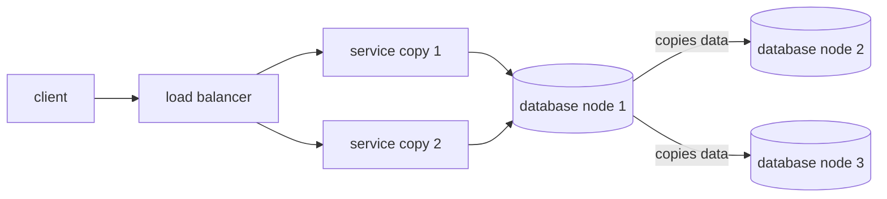

<!-- nav:top -->
[🏠 Start](../START-HERE.md) · [← Phase 18 — Distributed systems](README.md) · [📋 Phase 18](README.md) · [18.2 Failures and timeouts →](02-failures-and-timeouts.md) · [📖 Glossary](../GLOSSARY.md) · [🇷🇺 Русский](../../ru/18-distributed-systems/01-what-a-distributed-system-is.md) <!-- nav -->

# Lesson 18.1 — What a distributed system is

> **Phase 18 — Distributed systems** · Lesson 1 of 15 · ⏱ about 120 minutes

## What you will learn

- What a distributed system is, and why engineers build them even though they are hard.
- The three things that make distributed systems different from one program: no shared memory, no shared clock, and partial failure.
- How to run a tiny "cluster" of three nodes on your Mac and watch one of them fail in two different ways.
- Why a client that gets no answer cannot know what happened on the other side.
- The eight "fallacies of distributed computing": wrong beliefs that cause real bugs.

## Before you start

- You finished [Phase 17 — Storage and database internals](../17-storage-and-databases/README.md).
- You know `TcpListener`, `TcpStream`, the backlog and read timeouts from [Lesson 15.4 — TCP sockets in Rust](../15-networking/04-tcp-sockets-in-rust.md), scoped threads from [Lesson 14.4](../14-concurrency-and-async/04-thread-pools-scoped-threads-and-rayon.md), and the stop signal of Ctrl+Z from [Lesson 13.7 — Signals in your programs](../13-operating-systems/07-signals-in-your-programs.md).
- **How the code of this phase is organised.** Each lesson has its own package in `~/projects/rust/code/p18-<topic>`. The reusable code lives in `src/lib.rs`, every runnable example is a file in `src/bin/` (run it with `cargo run --bin <name>`), unit tests sit in `src/lib.rs`, and tests that use the package from outside go in `tests/`. Create the package for this lesson:

```bash
cd ~/projects/rust
cargo new --lib code/p18-nodes
cd code/p18-nodes
mkdir src/bin
```

You need three terminal tabs for this lesson. All of them should be in `code/p18-nodes`.

## New words

| Word | Meaning |
|---|---|
| **distributed system** | Several programs on several computers that work together on one job and talk only by sending messages over a network. |
| **node** | One participant of a distributed system: usually one process on one machine. A *cluster* is a group of nodes. |
| **message** | A piece of data that one node sends to another over the network. It is the only way nodes can share information. |
| **partial failure** | Some parts of the system have failed while other parts still work. One program usually works or crashes as a whole; a distributed system is almost always partly broken somewhere. |
| **network partition** | The network is cut so that some nodes cannot reach others, although all nodes are still running. |
| **latency** | How long something takes, for example the time from sending a request to getting the answer. |
| **RTT** (Round-Trip Time) | The time for a message to go to another node and for the answer to come back. |
| **scalability** | The ability to handle more work by adding more machines. |
| **fault tolerance** | The ability to keep working correctly while some parts have failed. |
| **fallacy** | A belief that sounds true but is false. |
| **CPU** (Central Processing Unit) | The chip that runs program instructions. |
| **TCP** (Transmission Control Protocol) | The protocol that gives a reliable stream of bytes between two programs (Lesson 15.3). |
| **IP** (Internet Protocol) / **DNS** (Domain Name System) | The protocol that moves packets between machines by address / the system that turns names into IP addresses (Phase 15). |
| **TLS** (Transport Layer Security) | Encryption and authentication for a network connection (Lesson 15.12). |
| **SSD** (Solid-State Drive) | A storage device built from flash memory chips (Lesson 17.1). |

## 1. Many computers, one job

A **distributed system** is a group of programs, running on different computers, that cooperate to look
like one service. When you open a web page, the request may go to a load balancer, then to one of twenty
copies of a web service, which reads from a database that keeps three copies of every row on three
machines. You see one website. Behind it there are dozens of computers that must agree with each other.

You have already used several distributed systems in this course:

- The internet itself and DNS (Domain Name System, Phase 15): millions of name servers, none of which knows everything.
- A NATS server with JetStream (Lesson 16.11) can run as a cluster of three servers that store the same messages.
- PostgreSQL (Phase 16) can keep copies of the database on other machines.

Why would anyone build something so complicated? There are four common reasons:

1. **The data or the work is too big for one machine.** One disk can hold a few terabytes; one CPU
   can answer only so many requests per second. With many
   machines, each one does a part. This is **scalability**.
2. **Machines fail.** Disks die, power goes out, someone restarts the wrong server. If the only copy of your
   data is on that machine, the service is down. With copies on several machines, the service survives. This
   is **fault tolerance**.
3. **Users are far away.** A message to a server in another country and back takes tens of
   milliseconds. A copy of the service closer to the user answers faster.
4. **Different teams own different parts.** A large company splits its product into many services that talk
   over the network (Phase 16).



Every arrow in this picture is a message over a network. And every arrow can fail.

## 2. What makes it hard

Inside one program, threads share memory (Phase 14). If one thread writes a value, another thread can read
it. All threads use the same clock. If the program crashes, everything stops at once, and you restart it.

A distributed system loses all three comforts:

| One program on one machine | A distributed system |
|---|---|
| Threads share memory. | Nodes share **nothing**. The only way to learn something is to receive a **message**. |
| One clock for everybody. | Every machine has its own clock, and the clocks disagree (Lesson 18.4). |
| It works or it crashed. | **Partial failure**: some nodes work, some crashed, some are slow, some cannot reach each other (a **network partition**). |
| A function call takes nanoseconds and always returns. | A message takes micro- to milliseconds, and it may never arrive. |

The last two rows are the heart of this phase. A function call either returns or panics. A message can be
lost, delayed for a long time, delivered twice, or delivered to a node that is just about to crash. The
sender usually cannot tell which of these happened. Let us see this with our own eyes.

## 3. A cluster on your Mac

We build the smallest possible distributed system: a few **nodes** that answer `ping` with `pong`, and a
client that asks all of them. Each node is a separate process with its own port, as if it were on its own
machine. Put this into `src/lib.rs`:

```rust
//! A tiny "node" that answers pings over TCP (Lesson 18.1).

use std::io::{BufRead, BufReader, Write};
use std::net::{SocketAddr, TcpListener, TcpStream};
use std::time::Duration;

/// Answers each connection: reads one line, and if it is "ping", replies "pong from <name>".
pub fn serve(listener: TcpListener, name: &str) {
    for stream in listener.incoming() {
        let result = stream.and_then(|stream| answer(stream, name));
        if let Err(error) = result {
            eprintln!("node {name}: {error}");
        }
    }
}

fn answer(mut stream: TcpStream, name: &str) -> std::io::Result<()> {
    let mut line = String::new();
    BufReader::new(&stream).read_line(&mut line)?;
    if line.trim() == "ping" {
        writeln!(stream, "pong from {name}")?;
        println!("node {name}: answered a ping");
    }
    Ok(())
}

/// Sends "ping" to the node at `addr` and waits at most `limit` for each step.
pub fn ping(addr: SocketAddr, limit: Duration) -> std::io::Result<String> {
    let mut stream = TcpStream::connect_timeout(&addr, limit)?;
    stream.set_read_timeout(Some(limit))?;
    writeln!(stream, "ping")?;
    let mut reply = String::new();
    BufReader::new(&stream).read_line(&mut reply)?;
    Ok(reply.trim().to_string())
}
```

**What happens:**

1. `serve` takes connections one by one (`listener.incoming()`). For each one it calls `answer`. An error in one
   connection is printed, and the node goes on serving the others: one bad client must not kill a node.
2. `answer` reads one line. If the line is `ping`, it writes back `pong from <name>` and prints a log line, so we
   can see in the node's terminal when it did the work.
3. `ping` is the client side. `connect_timeout` limits how long we wait for the connection, and
   `set_read_timeout` limits how long we wait for the reply. Without these two limits the client could wait
   forever (Common mistakes below).

Now the node program, `src/bin/node.rs`:

```rust
use std::net::TcpListener;

fn main() -> std::io::Result<()> {
    let args: Vec<String> = std::env::args().collect();
    if args.len() != 3 {
        eprintln!("usage: node <name> <port>");
        std::process::exit(2);
    }
    let (name, port) = (&args[1], &args[2]);
    let listener = TcpListener::bind(format!("127.0.0.1:{port}"))?;
    println!("node {name} listening on {}", listener.local_addr()?);
    p18_nodes::serve(listener, name);
    Ok(())
}
```

And the client, `src/bin/client.rs`, which pings three ports and measures each answer:

```rust
use std::net::SocketAddr;
use std::time::{Duration, Instant};

fn main() {
    let limit = Duration::from_millis(500);
    for port in [7001, 7002, 7003] {
        let addr = SocketAddr::from(([127, 0, 0, 1], port));
        let start = Instant::now();
        let result = p18_nodes::ping(addr, limit);
        let micros = start.elapsed().as_micros();
        match result {
            Ok(reply) => println!("{port}: {reply} ({micros} µs)"),
            Err(error) => println!("{port}: error: {error} ({micros} µs)"),
        }
    }
}
```

Start two nodes, one per terminal. We start no node on port 7003 on purpose.

```bash
# terminal 1
cargo run --bin node -- a 7001
```

```bash
# terminal 2
cargo run --bin node -- b 7002
```

```text
node a listening on 127.0.0.1:7001
```

```text
node b listening on 127.0.0.1:7002
```

Then run the client in the third terminal:

```bash
# terminal 3
cargo run --bin client
```

```text
7001: pong from a (157 µs)
7002: pong from b (75 µs)
7003: error: Connection refused (os error 61) (55 µs)
```

Each node prints `node a: answered a ping` (or `b`) in its own terminal. Your microseconds (µs, millionths of
a second) will be different; the size is what matters. A round trip (the RTT) over the loopback network inside one
Mac takes tens to hundreds of microseconds. A function call takes a few nanoseconds: about ten thousand
times less.

The answer from port 7003 is interesting. Nobody listens there, so the operating system of the "other
machine" (here, your own Mac) answered the connection attempt with a refusal. That is good news in a way:
we **know** that no node is running there. (On Linux the same error says `os error 111`.)

## 4. Partial failure in action

Now make node `b` freeze without dying. In terminal 2, press **Ctrl+Z**. The terminal sends the signal
`SIGTSTP`, which pauses the process (Lesson 13.7). The process still exists and its port is still open,
but it does not run any code. This is exactly what a node looks like when its machine is overloaded, when
it waits for a slow disk, or when a virtual machine is paused by its host.

Run the client again:

```text
7001: pong from a (90 µs)
7002: error: Resource temporarily unavailable (os error 35) (500124 µs)
7003: error: Connection refused (os error 61) (67 µs)
```

The connection to node `b` **succeeded**: the kernel finishes the TCP (Transmission Control Protocol) handshake and puts the connection into
the backlog even when the program is paused (Lesson 15.4). Our `ping` was also sent into the kernel buffer.
But no answer came, so after 500 ms the read timeout expired. On macOS a read timeout shows up as
`Resource temporarily unavailable` (kind `WouldBlock`; on Linux `os error 11`).

Now resume node `b`: type `fg` and press Enter in terminal 2. Look at terminal 2 immediately:

```text
node b: answered a ping
```

Node `b` woke up, found our old `ping` waiting in the backlog, and **did the work** — for a client that had
already given up and reported an error. Nobody saw the answer.

Think about what the client knew at each moment:

| What the client saw | What it can conclude |
|---|---|
| `pong from a` | Node `a` was alive and did the work. |
| `Connection refused` | Nothing listened on that port: node is down (or never started). The request was not processed. |
| Timeout | **Nothing certain.** The node may be dead, paused, slow, or the network may have lost the request or the reply. The work may have happened, may happen later, or may never happen. |

The third row is the most important idea of the whole phase. Replace "ping" with "transfer 100 euros" and
you see the problem: after a timeout, the client does not know if the money moved. Lesson 18.2 looks at
failures and timeouts in detail, and Lesson 18.3 shows how to retry safely.

> 💡 **Tip:** Ctrl+Z (pause) and Ctrl+C (stop) simulate two different failures. Ctrl+C kills the node: the
> port is closed and new clients get `Connection refused` at once. Ctrl+Z leaves a node that looks alive: it
> accepts connections but never answers. The second kind is much more dangerous, because it looks alive.

## 5. The eight fallacies of distributed computing

In the 1990s, engineers at Sun Microsystems wrote down the false assumptions that newcomers make about
networks. The list is still true today. Each item has caused real outages.

| Fallacy (false belief) | What is really true |
|---|---|
| 1. The network is reliable. | Messages get lost, connections break, a node can freeze, as you just saw. |
| 2. Latency is zero. | Every message costs time: microseconds on one machine, milliseconds across a data centre, about a hundred milliseconds across the world. |
| 3. Bandwidth is infinite. | A network link carries a limited number of bytes per second. Sending a whole database copy takes time. |
| 4. The network is secure. | Messages can be read or changed by others unless you use TLS (Transport Layer Security, Lesson 15.12). |
| 5. Topology does not change. | Machines are added, removed and moved. IP (Internet Protocol) addresses change. |
| 6. There is one administrator. | Different teams and companies control different parts with different rules. |
| 7. Transport cost is zero. | Turning data into bytes and sending them costs CPU time and money. |
| 8. The network is homogeneous. | Machines differ: different hardware, operating systems and versions of your own program. |

Most of the lessons in this phase are a careful answer to fallacies 1 and 2.

## 6. A rough scale of time

Engineers keep a few numbers in their heads to judge designs. The exact values depend on the hardware;
the order of magnitude is what counts. (ns is a nanosecond, a billionth of a second; µs is a microsecond, a
millionth; ms is a millisecond, a thousandth.)

| Operation | Rough time |
|---|---|
| Reading a value from the CPU cache | about 1 ns |
| Reading from main memory ([Lesson 12.9](../12-computer-systems/09-memory-hierarchy-and-caches.md)) | about 100 ns |
| Round trip over loopback on one machine | 10–200 µs |
| Round trip inside one data centre | about 0.5 ms |
| Writing to an SSD and waiting for `fsync` (Lesson 17.2) | 0.1–10 ms |
| Round trip between continents | 100–200 ms |

A single network round trip can cost as much as a million memory reads. This is why distributed designs
try hard to send **fewer** messages, and why "just ask the other node" is never free.

> ⚡ **Performance:** When a request has to wait for several nodes, ask them **in parallel**, not one after
> another. The total time then is the time of the slowest node, not the sum. Exercise 3 does this.

## Common mistakes

> ⚠️ **Common mistake: no timeout.** If you write the client with `TcpStream::connect(addr)` and no
> `set_read_timeout`, the client waits **forever** for a paused node. Nothing is printed and the program
> never ends; you can only press Ctrl+C. Every network call in a distributed system needs a time limit.

> ⚠️ **Common mistake: "timeout means it failed".** A timeout means "I stopped waiting". As Section 4
> showed, the other node may still do the work later. Code that, for example, charges a card again after a
> timeout can charge it twice. Lesson 18.3 fixes this properly.

**Forgetting `move` when you start a thread per node.** In Exercise 3 you start one scoped thread for each
port. Without `move`, the closure only borrows `port`, which lives only for one loop iteration:

```text
error[E0373]: closure may outlive the current function, but it borrows `port`, which is owned by the current function
  --> src/bin/parallel.rs:9:25
   |
 9 |             scope.spawn(|| {
   |                         ^^ may outlive borrowed value `port`
10 |                 let addr = SocketAddr::from(([127, 0, 0, 1], port));
   |                                                              ---- `port` is borrowed here
...
help: to force the closure to take ownership of `port` (and any other referenced variables), use the `move` keyword
   |
 9 |             scope.spawn(move || {
   |                         ++++
```

The fix is in the help line: `scope.spawn(move || { ... })`. `port` is a small `Copy` number, so `move` simply
copies it into each thread.

## Try it yourself

1. Start nodes `a` and `b` as in Section 3, and also a node `c` on port 7003. Run the client: three pongs.
2. Press **Ctrl+C** in the terminal of node `c`. Run the client: `7003` is refused immediately.
3. Press **Ctrl+Z** in the terminal of node `a`. Run the client: `7001` takes 500 ms and fails.
4. Run the client two more times, then type `fg` in the terminal of node `a`. Count the
   `answered a ping` lines that appear at once. Node `a` answered every ping that was waiting in its backlog,
   long after the clients had gone.

## Exercises

### Exercise 1 — Name the outcome, with a test (easy)

Add to `src/lib.rs` an enum `Outcome` with the variants `Answered`, `Refused`, `NoAnswer` and `Other`, and a
function `pub fn classify(result: &std::io::Result<String>) -> Outcome`. A read timeout has the error kind
`WouldBlock` on macOS and Linux and `TimedOut` on some other systems; both mean `NoAnswer`. Write a unit test
that checks all four outcomes **without** any network: build the errors with `std::io::Error::from(kind)`.

<details>
<summary>Hint</summary>

Use `match` with guards: `Err(e) if e.kind() == ErrorKind::ConnectionRefused => ...`. For two kinds in one
arm, `matches!(e.kind(), ErrorKind::WouldBlock | ErrorKind::TimedOut)` is handy.

</details>

<details>
<summary>Answer</summary>

```rust
/// What we can say about a node after one ping.
#[derive(Debug, PartialEq)]
pub enum Outcome {
    /// It replied: it is alive and it did the work.
    Answered,
    /// The other machine said "nobody listens on this port": the node is down.
    Refused,
    /// Nothing came back in time: we do not know what happened.
    NoAnswer,
    /// Something else went wrong.
    Other,
}

pub fn classify(result: &std::io::Result<String>) -> Outcome {
    use std::io::ErrorKind;
    match result {
        Ok(_) => Outcome::Answered,
        Err(e) if e.kind() == ErrorKind::ConnectionRefused => Outcome::Refused,
        Err(e) if matches!(e.kind(), ErrorKind::WouldBlock | ErrorKind::TimedOut) => {
            Outcome::NoAnswer
        }
        Err(_) => Outcome::Other,
    }
}

#[cfg(test)]
mod tests {
    use super::*;
    use std::io::{Error, ErrorKind};

    #[test]
    fn classifies_each_kind_of_result() {
        assert_eq!(classify(&Ok("pong from a".to_string())), Outcome::Answered);
        let refused = Err(Error::from(ErrorKind::ConnectionRefused));
        assert_eq!(classify(&refused), Outcome::Refused);
        assert_eq!(classify(&Err(Error::from(ErrorKind::WouldBlock))), Outcome::NoAnswer);
        assert_eq!(classify(&Err(Error::from(ErrorKind::TimedOut))), Outcome::NoAnswer);
        assert_eq!(classify(&Err(Error::from(ErrorKind::BrokenPipe))), Outcome::Other);
    }
}
```

`cargo test --lib`:

```text
test tests::classifies_each_kind_of_result ... ok

test result: ok. 1 passed; 0 failed; 0 ignored; 0 measured; 0 filtered out; finished in 0.00s
```

Why it works: the function only looks at the error **kind**, which is the same on every operating system,
not at the text or the operating system's error number, which differ.

</details>

### Exercise 2 — Test a living node and a frozen node (medium)

Write an integration test `tests/ping.rs` with two tests. The first starts a real node on port `0` in a
background thread and checks that `ping` returns `"pong from test"`. The second imitates a **frozen** node
without any signals: bind a `TcpListener` but never serve it, ping it with a 200 ms limit, and check that
`classify` (from Exercise 1) says `NoAnswer`.

<details>
<summary>Hint</summary>

Port `0` asks the operating system for any free port; `listener.local_addr()` tells you which one you got
(Lesson 15.4). A listener that nobody reads from still completes handshakes into its backlog, exactly like the
paused node in Section 4.

</details>

<details>
<summary>Answer</summary>

```rust
use std::net::TcpListener;
use std::time::Duration;

use p18_nodes::{Outcome, classify, ping, serve};

#[test]
fn a_running_node_answers() {
    let listener = TcpListener::bind("127.0.0.1:0").unwrap();
    let addr = listener.local_addr().unwrap();
    std::thread::spawn(move || serve(listener, "test"));

    let reply = ping(addr, Duration::from_secs(1)).unwrap();
    assert_eq!(reply, "pong from test");
}

#[test]
fn a_node_that_never_answers_gives_no_answer() {
    // The port is open, but nobody ever reads from the connection.
    let listener = TcpListener::bind("127.0.0.1:0").unwrap();
    let addr = listener.local_addr().unwrap();

    let result = ping(addr, Duration::from_millis(200));
    assert_eq!(classify(&result), Outcome::NoAnswer);
    drop(listener);
}
```

`cargo test --test ping`:

```text
test a_running_node_answers ... ok
test a_node_that_never_answers_gives_no_answer ... ok

test result: ok. 2 passed; 0 failed; 0 ignored; 0 measured; 0 filtered out; finished in 0.20s
```

Why it works: the second test keeps `listener` alive until the end (the explicit `drop` shows the intent), so
the port stays open and connections are accepted by the kernel, but no code ever reads them. The test takes
0.20 s: exactly the timeout.

</details>

### Exercise 3 — Ask everybody at once (hard)

Write `src/bin/parallel.rs`: ping ports 7001, 7002 and 7003 **at the same time**, one scoped thread per
port, print each answer, and at the end print how long the whole round took. Run it with node `a` running,
node `b` paused with Ctrl+Z and nothing on 7003. The total must be about 500 ms, not 1,000 ms or more.

<details>
<summary>Hint</summary>

`std::thread::scope(|scope| { for port in ... { scope.spawn(move || { ... }); } });` waits for all threads
before it returns. Remember `move` (Common mistakes).

</details>

<details>
<summary>Answer</summary>

```rust
use std::net::SocketAddr;
use std::time::{Duration, Instant};

fn main() {
    let limit = Duration::from_millis(500);
    let start = Instant::now();
    std::thread::scope(|scope| {
        for port in [7001, 7002, 7003] {
            scope.spawn(move || {
                let addr = SocketAddr::from(([127, 0, 0, 1], port));
                match p18_nodes::ping(addr, limit) {
                    Ok(reply) => println!("{port}: {reply}"),
                    Err(error) => println!("{port}: error: {error}"),
                }
            });
        }
    });
    println!("all answers in {} ms", start.elapsed().as_millis());
}
```

```text
7003: error: Connection refused (os error 61)
7001: pong from a
7002: error: Resource temporarily unavailable (os error 35)
all answers in 501 ms
```

Why it works: the three pings wait at the same time, so the round takes as long as the slowest one (the
paused node, 500 ms). Notice that the answers come in a different order than the ports: the order of
events depends on timing. This is normal in distributed systems, and Lessons 18.4 and 18.5 deal with it.

</details>

## Quiz

1. Name the three comforts of a single program that a distributed system does not have.

<details>
<summary>Answer</summary>

Shared memory (nodes communicate only by messages), one shared clock (every machine has its own clock), and
all-or-nothing failure (a distributed system has partial failures).

</details>

2. A client gets `Connection refused`. Was the request processed?

<details>
<summary>Answer</summary>

No. The remote operating system refused the connection because nothing listened on that port, so no program
ever saw the request. This is one of the few failures that give a certain answer.

</details>

3. A client's read timeout expires. List at least three things that might have happened on the other side.

<details>
<summary>Answer</summary>

The request was lost; the node crashed before or after doing the work; the node is paused or overloaded and
will do the work later; the work was done but the reply was lost or is still on its way. The client cannot
tell which.

</details>

4. Why did the connection to the paused node succeed?

<details>
<summary>Answer</summary>

The TCP handshake is done by the kernel, not by the program. The kernel puts the finished connection into the
listening socket's backlog even while the process is paused, and keeps the bytes we sent in its buffer.

</details>

5. Why is a paused (frozen) node more dangerous than a crashed one?

<details>
<summary>Answer</summary>

A crashed node is detected quickly (connections are refused). A frozen node looks alive: it accepts
connections, so clients wait until their timeout, and it may wake up later and act on old requests.

</details>

## Summary

- A distributed system is several nodes on several machines that cooperate by sending messages. People build
  them for scale, fault tolerance, distance to users and team boundaries.
- Nodes share no memory and no clock, and they fail **partially**: some work, some crashed, some are frozen.
- Every network call needs a timeout. A refused connection is a clear answer; a timeout is not an answer at all.
- After a timeout the other node may still do the work later, as the paused node did.
- A network round trip is thousands to millions of times slower than a memory access, so good designs send
  few messages and send them in parallel.
- The eight fallacies are a checklist of false beliefs: the network is not reliable, not instant, not
  infinite, not secure and not stable.

## Sources and further reading

- [Designing Data-Intensive Applications](https://dataintensive.net/) — Martin Kleppmann's book; the chapter "The Trouble with Distributed Systems" covers this lesson and the next two in depth.
- [Fallacies of distributed computing](https://en.wikipedia.org/wiki/Fallacies_of_distributed_computing) — the history of the eight fallacies and an explanation of each.
- [Notes on Distributed Systems for Young Bloods](https://www.somethingsimilar.com/2013/01/14/notes-on-distributed-systems-for-young-bloods/) — a short, practical essay by Jeff Hodges about lessons learned the hard way.
- [MIT 6.5840 Distributed Systems](https://pdos.csail.mit.edu/6.824/) — a university course with free lecture notes and labs; a good companion for the whole phase.
- [`std::net::TcpStream`](https://doc.rust-lang.org/std/net/struct.TcpStream.html) — `connect_timeout`, `set_read_timeout` and the other methods used in this lesson.
- [`std::thread::scope`](https://doc.rust-lang.org/std/thread/fn.scope.html) — scoped threads for Exercise 3.

---

[🏠 Start](../START-HERE.md) · [← Phase 18 — Distributed systems](README.md) · [📋 Phase 18](README.md) · [18.2 Failures and timeouts →](02-failures-and-timeouts.md) · [📖 Glossary](../GLOSSARY.md) <!-- nav -->
<!-- nav:bottom -->
