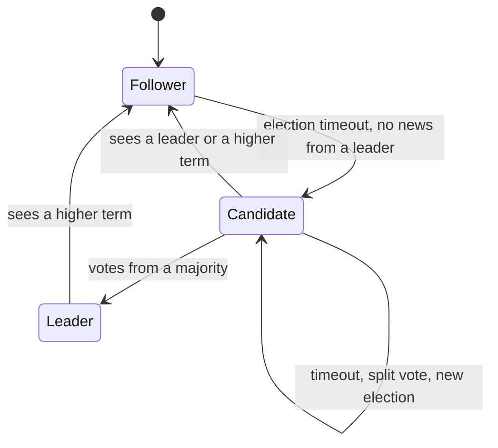

<!-- nav:top -->
[🏠 Start](../START-HERE.md) · [← 18.8 Partitioning and consistent hashing](08-partitioning-and-consistent-hashing.md) · [📋 Phase 18](README.md) · [18.10 Raft: leader election →](10-raft-leader-election.md) · [📖 Glossary](../GLOSSARY.md) · [🇷🇺 Русский](../../ru/18-distributed-systems/09-consensus-and-raft.md) <!-- nav -->

# Lesson 18.9 — Consensus and an overview of Raft

> **Phase 18 — Distributed systems** · Lesson 9 of 15 · ⏱ about 135 minutes

## What you will learn

- What the *consensus* problem is, and why it is hard when messages can be late or lost and machines can crash.
- The idea of a *replicated state machine*: the same commands, in the same order, give the same state on every machine.
- Why consensus uses *majorities*, and how many failures a cluster of 3, 5 or 7 machines survives.
- The big picture of Raft: roles, terms, the log, the two messages it needs, and the five promises it keeps.
- How the next lessons build a small Raft core of your own, step by step.

## Before you start

- You finished [Lesson 18.8 — Partitioning and consistent hashing](08-partitioning-and-consistent-hashing.md).
- You remember why a timeout cannot tell a *slow* machine from a *dead* one ([Lesson 18.2 — Failures and timeouts](02-failures-and-timeouts.md)), what a leader and followers do in replication ([Lesson 18.6 — Replication](06-replication.md)), and what *linearizable* means ([Lesson 18.7 — Consistency models](07-consistency-models.md)).
- You know the write-ahead log from [Lesson 17.4 — The write-ahead log (WAL)](../17-storage-and-databases/04-write-ahead-log.md): a file of commands that you replay after a crash. Raft's log is the same idea, shared by many machines.
- Create the package for this lesson. As everywhere in this phase, each example is one file in `src/bin/`, and you run it with `cargo run --bin <name>`:

```bash
cd ~/projects/rust
cargo new --lib code/p18-consensus
mkdir code/p18-consensus/src/bin
```

## New words

| Word | Meaning |
|---|---|
| **consensus** | Several machines agree on one value (or one sequence of values), and never change their minds, even when some of them crash or messages are lost. |
| **node** | One machine (or one process) in a cluster. In this phase, node, server and replica mean the same thing. |
| **replicated state machine** | A program that runs on every node and changes its state only by applying commands from a shared log, one by one, in order. |
| **deterministic** | Always giving the same result for the same input. A replicated state machine must be deterministic. |
| **majority** | More than half of the nodes: 2 of 3, 3 of 5, 4 of 7. |
| **quorum** | A group of nodes big enough to make a decision. In Raft a quorum is a majority. |
| **safety** | "Nothing bad ever happens": for example, two nodes never decide different values. |
| **liveness** | "Something good eventually happens": for example, the cluster eventually decides. |
| **crash fault** | A node stops working (crash, power loss, network cable pulled). It does not lie. Raft handles crash faults. |
| **Byzantine fault** | A node behaves arbitrarily, even maliciously: it sends wrong or contradicting messages. Raft does **not** handle these. |
| **split brain** | Two parts of a cluster both believe they are in charge and accept conflicting writes. Consensus prevents it. |
| **Raft** | A consensus algorithm designed to be easy to understand (Ongaro and Ousterhout, 2014). Used by etcd, Consul, NATS JetStream, TiKV and many others. |
| **Paxos** | An older consensus algorithm by Leslie Lamport. Correct, but known as hard to understand and to implement. |
| **term** | Raft's "epoch number". Time is split into terms 1, 2, 3, …; each term has at most one leader. |
| **log entry** | One command in Raft's log, together with the term in which the leader received it, at a numbered position (the *index*). |
| **committed** | A log entry is committed when it is stored on a majority. From then on it will never be lost or replaced, and nodes may apply it. |
| **RPC** (Remote Procedure Call) | A request that one program sends to another over the network, asking it to do something and answer, like calling a function on another machine. |
| **FLP result** | A proof by Fischer, Lynch and Paterson (1985): if messages may be delayed without limit, no algorithm can *guarantee* that consensus always finishes when even one node may crash. |

## 1. The problem: many machines, one decision

In [Lesson 18.6](06-replication.md) you saw a leader that copies writes to followers. That raises questions that replication alone does not answer:

- The leader crashed. Who is the new leader? All the followers must agree on **one** answer.
- Two clients wrote at the same moment. In which order did the writes happen? Every replica must use the **same** order.
- The old leader was only slow, not dead, and comes back. It still thinks it is the leader. What stops it from accepting writes?

Each question is the same problem: **several machines must agree on something, and stay agreed**. That is consensus. A correct consensus algorithm has three properties:

1. **Agreement:** no two nodes decide different values.
2. **Validity:** the decided value was really proposed by someone (the algorithm does not invent values).
3. **Termination:** every node that does not crash eventually decides.

Why is this hard? Remember from [Lesson 18.2](02-failures-and-timeouts.md): a node that does not answer may be dead, slow, or cut off by the network, and **you cannot tell which**. If node A decides "B is dead, I am the leader" while B is only slow, you have two leaders: split brain.

The FLP result even proves that, in a network where messages can be delayed for any amount of time, no algorithm can *guarantee* termination if one node may crash. Practical algorithms like Raft accept this: they **never break safety**, and they get liveness *in practice* by using timeouts and randomness. When the network is very bad, Raft may stop making progress for a while, but it never makes a wrong decision.

> 💡 **Tip:** when you read about any distributed algorithm, first ask "what is its safety property?" and then "when does it make progress?". Mixing up the two is the most common source of confusion.

## 2. Replicated state machines

Agreeing on *one* value is not enough for a database. We want to agree on a whole **sequence** of commands: "set apples to 10", then "add 5 to apples", and so on. The trick that makes this useful is the replicated state machine:

```text
  client commands
        |
        v
  +-----------+   same log on every node   +-----------+   +-----------+
  |  log:     |  ------------------------> |  log:     |   |  log:     |
  | 1 set a=10|                            | 1 set a=10|   | 1 set a=10|
  | 2 add a 5 |                            | 2 add a 5 |   | 2 add a 5 |
  +-----------+                            +-----------+   +-----------+
        |                                        |               |
        v  apply in order                        v               v
  state: a = 15                            state: a = 15   state: a = 15
       node 1                                   node 2          node 3
```

If every node starts from the same empty state and applies the same commands in the same order, every node ends in the same state. Consensus is only needed for the **log**; the state follows automatically. Write `src/bin/rsm.rs`:

```rust
use std::collections::BTreeMap;

/// One command in the replicated log.
#[derive(Debug, Clone)]
enum Command {
    Set(String, i64),
    Add(String, i64),
    Delete(String),
}

/// The state machine: a tiny key-value map.
#[derive(Debug, Default, PartialEq)]
struct Store {
    data: BTreeMap<String, i64>,
}

impl Store {
    fn apply(&mut self, cmd: &Command) {
        match cmd {
            Command::Set(k, v) => {
                self.data.insert(k.clone(), *v);
            }
            Command::Add(k, v) => {
                *self.data.entry(k.clone()).or_insert(0) += v;
            }
            Command::Delete(k) => {
                self.data.remove(k);
            }
        }
    }
}

fn main() {
    let log = vec![
        Command::Set("apples".to_string(), 10),
        Command::Add("apples".to_string(), 5),
        Command::Set("pears".to_string(), 3),
        Command::Delete("pears".to_string()),
        Command::Add("plums".to_string(), 7),
    ];

    // Three replicas start empty and apply the same log in the same order.
    let mut replicas = [Store::default(), Store::default(), Store::default()];
    for replica in replicas.iter_mut() {
        for cmd in &log {
            replica.apply(cmd);
        }
    }

    for (i, r) in replicas.iter().enumerate() {
        println!("replica {i}: {:?}", r.data);
    }
    println!(
        "all equal: {}",
        replicas[0] == replicas[1] && replicas[1] == replicas[2]
    );

    // Same commands, different order: a different result.
    let mut other = Store::default();
    for cmd in [&log[1], &log[0], &log[2], &log[3], &log[4]] {
        other.apply(cmd);
    }
    println!("other order: {:?}", other.data);
}
```

**What happens:**

1. `Command` is what travels through the log. `Store` is the state machine; it changes only inside `apply`.
2. `BTreeMap` keeps keys sorted, so printing is the same on every run (a `HashMap` would print in a random order).
3. Three replicas apply the same five commands in the same order and end up equal.
4. The last part applies the first two commands in swapped order: "add 5" runs on an empty key (0 + 5), then "set 10" overwrites it. The result differs. **Order matters**, so the nodes must agree on the order, not only on the set of commands.

```text
replica 0: {"apples": 15, "plums": 7}
replica 1: {"apples": 15, "plums": 7}
replica 2: {"apples": 15, "plums": 7}
all equal: true
other order: {"apples": 10, "plums": 7}
```

The state machine must also be **deterministic**. Imagine a command `TouchNow(key)` whose `apply` stores the current time from `SystemTime::now()`. Each replica applies it at a slightly different moment, so each stores a different number, and the replicas silently disagree although their logs are identical. The fix is a command `TouchAt(key, time)`: the leader reads the clock **once**, when it creates the command, and every replica only copies the value. (Exercise 4 lets you see both versions run.)

> 📏 **Convention:** anything non-deterministic (time, random numbers, generated IDs) is decided **once**, before the command enters the log, and stored in the command.

## 3. Majorities: why consensus needs more than half

A decision must survive crashes, so it must be stored on several nodes. How many? Raft (and Paxos) use a **majority**. The reason is one simple fact: **any two majorities of the same cluster share at least one node**. If a value was accepted by a majority, any later majority contains at least one node that knows about it, so the value cannot be silently forgotten.

Let us check this fact by brute force. Write `src/bin/quorum.rs`:

```rust
/// The smallest group that is more than half of `n` nodes.
fn majority(n: usize) -> usize {
    n / 2 + 1
}

/// Every group of exactly `size` nodes, out of `n` nodes, as a bit mask.
fn groups(n: usize, size: usize) -> Vec<u32> {
    (0..(1u32 << n))
        .filter(|mask| mask.count_ones() as usize == size)
        .collect()
}

/// True if every two groups of `size` nodes share at least one node.
fn always_overlap(n: usize, size: usize) -> bool {
    let all = groups(n, size);
    for a in &all {
        for b in &all {
            if a & b == 0 {
                return false;
            }
        }
    }
    true
}

fn main() {
    println!("nodes  majority  can lose");
    for n in 1..=7 {
        let m = majority(n);
        println!("{n:>5}  {m:>8}  {:>8}", n - m);
    }

    let n = 5;
    println!();
    for size in 1..=n {
        println!(
            "n = {n}, group size {size}: {:>2} possible groups, every two overlap: {}",
            groups(n, size).len(),
            always_overlap(n, size)
        );
    }
}
```

**What happens:**

1. A group of nodes is a *bit mask*: bit `i` is 1 when node `i` is in the group. With 5 nodes, the numbers `0..32` are all possible groups.
2. `count_ones()` counts the 1 bits, that is, the group size. `groups` keeps the groups of the wanted size.
3. Two groups share a node exactly when their masks have a common 1 bit, so `a & b != 0`. If any pair has `a & b == 0`, two groups of that size could decide without hearing of each other.
4. The table shows the majority size and how many nodes may fail while a majority is still alive.

```text
nodes  majority  can lose
    1         1         0
    2         2         0
    3         2         1
    4         3         1
    5         3         2
    6         4         2
    7         4         3

n = 5, group size 1:  5 possible groups, every two overlap: false
n = 5, group size 2: 10 possible groups, every two overlap: false
n = 5, group size 3: 10 possible groups, every two overlap: true
n = 5, group size 4:  5 possible groups, every two overlap: true
n = 5, group size 5:  1 possible groups, every two overlap: true
```

Read the table carefully. Two lessons follow from it:

- **To survive `f` failures you need `2f + 1` nodes.** 3 nodes survive 1 failure, 5 survive 2, 7 survive 3.
- **Even numbers do not help.** 4 nodes survive only 1 failure, like 3 nodes, but need one more machine and one more answer for every decision. Two nodes survive **zero** failures: if either one is down, no majority exists. Real clusters use 3 or 5 nodes.

The same overlap fact protects against split brain during a **network partition**. If 5 nodes split into a group of 3 and a group of 2, only the group of 3 has a majority. The group of 2 cannot elect a leader and cannot commit writes. It is unavailable, but it is never *wrong*. This is the trade-off from [Lesson 18.7](07-consistency-models.md): consensus chooses consistency over availability on the minority side.

> ⚡ **Performance:** every write waits for a majority to answer, so it costs at least one network round trip from the leader to the "middle" follower. More nodes give more fault tolerance, but writes do not get faster. That is why clusters stay small (3 or 5) and partitioning ([Lesson 18.8](08-partitioning-and-consistent-hashing.md)) is used to scale: many small Raft groups, one per partition.

## 4. Raft in one picture

Raft splits consensus into three smaller problems, and the next two lessons cover the first two:

1. **Leader election** ([Lesson 18.10](10-raft-leader-election.md)): choose one leader, and choose a new one when it fails.
2. **Log replication** ([Lesson 18.11](11-raft-log-replication.md)): the leader accepts commands, appends them to its log and copies the log to the followers.
3. **Safety**: a few extra rules make sure that a committed entry is never lost, even across many leader changes.

### Roles

Every node is in one of three roles:



- A **follower** is passive. It answers messages from the leader and from candidates.
- A **candidate** is a follower that heard nothing from a leader for a while (its *election timeout*) and asks the others for votes.
- A **leader** handles all client writes and sends regular *heartbeats* so that followers know it is alive.

### Terms

Time is divided into **terms**, numbered 1, 2, 3, … Each term begins with an election. If a candidate wins, it is the leader for the rest of the term. If the vote is split, the term ends without a leader and a new term starts soon.

```text
 term:   |   1   |    2    | 3 |      4        |
         | elect | normal  |   | elect normal  |
         | L = A | L = A   | (no leader:       |
         |       |         |  split vote)  L = C
```

Terms act as a **logical clock** ([Lesson 18.5 — Logical clocks](05-logical-clocks.md)). Every message carries the sender's term. The rule is simple and strict: **if a node sees a higher term, it updates its own term and becomes a follower**. An old leader that was cut off and comes back sees the higher term in the first reply it gets and steps down. That answers the third question from Section 1.

### The log

Each node has a log. Each entry has an **index** (its position, starting at 1), the **term** in which the leader created it, and the **command**:

```text
index:    1     2     3     4     5
term:   [ 1 ] [ 1 ] [ 2 ] [ 3 ] [ 3 ]
cmd:     a=1   b=2   a=3   c=4   b=5
                            ^
                    commit index = 4: entries 1..4 are on a majority
```

The leader sends new entries to the followers. When an entry is stored on a majority, the leader marks it **committed** (with one more condition that [Lesson 18.11](11-raft-log-replication.md) explains: the leader counts copies only for entries of its own current term), applies it to its state machine and tells the followers, who apply it too.

### Two messages

Basic Raft needs only two kinds of RPC:

| RPC | Sent by | Purpose |
|---|---|---|
| `RequestVote` | candidates | "Vote for me in term T. My log ends at index I with term X." |
| `AppendEntries` | the leader | "Here are new entries after index I (whose term is X). Commit up to index C." With no entries, it is a heartbeat. |

(The full algorithm adds a third one, `InstallSnapshot`, for sending a snapshot to a follower that is very far behind. We will not need it.)

### What every node must remember on disk

Three things must survive a crash, so a node writes them to disk ([Lesson 17.2](../17-storage-and-databases/02-durability-and-fsync.md)) **before** it answers a message:

| Persistent state | Why |
|---|---|
| `current_term` | So a restarted node does not go back to an old term. |
| `voted_for` | So a node never votes twice in the same term, even across a restart. |
| `log` | The entries themselves. |

Everything else (who the leader is, the commit index, the votes received) can be rebuilt after a restart.

### Five promises

The Raft paper lists five properties that are true at all times. In simple words:

1. **Election safety:** at most one leader per term.
2. **Leader append-only:** a leader never deletes or overwrites entries in its own log; it only appends.
3. **Log matching:** if two logs have an entry with the same index and the same term, the two logs are identical up to that index.
4. **Leader completeness:** a committed entry is present in the log of every later leader.
5. **State machine safety:** if a node applied the entry at index `i`, no node ever applies a different entry at index `i`.

Promise 5 is the one users care about: all replicas apply the same commands in the same order, so (Section 2) they all have the same state. The other four are the steps of the proof. The next two lessons show which rule in the code gives which promise.

> 🔒 **Security:** Raft trusts every node. A node with a bug or an attacker inside can break all five promises by lying about its term or its log. Protect cluster traffic with TLS (Transport Layer Security, the encryption layer from Phase 15) and mutual authentication ([Lesson 15.12](../15-networking/12-tls-in-rust-servers.md)), and never expose the Raft port to clients.

## 5. Where you meet consensus, and how we will build it

You use Raft every day without seeing it. **etcd**, the database where Kubernetes keeps the state of the whole cluster, is a Raft group. **NATS JetStream** ([Lesson 16.11](../16-backend-services/11-messaging-with-nats.md)) replicates each stream with its own Raft implementation. **TiKV**, **CockroachDB** and **Consul** use Raft too. In Rust, the two well-known libraries are `raft` (from the TiKV project) and `openraft`.

You will not use a library in this phase. Implementing a small Raft core yourself is the best way to really understand it. We use a design that makes it easy to test:

- The Raft core is a **plain struct with no networking, no threads and no clock**. You call `node.tick()` to say "one unit of time passed" and `node.step(message)` to deliver a message. It returns the messages it wants to send.
- A tiny test *cluster* in the same crate holds a few nodes and a queue of messages in flight. The test decides when time passes, which messages arrive, and which nodes are cut off.

Because nothing is real, every test is fast and gives the same result every time. This is the core idea of **deterministic simulation testing**, which [Lesson 18.12](12-deterministic-simulation-testing.md) applies to real network code with the `turmoil` crate. In the project ([Lesson 18.14](14-project-replicated-key-value-store.md)) you will connect the same core to a real network and to your key-value store from [Lesson 17.14](../17-storage-and-databases/14-project-key-value-store.md).

## Common mistakes

> ⚠️ **Common mistake:** "Two nodes are safer than one." With two nodes the majority is 2, so if either node fails, the cluster stops. Two nodes are *less* available than one. Use 3 or 5.

> ⚠️ **Common mistake:** a non-deterministic `apply`. Reading the clock, a random number or a `HashMap` iteration order inside `apply` makes replicas drift apart silently (Section 2). The bug does not crash anything; it just returns different answers on different nodes. Put such values into the command.

> ⚠️ **Common mistake:** "A timeout tells me the leader is dead, so I can take over." A timeout only says "I heard nothing". Raft uses timeouts to *start an election*, but a node becomes leader only with votes from a majority, and terms make an old leader step down. Never let one node decide alone.

> ⚠️ **Common mistake:** confusing replication with consensus. Copying data to followers ([Lesson 18.6](06-replication.md)) is easy. The hard part is agreeing on the order and on who is in charge when things fail. That is what consensus adds.

## Try it yourself

1. Run the two examples: `cargo run --bin rsm` and `cargo run --bin quorum`. Compare with the outputs above.
2. In `quorum.rs`, change `let n = 5;` to `let n = 4;`. Which group sizes always overlap now? (Answer: 3 and 4, because the majority of 4 is 3.)
3. In `rsm.rs`, add a fourth replica that applies only the first three commands. Print it. This is a replica that is *behind*: it has the same state the others had three steps ago. It is not wrong, only late. Raft followers are often in this situation.
4. Open the interactive Raft visualization listed in the sources ("The Secret Lives of Data") and watch an election and a log replication. Stop a node and see what happens.

## Exercises

### Exercise 1 — Majority with a test (easy)

Put `majority` into `src/lib.rs` as `pub fn majority(n: usize) -> usize` (replace the code that `cargo new` generated there). Write two tests: one checks the values for 1, 3, 4 and 5 nodes; the other checks, for every `n` from 1 to 100, that two majorities together are bigger than the whole cluster (`2 * majority(n) > n`).

<details>
<summary>Hint</summary>

If `2 * majority(n) > n`, two majorities cannot fit into the cluster without sharing a node (like two people who each take more than half of a cake must share a piece).

</details>

<details>
<summary>Answer</summary>

```rust
/// The smallest group that is more than half of `n` nodes.
pub fn majority(n: usize) -> usize {
    n / 2 + 1
}

#[cfg(test)]
mod tests {
    use super::*;

    #[test]
    fn majority_of_small_clusters() {
        assert_eq!(majority(1), 1);
        assert_eq!(majority(3), 2);
        assert_eq!(majority(4), 3);
        assert_eq!(majority(5), 3);
    }

    #[test]
    fn two_majorities_are_more_than_the_cluster() {
        for n in 1..=100 {
            assert!(2 * majority(n) > n, "n = {n}");
        }
    }
}
```

```text
test tests::majority_of_small_clusters ... ok
test tests::two_majorities_are_more_than_the_cluster ... ok
```

Why it works: integer division rounds down, so `n / 2 + 1` is the smallest number strictly bigger than half.

</details>

### Exercise 2 — Which side of the split can work? (medium)

Write `pub fn side_can_commit(side: usize, n: usize) -> bool`: one side of a network split has `side` of the `n` nodes; can it still commit writes? Test it: a 5-node cluster split 3 + 2 and a 4-node cluster split 2 + 2. Then add a test that, for every `n` from 1 to 9 and every split, **both** sides can never commit at the same time.

<details>
<summary>Hint</summary>

A side can commit if it has at least `majority(n)` nodes. The other side has `n - side` nodes.

</details>

<details>
<summary>Answer</summary>

The function goes next to `majority` in `src/lib.rs`; the test goes into `mod tests`.

```rust
pub fn side_can_commit(side: usize, n: usize) -> bool {
    side >= majority(n)
}

#[test]
fn splits_of_five_and_four() {
    // 5 nodes split 3 + 2: only the side with 3 can commit.
    assert!(side_can_commit(3, 5));
    assert!(!side_can_commit(2, 5));
    // 4 nodes split 2 + 2: nobody can commit.
    assert!(!side_can_commit(2, 4));
    // A split never lets both sides commit.
    for n in 1..=9 {
        for side in 0..=n {
            assert!(!(side_can_commit(side, n) && side_can_commit(n - side, n)));
        }
    }
}
```

Why it works: the 2 + 2 split shows the cost of even cluster sizes: the whole cluster stops. The loop is the split-brain guarantee in code form.

</details>

### Exercise 3 — Overlap exactly when … (hard)

Copy `groups` and `always_overlap` into `src/lib.rs` (make `always_overlap` public). Write a test that checks, for every `n` from 1 to 10 and every group size `q` from 1 to `n`, that `always_overlap(n, q)` is true **exactly** when `2 * q > n`. This proves (for small clusters) that majorities are the *smallest* groups that always overlap.

<details>
<summary>Hint</summary>

Use `assert_eq!(always_overlap(n, q), 2 * q > n, "n = {n}, q = {q}")`. You may rewrite the double loop in `always_overlap` with `iter().all(...)`.

</details>

<details>
<summary>Answer</summary>

The two functions go into `src/lib.rs`; the test goes into `mod tests`.

```rust
fn groups(n: usize, size: usize) -> Vec<u32> {
    (0..(1u32 << n))
        .filter(|mask| mask.count_ones() as usize == size)
        .collect()
}

pub fn always_overlap(n: usize, size: usize) -> bool {
    let all = groups(n, size);
    all.iter().all(|a| all.iter().all(|b| a & b != 0))
}

#[test]
fn overlap_exactly_when_twice_the_size_is_more_than_n() {
    for n in 1..=10 {
        for q in 1..=n {
            assert_eq!(always_overlap(n, q), 2 * q > n, "n = {n}, q = {q}");
        }
    }
}
```

```text
test tests::overlap_exactly_when_twice_the_size_is_more_than_n ... ok
```

Why it works: if `2q <= n`, you can pick two groups with no common node (the first `q` nodes and the next `q` nodes), and the brute force finds them. If `2q > n`, there is no room for two separate groups.

</details>

### Exercise 4 — See the non-determinism (medium)

Write `src/bin/stamp.rs` with a `Command` enum that has two variants, `TouchNow(String)` (its `apply` stores the current time in nanoseconds from `SystemTime::now()`) and `TouchAt(String, u128)` (its `apply` stores the given time). Write a function `run(log: &[Command]) -> bool` that applies the log to two empty stores, the second one 1 millisecond later, and returns whether they are equal. Call it for a log with one `TouchNow` and for a log with one `TouchAt`.

Expected output:

```text
TouchNow: replicas equal = false
TouchAt:  replicas equal = true
```

<details>
<summary>Hint</summary>

`SystemTime::now().duration_since(UNIX_EPOCH).unwrap().as_nanos()` gives a `u128`. Use `std::thread::sleep(Duration::from_millis(1))` between the two replicas.

</details>

<details>
<summary>Answer</summary>

```rust
use std::collections::BTreeMap;
use std::time::{SystemTime, UNIX_EPOCH};

#[derive(Debug, Clone)]
enum Command {
    // Wrong: every replica reads its own clock while applying.
    TouchNow(String),
    // Right: the leader read the clock once and put the value into the command.
    TouchAt(String, u128),
}

#[derive(Debug, Default, PartialEq)]
struct Store {
    data: BTreeMap<String, u128>,
}

impl Store {
    fn apply(&mut self, cmd: &Command) {
        match cmd {
            Command::TouchNow(k) => {
                let now = SystemTime::now()
                    .duration_since(UNIX_EPOCH)
                    .unwrap()
                    .as_nanos();
                self.data.insert(k.clone(), now);
            }
            Command::TouchAt(k, t) => {
                self.data.insert(k.clone(), *t);
            }
        }
    }
}

fn run(log: &[Command]) -> bool {
    let mut a = Store::default();
    let mut b = Store::default();
    for cmd in log {
        a.apply(cmd);
    }
    std::thread::sleep(std::time::Duration::from_millis(1)); // replica b is a little later
    for cmd in log {
        b.apply(cmd);
    }
    a == b
}

fn main() {
    let bad = vec![Command::TouchNow("session".to_string())];
    let good = vec![Command::TouchAt("session".to_string(), 1_763_000_000_000)];
    println!("TouchNow: replicas equal = {}", run(&bad));
    println!("TouchAt:  replicas equal = {}", run(&good));
}
```

Why it works: `TouchNow` reads each replica's clock inside `apply`, so the replicas store different numbers. `TouchAt` carries one value chosen in advance, so `apply` is deterministic and both replicas agree.

</details>

## Quiz

1. Name the three properties of a consensus algorithm, and say which one is *safety* and which is *liveness*.

<details>
<summary>Answer</summary>

Agreement, validity and termination. Agreement and validity are safety ("nothing bad happens"); termination is liveness ("something good eventually happens").

</details>

2. How many nodes do you need to survive 2 crashed nodes? Why not 4?

<details>
<summary>Answer</summary>

5 nodes (`2f + 1` with `f = 2`): a majority of 5 is 3, which is still alive when 2 are down. With 4 nodes the majority is 3, so only 1 node may fail.

</details>

3. Why must a replicated state machine be deterministic?

<details>
<summary>Answer</summary>

Raft only makes the **logs** equal. The states are equal only if applying the same commands in the same order always gives the same result. Clock, randomness or iteration order inside `apply` break that.

</details>

4. A 5-node cluster splits into 2 + 3. What can each side do?

<details>
<summary>Answer</summary>

The side with 3 nodes has a majority: it can elect a leader and commit writes. The side with 2 nodes cannot elect a leader or commit anything; it is unavailable but never inconsistent.

</details>

5. An old leader was cut off for a minute and comes back. Why does it not cause split brain?

<details>
<summary>Answer</summary>

Meanwhile the others elected a new leader in a higher term. The old leader's writes cannot be committed (it cannot reach a majority that accepts its old term), and the first message it receives with a higher term makes it step down to follower.

</details>

6. Which three pieces of state must a Raft node store on disk before it answers?

<details>
<summary>Answer</summary>

`current_term`, `voted_for` and the `log`.

</details>

7. What kind of fault does Raft **not** handle?

<details>
<summary>Answer</summary>

Byzantine faults: nodes that lie or send arbitrary messages. Raft assumes nodes either work correctly or stop (crash faults).

</details>

## Summary

- Consensus means several nodes agree on a value or a sequence of values and never change their minds. It must be safe always and live whenever the network behaves well enough.
- A replicated state machine turns an agreed **log** into equal **state** on every node, as long as `apply` is deterministic.
- Raft decides with **majorities**, because any two majorities overlap. `2f + 1` nodes survive `f` failures; even sizes add cost without adding tolerance.
- Raft has three roles (follower, candidate, leader), numbered **terms** with at most one leader each, and a **log** of entries with an index and a term.
- Two RPCs are enough: `RequestVote` for elections and `AppendEntries` for replication and heartbeats.
- `current_term`, `voted_for` and the log must be on disk before a node answers.
- We will build Raft as a pure struct driven by `tick()` and `step()`, tested in a simulated cluster.

## Sources and further reading

- [In Search of an Understandable Consensus Algorithm (the Raft paper)](https://raft.github.io/raft.pdf) — the original paper by Diego Ongaro and John Ousterhout. Figure 2 is the one-page summary of the whole algorithm; keep it open for the next two lessons.
- [The Raft Consensus Algorithm](https://raft.github.io/) — the official site, with an interactive cluster you can play with and a list of implementations.
- [The Secret Lives of Data: Raft](https://thesecretlivesofdata.com/raft/) — an animated, step-by-step visual explanation of elections and replication.
- [Consensus: Bridging Theory and Practice (Ongaro's PhD thesis)](https://web.stanford.edu/~ouster/cgi-bin/papers/OngaroPhD.pdf) — the long version of the paper, with membership changes, snapshots and client interaction.
- [Paxos Made Simple](https://lamport.azurewebsites.net/pubs/paxos-simple.pdf) — Leslie Lamport's short description of Paxos, the older algorithm.
- [Designing Data-Intensive Applications](https://dataintensive.net/) — Martin Kleppmann's book; its chapter "Consistency and Consensus" puts consensus next to linearizability and transactions.

---

[🏠 Start](../START-HERE.md) · [← 18.8 Partitioning and consistent hashing](08-partitioning-and-consistent-hashing.md) · [📋 Phase 18](README.md) · [18.10 Raft: leader election →](10-raft-leader-election.md) · [📖 Glossary](../GLOSSARY.md) <!-- nav -->
<!-- nav:bottom -->
