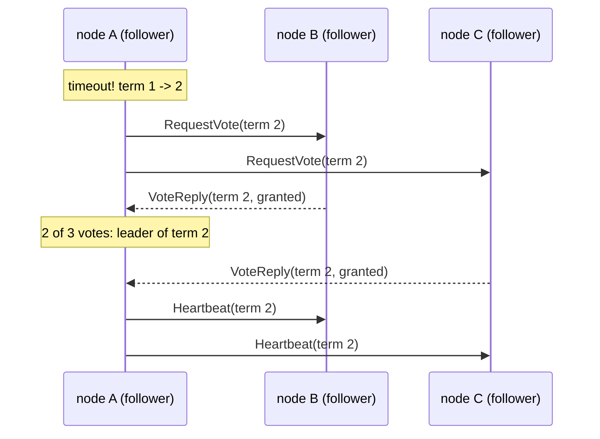

<!-- nav:top -->
[🏠 Start](../START-HERE.md) · [← 18.9 Consensus and an overview of Raft](09-consensus-and-raft.md) · [📋 Phase 18](README.md) · [18.11 Raft: log replication →](11-raft-log-replication.md) · [📖 Glossary](../GLOSSARY.md) · [🇷🇺 Русский](../../ru/18-distributed-systems/10-raft-leader-election.md) <!-- nav -->

# Lesson 18.10 — Raft: leader election

> **Phase 18 — Distributed systems** · Lesson 10 of 15 · ⏱ about 3 hours (2 sittings)

## What you will learn

- How a Raft election works, step by step: election timeouts, terms, votes and heartbeats.
- Why the election timeout must be *random*, and what happens when it is not.
- The two voting rules: one vote per term, and only for a candidate whose log is up to date.
- How to write the election half of Raft as a pure struct that you drive with `tick()` and `step()`.
- How to test the safety rule "at most one leader per term" on hundreds of simulated runs, and watch the test catch a real bug.

## Before you start

- You finished [Lesson 18.9 — Consensus and an overview of Raft](09-consensus-and-raft.md). Keep its picture of roles and terms in mind.
- You know seeded random numbers from [Lesson 09.4 — Property-based testing](../09-testing-debugging-benchmarking/04-property-based-testing.md): the same seed gives the same "random" sequence.
- Create the package. It grows over this lesson and the next one, and the project in Lesson 18.14 reuses it:

```bash
cd ~/projects/rust
cargo new --lib code/p18-raft
cd code/p18-raft
cargo add rand@0.10
mkdir src/bin tests
```

## New words

| Word | Meaning |
|---|---|
| **election timeout** | How long a follower waits without hearing from a leader before it starts an election. In Raft it is chosen at random from a range, again for every wait. |
| **tick** | One unit of simulated time. Our node does not read a clock; the caller tells it "one tick passed". Real code ticks every few milliseconds. |
| **vote** | A node's answer to a `RequestVote`: granted or not. Each node gives at most one vote per term. |
| **split vote** | An election in which no candidate gets a majority, because several candidates divided the votes. The term ends without a leader. |
| **up-to-date log** | A log whose last entry has a higher term, or the same term and at least the same index, compared with another log. Nodes vote only for candidates with an up-to-date log. |
| **step down** | A leader or candidate becomes a follower again, because it saw a higher term or a valid leader. |
| **sans-IO** | A style of writing protocol code with no input/output inside: the code receives events and returns what it wants to send, and other code does the real networking. |
| **outbox** | A list inside the node where it puts the messages it wants to send. The caller empties it with `take_outbox()`. |
| **RNG** (Random Number Generator) | Code that produces a sequence of numbers that look random. A *seeded* RNG produces the same sequence every time for the same seed. |
| **disruptive server** | A node that was cut off, raised its term in endless elections, and forces a new election when it comes back. |

## 1. An election, step by step

Every follower runs a countdown, its **election timeout**. Every message from a valid leader restarts the countdown. If the countdown reaches zero, the follower assumes there is no leader and does this:

1. It increments its term (say from 1 to 2) and becomes a **candidate**.
2. It votes for itself.
3. It sends `RequestVote { term: 2, … }` to every other node.

Each node that receives the request answers. It **grants** its vote if it has not voted for someone else in term 2 and the candidate's log is at least as up to date as its own (Section 4 explains this second rule). As soon as the candidate has votes from a majority (itself included), it becomes the **leader** and sends heartbeats at once, so the others stop their countdowns.



What if two followers time out at the same moment? Both become candidates in term 2 and vote for themselves. In a 3-node cluster the third node can vote for only one of them, so one wins. With 4 or 5 nodes, the votes can split: nobody reaches a majority. Then the candidates simply wait for their timeout again, start term 3, and try again.

This is why the timeout is **random**: with timeouts spread over a range (the paper suggests 150–300 milliseconds), one node usually times out clearly before the others, collects the votes, and sends heartbeats before anyone else wakes up. In Section 6 a test shows that with *equal* timeouts, a cluster never elects a leader at all.

How wide should the range be? A narrow range (say 10–11 ticks) causes many split votes; a very wide one (10–40) avoids them but makes followers wait longer before they notice a dead leader. A range from the minimum to about twice the minimum is a good balance.

> 💡 **Tip:** the heartbeat interval must be much shorter than the smallest election timeout (we use 3 ticks against 10–20 ticks). Otherwise followers time out between two heartbeats of a perfectly healthy leader and start useless elections.

## 2. Messages and settings

We write Raft in the **sans-IO** style. The node knows nothing about sockets, threads or clocks. That makes it small, deterministic and easy to test; the project in Lesson 18.14 connects it to a real network.

Create `src/node.rs` and start with the types:

```rust
use rand::rngs::StdRng;
use rand::{RngExt, SeedableRng};
use std::collections::BTreeSet;

pub type NodeId = u64;

#[derive(Debug, Clone, Copy, PartialEq, Eq)]
pub enum Role {
    Follower,
    Candidate,
    Leader,
}

/// One entry of the replicated log.
#[derive(Debug, Clone, PartialEq)]
pub struct Entry {
    pub term: u64,
    pub command: String,
}

#[derive(Debug, Clone, PartialEq)]
pub enum Message {
    RequestVote {
        term: u64,
        last_log_index: u64,
        last_log_term: u64,
    },
    VoteReply {
        term: u64,
        granted: bool,
    },
    Heartbeat {
        term: u64,
    },
    HeartbeatReply {
        term: u64,
    },
}

impl Message {
    pub fn term(&self) -> u64 {
        match self {
            Message::RequestVote { term, .. }
            | Message::VoteReply { term, .. }
            | Message::Heartbeat { term }
            | Message::HeartbeatReply { term } => *term,
        }
    }
}

/// A message on its way from one node to another.
#[derive(Debug, Clone, PartialEq)]
pub struct Envelope {
    pub from: NodeId,
    pub to: NodeId,
    pub msg: Message,
}

/// Timing settings, counted in ticks.
#[derive(Debug, Clone, Copy)]
pub struct Config {
    pub election_min: u32,
    pub election_max: u32,
    pub heartbeat: u32,
}

impl Default for Config {
    fn default() -> Self {
        Config {
            election_min: 10,
            election_max: 20,
            heartbeat: 3,
        }
    }
}
```

**What happens:**

1. `NodeId` is a plain number. A node only needs to know the ids of its `peers`.
2. `Entry` is one log entry. In this lesson logs stay empty (except in one test); Lesson 18.11 fills them.
3. `Message` has four kinds. `RequestVote` carries the candidate's term and the index and term of its **last** log entry. `Heartbeat` is the leader saying "I am alive in this term". `HeartbeatReply` lets an old leader learn about a newer term. (In Lesson 18.11, the heartbeat grows into `AppendEntries`.)
4. `Message::term` returns the term of any message. One `match` arm with `|` covers all four kinds because each has a field called `term`.
5. `Envelope` adds "from" and "to". The node never sends anything itself; it only produces envelopes.
6. `Config` holds the timing in ticks. `Default` gives a heartbeat every 3 ticks and election timeouts between 10 and 19 ticks.

## 3. The node and its timer

Add the `Node` struct and a first `impl` block with small helpers to `src/node.rs`:

```rust
pub struct Node {
    pub id: NodeId,
    peers: Vec<NodeId>,
    config: Config,
    pub role: Role,
    pub term: u64,
    voted_for: Option<NodeId>,
    pub log: Vec<Entry>,
    votes: BTreeSet<NodeId>,
    elapsed: u32,
    timeout: u32,
    rng: StdRng,
    outbox: Vec<Envelope>,
}

impl Node {
    pub fn new(id: NodeId, peers: Vec<NodeId>, config: Config, seed: u64) -> Node {
        let mut node = Node {
            id,
            peers,
            config,
            role: Role::Follower,
            term: 0,
            voted_for: None,
            log: Vec::new(),
            votes: BTreeSet::new(),
            elapsed: 0,
            timeout: 0,
            rng: StdRng::seed_from_u64(seed),
            outbox: Vec::new(),
        };
        node.reset_election_timer();
        node
    }

    /// Messages produced since the last call.
    pub fn take_outbox(&mut self) -> Vec<Envelope> {
        std::mem::take(&mut self.outbox)
    }

    fn send(&mut self, to: NodeId, msg: Message) {
        self.outbox.push(Envelope {
            from: self.id,
            to,
            msg,
        });
    }

    fn majority(&self) -> usize {
        let cluster_size = self.peers.len() + 1;
        cluster_size / 2 + 1
    }

    fn reset_election_timer(&mut self) {
        self.elapsed = 0;
        let (min, max) = (self.config.election_min, self.config.election_max);
        self.timeout = if min == max {
            min
        } else {
            self.rng.random_range(min..max)
        };
    }

    /// Index and term of the last log entry, (0, 0) for an empty log.
    fn last_log(&self) -> (u64, u64) {
        let index = self.log.len() as u64;
        let term = self.log.last().map_or(0, |e| e.term);
        (index, term)
    }
}
```

**What happens:**

1. `term`, `voted_for` and `log` are the three values that Raft must keep on disk (Lesson 18.9). Here they live in memory; the project adds persistence.
2. `votes` holds the ids of nodes that voted for us in the current term. A `BTreeSet` ignores duplicates, so a repeated reply cannot count twice.
3. `elapsed` counts ticks since the timer was reset; `timeout` is the current random limit.
4. Each node has its **own** seeded random number generator, `StdRng::seed_from_u64(seed)`. With the same seeds, the whole cluster behaves exactly the same on every run. Never use `rand::rng()` (seeded from the operating system) in code you want to test this way.
5. `random_range(min..max)` picks a number from `min` up to, but not including, `max`. It panics on an empty range, so `min == max` is handled separately: a fixed timeout, which we use in a test.
6. `last_log` returns `(index, term)` of the last entry. Index 0 with term 0 means "the log is empty". Raft numbers entries from 1, so index `i` is `self.log[i - 1]`.

Now the timer. A second `impl` block in the same file (Rust allows several `impl` blocks for one type):

```rust
// Time: ticks, timeouts and elections.
impl Node {
    /// One unit of time has passed.
    pub fn tick(&mut self) {
        self.elapsed += 1;
        match self.role {
            Role::Leader => {
                if self.elapsed >= self.config.heartbeat {
                    self.elapsed = 0;
                    self.send_heartbeats();
                }
            }
            Role::Follower | Role::Candidate => {
                if self.elapsed >= self.timeout {
                    self.start_election();
                }
            }
        }
    }

    fn start_election(&mut self) {
        self.term += 1;
        self.role = Role::Candidate;
        self.voted_for = Some(self.id);
        self.votes = BTreeSet::from([self.id]);
        self.reset_election_timer();
        let (last_log_index, last_log_term) = self.last_log();
        for peer in self.peers.clone() {
            let msg = Message::RequestVote {
                term: self.term,
                last_log_index,
                last_log_term,
            };
            self.send(peer, msg);
        }
        self.check_votes();
    }

    fn check_votes(&mut self) {
        if self.role == Role::Candidate && self.votes.len() >= self.majority() {
            self.role = Role::Leader;
            self.elapsed = 0;
            self.send_heartbeats();
        }
    }

    fn send_heartbeats(&mut self) {
        for peer in self.peers.clone() {
            self.send(peer, Message::Heartbeat { term: self.term });
        }
    }
}
```

**What happens:**

1. `tick` adds one tick. A leader sends heartbeats every `config.heartbeat` ticks. A follower or candidate whose timer ran out starts an election. (A candidate whose election failed simply times out again and starts the next term.)
2. `start_election` does the three steps of Section 1: next term, become candidate, vote for yourself. It also picks a **new** random timeout, so that the next attempt is spread out again.
3. `self.peers.clone()` is needed because `self.send` borrows `self` mutably while we loop over `self.peers`. The clone is a short vector of numbers, so it costs nothing worth worrying about.
4. `check_votes` is called after every granted vote and once right after the election starts. That second call matters for a 1-node cluster, where your own vote is already a majority.
5. A new leader resets `elapsed` and sends heartbeats **immediately**, to stop the other countdowns before they fire.

## 4. The voting rules

The third `impl` block handles messages. This is where Raft's safety lives:

```rust
// Messages: the rules for voting and following.
impl Node {
    fn become_follower(&mut self, term: u64) {
        self.term = term;
        self.role = Role::Follower;
        self.voted_for = None;
        self.votes.clear();
    }

    /// Deliver one message to this node.
    pub fn step(&mut self, from: NodeId, msg: Message) {
        // The rule for every message: a higher term wins.
        if msg.term() > self.term {
            self.become_follower(msg.term());
        }
        match msg {
            Message::RequestVote {
                term,
                last_log_index,
                last_log_term,
            } => {
                let (my_index, my_term) = self.last_log();
                let log_ok = (last_log_term, last_log_index) >= (my_term, my_index);
                let free = self.voted_for.is_none() || self.voted_for == Some(from);
                let granted = term == self.term && free && log_ok;
                if granted {
                    self.voted_for = Some(from);
                    self.reset_election_timer();
                }
                self.send(
                    from,
                    Message::VoteReply {
                        term: self.term,
                        granted,
                    },
                );
            }
            Message::VoteReply { term, granted } => {
                if granted && term == self.term {
                    self.votes.insert(from);
                    self.check_votes();
                }
            }
            Message::Heartbeat { term } => {
                if term == self.term {
                    // A leader exists in our term: follow it.
                    self.role = Role::Follower;
                    self.reset_election_timer();
                }
                self.send(from, Message::HeartbeatReply { term: self.term });
            }
            Message::HeartbeatReply { .. } => {
                // Nothing to do: a higher term was handled above.
            }
        }
    }
}
```

**What happens:**

1. The first `if` is Raft's rule for **all** messages: if the message has a higher term, adopt that term and become a follower. `become_follower` also forgets the old vote, because a vote belongs to a term. This single rule makes old leaders step down. It is the fencing-token idea of [Lesson 18.4](04-time-and-clocks.md): the term is the token, and a node never obeys a message whose term is lower than one it has already seen.
2. `RequestVote`: three conditions must all be true to grant the vote.
   - `term == self.term`: the request is for the current term (after step 1, an older term is the only other case, and it is refused).
   - `free`: we have not voted yet in this term, or we already voted for this same candidate (a repeated request must get the same answer).
   - `log_ok`: the candidate's log is at least as up to date as ours.
3. `log_ok` compares tuples. Rust compares tuples element by element: first the last terms; only if they are equal, the indexes. So a log ending in term 3 beats any log ending in term 2, however long that one is.
4. Granting a vote resets our own election timer: someone else is trying to become leader, so we should give them time.
5. `VoteReply` counts only granted votes **for the current term**. A late reply from an older election is ignored.
6. `Heartbeat` with our term means a legitimate leader exists. A candidate in the same term gives up and follows. Every heartbeat is answered with our term, so an old leader that sends a heartbeat to a node with a newer term receives a `HeartbeatReply` with that newer term, and step 1 turns it into a follower.

Why the up-to-date rule? A committed entry is stored on a majority. To win, a candidate needs votes from a majority. These two majorities overlap (Lesson 18.9), so at least one voter has the committed entry, and that voter refuses a candidate whose log is older. Therefore **a candidate that lacks a committed entry cannot win**. This gives the promise *leader completeness*. You will see why it matters in the next lesson, when logs fill up.

> 🔒 **Security:** a node trusts the `term` in every message it receives. One forged message with term 1,000,000 makes every node jump to that term. This is one more reason why only authenticated cluster members may talk to the Raft port.

## 5. A simulated cluster

The node needs someone to deliver its messages. For tests we write a tiny network inside the crate. Create `src/cluster.rs`:

```rust
//! A simulated cluster for tests: the test decides when time passes
//! and which messages arrive.

use crate::{Config, Envelope, Node, NodeId, Role};
use std::collections::{BTreeMap, BTreeSet, VecDeque};

pub struct Cluster {
    pub nodes: BTreeMap<NodeId, Node>,
    in_flight: VecDeque<Envelope>,
    cut_off: BTreeSet<NodeId>,
}

impl Cluster {
    /// `n` nodes with ids 1..=n. The seed decides all random timeouts.
    pub fn new(n: u64, config: Config, seed: u64) -> Cluster {
        let mut nodes = BTreeMap::new();
        for id in 1..=n {
            let peers = (1..=n).filter(|&p| p != id).collect();
            nodes.insert(id, Node::new(id, peers, config, seed * 1000 + id));
        }
        Cluster {
            nodes,
            in_flight: VecDeque::new(),
            cut_off: BTreeSet::new(),
        }
    }

    /// Drop every message to or from `id` until `heal` is called.
    pub fn isolate(&mut self, id: NodeId) {
        self.cut_off.insert(id);
    }

    pub fn heal(&mut self, id: NodeId) {
        self.cut_off.remove(&id);
    }

    /// One tick for every node, then deliver messages until none are left.
    pub fn tick(&mut self) {
        for node in self.nodes.values_mut() {
            node.tick();
        }
        self.collect();
        while let Some(env) = self.in_flight.pop_front() {
            if self.cut_off.contains(&env.from) || self.cut_off.contains(&env.to) {
                continue; // the network loses it
            }
            let node = self.nodes.get_mut(&env.to).expect("unknown node");
            node.step(env.from, env.msg);
            self.collect();
        }
    }

    fn collect(&mut self) {
        for node in self.nodes.values_mut() {
            self.in_flight.extend(node.take_outbox());
        }
    }

    /// (id, term) of every node that currently believes it is the leader.
    pub fn leaders(&self) -> Vec<(NodeId, u64)> {
        self.nodes
            .values()
            .filter(|n| n.role == Role::Leader)
            .map(|n| (n.id, n.term))
            .collect()
    }
}
```

And make both files part of the library, in `src/lib.rs`:

```rust
//! A small Raft core: no network, no threads, no clock.

pub mod cluster;
mod node;

pub use node::{Config, Entry, Envelope, Message, Node, NodeId, Role};
```

**What happens:**

1. `Cluster::new` creates nodes 1 to `n`. Every node gets a different seed derived from the cluster seed, so the timeouts differ, but the whole run depends only on `seed`.
2. `isolate` puts a node into `cut_off`. Messages from or to it are silently dropped, like a network cable that was pulled. `heal` puts the cable back.
3. `tick` advances every node by one tick, then delivers messages one by one. Delivering a message may produce new messages (a vote request produces a reply), so after each `step` we `collect` again, until the queue is empty. Messages arrive instantly in this simple network; Lesson 18.11 adds message loss.
4. `leaders` lists every node that *believes* it is a leader, with its term. An isolated old leader still believes it, so there may be two entries, but they must be in **different terms**.

Now watch an election. Create `src/bin/election.rs`:

```rust
use p18_raft::cluster::Cluster;
use p18_raft::{Config, Role};

fn main() {
    let mut cluster = Cluster::new(3, Config::default(), 7);
    let mut old_leader = 0;
    let mut roles: Vec<Role> = cluster.nodes.values().map(|n| n.role).collect();

    for tick in 1..=60 {
        if tick == 20 {
            old_leader = cluster.leaders()[0].0;
            println!("tick {tick}: cut node {old_leader} off the network");
            cluster.isolate(old_leader);
        }
        if tick == 45 {
            println!("tick {tick}: node {old_leader} is back");
            cluster.heal(old_leader);
        }
        cluster.tick();
        for (i, node) in cluster.nodes.values().enumerate() {
            if node.role != roles[i] {
                println!(
                    "tick {tick}: node {} {:?} -> {:?} (term {})",
                    node.id, roles[i], node.role, node.term
                );
                roles[i] = node.role;
            }
        }
    }
    println!("leaders at the end: {:?}", cluster.leaders());
}
```

**What happens:**

1. The run uses seed 7. After 20 ticks the program cuts the current leader off; at tick 45 it brings it back.
2. After every tick it prints the nodes whose role changed.

Run it with `cargo run --bin election`:

```text
tick 10: node 1 Follower -> Leader (term 1)
tick 20: cut node 1 off the network
tick 31: node 2 Follower -> Candidate (term 2)
tick 31: node 3 Follower -> Candidate (term 2)
tick 41: node 2 Candidate -> Follower (term 3)
tick 41: node 3 Candidate -> Leader (term 3)
tick 45: node 1 is back
tick 46: node 1 Leader -> Follower (term 3)
leaders at the end: [(3, 3)]
```

Read it line by line. At tick 10, node 1 timed out first, and the votes and heartbeats were all delivered within the same tick, so it went from follower to leader in one step. At tick 31, nodes 2 and 3 timed out **at the same tick** (bad luck with this seed): both became candidates in term 2, each voted for itself and refused the other, and node 1, the only other voter, was cut off. Split vote. Ten ticks later node 3 timed out first, started term 3 and won. Node 1 still thought it was the leader of term 1 the whole time. When it came back, its next heartbeat got a reply with term 3, and it stepped down.

> 🧪 **Testing:** because the run depends only on the seed, this output is the same on every computer and every run. When a test fails for seed 43, you can rerun seed 43 and watch the same failure as often as you like.

## 6. Testing election safety

Now turn the run into tests. Create `tests/election.rs`:

```rust
use p18_raft::Config;
use p18_raft::cluster::Cluster;
use rand::rngs::StdRng;
use rand::{RngExt, SeedableRng};
use std::collections::BTreeMap;

#[test]
fn elects_exactly_one_leader() {
    let mut cluster = Cluster::new(3, Config::default(), 1);
    for _ in 0..50 {
        cluster.tick();
    }
    assert_eq!(cluster.leaders().len(), 1);
}

#[test]
fn a_new_leader_takes_over_and_the_old_one_steps_down() {
    let mut cluster = Cluster::new(5, Config::default(), 2);
    for _ in 0..50 {
        cluster.tick();
    }
    let (old, old_term) = cluster.leaders()[0];

    cluster.isolate(old);
    for _ in 0..50 {
        cluster.tick();
    }
    cluster.heal(old);
    for _ in 0..10 {
        cluster.tick();
    }

    let leaders = cluster.leaders();
    assert_eq!(leaders.len(), 1);
    let (new, new_term) = leaders[0];
    assert_ne!(new, old);
    assert!(new_term > old_term);
}

#[test]
fn equal_timeouts_never_elect_a_leader() {
    let config = Config {
        election_min: 10,
        election_max: 10,
        heartbeat: 3,
    };
    let mut cluster = Cluster::new(3, config, 3);
    for _ in 0..500 {
        cluster.tick();
    }
    assert!(cluster.leaders().is_empty());
}

#[test]
fn never_two_leaders_in_one_term() {
    for seed in 0..300 {
        let mut cluster = Cluster::new(5, Config::default(), seed);
        let mut chaos = StdRng::seed_from_u64(seed);
        let mut leader_of_term: BTreeMap<u64, u64> = BTreeMap::new();

        for _ in 0..300 {
            // Now and then, cut a random node off or bring one back.
            if chaos.random_range(0..10) == 0 {
                let id = chaos.random_range(1..=5);
                if chaos.random_bool(0.5) {
                    cluster.isolate(id);
                } else {
                    cluster.heal(id);
                }
            }
            cluster.tick();
            for (id, term) in cluster.leaders() {
                let first = *leader_of_term.entry(term).or_insert(id);
                assert_eq!(first, id, "seed {seed}: two leaders in term {term}");
            }
        }
    }
}
```

**What happens:**

1. `elects_exactly_one_leader`: a healthy 3-node cluster has exactly one leader after 50 ticks (liveness).
2. `a_new_leader_takes_over_and_the_old_one_steps_down`: cut the leader of a 5-node cluster off, wait, bring it back; there is one leader, a different node, in a higher term.
3. `equal_timeouts_never_elect_a_leader`: with `election_min == election_max`, all nodes time out at the same tick forever, every election is a split vote, and after 500 ticks there is still no leader. The test documents *why* the timeout is random.
4. `never_two_leaders_in_one_term` is the important one, the **safety** test. For 300 seeds it runs 300 ticks while a second seeded generator, `chaos`, cuts random nodes off and brings them back. After every tick it records the first leader seen in each term and fails if a different node ever claims the same term.

```text
test elects_exactly_one_leader ... ok
test a_new_leader_takes_over_and_the_old_one_steps_down ... ok
test equal_timeouts_never_elect_a_leader ... ok
test never_two_leaders_in_one_term ... ok
test result: ok. 4 passed; 0 failed; 0 ignored; 0 measured; 0 filtered out; finished in 1.01s
```

Does the safety test really catch bugs? Try it. In `step`, remove the `free` condition, so that nodes may vote twice in one term:

```rust
let granted = term == self.term && log_ok;
```

Run `cargo test --test election` again (the compiler also warns that `free` is unused):

```text
test never_two_leaders_in_one_term ... FAILED

---- never_two_leaders_in_one_term stdout ----

thread 'never_two_leaders_in_one_term' (6200810) panicked at tests/election.rs:74:17:
assertion `left == right` failed: seed 43: two leaders in term 4
  left: 2
 right: 3
```

Only 7 of the 300 seeds trigger the bug, and seed 43 is the first. There, two candidates started term 4 at the same tick, the other nodes voted for both, and nodes 2 and 3 both became leaders of term 4. A test with a few hand-picked runs would very likely have passed. **Put the condition back** before you continue.

> ⚡ **Performance:** 300 seeds × 300 ticks × 5 nodes is 450,000 node ticks, and it runs in about a second, because nothing waits for a real network or a real clock. Simulated time is the reason this kind of testing is practical.

## Common mistakes

> ⚠️ **Common mistake:** forgetting to reset `voted_for` when the term changes. Then a node that voted in term 2 refuses everyone in term 3, and elections can stall. In our code `become_follower` clears it.

> ⚠️ **Common mistake:** resetting the election timer on **every** message. The timer must restart only when you grant a vote or hear from the current leader. If any message (for example a refused vote request) resets it, a candidate that can never win keeps everyone else from starting their own election.

> ⚠️ **Common mistake:** counting votes without checking the term. A late `VoteReply` from an old election would count for the new one. Always compare `term == self.term` before using a reply.

> ⚠️ **Common mistake:** comparing logs by length only. A longer log is **not** more up to date if its last entry has an older term. Compare `(last_term, last_index)` as a tuple, term first.

## Try it yourself

1. Run `cargo run --bin election`, then change the seed from `7` to `1`. The election after the cut is now clean (no split vote), and a different node wins.
2. Change the cluster to 5 nodes in `election.rs` and run again. More candidates can time out together; look for split votes.
3. Run `cargo test`. Then make the safety test bigger, 1,000 seeds, and see how the run time grows.
4. Break the up-to-date rule (`let log_ok = true;`) and run `cargo test`. It still passes: logs are empty in this lesson, so this rule cannot matter yet. Put it back; Lesson 18.11 adds the test that needs it.

## Exercises

### Exercise 1 — A cluster of one (easy)

Write a test in a new file `tests/exercises.rs`: a 1-node cluster must be the leader of term 1 after 20 ticks. Use `assert_eq!(cluster.leaders(), vec![(1, 1)])`.

<details>
<summary>Hint</summary>

Its first timeout is at most 19 ticks. When the election starts, its own vote is already a majority of 1, and `check_votes` is called at the end of `start_election`.

</details>

<details>
<summary>Answer</summary>

```rust
use p18_raft::Config;
use p18_raft::cluster::Cluster;

#[test]
fn a_single_node_elects_itself() {
    let mut cluster = Cluster::new(1, Config::default(), 1);
    for _ in 0..20 {
        cluster.tick();
    }
    assert_eq!(cluster.leaders(), vec![(1, 1)]);
}
```

Why it works: a 1-node cluster has no peers, so `start_election` sends nothing, and `check_votes` finds 1 vote out of a majority of 1.

</details>

### Exercise 2 — The up-to-date rule in a unit test (medium)

Write a test that creates a single `Node` (id 1, peers 2 and 3), pushes one `Entry` with term 2 into its `log`, and then delivers two vote requests with `step`, both for term 3:

- from node 2, with `last_log_index: 5, last_log_term: 1`: it must be **refused** (a longer log, but an older term);
- from node 3, with `last_log_index: 1, last_log_term: 2`: it must be **granted**.

Read each answer with `take_outbox()`.

<details>
<summary>Hint</summary>

After each `step`, the first envelope in `node.take_outbox()` holds the reply. A small helper function `ask` that sends the request and returns the reply keeps the test short. Why is the second vote still free? Because the first request was refused.

</details>

<details>
<summary>Answer</summary>

Add this to the same file, `tests/exercises.rs` (the first line adds the new imports):

```rust
use p18_raft::{Entry, Message, Node, Role};

/// Deliver a vote request for term 3 and return the node's answer.
fn ask(node: &mut Node, from: u64, last_log_index: u64, last_log_term: u64) -> Message {
    let request = Message::RequestVote {
        term: 3,
        last_log_index,
        last_log_term,
    };
    node.step(from, request);
    node.take_outbox().remove(0).msg
}

#[test]
fn refuses_a_candidate_with_an_older_log() {
    let mut node = Node::new(1, vec![2, 3], Config::default(), 1);
    let entry = Entry {
        term: 2,
        command: "x=1".to_string(),
    };
    node.log.push(entry);

    let refused = Message::VoteReply {
        term: 3,
        granted: false,
    };
    let granted = Message::VoteReply {
        term: 3,
        granted: true,
    };
    // Candidate 2: a longer log, but its last entry has an older term.
    assert_eq!(ask(&mut node, 2, 5, 1), refused);
    // Candidate 3: the same last term and index as ours.
    assert_eq!(ask(&mut node, 3, 1, 2), granted);
    assert_eq!(node.role, Role::Follower);
```

Why it works: `(1, 5) >= (2, 1)` is false because the first elements already decide (1 < 2); `(2, 1) >= (2, 1)` is true. The first request also moved the node to term 3 as a follower, and since it refused, its vote for term 3 is still free.

</details>

### Exercise 3 — The disruptive server (hard)

Write a test that shows a known weakness of basic Raft. In a healthy 3-node cluster, isolate a **follower** for 100 ticks. Check that its term grew by more than 3 (it keeps starting elections alone). Heal it, run 50 more ticks, and check that the leader's term is now at least the lonely node's term: the whole cluster had to jump to its term and hold a new election, although nothing was wrong with the old leader.

<details>
<summary>Hint</summary>

Read a node's term with `cluster.nodes[&id].term`. To pick a follower, take any id that is not the leader's.

</details>

<details>
<summary>Answer</summary>

Add it to `tests/exercises.rs`:

```rust

#[test]
fn a_returning_node_disrupts_the_leader() {
    let mut cluster = Cluster::new(3, Config::default(), 4);
    for _ in 0..50 {
        cluster.tick();
    }
    let (leader, term_before) = cluster.leaders()[0];
    let follower = if leader == 1 { 2 } else { 1 };

    cluster.isolate(follower);
    for _ in 0..100 {
        cluster.tick();
    }
    let lonely_term = cluster.nodes[&follower].term;
    assert!(lonely_term > term_before + 3, "it kept starting elections");

    cluster.heal(follower);
    for _ in 0..50 {
        cluster.tick();
    }
    let (_, term_after) = cluster.leaders()[0];
    assert!(
        term_after >= lonely_term,
        "the whole cluster jumped to its term"
    );
}
```

Why it works: the lonely node increments its term at every timeout. When it is back, its `RequestVote` carries that high term, and the rule "a higher term wins" makes the leader step down. Real implementations add a **Pre-Vote** phase (described in Ongaro's thesis): a node first asks "would you vote for me?" without changing any term, and starts a real election only if a majority says yes. The lonely node never gets that majority, so it cannot disrupt the cluster.

</details>

## Quiz

1. What does a follower do when its election timeout runs out?

<details>
<summary>Answer</summary>

It increments its term, becomes a candidate, votes for itself, resets its timer to a new random value and sends `RequestVote` to every other node.

</details>

2. Why are election timeouts random?

<details>
<summary>Answer</summary>

So that one node usually times out clearly before the others and wins before anyone else becomes a candidate. With equal timeouts, candidates start together and split the votes again and again (our test shows no leader ever).

</details>

3. Under which three conditions does a node grant its vote?

<details>
<summary>Answer</summary>

The request is for its current term (after adopting a higher term), it has not voted for another candidate in this term, and the candidate's log is at least as up to date as its own.

</details>

4. Log A ends with an entry of term 3 at index 4. Log B ends with term 2 at index 9. Which one is more up to date?

<details>
<summary>Answer</summary>

Log A: the last terms are compared first, and 3 > 2. The indexes matter only when the last terms are equal.

</details>

5. An old leader of term 4 comes back after a partition; the cluster is in term 6. What makes it step down?

<details>
<summary>Answer</summary>

Its next heartbeat is answered with a `HeartbeatReply` carrying term 6. The rule for all messages, "a higher term wins", makes it adopt term 6 and become a follower.

</details>

6. Why can there be two nodes in `cluster.leaders()` at the same moment without breaking safety?

<details>
<summary>Answer</summary>

Safety is "at most one leader **per term**". An isolated old leader may still believe it leads term 4 while the real leader leads term 6. The old one cannot commit anything, because it cannot reach a majority, and it steps down as soon as it hears from the others.

</details>

## Summary

- A follower that hears nothing for its election timeout starts an election: next term, vote for itself, `RequestVote` to all. A majority of votes makes it leader; it sends heartbeats immediately.
- Random timeouts make split votes rare; equal timeouts can prevent any election forever.
- A node grants at most one vote per term, and only to a candidate whose log is at least as up to date (last term first, then last index). This makes every new leader contain all committed entries.
- "A higher term wins" applies to every message, and it makes old leaders and candidates step down.
- Writing the node sans-IO, driven by `tick()` and `step()` with a seeded RNG (random number generator), makes every run deterministic and repeatable.
- A seeded chaos test over hundreds of runs checks "one leader per term" and finds bugs that hand-picked tests miss.

## Sources and further reading

- [In Search of an Understandable Consensus Algorithm (the Raft paper)](https://raft.github.io/raft.pdf) — section 5.2 (leader election) and 5.4.1 (the election restriction); Figure 2 lists every rule used in this lesson.
- [Consensus: Bridging Theory and Practice (Ongaro's PhD thesis)](https://web.stanford.edu/~ouster/cgi-bin/papers/OngaroPhD.pdf) — chapter 9 covers leader election in more depth, including Pre-Vote and how to choose timeouts.
- [The Raft Consensus Algorithm](https://raft.github.io/) — the interactive cluster on the front page lets you stop nodes and watch elections.
- [raft-rs](https://github.com/tikv/raft-rs) — a production Rust implementation in the same sans-IO style: you call `tick` and `step` and send the messages it returns.
- [rand documentation](https://docs.rs/rand) — `StdRng`, `SeedableRng` and `random_range`.

---

[🏠 Start](../START-HERE.md) · [← 18.9 Consensus and an overview of Raft](09-consensus-and-raft.md) · [📋 Phase 18](README.md) · [18.11 Raft: log replication →](11-raft-log-replication.md) · [📖 Glossary](../GLOSSARY.md) <!-- nav -->
<!-- nav:bottom -->
