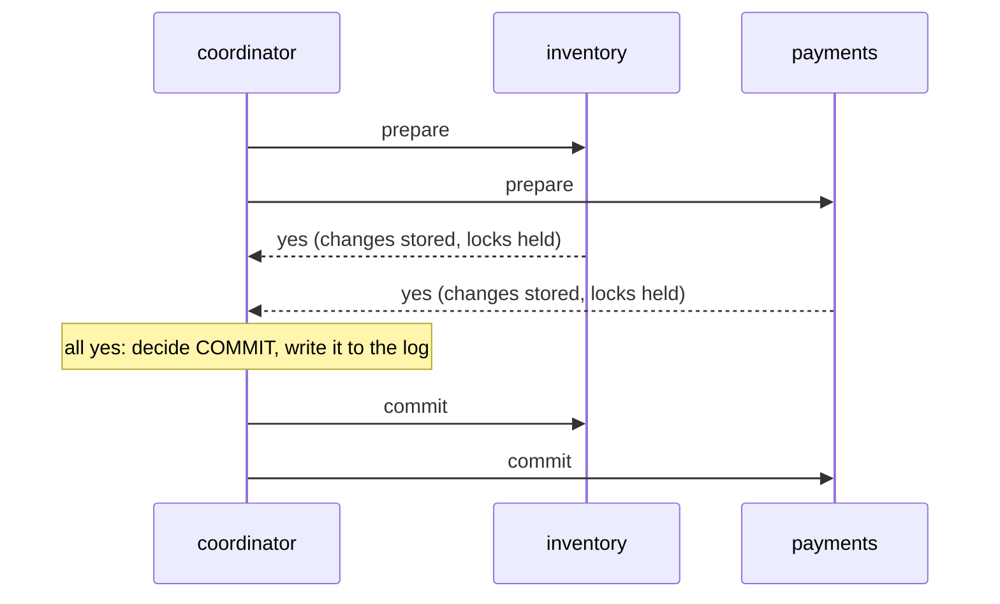

<!-- nav:top -->
[🏠 Start](../START-HERE.md) · [← 18.12 Deterministic simulation testing](12-deterministic-simulation-testing.md) · [📋 Phase 18](README.md) · [18.14 Project: a replicated key-value store →](14-project-replicated-key-value-store.md) · [📖 Glossary](../GLOSSARY.md) · [🇷🇺 Русский](../../ru/18-distributed-systems/13-distributed-transactions-and-sagas.md) <!-- nav -->

# Lesson 18.13 — Distributed transactions and sagas

> **Phase 18 — Distributed systems** · Lesson 13 of 15 · ⏱ about 135 minutes

## What you will learn

- Why one business operation that touches several services or partitions is hard to make "all or nothing".
- How *two-phase commit* (2PC) works, and why a coordinator crash can leave everyone waiting.
- How a *saga* replaces one big transaction with a chain of small ones plus *compensations*, and what it gives up.
- How to write and test a small saga orchestrator in Rust.
- How the *transactional outbox* sends a message and changes a database without losing either.

## Before you start

- You finished [Lesson 18.12 — Deterministic simulation testing](12-deterministic-simulation-testing.md).
- You know what a transaction and ACID (Atomicity, Consistency, Isolation, Durability) are ([Lesson 17.10 — Transactions and ACID](../17-storage-and-databases/10-transactions-and-acid.md)) and have used transactions in PostgreSQL ([Lesson 16.7 — Migrations and transactions](../16-backend-services/07-migrations-and-transactions.md)).
- You remember idempotency keys ([Lesson 18.3](03-retries-backoff-and-idempotency.md)) and messaging with NATS ([Lesson 16.11](../16-backend-services/11-messaging-with-nats.md)).
- Create the package:

```bash
cd ~/projects/rust
cargo new --lib code/p18-saga
mkdir code/p18-saga/src/bin code/p18-saga/tests
```

## New words

| Word | Meaning |
|---|---|
| **distributed transaction** | A transaction whose changes live on several machines (services, databases or partitions), but that must still be all-or-nothing. |
| **atomic commit** | The problem of making all participants either commit or abort, never a mix. |
| **2PC** (two-phase commit) | An atomic commit protocol: phase 1 asks every participant "can you commit?", phase 2 tells everyone the decision. |
| **coordinator** | The process that runs 2PC: it sends the questions, collects the votes and decides. |
| **participant** | A service or database that takes part in the transaction and votes. |
| **in doubt** | The state of a participant that voted yes and has not yet heard the decision. It may neither commit nor abort on its own. |
| **saga** | A long operation split into a sequence of local transactions; if one fails, the finished ones are undone by compensations. |
| **compensation** | An action that semantically undoes an earlier step: a refund for a charge, a release for a reservation. |
| **orchestration** | A saga style where one component (the orchestrator) tells each service what to do next. |
| **choreography** | A saga style where each service reacts to events from the others; there is no central component. |
| **transactional outbox** | A table in the service's own database where it writes outgoing messages in the same transaction as its data change; a separate process sends them later. |

## 1. One order, three services

An online shop takes an order. Three services must act:

1. **inventory** reserves one item;
2. **payments** charges the customer's card;
3. **shipping** books a courier.

Each service has its own database, so no single database transaction covers all three. Now something fails in the middle: the card is charged, but no courier is available. Without care the customer has paid for an order that will never ship, and an item is reserved forever. We want the whole order to be **atomic**: all three changes, or none.

Inside one database, ACID transactions (Lesson 17.10) solve this with a log and locks. Across machines there are two classic answers: make the machines **agree** before anyone commits (two-phase commit), or **let each step commit on its own and undo** the earlier steps if a later one fails (a saga).

## 2. Two-phase commit

2PC adds a **coordinator**. It runs in two phases:



1. **Prepare.** The coordinator asks each participant: "can you commit?" A participant that answers **yes** makes a promise: it writes all its changes durably and keeps its locks, so that it can commit later whatever happens, even after its own crash. A participant that answers **no** aborts at once.
2. **Commit or abort.** If every vote is yes, the coordinator decides **commit**, writes the decision to its own log, and tells everyone. If any vote is no (or a participant does not answer in time), it decides **abort**.

Let us simulate the three interesting cases. Write `src/bin/two_phase.rs`:

```rust
#[derive(Debug, Clone, Copy, PartialEq)]
enum State {
    Working,
    Prepared,
    Committed,
    Aborted,
}

struct Participant {
    name: &'static str,
    state: State,
    can_commit: bool,
}

impl Participant {
    /// Phase 1: "can you commit?" A yes is a promise: store the changes durably first.
    fn prepare(&mut self) -> bool {
        if self.can_commit {
            self.state = State::Prepared;
            true
        } else {
            self.state = State::Aborted; // a "no" may abort at once
            false
        }
    }
}

/// The coordinator. `crash` makes it die between the two phases.
fn two_phase_commit(parts: &mut [Participant], crash: bool) -> &'static str {
    // Phase 1: collect votes.
    let mut all_yes = true;
    for p in parts.iter_mut() {
        if !p.prepare() {
            all_yes = false;
        }
    }
    if crash {
        return "coordinator crashed";
    }
    // Phase 2: tell everyone the decision.
    for p in parts.iter_mut() {
        if all_yes {
            p.state = State::Committed;
        } else if p.state == State::Prepared {
            p.state = State::Aborted;
        }
    }
    if all_yes { "committed" } else { "aborted" }
}

fn run(title: &str, can_commit: [bool; 3], crash: bool) {
    let names = ["inventory", "payments", "shipping"];
    let mut parts: Vec<Participant> = names
        .iter()
        .zip(can_commit)
        .map(|(&name, can_commit)| Participant {
            name,
            state: State::Working,
            can_commit,
        })
        .collect();
    let outcome = two_phase_commit(&mut parts, crash);
    println!("{title}: {outcome}");
    for p in &parts {
        println!("  {:<9} {:?}", p.name, p.state);
    }
}

fn main() {
    run("all vote yes", [true, true, true], false);
    run("payments votes no", [true, false, true], false);
    run("crash after the votes", [true, true, true], true);
}
```

**What happens:**

1. Each participant has a state. `prepare` either moves it to `Prepared` (a yes vote: a promise to be able to commit) or to `Aborted` (a no vote).
2. `two_phase_commit` collects all votes, then either commits everyone or aborts everyone who is still `Prepared`.
3. `crash: true` makes the coordinator stop between the phases, as if its machine lost power right after counting the votes.

Run `cargo run --bin two_phase`:

```text
all vote yes: committed
  inventory Committed
  payments  Committed
  shipping  Committed
payments votes no: aborted
  inventory Aborted
  payments  Aborted
  shipping  Aborted
crash after the votes: coordinator crashed
  inventory Prepared
  payments  Prepared
  shipping  Prepared
```

The first two cases are fine: all commit, or all abort. The third one is the famous weakness of 2PC. All three participants are **in doubt**. They promised to commit if asked, so none may abort on its own (the coordinator may have decided commit and told someone already). None may commit on its own either (the coordinator may have decided abort). They must keep their locks and wait until the coordinator comes back. While they wait, every other transaction that needs the reserved item or the customer's account waits too. 2PC is a **blocking** protocol.

> 💡 **Tip:** 2PC is *atomic commit*, not consensus. In consensus (Raft), any majority can make progress; in 2PC, **every** participant must vote yes and **the** coordinator must survive. Systems such as Google Spanner and CockroachDB make 2PC safe to use by making the coordinator and each participant a replicated Raft or Paxos group, so that "the coordinator crashed" means "a majority of its replicas crashed".

Databases support 2PC directly: in PostgreSQL, `PREPARE TRANSACTION 'order-1'` performs phase 1 and `COMMIT PREPARED 'order-1'` performs phase 2. It is used rarely, because a forgotten prepared transaction holds its locks forever.

> 🔒 **Security:** a participant that is in doubt holds locks until it hears the decision. An attacker who can make the coordinator unreachable (or who starts many transactions and never finishes them) can freeze a part of your data. Limit how long a prepared transaction may live, and alert on old ones.

## 3. Sagas: commit each step, undo on failure

A **saga** gives up the idea of one transaction. The order becomes a sequence of **local** transactions, one per service, each committed at once. For every step we also write a **compensation**, an action that semantically undoes it:

| Step | Action | Compensation |
|---|---|---|
| 1 | reserve one item | release the item |
| 2 | charge 30 to the card | refund 30 |
| 3 | book a courier | cancel the courier |

If step `k` fails, the saga runs the compensations of steps `k - 1`, …, 1, **in reverse order**. Nobody waits for anybody, and no locks are held between steps.

A component that runs the steps and the compensations is called an **orchestrator**. Write it in `src/lib.rs`:

```rust
//! A tiny saga: steps with compensations, run by an orchestrator.

/// The "world" our three services change. In real life these are three
/// databases owned by three services.
#[derive(Debug, Clone, PartialEq)]
pub struct Shop {
    pub stock: u32,
    pub balance: i64,
    pub shipments: Vec<String>,
    /// For tests: the name of the step that should fail.
    pub fail_step: Option<&'static str>,
}

impl Shop {
    pub fn new() -> Shop {
        Shop {
            stock: 5,
            balance: 100,
            shipments: Vec::new(),
            fail_step: None,
        }
    }

    fn check(&self, step: &str) -> Result<(), String> {
        match self.fail_step {
            Some(name) if name == step => Err(format!("{step} is unavailable")),
            _ => Ok(()),
        }
    }
}

impl Default for Shop {
    fn default() -> Self {
        Shop::new()
    }
}

/// One local transaction and the action that undoes it.
pub struct Step {
    pub name: &'static str,
    pub action: fn(&mut Shop) -> Result<(), String>,
    pub compensate: fn(&mut Shop),
}

pub fn reserve_stock(shop: &mut Shop) -> Result<(), String> {
    shop.check("reserve")?;
    if shop.stock == 0 {
        return Err("out of stock".to_string());
    }
    shop.stock -= 1;
    Ok(())
}

pub fn release_stock(shop: &mut Shop) {
    shop.stock += 1;
}

pub fn charge_card(shop: &mut Shop) -> Result<(), String> {
    shop.check("charge")?;
    if shop.balance < 30 {
        return Err("card declined".to_string());
    }
    shop.balance -= 30;
    Ok(())
}

pub fn refund_card(shop: &mut Shop) {
    shop.balance += 30;
}

pub fn book_courier(shop: &mut Shop) -> Result<(), String> {
    shop.check("ship")?;
    shop.shipments.push("order-1".to_string());
    Ok(())
}

pub fn cancel_courier(shop: &mut Shop) {
    shop.shipments.retain(|s| s != "order-1");
}

/// The order saga: reserve, charge, ship.
pub fn order_saga() -> Vec<Step> {
    vec![
        Step {
            name: "reserve",
            action: reserve_stock,
            compensate: release_stock,
        },
        Step {
            name: "charge",
            action: charge_card,
            compensate: refund_card,
        },
        Step {
            name: "ship",
            action: book_courier,
            compensate: cancel_courier,
        },
    ]
}

/// Run the steps in order. If one fails, undo the finished ones in reverse order.
/// Returns what happened, as a list of log lines.
pub fn run_saga(shop: &mut Shop, steps: &[Step]) -> Result<Vec<String>, Vec<String>> {
    let mut log = Vec::new();
    for (i, step) in steps.iter().enumerate() {
        match (step.action)(shop) {
            Ok(()) => log.push(format!("done {}", step.name)),
            Err(e) => {
                log.push(format!("failed {}: {e}", step.name));
                for finished in steps[..i].iter().rev() {
                    (finished.compensate)(shop);
                    log.push(format!("undone {}", finished.name));
                }
                return Err(log);
            }
        }
    }
    Ok(log)
}
```

**What happens:**

1. `Shop` stands in for the three databases: the stock (inventory), the customer's balance (payments) and the list of shipments (shipping). `fail_step` lets a test make one service fail.
2. A `Step` holds two plain function pointers: `action` may fail and returns a `Result`; `compensate` returns nothing, because a compensation **must not fail** (more on this below).
3. Each action is a small local transaction: check, then change. `check` returns an error if the test chose this step to fail; the `?` passes it on.
4. `run_saga` runs the steps in order and logs each one. When a step fails, it walks back over the finished steps, `steps[..i]`, in reverse (`.rev()`), and runs their compensations.

Show it in `src/bin/saga.rs`:

```rust
use p18_saga::{Shop, order_saga, run_saga};

fn main() {
    let steps = order_saga();

    let mut shop = Shop::new();
    let result = run_saga(&mut shop, &steps);
    println!("{result:?}");
    println!(
        "stock {}, balance {}, shipments {:?}",
        shop.stock, shop.balance, shop.shipments
    );

    let mut shop = Shop::new();
    shop.fail_step = Some("ship");
    let result = run_saga(&mut shop, &steps);
    println!("{result:?}");
    println!(
        "stock {}, balance {}, shipments {:?}",
        shop.stock, shop.balance, shop.shipments
    );
}
```

Run `cargo run --bin saga`:

```text
Ok(["done reserve", "done charge", "done ship"])
stock 4, balance 70, shipments ["order-1"]
Err(["done reserve", "done charge", "failed ship: ship is unavailable", "undone charge", "undone reserve"])
stock 5, balance 100, shipments []
```

The second run charged the card and then refunded it. In the end the shop looks as before, but the customer may have **seen** the charge for a moment on their bank app, and another order may have been told "out of stock" while the item was reserved. A saga is atomic in the end, but it has **no isolation** (the "I" in ACID): other operations can see its intermediate steps. That is the price for not holding locks.

## 4. Testing the saga

The rules of a saga are easy to state as tests. Write `tests/saga.rs`:

```rust
use p18_saga::{Shop, order_saga, run_saga};

#[test]
fn a_successful_order_changes_all_three_services() {
    let mut shop = Shop::new();
    assert!(run_saga(&mut shop, &order_saga()).is_ok());
    assert_eq!(shop.stock, 4);
    assert_eq!(shop.balance, 70);
    assert_eq!(shop.shipments, ["order-1"]);
}

#[test]
fn compensations_run_in_reverse_order() {
    let mut shop = Shop::new();
    shop.fail_step = Some("ship");
    let log = run_saga(&mut shop, &order_saga()).unwrap_err();
    assert_eq!(
        log,
        [
            "done reserve",
            "done charge",
            "failed ship: ship is unavailable",
            "undone charge",
            "undone reserve",
        ]
    );
}

#[test]
fn a_failure_at_any_step_leaves_the_shop_as_it_was() {
    for step in ["reserve", "charge", "ship"] {
        let mut shop = Shop::new();
        shop.fail_step = Some(step);
        let before = shop.clone();
        assert!(run_saga(&mut shop, &order_saga()).is_err());
        assert_eq!(shop, before, "failure at {step}");
    }
}
```

**What happens:**

1. The success test checks all three services.
2. The order test checks the exact log: the failing step, then the compensations in reverse order.
3. The last test is a property over every failure point: whichever step fails, the shop ends up equal to how it started.

```text
test a_failure_at_any_step_leaves_the_shop_as_it_was ... ok
test a_successful_order_changes_all_three_services ... ok
test compensations_run_in_reverse_order ... ok
```

> 🧪 **Testing:** in a real system, run the orchestrator and fake services in a `turmoil` simulation (Lesson 18.12) and crash the orchestrator between steps. That is where the next section's rules come from.

## 5. Making sagas survive failures

Our orchestrator lives in memory. A real one must survive its own crash, and the network between it and the services fails like any network. Four rules follow:

1. **Write the saga's progress to a durable log before each step.** "Order 17: starting step 2", then "order 17: step 2 done". A restarted orchestrator reads the log and continues: forward if no step failed, backward with compensations if one did. This is the write-ahead log of Lesson 17.4 again.
2. **Make every action idempotent.** After a crash the orchestrator does not know whether "charge card" happened before the crash, so it sends it again. With an idempotency key per saga and step (`order-17-charge`), the payment service recognises the retry (Lesson 18.3).
3. **Make every compensation idempotent and retry it until it succeeds.** A compensation is the last line of defence; "the refund failed" is not an acceptable final state. So the orchestrator retries it with backoff, possibly for hours, and it must be safe to run twice (Exercise 2).
4. **Put the steps that cannot be undone last.** Sending an e-mail or handing a parcel to a courier cannot be compensated. Do them after every step that can still fail.

There are two ways to connect the steps. In **orchestration** (our code), one component calls each service in turn: the flow is in one place and easy to follow. In **choreography**, there is no central component: inventory publishes "item reserved", payments listens and charges, then publishes "card charged", and so on, for example over NATS JetStream (Lesson 16.11). Choreography has fewer central pieces, but the flow is spread across services and harder to see. Workflow engines (Temporal is a well-known one) are orchestrators that store the saga log for you.

## 6. The transactional outbox

One problem remains in every saga and every event-driven service: a service must **change its database and send a message**, and both must happen or neither. If it commits and then crashes before publishing, the message is lost; if it publishes first and the commit fails, the message lies.

The **transactional outbox** solves it with one local transaction:

```text
BEGIN;
  UPDATE stock SET count = count - 1 WHERE item = 'book';
  INSERT INTO outbox (id, topic, payload) VALUES ('order-17-reserved', 'orders', '...');
COMMIT;

-- a separate relay process, in a loop:
--   read unsent rows from outbox -> publish to NATS -> mark them sent
```

The data change and the outgoing message are now one atomic database transaction. The relay may crash after publishing but before marking a row as sent; then it publishes the row again. So consumers may see a message **twice**, and must deduplicate by the message id. Again: at-least-once delivery plus idempotent consumers.

## 7. Which one to use?

| Approach | Atomic | Isolated | Blocks on a crash | Typical use |
|---|---|---|---|---|
| One database transaction | yes | yes | no | Everything that fits into one database. Prefer it. |
| 2PC | yes | yes (locks) | yes, until the coordinator returns | Inside one database system across its own partitions, with replicated coordinators. |
| Saga | eventually | no | no | Long business processes across services you do not control. |

The best distributed transaction is the one you do not need. If data that changes together lives in one partition (Lesson 18.8) or one service, a normal ACID transaction does the job.

## Common mistakes

> ⚠️ **Common mistake:** a compensation that can fail and is not retried. Then a failed saga can end half-undone: card refunded, item still reserved. Compensations must be retried until they succeed, so they must be idempotent.

> ⚠️ **Common mistake:** treating a compensation as an erase. A refund is a new transaction; the charge still happened, and the customer may have seen it. Tests that expect "everything exactly as before" must say what "before" means (Exercise 2 shows a case).

> ⚠️ **Common mistake:** publishing a message and committing to the database as two separate steps. One of them will eventually fail without the other. Use an outbox.

> ⚠️ **Common mistake:** using 2PC across services owned by different teams or companies. One slow or crashed participant then blocks everyone. Across such boundaries, use sagas.

## Try it yourself

1. Run `cargo run --bin two_phase`, then add a fourth case in `main`: inventory votes no **and** the coordinator crashes. What are the states? Which participants are in doubt now?
2. Run `cargo run --bin saga` with `fail_step = Some("charge")`. Which compensations run?
3. Set `stock: 0` in `Shop::new` and run the saga. Which error do you get, and what is undone?
4. Add a fourth step "send confirmation e-mail" with an empty compensation. Where in the list should it go, and why?

## Exercises

### Exercise 1 — Nothing to undo (easy)

Write a test in `tests/exercises.rs`: if the very first step fails, the log contains only the failure line and no "undone" lines.

<details>
<summary>Hint</summary>

Set `shop.fail_step = Some("reserve")`. `run_saga` returns `Err(log)`; use `unwrap_err()`.

</details>

<details>
<summary>Answer</summary>

```rust
use p18_saga::{Shop, order_saga, run_saga};

#[test]
fn a_failure_at_the_first_step_undoes_nothing() {
    let mut shop = Shop::new();
    shop.fail_step = Some("reserve");
    let log = run_saga(&mut shop, &order_saga()).unwrap_err();
    assert_eq!(log, ["failed reserve: reserve is unavailable"]);
}
```

Why it works: when step 0 fails, `steps[..0]` is empty, so the loop over finished steps does nothing.

</details>

### Exercise 2 — An idempotent refund (medium)

A compensation may run twice (the orchestrator crashed after the refund but before it logged it). Write a test that charges the card, then calls `refund_card` **twice**, and expects the balance to be 100. It fails with the current code (balance 130). Fix `refund_card` by remembering which orders were refunded in a new field `refunds: Vec<String>`. Then run all tests: one of the old tests fails. Why, and how should it change?

<details>
<summary>Hint</summary>

In `refund_card`, return early if `"order-1"` is already in `shop.refunds`. The failing old test compares the whole `Shop` before and after.

</details>

<details>
<summary>Answer</summary>

The test (in `tests/exercises.rs`; import `charge_card` and `refund_card`):

```rust
#[test]
fn refunding_twice_refunds_once() {
    let mut shop = Shop::new();
    charge_card(&mut shop).unwrap();
    refund_card(&mut shop);
    refund_card(&mut shop); // a retried compensation
    assert_eq!(shop.balance, 100);
}
```

The fix in `src/lib.rs`: add `pub refunds: Vec<String>,` to `Shop`, `refunds: Vec::new(),` to `Shop::new`, and change `refund_card`:

```rust
pub fn refund_card(shop: &mut Shop) {
    if shop.refunds.iter().any(|r| r == "order-1") {
        return; // already refunded: doing it again would pay twice
    }
    shop.refunds.push("order-1".to_string());
    shop.balance += 30;
}
```

Now `a_failure_at_any_step_leaves_the_shop_as_it_was` fails for the failure at `ship`:

```text
assertion `left == right` failed: failure at ship
  left: Shop { stock: 5, balance: 100, shipments: [], refunds: ["order-1"], fail_step: Some("ship") }
 right: Shop { stock: 5, balance: 100, shipments: [], refunds: [], fail_step: Some("ship") }
```

Why: a compensation is a new action, not an erase. The refund left a record, as it would in a real payment system. The test must compare what the customer can see, not every internal field:

```rust
        // A compensation is a new action, not an erase: it may leave a record.
        let visible = |s: &Shop| (s.stock, s.balance, s.shipments.clone());
        assert_eq!(visible(&shop), visible(&before), "failure at {step}");
```

</details>

### Exercise 3 — Waiting in doubt (medium)

After the crash in `two_phase.rs`, the `payments` participant is `Prepared`. Explain why it may not abort on its own after a timeout, even though it has waited for an hour. Then name one piece of information that would let it finish safely without the coordinator.

<details>
<summary>Hint</summary>

What might the coordinator have done in the very last millisecond before it crashed?

</details>

<details>
<summary>Answer</summary>

The coordinator may have decided **commit**, written it to its log and told `inventory`, which then committed, and only then crashed. If `payments` aborted, the transaction would be committed in one place and aborted in another: atomicity broken. `payments` could finish safely if it learned the decision: from the coordinator's durable log (when it restarts or from its replica), or from another participant that already received a decision (if `inventory` committed, the decision was commit). If all participants are prepared and nobody knows the decision, everyone must wait.

</details>

### Exercise 4 — A saga log for a restart (hard)

Our orchestrator forgets everything when it crashes. Design (on paper, or as types) the records it should write to a durable log, and describe what a restarted orchestrator does when the last record for an order is (a) "step 2 started", (b) "step 2 done", (c) "step 3 failed, compensating", (d) "compensation of step 1 done".

<details>
<summary>Hint</summary>

Write a record **before** each action and **after** it. For "started" without "done", the step may or may not have happened. What property of the action makes that harmless?

</details>

<details>
<summary>Answer</summary>

One possible type:

```rust
enum SagaRecord {
    StepStarted { order: u64, step: usize },
    StepDone { order: u64, step: usize },
    StepFailed { order: u64, step: usize },
    CompensationDone { order: u64, step: usize },
}
```

Each record is written durably (`fsync`) before the orchestrator moves on. On restart:

(a) "step 2 started": the step may or may not have happened. Run step 2 again with the **same** idempotency key (for example `order-17-step-2`); the service either does it or recognises the repeat. Then continue with step 3.

(b) "step 2 done": continue with step 3.

(c) "step 3 failed, compensating": run the compensations of steps 2 and 1, in that order. Each one is idempotent, so running one that already happened is harmless.

(d) "compensation of step 1 done": step 1 was the last one to undo; the saga is finished (aborted). Report the result to the client.

This is the same pattern as a write-ahead log (Lesson 17.4), and the reason why idempotency appears in every lesson of this phase.

</details>

## Quiz

1. What are the two phases of 2PC, and what does a "yes" vote promise?

<details>
<summary>Answer</summary>

Prepare (collect votes) and commit/abort (announce the decision). A yes vote promises that the participant has stored its changes durably and will be able to commit whenever the coordinator says so, even after its own crash.

</details>

2. Why is 2PC called a blocking protocol?

<details>
<summary>Answer</summary>

If the coordinator crashes after the participants voted yes, they are in doubt: they may neither commit nor abort on their own, so they keep their locks and wait until the coordinator returns.

</details>

3. What is a compensation, and why must it be idempotent?

<details>
<summary>Answer</summary>

An action that semantically undoes an earlier saga step (a refund for a charge). It must be idempotent because the orchestrator retries it until it succeeds, for example after a crash, so it may run more than once.

</details>

4. Which ACID property does a saga give up, and what does that mean for other users?

<details>
<summary>Answer</summary>

Isolation. Other operations can see intermediate states, for example an item that is reserved by an order which will later be compensated, or a charge that will be refunded.

</details>

5. What is the difference between orchestration and choreography?

<details>
<summary>Answer</summary>

In orchestration, one component calls each service in order and runs the compensations. In choreography, services react to each other's events (for example over NATS), and there is no central component.

</details>

6. What problem does the transactional outbox solve, and what must consumers do?

<details>
<summary>Answer</summary>

It makes "change the database" and "send a message" atomic by writing the message into an outbox table in the same local transaction; a relay sends it later. The relay may send a message twice, so consumers must deduplicate by message id.

</details>

## Summary

- A business operation across services needs all-or-nothing behaviour, but no single database transaction covers several machines.
- 2PC asks everyone "can you commit?" and then announces one decision. It is atomic and isolated, but it blocks when the coordinator crashes after the votes; replicated coordinators make it practical inside one database system.
- A saga commits each step locally and, on failure, runs compensations in reverse order. It does not block, but it is not isolated.
- Compensations cannot fail for good: retry them, and make them and every action idempotent. Log the saga's progress durably so a restarted orchestrator can continue.
- The transactional outbox writes the data change and the outgoing message in one local transaction; consumers deduplicate.
- Prefer designs where data that changes together lives in one partition, so that a normal transaction is enough.

## Sources and further reading

- [Sagas (Garcia-Molina and Salem, 1987)](https://www.cs.cornell.edu/andru/cs711/2002fa/reading/sagas.pdf) — the original paper that introduced sagas for long-lived transactions.
- [Pattern: Saga](https://microservices.io/patterns/data/saga.html) — orchestration and choreography in a microservice architecture, with examples.
- [Pattern: Transactional outbox](https://microservices.io/patterns/data/transactional-outbox.html) — the outbox pattern and its relay.
- [PostgreSQL: PREPARE TRANSACTION](https://www.postgresql.org/docs/current/sql-prepare-transaction.html) — two-phase commit in PostgreSQL, with its warnings about forgotten prepared transactions.
- [Spanner: Google's Globally-Distributed Database](https://research.google/pubs/spanner-googles-globally-distributed-database-2/) — 2PC on top of Paxos-replicated groups.
- [Designing Data-Intensive Applications](https://dataintensive.net/) — Martin Kleppmann's book; its chapter on consistency and consensus explains atomic commit and 2PC in depth.

---

[🏠 Start](../START-HERE.md) · [← 18.12 Deterministic simulation testing](12-deterministic-simulation-testing.md) · [📋 Phase 18](README.md) · [18.14 Project: a replicated key-value store →](14-project-replicated-key-value-store.md) · [📖 Glossary](../GLOSSARY.md) <!-- nav -->
<!-- nav:bottom -->
