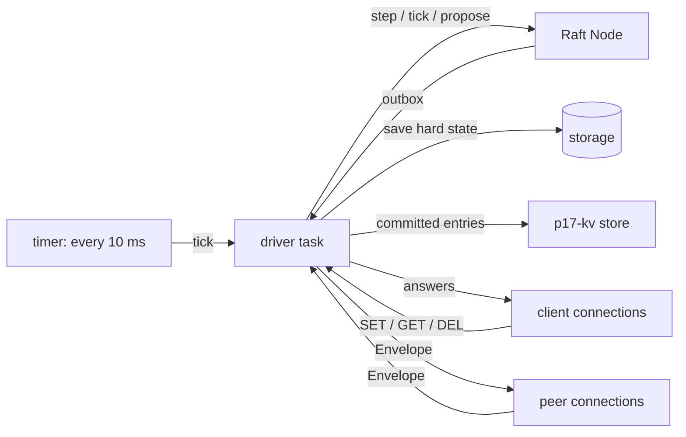

<!-- nav:top -->
[🏠 Start](../START-HERE.md) · [← 18.13 Distributed transactions and sagas](13-distributed-transactions-and-sagas.md) · [📋 Phase 18](README.md) · [18.15 Checkpoint: Stage 4 complete →](15-checkpoint-stage-4-complete.md) · [📖 Glossary](../GLOSSARY.md) · [🇷🇺 Русский](../../ru/18-distributed-systems/14-project-replicated-key-value-store.md) <!-- nav -->

# Lesson 18.14 — Project: a replicated key-value store

> **Phase 18 — Distributed systems** · Lesson 14 of 15 · ⏱ about 20 hours (10 sittings)

## What you will learn

- How to turn the pure Raft core of Lessons 18.10–18.11 into a running service: a tick loop, a network transport and a client protocol.
- How to put your key-value store from Lesson 17.14 behind Raft, so that every node applies the same writes in the same order.
- How to persist Raft's state so that a crashed node comes back with its term, its vote and its log.
- How to answer a client only when its write is committed, and how a client finds the leader.
- How to test the whole cluster in `turmoil` with partitions, delays and crashes, and check that no acknowledged write is ever lost.

## Before you start

- You finished [Lesson 18.13 — Distributed transactions and sagas](13-distributed-transactions-and-sagas.md).
- You have these packages, with all their tests passing:
  - `code/p18-raft` from [Lesson 18.10](10-raft-leader-election.md) and [Lesson 18.11](11-raft-log-replication.md): the Raft core and its simulated `Cluster`;
  - your key-value store from [Lesson 17.14 — Project: your own key-value store](../17-storage-and-databases/14-project-key-value-store.md). This lesson calls its folder `code/p17-kv`; use your real folder name.
- You know length-prefixed framing ([Lesson 15.7](../15-networking/07-designing-a-protocol.md)), Tokio tasks and channels ([Lesson 14.13](../14-concurrency-and-async/13-tokio-tasks-and-channels.md)), `turmoil` ([Lesson 18.12](12-deterministic-simulation-testing.md)), and `fsync` ([Lesson 17.2](../17-storage-and-databases/02-durability-and-fsync.md)).
- Plan time: reading this page takes one or two sittings, the project itself about two weeks. This is the largest project of Stage 4. Work milestone by milestone, commit after each one, and keep every earlier test green.

## New words

| Word | Meaning |
|---|---|
| **driver** | The code around a sans-IO core that does the real work: it calls `tick` on a timer, delivers network messages to `step`, sends the outbox, saves state to disk and applies committed entries. |
| **hard state** | The part of a Raft node that must survive a crash: `term`, `voted_for` and the log. |
| **transport** | The code that moves Raft messages between nodes, here TCP (Transmission Control Protocol) connections carrying length-prefixed frames. |
| **frame** | One message on a byte stream: a 4-byte length, then that many bytes (Lesson 15.7). |
| **redirect** | A follower's answer "I am not the leader; node 2 is", so the client can try the right node. |
| **acknowledged write** | A write for which the client received `OK`. The cluster promises never to lose it. |
| **linearizable read** | A read that returns the value of the latest acknowledged write, as if there were only one copy of the data (Lesson 18.7). |
| **history** | The list of operations a test performed, with their results. A checker reads it afterwards to decide whether the cluster behaved correctly. |

## The project

### What you will build

`p18-kv`: a key-value store replicated by Raft on three nodes. A client can connect to any node and send `SET`, `GET` and `DEL`. The cluster keeps working while one of the three nodes is down or cut off, and no write that was answered with `OK` is ever lost.

```text
             client: SET apples 10
                     |
                     v
 +---------+   AppendEntries   +---------+
 | node 1  | ----------------> | node 2  |
 | leader  | <---------------- |follower |
 |         |   AppendReply     |         |
 | Raft    |                   | Raft    |
 |  core   |      +---------+  |  core   |
 |  |      | ---> | node 3  |  |  |      |
 |  v      |      |follower |  |  v      |
 | p17-kv  |      +---------+  | p17-kv  |
 +---------+                   +---------+
   disk: term, vote, log         disk: term, vote, log
```

Each node is one process (one `turmoil` host in the tests). Inside, one **driver** task owns the Raft `Node` from Lesson 18.11 and does everything around it:



The order inside the driver matters: after every `tick`, `step` or `propose`, the driver **first saves the hard state**, then sends the outbox, then applies newly committed entries and answers waiting clients. Saving before sending is what Raft requires (Lesson 18.9): a node must never send a vote or an acknowledgement that it could forget in a crash.

### Contract

**Package layout.** Create the package next to the others:

```bash
cd ~/projects/rust
cargo new --lib code/p18-kv
cd code/p18-kv
cargo add --path ../p18-raft
cargo add --path ../p17-kv
cargo add tokio@1 --features full
cargo add serde@1 --features derive
cargo add serde_json@1
cargo add --dev turmoil@0.7
mkdir src/bin
```

`cargo add --path` adds a *path dependency*: Cargo builds the other package from its folder, so changes in `p18-raft` are picked up at once.

```text
code/p18-kv/
  Cargo.toml
  README.md
  src/lib.rs        pub mod command; pub mod storage; pub mod transport; pub mod node; pub mod client;
  src/command.rs    Command and its text encoding
  src/storage.rs    trait Storage, MemStorage (tests), FileStorage (real runs)
  src/transport.rs  write_frame / read_frame
  src/node.rs       NodeConfig and run_node
  src/client.rs     Client with set / get / delete
  src/sim.rs        #[cfg(test)] turmoil tests
  src/bin/node.rs   runs one node on your machine
  src/bin/kv.rs     a command-line client
```

**Changes to `p18-raft`** (keep all its old tests passing):

| Change | Why |
|---|---|
| Add `serde` with the `derive` feature; derive `Serialize` and `Deserialize` for `Entry`, `Message` and `Envelope`. | Messages must travel over the network. |
| `pub fn hard_state(&self) -> HardState` and `Node::restore(id, peers, config, seed, state: HardState) -> Node`, where `HardState { term, voted_for, log }`. | The driver saves and reloads what must survive a crash. |
| `pub fn take_committed(&mut self) -> Vec<(u64, Entry)>`: the (index, entry) pairs committed since the last call, in order. Keep `applied` for the old tests, or update them. | The driver, not the core, applies entries to the real store. |
| `pub fn leader_hint(&self) -> Option<NodeId>`: the node this node last heard from as leader of its current term. | Followers redirect clients. |

**Commands.** A log entry's `command: String` holds one of:

| Text | Meaning |
|---|---|
| `SET <id> <key> <value>` | set `key` to `value` (no spaces in key or value) |
| `DEL <id> <key>` | delete `key` |
| `GET <id> <key>` | a read that goes through the log (see the client protocol) |
| (empty) | the no-op entry of Lesson 18.11 |

`<id>` is a request id chosen by the client (for example `c7-42`). It lets the driver find the waiting client when the entry is applied.

**Storage.**

```rust
pub trait Storage {
    fn load(&self) -> HardState;
    fn save(&mut self, state: &HardState);
}
```

`MemStorage` keeps the state in an `Rc<RefCell<HardState>>`; clones share it, so a test can keep one clone outside the `turmoil` host and the "disk" survives `crash` and `bounce`. `FileStorage` writes the state to `<data_dir>/node-<id>.json` with the safe pattern of Lesson 17.2: write a temporary file, `sync_all`, rename it over the old file, sync the directory. (Rewriting the whole log on every save is slow but simple; a stretch goal replaces it with your write-ahead log.)

**Network.** Each node listens on two addresses: one for Raft traffic, one for clients. Raft traffic is a stream of frames, each a 4-byte big-endian length followed by one `Envelope` in JSON (JavaScript Object Notation, the text format for data that `serde_json` reads and writes). In the simulation, hosts are named `n1`, `n2`, `n3`, the Raft port is `7100` and the client port is `7200`. On your machine, node `i` uses `127.0.0.1:710i` and `127.0.0.1:720i`.

**Client protocol** (one request line, one answer line, as in Lesson 18.12):

| Request | Answer |
|---|---|
| `SET <key> <value>` | `OK` once the write is committed and applied |
| `GET <key>` | `VALUE <value>` or `NONE` |
| `DEL <key>` | `OK` |
| any request on a follower | `NOT_LEADER <id>`, or `NOT_LEADER ?` if it knows no leader |
| a request whose entry is not applied within 2 seconds | `ERR timeout` |
| a malformed line | `ERR bad request` |

`GET` is linearizable: the leader appends a `GET` entry to the log and answers when that entry is applied, with the value at that point. (A faster way without a log entry, the *read index*, is a stretch goal.)

**The client library.** `Client::new(nodes: Vec<String>)` takes the client addresses of all nodes. `set`, `get` and `delete` try the last known leader; on `NOT_LEADER <id>` they switch to that node; on a timeout, a connection error or `NOT_LEADER ?` they try the next node after a backoff (Lesson 18.3). After 10 failed attempts they return an error.

**Guarantees the tests check.**

1. *Safety:* a `GET` never returns a value older than the last `SET` or `DEL` of that key that was acknowledged before the `GET` started.
2. *Durability:* after any number of crashes and restarts of single nodes, every acknowledged write is still there.
3. *Availability:* with any two of the three nodes running and connected, writes succeed within a few seconds.
4. *Determinism:* every simulation test takes a seed and prints it in its failure messages.

**Quality gate** (as in every project): `cargo fmt --check`, `cargo clippy --all-targets -- -D warnings` and `cargo test` pass in both `p18-raft` and `p18-kv`; `README.md` explains how to run three nodes and the client; one Git commit per milestone.

### Step-by-step plan

#### M1 — Raft core: serde, hard state and committed entries

**Goal.** Make `p18-raft` ready to be driven from outside.

**Guidance.** Add `serde` to `p18-raft` (`cargo add serde@1 --features derive` inside `code/p18-raft`) and the derives. Add a `HardState` struct (derive `Clone`, `Debug`, `Default`, `PartialEq`, `Serialize`, `Deserialize`). `Node::restore` is `Node::new` plus three assignments; a restored node always starts as a follower, with `commit_index` and `last_applied` at 0: it learns the commit index from the next leader. For `take_committed`, change `apply` so that it also pushes `(index, entry.clone())` into a new `committed: Vec<(u64, Entry)>` field, and return `std::mem::take(&mut self.committed)`. Remember the leader: when a valid `AppendEntries` arrives, store `from` as the leader of this term; clear it when the term changes.

Write two new tests in `p18-raft`: a restored node has the same term, vote and log, and refuses to vote for another candidate in the term it already voted in; and `take_committed` returns each committed entry exactly once, in order.

<details>
<summary>Hint</summary>

The second test is easy with the `Cluster`: propose three commands, tick, call `take_committed()` on every node and compare the commands (skip the empty no-ops); call it again and check that it returns nothing.

</details>

**Done when:**

```bash
cd ~/projects/rust/code/p18-raft
cargo test
cargo clippy --all-targets -- -D warnings
```

All tests of Lessons 18.10 and 18.11 and your two new tests pass, with no warnings. (Example output; your test names may differ.)

```text
test restored_node_keeps_term_vote_and_log ... ok
test committed_entries_are_returned_once_in_order ... ok
test result: ok. 2 passed; 0 failed; 0 ignored; 0 measured; 0 filtered out; finished in 0.00s
```

#### M2 — Commands, storage and the state machine

**Goal.** Everything that does not need a network: parsing commands, saving hard state, applying entries to the 17.14 store.

**Guidance.** In `command.rs`, write `enum Command { Set { id, key, value }, Del { id, key }, Get { id, key }, Noop }` with `fn encode(&self) -> String` and `fn decode(&str) -> Result<Command, String>`. In `storage.rs`, write the trait, `MemStorage` and `FileStorage`. Then a small `StateMachine` that owns your 17.14 store and has `fn apply(&mut self, cmd: &Command) -> String`, returning the answer line (`OK`, `VALUE …`, `NONE`).

Here is a working start for `MemStorage`, so you can see how sharing works:

```rust
use std::cell::RefCell;
use std::rc::Rc;

/// A "disk" for simulation tests. Clones share the same data, so the test
/// can keep one clone outside the host and the data survives `bounce`.
#[derive(Clone, Default)]
pub struct MemStorage(Rc<RefCell<HardState>>);

impl Storage for MemStorage {
    fn load(&self) -> HardState {
        self.0.borrow().clone()
    }
    fn save(&mut self, state: &HardState) {
        *self.0.borrow_mut() = state.clone();
    }
}
```

Tests to write: `decode(encode(c)) == c` for every kind of command (a property test with `proptest` from Lesson 09.4 is a good fit); a malformed line is an error, never a panic; a `FileStorage` saved and loaded again gives the same `HardState` (use a temporary folder under `target/`); applying the same list of commands to two fresh state machines gives the same answers and the same final content.

<details>
<summary>Hint</summary>

Your 17.14 store keeps its own durable files (the data file of Design A, or the WAL, write-ahead log, of Design B). Open it in a separate folder per node (`data/node-1/kv`), or open it in memory-only mode if you built one. The Raft log is now the source of truth: after a restart, the node replays committed entries from the Raft log. The simplest correct start is to rebuild the store from scratch on every start and apply entries as they become committed again. Snapshots (a stretch goal) remove the need to replay everything.

</details>

**Done when:** `cargo test` in `p18-kv` runs your command, storage and state machine tests, all passing, and `cargo clippy --all-targets -- -D warnings` is clean.

#### M3 — One node on the network

**Goal.** `run_node(config: NodeConfig, storage: impl Storage) -> io::Result<()>` runs one node: Raft traffic, the tick timer and the client port. A 3-node simulation elects a leader and serves one write.

**Guidance.** Use the `#[cfg(test)]` switch of Lesson 18.12 between `tokio::net` and `turmoil::net` in `transport.rs` and `node.rs`. One way to structure the node:

- One **driver** task owns the `Node`, the storage, the state machine and a `HashMap<String, oneshot::Sender<String>>` of waiting clients (request id → where to send the answer). It loops over a `tokio::select!` with three branches: a `tokio::time::interval` of 10 ms (call `tick`), an `mpsc` channel of incoming envelopes (call `step`), and an `mpsc` channel of client requests (call `propose`, or answer `NOT_LEADER` at once).
- One task accepts Raft connections and, for each, reads frames and forwards the envelopes to the driver's channel.
- Outgoing messages: keep one connection per peer and reconnect when it breaks. A message that cannot be sent is simply dropped; Raft resends what matters.
- One task accepts client connections; each connection reads a line, sends a request with a fresh `oneshot` to the driver, and waits for the answer with a 2-second `timeout`.

After every `tick`, `step` or `propose`, the driver does, in this order: `storage.save(&node.hard_state())` (only if it changed), send the outbox, then `take_committed()`, apply each entry, and if its request id is in the waiting map, send the answer.

Inside a `turmoil` host, tasks run on a single thread in a `LocalSet`, so use `tokio::task::spawn_local` if your futures are not `Send` (for example because of `MemStorage`'s `Rc`). In `src/bin/node.rs`, run the same code inside `tokio::task::LocalSet::new().run_until(...)`.

Frames are short to write. A working version, built on `serde_json` and Tokio's `write_u32` / `read_u32` (both big-endian):

```rust
use serde::{Serialize, de::DeserializeOwned};
use tokio::io::{AsyncRead, AsyncReadExt, AsyncWrite, AsyncWriteExt};

/// Write one frame: 4-byte big-endian length, then JSON.
pub async fn write_frame<W, T>(w: &mut W, value: &T) -> std::io::Result<()>
where
    W: AsyncWrite + Unpin,
    T: Serialize,
{
    let bytes = serde_json::to_vec(value)?;
    w.write_u32(bytes.len() as u32).await?;
    w.write_all(&bytes).await?;
    Ok(())
}

/// Read one frame written by `write_frame`.
pub async fn read_frame<R, T>(r: &mut R) -> std::io::Result<T>
where
    R: AsyncRead + Unpin,
    T: DeserializeOwned,
{
    let len = r.read_u32().await? as usize;
    if len > 16 * 1024 * 1024 {
        return Err(std::io::Error::other("frame too large"));
    }
    let mut buf = vec![0; len];
    r.read_exact(&mut buf).await?;
    Ok(serde_json::from_slice(&buf)?)
}
```

The size check matters: without it, a broken or hostile peer that sends a length of 4 billion makes the node allocate 4 GB (gigabytes) of memory.

<details>
<summary>Hint</summary>

Write the first simulation test before the client library: three hosts `n1`, `n2`, `n3`, each running `run_node` with its own `MemStorage`, and one client that waits 1 second, then tries `SET apples 10` on each node's client port in turn with the plain `request` function of Lesson 18.12 until one answers `OK`, then sends `GET apples` to the same node. If no node ever becomes leader, print every node's role and term from the driver with `println!` (it shows up with `--nocapture`).

</details>

**Done when:**

```bash
cargo test sim::three_nodes_elect_a_leader_and_serve_a_write -- --nocapture
```

passes, and the leader's node answers `OK` and then `VALUE 10`. (Example output; your test name and log lines may differ.)

```text
test sim::three_nodes_elect_a_leader_and_serve_a_write ... ok
```

#### M4 — Leaders, redirects and the client library

**Goal.** Followers redirect, writes are acknowledged only after they are applied, and `Client` hides all of this.

**Guidance.** On a follower, answer `NOT_LEADER <id>` from `leader_hint()` without proposing. On the leader, `propose` returns the log index; remember the request id. One subtle case: a leader may lose its leadership after `propose` and before the entry commits; a later leader may overwrite the entry (Lesson 18.11, the `lost` write). The waiting client then never gets an answer from the apply path; the 2-second timeout answers `ERR timeout`, and the client library retries on another node. A write that timed out may or may not have happened. `SET` and `DEL` are idempotent, so retrying them is safe.

Write `Client` as described in the contract and use it in all further tests.

<details>
<summary>Hint</summary>

When a node steps down from leader, it can answer all its waiting clients with `NOT_LEADER <id>` at once, instead of letting them wait for the timeout. Check `node.role` after every `step` and compare it with the role before.

</details>

**Done when:** these simulation tests pass (write them; one seed each, printed in the messages):

```text
test sim::a_follower_redirects_the_client ... ok
test sim::the_client_finds_the_leader_from_any_node ... ok
test sim::a_new_leader_serves_after_the_leader_crashes ... ok
```

The third one: write 10 keys, `sim.crash` the leader, write 10 more keys through `Client` (they succeed with the two remaining nodes), `sim.bounce` the old leader, wait, and read all 20 keys back from **each** node in turn by sending `GET` while that node is the leader, or simply through `Client`.

#### M5 — Durability across crashes

**Goal.** A node that crashes and restarts keeps its hard state, and the cluster never loses an acknowledged write, even when **all** nodes restart.

**Guidance.** In the test, create the three `MemStorage` values **outside** the hosts and move a clone into each host closure, so that `bounce` restarts `run_node` with the same "disk". `run_node` calls `storage.load()` and `Node::restore` at start. Then write the test that would have caught the bug of Lesson 18.12: acknowledge writes, crash all three nodes, restart them, and read everything back.

<details>
<summary>Hint</summary>

The host closure in `turmoil` is `Fn`, called again on every `bounce`. Inside it, clone the storage before moving it into the `async` block: `let disk = disk.clone(); move || { let disk = disk.clone(); async move { run_node(config.clone(), disk).await?; Ok(()) } }`.

</details>

**Done when:**

```text
test sim::a_restarted_node_keeps_its_term_vote_and_log ... ok
test sim::acknowledged_writes_survive_a_full_cluster_restart ... ok
```

Then break it on purpose: make the driver send the outbox **before** saving. Can you find a seed where the full-restart test fails? Write down what you found in the README (even "not found in 200 seeds" is a useful result, and a reason to try harder in M6).

#### M6 — Chaos and a history checker

**Goal.** Many seeds, random partitions, random delays, random crashes, and an automatic check of the guarantees.

**Guidance.** Write one test function that takes a seed and:

1. builds a `turmoil` sim with `rng_seed(seed)`, latencies between 1 and 50 ms, and `simulation_duration` of 60 seconds;
2. runs three clients, each doing 30 random operations on 5 keys (`SET` with a unique value such as `c2-17`, `GET`, `DEL`), and records a **history**: for every operation its start time, end time (`turmoil::elapsed()`), the request and the answer;
3. from the step loop, every few hundred milliseconds chooses (with its own seeded generator) to partition one node, repair it, crash one node, or bounce a crashed one, but never takes down more than one node at a time;
4. at the end, repairs everything and checks the history.

The checker for guarantee 1 can be simple and still useful: for each `GET` that returned a value `v`, there must be a `SET` of `v` that **started** before the `GET` ended, and no other acknowledged write of that key may have **ended** after that `SET` ended and before the `GET` started. (A full linearizability checker is a stretch goal.) Run 100 seeds in the normal suite and 1,000 with `--release` before you call the project done.

<details>
<summary>Hint</summary>

Put the history in an `Rc<RefCell<Vec<Op>>>` shared by the clients, as `count_visits` in Lesson 18.12 shared its result. Start with a much weaker checker: "every value returned by `GET` was written by some `SET`". When that passes, add the time rules one by one. When a seed fails, rerun only that seed with `--nocapture` and print the history around the failing key.

</details>

**Done when:**

```bash
cargo test --release sim::chaos -- --nocapture
```

passes for 1,000 seeds (it may take minutes in release mode), and `cargo test` (100 seeds) passes in the normal build. Then run three real nodes on your machine, in three terminals, and use the client from a fourth (example output; yours will look similar):

```bash
cargo run --bin node -- --id 1 --data data
cargo run --bin node -- --id 2 --data data
cargo run --bin node -- --id 3 --data data
cargo run --bin kv -- set apples 10
cargo run --bin kv -- get apples
```

```text
OK
VALUE 10
```

Stop the leader with Ctrl+C, run `cargo run --bin kv -- get apples` again (it should still print `VALUE 10`), start the stopped node again, and check that it catches up.

### Stretch goals

- **Write-ahead log storage.** Replace `FileStorage`'s full rewrite with an append-only log of entries plus a small file for `term` and `voted_for`, built on your WAL from Lesson 17.4. Handle truncation (a follower's conflicting entries) with a "truncate to index" record.
- **Snapshots.** When the log is longer than 1,000 entries, save a snapshot of the store and drop the old entries; add `InstallSnapshot` for followers that are too far behind.
- **Read index.** Serve `GET` without a log entry: the leader records its commit index, confirms with one round of heartbeats that it is still the leader, waits until that index is applied, then reads.
- **Pre-Vote.** Implement the fix for the disruptive server of Lesson 18.10's last exercise, and write a simulation test that shows the difference.
- **Model check the core.** Describe the election rules as a `stateright` model (`stateright` 0.31) and check "at most one leader per term" for 3 nodes and 3 terms.
- **Membership changes.** Add and remove nodes one at a time (Ongaro's thesis, chapter 4).
- **Metrics.** Export the term, the role, the commit index and the replication lag per follower as Prometheus metrics (Lesson 16.12).

## Common mistakes

> ⚠️ **Common mistake:** answering `OK` when the leader appended the entry, not when it was applied. The leader may lose its leadership a moment later, and the entry may be replaced (Lesson 18.11). Answer only from the apply path.

> ⚠️ **Common mistake:** sending messages before saving the hard state. A node that votes, crashes before the vote is on disk, restarts and votes again for someone else breaks "one vote per term", and two leaders can be elected in one term.

> ⚠️ **Common mistake:** applying committed entries to the 17.14 store **and** letting the store keep its own durable state across restarts, without care. After a restart the node replays committed entries from the Raft log, and they are applied a second time. Either rebuild the store from the log, or remember the last applied index together with the store's data.

> ⚠️ **Common mistake:** real time or real randomness inside the node (`SystemTime::now()`, `rand::rng()`). The simulation is then no longer deterministic, and a failing seed does not fail again. Pass a seed into `Node::new` and use `tokio::time` only.

## Quiz

1. In which order does the driver save, send and apply after each `step`, and why?

<details>
<summary>Answer</summary>

Save the hard state, then send the outbox, then apply committed entries and answer clients. Saving first guarantees that the node never sends a vote or an acknowledgement it could forget in a crash.

</details>

2. Why does `GET` go through the log in this project?

<details>
<summary>Answer</summary>

To be linearizable. A leader that answers from its local store might no longer be the leader (a newer leader may have committed writes it has not seen). Putting the read into the log orders it after every write committed before it.

</details>

3. A client got `ERR timeout` for `SET apples 10`. Did the write happen?

<details>
<summary>Answer</summary>

It may or may not have happened: the entry may be committed later, or replaced by a new leader. The client retries; this is safe because `SET` is idempotent.

</details>

4. Why does the test keep a `MemStorage` clone outside the `turmoil` host?

<details>
<summary>Answer</summary>

`bounce` restarts the host's program with empty memory. A clone kept by the test shares the same `Rc<RefCell<HardState>>`, so the restarted node can `load` what it saved before the crash, like a real disk.

</details>

5. What does the M6 checker accept as a correct `GET` result?

<details>
<summary>Answer</summary>

A value written by a `SET` that started before the `GET` ended, provided no other acknowledged write of that key ended after that `SET` and before the `GET` started.

</details>

## Summary

- A sans-IO Raft core becomes a service through a driver that ticks, steps, saves, sends and applies, in that order.
- The 17.14 store is the state machine: only committed entries reach it, in log order, on every node.
- Hard state (`term`, `voted_for`, log) must be saved before any message leaves the node; a `MemStorage` shared with the test makes crashes testable.
- Clients are answered only after their entry is applied; followers redirect; timeouts mean "unknown", so writes must be idempotent.
- `turmoil` tests with partitions, delays and crashes, plus a history checker over many seeds, give strong evidence that no acknowledged write is lost.

## Sources and further reading

- [In Search of an Understandable Consensus Algorithm (the Raft paper)](https://raft.github.io/raft.pdf) — Figure 2 is your checklist; section 8 covers client interaction and linearizable reads.
- [Consensus: Bridging Theory and Practice (Ongaro's PhD thesis)](https://web.stanford.edu/~ouster/cgi-bin/papers/OngaroPhD.pdf) — chapter 6 (client interaction, read index), chapter 5 (snapshots), chapter 4 (membership changes).
- [turmoil documentation](https://docs.rs/turmoil) — `Sim::crash`, `Sim::bounce`, `partition`, `repair` and the builder settings used in M5 and M6.
- [Jepsen: etcd 3.4.3](https://jepsen.io/analyses/etcd-3.4.3) — a real analysis of a Raft-based key-value store under partitions, with the kind of history checking you build in M6.
- [Stateright](https://www.stateright.rs/) — for the model-checking stretch goal; its examples include a linearizable register.
- [MIT 6.5840 Distributed Systems](https://pdos.csail.mit.edu/6.824/) — its Raft and key-value labs follow the same plan as this project.

---

[🏠 Start](../START-HERE.md) · [← 18.13 Distributed transactions and sagas](13-distributed-transactions-and-sagas.md) · [📋 Phase 18](README.md) · [18.15 Checkpoint: Stage 4 complete →](15-checkpoint-stage-4-complete.md) · [📖 Glossary](../GLOSSARY.md) <!-- nav -->
<!-- nav:bottom -->
