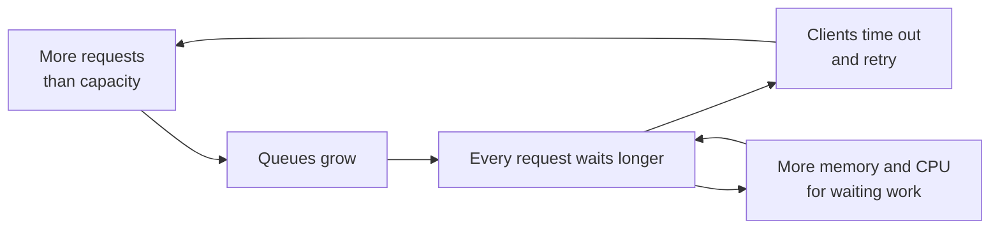

<!-- nav:top -->
[🏠 Start](../START-HERE.md) · [← 20.7 Supply-chain security in depth](07-supply-chain-security-in-depth.md) · [📋 Phase 20](README.md) · [20.9 The production-readiness checklist →](09-production-readiness-checklist.md) · [📖 Glossary](../GLOSSARY.md) · [🇷🇺 Русский](../../ru/20-reliability-and-hardening/08-overload-limits-and-backpressure.md) <!-- nav -->

# Lesson 20.8 — Overload, limits and backpressure

> **Phase 20 — Reliability and hardening** · Lesson 8 of 11 · ⏱ about 120 minutes

## What you will learn

- Why a service that gets more work than it can do becomes slow for **everybody**, and how to calculate it (Little's law).
- The three things a full queue can do: grow, make the sender wait (backpressure) or refuse (load shedding).
- How to give an axum service a concurrency limit, load shedding and a timeout with tower layers, and how to see the difference under load.
- How a token bucket limits each client, and when to answer `429` instead of `503`.
- Why limits and timeouts are also needed on the calling side, and why retries can make overload worse.

## Before you start

- You finished [Lesson 20.7 — Supply-chain security in depth](07-supply-chain-security-in-depth.md).
- You know axum middleware and tower layers ([Lesson 16.4 — Errors, validation and middleware](../16-backend-services/04-errors-validation-and-middleware.md)), Tokio channels ([Lesson 14.13](../14-concurrency-and-async/13-tokio-tasks-and-channels.md)), timeouts and the paused clock in tests ([Lesson 14.14](../14-concurrency-and-async/14-cancellation-timeouts-and-graceful-shutdown.md)), percentiles and the load tester `oha` ([Lesson 19.1](../19-performance-and-profiling/01-latency-throughput-and-percentiles.md) and [Lesson 19.2](../19-performance-and-profiling/02-load-testing.md)), and retries ([Lesson 18.3](../18-distributed-systems/03-retries-backoff-and-idempotency.md)).
- If `oha` is not installed: `cargo install --locked oha`.
- Create the package for this lesson:

```bash
cd ~/projects/rust
cargo new --lib code/p20-overload
cd code/p20-overload
mkdir src/bin
cargo add tokio@1 --features full
cargo add axum@0.8
cargo add tower@0.5 --features limit,load-shed,timeout,util
cargo add --dev tokio@1 --features test-util
```

## New words

| Word | Meaning |
|---|---|
| **overload** | More work arrives than the system can finish in the same time. |
| **capacity** | The most work a system can finish per second, for example 100 requests per second. |
| **in flight** | Started but not finished yet: a request that is being handled or waits in a queue. |
| **Little's law** | A simple rule for any stable queue: *in flight = arrival rate × time in the system*. |
| **bounded queue** | A queue with a maximum size. An **unbounded** queue has none and grows until memory runs out. |
| **backpressure** | Making the sender slow down by letting it wait when the receiver is full. |
| **load shedding** | Refusing extra work at once, with a cheap error, so that the accepted work stays fast. |
| **concurrency limit** | The most requests that may be handled at the same time. |
| **rate limit** | The most requests that one client may send per time unit, for example 10 per second. |
| **token bucket** | A rate-limit algorithm: a bucket holds tokens, every request takes one, new tokens drip in at a fixed rate. |
| **goodput** | The part of the throughput that is useful: answers that arrive in time and are correct. |
| **retry storm** | Many clients retry failed requests at the same time and multiply the load on a service that is already overloaded. |
| **circuit breaker** | A guard on the calling side: after many failures it stops calling the other service for a while and fails fast instead. |

## 1. Every service is a queue

A service is like a shop with a few cashiers. Customers arrive, wait in a line, get served, leave. As long as customers arrive more slowly than the cashiers can serve them, the line stays short. When they arrive faster, the line grows **without end**, and every new customer waits longer than the one before.

**Little's law** connects the numbers. For any system that is not growing:

```text
in flight  =  arrival rate  ×  time in the system
   L       =      λ         ×        W
```

Suppose your service gets 200 requests per second, and each takes 50 ms (0.05 s). On average 200 × 0.05 = **10** requests are in flight. Now the database becomes slow, and each request takes 2 s. With the same 200 requests per second, 200 × 2 = **400** requests are in flight: 40 times more open connections, more memory, more tasks.

| Arrival rate | Time per request | In flight |
|---|---|---|
| 200 / s | 0.05 s | 10 |
| 200 / s | 0.5 s | 100 |
| 200 / s | 2 s | 400 |

And it gets worse: more work in flight means more competition for the CPU (Central Processing Unit), memory and database connections, so each request becomes even slower. Clients time out and retry, so the arrival rate grows. This loop is how a service that is "a bit slow" becomes a service that answers **nobody**:



The cure is always the same: **decide in advance how much work you accept**, and do something deliberate with the rest.

## 2. Bounded queues: wait or refuse

Inside a program, the queues are channels. An unbounded channel (`mpsc::unbounded_channel`) never says no: under overload it grows until the process runs out of memory. A **bounded** channel has a size, and when it is full, the sender must choose. Create `src/bin/queue.rs`:

```rust
use std::time::Duration;
use tokio::sync::mpsc::{self, error::TrySendError};
use tokio::time::timeout;

/// Choice 2, wait: `send().await` waits for free room, but at most 50 ms.
async fn send_waiting(tx: &mpsc::Sender<u32>, job: u32) {
    match timeout(Duration::from_millis(50), tx.send(job)).await {
        Ok(Ok(())) => println!("job {job}: queued"),
        Ok(Err(_)) => println!("job {job}: the worker is gone"),
        Err(_) => println!("job {job}: waited 50 ms, still no room, giving up"),
    }
}

#[tokio::main]
async fn main() {
    // A queue with room for 3 jobs. Nobody takes jobs out yet: the worker is busy.
    let (tx, mut rx) = mpsc::channel::<u32>(3);

    // Choice 1, reject: `try_send` never waits.
    for job in 1..=5 {
        match tx.try_send(job) {
            Ok(()) => println!("job {job}: queued"),
            Err(TrySendError::Full(job)) => println!("job {job}: rejected, the queue is full"),
            Err(TrySendError::Closed(_)) => println!("job {job}: the worker is gone"),
        }
    }

    send_waiting(&tx, 6).await;

    // The worker takes one job, so there is room again.
    let first = rx.recv().await.unwrap();
    println!("worker: took job {first}");
    send_waiting(&tx, 7).await;

    let waiting = tx.max_capacity() - tx.capacity();
    println!("jobs in the queue: {waiting} of {}", tx.max_capacity());
}
```

`cargo run --bin queue`:

```text
job 1: queued
job 2: queued
job 3: queued
job 4: rejected, the queue is full
job 5: rejected, the queue is full
job 6: waited 50 ms, still no room, giving up
worker: took job 1
job 7: queued
jobs in the queue: 3 of 3
```

**What happens:**

1. `mpsc::channel(3)` makes a queue with room for three jobs. The worker (here: the receiver `rx`) does not take anything yet, like a busy worker.
2. **Refuse:** `try_send` puts the job in if there is room and returns `Err(TrySendError::Full(job))` at once if not. Jobs 4 and 5 are refused, and the error gives the job back, so the caller can answer "busy, try later".
3. **Wait:** `send(job).await` waits until there is room. This is **backpressure**: the fast sender is slowed down to the speed of the receiver. Waiting without limit would only move the queue somewhere else, so `timeout` gives up after 50 ms (job 6).
4. After the worker takes job 1, there is room and job 7 goes in without waiting.
5. `capacity()` is the free room now, `max_capacity()` the size of the queue; the difference is the number of jobs waiting.

Which choice is right? **Wait** when the sender is a part of your own program that can slow down (a file reader feeding a parser). **Refuse** when the sender is a user or another service that will not stop sending: waiting would only fill memory with requests whose clients gave up long ago.

> ⚠️ **Common mistake:** "I use an unbounded channel, so it can never be full." That is exactly the problem: it hides overload until the process is killed for using too much memory. Choose a size and decide what happens when it is reached.

## 3. Limits for a whole service

An HTTP (HyperText Transfer Protocol) service has a hidden queue too: every accepted connection with a request in it. Tower has ready-made layers to control it:

| Layer | What it does |
|---|---|
| `ConcurrencyLimitLayer` (`.concurrency_limit(n)`) | At most `n` requests run inside at the same time; the others wait for a free slot. |
| `LoadShedLayer` (`.load_shed()`) | If the service below is not ready (all slots taken), fail **at once** with an `Overloaded` error instead of waiting. |
| `TimeoutLayer` (`.timeout(d)`) | Fail with `Elapsed` if the inner service takes longer than `d`. |

The layers return errors, and an axum router needs a response for every request, so `HandleErrorLayer` turns each error into a response. Put the service into `src/lib.rs`:

```rust
//! Limits that protect a service from overload.

use std::time::Duration;

use axum::error_handling::HandleErrorLayer;
use axum::http::{StatusCode, header};
use axum::response::IntoResponse;
use axum::routing::get;
use axum::{BoxError, Router};
use tower::ServiceBuilder;

/// Pretends to do 100 ms of real work, for example a database query.
async fn work() -> &'static str {
    tokio::time::sleep(Duration::from_millis(100)).await;
    "done\n"
}

/// Turns the errors of the tower layers into HTTP responses.
async fn overloaded(err: BoxError) -> impl IntoResponse {
    let (status, text) = if err.is::<tower::load_shed::error::Overloaded>() {
        (StatusCode::SERVICE_UNAVAILABLE, "overloaded, try again later\n")
    } else if err.is::<tower::timeout::error::Elapsed>() {
        (StatusCode::SERVICE_UNAVAILABLE, "took too long\n")
    } else {
        (StatusCode::INTERNAL_SERVER_ERROR, "unexpected error\n")
    };
    (status, [(header::RETRY_AFTER, "1")], text)
}

/// The router. With `shed = false`, extra requests wait in a queue;
/// with `shed = true`, they are refused at once.
pub fn app(shed: bool, max_in_flight: usize) -> Router {
    let limits = ServiceBuilder::new()
        .layer(HandleErrorLayer::new(overloaded))
        .option_layer(shed.then(tower::load_shed::LoadShedLayer::new))
        .concurrency_limit(max_in_flight)
        .timeout(Duration::from_secs(1));
    Router::new()
        .route("/work", get(work))
        .layer(limits)
        .with_state(()) // build the layers once, not once per request
}
```

And a small `src/bin/server.rs`:

```rust
#[tokio::main]
async fn main() {
    let shed = std::env::args().nth(1).as_deref() == Some("shed");
    let listener = tokio::net::TcpListener::bind("127.0.0.1:3000")
        .await
        .unwrap();
    println!("listening on http://127.0.0.1:3000, load shedding: {shed}");
    axum::serve(listener, p20_overload::app(shed, 10))
        .await
        .unwrap();
}
```

**What happens:**

1. `ServiceBuilder` stacks layers; the **first** one written is the **outermost**. A request passes `HandleErrorLayer`, then (if `shed`) `LoadShedLayer`, then the concurrency limit, then the timeout, then the router's handler.
2. `.option_layer(shed.then(…))` adds the load-shedding layer only when `shed` is true (`bool::then` gives `Some(layer)` or `None`), so one program can show both behaviours.
3. With 10 slots and 100 ms per request, the **capacity** is about 10 / 0.1 s = 100 requests per second.
4. `overloaded` uses `err.is::<T>()` to find out which layer failed. Both overload and timeout answer `503 Service Unavailable` with a `Retry-After: 1` header: "the problem is on our side, try again in one second".
5. `.with_state(())` at the end matters. Without it, axum builds the handler's layers **for every request** again, so every request gets a fresh, empty concurrency limit and the limit does nothing (see Common mistakes).

Build and start the shedding version: `cargo build --release --bin server`, then `./target/release/server shed`. In a second terminal, send 20 requests at the same time and count the status codes:

```bash
for i in $(seq 1 20); do curl -s -o /dev/null -w "%{http_code}\n" http://127.0.0.1:3000/work & done | sort | uniq -c
```

```text
  10 200
  10 503
```

Ten requests got a slot, ten were refused in well under a millisecond. One refused response in full (`curl -si` while ten others are running):

```text
HTTP/1.1 503 Service Unavailable
content-type: text/plain; charset=utf-8
retry-after: 1
content-length: 28
date: Wed, 18 Nov 2026 08:04:17 GMT

overloaded, try again later
```

**Now the real test: steady overload.** Send 200 requests per second, twice the capacity, for 5 seconds, first to `./target/release/server` (queue), then to `./target/release/server shed`. `-q 200` sets the arrival rate and `-c 1000` allows up to 1,000 open connections, like many independent users:

```bash
oha -z 5s -c 1000 -q 200 --no-tui http://127.0.0.1:3000/work
```

The important lines of the two runs (shortened):

```text
=== queue
  Slowest:	2.5750 sec
  Average:	1.3311 sec
  50.00% in 1.3325 sec
  99.00% in 2.5647 sec
  [200] 489 responses
  [516] aborted due to deadline

=== shed
  Slowest:	133.7649 ms
  Average:	49.1239 ms
  50.00% in 2.6124 ms
  99.00% in 112.0734 ms
  [503] 520 responses
  [200] 472 responses
  [14] aborted due to deadline
```

**What happens:**

1. Both versions finish about 480 requests in 5 seconds: the capacity (100 per second) is the same. Limits do not make the service faster.
2. **Queue:** every extra request waits for a slot. The waiting line grows by about 100 requests every second, so the latency grows the whole time: the median is 1.3 s, the slowest 2.6 s, and 516 requests were still waiting when the test ended ("aborted due to deadline"). In a real service this continues until clients give up, and then their retries arrive on top.
3. **Shed:** extra requests get a `503` in about a millisecond. The accepted ones still take about 100 ms (the 75th to 99th percentiles are 101–112 ms). The low median comes from the fast `503` answers. Half of the users got a fast "yes", half a fast "no, try later": much better than everybody getting a slow "yes" that arrives after they have given up. That is **goodput**.

> ⚡ **Performance:** shedding must be **cheap**. A refused request should cost almost nothing: no database query, no big allocation, no log line per request (count them in a metric instead). If refusing is expensive, overload still kills the service.

> 🧪 **Testing:** a limit that was never tested probably does not work. Exercise 3 tests the shedding with two requests and a paused clock, without a network.

## 4. Rate limits for each client

A concurrency limit protects the **service**. It does not stop one greedy client from using all ten slots while everybody else gets `503`. A **rate limit** gives each client its own budget.

The usual algorithm is a **token bucket**. Picture a bucket that holds at most `capacity` tokens. Every request takes one token. New tokens drip in at `per_second`, but the bucket never holds more than `capacity`. So a client can send a short burst of `capacity` requests, and after that at most `per_second` requests per second.

```text
capacity 3, 1 token per second

time 0.0 s   [● ● ●]   3 requests → all allowed   [     ]
time 0.0 s   [     ]   4th request → refused (429)
time 1.0 s   [●    ]   1 token dripped in → 1 request allowed
```

Add it to `src/lib.rs`. Change the first `use` line to `use std::time::{Duration, Instant};` and append:

```rust
/// A token bucket: holds at most `capacity` tokens and gets `per_second` new ones every second.
/// Every request takes one token; with no token left, the request is refused.
pub struct TokenBucket {
    capacity: f64,
    per_second: f64,
    tokens: f64,
    last: Instant,
}

impl TokenBucket {
    /// A full bucket.
    pub fn new(capacity: u32, per_second: f64, now: Instant) -> Self {
        let capacity = f64::from(capacity);
        TokenBucket {
            capacity,
            per_second,
            tokens: capacity,
            last: now,
        }
    }

    /// Takes one token if there is one. `now` is passed in, so tests control the time.
    pub fn try_take(&mut self, now: Instant) -> bool {
        let elapsed = now.saturating_duration_since(self.last).as_secs_f64();
        self.tokens = (self.tokens + elapsed * self.per_second).min(self.capacity);
        self.last = now;
        if self.tokens >= 1.0 {
            self.tokens -= 1.0;
            true
        } else {
            false
        }
    }
}

#[cfg(test)]
mod tests {
    use super::*;

    #[test]
    fn allows_a_burst_up_to_the_capacity() {
        let t0 = Instant::now();
        let mut bucket = TokenBucket::new(3, 1.0, t0);
        let results: Vec<bool> = (0..4).map(|_| bucket.try_take(t0)).collect();
        assert_eq!(results, [true, true, true, false]);
    }

    #[test]
    fn refills_over_time() {
        let t0 = Instant::now();
        let mut bucket = TokenBucket::new(1, 2.0, t0); // 2 tokens per second
        assert!(bucket.try_take(t0));
        assert!(!bucket.try_take(t0 + Duration::from_millis(100))); // only 0.2 tokens
        assert!(bucket.try_take(t0 + Duration::from_millis(500))); // 1.0 token again
    }
}
```

`cargo test --lib`:

```text
test result: ok. 2 passed; 0 failed; 0 ignored; 0 measured; 0 filtered out; finished in 0.00s
```

**What happens:**

1. The bucket does not need a timer. On every call it computes how many tokens dripped in since the last call (`elapsed × per_second`), adds them, and caps the result at `capacity` with `.min(...)`.
2. `saturating_duration_since` returns zero instead of panicking if `now` is earlier than `last`.
3. Tokens are `f64`, so 100 ms at 2 tokens per second correctly gives 0.2 of a token, not zero.
4. The caller passes `now`. In production that is `Instant::now()`; in tests it is `t0 + Duration::from_millis(…)`, so the tests are exact and take no real time.

**Which status code?** A client that is over **its own** limit gets `429 Too Many Requests` ("you are sending too much"). A service that is overloaded **as a whole** answers `503 Service Unavailable` ("we have a problem"). Both should carry `Retry-After`, so well-behaved clients know when to come back.

> 💡 **Tip:** for production you do not have to write the bucket yourself: the `governor` crate implements the same idea (a variant called GCRA, the Generic Cell Rate Algorithm) without locks, with ready-made per-key limiters. A bucket in one process only limits that process; with several copies of the service behind a load balancer, keep the counters in a shared store such as Redis ([Lesson 16.10](../16-backend-services/10-caching-with-redis.md) built a fixed-window limiter there).

> 🔒 **Security:** rate limits are also a defence against password guessing and scraping. Choose the key carefully: per IP (Internet Protocol) address is simple, but many users can share one address, and one attacker can have many. Per API (Application Programming Interface) key or per account is fairer when clients log in.

## 5. Limits everywhere, also when you call others

Overload protection is not only about requests coming **in**. Check every place where work can pile up:

| Place | Limit |
|---|---|
| Request bodies | A maximum size (`RequestBodyLimitLayer`, Lesson 16.4): a 2 GB (gigabyte) upload must not be read into memory. |
| Connections | A maximum number of open connections, and time limits for slow clients that send one byte per second. |
| Internal queues | Bounded channels, as in Section 2. |
| Database | A pool with a fixed size (Lesson 16.6) and a timeout for getting a connection from it. |
| Calls to other services | A timeout on **every** call (Lesson 18.2). A call without a timeout can hang forever and hold a slot forever. |

**Retries multiply load.** A client that retries three times sends up to four requests for one user action. When a service is overloaded and **all** clients retry, its load jumps to four times the normal amount at the worst possible moment: a **retry storm**. The defences from Lesson 18.3 (exponential backoff with jitter, retry only idempotent requests) and two more:

- **A retry budget:** retries may be at most, say, 10 % of all requests. When more are failing, the client stops retrying, because the problem is clearly not a random one.
- **A circuit breaker:** after many failures in a row, the client stops calling for a while (the circuit is "open") and fails at once; later it lets one test request through ("half-open"), and if that works, it calls normally again ("closed"). The overloaded service gets time to recover.

> 📏 **Convention:** a timeout on the caller should be **longer** than the time the callee needs in the good case, and the callee's own deadline should be **shorter** than the caller's. Otherwise the callee keeps working on answers that nobody will read.

## Common mistakes

**1. A layer that is built again for every request.** Without `.with_state(())` at the end of `app`, the same `oha` test as above, with 50 connections, showed about 490 requests per second, all of them `200`, with 100 ms latency: five times the "capacity". The concurrency limit was not working at all, because every request had its own new limit with ten free slots. Exercise 3's test catches this mistake: without `.with_state(())` it fails with `left: [200, 200]`.

**2. The timeout inside the limit.** In our `ServiceBuilder` the timeout is **below** the concurrency limit, so it does not count the time spent waiting for a slot; that is why the queue version had requests that waited 2.6 s although the timeout is 1 s. If waiting must count, put a timeout **above** the limit as well.

**3. Shedding with an expensive error path.** Logging every refused request, or building a large error page, can cost more than the work itself.

**4. Limits only in front of the service.** Requests are limited, but each one calls another service without a timeout, so slots are held forever when that service hangs.

**5. Clients that retry at once and forever.** Every overload becomes a retry storm. Back off, add jitter, set a budget.

## Try it yourself

1. Start `./target/release/server` (the queue version) and run the `oha` command for 15 seconds instead of 5 (`-z 15s`). How slow is the slowest answer now? It keeps growing as long as the overload lasts.
2. Run the shedding version with `-q 80` (below the capacity). Do you see any `503`? A limit should not hurt when there is no overload.
3. Change `max_in_flight` from 10 to 20 in `server.rs`, rebuild, and repeat the 200-per-second test. How many requests per second succeed now?

## Exercises

### Exercise 1 — Little's law (easy)

A service gets 300 requests per second, and each takes 40 ms. (a) How many requests are in flight on average? (b) A dependency becomes slow and each request now takes 400 ms. How many are in flight now? (c) The service has a concurrency limit of 50. What is its capacity in case (b), and what happens to the other requests?

<details>
<summary>Hint</summary>

In flight = arrival rate × time. Capacity = slots ÷ time per request.

</details>

<details>
<summary>Answer</summary>

(a) 300 × 0.04 = **12**. (b) 300 × 0.4 = **120**. (c) Capacity = 50 ÷ 0.4 s = **125 requests per second**. About 300 − 125 = 175 requests per second cannot be served: without load shedding they wait and the queue grows by 175 every second; with load shedding they get a fast `503`.

Why it works: Little's law holds for any stable system, so it is a quick way to size limits, pools and queues. Notice that the limit of 50 was more than enough in case (a) and far too small in case (b): a slow dependency reduces your capacity.

</details>

### Exercise 2 — One bucket per client (medium)

Write a `RateLimiter` in `src/lib.rs` that keeps one `TokenBucket` per client name (`String`) and has a method `allow(&mut self, client: &str, now: Instant) -> bool`. Write a test that shows that two clients have separate budgets.

<details>
<summary>Hint</summary>

Store `capacity`, `per_second` and a `HashMap<String, TokenBucket>`. `entry(client.to_string()).or_insert_with(|| TokenBucket::new(…))` creates a full bucket the first time a client is seen.

</details>

<details>
<summary>Answer</summary>

```rust
/// One token bucket per client, for example per IP address or per API key.
pub struct RateLimiter {
    capacity: u32,
    per_second: f64,
    buckets: std::collections::HashMap<String, TokenBucket>,
}

impl RateLimiter {
    pub fn new(capacity: u32, per_second: f64) -> Self {
        RateLimiter {
            capacity,
            per_second,
            buckets: std::collections::HashMap::new(),
        }
    }

    /// Is this client allowed one more request now?
    pub fn allow(&mut self, client: &str, now: Instant) -> bool {
        self.buckets
            .entry(client.to_string())
            .or_insert_with(|| TokenBucket::new(self.capacity, self.per_second, now))
            .try_take(now)
    }
}

#[cfg(test)]
mod rate_limiter_tests {
    use super::*;

    #[test]
    fn clients_have_separate_budgets() {
        let now = Instant::now();
        let mut limiter = RateLimiter::new(2, 1.0);
        assert!(limiter.allow("alice", now));
        assert!(limiter.allow("alice", now));
        assert!(!limiter.allow("alice", now)); // alice used her two tokens
        assert!(limiter.allow("bob", now)); // bob has his own bucket
    }
}
```

`cargo test --lib` now shows `3 passed`.

Why it works: each client name maps to its own bucket. The closure in `or_insert_with` may read `self.capacity` while `self.buckets` is borrowed, because a closure borrows only the fields it uses. One problem remains for production: the map grows with every new client, and an attacker with many addresses can fill your memory. Real limiters remove buckets that have been full (unused) for a while.

</details>

### Exercise 3 — Test the shedding (hard)

Write an integration test `tests/limits.rs` that builds `app(true, 1)` (load shedding, one slot), sends two requests **at the same time** without a network, and checks that one gets `200` and the other `503`. Use the paused clock, so the test takes no real time. Then remove `.with_state(())` from `app` and run the test again.

<details>
<summary>Hint</summary>

`tower::ServiceExt::oneshot` sends one request to a clone of the router (Lesson 16.3). `tokio::join!` runs two futures at the same time. `#[tokio::test(start_paused = true)]` needs the `test-util` feature, which you added as a dev-dependency. Sort the two status codes before you compare them, because you do not know which request wins.

</details>

<details>
<summary>Answer</summary>

```rust
use axum::body::Body;
use axum::http::{Request, StatusCode};
use tower::ServiceExt;

#[tokio::test(start_paused = true)]
async fn a_second_request_is_shed_while_the_first_runs() {
    let app = p20_overload::app(true, 1);
    let request = || Request::get("/work").body(Body::empty()).unwrap();

    let (first, second) = tokio::join!(
        app.clone().oneshot(request()),
        app.clone().oneshot(request()),
    );

    let mut codes = [first.unwrap().status(), second.unwrap().status()];
    codes.sort();
    assert_eq!(codes, [StatusCode::OK, StatusCode::SERVICE_UNAVAILABLE]);
}
```

`cargo test --test limits` passes in `0.00s`. Without `.with_state(())`:

```text
thread 'a_second_request_is_shed_while_the_first_runs' (6122931) panicked at tests/limits.rs:17:5:
assertion `left == right` failed
  left: [200, 200]
 right: [200, 503]
```

Why it works: the first request takes the only slot and then sleeps in the handler; while it sleeps, the second request finds no free slot, and the load-shedding layer refuses it at once. The paused clock jumps over the 100 ms sleep. Clones of the router share one limit only when the layers were built once; that is exactly what the test checks. Put `.with_state(())` back.

</details>

## Quiz

1. A service handles 100 requests per second at most. 150 per second arrive for a minute, and there is no limit. What happens to the latency?

<details>
<summary>Answer</summary>

It grows the whole minute. Every second 50 more requests wait than before, so each new request waits longer than the one before it. After the minute, about 3,000 requests are waiting. Usually clients time out and retry long before that, which makes it worse.

</details>

2. What is the difference between backpressure and load shedding?

<details>
<summary>Answer</summary>

Backpressure makes the sender **wait** until there is room, so the sender slows down. Load shedding **refuses** the extra work at once with a cheap error. Backpressure suits senders inside your own program; shedding suits users and other services that will not slow down.

</details>

3. Why does a concurrency limit not make the service faster?

<details>
<summary>Answer</summary>

The capacity is the same: the same number of slots, the same time per request. A limit only decides what happens with the extra work: wait (and make everybody slow) or be refused (and keep the accepted work fast).

</details>

4. When should a service answer `429`, and when `503`?

<details>
<summary>Answer</summary>

`429 Too Many Requests` when one client exceeds its own rate limit. `503 Service Unavailable` when the service as a whole is overloaded or a dependency is down. Both should carry `Retry-After`.

</details>

5. A token bucket has capacity 5 and gets 2 tokens per second. A client has used all tokens. How many requests can it send 1.5 seconds later?

<details>
<summary>Answer</summary>

3 tokens dripped in (1.5 × 2), so 3 requests.

</details>

6. Why can retries turn a short overload into a long outage?

<details>
<summary>Answer</summary>

Every failed request comes back up to N more times, so the load on an already overloaded service multiplies (a retry storm). Backoff with jitter, a retry budget and a circuit breaker on the callers keep the extra load small, so the service can recover.

</details>

## Summary

- Little's law: in flight = arrival rate × time. A slow dependency multiplies the work in flight and reduces your capacity.
- Without limits, overload makes every request slow, then clients retry, and the service answers nobody.
- Every queue needs a size. When it is full, either let the sender wait (backpressure) or refuse at once (load shedding).
- In axum, `ConcurrencyLimitLayer`, `LoadShedLayer` and `TimeoutLayer` with `HandleErrorLayer` keep accepted requests fast and refuse the rest with `503` and `Retry-After`; build the layers once (`.with_state(())`).
- A token bucket limits each client: a burst up to the capacity, then a steady rate; over the limit means `429`.
- Limit everything that can pile up (bodies, connections, queues, pools) and give every outgoing call a timeout; keep retries small with backoff, jitter, budgets and circuit breakers.

## Sources and further reading

- [tower: `limit` module](https://docs.rs/tower/latest/tower/limit/index.html) and [`load_shed` module](https://docs.rs/tower/latest/tower/load_shed/index.html) — the concurrency limit, rate limit and load-shedding layers.
- [axum: error handling](https://docs.rs/axum/latest/axum/error_handling/index.html) — `HandleErrorLayer` and turning middleware errors into responses.
- [tokio: `mpsc` channels](https://docs.rs/tokio/latest/tokio/sync/mpsc/index.html) — bounded and unbounded channels, `try_send` and `send`.
- [governor](https://docs.rs/governor/latest/governor/) — a production rate limiter.
- SRE (Site Reliability Engineering): [Google SRE book: Handling Overload](https://sre.google/sre-book/handling-overload/) and [Addressing Cascading Failures](https://sre.google/sre-book/addressing-cascading-failures/) — how large services shed load and avoid retry storms.
- [Amazon Builders' Library: Using load shedding to avoid overload](https://aws.amazon.com/builders-library/using-load-shedding-to-avoid-overload/) — goodput, cheap rejections and testing limits.
- [MDN: 429 Too Many Requests](https://developer.mozilla.org/en-US/docs/Web/HTTP/Reference/Status/429) and [Retry-After](https://developer.mozilla.org/en-US/docs/Web/HTTP/Reference/Headers/Retry-After) — the status code and the header, from MDN (Mozilla Developer Network, the web reference of the Mozilla project).

---

[🏠 Start](../START-HERE.md) · [← 20.7 Supply-chain security in depth](07-supply-chain-security-in-depth.md) · [📋 Phase 20](README.md) · [20.9 The production-readiness checklist →](09-production-readiness-checklist.md) · [📖 Glossary](../GLOSSARY.md) <!-- nav -->
<!-- nav:bottom -->
