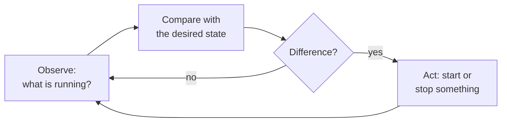

<!-- nav:top -->
[🏠 Start](../START-HERE.md) · [← Phase 21 — Cloud-native infrastructure](README.md) · [📋 Phase 21](README.md) · [21.2 Kubernetes concepts: pods, Deployments and Services →](02-kubernetes-concepts.md) · [📖 Glossary](../GLOSSARY.md) · [🇷🇺 Русский](../../ru/21-cloud-native-infrastructure/01-what-cloud-native-means.md) <!-- nav -->

# Lesson 21.1 — What cloud native means

> **Phase 21 — Cloud-native infrastructure** · Lesson 1 of 14 · ⏱ about 135 minutes

## What you will learn

- What problems appear when you run many copies of many services, and what "cloud native" means as an answer.
- The difference between *pets* and *cattle*, and between *imperative* and *declarative* work.
- The main idea behind Kubernetes: a *desired state* and a *reconciliation loop* that keeps the real world equal to it. You will write a small one in Rust.
- What a service must do to fit this world (configuration, logs, state, start and stop, health).
- How this phase is organised, which tools it uses and where your code goes.

## Before you start

- You can build a Docker image for a Rust program and run several containers with Docker Compose ([Lesson 11.13 — Dockerfiles for Rust programs](../11-linux-shell-and-containers/13-dockerfiles-for-rust.md), [Lesson 11.14 — Docker Compose](../11-linux-shell-and-containers/14-docker-compose.md)), and you deployed a service in [Lesson 11.15](../11-linux-shell-and-containers/15-project-deploy-a-rust-service.md).
- You know signals such as `SIGTERM` ([Lesson 11.5 — Processes and signals](../11-linux-shell-and-containers/05-processes-and-signals.md)) and graceful shutdown ([Lesson 14.14](../14-concurrency-and-async/14-cancellation-timeouts-and-graceful-shutdown.md)).
- You know configuration from environment variables and health checks ([Lesson 16.13 — Configuration, health checks and containers](../16-backend-services/13-configuration-health-checks-and-containers.md)) and the production-readiness checklist ([Lesson 20.9](../20-reliability-and-hardening/09-production-readiness-checklist.md)).
- This lesson needs only Rust. The cluster tools come in Lesson 21.3.

## New words

| Word | Meaning |
|---|---|
| **cloud native** | A way of building and running services so that machines, not people, start them, copy them, replace them when they break and roll out new versions. |
| **CNCF** (Cloud Native Computing Foundation) | A non-profit foundation that hosts open-source projects such as Kubernetes, Prometheus, Helm and OpenTelemetry. |
| **orchestrator** | A program that decides where containers run on a group of machines and keeps them running. Kubernetes is the best-known one. |
| **Kubernetes** (k8s) | An open-source orchestrator. "k8s" is a short form: k, then 8 letters, then s. |
| **cluster** | A group of machines that work together and are managed as one system. |
| **replica** | One running copy of the same service. Three replicas = three identical copies. |
| **pets and cattle** | Two ways to treat servers: a *pet* is unique and repaired by hand; *cattle* are identical and simply replaced when one breaks. |
| **immutable infrastructure** | You never change a running server or container; you build a new version and replace the old one. |
| **imperative** | Saying *how*: a list of commands to run, one after another ("start a container, then another one"). |
| **declarative** | Saying *what*: a description of the end result ("there must be 3 copies"), and a program finds the steps. |
| **desired state** | The description of what you want the system to look like. |
| **actual state** | What is really running right now. |
| **reconciliation loop** (control loop) | A loop that repeats: look at the actual state, compare it with the desired state, act to close the gap. |
| **controller** | A program that runs a reconciliation loop for one kind of object. |
| **idempotent** | An operation that gives the same result if you run it once or many times. |
| **YAML** (YAML Ain't Markup Language) | A text format for configuration that uses indentation, `key: value` pairs and `-` for list items. You met it in Docker Compose files. |
| **CI/CD** (Continuous Integration / Continuous Delivery) | CI checks every change automatically (Lesson 09.12); CD also ships every good change to the servers automatically. |
| **IaC** (Infrastructure as Code) | Describing servers, networks and clusters in files kept in Git, and creating them with a tool instead of by hand. |

## 1. From one server to many

In Lesson 11.15 you deployed one Rust service: one image, one server, a few `docker` or `docker compose` commands. That is a good start. Now imagine the same company two years later:

- there are **20 services**, each running **3 to 10 copies**;
- they run on **15 machines**;
- every service ships a **new version several times a week**;
- a machine **breaks** somewhere about once a week.

Questions that were easy with one server become a daily job:

| Question | With one server | With 15 machines and 20 services |
|---|---|---|
| Where does this container run? | On *the* server. | Which machine has free memory and CPU (Central Processing Unit) right now? |
| A container crashed. | You notice and restart it. | It happens at 3 a.m.; who restarts it? |
| A machine died. | The site is down. | Its containers must move to other machines, automatically. |
| How do others find the service? | A fixed address. | Copies come and go, and their addresses change all the time. |
| New version. | Stop old, start new; short downtime. | Replace copies one by one, with no downtime; go back if it is broken. |
| Traffic tripled. | Buy a bigger server. | Start more copies in a minute. |

**Cloud native** is the name for the set of ideas and tools that answer these questions with automation. The CNCF (Cloud Native Computing Foundation, the home of Kubernetes and many related projects) describes cloud-native systems as built from containers, managed by an orchestrator, described declaratively, observable, and changed often and safely through automation.

"Cloud" here does not mean a particular company. The same ideas work on rented servers, on your own servers in a building, and on your Mac. In this phase everything runs **on your Mac**, inside Docker, for free.

The program that answers the questions in the table is an **orchestrator**. You give it a group of machines (a **cluster**) and a description of what should run. It places the containers, restarts them, moves them away from broken machines, gives them stable names and replaces them during an update. The orchestrator of this phase is **Kubernetes**.

> ⚠️ **Common mistake:** thinking that every service needs Kubernetes. A cluster is a big system with its own failures, upgrades and learning cost. One small service on one server is often better served by Docker Compose and systemd (Phase 11). Kubernetes pays off when you have many services, many copies or many teams. You learn it here because most companies with many services use it, and because its ideas are useful everywhere.

## 2. Pets and cattle

There is a well-known way to describe the change in thinking.

A **pet** server has a name ("zeus"), was set up by hand over years, and nobody dares to reinstall it. When it is sick, a person logs in with SSH (Secure Shell, Lesson 11.10) and repairs it. If it dies, there is a crisis.

**Cattle** are numbered (`web-7f9c-1`, `web-7f9c-2`, …), all identical, and created by a program from the same image. When one is sick, it is not repaired: it is removed and a new one takes its place. If one dies, nobody notices except the logs.

```text
  pets                                  cattle
  ┌────────┐                            ┌──────┐ ┌──────┐ ┌──────┐
  │ "zeus" │  ← repaired by hand        │ web-1│ │ web-2│ │ web-3│  ← identical copies
  └────────┘                            └──────┘ └──────┘ └──────┘
  unique, precious, changed in place    web-2 breaks → delete it → web-4 appears
```

The rule that makes cattle possible is **immutable infrastructure**: you never change something that is running. You do not log in to a container to fix a file. You change the code or the configuration in Git, build a **new image** with a **new tag**, and the platform replaces the old copies with new ones. You learned the first half of this in Phase 11: an image is a read-only template, and a container is a disposable instance of it.

> 🔒 **Security:** a container that you can "fix by hand" is a container that an attacker can change by hand too, and nobody would notice the difference. With immutable infrastructure every running copy comes from an image built in CI from a reviewed commit, so you always know what is running.

## 3. Imperative and declarative

There are two ways to tell a computer what you want.

**Imperative** means giving the steps:

```bash
docker run -d --name web-1 course-web:1.0
docker run -d --name web-2 course-web:1.0
docker run -d --name web-3 course-web:1.0
```

This works once. But what if `web-2` already exists? The second command fails. What if `web-3` crashed an hour later? Nobody runs the command again. The commands describe *a change*, not *a result*.

**Declarative** means describing the result and letting a program find the steps. You already did this with Docker Compose: `compose.yaml` says which services should exist, and `docker compose up` creates only what is missing. Kubernetes takes this idea further. A Kubernetes file (called a **manifest**) for the example above says, in YAML:

```yaml
kind: Deployment
metadata:
  name: web
spec:
  replicas: 3
  template:
    spec:
      containers:
        - name: web
          image: course-web:1.0
```

(This is a shortened sketch; Lesson 21.2 explains every field and Lesson 21.4 deploys a full one.) It says: "there should be 3 copies of `course-web:1.0` called `web`". It does not say *how*. You can send the same file again and again: if 3 copies already run, nothing happens. The operation is **idempotent**.

Declarative files have three big advantages:

1. **They live in Git.** You review a change to `replicas: 5` like any code change, and you can see who changed what and when.
2. **They are the truth.** To know what should run, you read the files, not someone's shell history.
3. **The system can repair itself.** Because the wish is written down, a program can compare the wish with reality at any time, not only when you type a command.

The third point is the heart of Kubernetes.

## 4. Desired state and the reconciliation loop

Kubernetes is built from many **controllers**. Each controller runs the same simple loop forever:



- The **desired state** is what you declared: "3 healthy copies".
- The **actual state** is what is really running: maybe 2, because one crashed.
- The controller computes the **difference** and acts: "start 1".
- Then it looks again. Maybe the start failed; then it tries again on the next round.

This is the **reconciliation loop** (also called a **control loop**). A thermostat is the classic everyday example: you set 21 °C (desired), it measures 19 °C (actual), it turns on the heating (action), and it keeps measuring.

Two properties make this design robust:

- The controller does not remember events like "a container crashed at 10:31". It only compares two states each round. If it misses an event, the next round still sees the difference. (Engineers call this *level-triggered*: react to the current level, not to the edge of a change.)
- Each round is idempotent. If everything is already correct, the controller does nothing.

### A reconciliation loop in Rust

Let us build a tiny one to see the idea in code. In this phase your code goes into `~/projects/rust/code/p21-<topic>`; each lesson tells you the folder. Create the project:

```bash
cd ~/projects/rust
cargo new code/p21-reconcile
cd code/p21-reconcile
```

Replace `src/main.rs` with:

```rust
/// One running copy of our service, as the platform sees it.
#[derive(Debug, Clone)]
struct Replica {
    id: u32,
    healthy: bool,
}

/// A change the controller asks the platform to make.
#[derive(Debug, Clone, PartialEq)]
enum Action {
    Start,
    Stop(u32),
}

/// Compares the desired number of healthy replicas with what is running
/// and returns the actions that close the gap. It changes nothing itself.
fn reconcile(desired: usize, actual: &[Replica]) -> Vec<Action> {
    let mut actions = Vec::new();

    // 1. Broken replicas are never repaired: they are replaced.
    for r in actual.iter().filter(|r| !r.healthy) {
        actions.push(Action::Stop(r.id));
    }

    // 2. Compare the healthy ones with the wish.
    let healthy: Vec<&Replica> = actual.iter().filter(|r| r.healthy).collect();
    if healthy.len() < desired {
        for _ in healthy.len()..desired {
            actions.push(Action::Start);
        }
    } else {
        // Too many: stop the newest ones (highest id) first.
        for r in healthy.iter().rev().take(healthy.len() - desired) {
            actions.push(Action::Stop(r.id));
        }
    }
    actions
}

/// A tiny fake "platform" that can start and stop replicas.
struct Platform {
    replicas: Vec<Replica>,
    next_id: u32,
}

impl Platform {
    fn apply(&mut self, actions: &[Action]) {
        for action in actions {
            match action {
                Action::Start => {
                    self.replicas.push(Replica {
                        id: self.next_id,
                        healthy: true,
                    });
                    self.next_id += 1;
                }
                Action::Stop(id) => self.replicas.retain(|r| r.id != *id),
            }
        }
    }

    fn ids(&self) -> Vec<u32> {
        self.replicas.iter().map(|r| r.id).collect()
    }
}

fn main() {
    let mut desired = 3;
    let mut platform = Platform {
        replicas: Vec::new(),
        next_id: 1,
    };

    for tick in 1..=5 {
        // Things that happen in the world, outside the controller.
        if tick == 3 {
            platform.replicas[1].healthy = false; // replica 2 crashes
        }
        if tick == 5 {
            desired = 2; // a person edits the desired state
        }

        let actions = reconcile(desired, &platform.replicas);
        println!(
            "tick {tick}: desired={desired} running={:?} actions={actions:?}",
            platform.ids()
        );
        platform.apply(&actions);
    }
    println!("final: running={:?}", platform.ids());
}

#[cfg(test)]
mod tests {
    use super::*;

    fn healthy(ids: &[u32]) -> Vec<Replica> {
        ids.iter()
            .map(|&id| Replica { id, healthy: true })
            .collect()
    }

    #[test]
    fn starts_missing_replicas() {
        assert_eq!(reconcile(2, &[]), vec![Action::Start, Action::Start]);
    }

    #[test]
    fn does_nothing_when_actual_equals_desired() {
        assert!(reconcile(2, &healthy(&[1, 2])).is_empty());
    }

    #[test]
    fn replaces_an_unhealthy_replica() {
        let mut actual = healthy(&[1, 2]);
        actual[0].healthy = false;
        assert_eq!(reconcile(2, &actual), vec![Action::Stop(1), Action::Start]);
    }

    #[test]
    fn stops_the_newest_extra_replicas() {
        assert_eq!(
            reconcile(1, &healthy(&[1, 2, 3])),
            vec![Action::Stop(3), Action::Stop(2)]
        );
    }
}
```

**What happens:**

1. `Replica` is what the controller can *observe* about one copy: an id and whether it is healthy.
2. `Action` is what the controller can *ask for*: start a new copy, or stop the copy with a given id. Note that there is no "repair" action. That is the cattle rule from Section 2.
3. `reconcile` is a **pure function**: it takes the desired state and the actual state and returns a list of actions. It does not start or stop anything. This makes it easy to test, and it is how real controllers are designed too: decide first, act second.
4. First it asks to stop every unhealthy replica. Then it counts the healthy ones. If there are too few, it adds one `Start` per missing copy; if there are too many, `.rev().take(n)` picks the `n` newest (the vector is in start order) and stops them.
5. `Platform` plays the role of the real world. `apply` carries out the actions; `retain` keeps only the replicas whose id is not the stopped one.
6. `main` runs five rounds ("ticks"). In tick 3 the world breaks something; in tick 5 a person changes the desired state. The controller handles both in the same way: by comparing states.
7. The tests check the four basic cases. Because `reconcile` is pure, the tests need no platform at all.

Run it:

```bash
cargo run
```

```text
tick 1: desired=3 running=[] actions=[Start, Start, Start]
tick 2: desired=3 running=[1, 2, 3] actions=[]
tick 3: desired=3 running=[1, 2, 3] actions=[Stop(2), Start]
tick 4: desired=3 running=[1, 3, 4] actions=[]
tick 5: desired=2 running=[1, 3, 4] actions=[Stop(4)]
final: running=[1, 3]
```

Read it as a story. Tick 1: nothing runs, three starts. Tick 2: all good, no action, the loop is idempotent. Tick 3: replica 2 is unhealthy, so it is replaced by a new replica, number 4 (not "repaired"). Tick 5: the wish changes to 2, so the newest copy is stopped.

```bash
cargo test
```

```text
running 4 tests
test tests::does_nothing_when_actual_equals_desired ... ok
test tests::replaces_an_unhealthy_replica ... ok
test tests::starts_missing_replicas ... ok
test tests::stops_the_newest_extra_replicas ... ok

test result: ok. 4 passed; 0 failed; 0 ignored; 0 measured; 0 filtered out; finished in 0.00s
```

Kubernetes does exactly this, at a much larger scale. The *Deployment controller* watches your Deployment objects, the *ReplicaSet controller* keeps the number of copies right, the *scheduler* decides on which machine each new copy runs, and a program on each machine (the *kubelet*) starts and stops the containers. Lesson 21.2 introduces each of them. In Lesson 21.3 you will delete a copy by hand and watch a controller replace it within seconds.

> 🧪 **Testing:** separating "decide" (a pure function) from "act" (code that touches the world) is the most useful habit from this lesson. You used it in Phase 08 for the core and the adapters, and in Phase 18 for deterministic simulation. Kubernetes controllers written in Rust (with the `kube` crate) are tested the same way.

## 5. What the platform expects from your service

An orchestrator can only help a service that plays by its rules. The rules below are often called the *Twelve-Factor App* principles (a short web page, linked at the end). You already know most of them from earlier phases; here they come together.

| Rule | Why the platform needs it | Where you learned it |
|---|---|---|
| **Read configuration from the environment** (environment variables or mounted files), never hard-code it. | The same image runs in test and in production with different settings. | Lesson 16.13 |
| **Write logs to standard output**, one event per line, not to files inside the container. | The platform collects standard output (stdout) from every copy; files in a container vanish when it is replaced. | Lessons 09.10, 16.12 |
| **Keep no important state inside the container.** Store it in a database or a volume. | Any copy can be stopped at any moment and replaced by a fresh one. | Lessons 16.5–16.7 |
| **Start fast and stop gracefully.** On `SIGTERM`, stop taking new requests, finish the running ones, then exit. | The platform stops and starts copies during every update and every scale-down. | Lessons 11.5, 14.14 |
| **Offer health endpoints**, such as `/healthz` (am I alive?) and `/readyz` (can I take traffic?). | The platform restarts copies that are dead and sends traffic only to copies that are ready. | Lesson 16.13 |
| **One main process per container**, and the image tag says the exact version (`1.4.2` or a Git commit hash, not `latest`). | The platform watches one process; an exact tag makes every copy identical and a rollback possible. | Lessons 11.12, 11.13 |
| **Expose metrics** and propagate trace context. | With many copies you cannot log in and look; you need numbers and traces. | Lesson 16.12 |

These rules are also on your production-readiness checklist from Lesson 20.9. In Lessons 21.4 and 21.5 you will see each one used by Kubernetes: `SIGTERM` during an update, environment variables from a *ConfigMap*, and probes that call your health endpoints.

> ⚡ **Performance:** "start fast" matters more on a cluster than on one server. When traffic grows, new copies are useless until they are ready. A Rust service in a small image usually starts in well under a second, which is one reason Rust is popular for cloud services. Keep it so: do not do slow work (like loading a large cache) before you open the port, or report "not ready" until it is done.

## 6. The map of this phase

The phase follows one change on its way from your editor to a running, observed service:

```text
 your commit ──► CI: fmt, clippy, test ──► build image ──► registry
                     (Lesson 21.7)                          │
                                                            ▼
          ┌──────────────── Kubernetes cluster (kind) ────────────────┐
          │  Deployment ─► Pods (your containers) ◄── Service (21.2)  │
          │  ConfigMap, Secret, probes (21.5)  Helm, Kustomize (21.6) │
          └───────────────┬───────────────────────────────────────────┘
                          │ metrics, logs, traces (21.9, 21.10)
                          ▼
             Prometheus, Grafana, collector ──► SLOs and error budgets (21.11)
```

An **SLO** (Service Level Objective) at the end of the picture is a goal such as "99.9% of requests succeed"; Lesson 21.11 explains it.

The tools, all free and all running on your Mac:

| Tool | What it does | Lesson |
|---|---|---|
| **kind** | Creates a whole Kubernetes cluster inside Docker containers. | 21.3 |
| **kubectl** | The command-line client that talks to any Kubernetes cluster. | 21.3 |
| **Helm** and **Kustomize** | Package and customise sets of manifests. | 21.6 |
| **OpenTofu** | An IaC (Infrastructure as Code) tool: describes infrastructure in files and creates it. | 21.8 |
| **Prometheus** and **Grafana** | Collect metrics and draw dashboards. | 21.9 |
| **OpenTelemetry Collector** | Receives logs and traces from your services (you met it in Lesson 16.12). | 21.10 |

Three practical notes for the whole phase:

1. **One cluster per lesson.** Each lesson creates a fresh cluster named `course-21-NN` (for example `course-21-03`) and deletes it at the end. Clusters are cattle too: creating one takes about a minute.
2. **Resources.** A kind cluster with your service needs about 2 GB (gigabytes) of RAM (Random Access Memory). Check that Docker Desktop has at least 4 GB in *Settings → Resources*. Keep only one cluster running at a time.
3. **Safety.** Everything stays on your computer. You never need a cloud account or a credit card for this phase.

## Common mistakes

**Subtracting without checking which number is bigger.** A shorter `reconcile` without the `if`/`else`:

```rust
    for _ in healthy.len()..desired {
        actions.push(Action::Start);
    }
    for r in healthy.iter().rev().take(healthy.len() - desired) {
        actions.push(Action::Stop(r.id));
    }
```

The first loop is fine: a range whose start is bigger than its end is simply empty. The second line is not. When there are fewer healthy replicas than desired (tick 1: `0 - 3`), the subtraction of two `usize` values goes below zero, and a debug build panics:

```text
thread 'main' (5864161) panicked at src/main.rs:30:40:
attempt to subtract with overflow
note: run with `RUST_BACKTRACE=1` environment variable to display a backtrace
```

(The number after `'main'` is the thread id; yours will differ.) Fix: compare first, as the lesson code does, or use `healthy.len().saturating_sub(desired)`, which stops at zero. Controllers run forever, so a panic in one is a real outage.

**Repairing cattle by hand.** Running `docker exec` (or, later, `kubectl exec`) into a container and editing a file "just this once". The next replacement brings the old file back, and the copies are no longer identical. Change the source, build a new image, roll it out.

**Using the tag `latest`.** `latest` is just a name that points to whatever was pushed last. Two copies started an hour apart may run different code, and you cannot roll back to "the previous latest". Use exact versions.

**Keeping state in the container.** An upload saved into `/app/uploads` inside a container is gone when the copy is replaced, and the other copies never see it. Use a database, an object store or a volume.

## Try it yourself

1. In `main`, make two replicas crash in the same tick (`platform.replicas[0]` and `platform.replicas[2]` in tick 3). Predict the actions before you run. Then run and compare.
2. Change the wish in tick 5 to `desired = 6`. How many `Start` actions appear?
3. Add a sixth tick in which nothing happens. Check that its action list is empty. That empty list is the loop being idempotent.

## Exercises

### Exercise 1 — Imperative or declarative? (easy)

For each item, say whether it is imperative or declarative, and why.

1. `docker run -d --name db postgres:18`
2. A `compose.yaml` file with three services.
3. A shell script that runs `useradd alice` and then `mkdir /home/alice/projects`.
4. A line `replicas: 4` in a Kubernetes manifest.
5. `kubectl scale deployment web --replicas=4` (a command you will use in Lesson 21.3).

<details>
<summary>Hint</summary>

Ask: does it describe *the result* (and can I send it again safely), or *a step* to perform now?

</details>

<details>
<summary>Answer</summary>

1. Imperative: a step ("create this container now"). Run it twice and the second run fails because the name exists.
2. Declarative: it describes which services should exist; `docker compose up` creates only what is missing.
3. Imperative: two steps in order; the second run fails at `useradd` because the user exists.
4. Declarative: it states the wish, and a controller keeps it true.
5. Imperative in form (a command), but it *changes the desired state* rather than starting containers itself; the controller then does the work. Many `kubectl` commands are like this. The declarative way is to edit `replicas:` in the file in Git and apply the file.

</details>

### Exercise 2 — A test for idempotence (medium)

Write a test `second_run_changes_nothing`: start from an empty platform, run `reconcile` with `desired = 3`, apply the actions, then run `reconcile` again. The second list must be empty.

<details>
<summary>Hint</summary>

Create a `Platform` in the test exactly as `main` does. The test module can see private items of `main.rs` through `use super::*;`.

</details>

<details>
<summary>Answer</summary>

Add to the `tests` module:

```rust
    #[test]
    fn second_run_changes_nothing() {
        let mut platform = Platform {
            replicas: Vec::new(),
            next_id: 1,
        };
        let first = reconcile(3, &platform.replicas);
        platform.apply(&first);
        let second = reconcile(3, &platform.replicas);
        assert!(second.is_empty(), "second run wanted {second:?}");
    }
```

```text
test tests::second_run_changes_nothing ... ok
test result: ok. 5 passed; 0 failed; 0 ignored; 0 measured; 0 filtered out; finished in 0.00s
```

Why it works: after the first round the actual state equals the desired state, so a correct controller has nothing to do. If the test fails, the controller would act forever, for example starting a new copy on every round.

</details>

### Exercise 3 — Do not start everything at once (hard)

If 100 copies are missing, a real platform should not start all 100 at the same moment (the machines and the database would be overloaded). Add a parameter `max_start: usize` to `reconcile`: one round starts at most `max_start` copies. Use `2` in `main`. Write two tests: one round with `desired = 5` on an empty platform returns exactly two `Start`s; and three rounds reach replicas `[1, 2, 3, 4, 5]`.

<details>
<summary>Hint</summary>

Compute `let missing = desired - healthy.len();` inside the `if` (where it cannot underflow) and loop over `0..missing.min(max_start)`. Update every call of `reconcile`, including the old tests (give them a large limit such as `10`).

</details>

<details>
<summary>Answer</summary>

The two changed parts of `reconcile` (the rest stays as it was):

```rust
fn reconcile(desired: usize, actual: &[Replica], max_start: usize) -> Vec<Action> {
```

```rust
    if healthy.len() < desired {
        let missing = desired - healthy.len();
        for _ in 0..missing.min(max_start) {
            actions.push(Action::Start);
        }
    } else {
```

In `main`: `let actions = reconcile(desired, &platform.replicas, 2);`. The new tests:

```rust
    #[test]
    fn starts_at_most_max_start_per_run() {
        assert_eq!(reconcile(5, &[], 2), vec![Action::Start, Action::Start]);
    }

    #[test]
    fn reaches_desired_state_over_several_runs() {
        let mut platform = Platform {
            replicas: Vec::new(),
            next_id: 1,
        };
        for _ in 0..3 {
            let actions = reconcile(5, &platform.replicas, 2);
            platform.apply(&actions);
        }
        assert_eq!(platform.ids(), vec![1, 2, 3, 4, 5]);
    }
```

`cargo run` now shows the slower start:

```text
tick 1: desired=3 running=[] actions=[Start, Start]
tick 2: desired=3 running=[1, 2] actions=[Start]
tick 3: desired=3 running=[1, 2, 3] actions=[Stop(2), Start]
tick 4: desired=3 running=[1, 3, 4] actions=[]
tick 5: desired=2 running=[1, 3, 4] actions=[Stop(4)]
final: running=[1, 3]
```

Why it works: the loop does not need to reach the goal in one round; it only needs to move *towards* it every round. Kubernetes uses the same idea in rolling updates (`maxSurge`, Lesson 21.4): it replaces a few copies at a time.

</details>

## Quiz

1. Name three questions that become hard when you run many copies of many services on many machines.

<details>
<summary>Answer</summary>

Any three of: where to place each container; who restarts crashed containers; how to move work away from a dead machine; how clients find copies whose addresses change; how to roll out a new version without downtime and roll back; how to add copies quickly when traffic grows.

</details>

2. What is the difference between a pet and cattle, and what rule makes cattle possible?

<details>
<summary>Answer</summary>

A pet is unique and repaired by hand; cattle are identical copies that are replaced, not repaired. Immutable infrastructure makes it possible: every copy comes from the same image, and changes are made by building a new image and replacing the copies.

</details>

3. Why is a declarative file safer to send twice than an imperative command?

<details>
<summary>Answer</summary>

It describes the end result, so applying it again when the result already exists does nothing (it is idempotent). An imperative command describes a step, and repeating a step can fail or create duplicates.

</details>

4. Describe the reconciliation loop in one sentence.

<details>
<summary>Answer</summary>

Repeat forever: observe the actual state, compare it with the desired state, and act to make the actual state closer to the desired one.

</details>

5. Why does the `reconcile` function in this lesson return actions instead of starting replicas itself?

<details>
<summary>Answer</summary>

So that the decision is a pure function: it is easy to test without any real platform, and the same decision code can be used with a fake platform in tests and a real one in production.

</details>

6. A service writes its logs to `/var/log/app.log` inside the container and keeps user sessions in memory. Which two platform rules does it break, and what goes wrong?

<details>
<summary>Answer</summary>

It should write logs to standard output (the file disappears when the copy is replaced, and the platform cannot collect it), and it should keep no important state inside the container (sessions are lost when the copy is replaced, and other copies do not know them; store them in a database or Redis).

</details>

7. What does the platform send to your process before it stops a copy, and what should your service do?

<details>
<summary>Answer</summary>

The signal `SIGTERM`. The service should stop accepting new requests, finish the running ones, and exit (graceful shutdown). If it does not exit within a grace period, the platform sends `SIGKILL`; you will see this in Lesson 21.4.

</details>

## Summary

- Cloud native means building and running services so that automation, not people, places, restarts, copies and updates them. An orchestrator such as Kubernetes does this work on a cluster.
- Treat servers and containers as cattle, not pets: identical, replaceable, never changed in place (immutable infrastructure).
- Imperative = steps; declarative = the end result. Declarative files live in Git, are the source of truth and are idempotent.
- Kubernetes is a set of controllers running reconciliation loops: observe, compare with the desired state, act, repeat.
- Separate the decision (a pure, testable function) from the action.
- Your service must fit the platform: config from the environment, logs to stdout, no local state, fast start, graceful stop on `SIGTERM`, health endpoints, exact image tags, metrics.
- This phase runs everything locally with kind, kubectl, Helm, Kustomize, OpenTofu, Prometheus, Grafana and the OpenTelemetry Collector.

## Sources and further reading

- [CNCF Cloud Native Definition](https://github.com/cncf/toc/blob/main/DEFINITION.md) — the short official definition, in many languages.
- [Kubernetes documentation — Overview](https://kubernetes.io/docs/concepts/overview/) — what Kubernetes is and is not.
- [Kubernetes documentation — Controllers](https://kubernetes.io/docs/concepts/architecture/controller/) — the control loop explained by the project itself.
- [The Twelve-Factor App](https://12factor.net/) — the principles from Section 5, one short page each.
- [Kubernetes documentation — Pod Lifecycle](https://kubernetes.io/docs/concepts/workloads/pods/pod-lifecycle/) — how pods start and stop (you will use this in Lesson 21.4).

---

[🏠 Start](../START-HERE.md) · [← Phase 21 — Cloud-native infrastructure](README.md) · [📋 Phase 21](README.md) · [21.2 Kubernetes concepts: pods, Deployments and Services →](02-kubernetes-concepts.md) · [📖 Glossary](../GLOSSARY.md) <!-- nav -->
<!-- nav:bottom -->
