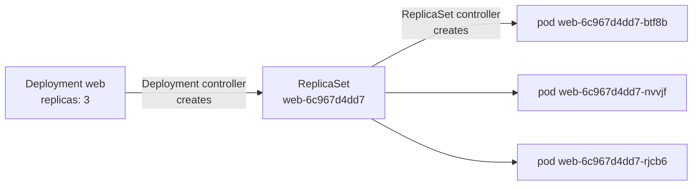

<!-- nav:top -->
[🏠 Start](../START-HERE.md) · [← 21.1 What cloud native means](01-what-cloud-native-means.md) · [📋 Phase 21](README.md) · [21.3 A local cluster with kind and kubectl →](03-a-local-cluster-with-kind.md) · [📖 Glossary](../GLOSSARY.md) · [🇷🇺 Русский](../../ru/21-cloud-native-infrastructure/02-kubernetes-concepts.md) <!-- nav -->

# Lesson 21.2 — Kubernetes concepts: pods, Deployments and Services

> **Phase 21 — Cloud-native infrastructure** · Lesson 2 of 14 · ⏱ about 2.5 hours (2 sittings)

## What you will learn

- The parts of a Kubernetes cluster: the control plane (API server, etcd, scheduler, controller manager) and the nodes (kubelet, container runtime, kube-proxy).
- What a Kubernetes object and a manifest are: `apiVersion`, `kind`, `metadata`, `spec` and `status`.
- What a pod is, and why you almost never create pods yourself.
- How a Deployment creates a ReplicaSet, and a ReplicaSet creates pods.
- How labels and selectors connect objects, and how a Service gives a group of pods one stable name. You will write a selector matcher in Rust.

## Before you start

- You finished [Lesson 21.1 — What cloud native means](01-what-cloud-native-means.md): desired state, controllers and the reconciliation loop.
- You know IP (Internet Protocol) addresses and ports ([Lesson 15.2](../15-networking/02-ip-addresses-and-routing.md)), DNS, the Domain Name System ([Lesson 15.10](../15-networking/10-dns-how-names-become-addresses.md)) and load balancers ([Lesson 15.14](../15-networking/14-proxies-and-load-balancers.md)).
- You know Linux namespaces and cgroups, which make containers possible ([Lesson 11.12 — Containers and Docker basics](../11-linux-shell-and-containers/12-containers-and-docker-basics.md)).
- This lesson is about ideas. You will not run a cluster yet; the outputs shown come from a local kind cluster like the one you will create in Lesson 21.3.

## New words

| Word | Meaning |
|---|---|
| **control plane** | The "brain" of the cluster: the programs that store the desired state and make decisions. |
| **node** | One machine (real or virtual) in the cluster that runs your containers. |
| **API server** (kube-apiserver) | The front door of the cluster. Every tool and every component reads and writes objects only through it. API = Application Programming Interface. |
| **etcd** | A small, reliable key-value database that stores all objects of the cluster. It uses the Raft consensus algorithm (Lesson 18.9). |
| **scheduler** (kube-scheduler) | The component that chooses a node for each new pod. |
| **controller manager** (kube-controller-manager) | One program that runs many built-in controllers (Deployment, ReplicaSet, …). |
| **kubelet** | The agent on every node. It starts and stops the containers of the pods placed on its node and reports their state. |
| **container runtime** | The program that actually runs containers on a node; kind uses **containerd**. |
| **kube-proxy** | A component on every node that makes Service addresses work by programming network rules. |
| **object** (resource) | One record in the cluster, such as one Deployment or one Service, with a desired state (`spec`) and an observed state (`status`). |
| **manifest** | A YAML (YAML Ain't Markup Language) or JSON (JavaScript Object Notation) file that describes one or more objects. |
| **namespace** (Kubernetes) | A named group of objects inside a cluster, such as `default` or `kube-system`. Not the same as a Linux namespace. |
| **pod** | The smallest thing Kubernetes runs: one or more containers that share a network address and can share files. |
| **ReplicaSet** | An object that keeps a given number of identical pods running. |
| **Deployment** | An object that manages ReplicaSets so that you can update pods to a new version step by step and roll back. |
| **label** | A `key: value` tag on an object, such as `app: web`. |
| **selector** | A rule that picks objects by their labels, such as "all pods with `app=web`". |
| **Service** | An object that gives a group of pods one stable virtual IP address and DNS name, and spreads connections over them. |
| **ClusterIP** | The default kind of Service: a virtual IP address reachable only inside the cluster. |
| **EndpointSlice** | An object that lists the current pod addresses behind a Service. Kubernetes keeps it up to date. |
| **CNI** (Container Network Interface) | The standard for plug-ins that give pods their network; kind installs one called kindnet. |

## 1. The parts of a cluster

A Kubernetes cluster has two kinds of parts: the **control plane**, which stores what you want and decides, and the **nodes**, which run your containers.

```text
                 kubectl (you)           other tools (CI, Helm)
                        │                      │
                        ▼                      ▼
  ┌───────────────────────── control plane ──────────────────────────┐
  │   ┌──────────────┐        ┌──────┐                               │
  │   │  API server  │◄──────►│ etcd │  all objects are stored here  │
  │   └──────┬───────┘        └──────┘                               │
  │          ▲   ▲                                                   │
  │          │   └──────── scheduler: "pod X goes to node 2"         │
  │          └──────────── controller manager: reconciliation loops  │
  └──────────┼───────────────────────────────────────────────────────┘
             │ watch and report
   ┌─────────┴─────────┐   ┌───────────────────┐
   │ node 1            │   │ node 2            │
   │ kubelet           │   │ kubelet           │
   │ containerd        │   │ containerd        │
   │ kube-proxy        │   │ kube-proxy        │
   │ [pod] [pod]       │   │ [pod] [pod] [pod] │
   └───────────────────┘   └───────────────────┘
```

Read the picture from the top:

1. You (with `kubectl`) and other tools (a CI, Continuous Integration, pipeline or Helm) talk only to the **API server**. It checks who you are, whether you may do this, and whether the object is valid. Then it stores the object in **etcd**.
2. **etcd** holds every object of the cluster. It is replicated with the Raft algorithm from Phase 18, so a real cluster runs three or five copies of it.
3. The **controller manager** runs controllers like the one you wrote in Lesson 21.1. They *watch* objects through the API server and create or delete other objects to close the gap.
4. The **scheduler** watches for new pods that have no node yet, picks a node with enough free CPU (Central Processing Unit) and memory, and writes the node's name into the pod.
5. On each node, the **kubelet** watches for pods assigned to its node and asks the **container runtime** (containerd) to start their containers. It reports back whether they run.
6. **kube-proxy** on each node makes Service addresses work (Section 6).

Note the pattern: no component calls another one directly to "do something". They all read and write objects through the API server, and each one reconciles its own part. That is why Kubernetes keeps working when one component restarts: it simply reads the state again.

In a kind cluster on your Mac, the control plane and the node are the same Docker container, and the control-plane programs themselves run as pods in the namespace `kube-system`. This is real output from a fresh kind cluster (you will run it in Lesson 21.3):

```bash
kubectl get pods -n kube-system
```

```text
NAME                                                 READY   STATUS    RESTARTS   AGE
coredns-559f6c778d-lfmjm                             1/1     Running   0          33s
coredns-559f6c778d-pwcbg                             1/1     Running   0          33s
etcd-course-21-02-control-plane                      1/1     Running   0          43s
kindnet-v862w                                        1/1     Running   0          33s
kube-apiserver-course-21-02-control-plane            1/1     Running   0          43s
kube-controller-manager-course-21-02-control-plane   1/1     Running   0          43s
kube-proxy-qpcqt                                     1/1     Running   0          33s
kube-scheduler-course-21-02-control-plane            1/1     Running   0          43s
```

You can find every part of the picture: `etcd`, `kube-apiserver`, `kube-controller-manager`, `kube-scheduler`, `kube-proxy`. `coredns` is the DNS server of the cluster (Section 6), and `kindnet` is the CNI (Container Network Interface) plug-in that gives every pod an IP address.

## 2. Objects and manifests

Everything in Kubernetes is an **object**: a Deployment, a pod, a Service, a namespace. Each object has the same four top-level parts. Here is a manifest for a Service, the file you write:

```yaml
apiVersion: v1          # which version of the API defines this kind
kind: Service           # what kind of object
metadata:               # who it is
  name: web
  namespace: default
spec:                   # what you want (desired state)
  selector:
    app: web
  ports:
    - port: 80
      targetPort: 80
```

1. **`apiVersion`** names the API group and version. Core objects (pods, Services) use `v1`; Deployments and ReplicaSets live in the group `apps`, so they use `apps/v1`.
2. **`kind`** says which kind of object this is.
3. **`metadata`** identifies the object: its `name`, its `namespace`, its labels. Within one namespace, the pair (kind, name) is unique.
4. **`spec`** is the **desired state**, written by you.
5. **`status`** is the **actual state**, written by the cluster. You never write it; it appears when you read the object back.

For example, when you read a Deployment back (`kubectl get deployment web -o yaml`), its `status` contains numbers that the controllers wrote, such as `readyReplicas: 3`. `spec` and `status` side by side are the "desired" and "actual" of Lesson 21.1, stored in one object.

You do not need to remember every field. `kubectl explain` prints the documentation of any field from the cluster itself:

```bash
kubectl explain deployment.spec.replicas
```

```text
GROUP:      apps
KIND:       Deployment
VERSION:    v1

FIELD: replicas <integer>


DESCRIPTION:
    Number of desired pods. This is a pointer to distinguish between explicit
    zero and not specified. Defaults to 1.
```

**Namespaces** group objects inside one cluster, like folders. A fresh cluster has a few: `default` (where your objects go if you do not say otherwise), `kube-system` (the cluster's own parts), and some smaller ones. Teams often get one namespace each. A Kubernetes namespace is only a naming and access-control boundary; it is not the Linux namespace from Phase 11 that isolates a process.

## 3. Pods: the smallest unit

Kubernetes never runs a bare container. It runs a **pod**: a small wrapper around one or more containers that always live on the same node and share:

- **one network address.** Every pod gets its own IP address inside the cluster. Containers of the same pod talk to each other through `localhost`, and they cannot both listen on the same port.
- **volumes**, if you declare them: a folder that several containers of the pod can mount.

```text
   pod web-6c967d4dd7-btf8b   (IP 10.244.0.7)
  ┌──────────────────────────────────────────┐
  │  container "nginx"   listens on :80      │
  │  (optional) helper container             │
  │  shared: network (localhost), volumes    │
  └──────────────────────────────────────────┘
```

Most pods have exactly one container: your service. A second container, when there is one, is a helper (for example one that ships logs); such a helper is often called a *sidecar*.

Pods are **mortal**. A pod is created, runs, and ends; it is never moved or repaired. If its node dies, the pod is gone, and a *new* pod with a *new* name and a *new* IP address is created elsewhere. This is the "cattle" rule of Lesson 21.1 built into the system.

That is why you almost never create a pod directly: nobody would replace it when it dies. Instead you create a **Deployment**, and controllers create the pods for you.

## 4. Deployments and ReplicaSets

A Deployment is the object you will use for every stateless service. Here is the full Deployment we use in this lesson, with the official `nginx` web-server image standing in for your service (your Rust service takes its place in Lesson 21.4):

```yaml
apiVersion: apps/v1
kind: Deployment
metadata:
  name: web
  labels:
    app: web
spec:
  replicas: 3
  selector:
    matchLabels:
      app: web
  template:
    metadata:
      labels:
        app: web
    spec:
      containers:
        - name: nginx
          image: nginx:1.30-alpine
          ports:
            - containerPort: 80
```

**What happens:**

1. `replicas: 3` is the desired number of pods.
2. `template` is a **pod template**: a complete description of the pods to create, with their own `metadata` (labels) and `spec` (containers). Every pod of this Deployment is made from this template.
3. `selector.matchLabels` says which pods belong to this Deployment: those with the label `app: web`. It must match the labels in the template, or the API server rejects the object (see "Common mistakes").
4. `containers` lists the containers of each pod: a name, an image with an exact tag, and the port the program listens on. `containerPort` is mostly documentation; the program decides the real port.

When you send this Deployment to the cluster, a chain of controllers starts working:



1. The **Deployment controller** sees the new Deployment and creates a **ReplicaSet** for the current template. The ReplicaSet's name is the Deployment's name plus a hash of the template (`6c967d4dd7`).
2. The **ReplicaSet controller** sees a ReplicaSet that wants 3 pods and has 0, and creates 3 pods. Their names are the ReplicaSet's name plus a random suffix.
3. The **scheduler** gives each pod a node; the **kubelet** on that node starts the containers.

This is what the cluster shows afterwards:

```bash
kubectl get deployments,replicasets,pods -l app=web
```

```text
NAME                  READY   UP-TO-DATE   AVAILABLE   AGE
deployment.apps/web   3/3     3            3           17s

NAME                             DESIRED   CURRENT   READY   AGE
replicaset.apps/web-6c967d4dd7   3         3         3       17s

NAME                       READY   STATUS    RESTARTS   AGE
pod/web-6c967d4dd7-btf8b   1/1     Running   0          17s
pod/web-6c967d4dd7-nvvjf   1/1     Running   0          17s
pod/web-6c967d4dd7-rjcb6   1/1     Running   0          17s
```

Why two levels? Because of updates. When you change the template (for example a new image tag), the Deployment controller creates a **second** ReplicaSet for the new template and then moves the count step by step: the new one up, the old one down. If the new version is bad, it can go back by scaling the old ReplicaSet up again. You will do exactly that in Lesson 21.4. You never edit ReplicaSets yourself; you edit the Deployment.

Every pod remembers who created it, in a field called `ownerReferences`. The pods above are owned by `ReplicaSet/web-6c967d4dd7`, and the ReplicaSet is owned by `Deployment/web`. When you delete the Deployment, Kubernetes deletes its ReplicaSets and their pods too (this is called *garbage collection*).

## 5. Labels and selectors

How does a ReplicaSet know which pods are "its" pods? How does a Service know where to send traffic? Not by name: names of pods are random. By **labels**.

A **label** is a `key: value` pair in an object's `metadata.labels`. A **selector** is a rule like "`app` must be `web`". An object matches when *every* rule of the selector is true for its labels. Extra labels do not matter. The ReplicaSet even adds its own label, `pod-template-hash`, to its pods:

```bash
kubectl get pods -l app=web --show-labels
```

```text
NAME                   READY   STATUS    RESTARTS   AGE   LABELS
web-6c967d4dd7-btf8b   1/1     Running   0          42s   app=web,pod-template-hash=6c967d4dd7
web-6c967d4dd7-nvvjf   1/1     Running   0          42s   app=web,pod-template-hash=6c967d4dd7
web-6c967d4dd7-rjcb6   1/1     Running   0          42s   app=web,pod-template-hash=6c967d4dd7
```

The `-l app=web` option is itself a selector. The rule is simple enough to write in a few lines of Rust, and writing it makes the meaning exact. Create the project:

```bash
cd ~/projects/rust
cargo new code/p21-selectors
cd code/p21-selectors
```

Replace `src/main.rs` with:

```rust
use std::collections::BTreeMap;

/// Labels are key-value pairs, like `app=web`.
type Labels = BTreeMap<String, String>;

/// Parses text such as `app=web,tier=frontend` into labels.
fn parse_labels(text: &str) -> Result<Labels, String> {
    let mut labels = Labels::new();
    for pair in text.split(',').filter(|p| !p.is_empty()) {
        let (key, value) = pair
            .split_once('=')
            .ok_or_else(|| format!("`{pair}` is not key=value"))?;
        labels.insert(key.trim().to_string(), value.trim().to_string());
    }
    Ok(labels)
}

/// A selector matches when every key=value of the selector is in the labels.
/// Extra labels on the object do not matter.
fn matches(selector: &Labels, labels: &Labels) -> bool {
    selector
        .iter()
        .all(|(key, value)| labels.get(key) == Some(value))
}

fn main() {
    let selector = parse_labels("app=web").unwrap();
    let pods = [
        ("web-1", "app=web,pod-template-hash=6c967d4dd7"),
        ("web-2", "app=web,pod-template-hash=6c967d4dd7"),
        ("db-1", "app=db"),
        ("debug", "app=web-debug"),
    ];
    for (name, text) in pods {
        let labels = parse_labels(text).unwrap();
        println!(
            "{name:<6} {text:<38} selected={}",
            matches(&selector, &labels)
        );
    }
}

#[cfg(test)]
mod tests {
    use super::*;

    #[test]
    fn extra_labels_do_not_matter() {
        let selector = parse_labels("app=web").unwrap();
        let labels = parse_labels("app=web,version=1.2").unwrap();
        assert!(matches(&selector, &labels));
    }

    #[test]
    fn values_must_be_equal_not_just_similar() {
        let selector = parse_labels("app=web").unwrap();
        assert!(!matches(&selector, &parse_labels("app=web-debug").unwrap()));
    }

    #[test]
    fn text_without_equals_sign_is_an_error() {
        assert_eq!(
            parse_labels("app"),
            Err("`app` is not key=value".to_string())
        );
    }
}
```

**What happens:**

1. `Labels` is a type alias for a `BTreeMap<String, String>`: a sorted map from key to value. Sorted keys make the printed output stable.
2. `parse_labels` splits the text at commas, then each part at the first `=` with `split_once`. A part without `=` becomes an error message; `?` returns it at once. `filter(|p| !p.is_empty())` lets an empty text mean "no labels".
3. `matches` is the whole rule in one line: `all` rules of the selector must hold, and a rule holds when the object has the same value for that key (`labels.get(key) == Some(value)`). A missing key gives `None`, which is not equal to `Some(...)`.
4. `main` tries the selector `app=web` on four pods. `{name:<6}` pads the text to 6 characters so that the columns line up.
5. The tests pin down the two surprising cases: extra labels are fine, and `web-debug` is not `web` (values are compared exactly, not as prefixes).

```bash
cargo run
```

```text
web-1  app=web,pod-template-hash=6c967d4dd7   selected=true
web-2  app=web,pod-template-hash=6c967d4dd7   selected=true
db-1   app=db                                 selected=false
debug  app=web-debug                          selected=false
```

```bash
cargo test
```

```text
running 3 tests
test tests::extra_labels_do_not_matter ... ok
test tests::values_must_be_equal_not_just_similar ... ok
test tests::text_without_equals_sign_is_an_error ... ok

test result: ok. 3 passed; 0 failed; 0 ignored; 0 measured; 0 filtered out; finished in 0.00s
```

> 📏 **Convention:** Kubernetes recommends a common set of label keys, such as `app.kubernetes.io/name: web` and `app.kubernetes.io/version: "1.30"`, so that tools can understand your objects. The short `app: web` is fine for learning; the Helm charts in Lesson 21.6 use the recommended keys.

## 6. Services: one stable name for many pods

Pods come and go, and each new pod has a new IP address. A client cannot keep a list of pod addresses. A **Service** solves this: it is one object with a **stable virtual IP address** and a **DNS name**, and it forwards each connection to one of the pods that match its selector. It is a small load balancer built into the cluster (you built one yourself in Lesson 15.15).

The Service for our Deployment:

```yaml
apiVersion: v1
kind: Service
metadata:
  name: web
spec:
  selector:
    app: web
  ports:
    - port: 80
      targetPort: 80
```

**What happens:**

1. `selector: app: web` picks the pods. The Service does not know about the Deployment at all; it only looks at pod labels.
2. `port: 80` is the port of the Service's own address. `targetPort: 80` is the port on the pods to forward to. They can differ: a Service on port 80 can forward to a Rust program that listens on 8080.
3. No `type` is given, so the type is **ClusterIP**: the address works only inside the cluster.

What the cluster does with it:

```bash
kubectl get service web
kubectl get endpointslices -l kubernetes.io/service-name=web
```

```text
NAME   TYPE        CLUSTER-IP      EXTERNAL-IP   PORT(S)   AGE
web    ClusterIP   10.96.160.137   <none>        80/TCP    17s
NAME        ADDRESSTYPE   PORTS   ENDPOINTS                          AGE
web-pdm5f   IPv4          80      10.244.0.4,10.244.0.2,10.244.0.7   17s
```

1. The Service got the virtual address `10.96.160.137`. It stays the same as long as the Service exists, no matter how many pods are replaced.
2. A controller keeps an **EndpointSlice** with the current IP addresses of the matching, *ready* pods: the three pods of our Deployment. When a pod is replaced, the list changes within a second.
3. **kube-proxy** on every node turns this into network rules: a connection to `10.96.160.137:80` is redirected to one of the three pod addresses.
4. **CoreDNS** gives the Service a name: `web.default.svc.cluster.local` (service, namespace, `svc`, cluster domain). Pods in the same namespace can simply use `web`.

From a temporary pod inside the cluster (you will learn the `kubectl run` command in Lesson 21.3), the name resolves to the Service address and the request reaches nginx:

```text
Server:		10.96.0.10
Address:	10.96.0.10:53

Name:	web.default.svc.cluster.local
Address: 10.96.160.137


<!DOCTYPE html>
<html>
<head>
<title>Welcome to nginx!</title>
```

The whole path of one request:

```text
 client pod ── "web" ──► CoreDNS ──► 10.96.160.137:80 (Service)
                                         │ kube-proxy rules
                     ┌───────────────────┼───────────────────┐
                     ▼                   ▼                   ▼
              10.244.0.2:80       10.244.0.4:80       10.244.0.7:80
              pod ...-nvvjf       pod ...-rjcb6       pod ...-btf8b
```

Other Service types build on ClusterIP:

| Type | Reachable from | Typical use |
|---|---|---|
| `ClusterIP` (default) | Inside the cluster only | Service-to-service traffic, databases |
| `NodePort` | Also a fixed port (30000–32767) on every node's address | Simple access from outside, tests |
| `LoadBalancer` | Also an external load balancer given by the cloud provider | Public services on a cloud cluster |

On your Mac you will reach ClusterIP Services with `kubectl port-forward` (Lesson 21.3), which needs no extra set-up.

> 🔒 **Security:** a ClusterIP Service is not reachable from outside the cluster, but by default **every pod can reach every other pod** inside it. Kubernetes has *NetworkPolicy* objects to restrict this ("only pods with `app=api` may talk to the database"); they are a later topic, but remember that a cluster network is not private by default.

## Common mistakes

**The selector does not match the template labels.** If the Deployment says `matchLabels: app: web` but the template has `app: website`, the API server refuses the object:

```text
The Deployment "web" is invalid: spec.template.metadata.labels: Invalid value: {"app":"website"}: `selector` does not match template `labels`
```

Fix: the labels in `spec.selector.matchLabels` must also be in `spec.template.metadata.labels`.

**The Service selector matches no pods.** This one gives no error, which makes it worse. A Service with `selector: app: api` in front of pods labelled `app: web` is created happily, but its EndpointSlice is empty and every connection fails:

```text
NAME        ADDRESSTYPE   PORTS     ENDPOINTS   AGE
web-tgd8z   IPv4          <unset>   <unset>     23s
```

```text
wget: can't connect to remote host (10.96.116.77): Connection refused
```

(The Service address differs from the one in Section 6 because this output comes from another, fresh cluster.)

Fix: whenever a Service does not answer, first look at its EndpointSlice. `<unset>` means the selector matches no ready pod.

**A tab in YAML.** YAML allows only spaces for indentation. A file `tab.yaml` whose line 6 starts with a tab character gives:

```text
error: error parsing tab.yaml: error converting YAML to JSON: yaml: line 6: found character that cannot start any token
```

Fix: configure your editor to insert spaces in `.yaml` files (RustRover does this by default), and use two spaces per level.

**A misspelled field.** `selectr:` instead of `selector:` is rejected by the API server with `strict decoding error: unknown field "spec.selectr"`. Read the field name in the message and compare it with `kubectl explain`.

**Creating pods directly for a service.** A pod created on its own is not replaced when it dies or when its node is drained. Use a Deployment even for one copy (`replicas: 1`).

## Try it yourself

1. Change the selector in `main` to `app=db` and predict the output before you run it.
2. Add a fifth pod with the labels `app=web,track=canary`. Is it selected by `app=web`? What does that tell you about adding labels to an existing group of pods?

## Exercises

### Exercise 1 — Find the bug in the manifest (easy)

A colleague runs a Deployment `shop` with 3 pods. The pod template has the label `app: shop`, and the program in the container listens on port 8080. All three pods run, but nobody can reach this Service on port 80. Find two mistakes.

```yaml
apiVersion: v1
kind: Service
metadata:
  name: shop
spec:
  selector:
    app: shop-api
  ports:
    - port: 80
      targetPort: 80
```

<details>
<summary>Hint</summary>

Compare the Service selector with the pod labels, and `targetPort` with the port the program listens on.

</details>

<details>
<summary>Answer</summary>

1. The Service selects `app: shop-api`, but the pods have `app: shop`. The EndpointSlice is empty. Fix: `selector: app: shop`.
2. `targetPort: 80`, but the program listens on 8080. Even with the right selector, connections would be refused. Fix: `targetPort: 8080` (and keep `port: 80` if clients should use port 80).

</details>

### Exercise 2 — The empty selector (medium)

Write a test `empty_selector_matches_everything`: an empty selector (`Labels::new()`) must match an object with the labels `app=db`. Then explain in one sentence why an empty selector is dangerous in a real cluster.

<details>
<summary>Hint</summary>

`all` on an empty iterator returns `true`: "every rule holds" is true when there are no rules.

</details>

<details>
<summary>Answer</summary>

```rust
    #[test]
    fn empty_selector_matches_everything() {
        let labels = parse_labels("app=db").unwrap();
        assert!(matches(&Labels::new(), &labels));
    }
```

```text
test tests::empty_selector_matches_everything ... ok
```

Why it is dangerous: a rule with no conditions selects *every* object, so a command or a policy with an empty selector can act on all pods of the namespace (for example a NetworkPolicy with an empty pod selector applies to every pod). Always check that a selector has at least one rule.

</details>

### Exercise 3 — "Not equal" rules (hard)

Kubernetes selectors also accept `key!=value`: the object must not have that value (an object without the key at all also matches). Add an enum `Requirement` with `Equals(String, String)` and `NotEquals(String, String)`, a function `parse_selector(text: &str) -> Result<Vec<Requirement>, String>` and a function `matches_all(rules: &[Requirement], labels: &Labels) -> bool`. Write a test of `app=web,track!=canary` against four objects: `app=web,track=stable` (yes), `app=web` (yes), `app=web,track=canary` (no), `app=db` (no). In `main`, print the result for the canary pod.

<details>
<summary>Hint</summary>

Check for `"!="` with `split_once("!=")` *before* you check for `'='`, because `track!=canary` also contains `=`. For `NotEquals`, the condition is `labels.get(k) != Some(v)`.

</details>

<details>
<summary>Answer</summary>

Add above `main`:

```rust
/// One rule of a selector.
#[derive(Debug, PartialEq)]
enum Requirement {
    Equals(String, String),
    NotEquals(String, String),
}

/// Parses `app=web,tier!=cache`. `!=` must be checked before `=`.
fn parse_selector(text: &str) -> Result<Vec<Requirement>, String> {
    let mut rules = Vec::new();
    for part in text.split(',').filter(|p| !p.is_empty()) {
        if let Some((key, value)) = part.split_once("!=") {
            rules.push(Requirement::NotEquals(
                key.trim().into(),
                value.trim().into(),
            ));
        } else if let Some((key, value)) = part.split_once('=') {
            rules.push(Requirement::Equals(key.trim().into(), value.trim().into()));
        } else {
            return Err(format!("`{part}` is not a requirement"));
        }
    }
    Ok(rules)
}

fn matches_all(rules: &[Requirement], labels: &Labels) -> bool {
    rules.iter().all(|rule| match rule {
        Requirement::Equals(k, v) => labels.get(k) == Some(v),
        // A missing key also counts as "not equal".
        Requirement::NotEquals(k, v) => labels.get(k) != Some(v),
    })
}
```

At the end of `main`:

```rust
    let rules = parse_selector("app=web,track!=canary").unwrap();
    let canary = parse_labels("app=web,track=canary").unwrap();
    println!("canary selected={}", matches_all(&rules, &canary));
```

Tests:

```rust
    #[test]
    fn not_equals_excludes_only_that_value() {
        let rules = parse_selector("app=web,track!=canary").unwrap();
        assert!(matches_all(
            &rules,
            &parse_labels("app=web,track=stable").unwrap()
        ));
        assert!(matches_all(&rules, &parse_labels("app=web").unwrap()));
        assert!(!matches_all(
            &rules,
            &parse_labels("app=web,track=canary").unwrap()
        ));
        assert!(!matches_all(&rules, &parse_labels("app=db").unwrap()));
    }
```

The last line of `cargo run` is now `canary selected=false`, and `cargo test` reports `5 passed` (with the test from Exercise 2).

Why it works: each rule is checked on its own, and `all` combines them with "and". `get` returns `None` for a missing key, and `None != Some(v)` is `true`, which gives the Kubernetes meaning "a pod without a `track` label is not a canary".

</details>

## Quiz

1. Which component do `kubectl` and all other components talk to, and where does it store the objects?

<details>
<summary>Answer</summary>

The API server (kube-apiserver). It stores all objects in etcd.

</details>

2. What do the scheduler and the kubelet each do when a new pod is created?

<details>
<summary>Answer</summary>

The scheduler picks a node for the pod and writes the node name into it. The kubelet on that node sees the pod and asks the container runtime to start its containers, then reports their state.

</details>

3. What is the difference between `spec` and `status`?

<details>
<summary>Answer</summary>

`spec` is the desired state, written by you. `status` is the actual state, written by the cluster's components.

</details>

4. Why does a Deployment use ReplicaSets instead of creating pods directly?

<details>
<summary>Answer</summary>

So that it can update step by step: it creates a new ReplicaSet for the new template, scales it up while scaling the old one down, and can roll back by scaling the old one up again.

</details>

5. A pod has the labels `app=web,tier=frontend,version=2`. Does the selector `app=web,version=2` match it? Does `app=web,version=3`?

<details>
<summary>Answer</summary>

The first matches (every rule holds; `tier` is an extra label and does not matter). The second does not (`version` is `2`, not `3`).

</details>

6. A Service does not answer. What is the first thing to look at, and what does `<unset>` there mean?

<details>
<summary>Answer</summary>

Its EndpointSlice (`kubectl get endpointslices -l kubernetes.io/service-name=<name>`). `<unset>` means no ready pod matches the Service's selector.

</details>

7. What is the DNS name of a Service `api` in the namespace `shop`, and what short name can pods in `shop` use?

<details>
<summary>Answer</summary>

`api.shop.svc.cluster.local`. Pods in the same namespace can use just `api`.

</details>

## Summary

- A cluster = a control plane (API server, etcd, scheduler, controller manager) + nodes (kubelet, container runtime, kube-proxy). All components talk through the API server and each reconciles its own part.
- Every object has `apiVersion`, `kind`, `metadata`, `spec` (desired, yours) and `status` (actual, the cluster's). `kubectl explain` documents every field.
- A pod is one or more containers sharing a network address; pods are mortal and are replaced, never moved.
- Deployment → ReplicaSet → pods. You edit the Deployment; ReplicaSets make updates and rollbacks possible.
- Labels tag objects; selectors pick objects by labels. Every rule must hold; extra labels do not matter.
- A Service gives matching pods one stable virtual IP and a DNS name; its EndpointSlice lists the ready pods behind it.

## Sources and further reading

- [Kubernetes documentation — Cluster Architecture](https://kubernetes.io/docs/concepts/architecture/) — the control plane and node components.
- [Kubernetes documentation — Pods](https://kubernetes.io/docs/concepts/workloads/pods/) — what a pod is and how it lives.
- [Kubernetes documentation — Deployments](https://kubernetes.io/docs/concepts/workloads/controllers/deployment/) — Deployments, ReplicaSets, updates and rollbacks.
- [Kubernetes documentation — Labels and Selectors](https://kubernetes.io/docs/concepts/overview/working-with-objects/labels/) — the exact rules, including `!=` and set-based selectors.
- [Kubernetes documentation — Service](https://kubernetes.io/docs/concepts/services-networking/service/) — Service types, ports and EndpointSlices.
- [Kubernetes documentation — Recommended Labels](https://kubernetes.io/docs/concepts/overview/working-with-objects/common-labels/) — the `app.kubernetes.io/*` keys.

---

[🏠 Start](../START-HERE.md) · [← 21.1 What cloud native means](01-what-cloud-native-means.md) · [📋 Phase 21](README.md) · [21.3 A local cluster with kind and kubectl →](03-a-local-cluster-with-kind.md) · [📖 Glossary](../GLOSSARY.md) <!-- nav -->
<!-- nav:bottom -->
