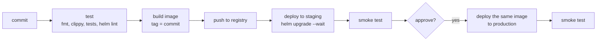

<!-- nav:top -->
[🏠 Start](../START-HERE.md) · [← 21.6 Packaging with Helm and Kustomize](06-helm-and-kustomize.md) · [📋 Phase 21](README.md) · [21.8 Infrastructure as code with OpenTofu →](08-infrastructure-as-code-with-opentofu.md) · [📖 Glossary](../GLOSSARY.md) · [🇷🇺 Русский](../../ru/21-cloud-native-infrastructure/07-ci-cd-from-commit-to-production.md) <!-- nav -->

# Lesson 21.7 — CI/CD: from commit to production

> **Phase 21 — Cloud-native infrastructure** · Lesson 7 of 14 · ⏱ about 2.5 hours (2 sittings)

## What you will learn

- The difference between continuous integration, continuous delivery and continuous deployment, and the stages of a delivery pipeline.
- Why you build an image **once** per commit, tag it with the commit, and promote the same image from environment to environment.
- How to run the whole pipeline on your Mac with one script: test, build, publish, deploy, smoke test — and how a bad release rolls itself back.
- How the same pipeline looks in GitHub Actions, with a registry, a kind cluster in CI and a protected production environment.
- Push-based and pull-based (GitOps) deployment, and the main release strategies: rolling, blue-green and canary.

## Before you start

- You finished [Lesson 21.6 — Packaging with Helm and Kustomize](06-helm-and-kustomize.md). You need the chart `chart/hello` **with the Helm test** from its Exercise 2 (the file is repeated in Section 3).
- You know CI with GitHub Actions and `actionlint` ([Lesson 09.12 — Continuous integration](../09-testing-debugging-benchmarking/12-continuous-integration.md)) and supply-chain security ([Lesson 20.7](../20-reliability-and-hardening/07-supply-chain-security-in-depth.md)).
- `code/p21-hello` is committed in your course repository (`~/projects/rust`), with `admin-token.txt` and `dev-token.txt` in `.gitignore`.

## New words

| Word | Meaning |
|---|---|
| **CI** (Continuous Integration) | Every change is merged often and checked automatically: build, lint, tests. |
| **continuous delivery** | Every change that passes CI is turned into a release that *can* go to production at any moment; a person decides when. |
| **continuous deployment** | Like continuous delivery, but every good change goes to production automatically, with no person in between. |
| **CD** | Short for continuous delivery or continuous deployment; which one is meant depends on the team. |
| **pipeline** | The ordered stages that a change passes through, from commit to production. |
| **artifact** | The result of a build that you deploy; for us, the container image. |
| **promotion** | Moving the same artifact from one environment to the next (test → staging → production) without rebuilding it. |
| **staging** | An environment that is as close to production as possible, used for the last checks. |
| **image digest** | The SHA-256 (Secure Hash Algorithm) hash of an image's content, such as `sha256:aad5…`. Unlike a tag, it can never point to different content. |
| **GHCR** (GitHub Container Registry) | GitHub's image registry at `ghcr.io`. |
| **e2e** (end-to-end) | A test of the whole running system together: from the image and the cluster to an answer through the Service. One job of the workflow in Section 5 has this name. |
| **GitOps** | A way of deploying where a program inside the cluster pulls the desired state from a Git repository and reconciles the cluster to it. |
| **blue-green deployment** | Running the new version next to the old one and switching all traffic at once. |
| **canary release** | Sending a small part of the traffic to the new version first, and more only if it behaves well. |
| **feature flag** | A switch in configuration that turns a feature on or off without a new deployment. |

## 1. CI, continuous delivery, continuous deployment

In Lesson 09.12 you built **CI** (Continuous Integration): every push runs format, lint and tests, so `main` is always in a good state. CI answers "is this change correct?". It does not put anything on a server.

**CD** goes further and comes in two strengths:

- **Continuous delivery:** every change that passes the pipeline becomes a release that *could* go to production now. The last step is a button that a person presses.
- **Continuous deployment:** there is no button. Every good change goes to production by itself, often many times a day.

Both need the same pipeline:



Each stage is a gate: if it fails, the change stops there, and the earlier the better. A failing unit test costs seconds; a failing smoke test in staging costs minutes; a failure in production costs users.

## 2. Build once, deploy many

The most important rule of a delivery pipeline: **build the artifact once, then promote the same artifact.** If staging and production each rebuild the image from the same commit, you get two images that are *probably* the same: a dependency, a base image or a compiler may have changed between the builds. Then "it worked in staging" proves nothing.

So the pipeline:

1. builds the image once, right after the tests;
2. tags it with something that names the code exactly: the **commit hash** (for example `d6750d2d90f0`), never `latest`;
3. pushes it to a registry;
4. deploys exactly that tag to staging, and later exactly that tag to production. Only **configuration** differs between environments (Lessons 21.5, 21.6).

A tag is still a name that *someone* could move to other content. For the strongest guarantee, deploy by **digest**: `ghcr.io/you/p21-hello@sha256:…`. The digest is computed from the content itself, so it can never change. Signing images and checking signatures before deployment (Lesson 20.7) builds on the same idea.

> 🔒 **Security:** the pipeline holds the keys to production. Anyone who can change the pipeline file, or a dependency it runs, can deploy anything. Protect the pipeline like production: review changes to workflow files, give each job only the permissions it needs, and keep production credentials in a protected environment (Section 5).

## 3. The pipeline on your Mac

Before you write a pipeline for a CI service, write it as a script you can run yourself. Then the CI file only calls the same steps, and you can debug the pipeline locally.

If you skipped Exercise 2 of Lesson 21.6, add the Helm test now, as `chart/hello/templates/tests/test-connection.yaml`:

```yaml
apiVersion: v1
kind: Pod
metadata:
  name: {{ .Release.Name }}-test
  labels:
    # Not the selector labels: the Service must not send traffic to this pod.
    app.kubernetes.io/instance: {{ .Release.Name }}
    app.kubernetes.io/component: test
  annotations:
    "helm.sh/hook": test
    "helm.sh/hook-delete-policy": before-hook-creation
spec:
  restartPolicy: Never
  containers:
    - name: wget
      image: busybox:1.37
      command:
        - sh
        - -c
        - wget -qO- -T 5 http://{{ .Release.Name }} | grep '{{ .Values.greeting }} from'
```

Then create `code/p21-hello/deploy.sh` and make it executable (`chmod +x deploy.sh`):

```bash
#!/usr/bin/env bash
# deploy.sh: the pipeline of Lesson 21.7, run against a local kind cluster.
set -euo pipefail

CLUSTER=${CLUSTER:-course-21-07}
IMAGE=course-p21-hello

# The image tag names the exact commit, so the code must be committed.
if ! git diff --quiet HEAD -- .; then
  echo "deploy: commit your changes first" >&2
  exit 1
fi
TAG=$(git rev-parse --short=12 HEAD)

echo "==> 1/5 test"
cargo fmt --check
cargo clippy --quiet --all-targets -- -D warnings
cargo test --quiet
helm lint --quiet chart/hello

echo "==> 2/5 build $IMAGE:$TAG"
docker build --quiet -t "$IMAGE:$TAG" . >/dev/null

echo "==> 3/5 publish (here: load into kind)"
kind load docker-image "$IMAGE:$TAG" --name "$CLUSTER"

echo "==> 4/5 deploy"
helm upgrade --install hello chart/hello \
  --set image.tag="$TAG" \
  --wait --timeout 2m --rollback-on-failure

echo "==> 5/5 smoke test"
helm test hello --logs
```

**What happens:**

1. `set -euo pipefail` (Lesson 11.9) stops the script at the first failing command, so a failed stage stops the pipeline.
2. The first check refuses to deploy uncommitted changes: `git diff --quiet HEAD -- .` exits with non-zero when tracked files in this folder differ from the last commit. Without it, the tag would name a commit that does not contain the code you deploy.
3. `git rev-parse --short=12 HEAD` gives the first 12 characters of the current commit hash: the image tag.
4. Stage 1 is the CI gate of Lesson 09.12 plus `helm lint` for the chart.
5. Stage 2 builds the image once. Stage 3 *publishes* it; with kind, "publish" means `kind load`, and in CI it will be `docker push` to a registry.
6. Stage 4 deploys exactly this tag. `--wait` waits until the new pods are ready; `--timeout 2m` limits the wait; `--rollback-on-failure` makes Helm return to the previous revision by itself if the release does not become ready in time (Section 4).
7. Stage 5 runs the Helm test: a real request through the Service, checked against the expected greeting.

> 🧪 **Testing:** the smoke test is the last test in the chain, and the only one that checks the *running* system: the image, the configuration, the Secret, the Service and the network together. Keep it fast and simple ("does it answer correctly?"), and keep detailed tests earlier in the pipeline, where failures are cheap.

Create the cluster and the Secret, commit the script, and run it:

```bash
kind create cluster --name course-21-07
kubectl create secret generic hello-admin --from-file=admin-token=admin-token.txt
git add deploy.sh chart && git commit -m "p21-hello: local deploy pipeline"
./deploy.sh
```

```text
==> 1/5 test

running 3 tests
...
test result: ok. 3 passed; 0 failed; 0 ignored; 0 measured; 0 filtered out; finished in 0.00s

==> 2/5 build course-p21-hello:1a3df93110ca
==> 3/5 publish (here: load into kind)
Image: "course-p21-hello:1a3df93110ca" with ID "sha256:aad5978d15471781280ee1c0aac2b83bde56134a2fa509407bc957f7e888ce79" not yet present on node "course-21-07-control-plane", loading...
==> 4/5 deploy
Release "hello" does not exist. Installing it now.
NAME: hello
LAST DEPLOYED: Wed Nov 18 14:12:41 2026
NAMESPACE: default
STATUS: deployed
REVISION: 1
DESCRIPTION: Install complete
==> 5/5 smoke test
NAME: hello
LAST DEPLOYED: Wed Nov 18 14:12:41 2026
NAMESPACE: default
STATUS: deployed
REVISION: 1
DESCRIPTION: Install complete
TEST SUITE:     hello-test
Last Started:   Wed Nov 18 14:12:47 2026
Last Completed: Wed Nov 18 14:12:54 2026
Phase:          Succeeded

POD LOGS: hello-test (wget)
salam from hello-599f54bf95-v4gkl (version 0.3.0)
```

Your commit hash and the times will differ. Now make a change: set `greeting: privet` in `chart/hello/values.yaml` and run the script **without** committing:

```text
deploy: commit your changes first
```

Commit (`git commit -am "p21-hello: greet with privet"`) and run `./deploy.sh` again. The same five stages run; the image gets the new tag, and stage 4 now says `Release "hello" has been upgraded. Happy Helming!` and `REVISION: 2`. The smoke test prints `privet from hello-6b8c74c99d-f7j48 (version 0.3.0)`. Every pod now runs the image of the new commit:

```bash
kubectl get pods -l app.kubernetes.io/name=hello -o custom-columns=NAME:.metadata.name,IMAGE:.spec.containers[0].image
```

```text
NAME                     IMAGE
hello-6b8c74c99d-f7j48   course-p21-hello:d6750d2d90f0
hello-6b8c74c99d-nhcl9   course-p21-hello:d6750d2d90f0
hello-6b8c74c99d-qgx6j   course-p21-hello:d6750d2d90f0
```

From any pod you can go back to the exact commit with `git show d6750d2d90f0`. That traceability is what the commit tag buys you.

## 4. A bad release rolls itself back

Simulate a broken release: an image tag that does not exist (as if the build had pushed nothing). Use a shorter timeout so that you do not wait long:

```bash
helm upgrade hello chart/hello --set image.tag=0.0.0-missing --wait --timeout 60s --rollback-on-failure
helm history hello
```

```text
level=WARN msg="upgrade failed" name=hello error="resource Deployment/default/hello not ready. status: InProgress, message: Updated: 1/3\ncontext deadline exceeded"
Error: UPGRADE FAILED: release hello failed, and has been rolled back due to rollback-on-failure being set: resource Deployment/default/hello not ready. status: InProgress, message: Updated: 1/3
context deadline exceeded
REVISION	UPDATED                 	STATUS    	CHART      	APP VERSION	DESCRIPTION                                                                                                   
1       	Wed Nov 18 14:12:41 2026	superseded	hello-0.1.0	0.3.0      	Install complete                                                                                              
2       	Wed Nov 18 14:12:56 2026	superseded	hello-0.1.0	0.3.0      	Upgrade complete                                                                                              
3       	Wed Nov 18 14:13:13 2026	failed    	hello-0.1.0	0.3.0      	Upgrade "hello" failed: resource Deployment/default/hello not ready. status: InProgress, message: Updated: ...
4       	Wed Nov 18 14:14:13 2026	deployed  	hello-0.1.0	0.3.0      	Rollback to 2                                                                                                 
```

**What happens:**

1. Helm applied revision 3. The Deployment created one new pod, which could not pull its image (Lesson 21.4), so the rollout stayed at `Updated: 1/3`.
2. Because of `maxUnavailable: 0`, the three old pods kept serving the whole time.
3. After 60 seconds Helm gave up, marked revision 3 as `failed`, and rolled back automatically: revision 4 is "Rollback to 2". The broken pod is removed.
4. `helm upgrade` exited with an error, so in `deploy.sh` (because of `set -e`) the pipeline would stop here and not run the smoke test: a red pipeline, with a working service.

This is the safety net you want: readiness probes (Lesson 21.5) decide whether a new pod is good, the rolling update keeps the old pods until then, and the pipeline turns "not ready in time" into an automatic rollback and a failed run that someone will look at.

## 5. The same pipeline in GitHub Actions

On GitHub the pipeline becomes a workflow. It has four jobs: `test` on every push and pull request; `image`, `e2e` and `production` only after a push. Create `.github/workflows/p21-hello.yml` at the root of your repository:

```yaml
name: p21-hello CD

on:
  push:
    branches: [main]
    paths: ["code/p21-hello/**", ".github/workflows/p21-hello.yml"]
  pull_request:
    paths: ["code/p21-hello/**", ".github/workflows/p21-hello.yml"]

# The smallest rights by default; jobs ask for more only when they need it.
permissions:
  contents: read

env:
  CARGO_TERM_COLOR: always

jobs:
  test:
    runs-on: ubuntu-latest
    defaults:
      run:
        working-directory: code/p21-hello
    steps:
      - uses: actions/checkout@v7
      - run: rustup toolchain install stable --profile minimal --component rustfmt,clippy
      - uses: Swatinem/rust-cache@v2
        with:
          workspaces: code/p21-hello
      - run: cargo fmt --check
      - run: cargo clippy --all-targets -- -D warnings
      - run: cargo test
      - uses: azure/setup-helm@v5
      - run: helm lint chart/hello

  image:
    needs: test
    if: github.event_name == 'push'
    runs-on: ubuntu-latest
    permissions:
      contents: read
      packages: write
    outputs:
      repo: ${{ steps.names.outputs.repo }}
      tag: ${{ steps.names.outputs.tag }}
    steps:
      - uses: actions/checkout@v7
      - id: names
        name: Image name and tag
        run: |
          echo "repo=ghcr.io/${GITHUB_REPOSITORY_OWNER,,}/p21-hello" >> "$GITHUB_OUTPUT"
          echo "tag=sha-${GITHUB_SHA::12}" >> "$GITHUB_OUTPUT"
      - uses: docker/login-action@v4
        with:
          registry: ghcr.io
          username: ${{ github.actor }}
          password: ${{ secrets.GITHUB_TOKEN }}
      - uses: docker/setup-buildx-action@v4
      - uses: docker/build-push-action@v7
        with:
          context: code/p21-hello
          push: true
          tags: ${{ steps.names.outputs.repo }}:${{ steps.names.outputs.tag }}

  e2e:
    needs: image
    runs-on: ubuntu-latest
    permissions:
      contents: read
      packages: read
    env:
      IMAGE_REPO: ${{ needs.image.outputs.repo }}
      IMAGE_TAG: ${{ needs.image.outputs.tag }}
    defaults:
      run:
        working-directory: code/p21-hello
    steps:
      - uses: actions/checkout@v7
      - uses: azure/setup-helm@v5
      - uses: helm/kind-action@v1
        with:
          cluster_name: e2e
      - uses: docker/login-action@v4
        with:
          registry: ghcr.io
          username: ${{ github.actor }}
          password: ${{ secrets.GITHUB_TOKEN }}
      - name: Load the pushed image into kind
        run: |
          docker pull "$IMAGE_REPO:$IMAGE_TAG"
          kind load docker-image "$IMAGE_REPO:$IMAGE_TAG" --name e2e
      - name: Create the Secret
        run: kubectl create secret generic hello-admin --from-literal=admin-token="$(openssl rand -hex 16)"
      - name: Deploy
        run: >
          helm upgrade --install hello chart/hello
          --set image.repository="$IMAGE_REPO"
          --set image.tag="$IMAGE_TAG"
          --wait --timeout 3m --rollback-on-failure
      - name: Smoke test
        run: helm test hello --logs

  production:
    needs: [image, e2e]
    if: github.ref == 'refs/heads/main'
    runs-on: ubuntu-latest
    # Rules for this environment (required reviewers, allowed branches)
    # are set in the repository settings on GitHub.
    environment: production
    env:
      IMAGE_REPO: ${{ needs.image.outputs.repo }}
      IMAGE_TAG: ${{ needs.image.outputs.tag }}
    defaults:
      run:
        working-directory: code/p21-hello
    steps:
      - uses: actions/checkout@v7
      - uses: azure/setup-helm@v5
      - name: Deploy the same image to production
        env:
          KUBECONFIG_DATA: ${{ secrets.PRODUCTION_KUBECONFIG }}
        run: |
          export KUBECONFIG="$RUNNER_TEMP/kubeconfig"
          printf '%s' "$KUBECONFIG_DATA" > "$KUBECONFIG"
          helm upgrade --install hello chart/hello \
            --set image.repository="$IMAGE_REPO" \
            --set image.tag="$IMAGE_TAG" \
            --wait --timeout 5m --rollback-on-failure
          helm test hello --logs
```

**What happens:**

1. `paths` runs the workflow only when files of this service (or the workflow itself) change; other code in the course repository does not trigger it.
2. `test` is the gate of Lesson 09.12, plus `helm lint`. `azure/setup-helm` installs Helm on the runner.
3. `image` runs only for a push (`if: github.event_name == 'push'`), never for a pull request: code from a pull request must not be able to publish images. It asks for one extra permission, `packages: write`, to push to GHCR (GitHub Container Registry). The built-in `GITHUB_TOKEN` is the password; there is no long-lived secret to steal.
4. The `names` step computes the image name and tag in bash: `${GITHUB_REPOSITORY_OWNER,,}` is the owner in lower case (registry names must be lower case), and `${GITHUB_SHA::12}` the first 12 characters of the commit. They become **job outputs**, which later jobs read as `needs.image.outputs.repo` and `.tag`.
5. `e2e` creates a fresh kind cluster on the runner with `helm/kind-action`, pulls the **pushed** image (not a new build), loads it into kind, creates a Secret with a random token, deploys with the same `helm upgrade` as `deploy.sh`, and runs the Helm test. This is staging in miniature: the real artifact in a real cluster.
6. `production` runs only on `main` and uses the **environment** `production`. In the repository settings on GitHub you give this environment protection rules, for example "one reviewer must approve" and "only from `main`"; the job then waits for that approval (continuous delivery). The kubeconfig of the real cluster is an *environment secret*, readable only by jobs of this environment. It deploys the same `repo:tag` as `e2e`.
7. Values from outside (image names, tags) reach shell commands through `env:` variables, not by writing `${{ ... }}` inside `run:`. This avoids the script-injection problem of Lesson 09.12.

You cannot run GitHub's runners on your Mac, so the output of a run is not shown here. Check the file with `actionlint` as in Lesson 09.12; for this workflow it printed nothing and exited with `0`. In this course you have no production cluster: the `production` job would fail for lack of the secret, so stop after `e2e` (remove the job, or keep it as a template for later).

## 6. Push or pull: GitOps

Both `deploy.sh` and the workflow **push**: a program outside the cluster runs `helm upgrade` against it. There is a second model:

```text
  push (this lesson)                      pull (GitOps)

  CI ──helm upgrade──► cluster            CI ──commit "tag: d6750d2"──► Git repo
  (CI needs cluster credentials)                                          ▲
                                          cluster: Argo CD / Flux ────────┘
                                          watches the repo and reconciles
                                          (no credentials leave the cluster)
```

In **GitOps**, the desired state of every environment lives in a Git repository (manifests, Helm values, Kustomize overlays). An agent inside the cluster, such as Argo CD or Flux, regularly compares the cluster with Git and applies the difference. It is the reconciliation loop of Lesson 21.1 again, with Git as the desired state. CI's last step is only a commit that changes the image tag in that repository.

| | Push (CI deploys) | Pull (GitOps) |
|---|---|---|
| Who changes the cluster | The CI job | An agent inside the cluster |
| Cluster credentials | Stored in CI | Stay inside the cluster |
| Drift (manual changes) | Stays until the next deploy | Detected and undone automatically |
| Audit trail | CI logs | Git history of the environment repository |
| Effort | Simple, nothing to install | An extra system to run |

For one service and one cluster, push is fine. With many services and clusters, GitOps is common, because Git becomes the single, reviewed source of truth for what runs where.

## 7. Release strategies

A rolling update (Lesson 21.4) is only one way to release:

| Strategy | How it works | Good | Costs |
|---|---|---|---|
| **Rolling** | Replace pods a few at a time | Built into Deployments, no extra capacity | Old and new versions serve at the same time for a while |
| **Blue-green** | Start the full new version ("green") next to the old ("blue"); switch the Service selector to green at once | Instant switch and instant switch back | Double capacity during the release |
| **Canary** | Send a small share (say 5%) of the traffic to the new version, watch error rate and latency, then increase | Problems reach few users | Needs traffic splitting and good metrics (Lessons 21.9–21.11) |

With plain Kubernetes you can build blue-green with two Deployments and one Service whose selector you change (the labels idea of Lesson 21.2). Canaries with exact percentages need a traffic-aware component, such as an Ingress controller, a service mesh or a tool like Argo Rollouts. **Feature flags** complement all three: the new code is deployed but switched off, and you turn it on in configuration, for some users first.

> ⚠️ **Common mistake:** during a rolling, blue-green or canary release, the old and the new version run **at the same time**. A database migration that the old version cannot handle (for example, renaming a column) breaks the old pods in the middle of the release. Make changes backward compatible: first add the new column, release code that writes both, and remove the old column in a later release (Lesson 16.7).

## 8. Clean up

```bash
kind delete cluster --name course-21-07
docker image ls --filter reference=course-p21-hello
```

Remove the listed images with `docker image rm course-p21-hello:<tag>` (one per commit you deployed). Keep `deploy.sh` and the workflow: the CI pipeline of the phase project in Lesson 21.13 follows the same pattern.

## Common mistakes

**Rebuilding the image for each environment.** "We build in staging and again in production" means production runs an untested artifact. Build once, push once, deploy the same tag (or digest) everywhere.

**A green pipeline with a broken service.** A deploy step that only runs `kubectl apply` succeeds as soon as the API (Application Programming Interface) server accepts the objects, even if no new pod ever becomes ready. Always wait for the rollout (`helm upgrade --wait`, `kubectl rollout status`) and run a smoke test.

**Deploying uncommitted code.** A tag made from the commit hash is a lie if the working folder had changes. `deploy.sh` refuses (`deploy: commit your changes first`); in CI the checkout is always clean.

**One all-powerful credential.** A kubeconfig with cluster-admin rights stored as a normal repository secret can be used by any workflow and, through a careless step, leaked to logs. Give the deploying identity rights only in its namespace, store it as an environment secret behind approvals, or use GitOps or short-lived credentials (GitHub's OIDC, OpenID Connect, lets a job get a temporary token from a cloud provider without any stored secret).

## Try it yourself

1. Run `./deploy.sh` twice without changing anything. Does stage 4 create a new revision? (Look at `helm history hello`.) Why is that harmless?
2. Break a unit test on purpose, commit, and run `./deploy.sh`. At which stage does it stop, and is anything deployed?
3. Clean up as in Section 8.

## Exercises

### Exercise 1 — Name the practice (easy)

For each team, say whether it does CI only, continuous delivery or continuous deployment, and find the one team that breaks "build once, deploy many".

1. Every push runs tests; releases are built by hand on a developer's laptop once a month.
2. Every merge to `main` is built, tested, deployed to staging and smoke-tested; a release manager clicks "approve" to send that image to production.
3. Every merge to `main` that passes all stages goes to production automatically.
4. Every merge is tested; the staging job and the production job each run `docker build` from the same commit.

<details>
<summary>Hint</summary>

Ask two questions: is every good change *ready* for production (delivery)? Does it *go* there without a person (deployment)? Then look at how many times the image is built.

</details>

<details>
<summary>Answer</summary>

1. CI only: changes are checked, but releases are manual and rare (and a laptop build is not reproducible).
2. Continuous delivery: every change becomes a deployable, tested release; a person decides when.
3. Continuous deployment: no person in the last step.
4. CI plus some delivery, but it breaks "build once, deploy many": production runs an image that was never tested. Build once in a separate job and pass the tag to both deploy jobs, as the workflow in Section 5 does.

</details>

### Exercise 2 — A smoke test in Rust (medium)

Write an integration test file `tests/smoke.rs` that checks a **running** service: `/healthz` answers `200` with `ok\n`, `/readyz` answers `200`, and `/admin` without a token answers `401`. The address comes from the environment variable `BASE_URL`. A normal `cargo test` must not run these tests (they need a running service). Use only the standard library: a `TcpStream` and a hand-written HTTP/1.1 (HyperText Transfer Protocol) request (Lesson 15.8). Run them against the cluster through a port-forward.

<details>
<summary>Hint</summary>

Mark the tests with `#[ignore = "reason"]` and run them with `cargo test --test smoke -- --ignored`. Send `GET /path HTTP/1.1`, a `Host` header and `Connection: close`, so that the server closes the connection after the answer and `read_to_string` ends. The status code is the second word of the first line; the body starts after the first empty line (`\r\n\r\n`).

</details>

<details>
<summary>Answer</summary>

```rust
//! Smoke tests against a running service. They are ignored by a normal
//! `cargo test`. Run them with:
//! BASE_URL=http://127.0.0.1:8088 cargo test --test smoke -- --ignored

use std::io::{Read, Write};
use std::net::TcpStream;
use std::time::Duration;

/// Sends `GET path` over HTTP/1.1 and returns the status code and the body.
fn get(base: &str, path: &str) -> (u16, String) {
    let host = base.trim_start_matches("http://").trim_end_matches('/');
    let mut stream = TcpStream::connect(host).expect("cannot connect to the service");
    stream
        .set_read_timeout(Some(Duration::from_secs(5)))
        .unwrap();
    write!(
        stream,
        "GET {path} HTTP/1.1\r\nHost: {host}\r\nConnection: close\r\n\r\n"
    )
    .unwrap();

    let mut response = String::new();
    stream.read_to_string(&mut response).unwrap();
    let status = response
        .split_whitespace()
        .nth(1)
        .and_then(|code| code.parse().ok())
        .unwrap_or(0);
    let body = match response.split_once("\r\n\r\n") {
        Some((_headers, body)) => body.to_string(),
        None => String::new(),
    };
    (status, body)
}

fn base_url() -> String {
    std::env::var("BASE_URL").expect("set BASE_URL, for example http://127.0.0.1:8088")
}

#[test]
#[ignore = "needs a running service; set BASE_URL"]
fn health_and_readiness_are_ok() {
    let base = base_url();
    assert_eq!(get(&base, "/healthz"), (200, "ok\n".to_string()));
    assert_eq!(get(&base, "/readyz").0, 200);
}

#[test]
#[ignore = "needs a running service; set BASE_URL"]
fn admin_requires_a_token() {
    assert_eq!(get(&base_url(), "/admin").0, 401);
}
```

A normal `cargo test` now reports the two tests as ignored:

```text
running 2 tests
test admin_requires_a_token ... ignored, needs a running service; set BASE_URL
test health_and_readiness_are_ok ... ignored, needs a running service; set BASE_URL
```

With `kubectl port-forward service/hello 8088:80` running in another tab:

```bash
BASE_URL=http://127.0.0.1:8088 cargo test --test smoke -- --ignored
```

```text
running 2 tests
test admin_requires_a_token ... ok
test health_and_readiness_are_ok ... ok

test result: ok. 2 passed; 0 failed; 0 ignored; 0 measured; 0 filtered out; finished in 2.01s
```

Without the port-forward, both fail with a clear message:

```text
thread 'admin_requires_a_token' (6625025) panicked at tests/smoke.rs:12:47:
cannot connect to the service: Os { code: 61, kind: ConnectionRefused, message: "Connection refused" }
```

Why it works: files in `tests/` are integration tests, compiled as separate programs. `#[ignore]` keeps them out of the normal test run, so `deploy.sh` stage 1 stays fast and needs no cluster. `Connection: close` makes the server end the connection, which ends `read_to_string`. Unlike the Helm test, these tests live next to the code in Rust, so they can grow with the service.

</details>

### Exercise 3 — Run the Rust smoke tests in CI (hard)

Extend the `e2e` job of the workflow: after the Helm test, install a Rust toolchain and run the tests of Exercise 2 against the kind cluster on the runner. Check the file with `actionlint`.

<details>
<summary>Hint</summary>

The runner is a normal Linux machine with `kubectl` (from `helm/kind-action`). Start the port-forward in the background with `&`, give it a few seconds, then run `cargo test` with `BASE_URL`. The job's `defaults.run.working-directory` is already `code/p21-hello`.

</details>

<details>
<summary>Answer</summary>

Add two steps at the end of the `e2e` job:

```yaml
      - run: rustup toolchain install stable --profile minimal
      - name: Rust smoke tests through a port-forward
        run: |
          kubectl port-forward service/hello 8088:80 &
          sleep 3
          BASE_URL=http://127.0.0.1:8088 cargo test --test smoke -- --ignored
```

`actionlint` (also with its built-in shellcheck, in the official `rhysd/actionlint` image) reports no problems for the changed file. The same three commands, run on your Mac against `course-21-07`, gave the passing output of Exercise 2.

Why it works: the background port-forward keeps running while the tests need it; the runner cleans up such leftover background processes at the end of the job. `sleep 3` is a simple way to wait for the tunnel; a more robust script retries the first request a few times instead. The job compiles the tests once more, which costs time: add `Swatinem/rust-cache@v2` as in the `test` job if it becomes slow.

</details>

## Quiz

1. What is the difference between continuous delivery and continuous deployment?

<details>
<summary>Answer</summary>

In continuous delivery every good change becomes a release that can go to production, and a person decides when. In continuous deployment every good change goes to production automatically.

</details>

2. Why should the image be built only once per commit?

<details>
<summary>Answer</summary>

So that the artifact tested in earlier environments is exactly the one that runs in production. A rebuild can differ (new dependency, base image or compiler), and then earlier tests prove nothing.

</details>

3. Why is the commit hash a good image tag, and what is even stronger?

<details>
<summary>Answer</summary>

It names the exact code, so every running pod can be traced back to a commit, and it never needs to be reused. Stronger still is the digest (`@sha256:…`), which is computed from the content and cannot point to anything else.

</details>

4. In Section 4, why did users not notice the broken release?

<details>
<summary>Answer</summary>

The new pod never became ready, and with `maxUnavailable: 0` the old pods kept serving. After the timeout, `--rollback-on-failure` returned the release to the previous revision.

</details>

5. Why does the `image` job run only for pushes and not for pull requests?

<details>
<summary>Answer</summary>

Code in a pull request is not reviewed yet (and may come from a fork). It must not be able to publish images or use write permissions.

</details>

6. What is GitOps, and which idea from Lesson 21.1 does it reuse?

<details>
<summary>Answer</summary>

The desired state of each environment is kept in Git, and an agent inside the cluster (Argo CD, Flux) pulls it and reconciles the cluster to it. It is the reconciliation loop, with Git as the desired state.

</details>

7. Name one advantage and one cost of a canary release.

<details>
<summary>Answer</summary>

Advantage: a bad version reaches only a small share of users. Cost: it needs traffic splitting and good metrics to decide whether to continue.

</details>

## Summary

- CI checks every change; continuous delivery makes every good change releasable; continuous deployment releases it automatically.
- A delivery pipeline is a chain of gates: test → build image → publish → deploy to staging → smoke test → (approval) → production → smoke test.
- Build once, tag with the commit (or deploy by digest), and promote the same artifact; only configuration differs between environments.
- `helm upgrade --install --wait --rollback-on-failure` plus readiness probes and `maxUnavailable: 0` turn a bad release into an automatic rollback and a red pipeline, not an outage.
- In GitHub Actions: build and push once with `GITHUB_TOKEN` and `packages: write`, test the pushed image in a kind cluster, and deploy to a protected `production` environment.
- Push deployment is simple; GitOps keeps credentials inside the cluster and undoes drift.
- Rolling, blue-green and canary trade capacity, speed and risk; all of them run two versions at once, so changes must be backward compatible.

## Sources and further reading

- [Martin Fowler — Continuous Delivery](https://martinfowler.com/bliki/ContinuousDelivery.html) — a short, classic definition and the difference from continuous deployment.
- [GitHub Docs — Working with the Container registry](https://docs.github.com/en/packages/working-with-a-github-packages-registry/working-with-the-container-registry) — pushing images to `ghcr.io` with `GITHUB_TOKEN`.
- [GitHub Docs — Managing environments for deployment](https://docs.github.com/en/actions/managing-workflow-runs-and-deployments/managing-deployments/managing-environments-for-deployment) — protection rules and environment secrets.
- [GitHub Docs — Automatic token authentication](https://docs.github.com/en/actions/security-for-github-actions/security-guides/automatic-token-authentication) — what `GITHUB_TOKEN` can do and how `permissions` limit it.
- [GitHub Docs — OpenID Connect](https://docs.github.com/en/actions/concepts/security/openid-connect) — short-lived cloud credentials without stored secrets.
- [helm/kind-action](https://github.com/helm/kind-action) — the action that creates a kind cluster in a workflow.
- [OpenGitOps](https://opengitops.dev/) — the four GitOps principles; see also [Argo CD](https://argo-cd.readthedocs.io/en/stable/) and [Flux](https://fluxcd.io/).

---

[🏠 Start](../START-HERE.md) · [← 21.6 Packaging with Helm and Kustomize](06-helm-and-kustomize.md) · [📋 Phase 21](README.md) · [21.8 Infrastructure as code with OpenTofu →](08-infrastructure-as-code-with-opentofu.md) · [📖 Glossary](../GLOSSARY.md) <!-- nav -->
<!-- nav:bottom -->
