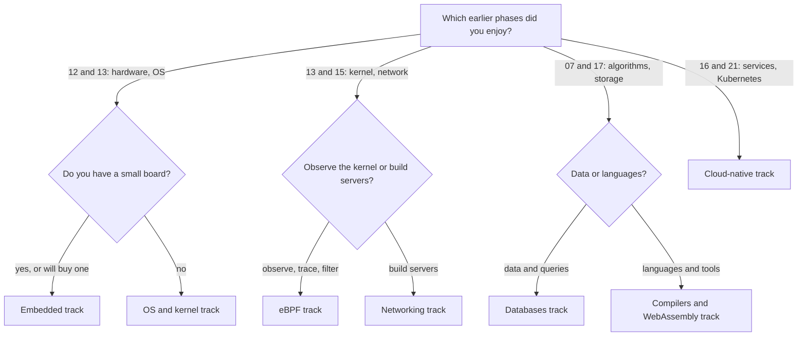

<!-- nav:top -->
[🏠 Start](../START-HERE.md) · [← Phase 22 — Specializations](README.md) · [📋 Phase 22](README.md) · [22.2 OS track: a freestanding Rust binary →](02-os-track-a-freestanding-binary.md) · [📖 Glossary](../GLOSSARY.md) · [🇷🇺 Русский](../../ru/22-specializations/01-choosing-a-specialization.md) <!-- nav -->

# Lesson 22.1 — Choosing a specialization

> **Phase 22 — Specializations** · Lesson 1 of 30 · ⏱ about 105 minutes

## What you will learn

- What a specialization is and why a systems engineer has one deep area next to broad basics.
- The seven tracks of this phase: what you build in each one and which earlier phases it uses.
- How to choose one track with a few honest questions, and how to move through the phase.
- How to check that your Mac has the tools your track needs, with a small Rust program and its tests.

## Before you start

- You finished [Phase 21 — Cloud-native infrastructure](../21-cloud-native-infrastructure/README.md) and the
  phases before it. This phase builds on all of them.
- You keep a learning journal ([Lesson 00.8](../00-getting-started/08-study-routine-notes-and-checkpoint.md)).
  You will write your choice there.
- You know `std::process::Command` from [Lesson 13.5](../13-operating-systems/05-fork-exec-and-wait.md).

## New words

| Word | Meaning |
|---|---|
| **specialization** | One area of engineering that you know much deeper than the rest, for example kernels or databases. |
| **track** | In this phase: a group of four lessons about one specialization. You study one track, not all seven. |
| **T-shaped engineer** | An engineer with broad basics (the top bar of the letter T) and one deep area (the vertical bar). |
| **OS** (Operating System) | The program that manages the hardware and runs other programs, for example Linux or macOS (Phase 13). |
| **kernel** | The core of an operating system, which runs with full control of the hardware. |
| **eBPF** (extended Berkeley Packet Filter) | A way to run small, checked programs inside the Linux kernel without changing the kernel. The name is historical; today it is used for much more than packets. |
| **embedded system** | A small computer built into a device (a thermostat, a drone) that runs one program, usually without an operating system. |
| **microcontroller** | A whole small computer on one chip: CPU (Central Processing Unit), memory and pins to talk to the outside world. |
| **query engine** | The part of a database that turns a query such as `SELECT …` into steps and runs them over the data. |
| **compiler** | A program that translates source code into another form, for example Rust into machine code. |
| **interpreter** | A program that runs source code directly, step by step, without producing machine code first. |
| **WebAssembly** (Wasm) | A portable binary format for programs. It runs in browsers and in separate runtimes on servers. |
| **operator** (Kubernetes) | A program that runs in a cluster and manages one kind of application automatically (Phase 21). |
| **nightly** | The Rust toolchain that is built every night. It has unstable features that some tracks need. |
| **QEMU** (Quick Emulator) | A free program that pretends to be a whole computer, so that you can boot your own kernel safely. |

**Other abbreviations in this lesson:** CSV (Comma-Separated Values, a text format for tables), HTTP (Hypertext
Transfer Protocol, the protocol of the web), USB (Universal Serial Bus, the usual cable and port for devices) and VM
(virtual machine: a whole computer simulated by software; the course VM `dev` comes from Lesson 11.1).

## 1. Why specialize

Phases 00–21 gave you the broad bar of the T: the Rust language, Git, algorithms, testing, security, Linux,
how the computer and the operating system work, networks, services, storage, distributed systems,
performance, reliability and Kubernetes. Almost every systems job expects these basics.

Jobs, open-source projects and interesting problems usually also need **depth in one area**. A team that
writes a database wants someone who understands query execution. A team that runs a large network wants
someone who can write a fast proxy. Depth is also what makes the work fun: you stop following
instructions and start to understand *why* things are built the way they are.

This phase gives you a first step into one deep area. Four lessons do not make you an expert. They give
you a working setup, the core ideas, a real project and a clear list of what to study and where to
contribute next. Many engineers later add a second specialization; you can come back here for that.

## 2. The seven tracks

Every track has the same shape: lesson 1 explains the field, why Rust is used there and how to set it up;
lessons 2 and 3 teach the core skills with small examples; lesson 4 is a project with milestones plus a
list of next steps (books, documentation, open-source projects, communities).

| Track | Lessons | What you build | Builds most on |
|---|---|---|---|
| OS and kernel | [22.2](02-os-track-a-freestanding-binary.md)–22.5 | A tiny kernel that boots in QEMU, prints text, handles interrupts and uses paging | Phases 12, 13 |
| eBPF | [22.6](06-ebpf-track-what-ebpf-is.md)–22.9 | Programs that run inside the Linux kernel and trace system calls or count network packets | Phases 13, 15 |
| Embedded | [22.10](10-embedded-track-microcontrollers-and-no-std.md)–22.13 | Firmware for a small, cheap board: blink a light, read a button, async tasks | Phases 12, 14 |
| Databases | [22.14](14-databases-track-how-query-engines-work.md)–22.17 | A tiny query engine that runs `SELECT` over CSV files, then Apache DataFusion | Phases 07, 17 |
| Networking | [22.18](18-networking-track-high-performance-servers.md)–22.21 | Fast Tokio servers, zero-copy parsing and an HTTP proxy | Phases 14, 15, 19 |
| Compilers and WebAssembly | [22.22](22-compilers-track-lexing-and-parsing.md)–22.25 | A lexer, a parser and an interpreter for a small language, then WebAssembly | Phases 07, 08 |
| Cloud-native | [22.26](26-cloud-native-track-kubernetes-operators.md)–22.29 | A Kubernetes operator in Rust, tested on a local kind cluster | Phases 16, 21 |

After your track, go to [Lesson 22.30 — Checkpoint](30-checkpoint-your-specialization.md). It has one question
set per track; you answer only the set of your track.

What the work looks like in each field, in one sentence each:

- **OS and kernel.** You write code that runs with no operating system under it: boot code, drivers,
  memory management. Rust is now used in the Linux kernel, in Android and in new research kernels.
- **eBPF.** You attach small programs to events in a running Linux kernel to observe or filter it, with no
  reboot. Observability and security tools and cloud networking are built this way.
- **Embedded.** You write firmware for chips with a few hundred kilobytes of memory. Rust's checks catch
  many bugs that would otherwise appear only on the device.
- **Databases.** You work on the engine inside a database: parsing, planning and running queries over
  columns of data. Several new analytics databases are written in Rust.
- **Networking.** You build servers and proxies that handle huge numbers of connections with low latency.
  Large internet companies run Rust proxies in production.
- **Compilers and WebAssembly.** You turn text into structure and structure into running code. The same
  skills appear in linters, query languages, configuration languages and code tools.
- **Cloud-native.** You write controllers that keep a cluster in the state you described, the "automation
  layer" of Kubernetes, with the kube-rs libraries.

## 3. How to choose

There is no wrong choice: every track uses the same Rust and the same engineering habits. Answer these
questions honestly and write the answers in your learning journal:

1. **Which earlier phase did you enjoy most?** The phase you liked is the best predictor. The table above
   shows which phases each track builds on.
2. **What kind of job do you want in two years?** Kernel and embedded work is close to hardware. Databases
   and compilers are about data structures and algorithms. Networking, eBPF and cloud-native are close to
   production systems and operations.
3. **What do you already have?** The embedded track needs a small board (a few dollars) and a USB cable.
   The eBPF track needs the Linux VM `dev` from [Lesson 11.1](../11-linux-shell-and-containers/01-linux-and-a-virtual-machine.md).
   The networking track uses the same VM for its Linux-only measurements. The other tracks need only your Mac and
   Docker.
4. **Which open-source project would you like to contribute to?** Each track ends with a list. Looking at
   those projects now can help you decide.



The diagram is only a starting point. If two tracks look equally good, pick the one whose project
(lesson 4 of the track) you would rather show to someone.

> 💡 **Tip:** Give your track about two weeks before you judge it. The first lesson of every track is the
> hardest, because everything is new. It becomes easier as soon as your setup works.

## 4. How to move through this phase

The lessons are numbered in one line, 22.1 to 22.30, but you do **not** read all of them. You read this
lesson, then the four lessons of your track, then the checkpoint:

```text
22.1 ──> your track (4 lessons) ──> 22.30 checkpoint ──> Phase 23
```

The "Next" link at the bottom of a lesson always points to the next file in the list. The first lesson of
each track starts with a note that tells you where to go if it is not your track, and the last lesson of
each track tells you to continue with 22.30.

**Code layout.** Each track keeps its code in its own folder named `code/p22-<name>`, for example
`code/p22-kernel` for the OS track. The first lesson of your track says the exact name and how its
examples are organised. The small program of this lesson lives in `code/p22-setup-check`.

> 📏 **Convention:** Commit your track work on a branch, as in earlier phases, with one commit per lesson
> step or project milestone. A clean history is part of what you will show in Phase 23 and Phase 24.

## 5. Check your tools with Rust

Before you start a track, check that the tools are there. Instead of typing six commands by hand, write a
small program that runs them and prints a table. Create the package:

```bash
cd ~/projects/rust
cargo new code/p22-setup-check
cd code/p22-setup-check
```

Replace `src/main.rs` with:

```rust
use std::process::Command;

/// Finds the first word that looks like a version number, such as "1.100.0".
fn first_version(text: &str) -> Option<&str> {
    text.split_whitespace()
        .map(|word| word.trim_start_matches('v').trim_end_matches(','))
        .find(|word| word.contains('.') && word.chars().all(|c| c.is_ascii_digit() || c == '.'))
}

/// Runs `<tool> <arg>` and returns the version it prints, if the tool exists.
fn tool_version(tool: &str, arg: &str) -> Option<String> {
    let output = Command::new(tool).arg(arg).output().ok()?;
    let text = String::from_utf8_lossy(&output.stdout);
    first_version(&text).map(String::from)
}

fn main() {
    let tools = [
        ("rustc", "--version", "every track"),
        ("cargo", "--version", "every track"),
        ("docker", "--version", "OS, eBPF, networking, cloud-native"),
        ("limactl", "--version", "eBPF, networking (the VM `dev`)"),
        ("kind", "--version", "cloud-native"),
        ("kubectl", "version", "cloud-native"),
    ];
    for (tool, arg, used_by) in tools {
        match tool_version(tool, arg) {
            Some(version) => println!("[ok]      {tool:<8} {version:<10} {used_by}"),
            None => println!("[missing] {tool:<8} {:<10} {used_by}", "-"),
        }
    }
}

#[cfg(test)]
mod tests {
    use super::*;

    #[test]
    fn finds_the_version_in_rustc_output() {
        let text = "rustc 1.100.0 (0ef1bc386 2026-11-09)";
        assert_eq!(first_version(text), Some("1.100.0"));
    }

    #[test]
    fn removes_a_leading_v_and_a_comma() {
        assert_eq!(
            first_version("Docker version 29.1.2, build abc"),
            Some("29.1.2")
        );
        assert_eq!(first_version("kind v0.31.0 go1.25"), Some("0.31.0"));
    }

    #[test]
    fn returns_none_without_a_version() {
        assert_eq!(first_version("command not found"), None);
    }
}
```

**What happens:**

1. `first_version` splits the text into words, removes a leading `v` (as in `v0.31.0`) and a trailing
   comma, and returns the first word made only of digits and dots that contains at least one dot.
   It returns `Option<&str>`: a slice of the input text, or `None`.
2. `tool_version` starts the tool as a child process with `Command::new(tool).arg(arg).output()`
   (Lesson 13.5). If the program does not exist, `output()` returns an error; `.ok()?` turns it into `None`
   and returns early.
3. `String::from_utf8_lossy` turns the bytes of standard output into text, replacing invalid bytes, so
   a strange tool output cannot crash the program.
4. `main` walks over an array of tuples `(tool, argument, used by)`. `{tool:<8}` pads the name to 8
   characters so that the columns line up.
5. The three tests check `first_version` with real-looking outputs. The function is pure (no processes,
   no files), which is why it is easy to test.

Run the tests, then the program:

```bash
cargo test
cargo run
```

```text
running 3 tests
test tests::finds_the_version_in_rustc_output ... ok
test tests::returns_none_without_a_version ... ok
test tests::removes_a_leading_v_and_a_comma ... ok

test result: ok. 3 passed; 0 failed; 0 ignored; 0 measured; 0 filtered out; finished in 0.00s
```

```text
[ok]      rustc    1.100.0    every track
[ok]      cargo    1.100.0    every track
[ok]      docker   29.9.3     OS, eBPF, networking, cloud-native
[missing] limactl  -          eBPF, networking (the VM `dev`)
[ok]      kind     0.33.0     cloud-native
[ok]      kubectl  1.36.1     cloud-native
```

This output comes from a machine without Lima. Your versions and your `[missing]` lines will be
different. A missing tool is only a problem if your track needs it; the first lesson of each track shows
how to install what it needs.

> 🧪 **Testing:** Notice the split: the part that talks to the outside world (`tool_version`) is thin, and
> the logic (`first_version`) is a pure function with tests. You will use the same split in every track:
> kernel code, eBPF programs and firmware are hard to test on your Mac, so their pure logic goes into
> functions that you can test with plain `cargo test`.

> 🔒 **Security:** The program runs only the fixed tool names from the array. Never build a command from
> text that a user typed without checking it ([Lesson 10.5](../10-security-fundamentals/05-injection-attacks.md)).

## Common mistakes

> ⚠️ **Common mistake:** Studying two tracks at the same time. Both stay shallow, and neither project gets
> finished. Finish one track and its checkpoint first; then start a second one if you want.

> ⚠️ **Common mistake:** Choosing by hype instead of by interest. A track that you do not enjoy is hard to
> finish. Use the questions in Section 3.

> ⚠️ **Common mistake:** Running kernel-level experiments on your Mac directly. In this phase, kernels boot
> inside QEMU, eBPF programs run in the VM `dev`, and clusters run in kind. Your Mac stays safe.

> ⚠️ **Common mistake:** Expecting `Command::new("docker --version")` to work. The first argument is only the
> program name. Arguments go into `.arg()`; otherwise the program `docker --version` (with a space in its
> name) is not found and you get `None`.

## Try it yourself

1. Create `code/p22-setup-check` as in Section 5, run `cargo test` and `cargo run`.
2. Read the first lesson of the two tracks you like most (only Sections 1 and 2 of each).
3. Answer the four questions of Section 3 in your learning journal and write one line:
   `My track: ...  Started: 2026-..-..`.
4. Commit the program: `git add code/p22-setup-check && git commit -m "Add p22 setup check"`.

## Exercises

### Exercise 1 — Check Git too (easy)

Add Git to the list of tools. `git --version` prints `git version 2.54.0` (your number may differ). The new
line must say that every track uses it.

<details>
<summary>Hint</summary>

Add one more tuple to the `tools` array. `first_version` already understands this output.

</details>

<details>
<summary>Answer</summary>

```rust
        ("git", "--version", "every track"),
```

Add this line inside the `tools` array, for example after the `cargo` line. The output gets a new row such as
`[ok]      git      2.54.0     every track`.

Why it works: the loop treats every tuple the same way, so adding a tool is only a data change.

</details>

### Exercise 2 — Test more outputs (medium)

Write a new test `ignores_words_that_are_not_versions` that checks two cases: `"git version 2.50.1"` gives
`Some("2.50.1")`, and `"version abc.def"` gives `None`. Run `cargo test` and see four tests pass.

<details>
<summary>Hint</summary>

Copy one of the existing tests inside `mod tests` and change the name and the two `assert_eq!` lines.

</details>

<details>
<summary>Answer</summary>

```rust
    #[test]
    fn ignores_words_that_are_not_versions() {
        assert_eq!(first_version("git version 2.50.1"), Some("2.50.1"));
        assert_eq!(first_version("version abc.def"), None);
    }
```

```text
test result: ok. 4 passed; 0 failed; 0 ignored; 0 measured; 0 filtered out; finished in 0.00s
```

Why it works: `abc.def` contains a dot, but its other characters are not digits, so `.all(...)` is false and
the word is skipped.

</details>

### Exercise 3 — Only my track, and a clear exit code (hard)

Change the program so that `cargo run -- eBPF` shows only the tools that the eBPF track needs (plus the
"every track" tools), and so that the program exits with code 1 when at least one shown tool is missing.
Write the filter as a small function so that you could test it.

<details>
<summary>Hint</summary>

`std::env::args().nth(1)` gives the first argument as `Option<String>`; `.as_deref()` turns it into
`Option<&str>`. `std::process::exit(1)` ends the program with code 1. Count the missing tools in a
`let mut missing = 0;`.

</details>

<details>
<summary>Answer</summary>

```rust
/// Is a tool with this `used_by` text needed for `track` (or for all tracks)?
fn wanted(used_by: &str, track: Option<&str>) -> bool {
    match track {
        None => true,
        Some(track) => used_by == "every track" || used_by.contains(track),
    }
}

fn main() {
    let tools = [
        ("rustc", "--version", "every track"),
        ("cargo", "--version", "every track"),
        ("docker", "--version", "OS, eBPF, networking, cloud-native"),
        ("limactl", "--version", "eBPF, networking (the VM `dev`)"),
        ("kind", "--version", "cloud-native"),
        ("kubectl", "version", "cloud-native"),
    ];
    // `cargo run -- eBPF` keeps only the tools that the eBPF track needs.
    let track = std::env::args().nth(1);
    let mut missing = 0;
    for (tool, arg, used_by) in tools {
        if !wanted(used_by, track.as_deref()) {
            continue;
        }
        match tool_version(tool, arg) {
            Some(version) => println!("[ok]      {tool:<8} {version:<10} {used_by}"),
            None => {
                println!("[missing] {tool:<8} {:<10} {used_by}", "-");
                missing += 1;
            }
        }
    }
    if missing > 0 {
        eprintln!("{missing} tool(s) missing");
        std::process::exit(1);
    }
}
```

`first_version`, `tool_version` and the tests stay as they were. Run it with `cargo run -q -- eBPF; echo "exit $?"`:

```text
[ok]      rustc    1.100.0    every track
[ok]      cargo    1.100.0    every track
[ok]      docker   29.9.3     OS, eBPF, networking, cloud-native
[missing] limactl  -          eBPF, networking (the VM `dev`)
1 tool(s) missing
exit 1
```

Why it works: `wanted` is a pure function, so a test such as
`assert!(!wanted("cloud-native", Some("eBPF")))` can check it. The exit code lets a script (or you, with
`echo $?`) see at once whether the setup is complete.

</details>

## Quiz

1. What does "T-shaped engineer" mean?

<details>
<summary>Answer</summary>

Broad basics in many areas (the top bar of the T) plus one deep area (the vertical bar). Phases 00–21 built the
bar; this phase starts the deep part.

</details>

2. How many lessons of this phase do you read, and in which order?

<details>
<summary>Answer</summary>

Six: this lesson, the four lessons of your track, and the checkpoint 22.30. Then you continue with Phase 23.

</details>

3. Which track needs hardware that you may have to buy, and which one needs the Linux VM?

<details>
<summary>Answer</summary>

The embedded track needs a small microcontroller board and a USB cable. The eBPF track needs a Linux kernel,
so it runs in the VM `dev` (the networking track also uses the VM for Linux-only measurements).

</details>

4. Why is `first_version` easy to test but `tool_version` is not?

<details>
<summary>Answer</summary>

`first_version` is a pure function: the same input text always gives the same result. `tool_version` starts real
programs, so its result depends on what is installed on the machine.

</details>

5. You like both the databases track and the compilers track. How can you decide?

<details>
<summary>Answer</summary>

Look at the project in lesson 4 of each track and pick the one you would rather build and show. Both are good
choices; you can study the other one later.

</details>

## Summary

- A specialization is one deep area on top of the broad basics of Phases 00–21.
- This phase has seven tracks of four lessons each: OS, eBPF, embedded, databases, networking, compilers and
  WebAssembly, cloud-native.
- Each track: the field and setup, two core-skill lessons, then a project with next steps.
- Read this lesson, your four track lessons and the checkpoint 22.30; skip the other tracks.
- Choose by what you enjoyed, the job you want, the hardware you have and the projects you like.
- Keep the logic pure and tested, and keep the code that touches the outside world thin.

## Sources and further reading

- [Rust for Linux](https://rust-for-linux.com/) — the project that brings Rust into the Linux kernel; a good look at
  the OS track's world.
- [Aya documentation](https://aya-rs.dev/) — the Rust eBPF library used in the eBPF track.
- [The Embedded Rust Book](https://docs.rust-embedded.org/book/) — the official starting point for embedded Rust.
- [Apache DataFusion](https://datafusion.apache.org/) — the Rust query engine used in the databases track.
- [Crafting Interpreters](https://craftinginterpreters.com/) — a free book about building languages, used in the
  compilers track.
- [kube-rs](https://kube.rs/) — the Rust Kubernetes client and controller runtime of the cloud-native track.

---

[🏠 Start](../START-HERE.md) · [← Phase 22 — Specializations](README.md) · [📋 Phase 22](README.md) · [22.2 OS track: a freestanding Rust binary →](02-os-track-a-freestanding-binary.md) · [📖 Glossary](../GLOSSARY.md) <!-- nav -->
<!-- nav:bottom -->
