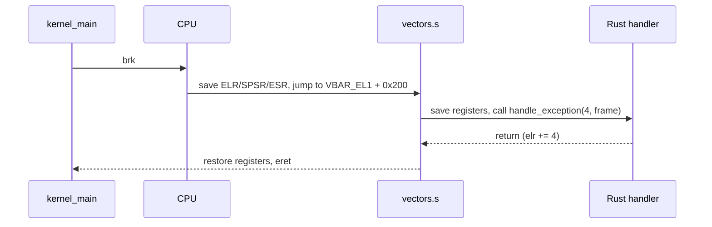

<!-- nav:top -->
[🏠 Start](../START-HERE.md) · [← 22.3 OS track: booting a kernel in QEMU](03-os-track-booting-a-kernel-in-qemu.md) · [📋 Phase 22](README.md) · [22.5 OS track: project and next steps →](05-os-track-project-and-next-steps.md) · [📖 Glossary](../GLOSSARY.md) · [🇷🇺 Русский](../../ru/22-specializations/04-os-track-interrupts-and-paging.md) <!-- nav -->

# Lesson 22.4 — OS track: interrupts and paging

> **Phase 22 — Specializations** · Lesson 4 of 30 · ⏱ about 3 hours (2 sittings)

## What you will learn

- What exceptions and interrupts are on arm64, and what the CPU does when one happens.
- How to write an exception vector table that saves registers and calls Rust.
- How to build a page table, turn on the MMU and map the same memory at two addresses.
- How to get timer interrupts through the GIC interrupt controller.
- How to read a page fault: the exception class, the fault status and the faulting address.

## Before you start

- You finished [Lesson 22.3 — OS track: booting a kernel in QEMU](03-os-track-booting-a-kernel-in-qemu.md); your
  kernel boots with `cargo run` and prints with `println!`.
- You know pages, frames, page tables and the TLB from [Lesson 13.10 — Virtual memory](../13-operating-systems/10-virtual-memory.md).
  This lesson builds a page table by hand.
- You know atomics ([Lesson 14.5](../14-concurrency-and-async/05-atomics.md)) and bit operations
  ([Lesson 12.4](../12-computer-systems/04-bitwise-operations.md)).

## New words

| Word | Meaning |
|---|---|
| **exception** | An event that makes the CPU stop the current code and jump to a handler: a fault, a special instruction or an interrupt. |
| **interrupt** | An exception caused by a device ("a timer expired", "a key was pressed"), not by the current instruction. |
| **IRQ** (Interrupt Request) | The normal kind of interrupt on arm64. |
| **exception level** (EL) | The privilege level of the CPU: EL0 for programs, EL1 for the kernel, EL2 for a hypervisor, EL3 for firmware. |
| **vector table** | A table of small code blocks; the CPU jumps into it when an exception happens. Its address is in `VBAR_EL1`. |
| **system register** | A CPU register for control and status, such as `ESR_EL1`, read with `mrs` and written with `msr`. |
| **ESR** (Exception Syndrome Register) | Says why the exception happened: the exception class and details. |
| **FAR** (Fault Address Register) | The address that a faulting memory access tried to use. |
| **ELR** (Exception Link Register) | The address where the interrupted code continues after `eret`. |
| **MMU** (Memory Management Unit) | The part of the CPU that translates virtual addresses to physical ones with page tables. |
| **block entry** | A page table entry that maps a whole large region (here 1 GiB) directly, without a next-level table. |
| **identity mapping** | A mapping where the virtual address equals the physical address. |
| **page fault** | The exception raised when an address is not mapped or the access is not allowed. |
| **GIC** (Generic Interrupt Controller) | The Arm chip that collects interrupts from devices and sends them to CPU cores. |
| **INTID** (interrupt ID) | The number that the GIC gives each interrupt source; the timer of this lesson is 30. |

**Abbreviations from earlier lessons:** OS (operating system), CPU (Central Processing Unit), QEMU (Quick Emulator),
BSS (Block Started by Symbol, the zero-filled data section, Lesson 22.3) and TLB (Translation Lookaside Buffer: the
CPU's cache of recent address translations, Lesson 13.10). Two more exception kinds appear in Section 1: FIQ (Fast
Interrupt Request) and SError (System Error).

**System registers of this lesson.** The suffix `_EL1` means "the copy of the register used at exception level 1",
the level of the kernel. `VBAR` is the Vector Base Address Register, `SPSR` the Saved Program Status Register, `MAIR`
the Memory Attribute Indirection Register, `TCR` the Translation Control Register, `TTBR0` Translation Table Base
Register 0 and `SCTLR` the System Control Register. In the GIC, `PMR` is the Priority Mask Register, `IAR` the
Interrupt Acknowledge Register and `EOIR` the End Of Interrupt Register.

## 1. What happens when an exception arrives

Until now the kernel ran from top to bottom. Real kernels must react to events: a program divides by zero, a
memory access goes to an unmapped page, a timer says "time is up". On arm64 all of these are **exceptions**:

| Kind | Caused by | Example |
|---|---|---|
| synchronous | the instruction that just ran | `brk`, `svc` (a system call), a page fault |
| IRQ | a device | the timer, a network card |
| FIQ | a device, "fast" variant | rarely used by normal kernels |
| SError | the memory system | a broken bus transfer |

The CPU also has **exception levels**: EL0 runs user programs, EL1 runs the kernel, EL2 a hypervisor and EL3
firmware. QEMU starts our kernel at EL1 and we stay there.

When an exception happens at EL1, the CPU does this in hardware, before any of our code runs:

```text
1. ELR_EL1  <- the address of the interrupted (or faulting) instruction
2. SPSR_EL1 <- the saved processor state (flags, interrupt masks)
3. ESR_EL1  <- why: exception class and details   (FAR_EL1 <- address, for memory faults)
4. mask interrupts
5. jump to  VBAR_EL1 + offset of the right slot
   ...handler runs...
6. `eret`: restore the state from SPSR_EL1 and continue at ELR_EL1
```

The **vector table** at `VBAR_EL1` has 16 slots of `0x80` bytes: four kinds (synchronous, IRQ, FIQ, SError)
for each of four situations. Our kernel always runs at EL1 with its own stack, which is the second situation,
so we only use **slot 4** (synchronous) and **slot 5** (IRQ). The table must be aligned to 2 KiB.

## 2. The vector table

The handler will be a normal Rust function. By the calling convention a Rust function may change the registers
`x0`–`x18` and `x30` freely. But the interrupted code did not call anything; when it continues, every register
must hold its old value. So the assembly saves those registers first. Create `src/vectors.s`:

```text
// The exception vector table: 16 slots of 0x80 bytes each.
// Every slot saves x0 and x1, puts its own number into x0 and jumps
// to the shared code below.
.macro SLOT number
.balign 0x80
    sub     sp, sp, #176
    stp     x0, x1, [sp, #0]
    mov     x0, #\number
    b       save_and_handle
.endm

.section .text
.balign 0x800
.global exception_vectors
exception_vectors:
.irp number, 0,1,2,3,4,5,6,7,8,9,10,11,12,13,14,15
    SLOT \number
.endr

save_and_handle:
    stp     x2, x3, [sp, #16]
    stp     x4, x5, [sp, #32]
    stp     x6, x7, [sp, #48]
    stp     x8, x9, [sp, #64]
    stp     x10, x11, [sp, #80]
    stp     x12, x13, [sp, #96]
    stp     x14, x15, [sp, #112]
    stp     x16, x17, [sp, #128]
    stp     x18, x30, [sp, #144]
    mrs     x9, elr_el1
    mrs     x10, spsr_el1
    stp     x9, x10, [sp, #160]

    mov     x1, sp              // second argument: the saved registers
    bl      handle_exception    // first argument (x0): the slot number

    ldp     x9, x10, [sp, #160]
    msr     elr_el1, x9
    msr     spsr_el1, x10
    ldp     x0, x1, [sp, #0]
    ldp     x2, x3, [sp, #16]
    ldp     x4, x5, [sp, #32]
    ldp     x6, x7, [sp, #48]
    ldp     x8, x9, [sp, #64]
    ldp     x10, x11, [sp, #80]
    ldp     x12, x13, [sp, #96]
    ldp     x14, x15, [sp, #112]
    ldp     x16, x17, [sp, #128]
    ldp     x18, x30, [sp, #144]
    add     sp, sp, #176
    eret
```

**What happens:**

1. `.macro SLOT` defines one slot: make room for 176 bytes on the stack, save `x0` and `x1`, put the slot number
   into `x0`, jump to the shared code. `.balign 0x80` starts each slot at its exact offset.
2. `.irp` repeats `SLOT` for the numbers 0 to 15, so the table has all 16 slots. `.balign 0x800` aligns it to 2 KiB.
3. `save_and_handle` saves the other registers and also `ELR_EL1` and `SPSR_EL1`: 22 values of 8 bytes, 176 bytes
   in total (a multiple of 16, as the stack requires).
4. `mov x1, sp` passes the address of the saved registers as the second argument; `x0` already holds the slot.
5. After `handle_exception` returns, everything is restored in reverse order, and `eret` continues the
   interrupted code. Because ELR is restored *from the stack*, the Rust handler can change where execution continues.

Now the Rust side. Create `src/exceptions.rs`:

```rust
//! Exceptions: the vector table and the Rust code that handles them.

use core::arch::{asm, global_asm};

global_asm!(include_str!("vectors.s"));

/// The registers that `vectors.s` saved on the stack, in the same order.
#[repr(C)]
pub struct Frame {
    pub x: [u64; 19], // x0 ..= x18
    pub x30: u64,     // the link register
    pub elr: u64,     // where the interrupted code continues
    pub spsr: u64,    // the saved processor state
}

const SYNC: u64 = 4; // slot 4: synchronous exception, current level
const IRQ: u64 = 5; // slot 5: interrupt request, current level

/// Tells the CPU where the vector table is.
pub fn init() {
    unsafe extern "C" {
        static exception_vectors: u8;
    }
    // SAFETY: `exception_vectors` is the 2 KiB aligned table from vectors.s.
    unsafe {
        let table = &raw const exception_vectors as u64;
        asm!("msr vbar_el1, {t}", "isb", t = in(reg) table);
    }
}

#[unsafe(no_mangle)]
extern "C" fn handle_exception(slot: u64, frame: &mut Frame) {
    match slot {
        SYNC => handle_sync(frame),
        IRQ => crate::timer::handle_irq(),
        _ => panic!("unexpected exception in slot {slot}"),
    }
}

fn handle_sync(frame: &mut Frame) {
    let esr: u64;
    let far: u64;
    // SAFETY: reading these two system registers has no side effects.
    unsafe {
        asm!("mrs {}, esr_el1", out(reg) esr);
        asm!("mrs {}, far_el1", out(reg) far);
    }
    let class = esr >> 26; // "exception class": what kind of exception
    match class {
        0x3c => {
            let number = esr & 0xffff;
            crate::println!("breakpoint #{number} at {:#x}", frame.elr);
            frame.elr += 4; // continue after the 4-byte `brk` instruction
        }
        0x25 => panic!(
            "page fault: data access at {far:#x} (status {:#04x}, code at {:#x})",
            esr & 0x3f,
            frame.elr
        ),
        _ => panic!(
            "synchronous exception, class {class:#x}, at {:#x}",
            frame.elr
        ),
    }
}
```

**What happens:**

1. `Frame` describes the 176 bytes on the stack; `#[repr(C)]` keeps the fields in exactly this order
   (Lesson 12.11). The assembly passes `sp` as `&mut Frame`.
2. `init` writes the table address into `VBAR_EL1`. `isb` (instruction synchronization barrier) makes sure the CPU
   uses the new value from the next instruction on.
3. `handle_exception` has a fixed name and the C calling convention because assembly calls it.
4. The top 6 bits of `ESR_EL1` are the **exception class**: `0x3c` is a `brk` instruction, `0x25` a data abort
   (a failed memory access) at the current level. For a breakpoint the low 16 bits are the number written in
   the instruction, and we add 4 to `elr` to continue after it.
5. A data abort cannot be fixed here, so we panic with the address from `FAR_EL1` and the 6-bit **fault status
   code** (the low bits of `ESR_EL1`).

## 3. Page tables on arm64

You know from Lesson 13.10 that the MMU translates virtual addresses with page tables. On arm64 with 4 KiB pages
a table is one page: 512 entries of 8 bytes. Each level of tables uses 9 bits of the virtual address. We tell the
MMU (with the setting `T0SZ = 25`) that virtual addresses have 39 bits; then translation starts at **level 1**,
and each level-1 entry covers 1 GiB:

```text
 virtual address: only bits 38..0 are used
  38        30 29                              0
 +------------+---------------------------------+
 | L1 index   |  offset inside the 1 GiB block   |
 +------------+---------------------------------+
      |
      v
 level-1 table (512 entries)        entry = a 1 GiB "block"
   [0] 0 GiB .. 1 GiB  -> device memory: UART, GIC
   [1] 1 GiB .. 2 GiB  -> RAM (our kernel)          identity mapping
   [2] 2 GiB .. 3 GiB  -> the same RAM again        an alias
   [3] ...             -> 0: not mapped, access = page fault
```

An entry can point to a next-level table (for 2 MiB and 4 KiB pages) or be a **block** that maps the whole 1 GiB
at once. Blocks keep our table tiny. The bits of a block entry that we use:

| Bits | Name | Our value |
|---|---|---|
| 1..0 | type | `0b01`: a valid block |
| 4..2 | memory type index | 0 = device, 1 = normal RAM (the types are defined in `MAIR_EL1`) |
| 9..8 | shareability | `0b11` for RAM: shared between cores |
| 10 | AF (access flag) | must be 1, or the first access faults |
| 47..30 | output address | the physical address of the block |
| 53, 54 | no-execute | 1 for devices: never run code from there |

Two memory types matter. **Normal** memory (RAM) may be cached and the CPU may reorder accesses. **Device**
memory is never cached and never reordered, exactly what device registers need.

We map the first two gigabytes with an **identity mapping** (virtual = physical). That is the trick that lets us
turn the MMU on while running: the instruction after "MMU on" is at the same address in both worlds.

Add a helper to `src/lib.rs` (above `#[cfg(test)]`), and a test inside `mod tests`:

```rust
/// The index in a level-1 page table for a virtual address:
/// bits 38..30 of the address, so each entry covers 1 GiB.
pub fn l1_index(virt: u64) -> usize {
    ((virt >> 30) & 0x1ff) as usize
}
```

```rust
    #[test]
    fn level1_index_counts_gibibytes() {
        assert_eq!(l1_index(0x0900_0000), 0); // the UART
        assert_eq!(l1_index(0x4008_0000), 1); // the kernel
        assert_eq!(l1_index(0x8000_0000), 2); // the RAM alias
        assert_eq!(l1_index(0xC000_0000), 3); // not mapped
    }
```

Then create `src/mmu.rs`:

```rust
//! Paging: one level-1 table that maps memory in 1 GiB blocks.

use core::arch::asm;
use p22_kernel::l1_index;

const GIB: u64 = 1 << 30;

// Bits of a level-1 "block" entry.
const VALID_BLOCK: u64 = 0b01; // bits 1..0: a valid entry that maps a block
const ATTR_DEVICE: u64 = 0 << 2; // use memory type 0 from MAIR (device)
const ATTR_NORMAL: u64 = 1 << 2; // use memory type 1 from MAIR (normal RAM)
const INNER_SHAREABLE: u64 = 0b11 << 8;
const ACCESSED: u64 = 1 << 10; // without this bit the first access faults
const NO_EXECUTE: u64 = (1 << 54) | (1 << 53);

const DEVICE: u64 = VALID_BLOCK | ATTR_DEVICE | ACCESSED | NO_EXECUTE;
const NORMAL: u64 = VALID_BLOCK | ATTR_NORMAL | INNER_SHAREABLE | ACCESSED;

#[repr(C, align(4096))]
struct Table([u64; 512]);

static mut LEVEL1: Table = Table([0; 512]);

/// Add this to a RAM address to reach the same memory a second time.
pub const ALIAS_OFFSET: u64 = GIB;

pub fn init() {
    let table = (&raw mut LEVEL1).cast::<u64>();
    // SAFETY: one core, MMU still off, and nothing else uses LEVEL1;
    // every index is below 512.
    unsafe {
        table.add(l1_index(0)).write(DEVICE); // 0..1 GiB: UART, GIC
        table.add(l1_index(GIB)).write(GIB | NORMAL); // 1..2 GiB: RAM, our kernel
        table.add(l1_index(GIB + ALIAS_OFFSET)).write(GIB | NORMAL); // 2..3 GiB: the SAME RAM
    }
    // all other entries stay 0: not mapped, any access is a page fault

    let mair: u64 = 0xff << 8; // type 0 (bits 7..0) = 0x00: device; type 1 = 0xff: normal
    let tcr: u64 = 25            // T0SZ: 2^(64-25) = 512 GiB of virtual space
        | (0b01 << 8)            // inner cache: write-back
        | (0b01 << 10)           // outer cache: write-back
        | (0b11 << 12)           // inner shareable
        | (1 << 23)              // EPD1: do not use the second table (TTBR1)
        | (0b001 << 32); // IPS: 36-bit physical addresses
    let ttbr0 = table as u64;

    // SAFETY: the table maps all code and data at the same address,
    // so the next instruction is still found after the MMU turns on.
    unsafe {
        asm!(
            "msr mair_el1, {mair}",
            "msr tcr_el1, {tcr}",
            "msr ttbr0_el1, {ttbr0}",
            "dsb ish",
            "isb",
            "tlbi vmalle1",
            "dsb ish",
            "isb",
            "mrs {tmp}, sctlr_el1",
            "orr {tmp}, {tmp}, #1",         // M: turn the MMU on
            "orr {tmp}, {tmp}, #(1 << 2)",  // C: data cache on
            "orr {tmp}, {tmp}, #(1 << 12)", // I: instruction cache on
            "msr sctlr_el1, {tmp}",
            "isb",
            mair = in(reg) mair,
            tcr = in(reg) tcr,
            ttbr0 = in(reg) ttbr0,
            tmp = out(reg) _,
        );
    }
}
```

**What happens:**

1. `Table` is aligned to 4096 bytes (`align(4096)`), as the MMU requires. It lives in the BSS, so the boot code
   already filled it with zeros, which means "not mapped".
2. `(&raw mut LEVEL1).cast::<u64>()` gets a raw pointer to the first entry without creating a reference to a
   `static mut` (Lesson 06.6). Three entries are written: device memory, RAM, and RAM again at +1 GiB.
3. `MAIR_EL1` defines the memory types that entries refer to by index: `0x00` means device memory, `0xff` normal
   memory with caches.
4. `TCR_EL1` describes the translation: 39-bit virtual addresses, 4 KiB pages (the bits 15..14 stay 0), cache
   settings for table walks, and "do not use the second table register" (`TTBR1`, which real kernels use for the
   kernel half of the address space).
5. `TTBR0_EL1` gets the physical address of our table.
6. The barriers make the order safe: `dsb ish` waits until all memory writes (our table) are done, `isb` makes the
   CPU use the new register values, `tlbi vmalle1` throws away old cached translations from the TLB.
7. Finally three bits of `SCTLR_EL1` switch on the MMU and the caches. From the next instruction on, every address
   goes through our table.

## 4. Timer interrupts through the GIC

Every arm64 core has a **generic timer**. We use its EL1 physical timer: write a number of ticks into
`CNTP_TVAL_EL0`, enable it in `CNTP_CTL_EL0`, and when the count reaches zero it raises an interrupt. The interrupt
goes to the **GIC** first. The GIC on `virt` has two parts: the **distributor** at `0x0800_0000` decides which
interrupts are enabled, and the **CPU interface** at `0x0801_0000` delivers them to a core. The timer is INTID 30.

Handling one interrupt is a handshake: read the CPU interface register `IAR` (interrupt acknowledge) to learn the
INTID and mark it "being handled", do the work, then write the same INTID to `EOIR` (end of interrupt). Create
`src/timer.rs`:

```rust
//! The interrupt controller (GICv2) and the CPU timer.

use core::arch::asm;
use core::ptr::{read_volatile, write_volatile};
use core::sync::atomic::{AtomicU64, Ordering};

const GICD: usize = 0x0800_0000; // distributor: decides which interrupts go on
const GICC: usize = 0x0801_0000; // CPU interface: what one core sees
const TIMER_IRQ: u32 = 30; // interrupt number of the EL1 physical timer

pub static TICKS: AtomicU64 = AtomicU64::new(0);

fn reg(addr: usize) -> *mut u32 {
    addr as *mut u32
}

/// Asks the timer to fire once after `ms` milliseconds.
fn arm(ms: u64) {
    let freq: u64;
    // SAFETY: reading the timer frequency and setting the countdown is harmless.
    unsafe {
        asm!("mrs {}, cntfrq_el0", out(reg) freq);
        asm!("msr cntp_tval_el0, {}", in(reg) freq * ms / 1000);
    }
}

pub fn init() {
    // SAFETY: these are the GICv2 registers of the QEMU `virt` machine,
    // which is mapped as device memory.
    unsafe {
        write_volatile(reg(GICD), 1); // distributor on
        write_volatile(reg(GICD + 0x100), 1 << TIMER_IRQ); // enable interrupt 30
        write_volatile(reg(GICC + 0x004), 0xff); // accept every priority
        write_volatile(reg(GICC), 1); // CPU interface on
    }
    arm(200);
    // SAFETY: enable the timer, then clear the "I" mask bit so IRQs arrive.
    unsafe {
        asm!("msr cntp_ctl_el0, {}", in(reg) 1u64);
        asm!("msr daifclr, #2");
    }
}

/// Called from the vector table for every IRQ.
pub fn handle_irq() {
    // SAFETY: reading IAR tells the GIC that we started to handle the interrupt.
    let id = unsafe { read_volatile(reg(GICC + 0x00c)) };
    if id == TIMER_IRQ {
        TICKS.fetch_add(1, Ordering::Relaxed);
        arm(200);
    }
    // SAFETY: writing EOIR says "finished" for this interrupt number.
    unsafe { write_volatile(reg(GICC + 0x010), id) };
}
```

**What happens:**

1. `arm` converts milliseconds into timer ticks with the frequency from `CNTFRQ_EL0` (62.5 MHz on QEMU) and starts
   the countdown. The timer fires once; the handler starts it again for the next tick.
2. `init` switches on the distributor, enables INTID 30 (bit 30 of the enable register at offset `0x100`), lets
   every priority through (`PMR` at `0x004`) and switches on the CPU interface.
3. `msr daifclr, #2` clears the IRQ mask bit in `DAIF`, the register with the four mask bits (Debug, SError,
   IRQ, FIQ). Until now interrupts were masked, as they are after reset.
4. `TICKS` is an atomic because two "threads of execution" use it: the interrupt handler and `kernel_main`.
   `Relaxed` is enough for a simple counter on one core (Lesson 14.6).

## 5. Putting it together

Replace `src/main.rs`:

```rust
#![no_std]
#![no_main]

mod exceptions;
mod mmu;
mod power;
mod timer;
mod uart;

use core::panic::PanicInfo;
use core::ptr::{read_volatile, write_volatile};

core::arch::global_asm!(include_str!("boot.s"));

static mut SECRET: u64 = 0;

#[unsafe(no_mangle)]
pub extern "C" fn kernel_main() -> ! {
    println!("Hello from p22-kernel!");
    exceptions::init();
    // SAFETY: `brk` only raises a breakpoint exception, which we handle.
    unsafe { core::arch::asm!("brk #7") };
    println!("back in kernel_main");

    mmu::init();
    println!("MMU is on");

    let real = &raw mut SECRET;
    let alias = (real as u64 + mmu::ALIAS_OFFSET) as *mut u64;
    // SAFETY: both addresses are mapped to the same physical memory.
    unsafe {
        write_volatile(alias, 42);
        println!("{:#x} -> {}", alias as u64, read_volatile(alias));
        println!("{:#x} -> {}", real as u64, read_volatile(real));
    }

    timer::init();
    let mut seen = 0;
    while seen < 3 {
        let now = timer::TICKS.load(core::sync::atomic::Ordering::Relaxed);
        if now != seen {
            seen = now;
            println!("tick {seen}");
        }
        // SAFETY: `wfi` just sleeps until the next interrupt.
        unsafe { core::arch::asm!("wfi") };
    }

    let unmapped = 0xC000_0000 as *const u64;
    // SAFETY: not safe at all: this address is not mapped. We want the fault.
    let value = unsafe { read_volatile(unmapped) };
    println!("never printed: {value}");
    power::shutdown();
}

#[panic_handler]
fn panic(info: &PanicInfo) -> ! {
    println!("KERNEL PANIC: {info}");
    power::shutdown();
}
```

Run `cargo host-test` (three tests pass) and then `cargo run`:

```text
Hello from p22-kernel!
breakpoint #7 at 0x40081cbc
back in kernel_main
MMU is on
0x80087000 -> 42
0x40087000 -> 42
tick 1
tick 2
tick 3
KERNEL PANIC: panicked at src/exceptions.rs:55:17:
page fault: data access at 0xc0000000 (status 0x05, code at 0x40081fbc)
```

**What happens:**

1. `brk #7` raised a synchronous exception. The CPU jumped to slot 4, the assembly saved the registers, Rust
   printed the line, moved `elr` past the instruction, and `eret` continued `kernel_main`.
2. After `mmu::init` every address goes through our table, and the kernel still runs: the identity mapping works.
3. `SECRET` is at the physical address `0x4008_7000`. We wrote `42` through `0x8008_7000` and read it back through
   both addresses: two virtual pages, one physical frame. This is exactly how two processes share memory.
4. Three timer interrupts arrived, 200 ms apart. Between them the CPU slept in `wfi` ("wait for interrupt").
5. Reading `0xC000_0000` hit entry 3 of the table, which is 0. The MMU raised a data abort; `FAR_EL1` holds the
   address, and the status `0x05` means "translation fault at level 1": no mapping at all.



> 🔒 **Security:** The no-execute bits on the device block mean that even a bug that jumps into device memory
> cannot run code there. Real kernels go much further: user pages are not executable by the kernel and kernel
> pages are not readable by programs. Page tables are the base of almost all memory protection.

> 🧪 **Testing:** Address arithmetic like `l1_index` is where kernel bugs hide, and it is pure: test it on the
> Mac with `cargo host-test`. The QEMU output above is your end-to-end test.

## Common mistakes

> ⚠️ **Common mistake:** Forgetting the access flag (bit 10) in the RAM entry. The output stops right after
> `back in kernel_main`, and QEMU keeps running until you press Ctrl-A X. The very first instruction fetch after
> "MMU on" faults, and so does the fetch of the exception handler: the kernel is stuck in faults it cannot print.

> ⚠️ **Common mistake:** Not writing `EOIR` at the end of the interrupt. The GIC thinks INTID 30 is still being
> handled and never delivers it again: you see `tick 1` and then nothing.

> ⚠️ **Common mistake:** Forgetting `frame.elr += 4` for `brk`. `eret` returns to the same `brk`, which raises the
> same exception again, forever: the screen fills with `breakpoint #7` lines.

> ⚠️ **Common mistake:** Changing the order or the size of `Frame` without changing `vectors.s` (or the other way
> round). The handler then reads and writes the wrong stack slots. Keep both in sync; `#[repr(C)]` is required.

## Try it yourself

1. Create `src/vectors.s`, `src/exceptions.rs`, `src/mmu.rs`, `src/timer.rs`, add `l1_index` and its test, and
   replace `src/main.rs`. Run `cargo host-test` and `cargo run`.
2. Change `brk #7` to `brk #100` and check the printed number.
3. Remove the `mmu::init()` line and run again. The write through the alias now fails with status `0x10` (an
   "external abort"): without the MMU, `0x8008_...` is a *physical* address, and no RAM exists there. Put the line back.
4. Commit: `git add -A && git commit -m "p22-kernel: exceptions, paging, timer"`.

## Exercises

### Exercise 1 — Faster ticks (easy)

Make the timer fire every 100 ms and let `kernel_main` wait for five ticks instead of three.

<details>
<summary>Hint</summary>

There are two calls `arm(200)` in `src/timer.rs` and one loop condition in `src/main.rs`.

</details>

<details>
<summary>Answer</summary>

Change both `arm(200)` to `arm(100)` in `src/timer.rs`, and `while seen < 3` to `while seen < 5` in `src/main.rs`.

```text
tick 1
tick 2
tick 3
tick 4
tick 5
```

Why it works: the handler restarts the countdown each time, so the value in `arm` is the distance between ticks.

</details>

### Exercise 2 — Decode the syndrome register, with a test (medium)

Write `pub fn decode_esr(esr: u64) -> (u64, u64)` in `src/lib.rs`, returning (exception class, fault status code),
and a test with three real values: `0xf200_0007` (from `brk #7`), `0x9600_0005` (the page fault above) and
`0x9600_004d` (a write to a read-only page). Then use it in `handle_sync`.

<details>
<summary>Hint</summary>

The class is bits 31..26 (`esr >> 26` is enough, the higher bits are 0); the status code is bits 5..0.

</details>

<details>
<summary>Answer</summary>

```rust
/// Splits the exception syndrome register into
/// (exception class, fault status code).
pub fn decode_esr(esr: u64) -> (u64, u64) {
    (esr >> 26, esr & 0x3f)
}
```

```rust
    #[test]
    fn decodes_a_breakpoint_and_page_faults() {
        assert_eq!(decode_esr(0xf200_0007), (0x3c, 0x07)); // brk #7
        assert_eq!(decode_esr(0x9600_0005), (0x25, 0x05)); // read, not mapped
        assert_eq!(decode_esr(0x9600_004d), (0x25, 0x0d)); // write, read-only
    }
```

```text
test tests::decodes_a_breakpoint_and_page_faults ... ok
test result: ok. 4 passed; 0 failed; 0 ignored; 0 measured; 0 filtered out; finished in 0.00s
```

In `handle_sync`, write `let (class, status) = p22_kernel::decode_esr(esr);` and use `status` in the page fault
message. Why it works: the decoding is pure bit logic, so it is tested on the Mac, and the kernel uses the tested
function.

</details>

### Exercise 3 — A read-only alias (hard)

Make the alias block (entry 2) **read-only** for the kernel. Bits 7..6 of an entry are the access permissions;
`0b10` means "read-only at EL1". Run the kernel. What happens, and what do the status code and `FAR` tell you? Then
change `kernel_main` so that it writes through the real address and only reads through the alias.

<details>
<summary>Hint</summary>

Add `const READ_ONLY: u64 = 0b10 << 6;` and OR it into the alias entry only. Status codes `0x0c`–`0x0f` are
"permission faults" at levels 0–3.

</details>

<details>
<summary>Answer</summary>

In `src/mmu.rs`:

```rust
const READ_ONLY: u64 = 0b10 << 6; // AP bits 7..6: read-only for the kernel
```

```rust
        table.add(l1_index(GIB + ALIAS_OFFSET)).write(GIB | NORMAL | READ_ONLY); // 2..3 GiB: the SAME RAM
```

The run now ends early:

```text
MMU is on
KERNEL PANIC: panicked at src/exceptions.rs:55:17:
page fault: data access at 0x80087000 (status 0x0d, code at 0x40081dd0)
```

`FAR` is the alias address, and `0x0d` is a permission fault at level 1: the address *is* mapped, but writing is
not allowed. After you change `write_volatile(alias, 42)` to `write_volatile(real, 42)`, both reads print `42`
again. Why it works: the same physical memory can have different permissions at different virtual addresses;
operating systems use this, for example, to share code read-only between processes.

</details>

## Quiz

1. What does the CPU do by itself when an exception happens at EL1?

<details>
<summary>Answer</summary>

It saves the return address in `ELR_EL1` and the processor state in `SPSR_EL1`, writes the reason into `ESR_EL1`
(and the address into `FAR_EL1` for memory faults), masks interrupts and jumps to `VBAR_EL1` plus the slot offset.

</details>

2. Why does `vectors.s` save `x0`–`x18` and `x30` before calling Rust?

<details>
<summary>Answer</summary>

The Rust function may change those registers (the calling convention allows it), but the interrupted code did
not make a call and expects all registers unchanged when it continues.

</details>

3. Why can the kernel keep running at the moment the MMU is switched on?

<details>
<summary>Answer</summary>

The code and data are identity-mapped: their virtual addresses equal their physical addresses, so the next
instruction is found at the same address after translation starts.

</details>

4. What is the difference between device memory and normal memory in the page table?

<details>
<summary>Answer</summary>

Normal memory may be cached and accesses may be reordered or merged. Device memory is uncached and accessed
exactly in program order, which device registers need. The type comes from `MAIR_EL1` through the index in bits 4..2.

</details>

5. What do `IAR` and `EOIR` of the GIC do?

<details>
<summary>Answer</summary>

Reading `IAR` returns the INTID of the pending interrupt and marks it active. Writing the INTID to `EOIR` marks it
finished, so the GIC can deliver it again.

</details>

6. A page fault shows status `0x05` and `FAR = 0xc0000000`. What does it mean?

<details>
<summary>Answer</summary>

A translation fault at level 1: the level-1 entry for `0xC000_0000` (index 3) is empty, so the address is not
mapped at all.

</details>

## Summary

- Exceptions (synchronous, IRQ, FIQ, SError) make the CPU save `ELR`/`SPSR`, record the reason in `ESR`, and jump
  into the vector table at `VBAR_EL1`; `eret` returns.
- The vector table saves the caller-saved registers, calls a Rust handler with a `Frame`, and restores everything.
- A level-1 table with 1 GiB block entries, `MAIR`, `TCR`, `TTBR0` and three bits of `SCTLR` turn on paging; an
  identity mapping keeps the kernel running.
- Two virtual addresses can map one physical frame; an empty entry gives a translation fault, a read-only entry a
  permission fault.
- The timer interrupt goes through the GIC: enable INTID 30, unmask IRQs with `daifclr`, and acknowledge with `IAR`
  / `EOIR`.

## Sources and further reading

- [Arm — Learn the architecture: AArch64 Exception Model](https://developer.arm.com/documentation/102412/latest/) —
  exception levels, vector tables and `eret`, explained by Arm.
- [Arm — Learn the architecture: AArch64 memory management](https://developer.arm.com/documentation/101811/latest/) —
  translation tables, `TCR`, `MAIR` and the TLB.
- [Arm — Learn the architecture: Generic Timer](https://developer.arm.com/documentation/102379/latest/) — the timer
  registers used in this lesson.
- [Arm Generic Interrupt Controller Architecture Specification (GICv2)](https://developer.arm.com/documentation/ihi0048/latest/) —
  distributor, CPU interface, `IAR` and `EOIR`.
- [`core::sync::atomic`](https://doc.rust-lang.org/core/sync/atomic/index.html) — atomics without `std`.
- [Writing an OS in Rust — CPU Exceptions](https://os.phil-opp.com/cpu-exceptions/) — the same ideas on x86-64.

---

[🏠 Start](../START-HERE.md) · [← 22.3 OS track: booting a kernel in QEMU](03-os-track-booting-a-kernel-in-qemu.md) · [📋 Phase 22](README.md) · [22.5 OS track: project and next steps →](05-os-track-project-and-next-steps.md) · [📖 Glossary](../GLOSSARY.md) <!-- nav -->
<!-- nav:bottom -->
