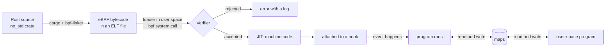

<!-- nav:top -->
[🏠 Start](../START-HERE.md) · [← 22.5 OS track: project and next steps](05-os-track-project-and-next-steps.md) · [📋 Phase 22](README.md) · [22.7 eBPF track: a first program with Aya →](07-ebpf-track-a-first-program-with-aya.md) · [📖 Glossary](../GLOSSARY.md) · [🇷🇺 Русский](../../ru/22-specializations/06-ebpf-track-what-ebpf-is.md) <!-- nav -->

# Lesson 22.6 — eBPF track: what eBPF is

> **Phase 22 — Specializations** · Lesson 6 of 30 · ⏱ about 105 minutes

> **Not your track?** This lesson starts the eBPF track (Lessons 22.6–22.9). If you chose another track, skip to
> [Lesson 22.10 — Embedded track: microcontrollers and no_std](10-embedded-track-microcontrollers-and-no-std.md) or
> straight to [Lesson 22.30 — Checkpoint: your specialization](30-checkpoint-your-specialization.md).

## What you will learn

- What eBPF is, what people build with it, and why Rust (with the Aya library) is a good fit.
- How an eBPF program gets into the kernel: bytecode, the verifier, the JIT compiler and maps.
- The main places where programs attach: tracepoints, kprobes and XDP.
- How to see eBPF in action in a minute with `bpftrace` and `bpftool`, before you write any Rust.
- How to prepare the VM `dev` for the next lessons: nightly Rust, `rust-src` and `bpf-linker`.

## Before you start

- You finished [Lesson 22.1 — Choosing a specialization](01-choosing-a-specialization.md) and chose this track.
- You know what the kernel and system calls are ([Lesson 13.1](../13-operating-systems/01-what-an-operating-system-does.md),
  [Lesson 13.3](../13-operating-systems/03-system-calls.md)).
- You have the Linux VM `dev` ([Lesson 11.1](../11-linux-shell-and-containers/01-linux-and-a-virtual-machine.md)) and you
  copied code into it as in [Lesson 13.1](../13-operating-systems/01-what-an-operating-system-does.md).
- You know packets and network interfaces from [Phase 15](../15-networking/README.md) (needed in Lesson 22.9).

## New words

| Word | Meaning |
|---|---|
| **eBPF** (extended Berkeley Packet Filter) | A small virtual machine inside the Linux kernel that runs checked programs when events happen. |
| **eBPF program** | A small function, compiled to eBPF bytecode, that the kernel runs at a hook. |
| **bytecode** | Instructions for a virtual machine, not for a real CPU (Central Processing Unit). |
| **hook** | A place in the kernel where a program can be attached: "when this function is called", "when a packet arrives". |
| **verifier** | The part of the kernel that checks every eBPF program before it may run: no crashes, no endless loops, no bad memory access. |
| **JIT** (Just-In-Time) compiler | The kernel part that turns the checked bytecode into real machine code, so it runs fast. |
| **map** | A data structure (hash map, array, ring buffer) that eBPF programs and user-space programs share. |
| **helper function** | A function that the kernel offers to eBPF programs, for example "read the current process ID". |
| **tracepoint** | A fixed, documented hook that kernel developers placed in the code; stable between kernel versions. |
| **kprobe** (kernel probe) | A hook at the start of (almost) any kernel function; powerful but not stable between versions. |
| **XDP** (eXpress Data Path) | A hook in the network driver that sees each received packet before the rest of the kernel. |
| **BTF** (BPF Type Format) | Type information about the kernel's own structures, in `/sys/kernel/btf/vmlinux`. |
| **user space** | Normal programs, outside the kernel. The program that loads eBPF code runs here. |
| **tracefs** | A special file system (usually at `/sys/kernel/tracing`) that lists tracepoints and their formats. |
| **Aya** | A Rust library for eBPF: one crate for the kernel side, one for the user side, no C needed. |

**Other abbreviations in this lesson:** BPF (Berkeley Packet Filter, the older and smaller technology that eBPF grew
from; the kernel still uses the name, as in the `bpf` system call), OS (operating system), VM (virtual machine; here the
Linux VM `dev`), ELF (Executable and Linkable Format, the file format of programs and object files) and LLVM (the
compiler toolkit that `rustc` is built on; the name is no longer an abbreviation of anything).

## 1. The field, and why Rust

Normally, to change what the kernel does you must change its source code, build it and reboot, or load a kernel
module that can crash the machine. eBPF gives a third way: you hand the kernel a **small program**, the kernel
**checks** that it is safe, and then runs it every time a chosen event happens. No reboot, no crash risk.

People use this for three big jobs:

- **Observability:** which files does this process open? Which function in the kernel is slow? Tools like
  `bpftrace` and many profilers are built on eBPF.
- **Networking:** count, filter, balance or rewrite packets at the earliest possible point. Kubernetes network
  plugins such as Cilium use eBPF.
- **Security:** watch or block suspicious actions (a process that starts a shell, a write to `/etc`).

Most eBPF code used to be written in C, with a C library to load it. **Aya** lets you write both sides in Rust:
the program that runs in the kernel (with the `aya-ebpf` crate, `no_std`, like the kernel of the OS track) and the
program that loads it and reads its results (with the `aya` crate, normal async Rust with Tokio). Both sides can
share types from a common crate, and you build everything with Cargo.

**Code layout of this track.** You edit the code on your Mac and build and run it in the VM `dev`, exactly as in
Phase 13: `rsync` the folder into the VM, then `cargo run` there. Lessons 22.7 and 22.8 build one Cargo workspace,
`code/p22-tracer`; the project in Lesson 22.9 is `code/p22-netwatch`.

## 2. How an eBPF program gets into the kernel



1. You compile the program for a special target, `bpfel-unknown-none` (eBPF, little-endian, no OS). The result is
   bytecode inside an ELF file. Linking it needs a special linker, `bpf-linker`.
2. A normal program (the **loader**) reads that file and passes it to the kernel with the `bpf` system call. Only a
   privileged user (root) may do this.
3. The **verifier** walks through every possible path of the program. It rejects the program if any path could
   read memory it must not read, loop forever, use more than 512 bytes of stack, or call a function that is not an
   allowed helper. This is why eBPF programs cannot crash the kernel.
4. The **JIT** compiler turns the bytecode into machine code for the real CPU.
5. The loader **attaches** the program to a hook. From now on it runs on every event, until the loader detaches it
   or exits.
6. The program cannot print to your terminal or return data directly. It writes into **maps**, and the user-space
   program reads them.

> 🔒 **Security:** Loading eBPF programs needs root (or the capability `CAP_BPF`), because a tracing program can see
> data of every process on the machine. Treat eBPF tools like any other root tool: run them only in your VM, and
> never run an eBPF program you do not understand.

## 3. Where programs attach

| Hook | When it runs | Stability | Used in |
|---|---|---|---|
| tracepoint | at fixed points that kernel developers marked, for example "a process called `openat`" | stable | Lessons 22.7, 22.8 |
| kprobe | when a chosen kernel function is called (the name can change between versions) | unstable | Lesson 22.8 |
| uprobe | when a function in a user-space program is called | depends on the program | — |
| XDP | when the network driver receives a packet | stable | Lesson 22.9 |
| tc (traffic control) | when a packet goes through the network stack, in or out | stable | — |
| LSM (Linux Security Modules) | at security checks, for example "may this process open this file?" | stable | — |

Prefer a tracepoint when one exists for your question: your program then keeps working on newer kernels. Use a
kprobe when you need a place where no tracepoint exists.

## 4. See it in action with bpftrace

`bpftrace` is a small tracing language that compiles to eBPF for you. It is the fastest way to *feel* what eBPF can
do. Enter the VM and install it together with `bpftool`, the official tool to inspect loaded programs and maps:

```bash
limactl shell dev
sudo apt-get update
sudo apt-get install -y bpftrace bpftool
bpftrace --version
```

```text
bpftrace v0.25.0
```

Which files does `cat` open while it prints one small file? Ask the kernel:

```bash
sudo bpftrace -e 'tracepoint:syscalls:sys_enter_openat /pid == cpid/ { printf("%s opened %s\n", comm, str(args.filename)); }' -c "/usr/bin/cat /etc/debian_version"
```

```text
Attached 1 probe
cat opened /etc/ld.so.cache
cat opened /usr/lib/aarch64-linux-gnu/libsystemd.so.0
cat opened /usr/lib/aarch64-linux-gnu/libselinux.so.1
cat opened /usr/lib/aarch64-linux-gnu/libgcc_s.so.1
cat opened /usr/lib/aarch64-linux-gnu/libm.so.6
cat opened /usr/lib/aarch64-linux-gnu/libc.so.6
cat opened /usr/lib/aarch64-linux-gnu/libpcre2-8.so.0
cat opened /proc/filesystems
cat opened /proc/self/maps
cat opened /usr/share/coreutils/locales/uucore/en-US.ftl
cat opened /usr/share/coreutils/locales/cat/en-US.ftl
cat opened /etc/debian_version
forky/sid
```

**What happens:**

1. `tracepoint:syscalls:sys_enter_openat` is the hook: "a process enters the `openat` system call". This one
   tracepoint fires for **every** process on the machine.
2. `/pid == cpid/` is a filter: only events from the child process that `-c` started (`cpid`) count.
3. `{ printf(...) }` is the action. `comm` is the command name of the current process; `args.filename` is a field
   of the tracepoint, a pointer into the memory of `cat`; `str(...)` copies the text out of it.
4. `-c "..."` starts the command, attaches first, and stops tracing when it ends.
5. Look at the result: before `cat` opens the one file you asked for, it opens 11 other files (shared libraries,
   locale files). This is something `strace` (Lesson 13.3) can also show, but eBPF did it **inside the kernel**,
   without stopping `cat` at each system call. (The `uucore` files are a sign that `cat` in Ubuntu 26.04 is the Rust
   rewrite of the coreutils.)

Every tracepoint has a list of fields. Show them with `-lv`:

```bash
sudo bpftrace -lv tracepoint:syscalls:sys_enter_openat
```

```text
tracepoint:syscalls:sys_enter_openat
    int __syscall_nr
    int dfd
    const char * filename
    int flags
    umode_t mode
    __data_loc char[] __filename_val
```

The same information, with the exact **byte offsets** of each field, is in a file of tracefs. Your Rust program in
Lesson 22.8 will need these offsets:

```bash
sudo cat /sys/kernel/tracing/events/syscalls/sys_enter_openat/format
```

```text
name: sys_enter_openat
ID: 584
format:
	field:unsigned short common_type;	offset:0;	size:2;	signed:0;
	field:unsigned char common_flags;	offset:2;	size:1;	signed:0;
	field:unsigned char common_preempt_count;	offset:3;	size:1;	signed:0;
	field:int common_pid;	offset:4;	size:4;	signed:1;

	field:int __syscall_nr;	offset:8;	size:4;	signed:1;
	field:int dfd;	offset:16;	size:8;	signed:0;
	field:const char * filename;	offset:24;	size:8;	signed:0;
	field:int flags;	offset:32;	size:8;	signed:0;
	field:umode_t mode;	offset:40;	size:8;	signed:0;
	field:__data_loc char[] __filename_val;	offset:48;	size:4;	signed:0;
...
```

(The last line, `print fmt: ...`, is long and is cut here. The `ID` may differ on your kernel.)

Finally, check two things: the BTF information about the kernel, which Aya uses, and the list of programs that are
already loaded (the system itself loads some, for example for network rules of containers):

```bash
ls -l /sys/kernel/btf/vmlinux
sudo bpftool prog list | head -1
```

Example output (yours will be different):

```text
-r--r--r-- 1 root root 6716903 Nov 18 07:40 /sys/kernel/btf/vmlinux
2: cgroup_skb  name egress  tag 3629986f5d8e9bc6  gpl
```

> 💡 **Tip:** `sudo bpftrace -l 'tracepoint:syscalls:*'` lists all system call tracepoints, and
> `sudo bpftrace -l 'tracepoint:*' | wc -l` shows how many tracepoints your kernel has (thousands). Browse them when
> you look for a hook.

## 5. Prepare the VM for Aya

The eBPF side of an Aya project is built with the **nightly** toolchain, because Cargo must build `core` for the
`bpfel-unknown-none` target from source (`-Z build-std=core`, a nightly-only option). That needs the `rust-src`
component. The user-space side uses your normal stable Rust. Inside the VM:

```bash
rustup toolchain install nightly --profile minimal --component rust-src
rustup toolchain list
```

Example output (yours will look similar):

```text
stable-aarch64-unknown-linux-gnu (active, default)
nightly-aarch64-unknown-linux-gnu
```

Next, `bpf-linker`. Its authors publish ready-made binaries; download the one for Linux on arm64, unpack it into
`~/.cargo/bin` (which is already on your `PATH`) and check it:

```bash
sudo apt-get install -y zstd
cd /tmp
curl -LO https://github.com/aya-rs/bpf-linker/releases/download/v0.13.0/bpf-linker-aarch64-unknown-linux-musl.tar.zst
tar -xpf bpf-linker-aarch64-unknown-linux-musl.tar.zst -C ~/.cargo/bin
bpf-linker --version
```

```text
bpf-linker 0.13.0
```

`.tar.zst` is an archive compressed with Zstandard, which is why `zstd` is installed first. Building `bpf-linker`
from source with `cargo install` is possible but needs a matching LLVM installation; the official binaries avoid
that.

> ⚠️ **Common mistake:** Downloading the `x86_64` archive. The VM `dev` on your Mac is arm64 (`uname -m` prints
> `aarch64`); an x86-64 binary fails with "cannot execute binary file: Exec format error".

## Common mistakes

> ⚠️ **Common mistake:** Forgetting `sudo`. Loading eBPF programs needs root; without it you get
> `Operation not permitted (os error 1)`.

> ⚠️ **Common mistake:** Trying eBPF on macOS. The Mac kernel has no eBPF. Everything in this track runs in the VM
> `dev` (or in a privileged Linux container).

> ⚠️ **Common mistake:** Forgetting the filter. Without `/pid == cpid/` the one-liner above prints every `openat`
> of every process on the machine, which can be thousands of lines per second.

> ⚠️ **Common mistake:** Using a kprobe on a function name that does not exist in your kernel (functions are
> renamed between versions). Check with `sudo bpftrace -l 'kprobe:vfs_*'` first.

## Try it yourself

1. Install `bpftrace` and `bpftool` in the VM and run the `openat` one-liner.
2. Change the command after `-c` to `/usr/bin/ls /tmp` and compare the list of opened files.
3. Install nightly with `rust-src` and `bpf-linker`, and check `bpf-linker --version`.
4. Write in your learning journal: what the verifier checks, and the difference between a tracepoint and a kprobe.

## Exercises

### Exercise 1 — Which system calls does `cat` make? (easy)

Count every system call that `cat /etc/debian_version` makes, by tracepoint name. Use the wildcard
`tracepoint:syscalls:sys_enter_*` and a bpftrace map `@[probe] = count();`. Which system call is the most common?

<details>
<summary>Hint</summary>

`probe` is the full name of the hook that fired. A map that is still filled when bpftrace exits is printed
automatically, sorted by value.

</details>

<details>
<summary>Answer</summary>

```bash
sudo bpftrace -e 'tracepoint:syscalls:sys_enter_* /pid == cpid/ { @[probe] = count(); }' -c "/usr/bin/cat /etc/debian_version"
```

The last lines of the output (sorted by count):

```text
@[tracepoint:syscalls:sys_enter_close]: 11
@[tracepoint:syscalls:sys_enter_newfstat]: 11
@[tracepoint:syscalls:sys_enter_openat]: 12
@[tracepoint:syscalls:sys_enter_munmap]: 14
@[tracepoint:syscalls:sys_enter_read]: 15
@[tracepoint:syscalls:sys_enter_mprotect]: 15
@[tracepoint:syscalls:sys_enter_mmap]: 32
```

`mmap` wins: loading shared libraries maps them into memory (Lesson 13.11). Why it works: `@[probe]` is a hash map
keyed by the probe name, and `count()` adds one per event — exactly the kind of map you will create in Rust in
Lesson 22.8.

</details>

### Exercise 2 — Trace the start of a program (medium)

Find the fields of the tracepoint `sched:sched_process_exec` (it fires when a process has started a new program).
Then write a one-liner that prints `pid <number> runs <filename>` for the command `/usr/bin/ls /dev/null`.

<details>
<summary>Hint</summary>

Use `-lv` to see the fields. The field `filename` has the type `__data_loc char[]`; bpftrace reads such fields with
`str(args.filename)` too.

</details>

<details>
<summary>Answer</summary>

```bash
sudo bpftrace -lv tracepoint:sched:sched_process_exec
sudo bpftrace -e 'tracepoint:sched:sched_process_exec /pid == cpid/ { printf("pid %d runs %s\n", pid, str(args.filename)); }' -c "/usr/bin/ls /dev/null"
```

```text
tracepoint:sched:sched_process_exec
    __data_loc char[] filename
    pid_t pid
    pid_t old_pid
```

```text
pid 90507 runs /usr/bin/ls
/dev/null
```

The second line is the output of `ls` itself. Why it works: the tracepoint fires after the kernel replaced the old
program with the new one (Lesson 13.5), so the filename is the new program. Lesson 22.7 attaches a Rust program to
this same tracepoint.

</details>

### Exercise 3 — Read field offsets with Rust, with tests (hard)

Write a library function `field_offset(format: &str, field: &str) -> Option<usize>` that finds the offset of a field
in the text of a tracepoint `format` file, and two tests: `filename` is at offset 24 and `dfd` at 16 in the
`sys_enter_openat` format above, and an unknown field gives `None`. This pure function runs on your Mac
(`cargo new --lib code/p22-tp-format`).

<details>
<summary>Hint</summary>

Field lines start with `field:` after a tab. Split such a line at the first `;`: the left part is the declaration,
whose last word is the field name (it may start with `*`). The right part starts with `offset:<number>;`.
`strip_prefix`, `split_once` and `split_whitespace` do all the work.

</details>

<details>
<summary>Answer</summary>

```rust
/// Finds the byte offset of `field` in a tracepoint format file
/// (the text of /sys/kernel/tracing/events/<category>/<name>/format).
pub fn field_offset(format: &str, field: &str) -> Option<usize> {
    for line in format.lines() {
        // A field line looks like: "field:const char * filename;\toffset:24;\tsize:8;..."
        let Some(rest) = line.trim().strip_prefix("field:") else {
            continue;
        };
        let (declaration, rest) = rest.split_once(';')?;
        let name = declaration
            .split_whitespace()
            .last()?
            .trim_start_matches('*');
        if name != field {
            continue;
        }
        let offset = rest.trim().strip_prefix("offset:")?.split(';').next()?;
        return offset.parse().ok();
    }
    None
}

#[cfg(test)]
mod tests {
    use super::*;

    const OPENAT: &str = "name: sys_enter_openat
ID: 584
format:
\tfield:unsigned short common_type;\toffset:0;\tsize:2;\tsigned:0;
\tfield:int __syscall_nr;\toffset:8;\tsize:4;\tsigned:1;
\tfield:int dfd;\toffset:16;\tsize:8;\tsigned:0;
\tfield:const char * filename;\toffset:24;\tsize:8;\tsigned:0;
\tfield:int flags;\toffset:32;\tsize:8;\tsigned:0;
";

    #[test]
    fn finds_the_filename_pointer() {
        assert_eq!(field_offset(OPENAT, "filename"), Some(24));
        assert_eq!(field_offset(OPENAT, "dfd"), Some(16));
    }

    #[test]
    fn unknown_field_gives_none() {
        assert_eq!(field_offset(OPENAT, "mode"), None);
    }
}
```

```text
test tests::finds_the_filename_pointer ... ok
test tests::unknown_field_gives_none ... ok
test result: ok. 2 passed; 0 failed; 0 ignored; 0 measured; 0 filtered out; finished in 0.00s
```

Why it works: the test copies a real format file (shortened), so the function is checked against what the kernel
really writes. `mode` is not in the shortened text, so `None` is correct. In Lesson 22.8 the offset 24 appears as a
constant in an eBPF program; this function is how you could check such constants automatically.

</details>

## Quiz

1. What does the verifier check, and why is that important?

<details>
<summary>Answer</summary>

That every path of the program only reads allowed memory, ends (no endless loops), stays within the stack limit and
calls only allowed helpers. Because of it, an eBPF program cannot crash or hang the kernel.

</details>

2. How does an eBPF program give its results to a user-space program?

<details>
<summary>Answer</summary>

Through maps: the program writes into a hash map, an array or a ring buffer, and the user-space program reads the
same map with the `bpf` system call (Aya does this for you).

</details>

3. When do you choose a tracepoint, and when a kprobe?

<details>
<summary>Answer</summary>

A tracepoint whenever one exists for your question, because tracepoints are stable across kernel versions. A kprobe
when you need a kernel function that has no tracepoint, knowing that it may break on another kernel.

</details>

4. Why does the eBPF side of an Aya project need nightly Rust and `rust-src`?

<details>
<summary>Answer</summary>

There is no ready-made `core` for `bpfel-unknown-none`, so Cargo builds it from source with `-Z build-std=core`,
which only nightly supports; `rust-src` provides that source code.

</details>

5. What is XDP, and why is it fast?

<details>
<summary>Answer</summary>

The eXpress Data Path: a hook in the network driver that runs for each received packet before the rest of the
network stack. It can drop or pass a packet before the kernel spends any work on it.

</details>

## Summary

- eBPF runs small, verified programs inside the Linux kernel at hooks, without reboots or kernel modules.
- The path: bytecode → `bpf` system call → verifier → JIT → attach → run on events → maps ↔ user space.
- Hooks: tracepoints (stable), kprobes (any function, unstable), XDP (packets in the driver), plus uprobes, tc, LSM.
- `bpftrace` and `bpftool` show eBPF at work in one line; tracefs lists tracepoints and their field offsets.
- Aya lets you write both the kernel side (`aya-ebpf`, `no_std`, nightly) and the user side (`aya`, stable, Tokio) in
  Rust.
- The VM needs nightly with `rust-src` and `bpf-linker` 0.13; everything runs as root in the VM, never on the Mac.

## Sources and further reading

- [ebpf.io — What is eBPF?](https://ebpf.io/what-is-ebpf/) — a clear overview by the eBPF community.
- [The Linux kernel documentation — BPF](https://docs.kernel.org/bpf/index.html) — the official reference, including
  [the verifier](https://docs.kernel.org/bpf/verifier.html).
- [The Aya book](https://aya-rs.dev/book/) — the guide to eBPF in Rust used in this track.
- [bpftrace](https://bpftrace.org/) — the one-liner tracing language, with its reference manual.
- [bpf-linker](https://github.com/aya-rs/bpf-linker) — the linker for eBPF programs written in Rust.
- [Linux kernel documentation — Kernel Probes](https://docs.kernel.org/trace/kprobes.html) — how kprobes work.

---

[🏠 Start](../START-HERE.md) · [← 22.5 OS track: project and next steps](05-os-track-project-and-next-steps.md) · [📋 Phase 22](README.md) · [22.7 eBPF track: a first program with Aya →](07-ebpf-track-a-first-program-with-aya.md) · [📖 Glossary](../GLOSSARY.md) <!-- nav -->
<!-- nav:bottom -->
