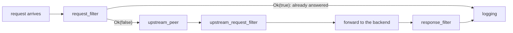

<!-- nav:top -->
[🏠 Start](../START-HERE.md) · [← 22.19 Networking track: zero-copy protocol parsing](19-networking-track-zero-copy-parsing.md) · [📋 Phase 22](README.md) · [22.21 Networking track: project and next steps →](21-networking-track-project-and-next-steps.md) · [📖 Glossary](../GLOSSARY.md) · [🇷🇺 Русский](../../ru/22-specializations/20-networking-track-production-proxies.md) <!-- nav -->

# Lesson 22.20 — Networking track: production proxies

> **Phase 22 — Specializations** · Lesson 20 of 30 · ⏱ about 2.5 hours (2 sittings)

## What you will learn

- Which jobs a production proxy must do besides "copy bytes from here to there".
- What Pingora is, and how its pieces fit: the server, services, the `ProxyHttp` trait and its hooks.
- How to build a small reverse proxy with Pingora: load balancing, health checks, blocking paths, adding headers, logging.
- How Pingora restarts without dropping connections, and how it is configured.
- How to keep proxy logic testable by moving decisions into plain functions.

## Before you start

- You finished [Lesson 22.19 — Networking track: zero-copy protocol parsing](19-networking-track-zero-copy-parsing.md).
- You know what proxies and load balancers do from [Lesson 15.14 — Proxies and load balancers](../15-networking/14-proxies-and-load-balancers.md)
  and HTTP (Hypertext Transfer Protocol) with hyper from [Lesson 15.9](../15-networking/09-http-with-hyper-and-reqwest.md).
- Pingora is built and run on Linux, so work in your VM `dev`. Pingora compiles a compression library
  with CMake (a tool that drives C and C++ builds), so install it there once:

```bash
sudo apt install -y cmake build-essential curl
cd ~/projects/rust
cargo new code/p22-proxy
cd code/p22-proxy
cargo add pingora@0.9 --features proxy,lb
cargo add async-trait@0.1
cargo add tokio@1 --features full
```

The proxy is `src/main.rs`; a small test backend goes in `src/bin/backend.rs`. The first build compiles
a few hundred crates and takes a few minutes.

## New words

| Word | Meaning |
|---|---|
| **reverse proxy** | A server that receives requests from clients and forwards them to one of several backend servers, then sends the answer back. Clients see only the proxy. |
| **upstream / downstream** | From the proxy's point of view: *upstream* is the backend it forwards to, *downstream* is the client that sent the request. |
| **backend** | One of the servers behind the proxy that does the real work. |
| **health check** | A regular test of each backend ("can I connect?"); backends that fail are taken out of the rotation. |
| **connection pool** | A set of open connections to upstreams that are kept and reused, so not every request pays for a new TCP (Transmission Control Protocol) handshake. |
| **Pingora** | A Rust framework for building proxies and other network services, published as open source by Cloudflare. |
| **hook** (filter) | A method that a framework calls at a fixed moment of a request, so your code can inspect or change it. |
| **request context** (`CTX`) | A value created for each request and passed to every hook of that request, so the hooks can share data. |
| **graceful upgrade** | Replacing a running server process with a new version without closing its listening sockets or dropping requests. |
| **sticky routing** | Sending all requests of the same user to the same backend, chosen by hashing a key such as a user id. |
| **consistent hashing** | A way to map keys to backends so that adding or removing one backend moves only a small share of the keys. |

**Other abbreviations in this lesson:** VM (virtual machine; the Linux VM `dev` from Phase 11), API (Application
Programming Interface, the functions and types a library offers) and IP (Internet Protocol; an IP address identifies a
machine on the network).

## 1. What a production proxy does

> **Your track project (Lesson 22.21) builds a small proxy by hand. This lesson shows what a mature
> framework already does, so you know what "production" adds.**

The core of a reverse proxy is short: accept a connection, read a request, pick a backend, forward the
request, copy the response back. A proxy that sits in front of real traffic must also do all of this:

| Job | Why it matters |
|---|---|
| Load balancing | Spread requests over backends (round robin, least connections, hashing). |
| Health checks | Never send traffic to a dead backend. |
| Connection pooling | Reuse upstream connections; new TCP (and TLS, Transport Layer Security) handshakes are slow. |
| Timeouts and retries | A slow backend must not block clients forever; a failed connect can be retried elsewhere. |
| Limits | Header size, body size, connection count (Lessons 22.18 and 22.19). |
| Header rules | Add `X-Forwarded-For`, remove internal headers, block paths. |
| Graceful restart | Deploy a new version without dropping a single request. |
| Observability | Access logs, metrics, traces for every request (Phase 16). |
| Protocols | HTTP/1.1, HTTP/2, TLS, WebSocket, gRPC (a framework for remote procedure calls, first built at Google; RPC means Remote Procedure Call). |

Writing all of this correctly is years of work. Pingora is a framework that implements these jobs and
leaves you the **policy**: which backend, which headers, what to block. Cloudflare built it to replace
an older proxy and runs it for a large share of its traffic; other companies use it for gateways and
load balancers.

## 2. How Pingora is organised

A Pingora program has three levels:

```text
 Server                      one process: threads, configuration, signals, graceful upgrade
  ├── Service "proxy"        listens on 127.0.0.1:6188, runs your ProxyHttp for every request
  └── Service "health check" a background task that tests the backends every second
```

The part you write is a type that implements the trait `ProxyHttp`. Pingora calls its methods (hooks)
in a fixed order for every request:



| Hook | Called when | Typical use |
|---|---|---|
| `new_ctx` | a request starts | create the per-request context |
| `request_filter` | the request head has arrived | authentication, blocking, answering directly |
| `upstream_peer` (required) | before connecting | choose the backend |
| `upstream_request_filter` | before the request goes upstream | add or remove request headers |
| `response_filter` | the response head has arrived from upstream | add or remove response headers |
| `logging` | the request is finished (also after errors) | access log, metrics |

Only `new_ctx` and `upstream_peer` must be written; all other hooks have default bodies that do nothing.
Many more hooks exist (for bodies, errors, retries, caching); the documentation lists them all.

The trait methods are `async`, and Pingora uses the `async-trait` crate for them: the attribute
`#[async_trait]` on the `impl` block turns each `async fn` into a normal method that returns a boxed
future, which is what Pingora's trait expects.

## 3. A test backend

To see the proxy work, we need backends. This tiny server answers every request with its port and the
`X-Forwarded-For` header it received, so we can see where each request went. It uses only what you know
from Lessons 15.6 and 22.19. Save as `src/bin/backend.rs`:

```rust
use tokio::io::{AsyncReadExt, AsyncWriteExt};
use tokio::net::{TcpListener, TcpStream};

/// A tiny HTTP/1.1 server for testing: answers every request with its own port.
async fn serve(mut stream: TcpStream, port: u16) -> std::io::Result<()> {
    let mut buf = Vec::new();
    let mut chunk = [0u8; 4096];
    loop {
        // Answer every complete request head in the buffer (keep-alive).
        while let Some(end) = buf.windows(4).position(|w| w == b"\r\n\r\n") {
            let head = String::from_utf8_lossy(&buf[..end]).to_string();
            buf.drain(..end + 4);
            let forwarded = head
                .lines()
                .find_map(|l| l.strip_prefix("X-Forwarded-For: "))
                .unwrap_or("-")
                .to_string();
            let body = format!("hello from backend {port} (client {forwarded})\n");
            let response = format!(
                "HTTP/1.1 200 OK\r\nContent-Length: {}\r\nContent-Type: text/plain\r\n\r\n{body}",
                body.len()
            );
            stream.write_all(response.as_bytes()).await?;
        }
        let n = stream.read(&mut chunk).await?;
        if n == 0 {
            return Ok(());
        }
        buf.extend_from_slice(&chunk[..n]);
    }
}

#[tokio::main]
async fn main() -> std::io::Result<()> {
    let port: u16 = std::env::args()
        .nth(1)
        .and_then(|p| p.parse().ok())
        .unwrap_or(8001);
    let listener = TcpListener::bind(("127.0.0.1", port)).await?;
    println!("backend listening on 127.0.0.1:{port}");
    loop {
        let (stream, _) = listener.accept().await?;
        tokio::spawn(async move {
            let _ = serve(stream, port).await;
        });
    }
}
```

**What happens:**

1. The port comes from the first command-line argument, so you can start several copies:
   `cargo run --bin backend -- 8001`.
2. The connection loop answers every complete request head in the buffer, then reads more. It keeps
   the connection open after each answer (HTTP/1.1 keep-alive), which lets the proxy reuse it.
3. `Content-Length` tells the client exactly where the body ends, so the connection can carry the next
   response.

This backend ignores request bodies and has no limits: it is a test tool, not a server to deploy.

## 4. A reverse proxy with Pingora

Our proxy will: spread requests over three backends with round robin, check their health every second,
answer `403 Forbidden` for paths under `/admin`, tell the backend the client's IP (Internet Protocol)
address in `X-Forwarded-For`, add an `X-Proxy` header to responses, and print one log line per request.
Save as `src/main.rs`:

```rust
use async_trait::async_trait;
use pingora::prelude::*;
use std::sync::Arc;
use std::time::Duration;

struct Proxy {
    backends: Arc<LoadBalancer<RoundRobin>>,
}

/// Data that lives for one request, shared by all hooks of that request.
#[derive(Default)]
struct RequestCtx {
    backend: Option<String>,
}

#[async_trait]
impl ProxyHttp for Proxy {
    type CTX = RequestCtx;

    fn new_ctx(&self) -> Self::CTX {
        RequestCtx::default()
    }

    async fn request_filter(&self, session: &mut Session, _ctx: &mut Self::CTX) -> Result<bool> {
        if session.req_header().uri.path().starts_with("/admin") {
            session.respond_error(403).await?;
            return Ok(true); // true = "I answered, stop here"
        }
        Ok(false)
    }

    async fn upstream_peer(
        &self,
        _session: &mut Session,
        ctx: &mut Self::CTX,
    ) -> Result<Box<HttpPeer>> {
        let backend = self
            .backends
            .select(b"", 256)
            .ok_or_else(|| Error::explain(HTTPStatus(502), "no healthy backend"))?;
        ctx.backend = Some(backend.addr.to_string());
        Ok(Box::new(HttpPeer::new(backend, false, String::new())))
    }

    async fn upstream_request_filter(
        &self,
        session: &mut Session,
        upstream_request: &mut RequestHeader,
        _ctx: &mut Self::CTX,
    ) -> Result<()> {
        if let Some(client) = session.client_addr().and_then(|a| a.as_inet()) {
            upstream_request.insert_header("X-Forwarded-For", client.ip().to_string())?;
        }
        Ok(())
    }

    async fn response_filter(
        &self,
        _session: &mut Session,
        upstream_response: &mut ResponseHeader,
        _ctx: &mut Self::CTX,
    ) -> Result<()> {
        upstream_response.insert_header("X-Proxy", "p22-proxy")?;
        Ok(())
    }

    async fn logging(&self, session: &mut Session, _e: Option<&Error>, ctx: &mut Self::CTX) {
        let status = session.response_written().map_or(0, |r| r.status.as_u16());
        println!(
            "{} {} -> {status} via {}",
            session.req_header().method,
            session.req_header().uri,
            ctx.backend.as_deref().unwrap_or("-")
        );
    }
}

fn main() {
    let mut server = Server::new(Some(Opt::parse_args())).unwrap();
    server.bootstrap();

    let mut upstreams =
        LoadBalancer::try_from_iter(["127.0.0.1:8001", "127.0.0.1:8002", "127.0.0.1:8003"])
            .unwrap();
    upstreams.set_health_check(TcpHealthCheck::new());
    upstreams.health_check_frequency = Some(Duration::from_secs(1));
    let health_checks = background_service("health check", upstreams);

    let mut proxy = http_proxy_service(
        &server.configuration,
        Proxy {
            backends: health_checks.task(),
        },
    );
    proxy.add_tcp("127.0.0.1:6188");

    server.add_service(proxy);
    server.add_service(health_checks);
    server.run_forever();
}
```

**What happens:**

1. `use pingora::prelude::*` brings in the common names: `Server`, `Opt`, `ProxyHttp`, `Session`,
   `HttpPeer`, `LoadBalancer`, `RoundRobin`, `TcpHealthCheck`, `RequestHeader`, `ResponseHeader`,
   Pingora's `Error` and `Result`, and more.
2. `Proxy` holds the load balancer in an `Arc`, because the health-check task and every request share it.
3. `type CTX = RequestCtx` declares our per-request context. `new_ctx` creates an empty one for each
   request; `upstream_peer` stores the chosen backend in it, and `logging` reads it later.
4. `request_filter` sees the request head first. For `/admin...` it sends a `403` itself and returns
   `Ok(true)`, which tells Pingora "the request is handled, do not forward it".
5. `upstream_peer` asks the load balancer for a backend. `select(key, 256)` takes a key (ignored by round
   robin) and a maximum number of tries to find a healthy backend. If none is healthy we return an error
   with status `502 Bad Gateway`. `HttpPeer::new(addr, false, String::new())` means "plain TCP, no TLS,
   no TLS server name".
6. `upstream_request_filter` changes the copy of the request that goes upstream: it adds the client's IP
   address. `client_addr()` returns Pingora's own address type, which can also be a Unix socket, so
   `as_inet()` gives the internet address when there is one.
7. `response_filter` adds a header to the response before it goes back to the client.
8. `logging` runs once at the end of every request, also for the `403` and for errors.
9. In `main`, `Opt::parse_args()` reads Pingora's standard command-line flags, `Server::new` creates the
   process-level server, and `bootstrap` prepares it (for example, takes over sockets during an upgrade).
10. `background_service` wraps the load balancer in a service that runs the health checks; `task()` gives
    an `Arc` to the same load balancer for the proxy. Both services are added to the server, and
    `run_forever` starts the threads and never returns.

Start two backends (8003 stays down on purpose), then the proxy, each in its own terminal of the VM:

```bash
cargo run --bin backend -- 8001
cargo run --bin backend -- 8002
cargo run --bin p22-proxy
```

In a fourth terminal, send requests:

```bash
for i in 1 2 3 4; do curl -s http://127.0.0.1:6188/hello; done
curl -si http://127.0.0.1:6188/admin/users | head -5
curl -si http://127.0.0.1:6188/ | head -8
```

```text
hello from backend 8001 (client 127.0.0.1)
hello from backend 8002 (client 127.0.0.1)
hello from backend 8001 (client 127.0.0.1)
hello from backend 8002 (client 127.0.0.1)
HTTP/1.1 403 Forbidden
Server: Pingora
Date: Wed, 18 Nov 2026 08:09:01 GMT
Content-Length: 0
Cache-Control: private, no-store
HTTP/1.1 200 OK
Content-Length: 43
Content-Type: text/plain
X-Proxy: p22-proxy
Date: Wed, 18 Nov 2026 08:09:01 GMT
Connection: keep-alive

hello from backend 8001 (client 127.0.0.1)
```

Round robin alternates between 8001 and 8002. Backend 8003 is never chosen: the health check could not
connect to it, so it is marked unhealthy. Now stop backend 8002 with Ctrl+C, wait two seconds, and run
the loop again: every request goes to 8001, and no client sees an error. The proxy's terminal shows the
log lines:

```text
GET /hello -> 200 via 127.0.0.1:8001
GET /hello -> 200 via 127.0.0.1:8002
GET /hello -> 200 via 127.0.0.1:8001
GET /hello -> 200 via 127.0.0.1:8002
GET /admin/users -> 403 via -
GET / -> 200 via 127.0.0.1:8001
GET /after -> 200 via 127.0.0.1:8001
GET /after -> 200 via 127.0.0.1:8001
GET /after -> 200 via 127.0.0.1:8001
```

(The last three lines come from the loop after stopping 8002, with the path changed to `/after`.)

> ⚡ **Performance:** Pingora does not open a new upstream connection for every request. It keeps
> upstream connections in a **connection pool** and reuses them (this is why our backend keeps its
> connections open), which saves a TCP handshake, and a TLS handshake when the upstream uses TLS, per
> request.

## 5. Running it in production: configuration and graceful upgrade

`Opt::parse_args()` gives every Pingora program the same flags:

```bash
cargo run --bin p22-proxy -- --help
```

```text
Command-line options

Usage: p22-proxy [OPTIONS]

Options:
  -u, --upgrade      This is the base set of command line arguments for a pingora-based service
  -d, --daemon       Whether this server should run in the background
  -t, --test         This flag is useful for upgrading service where the user wants to make sure the new service can start before shutting down the old server process.
  -c, --conf <CONF>  The path to the configuration file.
  -h, --help         Print help
```

The configuration file is YAML (a text format for configuration, "YAML Ain't Markup Language"). Save as
`conf.yaml`:

```yaml
---
version: 1
threads: 2
grace_period_seconds: 5
graceful_shutdown_timeout_seconds: 5
```

`threads` is the number of worker threads per service (Lesson 22.18), and the two timeouts control how
long a stopping process keeps serving the requests it already has. `cargo run --bin p22-proxy -- -c conf.yaml -t`
only checks the file and exits with code 0 if it is valid.

**Graceful upgrade** is how Pingora deploys a new version without dropping requests:

1. The old process is running and owns the listening sockets.
2. You start the new binary with `-u` (upgrade). It does not listen by itself; it waits to receive the
   listening sockets over a Unix socket whose path both processes know (the `upgrade_sock` setting).
3. You send `SIGQUIT` to the old process (Lesson 13.7). It hands its listening sockets to the new process
   over the Unix socket (passing file descriptors is a feature of Unix sockets), stops accepting, and
   finishes its open requests within `grace_period_seconds`.
4. The new process accepts on the *same* sockets, so the kernel's accept queue never closes and no
   client gets "connection refused".

> 🔒 **Security:** A proxy is the front door of every service behind it. Keep the Pingora version up to
> date (check advisories with `cargo audit`, Lesson 10.13), set limits on header and body sizes, and
> never forward headers that backends trust (for example an internal `X-User` header) without removing
> any value the client sent.

## 6. Keep decisions testable

Pingora hooks need a running server, which makes them awkward to unit-test. The fix is a design rule
from Phase 08: keep **decisions** in plain functions and keep the hooks thin. For example, which paths are
blocked is a pure function of the path; the hook only calls it. Exercise 2 does this, and its test finds
a real bug in our `starts_with("/admin")` rule.

> 🧪 **Testing:** Test policy functions with unit tests, and test the whole proxy end to end: start
> backends and the proxy, send requests with an HTTP client such as `reqwest` (Lesson 15.9) or `curl` in a
> script, and check status codes and headers. The project in Lesson 22.21 does both.

## Common mistakes

**Forgetting to add the health-check service.** If you delete the line `server.add_service(health_checks);`,
the program still compiles and runs, but no health checks run, so every backend counts as healthy:

```text
HTTP/1.1 200 OK
HTTP/1.1 200 OK
HTTP/1.1 502 Bad Gateway
```

Every third request goes to the dead backend 8003 and fails, and the proxy log shows
`GET /hello -> 502 via 127.0.0.1:8003`. Fix: add both services to the server.

**Building on macOS without CMake.** The first build fails with
`failed to run custom build command for libz-ng-sys` because CMake is missing. Build in the VM, where you
installed `cmake` in "Before you start".

**Trusting `X-Forwarded-For` from the client.** A client can send its own `X-Forwarded-For` header with
any address. `insert_header` replaces an existing value, which is what you want at the edge. A proxy
that sits behind another trusted proxy must instead *append* the address, and only trust the part that
its own trusted proxies added.

**Blocking by prefix with `starts_with`.** `"/administrator".starts_with("/admin")` is true, so our proxy
also blocks `/administrator`, which is probably a different page. Match whole path segments (exercise 2).

## Try it yourself

1. Start backend 8003 too. Within about a second the health check marks it healthy, and round robin
   uses all three backends.
2. Run the proxy with `-c conf.yaml` and `threads: 1`. Everything still works; on one thread the proxy is
   slower under load, which you can measure with the load generator from Phase 19.
3. Send a request with `curl -s -H "X-Forwarded-For: 6.6.6.6" http://127.0.0.1:6188/`. The backend still
   reports `client 127.0.0.1`, because `insert_header` replaced the client's value.

## Exercises

### Exercise 1 — Which backend answered? (easy)

Add a response header `X-Backend` with the address of the backend that served the request. Check it
with `curl -si http://127.0.0.1:6188/ | grep -i x-backend`.

<details>
<summary>Hint</summary>

The chosen backend is already stored in `ctx.backend` by `upstream_peer`. In `response_filter`, rename
`_ctx` to `ctx` and read it.

</details>

<details>
<summary>Answer</summary>

In `response_filter`:

```rust
upstream_response.insert_header("X-Proxy", "p22-proxy")?;
if let Some(backend) = &ctx.backend {
    upstream_response.insert_header("X-Backend", backend.as_str())?;
}
```

```text
X-Backend: 127.0.0.1:8001
```

Why it works: the context is the same value for all hooks of one request, so data found in an early
hook (`upstream_peer`) is available in a later one (`response_filter`).

</details>

### Exercise 2 — A testable blocklist (medium)

Create `src/lib.rs` with `pub const BLOCKED: [&str; 2] = ["/admin", "/internal"];` and
`pub fn is_blocked(path: &str) -> bool`. A path is blocked if it *is* one of the prefixes or lies below
one (`/admin`, `/admin/users`), but `/administrator` and `/shop/admin` are not blocked. Write unit tests
first, then use the function in `request_filter`.

<details>
<summary>Hint</summary>

For each prefix: the path is equal to it, or `path.strip_prefix(prefix)` returns a rest that starts
with `/`. In `main.rs`, the library crate is named `p22_proxy`.

</details>

<details>
<summary>Answer</summary>

```rust
/// Path prefixes that the proxy never forwards.
pub const BLOCKED: [&str; 2] = ["/admin", "/internal"];

/// True if `path` is one of the blocked prefixes or lies below one of them.
pub fn is_blocked(path: &str) -> bool {
    BLOCKED.iter().any(|prefix| {
        path == *prefix
            || path
                .strip_prefix(prefix)
                .is_some_and(|rest| rest.starts_with('/'))
    })
}

#[cfg(test)]
mod tests {
    use super::*;

    #[test]
    fn blocks_prefixes_and_everything_below_them() {
        assert!(is_blocked("/admin"));
        assert!(is_blocked("/admin/users"));
        assert!(is_blocked("/internal/metrics"));
    }

    #[test]
    fn does_not_block_lookalike_paths() {
        assert!(!is_blocked("/"));
        assert!(!is_blocked("/administrator"));
        assert!(!is_blocked("/shop/admin"));
    }
}
```

In `main.rs`, add `use p22_proxy::is_blocked;` and write
`if is_blocked(session.req_header().uri.path()) {` in `request_filter`.

```text
test tests::blocks_prefixes_and_everything_below_them ... ok
test tests::does_not_block_lookalike_paths ... ok
```

With the proxy running: `/admin` and `/admin/x` give `403`, `/administrator` gives `200`, `/internal`
gives `403`.

Why it works: comparing whole segments removes the lookalike bug, and because the rule is a plain
function, it is tested in milliseconds without starting a server.

</details>

### Exercise 3 — Sticky routing (hard)

Start all three backends. Change the proxy so that all requests with the same `X-User` header go to the
same backend, while different users spread over the backends. Show it with
`for u in alice bob carol alice bob carol; do echo "$u: $(curl -s -H "X-User: $u" http://127.0.0.1:6188/cart)"; done`.

<details>
<summary>Hint</summary>

Replace `RoundRobin` with `pingora::lb::selection::Consistent` (consistent hashing, also called Ketama
hashing). Then the key you pass to `select` decides the backend: use the bytes of the `X-User` header,
read with `session.req_header().headers.get("X-User")`.

</details>

<details>
<summary>Answer</summary>

Add `use pingora::lb::selection::Consistent;`, change the field to
`backends: Arc<LoadBalancer<Consistent>>`, and write `upstream_peer` like this:

```rust
async fn upstream_peer(&self, session: &mut Session, ctx: &mut Self::CTX) -> Result<Box<HttpPeer>> {
    let key = session
        .req_header()
        .headers
        .get("X-User")
        .map(|v| v.as_bytes().to_vec())
        .unwrap_or_default();
    let backend = self
        .backends
        .select(&key, 256)
        .ok_or_else(|| Error::explain(HTTPStatus(502), "no healthy backend"))?;
    ctx.backend = Some(backend.addr.to_string());
    Ok(Box::new(HttpPeer::new(backend, false, String::new())))
}
```

`main` does not change: `LoadBalancer::try_from_iter` builds a `LoadBalancer<Consistent>` because the
type of the `backends` field says so.

```text
alice: hello from backend 8002 (client 127.0.0.1)
bob: hello from backend 8003 (client 127.0.0.1)
carol: hello from backend 8001 (client 127.0.0.1)
alice: hello from backend 8002 (client 127.0.0.1)
bob: hello from backend 8003 (client 127.0.0.1)
carol: hello from backend 8001 (client 127.0.0.1)
```

Why it works: consistent hashing maps each key to a point on a ring of backends, so the same key always
gives the same backend while that backend is healthy. If a backend dies, only its users move to other
backends; everyone else keeps their backend, which keeps per-backend caches warm. Which user lands on
which backend depends on the hash, so your mapping may differ.

</details>

## Quiz

1. Name four jobs of a production proxy besides forwarding bytes.

<details>
<summary>Answer</summary>

Any four of: load balancing, health checks, connection pooling, timeouts and retries, size and
connection limits, header rules, graceful restart, logs and metrics, TLS and HTTP/2 support.

</details>

2. In which order does Pingora call `request_filter`, `upstream_peer`, `response_filter` and `logging`?
   Which of them can stop a request from being forwarded?

<details>
<summary>Answer</summary>

`request_filter`, then `upstream_peer`, then (after `upstream_request_filter` and the upstream call)
`response_filter`, and finally `logging`. `request_filter` can stop forwarding by answering itself and
returning `Ok(true)`.

</details>

3. What is the request context (`CTX`) for?

<details>
<summary>Answer</summary>

It is one value per request that every hook of that request receives, so hooks can share data, for
example the chosen backend for the log line.

</details>

4. Why does a dead backend stop receiving traffic in our proxy, and what breaks if you forget
   `server.add_service(health_checks)`?

<details>
<summary>Answer</summary>

The background health-check service tries to connect to each backend every second and marks failures
as unhealthy; `select` skips unhealthy backends. Without that service no checks run, every backend
stays "healthy", and requests that go to the dead one fail with `502`.

</details>

5. How can Pingora restart with a new version without refusing connections?

<details>
<summary>Answer</summary>

With a graceful upgrade: the new process starts with `-u`, the old one receives `SIGQUIT` and passes its
listening sockets to the new one over a Unix socket, then finishes its open requests. The listening
sockets never close, so the kernel keeps accepting connections.

</details>

6. Why use consistent hashing instead of `hash(key) % number_of_backends` for sticky routing?

<details>
<summary>Answer</summary>

With `% n`, changing the number of backends moves almost every key to a different backend. Consistent
hashing moves only the keys of the backend that was added or removed.

</details>

## Summary

- A production proxy adds load balancing, health checks, pooling, timeouts, limits, header rules,
  graceful restarts and observability to the simple "forward the request" core.
- Pingora gives you all of that; you write a type that implements `ProxyHttp`, and Pingora calls its
  hooks in a fixed order for every request.
- `upstream_peer` chooses the backend; `request_filter` can answer directly; the `*_filter` hooks change
  headers; `logging` runs at the end of every request; `CTX` carries data between hooks.
- `LoadBalancer` with a background health-check service keeps traffic away from dead backends;
  `RoundRobin` spreads load, `Consistent` gives sticky routing.
- Pingora programs share the same flags and YAML configuration and can upgrade gracefully without
  dropping connections.
- Keep policy in plain functions with unit tests, and test the whole proxy end to end.

## Sources and further reading

- [Pingora on GitHub](https://github.com/cloudflare/pingora) — the source code, examples and the user guide in `docs/`.
- [Pingora user guide](https://github.com/cloudflare/pingora/blob/main/docs/user_guide/index.md) — phases (hooks), configuration, graceful upgrade, connection pooling.
- [pingora on docs.rs](https://docs.rs/pingora/0.9/pingora/) — the API of all Pingora crates, including `ProxyHttp` and `LoadBalancer`.
- [Cloudflare blog: How we built Pingora](https://blog.cloudflare.com/how-we-built-pingora-the-proxy-that-connects-cloudflare-to-the-internet/) — why it was built and what it changed in production.
- [MDN: X-Forwarded-For](https://developer.mozilla.org/en-US/docs/Web/HTTP/Reference/Headers/X-Forwarded-For) — the header, and the security rules for trusting it (MDN, the MDN Web Docs, is the web documentation run by Mozilla).

---

[🏠 Start](../START-HERE.md) · [← 22.19 Networking track: zero-copy protocol parsing](19-networking-track-zero-copy-parsing.md) · [📋 Phase 22](README.md) · [22.21 Networking track: project and next steps →](21-networking-track-project-and-next-steps.md) · [📖 Glossary](../GLOSSARY.md) <!-- nav -->
<!-- nav:bottom -->
