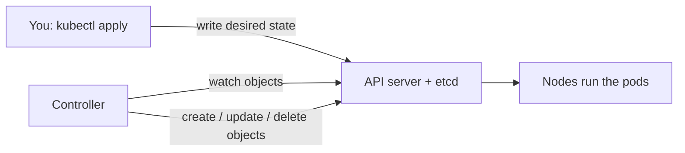

<!-- nav:top -->
[🏠 Start](../START-HERE.md) · [← 22.25 Compilers track: project and next steps](25-compilers-track-project-and-next-steps.md) · [📋 Phase 22](README.md) · [22.27 Cloud-native track: an operator with kube-rs →](27-cloud-native-track-an-operator-with-kube-rs.md) · [📖 Glossary](../GLOSSARY.md) · [🇷🇺 Русский](../../ru/22-specializations/26-cloud-native-track-kubernetes-operators.md) <!-- nav -->

# Lesson 22.26 — Cloud-native track: Kubernetes operators

> **Phase 22 — Specializations** · Lesson 26 of 30 · ⏱ about 135 minutes

## What you will learn

- What engineers on the cloud-native track build, and why Rust fits programs that run inside Kubernetes.
- The idea behind every Kubernetes controller: desired state, actual state and a reconcile loop.
- Why a good reconcile loop is *level-triggered* and *idempotent*, shown with a small Rust simulation.
- How a CRD (CustomResourceDefinition) adds your own object type to the Kubernetes API, and how to try it in a
  local `kind` cluster.
- What an operator is, and which Rust crates the rest of this track uses.

## Before you start

- You read [Lesson 22.1 — Choosing a specialization](01-choosing-a-specialization.md) and picked the
  cloud-native track. **Not your track?** This is the last track of the phase, so skip straight to
  [Lesson 22.30 — Checkpoint: your specialization](30-checkpoint-your-specialization.md).
- You finished Phase 21, especially [Lesson 21.2 — Kubernetes concepts](../21-cloud-native-infrastructure/02-kubernetes-concepts.md),
  [Lesson 21.3 — A local cluster with kind and kubectl](../21-cloud-native-infrastructure/03-a-local-cluster-with-kind.md) and
  [Lesson 21.5 — ConfigMaps, Secrets and health probes](../21-cloud-native-infrastructure/05-configmaps-secrets-and-probes.md).
- Docker Desktop is running, and `kind` and `kubectl` work in your terminal (`kind version`, `kubectl version --client`).
- You know Tokio tasks and async functions ([Lesson 14.13](../14-concurrency-and-async/13-tokio-tasks-and-channels.md)) and
  idempotency ([Lesson 18.3](../18-distributed-systems/03-retries-backoff-and-idempotency.md)).

## New words

| Word | Meaning |
|---|---|
| **API server** | The central Kubernetes program. Every tool (kubectl, controllers, your operator) reads and writes cluster objects only through its HTTP (HyperText Transfer Protocol) API (Application Programming Interface: the requests a program accepts from other programs). |
| **etcd** | The key-value database where the API server stores all objects. Nothing else talks to it directly. |
| **controller** | A program that watches some kinds of objects and keeps changing the cluster until it matches what those objects ask for. |
| **desired state / actual state** | What an object *asks for* (its `spec`, for example "3 replicas") / what really exists right now (for example 2 running pods). |
| **reconcile** | To compare desired and actual state and make the changes that remove the difference. One run of this is a *reconciliation*. |
| **level-triggered / edge-triggered** | Acting on the *current state* ("the room is 18 °C") / acting only on single *events* ("someone opened a window"); a lost event is then never handled. Kubernetes controllers are level-triggered. |
| **idempotent** | Doing it twice has the same effect as doing it once. A reconcile that finds nothing to fix must change nothing. |
| **CRD** (CustomResourceDefinition) | A Kubernetes object that adds a new object type to the API, with its name and a schema of allowed fields. |
| **custom resource** | One object of a type that a CRD added, for example one `Greeting` named `hello`. |
| **API group** | The family name of an object type, the part before `/` in `apiVersion: course.example.com/v1`. Built-in Deployments live in the group `apps`. |
| **schema** | A description of which fields an object may have and of which type. The API server rejects objects that do not match. |
| **OpenAPI** | A standard format for describing HTTP APIs. CRDs describe their fields with its "OpenAPI v3 schema" part, which is based on JSON Schema. |
| **operator** | A CRD plus a controller that understands it. Together they teach Kubernetes to manage something new. |
| **kubeconfig / context** | The file that tells `kubectl` (and your Rust code) which clusters exist and how to log in / the cluster and user that are selected right now. |
| **YAML** (YAML Ain't Markup Language) | The indented text format of Kubernetes manifests, which you used in Phase 21. |
| **JSON** (JavaScript Object Notation) | A text format for data with `{}` objects and `[]` lists. The API server speaks JSON; `kubectl` turns your YAML into JSON. |
| **CNCF** (Cloud Native Computing Foundation) | The non-profit foundation that hosts Kubernetes and many related open-source projects, including kube-rs. |

## 1. The cloud-native track

Kubernetes is a platform that many companies run all their services on. Engineers on this track do not only
*use* Kubernetes: they **extend** it. Typical work:

- **operators** that run a database, a message broker or certificates for the whole company, with one small YAML
  file per instance;
- **controllers** that enforce rules ("every namespace gets a default network policy");
- **command-line tools and proxies** that run next to services in a cluster.

Kubernetes talks to every client over an HTTP API, so a controller can be written in any language. For Rust
there is **kube-rs** (the crates `kube`, `kube-runtime` and friends), a CNCF Sandbox project. Rust is a good fit here
for concrete reasons:

- **Types for every object.** The crate `k8s-openapi` has a Rust struct for every built-in type (`Pod`,
  `ConfigMap`, `Deployment`, …), so a typo in a field name is a compile error, not a broken cluster.
- **serde** turns those structs into the JSON that the API server speaks, and back.
- **Tokio** lets one small program watch many objects at once without one thread per watch.
- **One small, memory-safe binary.** An operator becomes a single executable in a small image that starts fast and
  uses little memory. It often has wide permissions and runs for months; safe Rust removes whole classes of memory
  bugs from such a program.

The track has four lessons:

| Lesson | You will |
|---|---|
| 22.26 (this one) | understand control loops and CRDs, and create a custom resource by hand |
| 22.27 | write a real operator in Rust with kube-rs: a `Greeting` that creates a ConfigMap |
| 22.28 | add a finalizer, test the operator, and run it inside the cluster |
| 22.29 | build a bigger operator as a project, then plan your next steps |

📏 **Convention:** the code of this track goes in `code/p22-<name>`, for example `code/p22-reconcile-sim` today and
`code/p22-greeter-operator` from Lesson 22.27. Kubernetes manifests of a project go in its `k8s/` folder.

## 2. Kubernetes is a set of control loops

Think of a thermostat. You set it to 21 °C: that is the **desired state**. The thermometer says 18 °C: that is
the **actual state**. The thermostat does not need to know *why* it is cold (an open window, a cold night). Every
few seconds it compares the two numbers and turns the heating on or off. That comparison, repeated forever, is a
**control loop**.

Kubernetes works the same way. In Lesson 21.2 you created a Deployment with `replicas: 3`. You never told
Kubernetes "start three pods". You *stored a wish* in the API server, and a controller inside Kubernetes (the
Deployment controller) made it true:



The API server only **stores** objects. All the "doing" happens in controllers that watch the API server and
write back to it. If you kill a pod by hand, the controller notices that 2 is not 3 and creates a new one. This
is called *self-healing*, and it is not magic: it is a loop that compares two states.

Two properties make such loops reliable:

1. **Level-triggered, not edge-triggered.** A controller can crash, restart, or miss a notification. So it must
   never depend on "what just happened". It always looks at the *whole* current state and fixes any difference.
   After a restart it simply reconciles everything once, and the cluster is right again.
2. **Idempotent.** Reconcile runs many times for the same object (on every change, after errors, on a timer).
   When there is nothing to fix, it must change nothing.

## 3. A reconcile loop in plain Rust

Before we touch a cluster, here is the idea as a normal Rust program. The "user" wants some greetings. For each
greeting, a "ConfigMap" with the message should exist. Create the project:

```bash
cd ~/projects/rust
cargo new code/p22-reconcile-sim
```

Replace `src/main.rs`:

```rust
use std::collections::BTreeMap;

/// What the user asked for: Greeting name -> message.
type Desired = BTreeMap<String, String>;
/// What exists in the "cluster": ConfigMap name -> message.
type Actual = BTreeMap<String, String>;

#[derive(Debug, PartialEq)]
enum Change {
    Create(String),
    Update(String),
    Delete(String),
}

/// Compares desired and actual state and fixes every difference.
fn reconcile(desired: &Desired, actual: &mut Actual) -> Vec<Change> {
    let mut changes = Vec::new();

    for (name, message) in desired {
        let cm = format!("{name}-greeting");
        match actual.get(&cm) {
            None => {
                actual.insert(cm.clone(), message.clone());
                changes.push(Change::Create(cm));
            }
            Some(old) if old != message => {
                actual.insert(cm.clone(), message.clone());
                changes.push(Change::Update(cm));
            }
            Some(_) => {} // already correct: do nothing
        }
    }

    let unwanted: Vec<String> = actual
        .keys()
        .filter(|cm| {
            let name = cm.trim_end_matches("-greeting");
            !desired.contains_key(name)
        })
        .cloned()
        .collect();
    for cm in unwanted {
        actual.remove(&cm);
        changes.push(Change::Delete(cm));
    }

    changes
}

fn main() {
    let mut desired = Desired::new();
    desired.insert("hello".to_string(), "Hello, world".to_string());
    desired.insert("bye".to_string(), "Goodbye".to_string());
    let mut actual = Actual::new();

    println!("round 1: {:?}", reconcile(&desired, &mut actual));
    println!("round 2: {:?}", reconcile(&desired, &mut actual));

    desired.insert("hello".to_string(), "Hi there".to_string());
    desired.remove("bye");
    println!("round 3: {:?}", reconcile(&desired, &mut actual));

    actual.remove("hello-greeting"); // somebody deleted it by hand
    println!("round 4: {:?}", reconcile(&desired, &mut actual));
    println!("actual:  {actual:?}");
}
```

**What happens:**

1. `Desired` and `Actual` are two maps. A `BTreeMap` keeps its keys sorted, so the output order is always the same.
2. `reconcile` first walks over the desired greetings. For each one it computes the name of the object that should
   exist (`hello` → `hello-greeting`) and compares it with what is there: missing → create, different → update,
   equal → do nothing.
3. Then it looks for objects that nobody wants any more and deletes them. It first collects their names into a
   `Vec`, because we cannot remove keys from `actual` while we are still iterating over it.
4. It returns the list of changes, so we can see what it did.
5. `main` plays four rounds. Between them it changes the wish (round 3) or "breaks" the cluster (round 4).

```text
round 1: [Create("bye-greeting"), Create("hello-greeting")]
round 2: []
round 3: [Update("hello-greeting"), Delete("bye-greeting")]
round 4: [Create("hello-greeting")]
actual:  {"hello-greeting": "Hi there"}
```

Look at what this shows:

- **Round 2 is empty.** Nothing changed, so reconcile did nothing. That is idempotency.
- **Round 3** handles two wishes at once: reconcile gets no "events", it just compares the two maps.
- **Round 4** is self-healing. Reconcile never learned *that* somebody deleted the object. It only saw that the
  object is missing. That is level-triggered thinking.

A real operator has the same shape. The difference is that `desired` comes from objects in the API server, and the
changes are HTTP calls to it.

> 🧪 **Testing:** the most useful test for any reconcile function is "run it twice; the second run changes
> nothing". You will write it in Exercise 1.

## 4. Adding your own object type with a CRD

Kubernetes knows built-in types such as Pod and ConfigMap. A **CRD** (CustomResourceDefinition) adds a new type.
After that, the API server stores, validates and lists your objects exactly like built-in ones, and `kubectl`
works with them too.

Let us add a type `Greeting`. First start a cluster. In this track we use one kind cluster called
`course-22-operators` (kind means "Kubernetes IN Docker": every cluster node is a Docker container):

```bash
kind create cluster --name course-22-operators
```

```text
Creating cluster "course-22-operators" ...
 ✓ Ensuring node image (kindest/node:v1.37.0) 🖼️
 ✓ Preparing nodes 📦
 ✓ Writing configuration 📜
 ✓ Starting control-plane 🕹️
 ✓ Installing CNI 🔌
 ✓ Installing StorageClass 💾
Set kubectl context to "kind-course-22-operators"
You can now use your cluster with:

kubectl cluster-info --context kind-course-22-operators
```

The cluster runs Kubernetes 1.37.0. kind also switched your `kubectl` context to the new cluster.

> 🔒 **Security:** before every `kubectl apply` or `kubectl delete`, know which cluster you are talking to. Run
> `kubectl config current-context`; it must print `kind-course-22-operators`. At work, the same kubeconfig may also
> contain a production cluster.

Now write the CRD. In `code/p22-reconcile-sim`, create `k8s/greeting-crd.yaml`:

```yaml
apiVersion: apiextensions.k8s.io/v1
kind: CustomResourceDefinition
metadata:
  name: greetings.course.example.com
spec:
  group: course.example.com
  scope: Namespaced
  names:
    kind: Greeting
    plural: greetings
    singular: greeting
    shortNames: [gr]
  versions:
    - name: v1
      served: true
      storage: true
      schema:
        openAPIV3Schema:
          type: object
          properties:
            spec:
              type: object
              required: [message]
              properties:
                message:
                  type: string
                  maxLength: 100
                shout:
                  type: boolean
      additionalPrinterColumns:
        - name: Message
          type: string
          jsonPath: .spec.message
```

**What happens:**

1. A CRD is itself a Kubernetes object of kind `CustomResourceDefinition`. Its name must be `<plural>.<group>`.
2. `group: course.example.com` is our API group. Use a domain you own; `example.com` is reserved for examples.
3. `scope: Namespaced` means every Greeting lives in a namespace, like a ConfigMap.
4. `names` lists how people and tools refer to the type: `kind: Greeting` in YAML, `kubectl get greetings`,
   `kubectl get greeting`, or the short name `kubectl get gr`.
5. `versions` lists API versions. We have one, `v1`. `served: true` means the API answers for it; `storage: true`
   means objects are saved in this version.
6. `openAPIV3Schema` is the schema. A Greeting must have a `spec` with a string `message` of at most 100 characters
   and may have a boolean `shout`.
7. `additionalPrinterColumns` adds a `MESSAGE` column to `kubectl get`.

⚠️ The word *kind* has two meanings here: the field `kind:` in every manifest is the **type** of the object; the tool
`kind` makes local clusters. They are unrelated.

Before the CRD exists, the API does not know the type:

```bash
kubectl get greetings
```

```text
error: the server doesn't have a resource type "greetings"
```

Apply the CRD and look at it:

```bash
kubectl apply -f k8s/greeting-crd.yaml
kubectl get crd
```

```text
customresourcedefinition.apiextensions.k8s.io/greetings.course.example.com created
NAME                           SCOPE        VERSIONS      CREATED AT
greetings.course.example.com   Namespaced   v1(storage)   2026-11-18T07:44:00Z
```

Now create a custom resource. Write `k8s/hello.yaml`:

```yaml
apiVersion: course.example.com/v1
kind: Greeting
metadata:
  name: hello
spec:
  message: Hello from a custom resource
```

```bash
kubectl apply -f k8s/hello.yaml
kubectl get greetings
```

```text
greeting.course.example.com/hello created
NAME    MESSAGE
hello   Hello from a custom resource
```

`kubectl explain greeting.spec` now prints the fields of your type, read from the schema, exactly as it does for
built-in types.

The API server also **validates** custom resources against the schema. A message that is a number is rejected
before it is stored (save this as `k8s/bad.yaml`):

```yaml
apiVersion: course.example.com/v1
kind: Greeting
metadata:
  name: broken
spec:
  message: 42
```

```bash
kubectl apply -f k8s/bad.yaml
```

```text
The Greeting "broken" is invalid: spec.message: Invalid value: "integer": spec.message in body must be of type string: "integer"
```

> 🔒 **Security:** the schema is your first line of input validation (Lesson 10.4). Limits like `maxLength` stop
> huge or strange values before your operator ever sees them. Your operator code must still not trust the input
> completely.

## 5. Operator = CRD + controller

Check the ConfigMaps in the namespace:

```bash
kubectl get configmaps
```

```text
NAME               DATA   AGE
kube-root-ca.crt   1      11s
```

There is no `hello-greeting`. **A CRD only stores data.** Nobody watches Greetings yet, so nothing happens. The
missing piece is a controller that watches Greetings and reconciles them, like our simulation did. A CRD together
with such a controller is called an **operator**: it encodes the knowledge of a human operator ("to run this
database, create these objects, and on upgrade do these steps") in a program.

In Rust you build operators with these crates (versions checked for this course):

| Crate | Version | Use it for |
|---|---|---|
| `kube` | `"5.1"` (features `runtime`, `derive`) | `Client` to talk to the API server, `Api<T>` for one object type, `Controller` for the loop, `#[derive(CustomResource)]` |
| `k8s-openapi` | `"0.29"` (feature `latest`) | Rust structs for every built-in type: `ConfigMap`, `Pod`, `Deployment`, … |
| `schemars` | `"1"` | generates the OpenAPI schema of your CRD from a Rust struct, so you never write it by hand again |
| `serde`, `serde_json` | `"1"` | turn your structs into JSON for the API server |
| `tokio` | `"1"` | the async runtime that runs the controller |

`k8s-openapi` needs exactly one Kubernetes version feature. `latest` selects the newest API it knows, version
1.37, which matches the kind cluster above. If your cluster at work is older, pick that version instead, for
example `features = ["v1_35"]`.

In Lesson 22.27 you will write the controller. Leave the cluster running if you go on today; otherwise delete it
(`kind delete cluster --name course-22-operators`) and create it again next time.

## Common mistakes

> ⚠️ **Common mistake: creating a custom resource before its CRD.** If you apply `hello.yaml` into a cluster that
> has no Greeting CRD, the API server does not know where to put it:
>
> ```text
> Error from server (NotFound): error when creating "k8s/hello.yaml": the server could not find the requested resource (post greetings.course.example.com)
> ```
>
> Apply the CRD first. In a folder with both files, apply the CRD file on its own before the rest.

> ⚠️ **Common mistake: edge-triggered thinking.** A reconcile function written as "if the event is *created*, create
> the ConfigMap" breaks the first time the operator restarts and misses an event. Write reconcile as "make the world
> look like this object asks", whatever happened before.

> ⚠️ **Common mistake: deleting the CRD to "clean up".** Deleting a CRD deletes **every** custom resource of that type
> in the whole cluster. In a real cluster that can delete production data. Delete single objects instead.

## Try it yourself

Run the whole flow from a clean state, in `code/p22-reconcile-sim`:

1. `kubectl config current-context` → `kind-course-22-operators`.
2. `kubectl apply -f k8s/greeting-crd.yaml`, then `kubectl apply -f k8s/hello.yaml`, then `kubectl get gr` → one row.
3. `kubectl get greeting hello -o yaml` → the stored object, with fields the API server added: `uid`,
   `generation`, `resourceVersion` and `creationTimestamp`.
4. `kubectl delete greeting hello`, then `kubectl get greetings` → `No resources found in default namespace.`

Keep the CRD installed for the exercises.

## Exercises

### Exercise 1 — Reconcile twice (easy)

In `code/p22-reconcile-sim`, write a test `second_reconcile_changes_nothing`: build a desired state with two
greetings, run `reconcile` once (two creates) and again (no changes). Add a second test
`hand_deleted_object_comes_back` that clears `actual` after the first run and checks that reconcile creates the
object again.

<details>
<summary>Hint</summary>

Put the tests in a `#[cfg(test)] mod tests` at the end of `src/main.rs` with `use super::*;`. `Change` derives
`PartialEq`, so you can compare a whole `Vec<Change>` with `assert_eq!`.

</details>

<details>
<summary>Answer</summary>

```rust
#[cfg(test)]
mod tests {
    use super::*;

    #[test]
    fn second_reconcile_changes_nothing() {
        let mut desired = Desired::new();
        desired.insert("a".to_string(), "one".to_string());
        desired.insert("b".to_string(), "two".to_string());
        let mut actual = Actual::new();

        let first = reconcile(&desired, &mut actual);
        assert_eq!(first.len(), 2);

        let second = reconcile(&desired, &mut actual);
        assert!(second.is_empty(), "expected no changes, got {second:?}");
    }

    #[test]
    fn hand_deleted_object_comes_back() {
        let mut desired = Desired::new();
        desired.insert("a".to_string(), "one".to_string());
        let mut actual = Actual::new();
        reconcile(&desired, &mut actual);

        actual.clear();
        assert_eq!(
            reconcile(&desired, &mut actual),
            vec![Change::Create("a-greeting".to_string())]
        );
    }
}
```

```text
running 2 tests
test tests::hand_deleted_object_comes_back ... ok
test tests::second_reconcile_changes_nothing ... ok

test result: ok. 2 passed; 0 failed; 0 ignored; 0 measured; 0 filtered out; finished in 0.00s
```

Why it works: the first test checks idempotency, the second checks self-healing. Both only use the public shape of
`reconcile` (desired in, changes out), so they stay valid when you change how reconcile works inside.

</details>

### Exercise 2 — A dry run (medium)

Write `fn drift(desired: &Desired, actual: &Actual) -> usize` that returns how many changes `reconcile` *would*
make, without changing `actual`. Print it at the end of `main` and add a test `drift_is_zero_after_reconcile`.
(`kubectl diff` is the same idea for manifests.)

<details>
<summary>Hint</summary>

The simplest correct version reuses `reconcile` on a **copy** of `actual`. `BTreeMap` implements `Clone`.

</details>

<details>
<summary>Answer</summary>

```rust
/// Counts the changes `reconcile` would make, without making them.
fn drift(desired: &Desired, actual: &Actual) -> usize {
    let mut copy = actual.clone();
    reconcile(desired, &mut copy).len()
}
```

The test, inside `mod tests`:

```rust
#[test]
fn drift_is_zero_after_reconcile() {
    let mut desired = Desired::new();
    desired.insert("a".to_string(), "one".to_string());
    let mut actual = Actual::new();
    assert_eq!(drift(&desired, &actual), 1);
    assert!(actual.is_empty(), "drift must not change actual");

    reconcile(&desired, &mut actual);
    assert_eq!(drift(&desired, &actual), 0);
}
```

With `println!("drift:   {}", drift(&desired, &actual));` as the last line of `main`, the program ends with
`drift:   0`, and `cargo test` reports `3 passed`.

Why it works: `actual` is borrowed immutably (`&Actual`), so the compiler guarantees that `drift` cannot change it.
Reusing `reconcile` means the dry run can never disagree with the real run.

</details>

### Exercise 3 — A stricter CRD (medium)

Change `k8s/greeting-crd.yaml` so that an empty message is rejected (`minLength: 1`) and `kubectl get greetings`
shows a second column `Shout`. Apply it, create a Greeting `loud` with `shout: true`, and try to create one with
`message: ""`.

<details>
<summary>Hint</summary>

`minLength` goes next to `maxLength`. A printer column for a boolean has `type: boolean` and
`jsonPath: .spec.shout`. Applying a changed CRD updates it in place.

</details>

<details>
<summary>Answer</summary>

The changed parts of the CRD:

```yaml
                message:
                  type: string
                  minLength: 1
                  maxLength: 100
```

```yaml
      additionalPrinterColumns:
        - name: Message
          type: string
          jsonPath: .spec.message
        - name: Shout
          type: boolean
          jsonPath: .spec.shout
```

```text
The Greeting "blank" is invalid: spec.message: Invalid value: "": spec.message in body should be at least 1 chars long
NAME    MESSAGE                        SHOUT
hello   Hello from a custom resource   
loud    Hey                            true
```

Why it works: the API server checks every write against the schema of the CRD, so the empty message never reaches
etcd. `hello` has no `shout` field, so its column is empty.

</details>

## Quiz

1. Where does the "doing" happen in Kubernetes: in the API server or in controllers?

<details>
<summary>Answer</summary>

In controllers. The API server validates and stores objects (in etcd) and tells watchers about changes. Controllers
watch objects and create, update or delete other objects to make the desired state true.

</details>

2. Why must a reconcile function be level-triggered?

<details>
<summary>Answer</summary>

Because notifications can be missed: the operator restarts, the network breaks, two changes arrive together. A
level-triggered reconcile looks at the whole current state every time, so after any gap it still does the right thing.

</details>

3. Reconcile ran and found nothing to fix. What should it change?

<details>
<summary>Answer</summary>

Nothing. Reconcile must be idempotent: running it again on a correct cluster makes no writes. Otherwise it would cause
endless updates (each write triggers another reconcile).

</details>

4. You applied a CRD and then a custom resource, but nothing happened in the cluster. Why?

<details>
<summary>Answer</summary>

A CRD only adds a type: the API server stores and validates the objects. Something must *act* on them, and that is a
controller. CRD + controller = operator.

</details>

## Summary

- Engineers on the cloud-native track extend Kubernetes with operators, controllers and tools; in Rust they use kube-rs.
- The API server only stores objects. Controllers watch them and run a **reconcile** loop: compare desired and actual
  state, fix the difference.
- Good reconcile functions are **level-triggered** (they look at state, not events) and **idempotent** (a second run
  changes nothing). That gives self-healing for free.
- A **CRD** adds a new type to the API, with a schema that the API server enforces. A **custom resource** is one object
  of that type.
- A CRD alone does nothing. **Operator = CRD + controller.**
- The Rust toolbox: `kube` 5.1 (client, controller, derive), `k8s-openapi` 0.29 (types, feature `latest` = Kubernetes 1.37),
  `schemars` 1 (schemas), `serde`, `tokio`.
- Always check `kubectl config current-context` before you change a cluster.

## Sources and further reading

- [Kubernetes — Controllers](https://kubernetes.io/docs/concepts/architecture/controller/) — the control-loop idea and the thermostat example in the official docs.
- [Kubernetes — Operator pattern](https://kubernetes.io/docs/concepts/extend-kubernetes/operator/) — what an operator is and what operators are used for.
- [Kubernetes — Custom Resources](https://kubernetes.io/docs/concepts/extend-kubernetes/api-extension/custom-resources/) — when to add a custom type and how it is stored.
- [Kubernetes — Extend the Kubernetes API with CustomResourceDefinitions](https://kubernetes.io/docs/tasks/extend-kubernetes/custom-resources/custom-resource-definitions/) — every CRD field, validation and printer columns.
- [kube.rs — Introduction to controllers](https://kube.rs/controllers/intro/) — the kube-rs guide to controllers, the main reference for this track.
- [kind — Quick Start](https://kind.sigs.k8s.io/docs/user/quick-start/) — creating, using and deleting local clusters.
- [CNCF — kube-rs project page](https://www.cncf.io/projects/kube-rs/) — the project's status in the CNCF.

---

[🏠 Start](../START-HERE.md) · [← 22.25 Compilers track: project and next steps](25-compilers-track-project-and-next-steps.md) · [📋 Phase 22](README.md) · [22.27 Cloud-native track: an operator with kube-rs →](27-cloud-native-track-an-operator-with-kube-rs.md) · [📖 Glossary](../GLOSSARY.md) <!-- nav -->
<!-- nav:bottom -->
