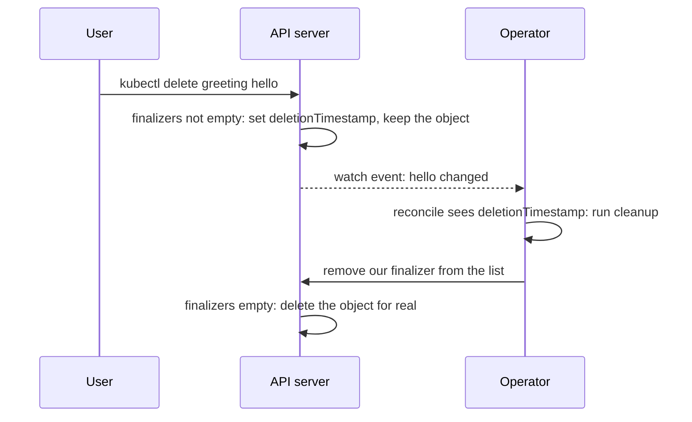

<!-- nav:top -->
[🏠 Start](../START-HERE.md) · [← 22.27 Cloud-native track: an operator with kube-rs](27-cloud-native-track-an-operator-with-kube-rs.md) · [📋 Phase 22](README.md) · [22.29 Cloud-native track: project and next steps →](29-cloud-native-track-project-and-next-steps.md) · [📖 Glossary](../GLOSSARY.md) · [🇷🇺 Русский](../../ru/22-specializations/28-cloud-native-track-testing-and-running-operators.md) <!-- nav -->

# Lesson 22.28 — Cloud-native track: testing and running operators

> **Phase 22 — Specializations** · Lesson 28 of 30 · ⏱ about 3 hours (2 sittings)

## What you will learn

- What a finalizer is, when owner references are not enough, and how kube-runtime's `finalizer` helper runs your
  cleanup code before an object disappears.
- How to test an operator at two levels: fast unit tests of pure functions and end-to-end tests against a kind cluster.
- How to package the operator as a small container image and load it into kind.
- How RBAC (Role-Based Access Control) gives the operator exactly the permissions it needs, and what a missing
  permission looks like.
- How to run the operator as a Deployment and read its logs.

## Before you start

- You finished [Lesson 22.27 — Cloud-native track: an operator with kube-rs](27-cloud-native-track-an-operator-with-kube-rs.md),
  including Exercise 2 (the unit tests in `src/lib.rs`). This lesson continues in `code/p22-greeter-operator`.
- The kind cluster `course-22-operators` is running and the generated CRD is applied.
- You know multi-stage Dockerfiles ([Lesson 11.13 — Dockerfiles for Rust programs](../11-linux-shell-and-containers/13-dockerfiles-for-rust.md)),
  Deployments ([Lesson 21.4](../21-cloud-native-infrastructure/04-deploying-a-rust-service-to-kubernetes.md)) and
  integration tests in `tests/` ([Lesson 05.6](../05-rust-intermediate/06-testing-in-depth.md)).

## New words

| Word | Meaning |
|---|---|
| **finalizer** | A string in an object's `metadata.finalizers` list. While the list is not empty, the API server does not delete the object; it only marks it for deletion and waits. |
| **`deletionTimestamp`** | The field the API server sets when someone deletes an object that still has finalizers. From then on the object is *terminating*: it exists, but it is on its way out. |
| **cleanup** | The work an operator does for a terminating object before removing its finalizer, for example deleting something outside the object's namespace. |
| **e2e test** (end-to-end test) | A test that runs the whole system the way a user would: here, create a Greeting in a real cluster and check what the running operator did. |
| **RBAC** (Role-Based Access Control) | The Kubernetes permission system: *roles* list allowed actions, *bindings* give a role to a user or a program. |
| **ServiceAccount** | An identity for programs running in pods. The operator's pod runs as the ServiceAccount `greeter-operator`. |
| **ClusterRole / ClusterRoleBinding** | A role whose rules apply in all namespaces / the object that gives such a role to a subject (here, the ServiceAccount). `Role` and `RoleBinding` are the same for one namespace. |
| **verb** | An action in an RBAC rule: `get`, `list`, `watch`, `create`, `patch`, `update`, `delete`. |
| **distroless image** | A container image with only the files a program needs to run (no shell, no package manager). Fewer files mean fewer things to attack. |
| **CRD** (CustomResourceDefinition) | The object that adds the `Greeting` type to the API (Lesson 22.26). |

## 1. When owner references are not enough

Owner references (Lesson 22.27) clean up children in the **same namespace**. Real operators also touch things that an
owner reference cannot reach: a DNS (Domain Name System) record at a provider, a database user, a bucket, or an
object in another namespace. Our operator will get such a thing: a shared **guestbook**, one ConfigMap in the
namespace `greeter-system`, with one entry per Greeting:

```text
ConfigMap greeter-system/guestbook
  data:
    default.hello: Hello from a custom resource     ← written when the Greeting appears
    demo.hi:       Hi                              ← must be removed when that Greeting is deleted
```

Nobody owns the guestbook, and it is in another namespace, so the garbage collector will never remove an entry. The
operator must do it, and it must do it **before** the Greeting is gone, because afterwards it no longer knows the
Greeting existed. That is the job of a finalizer.

Create the namespace and the empty guestbook. Save as `k8s/guestbook.yaml`:

```yaml
apiVersion: v1
kind: Namespace
metadata:
  name: greeter-system
---
apiVersion: v1
kind: ConfigMap
metadata:
  name: guestbook
  namespace: greeter-system
data: {}
```

```bash
kubectl apply -f k8s/guestbook.yaml
```

```text
namespace/greeter-system created
configmap/guestbook created
```

## 2. Finalizers

A finalizer turns deletion into a two-step process:



Before all this, when the operator first saw the Greeting, it **added** its finalizer `course.example.com/guestbook`
to the object. Only an object that carries the finalizer gets this two-step deletion.

Doing this by hand has tricky corners (what if cleanup fails halfway? what if the finalizer is not added yet?), so
kube-runtime has a helper, `kube::runtime::finalizer`. You give it two branches: `Event::Apply` ("the object exists,
make the world match") and `Event::Cleanup` ("the object is terminating, undo your side effects"). The helper adds and
removes the finalizer for you, and only removes it after your cleanup returned `Ok`.

Add the guestbook constants and a key function to `src/lib.rs`, just above `config_map_name`:

```rust
/// The finalizer this operator puts on every Greeting.
pub const FINALIZER: &str = "course.example.com/guestbook";
/// Where the shared guestbook ConfigMap lives.
pub const GUESTBOOK_NAMESPACE: &str = "greeter-system";
pub const GUESTBOOK: &str = "guestbook";

/// The key of a Greeting in the guestbook, for example `default.hello`.
pub fn guestbook_key(greeting: &Greeting) -> String {
    let ns = greeting.namespace().unwrap_or_default();
    format!("{ns}.{}", greeting.name_any())
}
```

Now `src/main.rs`. The imports, the error type and `reconcile` change:

```rust
use std::sync::Arc;
use std::time::Duration;

use futures::StreamExt;
use k8s_openapi::api::core::v1::ConfigMap;
use kube::api::{Patch, PatchParams};
use kube::runtime::controller::Action;
use kube::runtime::finalizer::{Event, finalizer};
use kube::runtime::{Controller, watcher};
use kube::{Api, Client, ResourceExt};
use p22_greeter_operator::{
    FINALIZER, GUESTBOOK, GUESTBOOK_NAMESPACE, Greeting, GreetingStatus, desired_config_map,
    guestbook_key,
};
use serde_json::json;

/// The name we sign our changes with (the "field manager").
const MANAGER: &str = "greeter-operator";

#[derive(Debug, thiserror::Error)]
enum Error {
    #[error("Kubernetes API error: {0}")]
    Kube(#[from] kube::Error),
    #[error("finalizer error: {0}")]
    Finalizer(#[source] Box<kube::runtime::finalizer::Error<Error>>),
}

/// Things every reconcile call needs.
struct Context {
    client: Client,
}

async fn reconcile(greeting: Arc<Greeting>, ctx: Arc<Context>) -> Result<Action, Error> {
    let ns = greeting
        .namespace()
        .unwrap_or_else(|| "default".to_string());
    let greetings: Api<Greeting> = Api::namespaced(ctx.client.clone(), &ns);
    finalizer(&greetings, FINALIZER, greeting, |event| async {
        match event {
            Event::Apply(greeting) => apply(&greeting, &ctx).await,
            Event::Cleanup(greeting) => cleanup(&greeting, &ctx).await,
        }
    })
    .await
    .map_err(|error| Error::Finalizer(Box::new(error)))
}
```

**What happens:**

1. `reconcile` is now a thin wrapper. It calls `finalizer(&api, name, object, closure)`. The closure gets an `Event` and
   sends `Apply` to `apply` and `Cleanup` to `cleanup`.
2. The helper can fail in its own ways (for example the patch that adds the finalizer), so it returns
   `finalizer::Error<Error>`, which wraps *our* error. We store it in a new variant `Error::Finalizer`. It is in a
   `Box` because an enum cannot contain itself directly: without the box the type would have infinite size.
3. `#[source]` (instead of `#[from]`) tells `thiserror` that this is the cause of the error, without generating a
   `From` conversion; we convert explicitly with `map_err`.

The old body of `reconcile` moves into `apply`, plus one new step, and `cleanup` is new:

```rust
/// The Greeting exists: make the world match it.
async fn apply(greeting: &Greeting, ctx: &Context) -> Result<Action, Error> {
    let ns = greeting
        .namespace()
        .unwrap_or_else(|| "default".to_string());
    let name = greeting.name_any();
    println!("apply {ns}/{name}");

    let cm = desired_config_map(greeting);
    let cm_name = cm.name_any();
    let config_maps: Api<ConfigMap> = Api::namespaced(ctx.client.clone(), &ns);
    let params = PatchParams::apply(MANAGER).force();
    config_maps
        .patch(&cm_name, &params, &Patch::Apply(&cm))
        .await?;

    let book: Api<ConfigMap> = Api::namespaced(ctx.client.clone(), GUESTBOOK_NAMESPACE);
    let entry = json!({ "data": { guestbook_key(greeting): greeting.spec.message } });
    book.patch(GUESTBOOK, &PatchParams::default(), &Patch::Merge(&entry))
        .await?;

    let greetings: Api<Greeting> = Api::namespaced(ctx.client.clone(), &ns);
    let status = GreetingStatus {
        config_map: Some(cm_name),
    };
    let patch = json!({ "status": status });
    greetings
        .patch_status(&name, &PatchParams::default(), &Patch::Merge(&patch))
        .await?;

    Ok(Action::requeue(Duration::from_secs(300)))
}

/// The Greeting is being deleted: undo what owner references cannot undo.
async fn cleanup(greeting: &Greeting, ctx: &Context) -> Result<Action, Error> {
    println!("cleanup {}", guestbook_key(greeting));
    let book: Api<ConfigMap> = Api::namespaced(ctx.client.clone(), GUESTBOOK_NAMESPACE);
    let remove = json!({ "data": { guestbook_key(greeting): null } });
    book.patch(GUESTBOOK, &PatchParams::default(), &Patch::Merge(&remove))
        .await?;
    Ok(Action::await_change())
}
```

**What happens:**

1. `apply` does what `reconcile` did in Lesson 22.27, and also writes the guestbook entry with a merge patch:
   `{"data": {"default.hello": "Hello from a custom resource"}}`. A merge patch only touches the keys it names, so
   entries of other Greetings stay.
2. `cleanup` sends `{"data": {"default.hello": null}}`. In a merge patch, `null` means "remove this key".
3. `cleanup` returns `Action::await_change()`: nothing to requeue, the object is about to disappear.
4. If the guestbook patch fails, `cleanup` returns `Err`, the helper keeps the finalizer, `error_policy` asks to retry
   in five seconds, and the Greeting stays terminating until cleanup succeeds. Nothing is lost.

`Context`, `error_policy` and `main` stay exactly as in Lesson 22.27.

> 🔒 **Security:** cleanup must be idempotent too. If the operator crashes after cleanup but before the finalizer is
> removed, cleanup runs again. Removing a key that is already gone is fine; "fail if not found" would block the
> deletion forever.

## 3. See the finalizer work

Start the operator (`cargo run`) and apply the Greeting:

```bash
kubectl apply -f k8s/hello.yaml
kubectl get configmap guestbook -n greeter-system -o jsonpath='{.data}'; echo
kubectl get greeting hello -o jsonpath='{.metadata.finalizers}'; echo
```

```text
greeting.course.example.com/hello created
{"default.hello":"Hello from a custom resource"}
["course.example.com/guestbook"]
```

The entry is in the guestbook and the finalizer is on the Greeting. Now **stop the operator** (Ctrl+C) and delete the
Greeting. `--wait=false` tells kubectl not to wait for the deletion to finish:

```bash
kubectl delete greeting hello --wait=false
kubectl get greetings
kubectl get greeting hello -o jsonpath='{.metadata.deletionTimestamp}'; echo
```

```text
greeting.course.example.com "hello" deleted from default namespace
NAME    MESSAGE
hello   Hello from a custom resource
2026-11-18T08:10:55Z
```

kubectl says "deleted", but the Greeting is still there, with a `deletionTimestamp`: it is terminating and waiting for
its finalizer. Start the operator again and look once more:

```bash
kubectl get greetings
kubectl get configmap guestbook -n greeter-system -o jsonpath='{.data}'; echo
```

```text
No resources found in default namespace.

```

The Greeting is gone and the guestbook is empty (the empty line). The logs of the two runs:

```text
greeter-operator started
done: hello
apply default/hello
done: hello
apply default/hello
done: hello
greeter-operator stopped
```

```text
greeter-operator started
cleanup default.hello
done: hello
controller error: tried to reconcile object Greeting.v1.course.example.com/hello.default that was not found in local store
greeter-operator stopped
```

**What happens:**

1. In the first run, the very first `done: hello` has no `apply` line: in that reconcile the helper only **added the
   finalizer** and stopped. Adding it changed the Greeting, which triggered the next reconcile, and that one ran `apply`.
2. In the second run, the operator found a terminating Greeting at start-up, ran `cleanup`, and the helper removed the
   finalizer. This works because reconcile is level-triggered: the operator never saw the delete *event* (it was not
   running), it only saw the *state*.
3. The last `controller error` line is the harmless one you know from Lesson 22.27.

## 4. Testing an operator

Use the test pyramid from [Lesson 09.1](../09-testing-debugging-benchmarking/01-the-test-pyramid.md):

| Level | What it checks | Needs | Speed |
|---|---|---|---|
| unit tests in `src/lib.rs` | `desired_config_map`, `guestbook_key`: the pure "what should exist" logic | nothing | milliseconds |
| e2e tests in `tests/` | the whole operator against a real API server | a kind cluster with the CRD, the guestbook and a running operator | seconds |

You wrote the unit tests in Lesson 22.27. There is also a middle level: kube-rs can test `reconcile` against a fake
API server built with the `tower-test` crate, where each test scripts the requests and the answers. It is precise but
long to write; the kube.rs testing guide in the sources shows it.

An e2e test is a normal integration test that talks to the cluster through your kubeconfig. Because it needs a cluster,
it is marked `#[ignore]`, so a plain `cargo test` (and your CI, continuous integration, from Lesson 09.12) skips it. Create `tests/e2e.rs`:

```rust
//! End-to-end test: needs a cluster with the CRD, the guestbook and a running operator.
//! Run it with `cargo test --test e2e -- --ignored`.
use std::time::Duration;

use k8s_openapi::api::core::v1::ConfigMap;
use kube::api::{DeleteParams, PostParams};
use kube::runtime::wait::{await_condition, conditions};
use kube::{Api, Client, ResourceExt};
use p22_greeter_operator::{Greeting, GreetingSpec};
use tokio::time::timeout;

const WAIT: Duration = Duration::from_secs(20);

#[tokio::test]
#[ignore = "needs a kind cluster with the operator running"]
async fn greeting_gets_a_config_map_and_is_cleaned_up() {
    let client = Client::try_default().await.expect("a kubeconfig");
    let greetings: Api<Greeting> = Api::namespaced(client.clone(), "default");
    let config_maps: Api<ConfigMap> = Api::namespaced(client.clone(), "default");

    // 1. Create a Greeting, as a user would.
    let spec = GreetingSpec {
        message: "testing".to_string(),
        shout: true,
    };
    let greeting = Greeting::new("e2e-test", spec);
    let created = greetings
        .create(&PostParams::default(), &greeting)
        .await
        .expect("create the Greeting");

    // 2. Wait until the operator made the ConfigMap.
    let has_cm = |cm: Option<&ConfigMap>| cm.is_some();
    let cm = timeout(
        WAIT,
        await_condition(config_maps, "e2e-test-greeting", has_cm),
    )
    .await
    .expect("the ConfigMap appears in time")
    .expect("the watch works")
    .expect("the ConfigMap exists");
    assert_eq!(cm.data.unwrap()["message"], "TESTING");

    // 3. Delete the Greeting and wait until it is really gone (finalizer done).
    greetings
        .delete("e2e-test", &DeleteParams::default())
        .await
        .expect("delete the Greeting");
    let uid = created.uid().expect("the API server set a uid");
    timeout(
        WAIT,
        await_condition(greetings, "e2e-test", conditions::is_deleted(&uid)),
    )
    .await
    .expect("the Greeting is deleted in time")
    .expect("the watch works");
}
```

**What happens:**

1. The test creates a Greeting with `Api::create`, exactly as a user's `kubectl apply` would.
2. `await_condition(api, name, condition)` from `kube::runtime::wait` watches one object until the condition is true.
   Our condition is a closure: "the ConfigMap exists". It returns `Result<Option<ConfigMap>, _>`, hence the three
   `expect` calls: in time, watch worked, object present.
3. `tokio::time::timeout` gives up after 20 seconds, so a broken operator makes the test fail instead of hang.
4. After the delete, `conditions::is_deleted(&uid)` waits until this exact object is gone. That proves the finalizer
   was removed, which means cleanup ran.
5. The `e2e-test` name is fixed. If a test fails in the middle, delete the leftover Greeting by hand before the next run.

`tokio` needs the `macros` feature for `#[tokio::test]`; you already have it. Run the normal tests, then (with the
operator running) the e2e test:

```bash
cargo test
cargo test --test e2e -- --ignored
```

```text
running 1 test
test greeting_gets_a_config_map_and_is_cleaned_up ... ignored, needs a kind cluster with the operator running

test result: ok. 0 passed; 0 failed; 1 ignored; 0 measured; 0 filtered out; finished in 0.00s
```

```text
running 1 test
test greeting_gets_a_config_map_and_is_cleaned_up ... ok

test result: ok. 1 passed; 0 failed; 0 ignored; 0 measured; 0 filtered out; finished in 0.08s
```

(The first command also prints the results of the unit tests and of empty test targets; only the e2e part is shown.)

> 🧪 **Testing:** in CI, an e2e job creates a kind cluster, applies the CRD, starts the operator and runs
> `cargo test -- --ignored`, then deletes the cluster. kind is made for exactly this.

## 5. Running inside the cluster

On your Mac the operator used *your* kubeconfig, with your full admin rights. In a cluster it runs in a pod, as a
ServiceAccount, with only the rights you give it. Four pieces are needed.

**1. An image.** Create `Dockerfile` (the multi-stage pattern from Lesson 11.13) and a `.dockerignore` with the lines
`target/` and `*.log`, so the build context stays small:

```dockerfile
# Stage 1: build the operator with the full Rust toolchain.
FROM rust:1.100 AS build
WORKDIR /src
COPY . .
RUN cargo build --release --bin p22-greeter-operator

# Stage 2: a tiny runtime image with only the binary, running as a non-root user.
FROM gcr.io/distroless/cc-debian13:nonroot
COPY --from=build /src/target/release/p22-greeter-operator /greeter-operator
ENTRYPOINT ["/greeter-operator"]
```

```bash
docker build -t course-greeter-operator:0.1.0 .
docker image ls course-greeter-operator
```

```text
IMAGE                           ID             DISK USAGE   CONTENT SIZE   EXTRA
course-greeter-operator:0.1.0   012ebd452cc1       69.5MB         15.2MB
```

The image downloads 15.2 MB: the binary plus a minimal Debian base. The build takes a few minutes the first time.

**2. Load it into kind.** The kind node cannot see your Docker images; copy the image into it:

```bash
kind load docker-image course-greeter-operator:0.1.0 --name course-22-operators
```

```text
Image: "course-greeter-operator:0.1.0" with ID "sha256:012ebd452cc1354e883f1f982c54006bb5ed3bf9d9a213cfea8fafbd2fa43af4" not yet present on node "course-22-operators-control-plane", loading...
```

**3. RBAC and 4. a Deployment.** Write `k8s/operator.yaml`:

```yaml
apiVersion: v1
kind: ServiceAccount
metadata:
  name: greeter-operator
  namespace: greeter-system
---
apiVersion: rbac.authorization.k8s.io/v1
kind: ClusterRole
metadata:
  name: greeter-operator
rules:
  - apiGroups: ["course.example.com"]
    resources: ["greetings"]
    verbs: ["get", "list", "watch", "patch"]
  - apiGroups: ["course.example.com"]
    resources: ["greetings/status"]
    verbs: ["get", "patch"]
  - apiGroups: [""]
    resources: ["configmaps"]
    verbs: ["get", "list", "watch", "create", "patch"]
---
apiVersion: rbac.authorization.k8s.io/v1
kind: ClusterRoleBinding
metadata:
  name: greeter-operator
roleRef:
  apiGroup: rbac.authorization.k8s.io
  kind: ClusterRole
  name: greeter-operator
subjects:
  - kind: ServiceAccount
    name: greeter-operator
    namespace: greeter-system
---
apiVersion: apps/v1
kind: Deployment
metadata:
  name: greeter-operator
  namespace: greeter-system
spec:
  replicas: 1
  selector:
    matchLabels:
      app: greeter-operator
  template:
    metadata:
      labels:
        app: greeter-operator
    spec:
      serviceAccountName: greeter-operator
      containers:
        - name: operator
          image: course-greeter-operator:0.1.0
          imagePullPolicy: IfNotPresent
          resources:
            requests:
              cpu: 10m
              memory: 32Mi
            limits:
              memory: 128Mi
          securityContext:
            allowPrivilegeEscalation: false
            readOnlyRootFilesystem: true
            runAsNonRoot: true
            capabilities:
              drop: ["ALL"]
```

**What happens:**

1. The `ServiceAccount` is the operator's identity. The pod uses it through `serviceAccountName`, and
   `Client::try_default()` finds its token inside the pod automatically.
2. The `ClusterRole` lists what the code does: watch and patch Greetings (patch is how the finalizer is added
   and removed), patch their status, and read, create and patch ConfigMaps. Nothing else: no `delete`, no Secrets.
3. The `ClusterRoleBinding` gives that role to the ServiceAccount, in all namespaces (our operator watches all of them).
4. The Deployment runs one replica. `imagePullPolicy: IfNotPresent` uses the image you loaded instead of trying to
   download it. The `securityContext` hardens the container: no root, no privilege escalation, a read-only file
   system, no Linux capabilities.

> 🔒 **Security:** least privilege. An operator often runs for months with a token that can change the cluster. Give it
> only the verbs it uses. A namespace-scoped operator (Exercise 3 of Lesson 22.27) can use a `Role` and `RoleBinding`
> instead and has no rights outside its namespace at all.

Apply it, wait for the rollout, and try it:

```bash
kubectl apply -f k8s/operator.yaml
kubectl rollout status deployment/greeter-operator -n greeter-system
kubectl apply -f k8s/hello.yaml
kubectl get configmaps
kubectl logs deployment/greeter-operator -n greeter-system
```

```text
serviceaccount/greeter-operator created
clusterrole.rbac.authorization.k8s.io/greeter-operator created
clusterrolebinding.rbac.authorization.k8s.io/greeter-operator created
deployment.apps/greeter-operator created
Waiting for deployment "greeter-operator" rollout to finish: 0 of 1 updated replicas are available...
deployment "greeter-operator" successfully rolled out
greeting.course.example.com/hello created
NAME               DATA   AGE
hello-greeting     1      3s
kube-root-ca.crt   1      39m
greeter-operator started
done: hello
apply default/hello
done: hello
apply default/hello
done: hello
```

The operator now lives in the cluster. The e2e test from Section 4 passes against it too; no `cargo run` needed.

⚡ **Performance:** the pod asks for 10 millicores (1/100 of a core) of CPU (Central Processing Unit) and 32 MiB
(mebibytes, 1 MiB = 1024 × 1024 bytes) of memory, with a 128 MiB limit. A small Rust
operator idles far below that; measure it with your Prometheus setup from Lesson 21.9 before you change the numbers.

## Common mistakes

> ⚠️ **Common mistake: a missing RBAC verb.** If the ClusterRole allows only `["get", "list", "watch", "create"]` for
> ConfigMaps, server-side apply (a *patch*) is refused. The log (shortened) says exactly what is missing:
>
> ```text
> reconcile of hello failed: finalizer error: failed to apply object: Kubernetes API error: ApiError: configmaps "hello-greeting" is forbidden: User "system:serviceaccount:greeter-system:greeter-operator" cannot patch resource "configmaps" in API group "" in the namespace "default": Forbidden
> ```
>
> Check a permission without guessing: `kubectl auth can-i patch configmaps --as=system:serviceaccount:greeter-system:greeter-operator -n default`
> prints `no` or `yes`. After you fix the role, the error policy retries, and the next try succeeds by itself.

> ⚠️ **Common mistake: removing the operator while finalizers remain.** With the operator scaled to zero, deleting a
> Greeting never finishes:
>
> ```text
> greeting.course.example.com "hello" deleted from default namespace
> error: timed out waiting for the condition on greetings/hello
> ```
>
> (that was `kubectl delete greeting hello --timeout=5s`). Start the operator again and the deletion completes. When
> you uninstall an operator for good, delete its custom resources **first**, while it still runs.

> ⚠️ **Common mistake: "fixing" a stuck object by deleting its finalizer by hand.**
> `kubectl patch greeting hello --type merge -p '{"metadata":{"finalizers":null}}'` makes the object disappear, but the
> cleanup never runs: the guestbook entry (or a real cloud resource) is left behind. Use it only when you have cleaned
> up yourself.

## Try it yourself

Repeat Section 3 with the operator running **in the cluster**: scale it to zero
(`kubectl scale deployment greeter-operator -n greeter-system --replicas=0`), delete the Greeting with `--wait=false`,
find `deletionTimestamp` and `finalizers` in `kubectl get greeting hello -o yaml`, scale back to 1, and run
`kubectl wait --for=delete greeting/hello --timeout=60s`. It prints `greeting.course.example.com/hello condition met`
once cleanup is done. Check that the guestbook is empty again.

## Exercises

### Exercise 1 — A test without its operator (easy)

Stop the operator (`kubectl scale deployment greeter-operator -n greeter-system --replicas=0`) and run
`cargo test --test e2e -- --ignored`. What happens, after how long, and what is left in the cluster?

<details>
<summary>Hint</summary>

Look at which `expect` message appears in the panic. The test creates the Greeting before it waits.

</details>

<details>
<summary>Answer</summary>

```text
thread 'greeting_gets_a_config_map_and_is_cleaned_up' (6174086) panicked at tests/e2e.rs:39:6:
the ConfigMap appears in time: Elapsed(())
…
test result: FAILED. 0 passed; 1 failed; 0 ignored; 0 measured; 0 filtered out; finished in 20.08s
```

After 20 seconds the `timeout` returns `Elapsed`, and the first `expect` panics with its message. The Greeting
`e2e-test` stays in the cluster; delete it with `kubectl delete greeting e2e-test`. It is deleted at once, because
no operator ever added a finalizer to it. (The number after the thread name is a thread id; yours differs.)

Why it works: the timeout turns "the operator does nothing" into a clear failure with a readable message instead of a
test that hangs forever.

</details>

### Exercise 2 — Test the guestbook key (medium)

Add a unit test `guestbook_key_is_namespace_dot_name` to the `tests` module in `src/lib.rs`: for the Greeting
`hello` in namespace `default`, the key must be `default.hello`. Run `cargo test --lib`.

<details>
<summary>Hint</summary>

Reuse the helper `greeting(message, shout)` from Lesson 22.27, Exercise 2: it already sets the namespace.

</details>

<details>
<summary>Answer</summary>

```rust
    #[test]
    fn guestbook_key_is_namespace_dot_name() {
        assert_eq!(guestbook_key(&greeting("Hi", false)), "default.hello");
    }
```

`cargo test --lib` now reports `test result: ok. 4 passed`.

Why it works: the key is the contract between `apply` and `cleanup`. If it ever changed between versions, cleanup
would remove the wrong key. A one-line test pins it down.

</details>

### Exercise 3 — Least privilege (hard)

The ClusterRole in `k8s/operator.yaml` still allows a few verbs that the code never uses. Find them by reading
`src/main.rs`, remove them, apply the role, restart the operator with
`kubectl rollout restart deployment/greeter-operator -n greeter-system`, and prove with both e2e tests and a
`kubectl logs … | grep -i forbidden` that nothing broke. Then remove `create` from ConfigMaps and explain the error.

<details>
<summary>Hint</summary>

List every API call in the code: the watches (`list` + `watch`), server-side apply and merge patches (`patch`), the
finalizer helper (a JSON patch on the Greeting; JSON is JavaScript Object Notation), `patch_status`. Does any line do a single `get`?

</details>

<details>
<summary>Answer</summary>

No line of our code calls `get`, so all three `get` verbs can go:

```yaml
rules:
  - apiGroups: ["course.example.com"]
    resources: ["greetings"]
    verbs: ["list", "watch", "patch"]
  - apiGroups: ["course.example.com"]
    resources: ["greetings/status"]
    verbs: ["patch"]
  - apiGroups: [""]
    resources: ["configmaps"]
    verbs: ["list", "watch", "create", "patch"]
```

With this role both e2e tests pass and the logs contain no `forbidden`. Without `create`, a new Greeting fails (log
shortened):

```text
reconcile of hello failed: finalizer error: failed to apply object: Kubernetes API error: ApiError: configmaps "hello-greeting" is forbidden: User "system:serviceaccount:greeter-system:greeter-operator" cannot create resource "configmaps" in API group "" in the namespace "default": Forbidden
```

Why it works: server-side apply is one `patch` request, but when the object does not exist yet the API server
creates it, and checks the `create` verb for that. RBAC checks what the request *does*, not only which method it uses.
Put `create` back and the error policy repairs the Greeting within seconds.

</details>

## Quiz

1. Why does the guestbook entry need a finalizer, while `hello-greeting` does not?

<details>
<summary>Answer</summary>

`hello-greeting` has an owner reference in the same namespace, so the garbage collector deletes it. The guestbook entry
is part of a shared object in another namespace that nobody owns; only the operator can remove it, and only while it
still knows about the Greeting.

</details>

2. A user ran `kubectl delete greeting hello`, but the Greeting is still listed. What is going on?

<details>
<summary>Answer</summary>

It has a finalizer. The API server set `deletionTimestamp` and waits until the list `metadata.finalizers` is empty.
Usually the operator is not running or its cleanup keeps failing; its logs say which.

</details>

3. On your Mac the operator worked; in the cluster it logs `forbidden`. Why the difference?

<details>
<summary>Answer</summary>

On the Mac it used your kubeconfig with admin rights. In the cluster it runs as its ServiceAccount, which has only the
rights of its RBAC role. The `forbidden` message names the missing verb and resource.

</details>

4. Why does `cleanup` have to be idempotent?

<details>
<summary>Answer</summary>

It can run more than once: the operator may crash after the cleanup but before the finalizer is removed, or the
removal patch may fail. A second run must succeed, otherwise the object stays terminating forever.

</details>

## Summary

- **Finalizers** delay deletion: the API server sets `deletionTimestamp` and waits until every finalizer is removed.
  Use them for cleanup that owner references cannot do (other namespaces, outside systems).
- kube-runtime's `finalizer()` helper adds and removes the finalizer and calls your `Event::Apply` or `Event::Cleanup`
  branch; the finalizer is removed only after cleanup succeeded. Cleanup must be idempotent.
- Test pure logic with unit tests; test the running operator with `#[ignore]`d e2e tests that use `Api`,
  `await_condition` and a timeout against kind.
- In a cluster the operator runs from a small distroless image, as a **ServiceAccount** with a least-privilege
  **ClusterRole** (or Role); `kind load docker-image` puts a local image into kind.
- Read `forbidden` errors carefully: they name the missing verb. `kubectl auth can-i … --as=system:serviceaccount:…`
  checks permissions directly.
- Delete custom resources before you uninstall their operator.

## Sources and further reading

- [Kubernetes — Finalizers](https://kubernetes.io/docs/concepts/overview/working-with-objects/finalizers/) — how deletion with finalizers works.
- [docs.rs — kube::runtime::finalizer](https://docs.rs/kube/5.1.0/kube/runtime/finalizer/fn.finalizer.html) — the helper used in this lesson and its guarantees.
- [kube.rs — Testing](https://kube.rs/controllers/testing/) — unit, mocked and e2e tests for kube-rs controllers.
- [kube.rs — Security](https://kube.rs/controllers/security/) — RBAC and container hardening for operators.
- [Kubernetes — Using RBAC Authorization](https://kubernetes.io/docs/reference/access-authn-authz/rbac/) — roles, bindings and verbs.
- [kind — Quick Start](https://kind.sigs.k8s.io/docs/user/quick-start/) — the "Loading an Image Into Your Cluster" part explains `kind load`.

---

[🏠 Start](../START-HERE.md) · [← 22.27 Cloud-native track: an operator with kube-rs](27-cloud-native-track-an-operator-with-kube-rs.md) · [📋 Phase 22](README.md) · [22.29 Cloud-native track: project and next steps →](29-cloud-native-track-project-and-next-steps.md) · [📖 Glossary](../GLOSSARY.md) <!-- nav -->
<!-- nav:bottom -->
