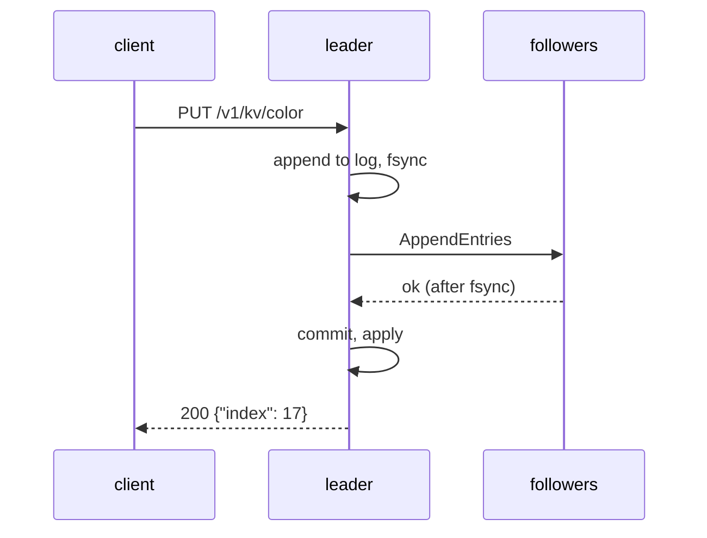

<!-- nav:top -->
[🏠 Start](../START-HERE.md) · [← 23.8 Testing, benchmarking and hardening your capstone](08-testing-benchmarking-and-hardening-capstones.md) · [📋 Phase 23](README.md) · [23.10 Checkpoint: capstone review →](10-checkpoint-capstone-review.md) · [📖 Glossary](../GLOSSARY.md) · [🇷🇺 Русский](../../ru/23-capstone-projects/09-presenting-your-work.md) <!-- nav -->

# Lesson 23.9 — Presenting your work

> **Phase 23 — Capstone projects** · Lesson 9 of 10 · ⏱ about 90 minutes

## What you will learn

- Who looks at a capstone, in which order and for how long, and what each of them must find.
- How to write a README that works in 30 seconds and in 5 minutes, with a diagram, a quick start, guarantees, a test matrix and results.
- How to keep the examples in your README true by running them as doc tests.
- How to write about the project (a blog post or write-up), give a two-minute demo and a ten-minute talk, and answer hard questions.
- How to publish a capstone: a licence, a final check for secrets, and a tagged release.

## Before you start

- At least one capstone is complete or nearly complete: its milestones are tagged, and `docs/design.md`, `docs/adr/` and `docs/results.md` exist (Lessons [23.2](02-writing-a-design-document.md) and [23.8](08-testing-benchmarking-and-hardening-capstones.md)).
- You know doc tests from [Lesson 05.7 — Documentation](../05-rust-intermediate/07-documentation.md) and remote repositories from [Lesson 01.8 — Remote repositories: GitHub and GitLab](../01-git-and-version-control/08-remotes-github-and-gitlab.md).
- Your work log (`docs/log.md`, Lesson 23.1) is your best source for the story: keep it open.

## New words

| Word | Meaning |
|---|---|
| **reader funnel** | The order in which people look at a project: most read only the top of the README, fewer read all of it, a few read the design and the code. |
| **quick start** | The shortest list of commands that takes a stranger from `git clone` to seeing the system work. |
| **claim** | A sentence that says something about your system ("tolerates the loss of 1 of 3 nodes"). Every claim must point to a test or a number. |
| **write-up** | A longer text about the project — a blog post or an article — that tells the story: the problem, the key decision, the hardest bug, the numbers. |
| **demo** | A short live (or recorded) showing of the system doing its job, usually two minutes. |
| **licence** | The legal text that says what others may do with your code. Without one, nobody may legally reuse it. |
| **release** | A named, tagged version of the project (for example `v1.0.0`) that others can refer to. |
| **SemVer** (Semantic Versioning) | The rule for version numbers `MAJOR.MINOR.PATCH`: breaking changes raise MAJOR, new features MINOR, fixes PATCH. |
| **VM** (Virtual Machine) | A whole computer simulated by software; the course's Linux VM is called `dev` (Lesson 11.1). |
| **ADR** (Architecture Decision Record) | A short file that records one important decision: context, decision, consequences (Lesson 23.2). |
| **HTTP** (HyperText Transfer Protocol) | The request-and-response protocol of the web; HTTPS is HTTP over an encrypted connection. |
| **API** (Application Programming Interface) | The functions and types a crate or a service offers to other code. |

## 1. Who looks, and what they need

A capstone is read by people with very different amounts of time. Plan for all of them:

```text
 30 seconds   most visitors   README top: what is it, one diagram, is it serious?
  5 minutes   interested      whole README: quick start, guarantees, tests, results
 30 minutes   reviewers       design document, ADRs, a few source files, CI
 60 minutes   interviewers    a conversation: "why this way?", "what if X fails?"
```

Each level must work **without** the next one. A visitor who reads only the first screen must still understand what you built and that it is real work. An interviewer who has read nothing must still be able to follow your ten-minute explanation.

> 💡 **Tip:** Give your README to someone who has not seen the project and ask them, after 30 seconds, "what does it do, and how do you know it works?". If they cannot answer both, the top of the README needs work.

## 2. The README

The README is the front page. Use a fixed structure, in this order:

```markdown
# kvd — a Raft-replicated key-value store

A key-value store on three nodes that keeps every acknowledged write when any
one node crashes or is cut off. Linearizable reads with read index, idempotent
writes, snapshots. Built in Rust as a learning capstone.

(diagram: the architecture from docs/design.md, 10-15 lines)

## Quick start
    docker compose up -d
    cargo run -p kv -- put color blue
    cargo run -p kv -- get color

## Guarantees and non-goals
- Linearizable reads and writes; tolerates the failure of 1 of 3 nodes.
- Not: transactions over several keys, sharding, authentication.

## How it works          (one paragraph per part, links to docs/design.md and ADRs)
## How it is tested      (the test matrix of Lesson 23.8, with links to the tests)
## Results               (the main table of docs/results.md, with the setup in one line)
## Limits and next steps (what is missing, what you would do with two more months)
## Licence
```

Rules that make the difference:

1. **The first paragraph says what it is, what it guarantees, and that it is a learning project.** Honesty about the context is a strength: a reviewer then judges the engineering, not the missing marketing.
2. **The quick start really works** from a fresh clone, on a machine that is not yours. Test it in a clean container or the VM `dev`.
3. **Every claim points to evidence.** "Tolerates the failure of 1 of 3 nodes" links to the simulation test and says how many seeds it passed. A claim without evidence is removed.
4. **Numbers come with their conditions** (Lesson 23.8): rate, hardware, and a link to the full `docs/results.md`.
5. **Limits are stated by you,** before a reviewer finds them.

Diagrams that change while you work are easier to keep correct as text. GitHub and GitLab draw Mermaid diagrams in Markdown, so a sequence diagram of the most important operation can live in the README:



## 3. Examples that cannot lie

A README example that no longer compiles is worse than none: it tells the reader that nothing else in the README can be trusted either. Rust can run the code blocks of your README as **doc tests**. Try it in a small library:

```bash
cd ~/projects/rust
cargo new --lib code/p23-present
cd code/p23-present
```

`README.md`:

````markdown
# p23-present

`split_pair` splits a `key=value` pair into its two halves.

```rust
use p23_present::split_pair;

assert_eq!(split_pair("level=info"), Some(("level", "info")));
assert_eq!(split_pair("no pair here"), None);
```
````

`src/lib.rs`:

```rust
#![doc = include_str!("../README.md")]

/// Splits `key=value` at the first `=`.
pub fn split_pair(text: &str) -> Option<(&str, &str)> {
    text.split_once('=')
}
```

**What happens:**

1. `include_str!("../README.md")` puts the text of the README into the program at compile time, as a string. The path is relative to `src/lib.rs`.
2. `#![doc = …]` (with `!`, so it applies to the whole crate) makes that text the crate's documentation. The README becomes the first page of `cargo doc`.
3. Every `rust` code block in documentation is a doc test (Lesson 05.7). So `cargo test` now compiles and runs the README example against the real crate.

```bash
cargo test --doc
```

```text
   Doc-tests p23_present

running 1 test
test src/../README.md - (line 5) ... ok

test result: ok. 1 passed; 0 failed; 0 ignored; 0 measured; 0 filtered out; finished in 0.00s
```

Now rename `split_pair` to `parse_pair` in `src/lib.rs` and forget the README — the mistake that makes READMEs lie. The test catches it:

```text
---- src/../README.md - (line 5) stdout ----
error[E0432]: unresolved import `p23_present::split_pair`
 --> src/../README.md:7:5
  |
7 | use p23_present::split_pair;
  |     ^^^^^^^^^^^^^----------
  |                  |
  |                  no `split_pair` in the root
```

Rename it back. In a workspace, put the `#![doc = include_str!(…)]` line into the crate whose API the README shows (for example the client library), and use ` ```rust,no_run ` for examples that need a running server: they are compiled, so they stay correct, but not executed.

> ⚠️ **Common mistake:** A code block with no language (just three backticks) is treated as **Rust** by rustdoc. A quick start with shell commands in such a block becomes a failing doc test — `expected one of '!' or '::', found 'run'` for `cargo run --release`. Always label blocks: ` ```bash `, ` ```text `, ` ```toml `.

## 4. Writing about it

A write-up (a blog post, an article on your site, or a long `docs/story.md`) reaches people the README does not. It is also the best preparation for interviews, because writing forces you to put the story in order. A proven shape, 1,500–2,500 words:

1. **The problem** (one paragraph): what the system does and why it is hard.
2. **The design in one picture**, with the two or three decisions that shaped everything (from your ADRs).
3. **The most interesting decision**, explained with its alternatives and trade-offs.
4. **The hardest bug**: how it showed up, how you found it (a seed, a flame graph, a fuzz crash), what it taught you. Your work log has it.
5. **The numbers**, with conditions, and what limits them.
6. **What you would do next**, and what you learned.

Write for a reader who knows programming but not your project. Show small code fragments only when they carry an idea. And keep it honest: "I learned how read index works by getting it wrong first" is more interesting — and more credible — than "I implemented a production-grade consensus layer".

## 5. The demo and the talk

**A two-minute demo** shows the system doing its job and surviving a failure. For the key-value store: start three nodes, write a value, kill the leader, show the new leader, read the value. For the proxy: run a load test, change the configuration during it, show zero errors. Script it (literally: a list of commands), rehearse it three times, and have a recording as a fallback; a terminal recorder such as asciinema produces a small file that you can link from the README.

**A ten-minute talk** has a fixed shape:

| Minutes | Content |
|---|---|
| 0–1 | The problem and why it is hard (one slide or one diagram) |
| 1–3 | The architecture: the parts and the path of one request |
| 3–5 | One key decision: alternatives, trade-off, why you chose this one |
| 5–7 | How you know it works: the test matrix, one failure test, one bug a test found |
| 7–9 | Numbers, limits and the biggest bottleneck |
| 9–10 | What you learned and what is next; then questions |

**The questions** decide how the talk is remembered. Most of them are one of three kinds, and your documents already contain the answers:

- **"What happens when X fails?"** — your failure-mode table (Lesson 23.2).
- **"Why did you not use Y?"** — your ADRs and the "Alternatives" section.
- **"How do you know?"** — your test matrix and `docs/results.md`.

When you do not know, say so, and say how you would find out: "I have not measured that; I would run the open-model load test at twice the rate and look at the p99." (p99 is the 99th percentile of latency, Lesson 19.1.) That is a strong answer.

## 6. Publishing

Before the repository becomes public, four short steps:

1. **A licence.** Most Rust projects use the dual licence "MIT OR Apache-2.0", the same as the Rust project itself: the user may choose the short MIT licence (named after the Massachusetts Institute of Technology, where it was written) or the Apache License 2.0, which also covers patents. Add the two licence files and `license = "MIT OR Apache-2.0"` in `[workspace.package]`.
2. **A check for secrets in the whole history,** not only in the current files: run a scanner such as `gitleaks` over the repository (Lesson 10.8). A token in an old commit is still public.
3. **A last run of the quick start** from a fresh clone, in a clean container or the VM `dev`.
4. **A release:** an annotated tag with a SemVer version and a push of the branch with its tags.

The Git step of this lesson is the release. Create the empty repository on GitHub or GitLab first (Lesson 01.8), then:

```bash
git remote add origin git@github.com:<your-account>/p23-kv.git
git tag -a v1.0.0 -m "p23-kv 1.0.0: all milestones done"
git push --follow-tags origin main
```

`--follow-tags` pushes the branch and every annotated tag that points into it, so the milestone tags `m0` … `m6` are published too. Example output, from a push to a local test remote (GitHub prints a few more lines):

```text
To ../remote.git
 * [new branch]      main -> main
 * [new tag]         v1.0.0 -> v1.0.0
```

On GitHub or GitLab, turn the tag into a release page and paste the first paragraph of the README and the results table into its description.

> 🔒 **Security:** Look at what a public repository reveals besides code: real host names and IP (Internet Protocol) addresses in configuration examples, internal URLs (Uniform Resource Locators, web addresses) in the work log, your e-mail address in every commit. Use `example.test` names in examples, and decide consciously which e-mail address your commits carry (Lesson 01.2).

## Common mistakes

**1. A README that starts with the build instructions.** The visitor leaves before learning what the project is. Fix: what, guarantees and diagram first; the quick start second.

**2. Claims without evidence.** "Blazing fast", "production-ready", "fault-tolerant". Fix: replace each with a measured or tested sentence, or remove it.

**3. A quick start that works only on your machine.** It uses a file that is not committed or a tool you installed months ago. Fix: run it from a fresh clone in a clean container.

**4. Hiding the limits.** A reviewer finds them anyway, and then doubts everything else. Fix: a "Limits and next steps" section that you write yourself.

**5. A talk that is a tour of the code.** Ten minutes of files and functions, no story. Fix: the table in Section 5 — problem, architecture, one decision, evidence, numbers.

**6. Publishing without a licence.** Without a licence, others may look but not legally reuse your code. Fix: "MIT OR Apache-2.0", as most Rust projects do.

## Try it yourself

1. Create `code/p23-present` from Section 3 and run `cargo test --doc`.
2. Rename the function, run the doc test again and read the error; rename it back.
3. Add a shell block without a language to the README, see the doc test fail, and fix it with ` ```bash `.
4. Write the top of your capstone's README: the first paragraph, the diagram and the quick start. Give it to someone for the 30-second test of Section 1.
5. Write the list of commands for your two-minute demo and rehearse it once.

## Exercises

### Exercise 1 — Make the claims honest (easy)

Rewrite these README sentences so that each one is checkable, or delete it if it cannot be: (a) "Blazing-fast reverse proxy." (b) "Fault-tolerant and production-ready." (c) "Handles millions of messages."

<details>
<summary>Hint</summary>

For each one, ask: which test or measurement would prove it? Then write the sentence that the evidence supports, with its conditions.

</details>

<details>
<summary>Answer</summary>

(a) "Adds 0.3 ms at p99 compared with direct backend access, at 5,000 requests per second on an Apple M4 (see docs/results.md)." (b) "Production-ready" cannot be proven by a learning project — delete it. "Fault-tolerant" becomes: "Keeps serving with any 1 of 3 backends down; tested by `m3_backend_crash_causes_no_client_errors`." (c) "Produced and consumed 1,000,000 messages of 1 KiB in order, with no loss, in the M2 acceptance test; sustained 85 MB/s (megabytes per second) with `acks=1` (docs/results.md)."

</details>

### Exercise 2 — Write a test: a second README example (medium)

Add a second example to the README of `code/p23-present` that documents two edge cases of `split_pair`: only the first `=` splits (`"query=a=b"` gives `("query", "a=b")`), and an empty key is allowed (`"=empty-key"` gives `("", "empty-key")`). Run `cargo test --doc`.

<details>
<summary>Hint</summary>

Each `rust` block is its own doc test with its own `use` line. Put one sentence of explanation before the block; the README is still documentation.

</details>

<details>
<summary>Answer</summary>

Append to `README.md`:

````markdown
Only the first `=` splits; the value may contain more:

```rust
use p23_present::split_pair;

assert_eq!(split_pair("query=a=b"), Some(("query", "a=b")));
assert_eq!(split_pair("=empty-key"), Some(("", "empty-key")));
```
````

```text
test src/../README.md - (line 14) ... ok
test src/../README.md - (line 5) ... ok
test result: ok. 2 passed; 0 failed; 0 ignored; 0 measured; 0 filtered out; finished in 0.01s
```

Why it works: the new block is a second doc test, named after its line in the README. Edge cases in the README are documentation and tests at the same time: if someone changes `split_once` to `rsplit_once`, the README fails.

</details>

### Exercise 3 — Plan a ten-minute talk (medium)

Write the outline of a ten-minute talk about your capstone (or about option 1 if you are not done yet), following the table in Section 5: one or two sentences per row, and the single slide or diagram you would show.

<details>
<summary>Hint</summary>

The hardest row is "one key decision". Choose the decision with the most interesting trade-off from your ADRs, not the one that took the most code.

</details>

<details>
<summary>Answer</summary>

An outline for option 1:

| Minutes | Content | On screen |
|---|---|---|
| 0–1 | Three machines must agree on every write even when one crashes; acknowledged writes must never be lost. | one sentence + three boxes |
| 1–3 | HTTP API → driver → Raft core → log and state machine; the path of a `PUT`. | the sequence diagram of Section 2 |
| 3–5 | Reads: through the log (simple, slow) vs read index (fast, needs a heartbeat round) vs leases (fastest, needs bounded clock drift). I chose read index; ADR 0004. | a three-column table |
| 5–7 | Test matrix; the simulation test that partitions the old leader; the bug it found (the old leader answered a read before its no-op was committed). | the failing seed's log, five lines |
| 7–9 | Writes per second before and after batching, p99; the limit is `fsync`. | the results table and a flame graph |
| 9–10 | What I learned about failure; next: membership changes. Questions. | — |

</details>

### Exercise 4 — Prepare for hard questions (hard)

Write short answers (three to five sentences each) for these questions about your capstone, using your design document and ADRs: (a) "What happens when the disk of one node becomes full?" (b) "Why did you not use an existing library for the core?" (c) "What is the biggest weakness of your design?"

<details>
<summary>Hint</summary>

(a) is a failure-mode question: detection, user impact, reaction, test. (b) is an alternatives question: name the library, the trade-off, and what you would choose in a real job. (c) is an honesty question: the best answer names a real weakness and what would fix it.

</details>

<details>
<summary>Answer</summary>

Example answers for option 1:

(a) "The node can no longer append to its log, so `fsync` fails. It stops acknowledging `AppendEntries`; if it is the leader, it steps down, because it can no longer commit. The other two nodes keep a majority and continue. The disk-usage metric alerts at 80%, and the fault-injection test `f4_follower_disk_full` checks that writes continue."

(b) "Because the point of the project was to understand consensus, I wrote the Raft core myself, following the paper and Project 18.14. In a real job I would start from `openraft` or `raft-rs`, which have years of testing behind them. My ADR 0001 records that choice, and the README says it."

(c) "All data lives in one Raft group, so one leader handles every write: throughput is limited by one machine's disk. The fix is sharding into ranges with one Raft group each (multi-Raft, as in TiKV), which I listed as a stretch goal. A second weakness is that my linearizability checker only handles small histories."

</details>

## Quiz

1. What must a visitor understand after 30 seconds on your README?

<details>
<summary>Answer</summary>

What the project is, what it guarantees, and that it is serious, tested work — from the first paragraph and the diagram.

</details>

2. What does `#![doc = include_str!("../README.md")]` do, and why is it useful?

<details>
<summary>Answer</summary>

It makes the README the crate's documentation at compile time, so every `rust` code block in the README becomes a doc test. `cargo test` then fails when an example in the README no longer matches the code.

</details>

3. Why must every code block in a README that is included as documentation have a language label?

<details>
<summary>Answer</summary>

Because rustdoc treats a block without a language as Rust and tries to compile it. A shell or text block without a label becomes a failing doc test.

</details>

4. Which three kinds of questions come after most capstone talks, and where are their answers?

<details>
<summary>Answer</summary>

"What happens when X fails?" (the failure-mode table), "Why not Y?" (the ADRs and alternatives), and "How do you know?" (the test matrix and the results).

</details>

5. Why check the whole Git history for secrets before publishing, not only the current files?

<details>
<summary>Answer</summary>

Because every old commit is published too. A token that was committed once and deleted later is still in the history and can be read by anyone.

</details>

6. What does `git push --follow-tags origin main` publish?

<details>
<summary>Answer</summary>

The `main` branch and every annotated tag that points to a commit in it — the release tag `v1.0.0` and the milestone tags.

</details>

## Summary

- Plan for the reader funnel: 30 seconds (README top), 5 minutes (whole README), 30 minutes (design, ADRs, code), 60 minutes (a conversation).
- A README has a fixed order: what and guarantees, diagram, quick start, guarantees and non-goals, how it works, how it is tested, results, limits, licence. Every claim points to a test or a number.
- `#![doc = include_str!("../README.md")]` turns README examples into doc tests; label every code block.
- A write-up tells the story: problem, design, one key decision, the hardest bug, numbers, next steps.
- A two-minute demo shows the system surviving a failure; a ten-minute talk follows problem → architecture → decision → evidence → numbers → lessons, and the answers to hard questions come from your failure table, ADRs and results.
- Publish with a licence, a history scan for secrets, a fresh-clone check of the quick start, and an annotated SemVer tag pushed with `--follow-tags`.

## Sources and further reading

- [The rustdoc book — Documentation tests](https://doc.rust-lang.org/rustdoc/write-documentation/documentation-tests.html) — code block attributes such as `no_run`, `ignore` and `should_panic`.
- [The rustdoc book — The `#[doc]` attribute](https://doc.rust-lang.org/rustdoc/write-documentation/the-doc-attribute.html) — including documentation from a file.
- [GitHub Docs — Creating diagrams](https://docs.github.com/en/get-started/writing-on-github/working-with-advanced-formatting/creating-diagrams) and [Mermaid sequence diagrams](https://mermaid.js.org/syntax/sequenceDiagram.html) — diagrams as text in Markdown.
- [Make a README](https://www.makeareadme.com/) — a short guide to what a README needs.
- [Choose a License](https://choosealicense.com/) — what the common open-source licences allow.
- [Rust API Guidelines — Necessities](https://rust-lang.github.io/api-guidelines/necessities.html) — why Rust crates use "MIT OR Apache-2.0".
- [asciinema](https://asciinema.org/) — recording terminal demos as small text files.

---

[🏠 Start](../START-HERE.md) · [← 23.8 Testing, benchmarking and hardening your capstone](08-testing-benchmarking-and-hardening-capstones.md) · [📋 Phase 23](README.md) · [23.10 Checkpoint: capstone review →](10-checkpoint-capstone-review.md) · [📖 Glossary](../GLOSSARY.md) <!-- nav -->
<!-- nav:bottom -->
