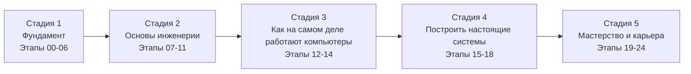

<!-- nav:top -->
[🏠 Начало](../START-HERE.md) · [← Этап 00 — Начало пути](README.md) · [📋 Этап 00](README.md) · [00.2 Что такое программирование →](02-what-is-programming.md) · [📖 Глоссарий](../GLOSSARY.md) · [🇬🇧 English](../../en/00-getting-started/01-how-to-use-this-course.md) <!-- nav -->

# Урок 00.1 — Как пользоваться этим курсом

> **Этап 00 — Начало пути** · Урок 1 из 8 · ⏱ около 90 минут

## Что вы узнаете

- Чему учит этот курс, для кого он и куда он вас приведёт.
- Карту курса: 5 стадий и 25 этапов, и сколько времени занимает каждая часть.
- Как устроен каждый урок и зачем нужен каждый блок (слова, упражнения, вопросы, скрытые ответы).
- Как распределять время, папки и работу, в том числе как пользоваться ИИ-помощником и не обманывать самого себя.
- Почему контроль версий (Git) — первый настоящий навык, который вы осваиваете ещё до самого языка Rust.

## Перед началом

- У вас есть Mac с macOS и доступ в интернет (интернет нужен только для установки инструментов и открытия ссылок).
- Папка курса `~/projects/rust` существует и содержит этот курс. В этой папке `~` — короткая запись «вашей домашней папки»; как это работает, вы узнаете в [Уроке 00.4 — Терминал: первые команды](04-terminal-basics.md).
- Знать программирование не нужно. Это самый первый урок.

## Новые слова

| Слово | Значение |
|---|---|
| **курс** (course) | Весь набор уроков в этой папке — от нуля до работающего системного инженера. |
| **стадия** (stage) | Большая группа этапов с одной общей целью. В курсе 5 стадий. |
| **этап** (phase) | Часть курса об одной теме, например «Git и контроль версий». Этапы пронумерованы от 00 до 24. |
| **урок** (lesson) | Один текстовый файл, который вы изучаете за одно занятие (30–150 минут). Нумеруется так: `02.4` = Этап 02, урок 4. |
| **проект** (project) | Урок, в котором вы сами создаёте небольшую программу: есть список требований, но нет готового решения. |
| **контрольная точка** (checkpoint) | Урок в конце этапа с самопроверкой, чтобы понять, готовы ли вы идти дальше. |
| **системный инженер** (systems engineer) | Программист, который создаёт и поддерживает «нижние» слои программ: серверы, базы данных, инструменты, части операционных систем. Для него важны скорость, расход памяти и надёжность. |
| **Rust** | Язык программирования, созданный для быстрых и безопасных программ. Это язык нашего курса. |
| **IDE** (Integrated Development Environment, интегрированная среда разработки) | Программа для написания кода, которая объединяет редактор, запуск программ и множество помощников. Мы используем **RustRover**. |
| **Git** | Инструмент, который помнит историю ваших файлов. Его изучает Этап 01. |
| **VC** (Version Control, контроль версий) | Общая идея, на которой построен Git: хранить каждую версию файлов, чтобы можно было заглянуть в прошлое и отменить ошибки. |
| **терминал** (terminal) | Окно, в котором компьютером управляют, вводя команды. Его изучает Урок 00.4. |
| **компилятор** (compiler) | Программа, которая переводит написанный вами код во что-то, что компьютер может выполнить. Объясняется в Уроке 00.3. |
| **Markdown** | Простой способ писать форматированный текст (заголовки, списки, код) в обычном файле. Все уроки — файлы Markdown. Его изучает Урок 00.8. |
| **ИИ-помощник** (AI, Artificial Intelligence — искусственный интеллект) | Программа вроде Claude, которая отвечает на вопросы на обычном языке. При аккуратном использовании это хороший наставник. |

## 1. Для чего этот курс

Цель курса просто сформулировать, но чтобы её достичь, нужно время: **превратить вас из новичка в системного инженера**.

*Системный инженер* обычно не делает кнопки и цвета, которые видит пользователь. Он создаёт то, что лежит под ними: программу, которая хранит ваши данные (база данных), программу, которая отвечает на запросы в интернете (сервер), инструменты, которыми программисты пользуются каждый день, и части, которые работают напрямую с операционной системой. Такие программы должны быть **быстрыми**, не расходовать лишнюю **память** и работать месяцами без сбоев. Поэтому системному инженеру нужно
понимать, как на самом деле устроен компьютер, а не только уметь писать код.

Язык курса — **Rust**. Он создан так, чтобы быстрые программы были ещё и безопасными: компилятор (программа, которая переводит ваш код) проверяет многие виды ошибок ещё до запуска программы. Компании используют Rust для частей операционных систем, сетевых сервисов, браузеров и консольных инструментов. Изучая Rust, вы вынуждены разобраться, как работает память, а именно это и нужно системному инженеру.

Будьте честны с собой насчёт длины дороги. Весь курс занимает около 113–147 недель при примерно 10 часах в неделю (примерно два–три года неполной занятости). Заканчивать всё необязательно, чтобы быть полезным. После Стадии 1 (около 17–22 недель) вы уже сможете писать настоящие программы и пользоваться Git как профессионал. Каждая следующая стадия добавляет глубины.

> 💡 **Совет:** думайте о курсе как об освоении ремесла, а не о заучивании фактов. Плотник учится, делая много небольших вещей руками. Вы будете учиться, набирая код, запуская его, ломая и исправляя.

## 2. Карта курса

В курсе **5 стадий**, и в каждой стадии несколько **этапов**. Каждый этап — это папка с файлом `README.md` (обзор) и несколькими уроками.



Вот все этапы и время, которое они требуют (при ~10 часах в неделю):

| Этап | Название | Недели |
|---|---|---|
| **Стадия 1 — Фундамент: инструменты, Git и язык Rust** | | |
| 00 | Начало пути | 1 |
| 01 | Git и контроль версий | 1–2 |
| 02 | Основы программирования на Rust | 2–3 |
| 03 | Владение и заимствование | 2 |
| 04 | Структуры, перечисления, коллекции и ошибки | 3–4 |
| 05 | Rust: средний уровень | 4–5 |
| 06 | Rust: продвинутый уровень | 4–5 |
| **Стадия 2 — Основы инженерии** | | |
| 07 | Алгоритмы и структуры данных | 6–8 |
| 08 | Проектирование ПО: принципы, паттерны и соглашения | 3–4 |
| 09 | Тестирование, отладка и бенчмарки | 3–4 |
| 10 | Основы безопасности | 3–4 |
| 11 | Linux, командная оболочка и контейнеры | 3–4 |
| **Стадия 3 — Как на самом деле работают компьютеры** | | |
| 12 | Компьютерные системы | 6–8 |
| 13 | Операционные системы изнутри | 8–10 |
| 14 | Конкурентность и асинхронность подробно | 6–8 |
| **Стадия 4 — Построить настоящие системы** | | |
| 15 | Сети | 6–8 |
| 16 | Бэкенд-сервисы | 5–6 |
| 17 | Как устроены хранилища и базы данных | 7–9 |
| 18 | Распределённые системы | 8–10 |
| **Стадия 5 — Мастерство и карьера** | | |
| 19 | Производительность и профилирование | 4–5 |
| 20 | Надёжность и защита | 4–5 |
| 21 | Облачная (cloud-native) инфраструктура | 4–6 |
| 22 | Специализации | 10–12 |
| 23 | Итоговые проекты | 10–14 |
| 24 | Карьера и open source | постоянно |

Некоторые из этих слов (владение, конкурентность, асинхронность) пока ничего вам не говорят. Это
нормально. Каждое из них объясняется с нуля в своём этапе.

## 3. Где в курсе Git

Посмотрите на порядок: **Этап 01 — это Git и контроль версий, а язык Rust начинается только с
Этапа 02.** Это сделано намеренно.

*Контроль версий* отвечает на очень практичный вопрос: «Как выглядели мои файлы вчера и как вернуть
ту версию?» Без него люди сохраняют файлы как `program-final.rs`, `program-final2.rs`,
`program-really-final.rs`. С ним у вас одна чистая папка и полная история за ней. Каждая
профессиональная команда в мире использует контроль версий, и **Git** — инструмент, которым пользуются почти все.

В этом курсе Git — не побочная тема:

- Начиная с Этапа 01 каждый проект просит вас делать **коммит** (сохранённый снимок вашей работы) на каждой вехе.
- Ваш учебный репозиторий (папка под управлением Git) будет хранить весь ваш код и заметки, так что прогресс будет в безопасности и на виду.
- В [Уроке 00.5 — Установка Rust и RustRover](05-install-rust-and-rustrover.md) вы только проверите, что Git установлен. В [Уроке 00.6 — Ваша первая программа на Rust](06-your-first-rust-program.md) вы увидите, что Cargo (инструмент сборки Rust) уже сам готовит для вас репозиторий Git. По-настоящему обучение начнётся на Этапе 01.

> 💡 **Совет:** этап 00 — это подготовка. «Настоящих» программ вы пока не пишете. Его задача —
> убедиться, что ваш компьютер, инструменты и привычки готовы, чтобы дальнейшие этапы шли гладко.

## 4. Как устроен урок

Каждый урок имеет одну и ту же форму. Когда вы её знаете, вы всегда понимаете, где находитесь.

| Блок | Что это | Как использовать |
|---|---|---|
| **Что вы узнаете** | 3–5 целей. | Прочитайте сначала. В конце проверьте, что умеете каждое. |
| **Перед началом** | Что нужно было сделать раньше. | Если чего-то не хватает, идите по ссылкам. |
| **Новые слова** | Таблица новых терминов и сокращений. | Прочитайте до урока и возвращайтесь, когда слово непонятно. |
| **Нумерованные разделы** | Само обучение: сначала простое объяснение, потом точное правило, потом небольшой пример. | Читайте медленно. Набирайте примеры. |
| **Что происходит:** | Нумерованное построчное объяснение после каждого примера. | Сравните его со своей догадкой. |
| **Частые ошибки** | Типичные ошибки с настоящим сообщением и исправлением. | Хотя бы раз сделайте эти ошибки нарочно. |
| **Попробуйте сами** | Пошаговое мини-задание с точными командами. | Делайте его, держа урок рядом с терминалом. |
| **Упражнения** | 3–6 заданий с отметкой «легко», «средне» или «сложно». | Сначала попробуйте сами. Подсказку открывайте, только если застряли. Ответ — в последнюю очередь. |
| **Вопросы для самопроверки** | 4–8 коротких вопросов. | Ответьте в уме или на бумаге, потом проверьте. |
| **Итоги** | Главные идеи в нескольких строках. | Скопируйте нужные в свои заметки. |
| **Источники и что почитать** | Официальная документация и книги. | По желанию. Проверьте факт или изучите глубже. |

Всё, что нужно, находится **внутри урока**. Ссылки в конце нужны для проверки и углубления; вам
никогда не *обязательно* открывать их, чтобы понять урок.

### Скрытые подсказки и ответы

Подсказки и ответы скрыты, чтобы вы не прочли их случайно. Нажмите на строку, чтобы открыть:

<details>
<summary>Нажмите, чтобы открыть скрытый блок</summary>

Так выглядит ответ. В настоящем упражнении нужно решить задачу *до того*, как вы это откроете.

</details>

Если скрытый блок не открывается в вашей программе просмотра, откройте файл в RustRover (он показывает Markdown) или в
веб-браузере.

### Блоки-заметки

В тексте встречаются короткие заметки со значком:

| Значок | Значение |
|---|---|
| 💡 **Совет** | Практический совет, который экономит время. |
| ⚠️ **Частая ошибка** | То, в чём новички часто ошибаются. |
| 📏 **Соглашение** | Как профессионалы обычно называют, форматируют или организуют вещи. |
| 🧪 **Тестирование** | Как проверить, что код работает. |
| 🔒 **Безопасность** | Правило безопасности (например: никогда не кладите пароль в Git). |
| ⚡ **Производительность** | То, что влияет на скорость или память. |

### Три вида уроков

- **Обычные уроки** учат одной теме и заканчиваются упражнениями и вопросами.
- **Уроки-проекты** (в имени файла есть `project`) просят вас создать небольшую программу. Вы получаете
  *контракт* (что именно должна делать программа) и план с вехами M1, M2 и так далее. Полного
  решения нет намеренно: обучение происходит в процессе создания. В каждом проекте должны быть тесты, он должен проходить
  `cargo clippy` и `cargo fmt` (инструменты Rust для проверки и форматирования), иметь короткий README и, начиная с Этапа 01, коммит Git на каждой вехе.
- **Уроки-контрольные точки** завершают этап. Вы отвечаете на самопроверку, делаете несколько практических заданий, и урок
  подскажет, какие прежние уроки повторить, если что-то не получилось.

## 5. Ваши папки

Вся ваша работа находится в `~/projects/rust`. Когда курс подготовлен, она выглядит так:

```text
~/projects/rust
├── START-HERE.md      ← первая страница курса
├── GLOSSARY.md        ← все новые слова и сокращения в одном месте
├── course/            ← уроки на английском
├── ru/
│   └── course/        ← те же уроки на русском (этот файл здесь)
├── code/              ← ВАШ код: по папке на проект
│   ├── p00-hello/
│   └── p02-guessing-game/
└── notes/             ← ВАШИ заметки (вы создадите папку в Уроке 00.4)
```

В `code/` лежит по одной папке на проект. Имя всегда начинается с `p` и номера этапа:
`p02-guessing-game` — проект из Этапа 02. Папку `code/p00-hello` вы создадите в
[Уроке 00.6](06-your-first-rust-program.md).

> 📏 **Соглашение:** никогда не вносите свои заметки в файлы уроков из `course/` (`course/en/` и
> `course/ru/`); единственное, что вы там меняете, — галочки в `PROGRESS.md`. Свой текст
> держите в `notes/`, свои программы — в `code/`. Если позже вы захотите обновить курс, ваша
> работа не будет перезаписана.

Два справочных файла:

- [START-HERE.md](../START-HERE.md) — входная страница: с чего начать и где что находится.
- [GLOSSARY.md](../GLOSSARY.md) — каждое новое слово и сокращение из каждого урока. Если слово непонятно, сначала поищите здесь.

## 6. Как работать

### Читайте, держа руки на клавиатуре

Чтение о программировании не учит программированию, так же как чтение о плавании не учит плавать.
Для каждого примера:

1. **Предскажите**, что программа выведет или сделает.
2. **Наберите** код сами. Не копируйте и не вставляйте; набор заставляет заметить каждый символ.
3. **Запустите** и сравните настоящий результат с предсказанием.
4. **Измените** что-нибудь и запустите снова. Сломайте нарочно и прочитайте ошибку.

### Лестница «я застрял»

Когда упражнение не получается, поднимайтесь по лестнице шаг за шагом:

1. Перечитайте сообщение об ошибке медленно, с самого начала. Как это делать, расскажет Урок 00.7.
2. Потратьте 15 минут настоящих усилий. Если вы расстроены, пройдитесь.
3. Откройте только **подсказку**.
4. Посмотрите **ответ**, потом закройте его и напишите решение сами, не подглядывая.
5. Спросите человека или ИИ-помощника (см. ниже), указав точную ошибку и свой код.

### Время

План рассчитан примерно на **10 часов в неделю**. Хороший ритм — 4–5 занятий примерно по 2 часа,
а не один десятичасовой марафон. Короткие регулярные занятия лучше длинных редких, потому что мозгу
нужен сон, чтобы запомнить новое. Полный режим учёбы вам даст Урок 00.8.

### Английский и русский

Каждый урок существует на английском и на русском с одинаковой структурой. Хороший способ: сначала прочитайте
язык, который понимаете лучше, потом просмотрите второй. *Код* и *команды* одинаковы в обеих
версиях. Технические слова тоже даны по-английски, потому что документация,
сообщения об ошибках и другие программисты говорят по-английски. В русских файлах при первом
появлении английское слово стоит в скобках, например «владение (ownership)».

### Работа с ИИ-помощником

ИИ-помощник вроде Claude может объяснить понятие по-другому, проверить ваш код или подсказать,
что попробовать дальше. Пользуйтесь им как терпеливым наставником:

- **Хорошо:** «Объясни эту ошибку компилятора простыми словами». «Почему эта строка выводит 5?» «Дай подсказку, а не решение».
- **Плохо:** «Напиши за меня весь проект». Так вы получите рабочий код и ничему не научитесь.
- Всегда **проверяйте ответ**, запуская код. Помощник может быть уверенно неправ.
- Всегда пробуйте сами хотя бы 15 минут, прежде чем спрашивать.

> 🔒 **Безопасность:** никогда не вставляйте пароли, токены доступа, закрытые ключи или закрытый код компании в чат
> с любым помощником или в публичный форум. Урок 00.7 повторяет это правило.

## Частые ошибки

1. **Пропуск «скучных» уроков.** Этап 00 выглядит простым, но терминал и привычка читать ошибки
   экономят часы позже. *Исправление:* пройдите все восемь уроков, пусть даже быстро.
2. **Копирование и вставка кода.** Программа работает, но ваши пальцы и глаза ничему не научились. *Исправление:* набирайте всё.
3. **Мгновенное открытие ответа.** Вам кажется, что вы поняли, но вы лишь узнали. *Исправление:* пользуйтесь лестницей «я застрял».
4. **Одно огромное занятие.** После 3 часов качество резко падает. *Исправление:* несколько коротких занятий.
5. **Отсутствие заметок.** Через неделю вы забудете детали. *Исправление:* записывайте 5 строк после каждого урока (Урок 00.8).

## Попробуйте сами

1. Откройте Finder и перейдите в папку `~/projects/rust` (в Finder: меню **Переход → Домой**, затем откройте `projects`, затем `rust`). Найдите папки `course` и `ru`.
2. Откройте этот файл урока в RustRover, если он установлен, или в любом текстовом редакторе. Если у вас только простой редактор, текст всё равно читается.
3. Откройте скрытый блок в разделе 4 выше.
4. Возьмите лист бумаги или любое приложение для заметок. Запишите, в какие дни и часы вы будете учиться на следующей неделе. Будьте реалистичны: 4–5 занятий примерно по 2 часа.
5. Когда будете готовы, откройте [Урок 00.2 — Что такое программирование](02-what-is-programming.md).

## Упражнения

### Упражнение 1 — Найдите этап (легко)

В каком этапе вы бы искали каждую тему? Используйте таблицу из раздела 2.

1. Как отменить ошибку в ваших файлах.
2. Как написать сервер, который отвечает на запросы из интернета.
3. Как операционная система делит один процессор между многими программами.

<details>
<summary>Подсказка</summary>

Посмотрите на названия этапов. Контроль версий, сети и «операционные системы» есть в названиях.

</details>

<details>
<summary>Ответ</summary>

1. Этап 01 — Git и контроль версий.
2. Этап 16 — Бэкенд-сервисы (а для нижних слоёв — Этап 15 — Сети).
3. Этап 13 — Операционные системы изнутри.

Почему это работает: названия этапов называют главную тему, поэтому беглый просмотр таблицы находит нужное место.

</details>

### Упражнение 2 — Составьте план недели (средне)

Составьте план на ближайшие 7 дней. В нём должны быть: число занятий, длительность каждого,
день и время каждого и урок, который вы будете изучать на каждом. Всего уроков Этапа 00 — 600 минут
(10 часов). Уложитесь в одну неделю.

<details>
<summary>Подсказка</summary>

Уроки длятся 30, 60, 90, 120, 60, 90, 60 и 90 минут (уроки с 00.1 по 00.8 в этом порядке). В занятие на 2 часа помещаются два коротких урока или один длинный урок с упражнениями.

</details>

<details>
<summary>Ответ</summary>

Один из возможных планов (5 занятий по 2 часа = 10 часов):

| День | Время | Уроки |
|---|---|---|
| Понедельник | 19:00–21:00 | 00.1 (30 мин) + 00.2 (60 мин) |
| Вторник | 19:00–21:00 | 00.3 (90 мин) |
| Среда | 19:00–21:00 | 00.4 (120 мин) |
| Четверг | 19:00–21:00 | 00.5 (60 мин) + первая половина 00.6 |
| Суббота | 10:00–13:00 | вторая половина 00.6, 00.7 (60 мин), 00.8 (90 мин) |

Почему это работает: ни одно занятие не длиннее примерно трёх часов, трудные темы не свалены вместе, и
есть день отдыха. Ваш план может отличаться. Важно, чтобы в нём были закреплённые дни и время.

</details>

### Упражнение 3 — Назовите папки (сложно)

Вы на Этапе 04 и будете создавать проект «телефонная книга», а на Этапе 09 — проект
«запуск бенчмарков». По соглашению об именах курса напишите имена папок и
полный путь (с `~`) для обоих.

<details>
<summary>Подсказка</summary>

Шаблон такой: `p` + двузначный номер этапа + `-` + короткое имя строчными буквами с дефисами между словами.

</details>

<details>
<summary>Ответ</summary>

- `~/projects/rust/code/p04-phone-book`
- `~/projects/rust/code/p09-benchmark-runner`

Почему это работает: номер этапа в имени подсказывает, когда вы сделали проект, а строчные слова
с дефисами — обычный стиль имён папок в проектах на Rust.

</details>

## Вопросы для самопроверки

1. Кто такой системный инженер?

<details>
<summary>Ответ</summary>

Программист, который создаёт и поддерживает нижние слои программ (серверы, базы данных, инструменты, части операционных систем), где важны скорость, расход памяти и надёжность.

</details>

2. Почему курс учит Git раньше языка Rust?

<details>
<summary>Ответ</summary>

Потому что начиная с Этапа 01 каждый проект хранится в Git с коммитом на каждой вехе. Контроль версий хранит историю ваших файлов и защищает вашу работу.

</details>

3. Что даёт урок-проект и чего он не даёт?

<details>
<summary>Ответ</summary>

Он даёт контракт (что должна делать программа) и план с вехами и подсказками. Он не даёт полного решения, потому что обучение происходит в процессе самостоятельного создания.

</details>

4. Где хранить свой код и свои заметки?

<details>
<summary>Ответ</summary>

Код — в `~/projects/rust/code/` (по одной папке на проект, с именами вроде `p02-guessing-game`), заметки — в `~/projects/rust/notes/`. Файлы уроков в `course/` остаются нетронутыми (вы только отмечаете галочки в `PROGRESS.md`).

</details>

5. Назовите два хороших способа и один плохой способ использовать ИИ-помощника.

<details>
<summary>Ответ</summary>

Хорошо: попросить объяснить ошибку простыми словами; попросить подсказку вместо решения. Плохо: просить написать весь проект, потому что тогда вы ничему не научитесь. Всегда проверяйте его ответы, запуская код.

</details>

## Итоги

- Курс ведёт вас от нуля до системного инженера через 5 стадий и 25 этапов, около 113–147 недель при ~10 часах в неделю.
- Стадия 1 (Этапы 00–06) даёт инструменты, Git и язык Rust.
- Git стоит первым (Этап 01), потому что каждый следующий проект сохраняется коммитами.
- В уроке всегда есть: цели, новые слова, разделы с «Что происходит:», ошибки, упражнения, вопросы, итоги, источники.
- Набирайте каждый пример, предсказывайте результат, потом запускайте.
- Пользуйтесь лестницей «я застрял»: сообщение об ошибке, 15 минут, подсказка, ответ, вопрос.
- Держите код в `code/`, а заметки в `notes/`.
- ИИ-помощник — наставник, а не замена вашей собственной работы.

## Источники и что почитать

- [Rust — Getting Started](https://www.rust-lang.org/learn/get-started) — официальная страница со ссылками на основные учебные материалы проекта Rust.
- [The Rust Programming Language ("the Book")](https://doc.rust-lang.org/book/) — официальная бесплатная книга; курс следует её порядку идей, но объясняет всё с нуля.
- [Rust by Example](https://doc.rust-lang.org/rust-by-example/) — короткие официальные примеры, которые можно запускать; полезны как второе объяснение.
- [Pro Git](https://git-scm.com/book/en/v2) — бесплатная официальная книга о Git; Этап 01 использует её как основной справочник.
- [CommonMark help](https://commonmark.org/help/) — краткое руководство по Markdown, формату всех уроков.

---

[🏠 Начало](../START-HERE.md) · [← Этап 00 — Начало пути](README.md) · [📋 Этап 00](README.md) · [00.2 Что такое программирование →](02-what-is-programming.md) · [📖 Глоссарий](../GLOSSARY.md) <!-- nav -->
<!-- nav:bottom -->
