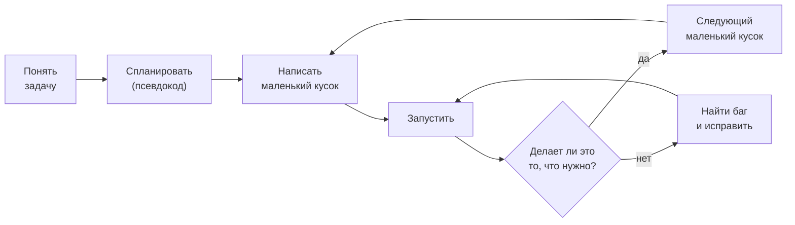

<!-- nav:top -->
[🏠 Начало](../START-HERE.md) · [← 00.1 Как пользоваться этим курсом](01-how-to-use-this-course.md) · [📋 Этап 00](README.md) · [00.3 Как компьютер выполняет программу →](03-how-a-computer-runs-a-program.md) · [📖 Глоссарий](../GLOSSARY.md) · [🇬🇧 English](../../en/00-getting-started/02-what-is-programming.md) <!-- nav -->

# Урок 00.2 — Что такое программирование

> **Этап 00 — Начало пути** · Урок 2 из 8 · ⏱ около 105 минут

## Что вы узнаете

- Что такое программа и почему компьютеру нужны точные инструкции.
- Что такое алгоритм и как описать его простыми словами (псевдокод).
- Шесть строительных блоков, из которых состоит любая программа.
- Ежедневный цикл программиста: планируем, пишем, запускаем, проверяем, исправляем.
- Какие бывают ошибки в программах и какими инструментами пользуется программист (в том числе контролем версий).

## Перед началом

- Вы прошли [Урок 00.1 — Как пользоваться этим курсом](01-how-to-use-this-course.md).
- Ничего устанавливать не нужно. В этом уроке только слова и несколько крошечных фрагментов кода на Rust, которые вы лишь *читаете*.

## Новые слова

| Слово | Значение |
|---|---|
| **программа** (program) | Список инструкций, который говорит компьютеру, что делать. |
| **инструкция** (instruction) | Один маленький точный шаг, например «сложи эти два числа». |
| **алгоритм** (algorithm) | Конечный список шагов, который решает задачу. Рецепт — это алгоритм приготовления еды. |
| **псевдокод** (pseudocode) | Алгоритм, записанный простыми словами, упорядоченно и без строгих правил настоящего языка программирования. |
| **исходный код** (source code) | Текст программы, написанный человеком на языке программирования. |
| **язык программирования** (programming language) | Строгий небольшой язык, на котором люди пишут программы. Rust — один из них. |
| **ввод / вывод** (input / output) | Ввод — данные, которые программа получает (нажатие клавиши, файл). Вывод — то, что она производит (текст на экране, файл). |
| **переменная** (variable) | Именованное место, в котором хранится значение, например `width` хранит число 5. Её изучает Урок 02.1. |
| **условие** (condition) | Вопрос «да/нет» внутри программы: «возраст меньше 18?». |
| **цикл** (loop) | Способ повторить шаги много раз. |
| **функция** (function) | Именованная группа шагов, которую можно использовать повторно. |
| **баг** (bug) | Ошибка в программе, из-за которой она делает не то, что вы хотели. |
| **отладка** (debugging) | Поиск и исправление багов. |
| **компилятор** (compiler) | Программа, которая переводит исходный код в инструкции, которые может выполнить компьютер. Объясняется в Уроке 00.3. |
| **редактор** (editor) | Программа для написания и изменения текстовых файлов. **IDE** (Integrated Development Environment, интегрированная среда разработки) — это редактор с множеством дополнительных помощников. |
| **контроль версий** (version control) | Инструмент, который записывает каждую версию ваших файлов, чтобы можно было видеть историю и отменять ошибки. Его изучает Этап 01. |

## 1. Программа — это список инструкций

Представьте, что вы даёте очень строгому помощнику листок с рецептом. Помощник:

- делает ровно то, что написано, в том порядке, в каком написано;
- никогда не догадывается, что вы «наверное, имели в виду»;
- никогда не устаёт и работает невероятно быстро;
- не знает ничего, чего нет на листке.

Этот помощник — компьютер. Листок — **программа**.

Поскольку помощник не умеет догадываться, человеческой инструкции «сделай мне бутерброд»
недостаточно. Какой хлеб? Сколько ломтиков? Где нож? Когда остановиться? Компьютеру нужен ответ на каждый
из этих вопросов, записанный на листке. Сравните:

| Человеческая версия | Версия для компьютера |
|---|---|
| Сделай мне бутерброд. | 1. Возьми 2 ломтика хлеба из пакета. 2. Положи их на тарелку. 3. Открой масло. 4. Намажь маслом один ломтик ножом. 5. Положи 2 ломтика сыра на намазанный ломтик. 6. Положи второй ломтик сверху. 7. Остановись. |

Даже этот список неполон (что, если пакет пуст?), и поиск того, чего не хватает, — большая
часть программирования.

> 💡 **Совет:** пока вы учитесь, говорите как строгий помощник. Спрашивайте себя: «Что именно происходит,
> шаг за шагом, если прочитать эту строку буквально?»

## 2. Алгоритмы и псевдокод

**Алгоритм** — это конечный список шагов, который решает задачу. «Конечный» значит, что он заканчивается. Прежде чем
писать настоящий код, мы часто записываем алгоритм простыми словами. Это называется **псевдокод**
(«псевдо» значит «ненастоящий»). Официального формата нет; цель — ясный план, которому может следовать человек.

Задача: *найти наибольшее число в списке*.

```pseudocode
Возьми первое число списка. Назови его «лучшее».
Для каждого из остальных чисел списка:
    Если число больше, чем «лучшее»:
        Сделай «лучшее» равным этому числу.
Когда чисел больше нет, ответ — «лучшее».
```

Что происходит, когда мы выполняем его для списка `4, 17, 9, 2`? Мы ведём **трассировку**: таблицу, которая показывает
значение каждого имени после каждого шага. Трассировка вручную — один из самых полезных навыков в программировании.

| Шаг | Число, на которое смотрим | Больше, чем «лучшее»? | «лучшее» после шага |
|---|---|---|---|
| начало | (первое число) 4 | — | 4 |
| 1 | 17 | да (17 > 4) | 17 |
| 2 | 9 | нет (9 < 17) | 17 |
| 3 | 2 | нет (2 < 17) | 17 |

Ответ — 17. Заметьте, что алгоритму не нужно знать, *какие* числа в списке; он работает
для любого списка. В этом сила алгоритма: одни и те же шаги решают целое семейство задач.

## 3. Исходный код и языки программирования

Псевдокод — для людей. Компьютеру нужен план, записанный на **языке программирования**, у которого
строгие правила написания, символов и порядка. Текст, который вы пишете, называется **исходным кодом**.
Вот небольшая программа на Rust. Не пытайтесь понять каждое слово сейчас; вы выучите их на
Этапе 02. Просто прочитайте её как рассказ:

```rust
fn main() {
    let width = 5;
    let height = 3;
    println!("The area is {}", width * height);
}
```

Что происходит:

1. `fn main() {` — «здесь начинается главная часть программы». Каждая программа на Rust начинает работу с `main`.
2. `let width = 5;` — создать **переменную** (именованную коробку) `width` и положить в неё число 5.
3. `let height = 3;` — то же для `height` с числом 3.
4. `println!(...)` — вывести строку текста на экран. `{}` внутри кавычек — это дырка; значение после запятой (`width * height`, то есть 5 умножить на 3) заполняет её.
5. `}` — здесь главная часть заканчивается, значит, программа заканчивается.

Вывод (это настоящий вывод этой программы):

```text
The area is 15
```

Компьютер делает **ровно то, что сказано в коде, а не то, что вы имели в виду**. Измените один символ, `*` на `+`:

```rust
fn main() {
    let width = 5;
    let height = 3;
    println!("The area is {}", width + height);
}
```

Вывод:

```text
The area is 8
```

Никто не пожаловался. С точки зрения языка программа правильная, просто она больше не вычисляет площадь. Компьютер
не может знать, что вы хотели получить площадь. Такие ошибки найти труднее всего, и
мы называем их *логическими багами* (подробнее в разделе 5).

> ⚠️ **Частая ошибка:** верить, что «компьютер поймёт, что я имел в виду». Он никогда не понимает. Говорите
> точно то, что имеете в виду.

## 4. Шесть строительных блоков

Почти любая программа, которую вы когда-нибудь напишете, состоит из одного и того же небольшого набора идей. Научитесь
узнавать их, и большие программы перестанут казаться страшными.

| Блок | Пример из жизни | В программе | Где изучается |
|---|---|---|---|
| **Ввод** | Кто-то говорит вам свой возраст. | Прочитать число, набранное на клавиатуре, или из файла. | Урок 02.7 |
| **Вывод** | Вы произносите результат вслух. | Напечатать текст на экране, записать файл. | Уроки 00.6 и 02.6 |
| **Хранение** | Вы запоминаете возраст. | Переменная хранит значение. | Урок 02.1 |
| **Решения** | Если возраст меньше 18, сказать «слишком молод». | Условие (`if`). | Урок 02.5 |
| **Повторение** | Спрашивать снова, пока ответ не станет числом. | Цикл. | Урок 02.5 |
| **Повторное использование** | «Завари чай» одной фразой вместо всех шагов. | Функция. | Урок 02.4 |

Вот программа на псевдокоде, которая использует все шесть блоков:

```pseudocode
Спроси у пользователя возраст.                   (ввод)
Сохрани ответ в «возраст».                       (хранение)
Повторяй, пока ответ не является числом:         (повторение)
    Скажи пользователю ввести число.             (вывод)
    Спроси снова.                                (ввод)
Если возраст меньше 18:                          (решение)
    Покажи «Слишком молод».                      (вывод)
Иначе:
    Покажи «Добро пожаловать».                   (вывод)
```

Повторное использование (функции) появилось бы, если бы мы поместили шаги «спросить число» в именованную группу и использовали её
во многих местах.

## 5. Цикл программиста и баги

Никто не пишет правильную программу с первого раза. Профессионалы весь день работают в маленьком цикле:



Ключевая привычка — **маленькие шаги**. Напишите 5 строк, запустите, проверьте. Если вы напишете 200 строк и запустите
их впервые, у вас будет 20 ошибок сразу и никакого понимания, какая из них какая.

Бывает три вида багов. Со всеми тремя вы познакомитесь в Уроке 00.7.

| Вид | Когда проявляется | Пример |
|---|---|---|
| **Ошибка компиляции** | Вы пытаетесь собрать программу. Компилятор отказывается и объясняет. | Пропущена точка с запятой, неверно написано имя. |
| **Ошибка времени выполнения** | Программа запускается, а потом останавливается с сообщением об ошибке («падение», или *паника*). | Программа пытается прочитать то, чего не существует. |
| **Логический баг** | Программа спокойно работает и выдаёт неверный результат. | `+` вместо `*` в примере с площадью. |

Ошибки компиляции — самые дружелюбные: Rust находит их *до* запуска программы и
точно говорит, где они. Большая часть силы Rust в том, что он превращает многие ошибки времени выполнения
и логические баги в ошибки компиляции.

## 6. Чем пользуется программист

На столе программиста не один инструмент. Со всеми ними вы познакомитесь в ближайших уроках:

- **Терминал** — окно, в котором вы вводите команды (Урок 00.4).
- **Редактор или IDE** — где вы пишете исходный код. Мы используем RustRover (Урок 00.5).
- **Компилятор и инструмент сборки** — `rustc` и Cargo переводят и запускают вашу программу (Уроки 00.5 и 00.6).
- **Контроль версий** — Git записывает историю ваших файлов (Этап 01).
- **Документация** — официальные описания языка и его библиотеки (Урок 00.7).
- **Тесты** — маленькие программы, которые проверяют основную (Этап 02).

Несколько слов о контроле версий, потому что новички часто его пропускают: представьте, что вы два часа
меняли программу, она теперь сломана, а как она выглядела раньше, вы не помните.
С контролем версий вы сохраняете именованный снимок («коммит») в каждый удачный момент. Тогда вы можете
всегда вернуться к последнему рабочему снимку, построчно сравнить две версии и увидеть,
*когда* появился баг. Он также позволяет многим людям работать над одним проектом, не затирая друг друга. Вот почему
курс учит ему первым.

## 7. Каким программистом вы становитесь

Многие программы можно написать на любом языке. **Системный инженер** работает над теми, где важна
*машина*: сколько памяти используется, сколько запросов в секунду выдерживает сервер,
что происходит, когда диск заполнен или сетевой кабель выдернут. Примеры такого ПО: база
данных, веб-сервер, часть браузера, которая рисует страницы, программа копирования файлов, части операционной
системы.

Поэтому курс учит двум вещам одновременно: **языку** (Rust) и **машине** (как на самом деле
устроен компьютер). Следующий урок начинается с машины.

## Частые ошибки

1. **Писать код, не подумав.** Вы печатаете час и получаете кашу. *Исправление:* сначала напишите 3–5 строк
   псевдокода. Если вы не можете объяснить шаги словами, вы не напишете их и в коде.
2. **Пытаться сначала выучить весь язык.** Никто не помнит 300 правил. *Исправление:* выучите одну идею,
   используйте её в маленькой программе, затем идите дальше.
3. **Писать много кода до первого запуска.** *Исправление:* запускайте после каждых нескольких строк.
4. **Копировать код, который вы не понимаете.** Он сработает один раз, а потом вы не сможете его изменить. *Исправление:* после
   копирования любой строки объясните её вслух, строка за строкой.
5. **Сравнивать себя с опытными программистами.** Они видели те же ошибки 10 000 раз.
   *Исправление:* сравнивайте себя с собой на прошлой неделе.

## Попробуйте сами

Для этого упражнения нужны только бумага и друг (или вы сами в двух ролях).

1. Выберите крошечную задачу, например «заварить чашку чая».
2. Запишите инструкции нумерованными шагами. Не смотрите на кухню, пока пишете.
3. Теперь станьте строгим помощником. Идите на кухню и выполняйте **только то, что написано, буквально**. Если
   в шаге сказано «налей воды», а не сказано «в чайник», лейте её на стол (мысленно!).
4. Каждый раз, когда инструкции не срабатывают, исправляйте их. Посчитайте, сколько версий понадобилось.
5. Сохраните окончательную версию. Вы только что потренировались в отладке.

## Упражнения

### Упражнение 1 — Назовите блок (легко)

Для каждого предложения скажите, какой это строительный блок: ввод, вывод, хранение, решение или повторение.

1. «Прочитай число с клавиатуры».
2. «Запомни результат под именем `total`».
3. «Если число отрицательное, остановись».
4. «Сделай следующие три шага десять раз».
5. «Покажи на экране слово `Done`».

<details>
<summary>Подсказка</summary>

Спросите себя: приносит ли это данные внутрь (ввод), отправляет ли данные наружу (вывод), хранит ли данные (хранение), выбирает ли между путями (решение) или делает что-то снова (повторение)?

</details>

<details>
<summary>Ответ</summary>

1. Ввод.
2. Хранение.
3. Решение (условие, «если»).
4. Повторение (цикл).
5. Вывод.

Почему это работает: в каждом предложении один главный глагол, который соответствует одному блоку: прочитай = ввод, запомни = хранение, если = решение, «сделай N раз» = повторение, покажи = вывод.

</details>

### Упражнение 2 — Посчитайте чётные числа (средне)

Напишите псевдокод, который считает, сколько чисел в списке чётные (делятся на 2 без
остатка). Сделайте трассировку для списка `3, 8, 5, 10, 12`.

<details>
<summary>Подсказка</summary>

Вам нужен счётчик, который начинается с 0. Смотрите на каждое число; если оно чётное, прибавляйте 1 к счётчику.

</details>

<details>
<summary>Ответ</summary>

```pseudocode
Установи «счётчик» в 0.
Для каждого числа в списке:
    Если остаток от деления числа на 2 равен 0:
        Прибавь 1 к «счётчику».
Ответ — «счётчик».
```

Трассировка для `3, 8, 5, 10, 12`:

| Число | Чётное? | счётчик после |
|---|---|---|
| (начало) | — | 0 |
| 3 | нет | 0 |
| 8 | да | 1 |
| 5 | нет | 1 |
| 10 | да | 2 |
| 12 | да | 3 |

Ответ — 3.

Почему это работает: счётчик хранит прогресс между шагами, условие выбирает, какие числа
считать, а повторение посещает каждое число один раз.

</details>

### Упражнение 3 — Найдите баг (средне)

Этот псевдокод должен складывать все числа списка. Для списка `2, 4, 6` он даёт 6 вместо
12. Найдите баг и исправьте его.

```pseudocode
Установи «сумму» в 0.
Для каждого числа в списке:
    Установи «сумму» равной этому числу.
Ответ — «сумма».
```

<details>
<summary>Подсказка</summary>

Сделайте трассировку вручную. Чему равна «сумма» после каждого числа?

</details>

<details>
<summary>Ответ</summary>

Трассировка ошибочной версии: после 2 → сумма равна 2; после 4 → сумма равна 4; после 6 → сумма равна 6. Каждый шаг *заменяет* сумму, а не прибавляет к ней, поэтому остаётся только последнее число.

Исправленная версия:

```pseudocode
Установи «сумму» в 0.
Для каждого числа в списке:
    Установи «сумму» равной «сумма» плюс это число.
Ответ — «сумма».
```

Новая трассировка: 0 → 2 → 6 → 12. Ответ — 12.

Почему это работает: новое значение суммы вычисляется из старого значения суммы. Это тот же шаблон, что и счётчик в предыдущем упражнении. Это логический баг: ничего не «падает», неверен только результат, поэтому трассировка так ценна.

</details>

### Упражнение 4 — Игра «Угадай число» на псевдокоде (сложно)

Напишите псевдокод игры. Компьютер тайно выбирает число от 1 до 100. Игрок угадывает.
После каждой попытки программа говорит «больше», «меньше» или «верно». В конце она сообщает, сколько попыток
понадобилось. Отметьте, какие строки относятся к вводу, выводу, хранению, решению и повторению.

<details>
<summary>Подсказка</summary>

Вам нужны два хранимых значения: загаданное число и число попыток. Повторение заканчивается, когда
догадка верна.

</details>

<details>
<summary>Ответ</summary>

```pseudocode
Выбери тайное число от 1 до 100.                 (хранение)
Установи «попытки» в 0.                          (хранение)
Повторяй:                                        (повторение)
    Попроси игрока ввести число.                 (ввод)
    Прибавь 1 к «попыткам».                      (хранение)
    Если догадка меньше тайного числа:           (решение)
        Покажи «больше».                         (вывод)
    Иначе, если догадка больше тайного числа:    (решение)
        Покажи «меньше».                         (вывод)
    Иначе:
        Покажи «верно».                          (вывод)
        Прекрати повторять.
Покажи «Вам понадобилось» и значение «попыток».  (вывод)
```

Почему это работает: здесь используются все строительные блоки. Именно эту программу вы напишете на Rust в
Уроке 02.10, проекте «Угадай число».

</details>

## Вопросы для самопроверки

1. Почему нельзя сказать компьютеру «сделай получше»?

<details>
<summary>Ответ</summary>

Компьютер делает ровно то, что сказано в инструкциях, и не может догадаться, что вы имели в виду. «Получше» — не точная инструкция.

</details>

2. В чём разница между алгоритмом и псевдокодом?

<details>
<summary>Ответ</summary>

Алгоритм — это идея: конечный список шагов, решающий задачу. Псевдокод — один из способов записать эту идею простыми словами, без строгих правил настоящего языка.

</details>

3. Назовите шесть строительных блоков программы.

<details>
<summary>Ответ</summary>

Ввод, вывод, хранение (переменные), решения (условия), повторение (циклы) и повторное использование (функции).

</details>

4. В чём разница между ошибкой компиляции и логическим багом?

<details>
<summary>Ответ</summary>

Ошибка компиляции останавливает сборку: компилятор отвергает программу и объясняет, где проблема. Логический баг позволяет программе работать, но результат получается неверным, поэтому заметить его гораздо труднее.

</details>

5. Почему мы пишем и запускаем код маленькими шагами?

<details>
<summary>Ответ</summary>

Потому что при нескольких новых строках ошибку легко найти. При сотнях непроверенных строк ошибок много сразу, и неясно, какая строка вызвала какую проблему.

</details>

6. Назовите две причины пользоваться контролем версий.

<details>
<summary>Ответ</summary>

Любые две из: вернуться к более ранней рабочей версии; увидеть, что изменилось и когда появился баг; хранить историю без ручного копирования файлов; позволить нескольким людям работать над одним проектом.

</details>

## Итоги

- Программа — это список точных инструкций; компьютер выполняет его буквально и не умеет догадываться.
- Алгоритм — конечный список шагов, решающий задачу; псевдокод записывает его простыми словами.
- Трассировка вручную (таблица значений после каждого шага) — лучший способ понять и отладить алгоритм.
- Программы строятся из шести блоков: ввод, вывод, хранение, решения, повторение, повторное использование.
- Цикл программиста — маленькие шаги: планируем, пишем, запускаем, проверяем, исправляем.
- Баги бывают ошибками компиляции, ошибками времени выполнения и логическими багами. Последние — самые трудные.
- Системный инженер заботится о машине: памяти, скорости и надёжности.
- Контроль версий сохраняет историю ваших файлов; курс учит ему первым.

## Источники и что почитать

- [The Rust Programming Language — Chapter 1: Getting Started](https://doc.rust-lang.org/book/ch01-00-getting-started.html) — начало официальной книги; вы будете пользоваться ею в Уроках 00.5 и 00.6.
- [The Rust Programming Language — Chapter 3: Common Programming Concepts](https://doc.rust-lang.org/book/ch03-00-common-programming-concepts.html) — переменные, типы, функции, управление потоком; темы Этапа 02.
- [CS50: Introduction to Computer Science](https://cs50.harvard.edu/x/) — бесплатный университетский курс с очень мягким началом; хороший второй взгляд на то, что такое программирование.
- [Pro Git — About Version Control](https://git-scm.com/book/en/v2/Getting-Started-About-Version-Control) — краткое объяснение в официальной книге о Git, зачем нужен контроль версий.

---

[🏠 Начало](../START-HERE.md) · [← 00.1 Как пользоваться этим курсом](01-how-to-use-this-course.md) · [📋 Этап 00](README.md) · [00.3 Как компьютер выполняет программу →](03-how-a-computer-runs-a-program.md) · [📖 Глоссарий](../GLOSSARY.md) <!-- nav -->
<!-- nav:bottom -->
