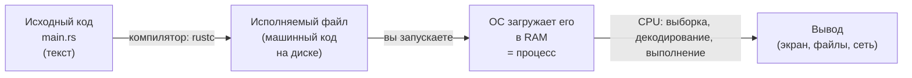

<!-- nav:top -->
[🏠 Начало](../START-HERE.md) · [← 00.2 Что такое программирование](02-what-is-programming.md) · [📋 Этап 00](README.md) · [00.4 Терминал: первые команды →](04-terminal-basics.md) · [📖 Глоссарий](../GLOSSARY.md) · [🇬🇧 English](../../en/00-getting-started/03-how-a-computer-runs-a-program.md) <!-- nav -->

# Урок 00.3 — Как компьютер выполняет программу

> **Этап 00 — Начало пути** · Урок 3 из 8 · ⏱ около 120 минут

## Что вы узнаете

- Основные части компьютера (процессор, память, накопитель) и для чего нужна каждая.
- Как информация хранится в виде битов и байтов и как читать двоичные числа.
- Как процессор выполняет инструкции одну за другой — на примере крошечного игрушечного компьютера, за которым можно проследить вручную.
- Что такое машинный код и как исходный код превращается в машинный код с помощью компилятора.
- Что происходит шаг за шагом между «я запускаю программу» и «программа что-то выводит».

## Перед началом

- Вы прошли [Урок 00.2 — Что такое программирование](02-what-is-programming.md).
- В этом уроке есть несколько демонстраций «смотрите, не запускайте». Они показывают настоящий вывод, который я получил на Mac с чипом Apple M4. Вам пока **не нужно** набирать их: терминал вы изучите в [Уроке 00.4](04-terminal-basics.md), а Rust установите в [Уроке 00.5](05-install-rust-and-rustrover.md). Вы сможете вернуться и повторить их потом.

## Новые слова

| Слово | Значение |
|---|---|
| **CPU** (Central Processing Unit, центральный процессор) | Микросхема, которая выполняет инструкции программ. Ещё её называют *процессором*. |
| **RAM** (Random Access Memory, оперативная память) | Быстрая рабочая память. Программы и их данные находятся здесь, пока работают. При отключении питания она очищается. |
| **накопитель** (storage) | Память, которая хранит данные и при выключенном питании, например **SSD** (Solid-State Drive, твердотельный накопитель). Здесь лежат файлы. |
| **бит** (bit) | Наименьшая порция информации: 0 или 1. |
| **байт** (byte) | Группа из 8 битов. Может хранить одно из 256 разных значений (от 0 до 255). |
| **двоичная система** (binary) | Счёт с помощью только двух цифр, 0 и 1. |
| **шестнадцатеричная система** (hexadecimal, hex) | Счёт с помощью 16 цифр: 0–9, а затем a–f. Две шестнадцатеричные цифры описывают ровно один байт. Числа в hex начинаются с `0x`. |
| **инструкция** (instruction) | Одна крошечная команда для CPU, например «сложи два числа». |
| **регистр** (register) | Очень маленькое и очень быстрое место хранения внутри CPU. |
| **адрес памяти** (memory address) | Номер байта в RAM, как номер дома на улице. |
| **машинный код** (machine code) | Инструкции программы в виде чисел, в точной форме, которую понимает CPU. |
| **язык ассемблера** (assembly language) | Машинный код, записанный читаемыми короткими словами, такими как `add` и `ret`. |
| **архитектура** (architecture, набор инструкций) | «Язык», который понимает семейство CPU. Чип M4 вашего Mac использует **arm64** (его также называют AArch64). Многие другие компьютеры используют **x86-64**. |
| **компилятор** (compiler) | Программа, которая переводит исходный код в машинный код. Компилятор Rust называется `rustc`. |
| **исполняемый файл** (executable) | Файл, содержащий готовую к запуску программу в машинном коде. |
| **ОС** (OS, Operating System, операционная система) | Главная программа (здесь macOS), которая запускает другие программы и даёт им память, файлы и экран. |
| **процесс** (process) | Программа, которая выполняется в данный момент. Одна программа может работать как несколько процессов. |
| **I/O** (Input/Output, ввод-вывод) | Всё, что переносит данные в компьютер или из него: клавиатура, экран, диск, сеть. |
| **ПК** (PC, Personal Computer, персональный компьютер) | Обычный настольный компьютер или ноутбук, например ПК с Windows. |

## 1. Основные части компьютера

Представьте кухню:

- **CPU** — повар. Он выполняет настоящую работу, маленький шаг за маленьким шагом, очень быстро.
- **RAM** — рабочий стол. Вещи, которыми вы пользуетесь прямо сейчас, лежат на нём под рукой. Когда вы уходите с кухни на ночь, стол убирают.
- **Накопитель** (SSD) — кладовая. Она хранит всё долго, но доставать оттуда медленно по сравнению со столом.
- **Устройства ввода-вывода** (клавиатура, экран, сеть) — двери и окна: заказы приходят, блюда уходят.

```text
        +-------------+         +-------------+         +----------------+
        |     CPU     | <-----> |     RAM     | <-----> |  Storage (SSD) |
        |   (cook)    |  fast   | (work table)|  slower |    (pantry)    |
        +------+------+         +-------------+         +----------------+
               |
               |   keyboard, screen, network ... (I/O)
               v
```

Примерные скорости (на разных компьютерах они отличаются, но важны именно *соотношения*):

| Действие | Примерное время | Если бы один шаг CPU длился 1 секунду |
|---|---|---|
| Один шаг CPU | около 1 наносекунды (миллиардной доли секунды) | 1 секунда |
| Чтение одного значения из RAM | около 100 наносекунд | около 2 минут |
| Чтение одного значения с SSD | около 100 000 наносекунд (100 микросекунд) | больше суток |

> ⚡ **Производительность:** из-за этой таблицы системные инженеры заботятся о том, *где* лежат данные. Программа,
> которая постоянно просит данные у RAM или диска, большую часть времени ждёт. Вы будете измерять это на
> следующих этапах (Этап 12 и Этап 19). Пока запомните: **CPU быстрый, RAM медленнее, диск гораздо медленнее.**

Свои числа можно увидеть: щёлкните меню Apple в левом верхнем углу, выберите **Об этом Mac**. Вы увидите чип (например, «Apple M4») и объём памяти (RAM).

## 2. Биты, байты и двоичная система

Всё в компьютере хранится в виде чисел, а каждое число хранится с помощью **битов**. Бит похож
на выключатель света: выключен — 0, включён — 1.

**Байт** — это 8 выключателей в ряд. С помощью 8 выключателей можно составить 2 × 2 × 2 × 2 × 2 × 2 × 2 × 2 = 256
разных комбинаций, то есть числа от 0 до 255.

### Как читать двоичные числа

В десятичной системе мы используем десять цифр, и каждый разряд стоит в 10 раз больше разряда справа от него
(единицы, десятки, сотни). В **двоичной системе** две цифры, и каждый разряд стоит **в 2 раза** больше разряда справа
от него: 1, 2, 4, 8, 16, 32, 64, 128.

```text
Place value:    128   64   32   16    8    4    2    1
Bits:             0    0    0    0    1    1    0    1
                                      8  + 4       + 1  = 13
```

Значит, двоичное число `00001101` — это 13. Чтобы прочитать двоичное число, сложите значения разрядов, где стоит 1.

| Десятичное | Двоичное (8 бит) |
|---|---|
| 0 | 00000000 |
| 1 | 00000001 |
| 2 | 00000010 |
| 3 | 00000011 |
| 4 | 00000100 |
| 5 | 00000101 |
| 8 | 00001000 |
| 13 | 00001101 |
| 200 | 11001000 |
| 255 | 11111111 |

Чтобы записать десятичное число в двоичном виде, возьмите самое большое значение разряда, которое помещается, запишите 1, вычтите его и
продолжайте. Для 37: 32 помещается (37 − 32 = 5), 16 нет, 8 нет, 4 помещается (5 − 4 = 1), 2 нет, 1 помещается.
Биты: `00100101`.

### Текст, картинки и всё остальное — тоже числа

Как хранить букву `A`? По договорённости: число 65 означает `A`, 66 — `B` и так далее. Эта
договорённость — таблица **ASCII** (American Standard Code for Information Interchange, американский стандартный код обмена информацией) для английских
букв; более крупная таблица, **Unicode**, охватывает все языки мира, а кодировка **UTF-8**
(Unicode Transformation Format, 8-bit — формат преобразования Unicode, 8 бит) хранит Unicode в виде байтов. Цвет — это три числа
(красный, зелёный, синий). Песня — длинный список чисел. Программа — тоже список чисел, как мы увидим.

*Смотрите, не запускайте.* Есть небольшой инструмент `xxd`, который показывает байты любых данных. Здесь он показывает байты двух букв `Hi`. Как запускать команды, вы узнаете в Уроке 00.4. Вывод настоящий:

```text
00000000: 4869                                     Hi
```

Число после двоеточия, `4869`, — это два байта, записанные в **шестнадцатеричной системе**. Hex — более короткий способ
записи двоичных данных: одна шестнадцатеричная цифра соответствует 4 битам, поэтому две цифры — ровно один байт. `48` в hex = 72 =
буква `H`, а `69` в hex = 105 = буква `i`. В двоичном виде `H` — это `01001000`, а `i` — `01101001`.

> 💡 **Совет:** вам не нужно переводить большие числа вручную. Нужно понимать, что «байт хранит
> 0–255» и «всё — это числа». Позже, когда вы встретите типы вроде `u8` (число от 0 до 255) в
> Уроке 02.2, это сразу станет понятно.

Размеры, которые вы будете часто видеть: 1 **КБ** (килобайт) — примерно тысяча байт, 1 **МБ** (мегабайт) — около
миллиона, 1 **ГБ** (гигабайт) — около миллиарда. (Есть и точный счёт степенями числа 2; его объяснит Этап 12.)

## 3. Как CPU выполняет инструкции

CPU делает одно очень простое действие снова и снова, миллиарды раз в секунду:

1. **Выборка** (fetch) — прочитать следующую инструкцию из RAM.
2. **Декодирование** (decode) — понять, что она означает.
3. **Выполнение** (execute) — сделать это (например, сложить два числа).
4. Перейти к следующей инструкции и вернуться к шагу 1.

Внутри CPU есть несколько очень быстрых мест для хранения чисел, называемых **регистрами**. Ещё есть
один особый регистр, который помнит, *какая инструкция следующая*. Он называется **счётчиком команд** (program counter).

RAM — это длинный ряд байтов. У каждого байта есть номер — его **адрес памяти**: байт 0, байт 1, байт 2 ...

Построим **игрушечный компьютер**, чтобы всё стало конкретным. Он придуман, но настоящие CPU работают по
тому же принципу. У него два регистра, `A` и `B`, и такие инструкции:

| Инструкция | Значение |
|---|---|
| `LOAD A, 7` | положить число 7 в регистр A |
| `ADD A, B` | A становится A + B |
| `STORE A, 100` | записать значение A в ячейку памяти номер 100 |
| `HALT` | остановиться |

Программа для игрушечного компьютера:

```text
line 1:  LOAD A, 7
line 2:  LOAD B, 5
line 3:  ADD A, B
line 4:  STORE A, 100
line 5:  HALT
```

Что происходит шаг за шагом (эта таблица — «трассировка», с которой вы познакомились в Уроке 00.2):

| Шаг | Счётчик команд | Инструкция | A | B | Ячейка памяти 100 |
|---|---|---|---|---|---|
| начало | 1 | — | 0 | 0 | 0 |
| 1 | 1 → 2 | `LOAD A, 7` | 7 | 0 | 0 |
| 2 | 2 → 3 | `LOAD B, 5` | 7 | 5 | 0 |
| 3 | 3 → 4 | `ADD A, B` | 12 | 5 | 0 |
| 4 | 4 → 5 | `STORE A, 100` | 12 | 5 | 12 |
| 5 | 5 | `HALT` | 12 | 5 | 12 |

Результат 12 был вычислен в регистре и потом сохранён в память. Настоящая программа — это то же
самое, только с миллионами строк, а CPU выполняет каждую строку за доли наносекунды.

Откуда берутся циклы и решения? Из инструкций *перехода*: «установи счётчик команд на строку
4, если это значение не ноль». Одну такую вы используете в упражнении 6.

## 4. Машинный код: что на самом деле читает CPU

Настоящий CPU не читает слова вроде `LOAD`. Он читает числа. Каждая инструкция закодирована
числом из битов. Это и есть **машинный код**. Для людей существует его читаемая форма, которая называется
**языком ассемблера**.

Вот настоящий пример. Эта крошечная функция на Rust складывает два числа (не беспокойтесь о синтаксисе,
вы выучите его в Уроке 02.4). Первая строка и слова `pub extern "C"` — особые настройки, которые лишь сохраняют читаемое имя функции в выводе; игнорируйте их.

```rust
#[unsafe(no_mangle)]
pub extern "C" fn add(a: i32, b: i32) -> i32 {
    a + b
}
```

Я скомпилировал её для Apple M4 (arm64), попросив компилятор оптимизировать. Компилятор выдал такой ассемблер:

```text
_add:
	add	w0, w1, w0
	ret
```

Что происходит:

1. `_add:` — метка: имя этого куска кода.
2. `add w0, w1, w0` — сложить числа в регистрах `w1` и `w0` и положить результат в `w0`. (По правилам этого CPU два аргумента приходят в `w0` и `w1`, а ответ возвращается в `w0`.)
3. `ret` — вернуться в код, который вызвал функцию.

А вот машинный код этих двух инструкций в том виде, как его видит CPU. Каждая инструкция имеет длину 32 бита
(4 байта):

```text
0b000020 d65f03c0
```

`0b000020` в hex — это двоичное число `00001011000000000000000000100000`. Эти 32 бита *и есть*
инструкция `add w0, w1, w0`. А `d65f03c0` — это `ret`. Когда компилятор записывает файл программы, он
помещает в файл именно эти байты (`20 00 00 0b c0 03 5f d6`; порядок байтов внутри числа — это
деталь, которую объяснит Этап 12).

Та же функция без оптимизации — это гораздо больше строк ассемблера, потому что в обычном
режиме «debug» Rust добавляет проверку, которая останавливает программу, если сумма слишком велика для типа числа. Вы
увидите это в Уроке 02.2. Главное: **компилятор решает, какой машинный код получится.**

### Разные CPU — разный машинный код

Машинный код зависит от семейства CPU. Чип M4 вашего Mac использует набор инструкций **arm64**.
Более старые Mac и большинство ПК с Windows и Linux используют **x86-64**. Байты для «сложить два числа» на
каждой архитектуре разные, поэтому программа, собранная для arm64, не может работать на CPU x86-64. Компилятору сообщают, для какой
**целевой платформы** (target — семейство CPU + операционная система) собирать. На вашем Mac целевая платформа Rust по умолчанию называется
`aarch64-apple-darwin` (aarch64 = arm64, darwin = ядро macOS). Это имя вы увидите в Уроке 00.5.

## 5. От исходного кода к работающей программе

Люди пишут исходный код; CPU нужен машинный код. Переводчик — это **компилятор**.



Rust — **компилируемый** язык: перевод в машинный код происходит *один раз, до* запуска
программы. После этого CPU выполняет ваш машинный код напрямую, без посредников, и это
одна из причин, почему программы на Rust быстрые. (Некоторые другие языки переводятся строка за строкой, пока
программа работает, вспомогательной программой, которая называется *интерпретатор*. Обычно это медленнее при работе, но
не требует отдельного шага перевода.)

*Смотрите, не запускайте.* Вот настоящая маленькая программа на Rust и то, как выглядит файл после компиляции:

```rust
fn main() {
    println!("Hello, world!");
}
```

Я скомпилировал её командой `rustc hello.rs` и задал три вопроса о результате.

1. Запустить её:

```text
Hello, world!
```

2. Что это за файл? Инструмент `file` заглядывает внутрь файла и сообщает его тип:

```text
hello: Mach-O 64-bit executable arm64
```

**Mach-O** — формат исполняемых файлов в macOS, а «arm64» — семейство CPU. Размер файла —
472 296 байт, что довольно много для программы из одной строки, потому что в нём также находятся части стандартной
библиотеки Rust, которые печатают текст.

3. Каковы первые байты файла? (`xxd` снова показывает их.)

```text
00000000: cffa edfe 0c00 0001 0000 0000 0200 0000  ................
00000010: 1100 0000 3808 0000 8500 a000 0000 0000  ....8...........
```

Первые четыре байта, `cf fa ed fe`, — «магическое число»: фиксированная подпись, которая сообщает ОС: «это
64-битный файл Mach-O». После заголовка идут машинный код и данные. Вот что такое «программа» на самом деле:
файл с заголовком, числами для CPU и данными.

## 6. Что делает операционная система

Когда вы запускаете файл, вы разговариваете не с CPU. Вы разговариваете с **операционной системой** (macOS).
Она делает следующее:

1. **Читает** исполняемый файл с накопителя.
2. **Копирует** нужные части в RAM и создаёт **процесс** — работающий экземпляр программы со своей защищённой частью памяти.
3. **Направляет** счётчик команд на первую инструкцию вашей программы и отпускает CPU.
4. **Делит** CPU между всеми процессами: одновременно работают десятки или сотни, и ОС переключается между ними так быстро, что кажется, будто всё происходит одновременно.
5. **Обрабатывает** ввод-вывод для программы. Программа не может напрямую обратиться к экрану или диску. Вместо этого она просит ОС («пожалуйста, напечатай этот текст», «пожалуйста, открой этот файл»). Такой запрос называется **системным вызовом** (system call); Этап 13 учит этому подробно.
6. **Наводит порядок**, когда программа заканчивается: забирает память обратно и закрывает файлы.

Свои процессы можно увидеть: откройте **Мониторинг системы** (Activity Monitor; нажмите `Cmd + Space`, введите «Activity Monitor» или «Мониторинг системы»,
нажмите Enter). Вкладка **ЦП** (CPU) показывает, какую часть процессора использует каждый процесс; вкладка **Память** показывает RAM.

### Что внутри процесса

Память работающей программы делится на области. Две из них очень важны для Rust,
и Этап 03 научит им подробно:

```text
 high addresses
 +----------------------+
 |        stack         |  fast, small, automatic: local values of functions
 +----------------------+
 |          ...         |
 +----------------------+
 |         heap         |  flexible, bigger: data whose size grows while running
 +----------------------+
 |  data and constants  |
 +----------------------+
 |    machine code      |  your instructions
 +----------------------+
 low addresses
```

Запоминать это сейчас не нужно. Достаточно знать, что «работающая программа» — это *код +
память* и что Rust даёт вам большой контроль над тем, как эта память используется.

## Частые ошибки

1. **Путать RAM и накопитель.** «Я сохранил файл, значит, он в RAM» — неверно. Файл лежит на SSD. В RAM находится *копия*, с которой программа работает в данный момент. *Исправление:* RAM — временный рабочий стол, SSD — долгая кладовая.
2. **Думать, что компилятор запускает программу.** Компилятор только переводит. Запуск — отдельный шаг: ОС запускает исполняемый файл. (В Уроке 00.6 команда `cargo run` выполняет оба шага за вас, один за другим.)
3. **Думать, что «программа» = «процесс».** Программа — это файл на диске. Процесс — эта программа, ожившая в памяти. Одну и ту же программу можно запустить три раза и получить три процесса.
4. **Думать, что двоичная система — магия.** Это просто счёт двумя цифрами. Если вы умеете складывать значения разрядов (1, 2, 4, 8 ...), вы сможете её читать.
5. **Думать, что программа, собранная на одном компьютере, работает везде.** Машинный код собран для одной целевой платформы. Сборка для вашего M4 не запустится на ПК с x86-64.

## Попробуйте сами

Это упражнение без терминала.

1. Щёлкните меню Apple и выберите **Об этом Mac**. Запишите название чипа и объём RAM.
2. Откройте **Мониторинг системы** (Activity Monitor). На вкладке **ЦП** щёлкните столбец «% ЦП» для сортировки. Какой процесс сейчас больше всего использует процессор? Откройте вкладку **Память** и найдите процесс, который использует больше всего памяти.
3. На бумаге переведите эти десятичные числа в двоичные: 6, 19 и 100. Проверьте по таблице значений разрядов. (Ответы: `00000110`, `00010011`, `01100100`.)
4. Опишите своими словами, в 4–5 строках, что происходит между двойным щелчком по программе и появлением её окна.

## Упражнения

### Упражнение 1 — Прочитайте двоичные числа (легко)

Переведите в десятичные: `1010`, `101101`, `11111111`.

<details>
<summary>Подсказка</summary>

Запишите значения разрядов 1, 2, 4, 8, 16, 32, 64, 128 справа налево под битами и сложите те, где бит равен 1.

</details>

<details>
<summary>Ответ</summary>

- `1010` = 8 + 2 = **10**
- `101101` = 32 + 8 + 4 + 1 = **45**
- `11111111` = 128 + 64 + 32 + 16 + 8 + 4 + 2 + 1 = **255**

Почему это работает: каждый бит означает «включить это значение разряда или нет», а сумма включённых значений — это число. `11111111` — самое большое значение, которое помещается в один байт.

</details>

### Упражнение 2 — Запишите двоичные числа (легко)

Запишите 13 и 37 в двоичном виде, используя 8 бит.

<details>
<summary>Подсказка</summary>

Используйте метод из раздела 2: возьмите самое большое подходящее значение разряда, запишите 1, вычтите, продолжайте.

</details>

<details>
<summary>Ответ</summary>

- 13 = 8 + 4 + 1 → `00001101`
- 37 = 32 + 4 + 1 → `00100101`

Почему это работает: вы выбираете, какие значения разрядов в сумме дают число; выбранные разряды получают 1, все остальные — 0.

</details>

### Упражнение 3 — Какая это часть? (легко)

Для каждого утверждения скажите: CPU, RAM или накопитель.

1. Хранит ваши фото после выключения компьютера.
2. Выполняет инструкции программ.
3. Работающая программа и её данные находятся здесь, рядом с CPU.
4. Самая медленная из трёх, но самая большая и самая дешёвая в расчёте на байт.

<details>
<summary>Подсказка</summary>

Используйте картину кухни: повар, рабочий стол, кладовая.

</details>

<details>
<summary>Ответ</summary>

1. Накопитель (SSD).
2. CPU.
3. RAM.
4. Накопитель.

Почему это работает: только накопитель хранит данные без питания; только CPU выполняет инструкции; RAM — быстрое рабочее пространство.

</details>

### Упражнение 4 — Проследите игрушечный компьютер (средне)

Проследите эту программу на игрушечном компьютере из раздела 3 (есть новая инструкция `SUB A, B`, которая
означает: A становится A − B). Чему равны A, B и ячейка памяти 50 в конце?

```text
line 1:  LOAD A, 20
line 2:  LOAD B, 6
line 3:  SUB A, B
line 4:  STORE A, 50
line 5:  HALT
```

<details>
<summary>Подсказка</summary>

Сделайте таблицу, как в разделе 3, по одной строке на инструкцию.

</details>

<details>
<summary>Ответ</summary>

| Шаг | Инструкция | A | B | Ячейка памяти 50 |
|---|---|---|---|---|
| начало | — | 0 | 0 | 0 |
| 1 | `LOAD A, 20` | 20 | 0 | 0 |
| 2 | `LOAD B, 6` | 20 | 6 | 0 |
| 3 | `SUB A, B` | 14 | 6 | 0 |
| 4 | `STORE A, 50` | 14 | 6 | 14 |
| 5 | `HALT` | 14 | 6 | 14 |

В конце A = 14, B = 6, а ячейка памяти 50 содержит 14.

Почему это работает: CPU меняет только одну вещь за инструкцию, поэтому таблица по строкам всегда даёт верный ответ.

</details>

### Упражнение 5 — Расставьте шаги по порядку (средне)

Расставьте эти шаги в правильном порядке: (a) ОС создаёт процесс и загружает код в RAM,
(b) вы пишете исходный код, (c) CPU выполняет машинный код, (d) компилятор создаёт исполняемый файл,
(e) вы запускаете исполняемый файл.

<details>
<summary>Подсказка</summary>

Следуйте за схемой из раздела 5 слева направо.

</details>

<details>
<summary>Ответ</summary>

(b) → (d) → (e) → (a) → (c).

Почему это работает: код должен существовать до компиляции; исполняемый файл должен существовать до запуска; ОС должна загрузить его до того, как CPU сможет его выполнять.

</details>

### Упражнение 6 — Цикл с переходом (сложно)

Добавьте в игрушечный компьютер две новые инструкции: `DEC C` (C становится C − 1) и `JNZ C, 4` (JNZ означает
«перейти, если не ноль»: если C не равно 0, следующая инструкция — строка 4; иначе продолжить со следующей строки). Проследите
эту программу. Что она вычисляет?

```text
line 1:  LOAD A, 0
line 2:  LOAD B, 3
line 3:  LOAD C, 4
line 4:  ADD A, B
line 5:  DEC C
line 6:  JNZ C, 4
line 7:  STORE A, 100
line 8:  HALT
```

<details>
<summary>Подсказка</summary>

Строки 4–6 повторяются. После каждого прохода C уменьшается на 1. Цикл заканчивается, когда C доходит до 0.

</details>

<details>
<summary>Ответ</summary>

| Проход по строкам 4–6 | A после `ADD A, B` | C после `DEC C` | `JNZ C, 4` |
|---|---|---|---|
| 1 | 3 | 3 | C не равно 0, переход на строку 4 |
| 2 | 6 | 2 | переход на строку 4 |
| 3 | 9 | 1 | переход на строку 4 |
| 4 | 12 | 0 | C равно 0, идём дальше к строке 7 |

Строка 7 записывает 12 в ячейку 100, затем `HALT`. Программа вычисляет 4 × 3, складывая 3 четыре раза.

Почему это работает: переход меняет счётчик команд, поэтому CPU возвращается к более ранним инструкциям. Именно
так циклы (и решения `if`) существуют на уровне машины; циклы Rust `for` и `while`, которые вы
выучите в Уроке 02.5, переводятся в инструкции вроде этих.

</details>

## Вопросы для самопроверки

1. В чём разница между RAM и накопителем?

<details>
<summary>Ответ</summary>

RAM — быстрая рабочая память для работающих программ, она очищается при отключении питания. Накопитель (SSD) медленнее, но хранит данные постоянно, например ваши файлы.

</details>

2. Сколько разных значений может хранить один байт и какие?

<details>
<summary>Ответ</summary>

256 значений, от 0 до 255 (8 бит, 2⁸).

</details>

3. Какие три основных шага повторяет CPU?

<details>
<summary>Ответ</summary>

Выбирает следующую инструкцию, декодирует её, выполняет. Затем переходит к следующей инструкции.

</details>

4. Что такое машинный код и почему программа для arm64 не может работать на CPU x86-64?

<details>
<summary>Ответ</summary>

Машинный код — инструкции программы в виде чисел в той форме, которую понимает CPU. У каждого семейства CPU свой набор инструкций, поэтому числа для одной и той же операции различаются в arm64 и x86-64.

</details>

5. Что делает компилятор и когда?

<details>
<summary>Ответ</summary>

Переводит исходный код в машинный код (исполняемый файл). В Rust он делает это один раз, до запуска программы.

</details>

6. В чём разница между программой и процессом?

<details>
<summary>Ответ</summary>

Программа — это файл на диске с машинным кодом. Процесс — работающий экземпляр программы в RAM, созданный ОС. У одной программы может быть несколько процессов.

</details>

7. Почему программа просит ОС напечатать текст, а не рисует на экране сама?

<details>
<summary>Ответ</summary>

Программы не получают прямого доступа к оборудованию. ОС управляет экраном, диском и сетью, делит их между программами и следит за безопасностью. Программа обращается к ОС через системный вызов.

</details>

## Итоги

- В компьютере есть CPU (выполняет работу), RAM (быстрая временная память) и накопитель (медленный, постоянный).
- Всё — числа, состоящие из битов; байт — это 8 бит и хранит 0–255. Hex — короткая запись байтов.
- CPU повторяет выборку, декодирование и выполнение, а счётчик команд указывает на следующую инструкцию.
- Машинный код — числа, которые читает CPU; ассемблер — его читаемая форма. Он зависит от семейства CPU (на вашем Mac — arm64).
- Компилятор (`rustc`) превращает исходный код Rust в исполняемый файл один раз, до запуска.
- ОС загружает исполняемый файл в RAM как процесс, делит CPU и обрабатывает для него ввод-вывод.
- Работающая программа — это код плюс память; Rust даёт вам контроль над этой памятью (Этап 03).

## Источники и что почитать

- [The Rust Programming Language — Hello, World!](https://doc.rust-lang.org/book/ch01-02-hello-world.html) — официальная книга объясняет, что компиляция и запуск — два отдельных шага.
- [The rustc book — What is rustc?](https://doc.rust-lang.org/rustc/what-is-rustc.html) — официальное описание компилятора Rust.
- [The rustc book — Platform Support](https://doc.rust-lang.org/rustc/platform-support.html) — список целевых платформ (сочетаний CPU и ОС), для которых Rust умеет собирать, включая `aarch64-apple-darwin`.
- [The Rust Programming Language — What Is Ownership?](https://doc.rust-lang.org/book/ch04-01-what-is-ownership.html) — объясняет стек и кучу; вы изучите это на Этапе 03.
- [Nand to Tetris](https://www.nand2tetris.org/) — бесплатный курс, в котором вы строите простой компьютер с нуля; отлично, если хотите глубже разобраться в теме этого урока.

---

[🏠 Начало](../START-HERE.md) · [← 00.2 Что такое программирование](02-what-is-programming.md) · [📋 Этап 00](README.md) · [00.4 Терминал: первые команды →](04-terminal-basics.md) · [📖 Глоссарий](../GLOSSARY.md) <!-- nav -->
<!-- nav:bottom -->
