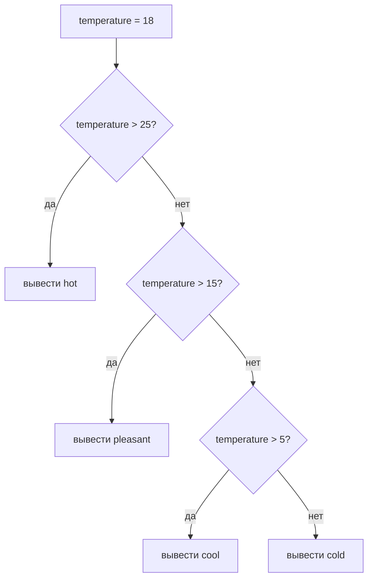

<!-- nav:top -->
[🏠 Начало](../START-HERE.md) · [← 02.4 Функции](04-functions.md) · [📋 Этап 02](README.md) · [02.6 Вывод, форматирование и комментарии →](06-printing-formatting-and-comments.md) · [📖 Глоссарий](../GLOSSARY.md) · [🇬🇧 English](../../en/02-programming-basics/05-control-flow.md) <!-- nav -->

# Урок 02.5 — Ветвления и циклы

> **Этап 02 — Основы программирования на Rust** · Урок 5 из 11 · ⏱ около 3 часов (2 занятия)

## Что вы узнаете

- Как принимать решения с помощью `if`, `else if` и `else` и почему `if` — выражение.
- Как повторять код с помощью `loop`, `while` и `for`.
- Как остановить или пропустить повторение с помощью `break` и `continue` и как выходить из вложенных циклов с помощью меток.
- Как `match` выбирает между многими случаями (первое знакомство).
- Как выбрать подходящий вид цикла и как избегать бесконечных циклов и ошибок на единицу.

## Перед началом

- Вы прошли [Урок 02.4 — Функции](04-functions.md).
- Вы помните, что сравнения вроде `n % 2 == 0` дают `bool` ([Урок 02.3](03-operators-and-expressions.md)).

## Новые слова

| Слово | Значение |
|---|---|
| **поток управления** (control flow) | Порядок, в котором выполняются строки программы. Условия и циклы его меняют. |
| **условие** (condition) | Выражение типа `bool`, которое решает, что будет дальше. |
| **ветка** (branch) | Один из возможных путей `if`: часть `if`, часть `else if` или часть `else`. |
| **цикл** (loop) | Код, который выполняется снова и снова. |
| **итерация** (iteration) | Один проход тела цикла. |
| **бесконечный цикл** (infinite loop) | Цикл, который никогда не заканчивается. Остановите его комбинацией `Ctrl+C` в терминале. |
| **диапазон** (range) | Последовательность целых чисел: `1..5` (1, 2, 3, 4) или `1..=5` (1, 2, 3, 4, 5). |
| **итератор** (iterator) | Нечто, что выдаёт элементы по одному. Диапазон — итератор. Итераторы подробно объясняет Этап 05. |
| **метка цикла** (loop label) | Имя вроде `'outer`, записанное перед циклом, чтобы `break` и `continue` могли указать на него. |
| **ошибка на единицу** (off-by-one error) | Ошибка, при которой цикл выполняется на один раз больше или меньше, либо индекс на единицу больше или меньше нужного. |
| **образец** (pattern) | Форма, с которой сравнивается значение, например `0`, `2 \| 3` или `4..=9`. Образцы подробно изучает Этап 04. |
| **match** | Выражение, которое сравнивает значение с несколькими образцами и выполняет первый подходящий. |
| **исчерпывающий** (exhaustive) | Покрывающий все возможные значения. Компилятор требует, чтобы `match` был исчерпывающим. |
| **DoS** (Denial of Service, отказ в обслуживании) | Атака или ошибка, из-за которой сервис становится непригодным, например из-за бесконечного цикла. |

## 1. Принятие решений: `if`

Программы должны реагировать на данные. Ключевое слово `if` выполняет блок кода только тогда, когда **условие** истинно.

```rust
fn main() {
    let temperature = 18;

    if temperature > 25 {
        println!("hot");
    } else if temperature > 15 {
        println!("pleasant");
    } else if temperature > 5 {
        println!("cool");
    } else {
        println!("cold");
    }
}
```

Что происходит:

1. Rust вычисляет `temperature > 25`. Это `false` (18 не больше 25), поэтому первый блок пропускается.
2. Далее `temperature > 15` — `true`. Его блок выполняется и печатает `pleasant`.
3. Остальное (`else if temperature > 5` и `else`) пропускается: **выполняется только первая ветка с истинным условием**.
4. Если бы ни одно условие не было истинным, выполнился бы блок `else`. Часть `else` необязательна.

```text
pleasant
```



Условию не нужны скобки (`if x > 5`, а не `if (x > 5)`), но фигурные скобки `{ }` **обязательны**, даже для одной строки.

**Условие должно быть `bool`.** Rust не считает числа истиной или ложью:

```rust
fn main() {
    let number = 3;
    if number {
        println!("number was three");
    }
}
```

```text
error[E0308]: mismatched types
 --> src/main.rs:3:8
  |
3 |     if number {
  |        ^^^^^^ expected `bool`, found integer
```

Пишите то, что имеете в виду: `if number != 0 { … }`.

## 2. `if` — это выражение

Поскольку `if` — выражение (Урок 02.3), у него есть значение. Это позволяет выбрать значение одной строкой:

```rust
fn main() {
    let n = 7;
    let kind = if n % 2 == 0 { "even" } else { "odd" };
    println!("{n} is {kind}");

    let bigger = if n > 10 { n } else { 10 };
    println!("bigger = {bigger}");
}
```

```text
7 is odd
bigger = 10
```

Что происходит: каждая ветка — блок, чьё последнее выражение **без точки с запятой**; это и есть значение ветки. Затем у всего `if` значение той ветки, которая сработала.

Два правила защищают вас:

- **Все ветки должны иметь один и тот же тип.** Иначе компилятор не может знать тип `x`:

```text
error[E0308]: `if` and `else` have incompatible types
 --> src/main.rs:3:35
  |
3 |     let x = if n > 5 { 1 } else { "small" };
  |                        -          ^^^^^^^ expected integer, found `&str`
  |                        |
  |                        expected because of this
```

- **У `if`, используемого как значение, должна быть ветка `else`.** Без неё недостающая ветка была бы `()`:

```text
error[E0317]: `if` may be missing an `else` clause
 --> src/main.rs:3:13
  |
3 |     let x = if n > 5 { 1 };
  |             ^^^^^^^^^^^-^^
  |             |          |
  |             |          found here
  |             expected integer, found `()`
  |
  = note: `if` expressions without `else` evaluate to `()`
```

> 📏 **Соглашение:** используйте `let x = if … else …;`, когда нужно только выбрать значение. Используйте обычный `if` с инструкциями внутри, когда нужно выполнить действия.

## 3. Бесконечное повторение: `loop`

`loop` повторяет свой блок, пока вы не выйдете из него с помощью `break`.

```rust
fn main() {
    let mut counter = 0;
    let result = loop {
        counter += 1;
        if counter == 5 {
            break counter * 10;
        }
    };
    println!("result = {result}");
}
```

Что происходит:

1. `counter` начинается с 0. Каждая **итерация** добавляет 1.
2. Когда `counter` становится 5, `break counter * 10;` выходит из цикла **и отдаёт значение**: `50`. `loop` — выражение, поэтому это значение попадает в `result`.
3. Без `break` цикл был бы **бесконечным**. Если вы когда-нибудь сделаете такой по ошибке, нажмите `Ctrl+C` в терминале, чтобы остановить программу.

```text
result = 50
```

`loop` — правильный выбор, когда вы не знаете, сколько раз будете повторять (например, «спрашивать, пока ответ не станет верным» в Уроке 02.7).

## 4. Повторение, пока условие истинно: `while`

```rust
fn main() {
    let mut n = 3;
    while n > 0 {
        println!("{n}...");
        n -= 1;
    }
    println!("Liftoff!");
}
```

Что происходит:

1. Перед **каждой** итерацией Rust проверяет `n > 0`. Если оно ложно, цикл заканчивается.
2. Внутри программа печатает `n` и вычитает 1. Этот шаг важен: если забыть `n -= 1;`, условие останется истинным навсегда и вы получите бесконечный цикл.
3. После окончания цикла программа продолжает со следующей строки.

```text
3...
2...
1...
Liftoff!
```

Если условие ложно с самого начала, тело выполняется ноль раз.

## 5. Повторение по последовательности: `for`

`for` берёт элементы последовательности по одному. Это цикл, которым вы будете пользоваться чаще всего, потому что он не может случайно выйти за конец.

```rust
fn main() {
    for i in 1..5 {
        print!("{i} ");
    }
    println!();
    for i in 1..=5 {
        print!("{i} ");
    }
    println!();
    for i in (1..=5).rev() {
        print!("{i} ");
    }
    println!();
    for i in (0..=20).step_by(5) {
        print!("{i} ");
    }
    println!();
}
```

Что происходит:

1. `1..5` — это **диапазон**: он начинается с 1 и останавливается **перед** 5 (1, 2, 3, 4). Первое число входит, последнее — нет. В `1..=5` есть `=`, и он **включает** 5.
2. `print!` похож на `println!`, но не добавляет перевод строки, поэтому всё остаётся на одной строке. `println!()` без аргументов печатает только перевод строки. (Вывод объясняет Урок 02.6.)
3. `.rev()` разворачивает диапазон. Скобки нужны: `(1..=5).rev()`.
4. `.step_by(5)` берёт каждое пятое число.
5. В `for i in …` для каждой итерации создаётся новая переменная `i`. `mut` не нужен.

```text
1 2 3 4 
1 2 3 4 5 
5 4 3 2 1 
0 5 10 15 20 
```

Можно также перебирать массив:

```rust
fn main() {
    let fruits = ["apple", "banana", "cherry"];
    for fruit in fruits {
        println!("I like {fruit}");
    }
    for (index, fruit) in fruits.iter().enumerate() {
        println!("{index}: {fruit}");
    }
}
```

```text
I like apple
I like banana
I like cherry
0: apple
1: banana
2: cherry
```

`fruits.iter()` проходит по элементам, не забирая их (почему это важно, объясняет Этап 03), а `.enumerate()` связывает каждый элемент с его индексом в виде кортежа `(index, fruit)`. Строка `for (index, fruit) in …` разбирает этот кортеж, как в Уроке 02.2.

> 💡 **Совет:** предпочитайте `for item in collection`, а не `for i in 0..collection.len()` с `collection[i]`. Это короче, нет ошибок с индексами, и Rust не нужно проверять каждый индекс.

## 6. `break`, `continue` и метки

- `break` сразу выходит из цикла.
- `continue` пропускает остаток текущей итерации и переходит к следующей.
- Во вложенных циклах `break` и `continue` действуют только на **внутренний** цикл. **Метка** (имя, начинающееся с `'`) позволяет указать внешний цикл.

```rust
fn main() {
    for i in 1..=6 {
        if i % 2 == 0 {
            continue;
        }
        println!("odd: {i}");
    }

    'outer: for a in 1..=5 {
        for b in 1..=5 {
            if a * b == 12 {
                println!("found a = {a}, b = {b}");
                break 'outer;
            }
        }
    }
    println!("done");
}
```

Что происходит:

1. Для чётных `i` `continue` переходит к следующему числу, поэтому печатаются только нечётные.
2. Вложенные циклы перебирают пары `(a, b)`. Первая пара с `a * b == 12` — `(3, 4)`. `break 'outer;` останавливает **оба** цикла. Обычный `break` остановил бы только внутренний, а внешний продолжил бы с `a = 4`.

```text
odd: 1
odd: 3
odd: 5
found a = 3, b = 4
done
```

## 7. Первое знакомство с `match`

Когда случаев много, длинная цепочка `if / else if` читается тяжело. `match` сравнивает одно значение с несколькими **образцами** и выполняет первый подходящий:

```rust
fn main() {
    for n in [0, 1, 3, 7, 100] {
        let word = match n {
            0 => "zero",
            1 => "one",
            2 | 3 => "two or three",
            4..=9 => "a few",
            _ => "many",
        };
        println!("{n}: {word}");
    }
}
```

Что происходит:

1. `match n { … }` проверяет `n` по каждой **ветке** (arm) сверху вниз. Ветка выглядит так: `pattern => value,`.
2. `2 | 3` значит «2 или 3». `4..=9` значит «любое число от 4 до 9».
3. `_` подходит к чему угодно. Это ветка «всё остальное».
4. `match` — выражение: значение подошедшей ветки попадает в `word`. Все ветки должны иметь один тип.

```text
0: zero
1: one
3: two or three
7: a few
100: many
```

Компилятор требует, чтобы `match` был **исчерпывающим**: должны быть покрыты все возможные значения. Если забыть ветку `_`, вы получите точную ошибку:

```text
error[E0004]: non-exhaustive patterns: `i32::MIN..=-1_i32` and `10_i32..=i32::MAX` not covered
 --> src/main.rs:3:22
  |
3 |     let word = match n {
  |                      ^ patterns `i32::MIN..=-1_i32` and `10_i32..=i32::MAX` not covered
  |
  = note: the matched value is of type `i32`
help: ensure that all possible cases are being handled by adding a match arm with a wildcard pattern, ...
```

Это отличная защитная функция: когда вы позже добавите новый случай в свои данные, компилятор покажет все `match`, которые нужно обновить. Можно сопоставлять и пару значений — классический FizzBuzz:

```rust
fn main() {
    for n in 1..=15 {
        match (n % 3, n % 5) {
            (0, 0) => println!("FizzBuzz"),
            (0, _) => println!("Fizz"),
            (_, 0) => println!("Buzz"),
            _ => println!("{n}"),
        }
    }
}
```

```text
1
2
Fizz
4
Buzz
Fizz
7
8
Fizz
Buzz
11
Fizz
13
14
FizzBuzz
```

Здесь значение — кортеж из двух остатков, и образцы тоже кортежи: `(0, _)` значит «первый равен 0, второй — любой». `match` и образцы полностью изучает Этап 04 (уроки 4 и 5) вместе с перечислениями и `Option`.

## 8. Какой цикл выбрать?

| Ситуация | Что использовать |
|---|---|
| Пройти по диапазону чисел или по элементам массива | `for` |
| Повторять, пока что-то истинно, и вы не знаете, сколько раз | `while` |
| Повторять до события внутри цикла и, возможно, вернуть значение | `loop` с `break value` |
| Выбрать между многими значениями одной переменной | `match` |
| Выбрать между несколькими условиями | `if / else if / else` |

Пример со счётом, где есть все части:

```rust
fn main() {
    let mut sum = 0;
    for i in 1..=100 {
        sum += i;
    }
    println!("sum of 1..=100 = {sum}");
    assert_eq!(sum, 100 * 101 / 2);
}
```

```text
sum of 1..=100 = 5050
```

`assert_eq!` сравнивает результат цикла со школьной формулой `n * (n + 1) / 2`. Два разных способа получить один ответ — очень хороший тест.

Более длинный пример, где `while` и `if` работают вместе, — последовательность Коллатца. Возьмите число. Если оно чётное, поделите его пополам. Если нечётное, умножьте на 3 и прибавьте 1. Повторяйте, пока не получите 1. Сколько шагов это займёт?

```rust
fn collatz_steps(start: u64) -> u32 {
    let mut n = start;
    let mut steps = 0;
    while n != 1 {
        if n % 2 == 0 {
            n /= 2;
        } else {
            n = 3 * n + 1;
        }
        steps += 1;
    }
    steps
}

fn main() {
    println!("6 -> {} steps", collatz_steps(6));
    println!("27 -> {} steps", collatz_steps(27));
}
```

```text
6 -> 8 steps
27 -> 111 steps
```

Для 6 путь такой: 6, 3, 10, 5, 16, 8, 4, 2, 1 — восемь шагов. Никто не доказал, что каждое начальное число доходит до 1, но никто и не нашёл число, которое не доходит.

## Частые ошибки

**1. Число в качестве условия.** `if number { … }` даёт `E0308 expected bool`. Напишите сравнение.

**2. Ветки разных типов или `if` как значение без `else`.** `E0308` и `E0317` (раздел 2).

**3. Ошибка на единицу.** Если использовать `0..=days.len()` вместо `0..days.len()`, цикл выйдет на один шаг за конец:

```rust
fn main() {
    let days = [31, 28, 31, 30];
    let mut total = 0;
    for i in 0..=days.len() {
        total += days[i];
    }
    println!("total = {total}");
}
```

```text
thread 'main' (4005449) panicked at src/main.rs:5:18:
index out of bounds: the len is 4 but the index is 4
```

Помните: `a..b` останавливается перед `b`; `a..=b` включает `b`. Лучшее исправление — `for day in days { total += day; }`.

**4. Забыли изменить переменную в `while`.** Условие никогда не становится ложным, и программа зависает. Нажмите `Ctrl+C`.

**5. Нет ветки `_` в `match`.** `E0004 non-exhaustive patterns`.

**6. Точка с запятой не на месте в `if`, который даёт значение.** У `if c { 1; } else { 2; }` тип `()`, а не число.

> 🔒 **Безопасность:** цикл, число итераций которого приходит снаружи (из файла, сетевого запроса), можно использовать во вред. Если клиент может заставить ваш сервер выполнить миллиард итераций, это **DoS** (Denial of Service, отказ в обслуживании). Всегда ограничивайте циклы и рекурсию, зависящие от входных данных.

> 🧪 **Тестирование:** для кода с условиями и циклами проверяйте каждую ветку и границы. Для `is_prime` стоит попробовать `0`, `1`, `2` (наименьшее простое), простое число, квадрат простого числа вроде `9` и большое число. Тесты в упражнении 3 делают именно это.

> ⚡ **Производительность:** цикл `for` по диапазону или массиву в оптимизированной сборке (`cargo run --release`) компилируется в такой же простой машинный код, как счётчик, написанный вручную: никаких лишних затрат. Обычная лишняя работа — повторять внутри цикла вычисления, которые не меняются: посчитайте их один раз до цикла.

## Попробуйте сами

1. Создайте `src/bin/05_control_flow.rs`. Напишите программу, которая задаёт `let score = 73;` и печатает оценку: `A` для 90 и выше, `B` для 80 и выше, `C` для 70 и выше, иначе `F`. Используйте `if / else if / else`. Попробуйте баллы 95, 85, 73 и 10.
2. Перепишите так, чтобы оценка была значением `let grade = if … ;`, и напечатайте её один раз.
3. Напишите цикл `for`, который печатает таблицу умножения на 7 от `7 * 1` до `7 * 10` в виде `7 x 3 = 21`.
4. Напишите цикл `while`, который удваивает число, начиная с 1, пока оно не превысит 1000, и печатает каждое значение.
5. Намеренно сделайте бесконечный цикл (`loop {}`), запустите его и остановите комбинацией `Ctrl+C`.
6. Выполните `cargo fmt` и `cargo clippy`. Сделайте коммит:

```bash
cd ~/projects/rust
git add code/p02-basics
git commit -m "feat(p02): add control flow examples"
```

## Упражнения

### Упражнение 1 — FizzBuzz через `if` (легко)

Напечатайте числа от 1 до 15. Для кратных 3 напечатайте `Fizz`, для кратных 5 — `Buzz`, для кратных обоим — `FizzBuzz`. Используйте `if / else if / else` (не `match`).

<details>
<summary>Подсказка</summary>

Сначала проверьте случай «оба»: число, делящееся и на 3, и на 5, делится на 15. Если сначала проверить `n % 3 == 0`, то для `15` напечатается `Fizz`.

</details>

<details>
<summary>Ответ</summary>

```rust
fn main() {
    for n in 1..=15 {
        if n % 15 == 0 {
            println!("FizzBuzz");
        } else if n % 3 == 0 {
            println!("Fizz");
        } else if n % 5 == 0 {
            println!("Buzz");
        } else {
            println!("{n}");
        }
    }
}
```

Почему это работает: ветки проверяются сверху вниз, и выполняется только первая истинная, поэтому самый конкретный случай должен идти первым. Вывод такой же, как в разделе 7.

</details>

### Упражнение 2 — Сумма с проверкой (легко)

Напишите `fn sum_to(n: u32) -> u32`, которая складывает числа от 1 до `n` циклом `for`. В `main` проверьте `sum_to(0) == 0`, `sum_to(1) == 1`, `sum_to(100) == 5050`, а затем в цикле по `0..=50` проверьте, что `sum_to(n)` равна `n * (n + 1) / 2`.

<details>
<summary>Подсказка</summary>

`1..=0` — пустой диапазон (в нём нет чисел), поэтому цикл не выполняется и сумма остаётся `0`.

</details>

<details>
<summary>Ответ</summary>

```rust
fn sum_to(n: u32) -> u32 {
    let mut sum = 0;
    for i in 1..=n {
        sum += i;
    }
    sum
}

fn main() {
    assert_eq!(sum_to(0), 0);
    assert_eq!(sum_to(1), 1);
    assert_eq!(sum_to(100), 5050);
    for n in 0..=50 {
        assert_eq!(sum_to(n), n * (n + 1) / 2);
    }
    println!("sum_to: all checks passed");
}
```

Почему это работает: цикл даёт тот же ответ, что и формула, для каждого `n` от 0 до 50. Вывод: `sum_to: all checks passed`.

</details>

### Упражнение 3 — Простые числа (средне)

Напишите `fn is_prime(n: u32) -> bool`. Простое число больше 1 и не имеет делителей, кроме 1 и самого себя. Используйте цикл `while`: пробуйте делители 2, 3, 4, … пока `divisor * divisor <= n`. Проверьте `0`, `1`, `2`, `9`, `97`, `100`. Затем напечатайте все простые числа до 30.

<details>
<summary>Подсказка</summary>

Сначала обработайте `n < 2` ранним `return false;`. Если у числа есть делитель, то есть и делитель, не превышающий квадратный корень, поэтому можно остановиться, когда `divisor * divisor > n`.

</details>

<details>
<summary>Ответ</summary>

```rust
fn is_prime(n: u32) -> bool {
    if n < 2 {
        return false;
    }
    let mut divisor = 2;
    while divisor * divisor <= n {
        if n % divisor == 0 {
            return false;
        }
        divisor += 1;
    }
    true
}

fn main() {
    assert_eq!(is_prime(0), false);
    assert_eq!(is_prime(1), false);
    assert_eq!(is_prime(2), true);
    assert_eq!(is_prime(9), false);
    assert_eq!(is_prime(97), true);
    assert_eq!(is_prime(100), false);
    for n in 1..=30 {
        if is_prime(n) {
            print!("{n} ");
        }
    }
    println!();
    println!("is_prime: all checks passed");
}
```

```text
2 3 5 7 11 13 17 19 23 29 
is_prime: all checks passed
```

Почему это работает: для `2` условие цикла `2 * 2 <= 2` сразу ложно, поэтому мы возвращаем `true`. Для `9` делитель `3` даёт `9 % 3 == 0`, и мы возвращаем `false`. `return` внутри цикла выходит из всей функции.

</details>

### Упражнение 4 — Коллатц с проверками (средне)

Наберите функцию `collatz_steps` из раздела 8 самостоятельно и добавьте утверждения: `collatz_steps(1) == 0`, `collatz_steps(2) == 1`, `collatz_steps(6) == 8`, `collatz_steps(27) == 111`.

<details>
<summary>Подсказка</summary>

Используется `u64`, чтобы числа в середине последовательности (они могут стать большими) не переполнились. Для `start = 1` цикл `while` не выполняется вовсе.

</details>

<details>
<summary>Ответ</summary>

```rust
fn collatz_steps(start: u64) -> u32 {
    let mut n = start;
    let mut steps = 0;
    while n != 1 {
        if n % 2 == 0 {
            n /= 2;
        } else {
            n = 3 * n + 1;
        }
        steps += 1;
    }
    steps
}

fn main() {
    assert_eq!(collatz_steps(1), 0);
    assert_eq!(collatz_steps(2), 1);
    assert_eq!(collatz_steps(6), 8);
    assert_eq!(collatz_steps(27), 111);
    println!("collatz: all checks passed");
}
```

Почему это работает: `collatz_steps(2)` — один шаг (`2 → 1`). Тест для `27` — знаменитый длинный: 111 шагов. Вывод: `collatz: all checks passed`.

</details>

### Упражнение 5 — `loop` со значением и `break` с меткой (сложно)

(a) С помощью `loop` и `break value` найдите наименьшее `n`, для которого `1 + 2 + … + n` больше 1000. (b) С помощью вложенных циклов `for` и `break 'outer` найдите `a < b`, оба из `1..=20`, с `a * b == 91`. Сохраните пару в кортеже. Проверьте оба результата утверждениями.

<details>
<summary>Подсказка</summary>

Для (a) держите две переменные, `n` и `sum`: на каждой итерации добавляйте 1 к `n`, затем добавляйте `n` к `sum`, и делайте `break n;`, когда `sum > 1000`. Для (b) внутренний цикл может начинаться с `(a + 1)`: `for b in (a + 1)..=20`. Объявите `let mut found = (0, 0);` до циклов.

</details>

<details>
<summary>Ответ</summary>

```rust
fn main() {
    // part 1: the smallest n with 1 + 2 + ... + n > 1000
    let mut n = 0;
    let mut sum = 0;
    let answer = loop {
        n += 1;
        sum += n;
        if sum > 1000 {
            break n;
        }
    };
    println!("n = {answer}, sum = {sum}");
    assert_eq!(answer, 45);

    // part 2: find a < b in 1..=20 with a * b == 91
    let mut found = (0, 0);
    'outer: for a in 1..=20 {
        for b in (a + 1)..=20 {
            if a * b == 91 {
                found = (a, b);
                break 'outer;
            }
        }
    }
    println!("found = {:?}", found);
    assert_eq!(found, (7, 13));
}
```

```text
n = 45, sum = 1035
found = (7, 13)
```

Почему это работает: после 44 шагов сумма равна 990, после 45 — 1035. Во второй части `91 = 7 * 13`; метка останавливает оба цикла, как только пара найдена.

</details>

## Вопросы для самопроверки

1. Какой тип должно иметь условие `if`?

<details>
<summary>Ответ</summary>

`bool`. Rust не принимает числа или другие типы в качестве условий.

</details>

2. Чему равно значение `let x = if false { 1 } else { 2 };`?

<details>
<summary>Ответ</summary>

`2`. `if` — выражение, и сработала ветка `else`.

</details>

3. Чем отличается `1..5` от `1..=5`?

<details>
<summary>Ответ</summary>

`1..5` — это 1, 2, 3, 4 (конец не включён). `1..=5` — это 1, 2, 3, 4, 5 (конец включён).

</details>

4. Что делает `break 'outer;`?

<details>
<summary>Ответ</summary>

Выходит из цикла с меткой `'outer` — даже если вы находитесь во внутреннем цикле.

</details>

5. Какой цикл может вернуть значение через `break`?

<details>
<summary>Ответ</summary>

Только `loop`: `let x = loop { … break value; };`.

</details>

6. Почему у `match` по целому числу должна быть ветка `_`?

<details>
<summary>Ответ</summary>

`match` должен быть исчерпывающим, а у целого числа слишком много значений, чтобы перечислить их все. `_` покрывает все оставшиеся.

</details>

7. Что не так с `while n > 0 { println!("{n}"); }`?

<details>
<summary>Ответ</summary>

`n` никогда не меняется, поэтому условие остаётся истинным навсегда: бесконечный цикл. Добавьте `n -= 1;` (и `let mut n`).

</details>

## Итоги

- `if / else if / else` выбирает ветку. Условие должно быть `bool`; фигурные скобки обязательны.
- `if` и `match` — выражения: `let x = if c { a } else { b };`. У всех веток один тип.
- `loop` повторяет до `break` (и может дать значение), `while` повторяет, пока условие истинно, `for` проходит по диапазону или коллекции.
- `a..b` не включает `b`; `a..=b` включает `b`.
- `break` выходит из цикла, `continue` переходит к следующей итерации, метки (`'outer`) указывают на внешний цикл.
- `match` сравнивает с образцами и должен быть исчерпывающим; `_` значит «всё остальное».
- Предпочитайте `for` циклам по индексам. Остерегайтесь ошибок на единицу и циклов, конец которых зависит от недоверенных данных.

## Источники и что почитать

- [The Rust Programming Language — 3.5 Control Flow](https://doc.rust-lang.org/book/ch03-05-control-flow.html) — глава официальной книги по этой теме.
- [The Rust Programming Language — 6.2 The match Control Flow Construct](https://doc.rust-lang.org/book/ch06-02-match.html) — подробнее о `match`, к которому вернётся Этап 04.
- [Rust by Example — Flow of Control](https://doc.rust-lang.org/rust-by-example/flow_control.html) — запускаемые примеры `if`, циклов и `match`.
- [The Rust Reference — Loop expressions](https://doc.rust-lang.org/reference/expressions/loop-expr.html) — точные правила для `loop`, `while`, `for` и меток.
- [Collatz conjecture (Wikipedia)](https://en.wikipedia.org/wiki/Collatz_conjecture) — история последовательности из раздела 8.

---

[🏠 Начало](../START-HERE.md) · [← 02.4 Функции](04-functions.md) · [📋 Этап 02](README.md) · [02.6 Вывод, форматирование и комментарии →](06-printing-formatting-and-comments.md) · [📖 Глоссарий](../GLOSSARY.md) <!-- nav -->
<!-- nav:bottom -->
