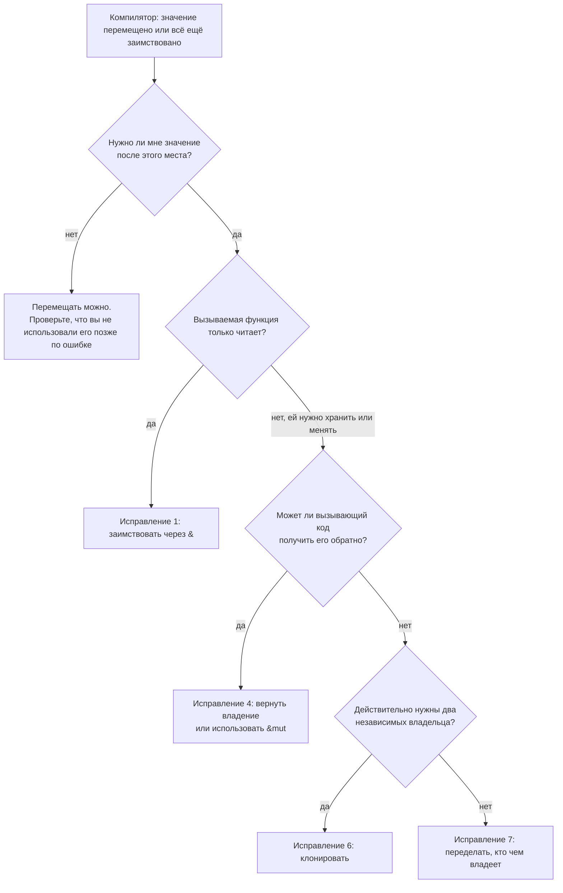

<!-- nav:top -->
[🏠 Начало](../START-HERE.md) · [← 03.6 Срезы и строковые типы](06-slices-and-string-types.md) · [📋 Этап 03](README.md) · [03.8 Проект: счётчик слов и контрольная точка →](08-project-word-counter-and-checkpoint.md) · [📖 Глоссарий](../GLOSSARY.md) · [🇬🇧 English](../../en/03-ownership-and-borrowing/07-fixing-common-ownership-errors.md) <!-- nav -->

# Урок 03.7 — Исправляем частые ошибки владения

> **Этап 03 — Владение и заимствование** · Урок 7 из 8 · ⏱ около 3 часов (2 занятия)

## Что вы узнаете

- Как читать ошибку проверки заимствований сверху вниз.
- Ранжированный набор исправлений: заимствовать, переставить, клонировать, вернуть владение, изменить проект.
- Справочник из девяти ошибок, которые вы будете встречать чаще всего, с неработающей программой, настоящим сообщением и исправлениями для каждой.
- Как использовать `rustc --explain`, `cargo clippy` и Git, чтобы исправлять ошибки спокойно и безопасно.
- Привычки, которые отличают «борьбу с компилятором» от «работы вместе с ним».

## Перед началом

- Вы прошли [Урок 03.6 — Срезы и строковые типы](06-slices-and-string-types.md). Вы знаете перемещения, `Copy`, `clone`, `&`, `&mut`, срезы и правила заимствования.
- Вы знаете основные команды Git из [Этапа 01](../01-git-and-version-control/03-your-first-repository-and-commits.md): `git status`, `git add`, `git commit`, а также (из [Урока 01.5](../01-git-and-version-control/05-undoing-changes-safely.md)) `git restore`.
- Создайте проект: `cargo new code/p03-fixing-errors` (из `~/projects/rust`). Вставляйте каждую неработающую программу, читайте ошибку, затем применяйте исправление.

## Новые слова

| Слово | Значение |
|---|---|
| **диагностика** (diagnostic) | Полное сообщение компилятора о проблеме: код ошибки, фрагмент кода, подписи и подсказки. |
| **код ошибки** (error code) | Короткое имя вроде `E0382`, которое определяет один вид ошибки. У каждого есть официальная страница в *индексе ошибок*. |
| **подпись** (label) | Короткая заметка, которую компилятор печатает под частью вашего кода или рядом с ней, например `value moved here`. |
| **линт** (lint) | Проверка кода, который компилируется, но, вероятно, неверен или неопрятен. Инструмент, запускающий много линтов, — **Clippy**. |
| **Clippy** | Официальный набор линтов для Rust. Запускается командой `cargo clippy`. |
| **временное значение** (temporary) | Значение, которое компилятор создаёт для части выражения и уничтожает в конце инструкции. |
| **diff** (разница) | Список точных строк, изменившихся между двумя версиями файла. Его выводит `git diff`. |

## 1. Как читать ошибку проверки заимствований

Вы уже видели много ошибок. Теперь прочитаем одну медленно, как метод. Возьмём такую программу:

```rust
fn describe(name: String) -> usize {
    println!("name: {name}");
    name.len()
}

fn main() {
    let name = String::from("Grace");
    let n = describe(name);
    println!("{name} has {n} bytes");
}
```

```text
error[E0382]: borrow of moved value: `name`
 --> src/main.rs:9:16
  |
7 |     let name = String::from("Grace");
  |         ---- move occurs because `name` has type `String`, which does not implement the `Copy` trait
8 |     let n = describe(name);
  |                      ---- value moved here
9 |     println!("{name} has {n} bytes");
  |                ^^^^ value borrowed here after move
  |
note: consider changing this parameter type in function `describe` to borrow instead if owning the value isn't necessary
 --> src/main.rs:1:19
  |
1 | fn describe(name: String) -> usize {
  |    --------       ^^^^^^ this parameter takes ownership of the value
  |    |
  |    in this function
help: consider cloning the value if the performance cost is acceptable
  |
8 |     let n = describe(name.clone());
  |                          ++++++++
```

Читайте в таком порядке:

1. **Первая строка:** `error[E0382]: borrow of moved value: name`. Код (`E0382`) и заголовок. Вместе они называют проблему.
2. **Стрелка `-->`:** файл, строка и столбец главного места.
3. **Подписи** (`----` и `^^^^`). Они рассказывают историю в хронологическом порядке: где переменная родилась (строка 7), где случилось плохое (строка 8, «moved here») и где вы столкнулись с проблемой (строка 9, «used after move»). **Найдите эти три места.** Почти у каждой ошибки владения такая форма: *создание → конфликт → позднее использование*.
4. **`note:`** даёт дополнительный контекст. Здесь сказано, что параметр функции забирает владение, и предложено заимствовать.
5. **`help:`** даёт конкретное предложение. Считайте его идеей, а не приказом. Предложение `name.clone()` компилируется, но здесь это не лучшее исправление — лучше `note`.

> 💡 **Совет:** всегда исправляйте **первую** ошибку в списке. Последующие часто являются следствиями первой и исчезают, когда она исправлена. После каждого исправления запускайте `cargo check` (он проверяет без сборки программы, поэтому быстрее).

Для более длинного объяснения любого кода спросите у компилятора:

```bash
rustc --explain E0382
```

```text
A variable was used after its contents have been moved elsewhere.
...
```

(Он выводит страницу с примерами. Тот же текст есть в онлайн-*индексе ошибок*, ссылка на который в конце урока.) В RustRover можно также нажать **Alt+Enter** (или **Option+Enter** на Mac) на красном подчёркивании, чтобы увидеть быстрые исправления.

## 2. Набор инструментов: ранжированные исправления

Когда компилятор говорит, что значение перемещено или всё ещё заимствовано, пробуйте их по порядку. Ранние дешевле и обычно лучше:

| № | Исправление | Применяйте, когда | Цена |
|---|---|---|---|
| 1 | **Заимствовать вместо перемещения.** Измените параметр с `T` на `&T`, а вызов — на `&x`. | Функция только читает. | нет |
| 2 | **Переставить.** Переместите использование ссылки раньше конфликтующего действия или закончите её жизнь раньше. | Заимствование пересекается с изменением или перемещением. | нет |
| 3 | **Сузить область видимости.** Поместите заимствование в блок `{ }`. | Короткое заимствование мешает более позднему действию. | нет |
| 4 | **Вернуть владение.** Верните значение (или верните `String` во владение вместо ссылки). | Функция создаёт данные и должна их отдать. | перемещение |
| 5 | **Разделить работу.** Соберите изменения во второй переменной, затем примените их после цикла. | Вы меняете коллекцию, читая её. | небольшой буфер |
| 6 | **Клонировать.** `.clone()` значения. | Действительно нужны два независимых владельца. | выделение + копирование |
| 7 | **Переделать проект.** Измените, кто чем владеет; используйте индексы; храните данные во владении. | Ничто из вышеперечисленного не подходит. | время на размышления |
| 8 | Подсчёт ссылок и внутренняя изменяемость (`Rc`, `RefCell`). | Когда вы действительно знаете, зачем они нужны (Уроки 05.9 и 06.4). | проверки во время выполнения |



> ⚠️ **Частая ошибка:** сразу хвататься за исправление 6 (`.clone()`) или 8, потому что ошибка после него исчезает. Программа, полная клонов, работает, но медленнее и скрывает проблемы проектирования. Поднимайтесь по лестнице сверху.

## 3. Справочник: девять ошибок

В каждом случае ниже есть: **неработающая** программа, **сообщение** (ключевые строки), **почему** это происходит и **исправления**.

### Случай 1 — `E0382` перемещено в функцию (пример выше)

*Почему:* `describe` принимает `String`, поэтому `main` отдал `name`.

*Исправление 1 — заимствовать* (лучшее): функция только читает, значит, принимайте `&str`.

```rust
fn describe(name: &str) -> usize {
    println!("name: {name}");
    name.len()
}

fn main() {
    let name = String::from("Grace");
    let n = describe(&name);
    println!("{name} has {n} bytes");
}
```

```text
name: Grace
Grace has 5 bytes
```

### Случай 2 — `E0382` перемещено в цикле

```rust
fn main() {
    let word = String::from("hi");
    let mut list = Vec::new();
    for _ in 0..3 {
        list.push(word);
    }
    println!("{:?}", list);
}
```

```text
error[E0382]: use of moved value: `word`
 --> src/main.rs:5:19
  |
2 |     let word = String::from("hi");
  |         ---- move occurs because `word` has type `String`, which does not implement the `Copy` trait
3 |     let mut list = Vec::new();
4 |     for _ in 0..3 {
  |     ------------- inside of this loop
5 |         list.push(word);
  |                   ^^^^ value moved here, in previous iteration of loop
```

*Почему:* вектор должен владеть каждым элементом, а `String` можно переместить только один раз.

*Исправление:* здесь программе действительно нужны три независимые строки, поэтому клонирование на каждом проходе правильно:

```rust
fn main() {
    let word = String::from("hi");
    let mut list = Vec::new();
    for _ in 0..3 {
        list.push(word.clone());
    }
    println!("{:?}", list);
}
```

```text
["hi", "hi", "hi"]
```

### Случай 3 — `E0502` одно значение заимствовано двумя способами в одном вызове

```rust
fn copy_into(dst: &mut Vec<i32>, src: &Vec<i32>) {
    for i in 0..src.len() {
        dst.push(src[i]);
    }
}

fn main() {
    let mut numbers = vec![1, 2, 3];
    copy_into(&mut numbers, &numbers);
    println!("{:?}", numbers);
}
```

```text
error[E0502]: cannot borrow `numbers` as immutable because it is also borrowed as mutable
 --> src/main.rs:9:29
  |
9 |     copy_into(&mut numbers, &numbers);
  |     --------- ------------  ^^^^^^^^ immutable borrow occurs here
  |     |         |
  |     |         mutable borrow occurs here
  |     mutable borrow later used by call
```

*Почему:* функция читала бы `src`, пока добавляет в тот же самый вектор. Если бы `push` переместил буфер, `src` стала бы висячей. Это проблема «алиасинга» из Урока 03.5.

*Исправление 6 — одна намеренная копия* (функции действительно нужен стабильный источник):

```rust
fn copy_into(dst: &mut Vec<i32>, src: &[i32]) {
    for i in 0..src.len() {
        dst.push(src[i]);
    }
}

fn main() {
    let mut numbers = vec![1, 2, 3];
    let snapshot = numbers.clone(); // one deliberate copy
    copy_into(&mut numbers, &snapshot);
    println!("{:?}", numbers);
}
```

```text
[1, 2, 3, 1, 2, 3]
```

(Мы также заменили `&Vec<i32>` на `&[i32]`, как рекомендует Урок 03.6.)

### Случай 4 — `E0505` перемещение или уничтожение заимствованного значения

```rust
fn main() {
    let numbers = vec![10, 20, 30];
    let first = &numbers[0];
    drop(numbers);
    println!("first = {first}");
}
```

```text
error[E0505]: cannot move out of `numbers` because it is borrowed
 --> src/main.rs:4:10
  |
2 |     let numbers = vec![10, 20, 30];
  |         ------- binding `numbers` declared here
3 |     let first = &numbers[0];
  |                  ------- borrow of `numbers` occurs here
4 |     drop(numbers);
  |          ^^^^^^^ move out of `numbers` occurs here
5 |     println!("first = {first}");
  |                        ----- borrow later used here
```

*Почему:* `first` указывает внутрь `numbers`; уничтожение `numbers` оставило бы `first` висячей.

*Исправление 2 — переставить:* используйте `first` до `drop`.

```rust
fn main() {
    let numbers = vec![10, 20, 30];
    let first = &numbers[0];
    println!("first = {first}");
    drop(numbers); // after the last use of `first`
}
```

```text
first = 10
```

### Случай 5 — `E0507` перемещение из заимствования или из индекса

```rust
fn first_name(names: &Vec<String>) -> String {
    names[0]
}

fn main() {
    let names = vec![String::from("Ada"), String::from("Grace")];
    println!("{}", first_name(&names));
}
```

```text
error[E0507]: cannot move out of index of `Vec<String>`
 --> src/main.rs:2:5
  |
2 |     names[0]
  |     ^^^^^^^^ move occurs because value has type `String`, which does not implement the `Copy` trait
```

*Почему:* функция лишь *заимствует* вектор, поэтому не вправе вынуть из него `String` (Урок 03.3, раздел 5).

*Исправление A — вернуть заимствованный срез* (вообще без копирования):

```rust
fn first_name(names: &[String]) -> &str {
    &names[0]
}

fn main() {
    let names = vec![String::from("Ada"), String::from("Grace")];
    println!("{}", first_name(&names));
}
```

```text
Ada
```

*Исправление B — клонировать,* если вызывающему коду нужно владеть результатом и менять его:

```rust
fn first_name(names: &[String]) -> String {
    names[0].clone()
}

fn main() {
    let names = vec![String::from("Ada"), String::from("Grace")];
    let mut mine = first_name(&names);
    mine.push_str(" Lovelace");
    println!("{mine}");
    println!("{:?}", names);
}
```

```text
Ada Lovelace
["Ada", "Grace"]
```

### Случай 6 — `E0515` возврат ссылки на локальную переменную

```rust
fn shout(text: &str) -> &str {
    let upper = text.to_uppercase();
    &upper
}

fn main() {
    println!("{}", shout("hello"));
}
```

```text
error[E0515]: cannot return reference to local variable `upper`
 --> src/main.rs:3:5
  |
3 |     &upper
  |     ^^^^^^ returns a reference to data owned by the current function
```

*Почему:* `upper` строится внутри функции и уничтожается в её конце. Ссылка на неё висела бы. `to_uppercase` создаёт *новый* текст, поэтому срез входных данных тоже вернуть нельзя.

*Исправление 4 — вернуть владение:*

```rust
fn shout(text: &str) -> String {
    text.to_uppercase()
}

fn main() {
    println!("{}", shout("hello"));
}
```

```text
HELLO
```

> 📏 **Соглашение:** если функция *создаёт* текст, она возвращает `String`. Если она только *находит* часть своих входных данных, она возвращает `&str` (срез входных данных).

### Случай 7 — `E0597` ссылка переживает свои данные

```rust
fn main() {
    let text = "short\na much longer line\nmid";
    let mut longest = "";
    for line in text.lines() {
        let cleaned = line.to_lowercase();
        if cleaned.len() > longest.len() {
            longest = &cleaned;
        }
    }
    println!("longest: {longest}");
}
```

```text
error[E0597]: `cleaned` does not live long enough
  --> src/main.rs:7:23
   |
 5 |         let cleaned = line.to_lowercase();
   |             ------- binding `cleaned` declared here
 6 |         if cleaned.len() > longest.len() {
 7 |             longest = &cleaned;
   |                       ^^^^^^^^ borrowed value does not live long enough
 8 |         }
 9 |     }
   |     - `cleaned` dropped here while still borrowed
10 |     println!("longest: {longest}");
   |                         ------- borrow later used here
```

*Почему:* `cleaned` создаётся заново на каждом проходе и уничтожается в его конце, а `longest` хранит ссылку на неё после цикла.

*Исправление 7 — изменить то, что вы храните:* храните срез `text`, который переживает цикл, и приводите к нижнему регистру только в конце.

```rust
fn main() {
    let text = "short\na much longer line\nmid";
    let mut longest = "";
    for line in text.lines() {
        if line.len() > longest.len() {
            longest = line; // `line` borrows from `text`, which outlives the loop
        }
    }
    println!("longest: {}", longest.to_lowercase());
}
```

```text
longest: a much longer line
```

(Другое допустимое исправление: сделать `longest` типа `String` и сохранять клон, `longest = cleaned;`, что *перемещает* строку из цикла.)

### Случай 8 — `E0716` временное значение уничтожено, пока заимствовано

```rust
fn main() {
    let word = String::from("  padded  ").trim();
    println!("[{word}]");
}
```

```text
error[E0716]: temporary value dropped while borrowed
 --> src/main.rs:2:16
  |
2 |     let word = String::from("  padded  ").trim();
  |                ^^^^^^^^^^^^^^^^^^^^^^^^^^       - temporary value is freed at the end of this statement
  |                |
  |                creates a temporary value which is freed while still in use
3 |     println!("[{word}]");
  |                 ---- borrow later used here
  |
help: consider using a `let` binding to create a longer lived value
  |
2 ~     let binding = String::from("  padded  ");
3 ~     let word = binding.trim();
```

*Почему:* `String::from(...)` создаёт **временное** значение. Никто им не владеет, поэтому оно уничтожается в конце строки. `trim()` вернул срез внутри него, и тот висел бы.

*Исправление 3 — дать значению владельца:*

```rust
fn main() {
    let padded = String::from("  padded  ");
    let word = padded.trim();
    println!("[{word}]");
}
```

```text
[padded]
```

### Случай 9 — `E0596` изменение того, что не `mut`

```rust
fn exclaim(s: String) -> String {
    s.push('!');
    s
}

fn main() {
    println!("{}", exclaim(String::from("hey")));
}
```

```text
error[E0596]: cannot borrow `s` as mutable, as it is not declared as mutable
 --> src/main.rs:2:5
  |
2 |     s.push('!');
  |     ^ cannot borrow as mutable
  |
help: consider changing this to be mutable
  |
1 | fn exclaim(mut s: String) -> String {
  |            +++
```

*Почему:* параметр — это переменная, а переменные доступны только для чтения, пока не объявлены `mut`. Владение значением не даёт права его менять; это даёт `mut`.

*Исправление:* добавьте `mut` к параметру (`mut s: String`).

### Другие коды, которые вы знаете

| Код | Где вы встречали | Обычное исправление |
|---|---|---|
| `E0499` две `&mut` сразу | Урок 03.5 | закончите первую до второй (переставьте или блок) |
| `E0502` `&mut`, пока жива `&` | Урок 03.5 | сначала используйте разделяемую ссылку; или соберите изменения и примените их позже |
| `E0506` присваивание заимствованному значению | Урок 03.5 | присваивайте после последнего использования ссылки |
| `E0106` отсутствует спецификатор времени жизни | Урок 03.4 | верните значение во владение (времена жизни: Урок 05.3) |
| `E0368` `+=` для `&mut i32` | Урок 03.5 | пишите `*n += 1` |

## 4. Пусть Clippy вас учит

Компилятор останавливается на ошибках. **Clippy** находит также код, который компилируется, но не идиоматичен. Запустите его командой `cargo clippy`. Эта программа компилируется, но посмотрите, что говорит Clippy:

```rust
fn count_a(text: &String) -> usize {
    text.chars().filter(|c| *c == 'a').count()
}

fn total(numbers: &Vec<i32>) -> i32 {
    numbers.iter().sum()
}

fn main() {
    let text = String::from("banana");
    let n = 5;
    let m = n.clone();
    println!("{} {} {}", count_a(&text), total(&vec![1, 2, 3]), m);
}
```

```text
warning: writing `&String` instead of `&str` involves a new object where a slice will do
 --> src/main.rs:1:18
  |
1 | fn count_a(text: &String) -> usize {
  |                  ^^^^^^^
  |
  = note: `#[warn(clippy::ptr_arg)]` on by default
help: change this to
  |
1 - fn count_a(text: &String) -> usize {
1 + fn count_a(text: &str) -> usize {

warning: writing `&Vec` instead of `&[_]` involves a new object where a slice will do
 --> src/main.rs:5:19
  |
5 | fn total(numbers: &Vec<i32>) -> i32 {
  |                   ^^^^^^^^^
  |
help: change this to
  |
5 - fn total(numbers: &Vec<i32>) -> i32 {
5 + fn total(numbers: &[i32]) -> i32 {

warning: using `clone` on type `i32` which implements the `Copy` trait
  --> src/main.rs:12:13
   |
12 |     let m = n.clone();
   |             ^^^^^^^^^ help: try removing the `clone` call: `n`
   |
   = note: `#[warn(clippy::clone_on_copy)]` on by default
```

Clippy повторяет совет Урока 03.6 (`&str` и `&[T]`) и замечает бессмысленный `clone` у `i32`. (Часть с фильтром, `|c| *c == 'a'`, — это *замыкание*, небольшая безымянная функция; Урок 05.4.) С этого момента каждый проект курса должен быть **чистым для clippy**: `cargo clippy` не показывает предупреждений.

> 🧪 **Тестирование:** исправление ошибки не закончено, пока тест его не закрепит. После исправления функции напишите тест, который вызывает её дважды или использует аргумент после вызова — это тест «не потребила мои входные данные», который компилятор уже проверяет, а также тест поведения, которого он не проверяет.

## 5. Исправляйте ошибки с Git как страховкой

Когда исправление означает переписывание нескольких строк, работайте так:

1. **Начинайте с чистого коммита.** `git status` показывает, что коммитить нечего, или вы коммитите то, что есть: `git commit -am "before fixing the borrow errors"`.
2. Попробуйте исправление. Запустите `cargo check`.
3. Если сработало, посмотрите, что именно вы изменили, с помощью `git diff`:

   ```text
   diff --git a/code/p03-demo/src/main.rs b/code/p03-demo/src/main.rs
   --- a/code/p03-demo/src/main.rs
   +++ b/code/p03-demo/src/main.rs
   @@ -1,10 +1,10 @@
   -fn describe(name: String) -> usize {
   +fn describe(name: &str) -> usize {
        println!("name: {name}");
        name.len()
    }

    fn main() {
        let name = String::from("Grace");
   -    let n = describe(name);
   +    let n = describe(&name);
        println!("{name} has {n} bytes");
    }
   ```

   Строки с `-` были удалены, а строки с `+` добавлены. Чтение собственного diff — очень хороший способ увидеть, чем на самом деле было исправление: здесь два небольших изменения.
4. Сделайте коммит с сообщением, говорящим, *что* и *почему*: `git commit -am "describe: borrow the name instead of taking it"`.
5. Если эксперимент пошёл не так и вы хотите вернуться к последнему коммиту, `git restore src/main.rs` (Урок 01.5) отбрасывает ваши незакоммиченные изменения в этом файле. Используйте осторожно: это нельзя отменить.

> 💡 **Совет:** одно исправление — один коммит. Тогда `git log --oneline` читается как история того, как программа становилась лучше (Урок 01.4).

## Частые ошибки

**1. Исправлять последнюю ошибку вместо первой.** Последующие могут исчезнуть сами.

**2. Применять подсказку `help:` не читая.** `.clone()` — лишь один из вариантов, и часто не лучший.

**3. Делать всё `String` и `.clone()`.** Программа работает, но вы ничему не научились, и она медленнее. Предпочитайте ссылки.

**4. Хвататься за `unsafe`, `'static` или `Rc<RefCell<…>>`, потому что проверка заимствований «мешает».** Это инструменты для особых случаев со своей ценой. Новичку, которому они нужны, почти всегда нужен более простой проект.

**5. Менять пять вещей сразу.** Сделайте одно изменение, запустите `cargo check`, затем следующее. Тогда вы знаете, какое изменение что исправило.

**6. Не читать подписи.** Три подписи (рождение, конфликт, позднее использование) содержат ответ.

## Попробуйте сами

1. В `code/p03-fixing-errors` вставьте Случай 2 (`list.push(word)` в цикле). Запустите `cargo check` и найдите три подписи в сообщении.
2. Выполните `rustc --explain E0382` и прочтите первый экран.
3. Примените исправление. Запустите `cargo clippy`; вывод должен быть пустым.
4. Сделайте коммит: `git add code/p03-fixing-errors && git commit -m "p03: fixing errors playground"`. Затем вставьте Случай 8 (временное значение) и исправьте его. Выполните `git diff`, чтобы прочитать своё изменение, и снова закоммитьте.
5. Выберите один случай из раздела 3 и снова намеренно сломайте его другим способом (например, в Случае 4 используйте `numbers.push(1)` вместо `drop(numbers)`). Какой код ошибки вы получаете теперь?

## Упражнения

### Упражнение 1 — Приветствие (легко)

Эта программа не компилируется. Исправьте её, сделав так, чтобы функция заимствовала:

```rust
fn make_greeting(name: String) -> String {
    format!("Hello, {name}!")
}

fn main() {
    let name = String::from("Ada");
    let greeting = make_greeting(name);
    println!("{greeting}");
    println!("(sent to {name})");
}
```

<details>
<summary>Подсказка</summary>

Функция только читает `name`. Измените тип параметра на `&str` и передайте `&name` в `main`.

</details>

<details>
<summary>Ответ</summary>

```rust
fn make_greeting(name: &str) -> String {
    format!("Hello, {name}!")
}

fn main() {
    let name = String::from("Ada");
    let greeting = make_greeting(&name);
    println!("{greeting}");
    println!("(sent to {name})");
}
```

```text
Hello, Ada!
(sent to Ada)
```

Почему это работает: `format!` создаёт новую `String`, поэтому функция возвращает значение во владение. Параметр лишь заимствован, поэтому `name` остаётся действительным.

</details>

### Упражнение 2 — Расти, пока читаешь (средне)

Эта программа должна вывести `[1, 2, 3, 10, 20, 30]` (в конец добавляется каждый элемент, умноженный на десять). Она падает с `E0502`. Исправьте её.

```rust
fn main() {
    let mut numbers = vec![1, 2, 3];
    for n in &numbers {
        numbers.push(n * 10);
    }
    println!("{:?}", numbers);
}
```

<details>
<summary>Подсказка</summary>

Не удерживайте заимствование вектора, пока добавляете в него. Обходите *позиции* `0..count`, где `count` — длина до цикла, и читайте `numbers[i]` внутри.

</details>

<details>
<summary>Ответ</summary>

```rust
fn main() {
    let mut numbers = vec![1, 2, 3];
    let count = numbers.len();
    for i in 0..count {
        let bigger = numbers[i] * 10;
        numbers.push(bigger);
    }
    println!("{:?}", numbers);
}
```

```text
[1, 2, 3, 10, 20, 30]
```

Почему это работает: `numbers.len()` читается один раз, до цикла. Внутри цикла `numbers[i]` — недолгое чтение, а `push` — недолгая запись, и они не пересекаются. Без переменной `count` вариант `0..numbers.len()` тоже сработал бы, так как диапазон создаётся один раз до начала цикла.

</details>

### Упражнение 3 — Что длиннее? (средне)

Это падает с `E0106` (отсутствует спецификатор времени жизни). Исправьте **без** времён жизни, вернув `String` во владение, и добавьте два теста (явный победитель и ничья, где побеждает первая).

```rust
fn longer(a: &str, b: &str) -> &str {
    if a.len() >= b.len() { a } else { b }
}

fn main() {
    println!("{}", longer("tiny", "enormous"));
}
```

<details>
<summary>Подсказка</summary>

Компилятор не может понять, заимствует ли результат из `a` или из `b`. Верните `String` и преобразуйте с помощью `.to_string()`.

</details>

<details>
<summary>Ответ</summary>

```rust
fn longer(a: &str, b: &str) -> String {
    if a.len() >= b.len() { a.to_string() } else { b.to_string() }
}

fn main() {
    println!("{}", longer("tiny", "enormous"));
}

#[cfg(test)]
mod tests {
    use super::*;

    #[test]
    fn picks_the_longer() {
        assert_eq!(longer("tiny", "enormous"), "enormous");
    }

    #[test]
    fn tie_picks_the_first() {
        assert_eq!(longer("ab", "cd"), "ab");
    }
}
```

```text
enormous
```

Почему это работает: `String` во владении никак не связана с входными данными, поэтому время жизни не нужно. Собственное предложение компилятора для исходной ошибки было `fn longer<'a>(a: &'a str, b: &'a str) -> &'a str`. Это оставляет функцию без выделений памяти; как это читать, объясняет Урок 05.3.

</details>

### Упражнение 4 — Три ошибки, три коммита (сложно)

Поместите эту программу в `code/p03-fixing-errors` и закоммитьте как есть. В ней три разные ошибки владения. Исправляйте их **по одной**, запуская `cargo check` после каждой, и делайте **один коммит Git на каждое исправление** (с понятными сообщениями). Затем добавьте два теста для `shout`. Закончите командой `git log --oneline`.

```rust
fn shout(text: String) -> String {
    text.push('!');
    text.to_uppercase()
}

fn main() {
    let mut words = vec![String::from("hello"), String::from("world")];
    let first = &words[0];
    words.push(String::from("again"));
    println!("first word: {first}");

    let message = String::from("done");
    let loud = shout(message);
    println!("{loud} / {message}");
}
```

<details>
<summary>Подсказка</summary>

Компилятор сообщает все три ошибки вместе (`E0596`, `E0502`, `E0382`). Исправляйте их в порядке появления. Ошибка 1: `shout` меняет параметр, который не `mut`; но лучше сделать так, чтобы `shout` принимала `&str` и строила новую `String`. Ошибка 2: выведите `first` до `push`. Ошибка 3 исчезает, когда `shout` заимствует.

</details>

<details>
<summary>Ответ</summary>

Возможный результат:

```rust
fn shout(text: &str) -> String {
    let mut loud = text.to_uppercase();
    loud.push('!');
    loud
}

fn main() {
    let mut words = vec![String::from("hello"), String::from("world")];
    let first = &words[0];
    println!("first word: {first}");
    words.push(String::from("again"));

    let message = String::from("done");
    let loud = shout(&message);
    println!("{loud} / {message}");
}

#[cfg(test)]
mod tests {
    use super::*;

    #[test]
    fn shout_makes_loud_text() {
        assert_eq!(shout("hey"), "HEY!");
    }

    #[test]
    fn shout_keeps_the_input() {
        let original = String::from("quiet");
        let _ = shout(&original);
        assert_eq!(original, "quiet");
    }
}
```

```text
first word: hello
DONE! / done
```

Исходная программа сообщает в таком порядке: `E0596` (cannot borrow `text` as mutable, as it is not declared as mutable), `E0502` (cannot borrow `words` as mutable because it is also borrowed as immutable) и `E0382` (borrow of moved value: `message`).

Хорошая история коммитов выглядит так (ваши хеши будут другими):

```text
f3a91c2 shout: borrow the text and build a new String
b72d4e0 main: read `first` before pushing to the vector
0c15a8d Add p03 fixing-errors playground (does not compile yet)
```

Почему это работает: исправление 1 (параметр `&str` плюс новая `String`) лечит и ошибку `mut`, и ошибку перемещения сразу; исправление 2 лишь переставляет две строки. Небольшие коммиты показывают, какое изменение вылечило какую ошибку.

</details>

## Вопросы для самопроверки

1. На какие три места обычно указывают подписи в ошибке владения?

<details>
<summary>Ответ</summary>

Где было создано значение или заимствование, где произошло конфликтующее действие (перемещение, изменяемое заимствование, уничтожение) и где значение используется позже.

</details>

2. Какую ошибку исправляют первой, когда сообщено несколько?

<details>
<summary>Ответ</summary>

Первую. Последующие могут быть её следствиями.

</details>

3. Назовите первые три исправления из набора, от самого дешёвого к самому дорогому.

<details>
<summary>Ответ</summary>

Заимствовать вместо перемещения; переставить код; сузить область видимости блоком. (Затем вернуть владение, разделить работу, клонировать, переделать проект.)

</details>

4. Когда `.clone()` — правильное исправление?

<details>
<summary>Ответ</summary>

Когда вам действительно нужны два независимых владельца данных, например сохранить копию в векторе, оставив оригинал.

</details>

5. Что означает `E0515` и как её исправить?

<details>
<summary>Ответ</summary>

Вы вернули ссылку на локальную переменную, которая уничтожается при завершении функции. Верните вместо этого значение во владение (например, `String`).

</details>

6. Чем `git diff` помогает при исправлении ошибок?

<details>
<summary>Ответ</summary>

Он показывает, какие именно строки вы изменили, так что можно убедиться, что исправление небольшое и верное, прежде чем коммитить.

</details>

7. Что добавляет Clippy по сравнению с компилятором?

<details>
<summary>Ответ</summary>

Линты для кода, который компилируется, но неидиоматичен или, вероятно, неверен, например параметры `&String` или бесполезный `clone`.

</details>

## Итоги

- Читайте ошибку сверху вниз: код и заголовок, расположение, затем подписи (создание → конфликт → позднее использование), затем `note` и `help`.
- Исправляйте первую ошибку первой, по одному изменению, запуская между ними `cargo check`.
- Поднимайтесь по набору сверху: заимствовать, переставить, сузить область видимости, вернуть владение, разделить работу, клонировать, переделать.
- Девять частых ошибок: `E0382` (дважды), `E0502`, `E0505`, `E0507`, `E0515`, `E0597`, `E0716`, `E0596`.
- `rustc --explain CODE` даёт длинное объяснение; `cargo clippy` находит неидиоматичный код. Ваши проекты должны оставаться чистыми для clippy.
- Используйте Git как страховку: чистый коммит до, `git diff` после, одно исправление — один коммит.

## Источники и что почитать

- [Rust compiler error index](https://doc.rust-lang.org/error_codes/E0382.html) — официальная страница для `E0382`; меняйте код в адресе (`E0499`, `E0502`, `E0505`, `E0507`, `E0515`, `E0597`, `E0716`), чтобы открыть остальные.
- [The Rust Programming Language — 4.2 References and Borrowing](https://doc.rust-lang.org/book/ch04-02-references-and-borrowing.html) — правила, стоящие за большинством этих ошибок.
- [Clippy lints](https://rust-lang.github.io/rust-clippy/master/index.html) — полный список проверок Clippy с объяснениями и примерами.
- [Pro Git — Recording Changes to the Repository](https://git-scm.com/book/en/v2/Git-Basics-Recording-Changes-to-the-Repository) — `git diff`, `git commit` и другие команды подробно.
- [git restore](https://git-scm.com/docs/git-restore) — официальная страница руководства команды, которой отбрасывают локальные изменения.

---

[🏠 Начало](../START-HERE.md) · [← 03.6 Срезы и строковые типы](06-slices-and-string-types.md) · [📋 Этап 03](README.md) · [03.8 Проект: счётчик слов и контрольная точка →](08-project-word-counter-and-checkpoint.md) · [📖 Глоссарий](../GLOSSARY.md) <!-- nav -->
<!-- nav:bottom -->
