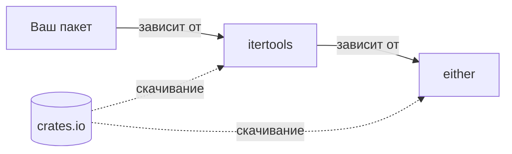

<!-- nav:top -->
[🏠 Начало](../START-HERE.md) · [← 05.7 Документация](07-documentation.md) · [📋 Этап 05](README.md) · [05.9 Умные указатели →](09-smart-pointers.md) · [📖 Глоссарий](../GLOSSARY.md) · [🇬🇧 English](../../en/05-rust-intermediate/08-cargo-dependencies-and-versions.md) <!-- nav -->

# Урок 05.8 — Cargo: зависимости и версии

> **Этап 05 — Rust: средний уровень** · Урок 8 из 14 · ⏱ около 3 часов (2 занятия)

## Что вы узнаете

- Что такое зависимость, откуда берутся крейты и как добавить крейт командой `cargo add`.
- Как устроены номера версий (семантическое версионирование) и как записать требование к версии, например `"0.15"` или `"1.2.3"`.
- Что такое `Cargo.lock`, зачем он нужен и когда его нужно сохранять в Git.
- Как заглянуть внутрь своих зависимостей командой `cargo tree` и как обновить их командой `cargo update`.
- Как включать и выключать фичи (features) крейта, как пользоваться dev-зависимостями, зависимостями по пути и зависимостями из Git.
- Как выбрать крейт, которому можно доверять.

## Перед началом

- Вы прошли [Урок 05.7 — Документация](07-documentation.md).
- Вы знаете, что такое крейт и пакет: [Урок 04.6 — Модули, крейты и пакеты](../04-structs-enums-collections-errors/06-modules-crates-and-packages.md).
- Вы умеете делать коммиты в Git: [Урок 01.3 — Первый репозиторий и коммиты](../01-git-and-version-control/03-your-first-repository-and-commits.md).
- Создайте папку для экспериментов: `mkdir -p ~/projects/rust/code/p05-cargo-lab && cd ~/projects/rust/code/p05-cargo-lab`. Для этого урока компьютер должен быть подключён к интернету, потому что Cargo скачивает крейты.

## Новые слова

| Слово | Значение |
|---|---|
| **зависимость** (dependency) | Код, который написал кто-то другой и который использует ваша программа. В Rust зависимость — это крейт. |
| **crates.io** | Публичный сайт и сервер, где сообщество Rust публикует крейты. |
| **реестр** (registry) | Сервер, который хранит опубликованные крейты и их версии. Реестр по умолчанию — crates.io. |
| **TOML** (Tom's Obvious Minimal Language, «очевидный минимальный язык Тома») | Простой текстовый формат для настроек. `Cargo.toml` написан на TOML. |
| **semver** (Semantic Versioning, семантическое версионирование) | Набор правил для номеров версий вида `MAJOR.MINOR.PATCH`. |
| **требование к версии** (version requirement) | Текст после имени крейта в `Cargo.toml` (например, `"0.15"`). Он говорит Cargo, какие версии разрешены. |
| **файл блокировки** (`Cargo.lock`) | Файл, который создаёт Cargo и в котором записана точная версия каждого крейта, использованного в сборке. |
| **транзитивная зависимость** (transitive dependency) | Зависимость вашей зависимости. Вы не просили её напрямую, но она попадает в программу. |
| **фича** (feature) | Необязательная часть крейта. Вы включаете её в `Cargo.toml`, только если она нужна. |
| **dev-зависимость** (dev-dependency) | Зависимость, которая нужна только тестам, примерам и бенчмаркам, но не итоговой программе. |
| **зависимость по пути** (path dependency) | Зависимость, которая лежит в папке на вашем компьютере. |
| **зависимость из Git** (Git dependency) | Зависимость, которую Cargo скачивает из репозитория Git. |
| **отозванная версия** (yanked version) | Опубликованная версия, которую автор пометил как «не использовать в новых проектах». |
| **MSRV** (Minimum Supported Rust Version, минимальная поддерживаемая версия Rust) | Самая старая версия компилятора Rust, с которой крейт обещает работать. |
| **цепочка поставок** (supply chain) | Весь чужой код, который в итоге оказывается внутри вашей программы. |
| **UUID** (Universally Unique Identifier, универсальный уникальный идентификатор) | 128-битное число, записанное как 36 символов, которое практически уникально во всём мире. |
| **SHA** (Secure Hash Algorithm, безопасный алгоритм хеширования) | Способ превратить данные в короткий «отпечаток». Git использует его для идентификаторов коммитов. |

## 1. Что такое зависимость

До сих пор вы писали каждую строку программы сами и пользовались стандартной библиотекой (`std`), которая поставляется вместе с Rust. Настоящие программы используют и код других людей: библиотеку для чтения JSON (JavaScript Object Notation, популярный текстовый формат данных), библиотеку для разбора аргументов командной строки, библиотеку для случайных чисел.

Представьте, что вы строите дом. Вы не делаете кирпичи и трубы сами, а покупаете их в магазине. **Зависимость** — это «кирпич», который вы берёте (бесплатно) в магазине кода. Магазин называется **реестром**, а главный реестр Rust — **crates.io**.



Код вручную копировать не нужно. Вы пишете имя и версию в `Cargo.toml`, а Cargo (инструмент сборки Rust) скачивает код, компилирует его и подключает к вашей программе.

### Как добавить зависимость

Создайте проект и добавьте крейт `itertools`. Он даёт дополнительные инструменты для работы с последовательностями элементов.

```bash
cargo new word-tools
cd word-tools
cargo add itertools@0.15
```

`cargo add` сам правит `Cargo.toml`. После команды файл выглядит так:

```toml
[package]
name = "word-tools"
version = "0.1.0"
edition = "2024"

[dependencies]
itertools = "0.15"
```

Теперь используйте крейт. Замените `src/main.rs`:

```rust
use itertools::Itertools;

fn main() {
    let words = ["rust", "is", "fun"];
    let line = words.iter().join("-");
    println!("{line}");
}
```

Запустите:

```bash
cargo run
```

```text
   Compiling either v1.19.0
   Compiling itertools v0.15.0
   Compiling word-tools v0.1.0 (/home/you/projects/rust/code/p05-cargo-lab/word-tools)
    Finished `dev` profile [unoptimized + debuginfo] target(s) in 1.00s
     Running `target/debug/word-tools`
rust-is-fun
```

**Что происходит:**

1. `use itertools::Itertools;` вводит в область видимости трейт `Itertools`. **Трейт** (вы изучали его в [Уроке 05.2 — Трейты](02-traits.md)) добавляет методы к существующим типам; `join` — один из методов, которые этот трейт добавляет к итераторам.
2. `words.iter()` создаёт итератор по трём словам.
3. `.join("-")` склеивает все элементы, ставя между ними `-`, и возвращает `String`.
4. Cargo сначала скачал два крейта: `itertools` (тот, что вы просили) и `either` (тот, что нужен самому `itertools`). Он скомпилировал оба, а затем скомпилировал ваш пакет.

> 💡 **Совет:** `cargo add` — самый простой способ, но можно и вписать строку в `[dependencies]` самостоятельно. Результат будет одинаковым. Чтобы убрать зависимость, выполните `cargo remove itertools`.

### Где лежит код?

Cargo скачивает крейты один раз в папку-кэш в вашем домашнем каталоге (`~/.cargo/registry`). Все проекты на компьютере используют этот кэш. Скомпилированные файлы вашего проекта попадают в папку `target` этого проекта, как вы уже знаете.

### Частая ошибка: использовать крейт, которого нет в Cargo.toml

Если вы написали `use itertools::Itertools;`, но забыли добавить зависимость, компилятор остановится:

```text
error[E0432]: unresolved import `itertools`
 --> src/main.rs:1:5
  |
1 | use itertools::Itertools;
  |     ^^^^^^^^^ use of unresolved module or unlinked crate `itertools`
  |
  = help: if you wanted to use a crate named `itertools`, use `cargo add itertools` to add it to your `Cargo.toml`

error[E0599]: no method named `join` found for struct `std::slice::Iter<'a, T>` in the current scope
```

Настоящая ошибка — первая. Вторая — всего лишь её следствие (метод `join` приходит из отсутствующего крейта). Строка help подсказывает исправление: выполните `cargo add itertools`. **Всегда исправляйте сначала первую ошибку.**

## 2. Версии и требования к версиям

### Семантическое версионирование

Версия каждого крейта — это три числа: `MAJOR.MINOR.PATCH`, например `1.4.2`. Правила, которые называются **семантическим версионированием** или **semver**, такие:

| Число | Меняется, когда… | Безопасно обновлять? |
|---|---|---|
| **PATCH** (`1.4.2` → `1.4.3`) | Автор исправил ошибку. Ничего нового, ничего не удалено. | Да. |
| **MINOR** (`1.4.2` → `1.5.0`) | Автор добавил что-то новое. Старый код продолжает работать. | Да. |
| **MAJOR** (`1.4.2` → `2.0.0`) | Автор изменил или удалил что-то. Старый код может перестать работать. | Только когда вы готовы исправлять свой код. |

Для версий, которые начинаются с `0`, действует особое правило. Пока старшее число равно `0`, крейт как бы говорит: «я ещё сильно меняюсь». Для `0.x.y` изменение **среднего** числа (`0.14` → `0.15`) может сломать ваш код — так же, как изменение старшего.

### Как записать требование к версии

В `Cargo.toml` запись `itertools = "0.15"` не означает «ровно 0.15». Это **требование к версии**: правило о том, какие версии Cargo может выбрать. Правило по умолчанию — **каретка** (`^`): «любая версия, совместимая с этой по semver».

| Вы пишете | Cargo принимает | Примечания |
|---|---|---|
| `"1.2.3"` (то же, что `"^1.2.3"`) | от `1.2.3` до `2.0.0` (не включая) | Обычный выбор. |
| `"1.2"` | от `1.2.0` до `2.0.0` (не включая) | Та же идея, короче. |
| `"0.15"` | от `0.15.0` до `0.16.0` (не включая) | Для `0.x` «ломающее» число — среднее. |
| `"0.0.3"` | только `0.0.3` | Для `0.0.x` любое изменение может сломать код. |
| `"~1.2.3"` | от `1.2.3` до `1.3.0` (не включая) | Тильда: только обновления PATCH. |
| `"=1.2.3"` | ровно `1.2.3` | Используйте редко. Из-за неё трудно сочетать крейты. |
| `">=1.2, <1.5"` | диапазон | Редко. |
| `"*"` | любая версия | Не используйте. crates.io не даёт публиковать пакеты с такой записью. |

> 📏 **Соглашение:** записывайте требование к версии коротко, так, как это делает `cargo add` (`"0.15"`, `"1"`). Такая запись разрешает все совместимые обновления и при этом защищает вас от ломающих изменений.

### Версия, которой не существует

```toml
[dependencies]
itertools = "99.0"
```

```text
error: failed to select a version for the requirement `itertools = "^99.0"`
candidate versions found which didn't match: 0.15.0, 0.14.0, 0.13.0, ...
location searched: crates.io index
required by package `word-tools v0.1.0 (...)`
```

Что это значит: Cargo спросил у crates.io версию `99.x` крейта `itertools`, а такой нет. Он показывает самые новые версии, которые существуют. Исправление: выберите одну из них.

### Какая версия крейта поддерживает какую версию Rust?

Каждый крейт может указать свою **MSRV** — самую старую версию Rust, с которой он работает, — в поле `rust-version`. Прочитать её можно командой `cargo info`:

```bash
cargo info itertools
```

```text
itertools #iterator #data-structure #zip #product
Extra iterator adaptors, iterator methods, free functions, and macros.
version: 0.15.0
license: MIT OR Apache-2.0
rust-version: 1.63.0
documentation: https://docs.rs/itertools/
repository: https://github.com/rust-itertools/itertools
crates.io: https://crates.io/crates/itertools/0.15.0
features:
 +default   = [use_std]
  use_alloc = []
  use_std   = [use_alloc, either/use_std]
note: to see how you depend on itertools, run `cargo tree --invert itertools@0.15.0`
```

Вы видите самую новую версию, лицензию, минимальную версию Rust, ссылки на документацию и исходный код и список фич (подробнее о них — в разделе 5).

## 3. Cargo.lock: точные версии

Когда вы выполнили `cargo run`, Cargo создал рядом с `Cargo.toml` новый файл. Откройте его:

```toml
# This file is automatically @generated by Cargo.
# It is not intended for manual editing.
version = 4

[[package]]
name = "either"
version = "1.19.0"
source = "registry+https://github.com/rust-lang/crates.io-index"
checksum = "0e9c71c2167ca323c882b99918929403426e2373ea17242ff5653e0d5e1058be"

[[package]]
name = "itertools"
version = "0.15.0"
source = "registry+https://github.com/rust-lang/crates.io-index"
checksum = "8b4baf93f58d4425749ca49a51c50ebab072c5df6994d08fed93541c331481dc"
dependencies = [
 "either",
]

[[package]]
name = "word-tools"
version = "0.1.0"
dependencies = [
 "itertools",
]
```

**Что происходит:**

1. `Cargo.toml` говорит, что вы **разрешаете**: «любую `0.15.x`».
2. Cargo выбрал самую новую из разрешённых версий на сегодня — `0.15.0` — и записал именно этот выбор в `Cargo.lock`.
3. Для каждого пакета записаны точная версия, источник (`source`) и `checksum` — «отпечаток» скачанных файлов. Если кто-то подменит файлы по сети, отпечаток не совпадёт, и Cargo откажется собирать. Это вас защищает.
4. При следующей сборке Cargo читает `Cargo.lock` и берёт **те же версии**, даже если вышли более новые. Сборка одинакова сегодня, через месяц и на компьютере вашего коллеги.

> 📏 **Соглашение:** никогда не правьте `Cargo.lock` вручную. Этот файл принадлежит Cargo.

### Нужно ли класть Cargo.lock в Git?

Вспомните Git из [Этапа 01](../01-git-and-version-control/01-what-is-version-control.md): контроль версий сохраняет историю ваших файлов. Какие файлы туда класть? Правило такое:

| Вид пакета | Коммитить `Cargo.lock`? | Почему |
|---|---|---|
| **Программа** (есть `src/main.rs`) | **Да** | Все, кто собирает программу, получают одинаковые версии. |
| **Библиотека** (есть `src/lib.rs`, от неё будут зависеть другие) | Необязательно. Многие команды коммитят и его. | У пользователей вашей библиотеки есть свой `Cargo.lock`, ваш они не учитывают. Но коммит делает повторяемыми ваши собственные тесты. |
| Папка `target` | **Никогда** | Она большая и в любой момент пересобирается. |

Когда вы выполняете `cargo new` вне какого-либо репозитория, Cargo также создаёт репозиторий Git и файл `.gitignore` с одной строкой, `/target`. Внутри существующего репозитория (вашего учебного репозитория `~/projects/rust`) Cargo не создаёт ни того, ни другого, поэтому правило игнорирования для `target` уже должно быть в `.gitignore` в корне вашего репозитория (вы настроили его в [Уроке 05.1](01-generics.md)). В любом случае папка `target` игнорируется, а `Cargo.lock` — нет.

Вот реальный порядок работы при добавлении зависимости. В вашем учебном репозитории команды те же; Git лишь показывает там более длинные пути (`code/p05-cargo-lab/word-tools/Cargo.toml` вместо `Cargo.toml`):

```bash
git status --short
```

```text
 M Cargo.toml
?? Cargo.lock
```

`M` значит «изменён» (modified), а `??` — «новый файл, Git его ещё не знает». Посмотрите точное изменение:

```bash
git diff Cargo.toml
```

```text
@@ -4,3 +4,4 @@ version = "0.1.0"
 edition = "2024"
 
 [dependencies]
+itertools = "0.15"
```

Закоммитьте оба файла вместе, потому что они относятся к одному изменению:

```bash
git add Cargo.toml Cargo.lock
git commit -m "chore(p05): add itertools 0.15"
git log --oneline -2
```

```text
e92cbb1 chore(p05): add itertools 0.15
70ad873 chore(p05): start the project
```

(Ваши идентификаторы коммитов будут другими.) Теперь история отвечает на вопрос «когда мы начали использовать этот крейт и в какой версии?». В этом реальная польза контроля версий.

> 📏 **Соглашение:** делайте один коммит на одно изменение зависимостей, с сообщением в стиле этого этапа, например `chore(p05): add itertools 0.15` или `chore(p05): update serde to 1.0.229`. Если после обновления что-то сломалось, `git log` и `git diff Cargo.lock` покажут, что изменилось, и вы сможете вернуться назад (см. [Урок 01.5 — Как безопасно отменять изменения](../01-git-and-version-control/05-undoing-changes-safely.md)).

## 4. Заглянуть внутрь и обновить

### cargo tree

У ваших зависимостей есть собственные зависимости. Команда `cargo tree` рисует всё **дерево зависимостей**:

```bash
cargo tree
```

```text
word-tools v0.1.0 (/home/you/projects/rust/code/p05-cargo-lab/word-tools)
└── itertools v0.15.0
    └── either v1.19.0
```

`either` — это **транзитивная зависимость**: вы её не писали, но она есть в программе. Можно задать и обратный вопрос: «кому нужен `either`?» — с помощью `-i` (invert, инвертировать):

```bash
cargo tree -i either
```

```text
either v1.19.0
└── itertools v0.15.0
    └── word-tools v0.1.0 (/home/you/projects/rust/code/p05-cargo-lab/word-tools)
```

Команда `cargo tree --depth 1` показывает только те крейты, которые вы сами записали в `Cargo.toml`. Команда `cargo tree -d` находит крейты, которые встречаются в **двух разных версиях** (из-за этого программа становится больше и дольше компилируется). Для быстрой демонстрации этот `Cargo.toml` просит `itertools` дважды под двумя именами:

```toml
[dependencies]
itertools = "0.14"
itertools_new = { package = "itertools", version = "0.15" }
```

```text
itertools v0.14.0
└── dup-demo v0.1.0 (/home/you/projects/rust/code/p05-cargo-lab/dup-demo)

itertools v0.15.0
└── dup-demo v0.1.0 (/home/you/projects/rust/code/p05-cargo-lab/dup-demo)
```

Ключ `package = "..."` позволяет дать крейту другое локальное имя. Cargo разрешает две несовместимые версии одного крейта в одной программе, потому что с точки зрения компилятора это два разных крейта.

### cargo update

`Cargo.lock` нарочно хранит старые версии. Чтобы перейти на более новые версии, которые `Cargo.toml` всё ещё разрешает, выполните `cargo update`. Чтобы увидеть эффект, вот проект, в котором `serde` нарочно закреплён на старой версии (командой `cargo update serde --precise 1.0.200`):

```bash
cargo update
```

```text
    Updating crates.io index
     Locking 4 packages to highest Rust 1.100.0 compatible versions
    Updating serde v1.0.200 -> v1.0.229
      Adding serde_core v1.0.229
    Updating serde_derive v1.0.200 -> v1.0.229
    Updating syn v2.0.119 -> v3.0.10
```

**Что происходит:**

1. Cargo обращается к реестру и ищет более новые версии, которые удовлетворяют всем требованиям.
2. Он меняет только `Cargo.lock`. `Cargo.toml` остаётся прежним.
3. Он также обновляет крейты, которые нужны самому `serde`. Новому `serde_derive` нужна более новая старшая версия вспомогательного крейта `syn`, поэтому `syn` перешёл с 2 на 3. Это нормально: `syn` — транзитивная зависимость, и другие крейты, которым нужна старая версия, сохранят свою.
4. Фраза «Rust 1.100.0 compatible» показывает, что Cargo учитывает поля `rust-version`: он избегает версий, которым нужен более новый компилятор, чем ваш.

Полезные варианты:

| Команда | Что делает |
|---|---|
| `cargo update` | Обновляет всё, что разрешено. |
| `cargo update serde` | Обновляет только `serde` (и то, что ему нужно). |
| `cargo update serde --precise 1.0.200` | Ставит `serde` на одну точную версию (можно и понизить). |
| `cargo update --dry-run` | Показывает, что изменилось бы; ничего не меняет. |
| `cargo build --locked` | Завершается с ошибкой, если `Cargo.lock` пришлось бы изменить. |
| `cargo build --offline` | Не использует сеть, только локальный кэш. |

Флаг `--locked` нужен для автоматизации, например на сервере сборки. Если файл блокировки устарел, сборка останавливается, а не выбирает новые версии молча:

```text
error: cannot update the lock file .../Cargo.lock because --locked was passed to prevent this
help: to generate the lock file without accessing the network, remove the --locked flag and use --offline instead.
```

> 🔒 **Безопасность:** обновление — это ещё и инструмент безопасности. В старых версиях могут быть известные ошибки, которыми пользуются злоумышленники. Сообщество Rust собирает такие отчёты в базе RustSec advisory database. Инструмент `cargo-audit` (установка: `cargo install cargo-audit`) читает ваш `Cargo.lock` и сообщает, есть ли у какой-либо из закреплённых версий известная проблема. Время от времени запускайте `cargo audit`; гораздо больше о безопасности будет на Этапе 10 (Основы безопасности).

> 💡 **Совет:** свежие версии Cargo (например, 1.100, которая используется в курсе) предупреждают, если зависимость в `Cargo.toml` нигде не используется (`warning: unused dependency`). Если вы видите это предупреждение, удалите строку командой `cargo remove`. Меньше зависимостей — быстрее сборка и меньше рисков.

## 5. Фичи

Многие крейты большие. Автор крейта не хочет, чтобы вы компилировали 20 частей, когда вам нужны только 2. Поэтому он прячет необязательные части за **фичами**. Фича — это именованный переключатель.

Попробуйте создать случайный идентификатор (UUID) с помощью крейта `uuid`:

```bash
cargo new feat-demo && cd feat-demo
cargo add uuid@1
```

```rust
use uuid::Uuid;

fn main() {
    let id = Uuid::new_v4();
    println!("length of text form: {}", id.to_string().len());
}
```

```text
error[E0599]: no associated function or constant named `new_v4` found for struct `Uuid` in the current scope
 --> src/main.rs:4:20
  |
4 |     let id = Uuid::new_v4();
  |                    ^^^^^^ associated function or constant not found in `Uuid`
```

Что это значит: функция `new_v4` в крейте есть, но только когда включена фича `v4`. (UUID версии 4 создаются из случайных чисел, и этот код нужен не всем.) Фичи крейта перечислены в его документации. Включите её:

```bash
cargo add uuid --features v4
```

```toml
[dependencies]
uuid = { version = "1", features = ["v4"] }
```

```text
   Compiling feat-demo v0.1.0 (/home/you/projects/rust/code/p05-cargo-lab/feat-demo)
    Finished `dev` profile [unoptimized + debuginfo] target(s) in 0.82s
     Running `target/debug/feat-demo`
length of text form: 36
```

**Что происходит:**

1. `uuid = { version = "1", features = ["v4"] }` — это длинная форма записи зависимости. Это небольшая таблица с `version` и списком фич.
2. Когда `v4` включена, Cargo включает и другие фичи, которые ей нужны (`rng`), и компилирует дополнительный код и дополнительные зависимости (`getrandom`, `libc`).
3. Теперь `Uuid::new_v4()` существует. UUID в текстовом виде всегда состоит из 36 символов, например `67e55044-10b1-426f-9247-bb680e5fe0c8`.

Что нужно знать о фичах:

- Фичи **аддитивны**: включение фичи только добавляет код. Если двум крейтам нужны разные фичи одной и той же зависимости, они получат объединение обоих наборов.
- У большинства крейтов есть набор фич `default`, который включён автоматически. В выводе `cargo info` выше запись `+default = [use_std]` означает, что `use_std` включена по умолчанию.
- `default-features = false` выключает фичи по умолчанию. Это понадобится во встраиваемых и очень маленьких программах: `serde = { version = "1", default-features = false }`.
- `cargo tree -e features` показывает, какие фичи действительно включены.

> ⚡ **Производительность:** каждая включённая фича добавляет время компиляции и, возможно, размер программы. Включайте только то, чем пользуетесь. Чистая сборка большого проекта часто бывает медленной просто из-за ненужных фич.

## 6. Другие виды зависимостей

### dev-зависимости

Некоторые крейты помогают только во время тестирования. Положите их в `[dev-dependencies]`. Они компилируются для `cargo test`, но **не входят** в вашу программу. Добавьте такую зависимость с флагом `--dev`:

```bash
cargo add --dev pretty_assertions@1
```

```toml
[dependencies]
itertools = "0.15"

[dev-dependencies]
pretty_assertions = "1"
```

`pretty_assertions` даёт версию `assert_eq!`, которая показывает цветную разницу, если значения не равны. Используйте её в тесте:

```rust
use itertools::Itertools;

fn join_words(words: &[&str]) -> String {
    words.iter().join("-")
}

fn main() {
    let words = ["rust", "is", "fun"];
    println!("{}", join_words(&words));
}

#[cfg(test)]
mod tests {
    use super::*;
    use pretty_assertions::assert_eq;

    #[test]
    fn joins_with_dashes() {
        assert_eq!(join_words(&["a", "b"]), "a-b");
    }

    #[test]
    fn empty_list_gives_empty_text() {
        assert_eq!(join_words(&[]), "");
    }
}
```

```text
running 2 tests
test tests::empty_list_gives_empty_text ... ok
test tests::joins_with_dashes ... ok

test result: ok. 2 passed; 0 failed; 0 ignored; 0 measured; 0 filtered out; finished in 0.00s
```

**Что происходит:**

1. `#[cfg(test)]` означает «компилировать этот модуль только для `cargo test`» (вы видели это в [Уроке 02.8 — Ваши первые тесты](../02-programming-basics/08-your-first-tests.md)).
2. `use pretty_assertions::assert_eq;` заменяет внутри модуля стандартный `assert_eq!` цветной версией.
3. `cargo build` не компилирует `pretty_assertions` для итоговой программы; это делает только `cargo test`.

> 🧪 **Тестирование:** помощников для тестов кладите в `[dev-dependencies]`. Если положить их в `[dependencies]`, каждому пользователю вашей программы или библиотеки придётся компилировать их тоже. Больше инструментов для тестов вы узнаете в [Уроке 05.6 — Тестирование подробно](06-testing-in-depth.md).

Третья таблица, `[build-dependencies]`, нужна для крейтов, которые использует скрипт сборки (`build.rs`) — программа, запускаемая до компилятора. Вы встретите её, когда будете вызывать код на C в [Уроке 06.10 — FFI: вызов кода на C](../06-rust-advanced/10-ffi-calling-c.md).

### Зависимости по пути

**Зависимость по пути** — это крейт в папке на вашем компьютере. Она полезна, когда вы делите один большой проект на несколько пакетов, лежащих рядом:

```toml
[dependencies]
greeter = { path = "../greeter" }
```

Если `../greeter` — библиотека с `pub fn hello(name: &str) -> String`, то в вашем коде работает `greeter::hello("Rust")`. У зависимости по пути нет версии для скачивания. Cargo просто компилирует папку.

### Зависимости из Git

**Зависимость из Git** — это крейт, который Cargo клонирует из репозитория Git. Её используют для крейта, которого нет на crates.io, или когда нужно исправление, которое ещё не вышло в релизе.

```toml
[dependencies]
greeter = { git = "https://github.com/your-name/greeter", tag = "v0.1.0" }
```

Что брать из репозитория, вы выбираете одним из трёх ключей:

| Ключ | Значение | Стабильность |
|---|---|---|
| `tag = "v0.1.0"` | Именованная фиксированная точка в истории. | Стабильно. |
| `rev = "18b9654"` | Один точный коммит. | Стабильнее всего. |
| `branch = "main"` | Самый новый коммит ветки. | Меняется каждый раз, когда сдвигается ветка. |

Cargo записывает точный коммит в `Cargo.lock`. Вот реальный вывод проверки с локальным репозиторием (путь сокращён):

```text
[[package]]
name = "greeter"
version = "0.1.0"
source = "git+file://<path>/greeter?tag=v0.1.0#18b9654df6bb7dd470ad8567b18d770ca6c75b4a"
```

Длинное шестнадцатеричное число после `#` — это «отпечаток» **SHA** (Secure Hash Algorithm, безопасный алгоритм хеширования) коммита, тот самый идентификатор, который показывает `git log`. Даже если кто-то позже передвинет тег, ваш файл блокировки по-прежнему указывает на первый коммит.

> ⚠️ **Частая ошибка:** писать `branch = "main"` в проекте, которым вы делитесь. Двое людей могут собирать проект в разные дни и получить разный код. Лучше используйте `tag` или `rev`.

> 🔒 **Безопасность:** крейты, опубликованные на crates.io, нельзя удалить или изменить. Если версия неправильная или опасная, автор может только **отозвать** её (yank): Cargo не будет выбирать её для новых файлов `Cargo.lock`, а существующие файлы блокировки продолжат работать. У зависимости из Git такой защиты нет. Используйте зависимости из Git только из источников, которым доверяете.

## 7. Как выбрать крейт

Каждый крейт, который вы добавляете, — это код, который запускается на вашем компьютере и на компьютерах ваших пользователей. Это ваша **цепочка поставок**. Прежде чем добавить крейт, проверьте:

| Вопрос | Где смотреть |
|---|---|
| Не делает ли это уже стандартная библиотека? | Документация `std`. |
| Он популярен и поддерживается? | Страница крейта на crates.io: число загрузок, дата последнего релиза. |
| Он документирован? | Страница на docs.rs: примеры, понятный API. |
| Какая лицензия? | `cargo info`. `MIT OR Apache-2.0` — самая распространённая и удобная. |
| Насколько большое у него дерево? | `cargo tree` после добавления. Десять новых крейтов ради одной маленькой функции — плохая сделка. |
| Много ли в нём `unsafe`? | Посмотрите в репозитории. |
| Это тот крейт, которым пользуются все? | Поищите имя крейта вместе со словом «Rust». У экосистемы есть известные выборы (вы встретите `serde`, `clap`, `rand`, `regex`, `tokio`). |

> 📏 **Соглашение:** следуйте KISS (Keep It Simple, Stupid — «делай проще»): не добавляйте зависимость ради трёх строк кода. Следуйте DRY (Don't Repeat Yourself — «не повторяйся»): и разбор JSON вручную переписывать не нужно.

## Частые ошибки

1. **Забыли `cargo add`** — ошибка `E0432` (см. раздел 1). Исправление: добавьте зависимость.
2. **Не та фича** — ошибка `E0599` «функция не найдена» для того, что показано в документации (см. раздел 5). Исправление: прочитайте список фич на docs.rs или в `cargo info` и добавьте `features = [...]`.
3. **Запросили версию, которой нет** — «failed to select a version» (раздел 2). Исправление: посмотрите версии-кандидаты в сообщении.
4. **Добавили `Cargo.lock` в `.gitignore` для программы.** Тогда коллега соберёт программу с другими версиями и увидит ошибку, которую вы не можете воспроизвести. Для программ коммитьте файл блокировки.
5. **Закоммитили папку `target`.** В ней сотни мегабайт сгенерированных файлов. Держите `/target` в `.gitignore`. Если папка уже закоммичена, попросите помощи, прежде чем пытаться убрать её из истории.
6. **Написали `"*"` вместо версии.** crates.io не даст опубликовать такой пакет, а ваши сборки непредсказуемы. Пишите настоящее требование.
7. **Правили `Cargo.lock` вручную.** Используйте вместо этого `cargo update`.

## Попробуйте сами

Выполняйте это в `~/projects/rust/code/p05-cargo-lab`.

1. Выполните `cargo new greeter-app && cd greeter-app`.
2. Посмотрите файлы командой `ls -a`. Поскольку вы внутри своего учебного репозитория, папки `.git` здесь нет; данные Git лежат в корне (`ls -a ~/projects/rust`). Выполните `cat ~/projects/rust/.gitignore` и убедитесь, что там есть правило для `target`.
3. Выполните `cargo add uuid --features v4` и `cargo add itertools@0.15`.
4. Замените `src/main.rs` этой программой:

```rust
use itertools::Itertools;
use uuid::Uuid;

fn main() {
    let ids: Vec<String> = (0..3).map(|_| Uuid::new_v4().to_string()).collect();
    let lengths = ids.iter().map(|id| id.len()).join(", ");
    println!("lengths: {lengths}");
}
```

5. Выполните `cargo run`. Ожидаемый вывод (последняя строка):

```text
lengths: 36, 36, 36
```

6. Выполните `cargo tree` и найдите `uuid`, `itertools`, `either` и `getrandom`.
7. Выполните `cargo tree -i getrandom` и прочитайте, кому он нужен.
8. Выполните `git status --short`, затем `git add .` (это добавляет в индекс только текущую папку) и `git commit -m "chore(p05): add uuid and itertools"`.
9. Выполните `cargo update --dry-run`. Ничего не изменится: вы только что поставили свежие версии.

## Упражнения

### Упражнение 1 — Добавьте и используйте зависимость (легко)

Создайте новый пакет `shout`. Добавьте `itertools` 0.15. Напишите программу, которая склеивает слова `["cargo", "is", "great"]` через пробел и печатает результат. Ожидаемый вывод: `cargo is great`.

<details>
<summary>Подсказка</summary>

Используйте `cargo add itertools@0.15`, `use itertools::Itertools;` и `.join(" ")` у `words.iter()`.

</details>

<details>
<summary>Ответ</summary>

```rust
use itertools::Itertools;

fn main() {
    let words = ["cargo", "is", "great"];
    println!("{}", words.iter().join(" "));
}
```

```text
cargo is great
```

Почему это работает: `join` — метод, который трейт `Itertools` добавляет к каждому итератору. Без строки `use` метод не нашёлся бы, потому что трейт должен быть в области видимости, прежде чем можно вызвать его методы.

</details>

### Упражнение 2 — Прочитайте дерево зависимостей (легко)

В проекте `greeter-app` из раздела «Попробуйте сами» выясните, каким крейтам нужен `getrandom` и какая из **ваших собственных прямых зависимостей** его подтягивает. Запишите команду, которая отвечает на этот вопрос.

<details>
<summary>Подсказка</summary>

Параметр `-i` (invert) команды `cargo tree` начинает с одного крейта и рисует путь обратно к вашему пакету.

</details>

<details>
<summary>Ответ</summary>

```bash
cargo tree -i getrandom
```

Вывод заканчивается на `greeter-app`, а строка сразу под `getrandom` показывает `uuid`. Значит, `uuid` — прямая зависимость, которая подтягивает `getrandom` (потому что фиче `v4` нужны случайные числа). Номера версий у вас могут отличаться.

Почему это работает: дерево строится по `Cargo.lock`, где записано, какой пакет от какого зависит. Инвертированное дерево отвечает на вопрос «кому это нужно?» одной командой.

</details>

### Упражнение 3 — Напишите тест для кода с зависимостью (средне)

В новом пакете напишите функцию `fn shout(words: &[&str]) -> String`, которая склеивает слова через пробел (используйте `itertools`) и переводит результат в верхний регистр. Напишите **два теста**: для обычного случая (`["a", "b"]` даёт `"A B"`) и для пустого списка (даёт `""`). Запустите `cargo test`.

<details>
<summary>Подсказка</summary>

Верхний регистр: метод `to_uppercase()` у `str` возвращает новую `String`. Тесты поместите в `#[cfg(test)] mod tests` с `use super::*;`.

</details>

<details>
<summary>Ответ</summary>

```rust
use itertools::Itertools;

fn shout(words: &[&str]) -> String {
    words.iter().join(" ").to_uppercase()
}

fn main() {
    println!("{}", shout(&["cargo", "is", "great"]));
}

#[cfg(test)]
mod tests {
    use super::*;

    #[test]
    fn joins_and_uppercases() {
        assert_eq!(shout(&["a", "b"]), "A B");
    }

    #[test]
    fn empty_list_gives_empty_text() {
        assert_eq!(shout(&[]), "");
    }
}
```

`cargo run` печатает `CARGO IS GREAT`. `cargo test` сообщает `2 passed`.

Почему это работает: `join` возвращает `String`; `to_uppercase()` создаёт другую `String`, где каждая буква заглавная. Склейка пустого списка даёт пустую строку, а перевод пустой строки в верхний регистр тоже даёт пустую строку.

</details>

### Упражнение 4 — Фичи в тесте (средне)

Напишите тест `uuid_text_has_36_chars`, который проверяет длину `Uuid::new_v4().to_string()`. Какая строка должна быть в `Cargo.toml`, чтобы код скомпилировался? Что произойдёт, если фичи `v4` не будет?

<details>
<summary>Подсказка</summary>

`cargo add uuid --features v4`. Ошибка без фичи — та, что показана в разделе 5.

</details>

<details>
<summary>Ответ</summary>

В `Cargo.toml` должна быть строка:

```toml
uuid = { version = "1", features = ["v4"] }
```

```rust
#[cfg(test)]
mod tests {
    use uuid::Uuid;

    #[test]
    fn uuid_text_has_36_chars() {
        assert_eq!(Uuid::new_v4().to_string().len(), 36);
    }
}
```

Без фичи компилятор остановится с `error[E0599]: no associated function or constant named `new_v4` found for struct `Uuid``.

Почему это работает: фича `v4` включает в крейт функцию `new_v4`. UUID в текстовом виде — это 32 шестнадцатеричные цифры и 4 дефиса, то есть 36 символов.

</details>

### Упражнение 5 — Зависимость по пути (сложно)

Создайте папку `lab` с двумя пакетами рядом: библиотекой `greeter` с `pub fn hello(name: &str) -> String`, которая возвращает `Hello, <name>!`, и программой `app`, которая зависит от неё через зависимость по пути и печатает `Hello, Rust!`. Добавьте тест в `greeter`.

<details>
<summary>Подсказка</summary>

`cargo new --lib greeter` и `cargo new app`. В `app/Cargo.toml` напишите `greeter = { path = "../greeter" }`.

</details>

<details>
<summary>Ответ</summary>

`greeter/src/lib.rs`:

```rust
pub fn hello(name: &str) -> String {
    format!("Hello, {name}!")
}

#[cfg(test)]
mod tests {
    use super::*;

    #[test]
    fn says_hello() {
        assert_eq!(hello("Rust"), "Hello, Rust!");
    }
}
```

`app/Cargo.toml` (конец файла):

```toml
[dependencies]
greeter = { path = "../greeter" }
```

`app/src/main.rs`:

```rust
fn main() {
    println!("{}", greeter::hello("Rust"));
}
```

`cargo run` внутри `app` печатает `Hello, Rust!`. `cargo test` внутри `greeter` сообщает `1 passed`.

Почему это работает: зависимость по пути компилируется прямо из папки, поэтому вы можете изменить `greeter` и сразу увидеть результат в `app`, ничего не публикуя.

</details>

## Вопросы для самопроверки

1. Чем отличаются `Cargo.toml` и `Cargo.lock`?

<details>
<summary>Ответ</summary>

`Cargo.toml` говорит, что вы разрешаете (например, «любую `0.15.x`»). `Cargo.lock` записывает точные версии, которые Cargo действительно выбрал. Первый файл правите вы, второй пишет Cargo.

</details>

2. Какие версии принимает `serde = "1.0.200"`?

<details>
<summary>Ответ</summary>

Все версии от `1.0.200` до `2.0.0` (не включая). Требование без оператора означает «каретку»: совместимые обновления разрешены.

</details>

3. Какие версии принимает `itertools = "0.15"` и чем это отличается от `"1.5"`?

<details>
<summary>Ответ</summary>

Версии от `0.15.0` до `0.16.0` (не включая). У крейтов, у которых старшее число равно `0`, «ломающим» числом становится среднее, поэтому `0.16` может сломать код, который работает с `0.15`.

</details>

4. Нужно ли коммитить `Cargo.lock` программы в Git? А папку `target`?

<details>
<summary>Ответ</summary>

`Cargo.lock` программы — да: он делает сборки повторяемыми. `target` — нет: она генерируется, большая и указана в `.gitignore`.

</details>

5. Что показывает `cargo tree -i either`?

<details>
<summary>Ответ</summary>

Инвертированное дерево: оно начинается с `either` и показывает все пакеты, которые от него зависят, вплоть до вашего собственного пакета. Оно отвечает на вопрос «почему этот крейт есть в моей программе?».

</details>

6. Функция из документации крейта «не найдена», хотя крейт есть в `Cargo.toml`. Какова самая вероятная причина?

<details>
<summary>Ответ</summary>

Функция спрятана за фичей, которая не включена. Добавьте `features = ["name"]` к зависимости.

</details>

7. Когда используют dev-зависимость?

<details>
<summary>Ответ</summary>

Для крейтов, которые нужны только тестам, примерам или бенчмаркам. В итоговую программу они не компилируются.

</details>

8. Почему `branch = "main"` — рискованный способ записать зависимость из Git?

<details>
<summary>Ответ</summary>

Ветка движется. Две сборки в разные дни могут получить разный код. `tag` или `rev` всегда указывают на один и тот же коммит.

</details>

## Итоги

- Зависимость — это крейт извне вашего пакета. Вы объявляете её в `[dependencies]` в `Cargo.toml` командой `cargo add`.
- Версии следуют semver: `MAJOR.MINOR.PATCH`. У крейтов `0.x` ломающим является среднее число.
- Требование вроде `"0.15"` — это правило («совместимо с 0.15»), а не точная версия.
- `Cargo.lock` хранит точные версии и контрольные суммы. Для программ его коммитят; `target` не коммитят никогда.
- `cargo tree` показывает дерево зависимостей (`-i` инвертирует его, `-d` находит дубликаты); `cargo update` двигает файл блокировки вперёд.
- Фичи — это необязательные части крейта; включайте только то, что нужно.
- Используйте `[dev-dependencies]` для помощников тестов, `path` для локальных крейтов, `tag` или `rev` для зависимостей из Git.
- Выбирайте крейты осторожно: они часть вашей цепочки поставок.

## Источники и что почитать

- [The Cargo Book — Specifying Dependencies](https://doc.rust-lang.org/cargo/reference/specifying-dependencies.html) — все формы зависимостей и требований к версиям.
- [The Cargo Book — Cargo.toml vs Cargo.lock](https://doc.rust-lang.org/cargo/guide/cargo-toml-vs-cargo-lock.html) — когда коммитить файл блокировки.
- [The Cargo Book — Features](https://doc.rust-lang.org/cargo/reference/features.html) — как работают фичи, включая `default-features`.
- [The Cargo Book — cargo tree](https://doc.rust-lang.org/cargo/commands/cargo-tree.html) — все параметры `cargo tree`.
- [Semantic Versioning 2.0.0](https://semver.org/) — официальный текст правил версионирования.
- [The Rust Programming Language — Chapter 14: More about Cargo and Crates.io](https://doc.rust-lang.org/book/ch14-00-more-about-cargo.html) — профили, публикация и рабочие пространства.
- [RustSec Advisory Database](https://rustsec.org/) — известные проблемы безопасности в крейтах.

---

[🏠 Начало](../START-HERE.md) · [← 05.7 Документация](07-documentation.md) · [📋 Этап 05](README.md) · [05.9 Умные указатели →](09-smart-pointers.md) · [📖 Глоссарий](../GLOSSARY.md) <!-- nav -->
<!-- nav:bottom -->
