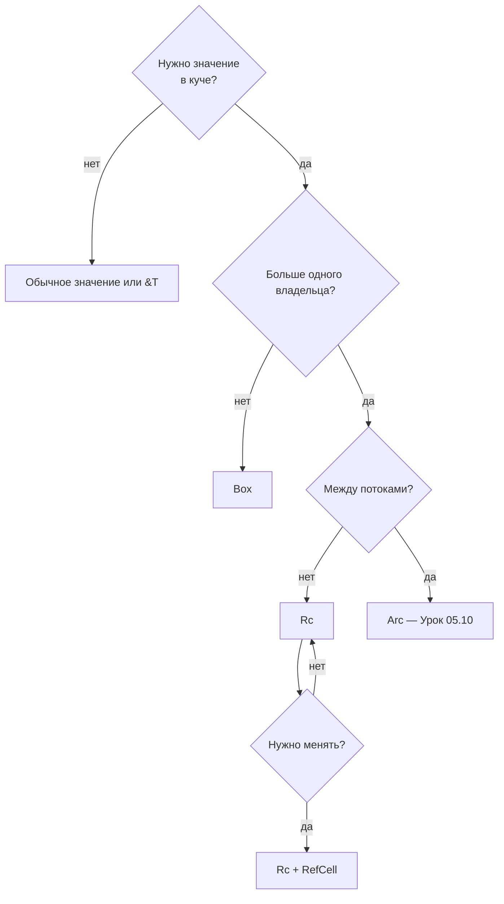

<!-- nav:top -->
[🏠 Начало](../START-HERE.md) · [← 05.8 Cargo: зависимости и версии](08-cargo-dependencies-and-versions.md) · [📋 Этап 05](README.md) · [05.10 Потоки, каналы и общее состояние →](10-threads-channels-and-shared-state.md) · [📖 Глоссарий](../GLOSSARY.md) · [🇬🇧 English](../../en/05-rust-intermediate/09-smart-pointers.md) <!-- nav -->

# Урок 05.9 — Умные указатели

> **Этап 05 — Rust: средний уровень** · Урок 9 из 14 · ⏱ около 3 часов (2 занятия)

## Что вы узнаете

- Что такое умный указатель и чем он отличается от обычной ссылки.
- Как поместить значение в кучу с помощью `Box<T>` и почему для рекурсивного типа он необходим.
- Как `Deref` позволяет умному указателю вести себя как ссылка и как `Drop` запускает код, когда значение умирает.
- Как разделить одно значение между несколькими владельцами с помощью `Rc<T>` и как менять общие данные с помощью `RefCell<T>`.
- Как `Weak<T>` предотвращает циклы ссылок и как выбрать подходящий указатель.

## Перед началом

- Вы прошли [Урок 05.8 — Cargo: зависимости и версии](08-cargo-dependencies-and-versions.md).
- Вы помните стек и кучу: [Урок 03.1 — Память: стек и куча](../03-ownership-and-borrowing/01-memory-stack-and-heap.md).
- Вы помните владение и заимствование: [Урок 03.4 — Ссылки и заимствование](../03-ownership-and-borrowing/04-references-and-borrowing.md) и [Урок 03.5 — Изменяемые ссылки и правила заимствования](../03-ownership-and-borrowing/05-mutable-references-and-the-borrow-rules.md).
- Вы знаете трейты ([Урок 05.2](02-traits.md)) и обобщённые типы ([Урок 05.1](01-generics.md)).
- Создайте проект: `cd ~/projects/rust/code && cargo new p05-smart-pointers && cd p05-smart-pointers`. В этом уроке кладите каждый пример в отдельный файл `src/bin/<name>.rs` и запускайте его командой `cargo run --bin <name>`, либо просто каждый раз заменяйте `src/main.rs`.

## Новые слова

| Слово | Значение |
|---|---|
| **указатель** (pointer) | Значение, которое хранит адрес других данных в памяти. |
| **умный указатель** (smart pointer) | Тип, похожий на указатель, но с дополнительными возможностями и правилами. Обычно он **владеет** данными, на которые указывает. Примеры: `Box`, `Rc`, `RefCell` (строго говоря, `RefCell` — обёртка, но её используют вместе с остальными). |
| **`Box<T>`** | Умный указатель, который хранит `T` в куче. У него один владелец. |
| **разыменование** (dereference) | Переход по указателю к значению, которое за ним лежит. Записывается `*pointer`. |
| **`Deref`** | Трейт, который говорит Rust, как перейти от вашего типа к внутреннему значению. |
| **приведение при разыменовании** (deref coercion) | Автоматическое превращение `&Box<String>` (и похожих типов) в `&str` (и похожие) при вызове функции. |
| **`Drop`** | Трейт, чей метод `drop` автоматически запускается, когда значение выходит из области видимости. |
| **рекурсивный тип** (recursive type) | Тип, который содержит значение своего же типа. |
| **косвенность** (indirection) | Хранение чего-то «по адресу», а не «внутри». `Box` — это косвенность. |
| **`Rc<T>`** (Reference Counted, со счётчиком ссылок) | Умный указатель, который позволяет нескольким владельцам делить одно значение. Значение живёт, пока не исчезнет последний владелец. |
| **счётчик ссылок** (reference count) | Число владельцев `Rc`. Его также называют **сильным счётчиком** (strong count). |
| **`Weak<T>`** | Указатель на значение в `Rc`, который **не** удерживает значение живым. |
| **`RefCell<T>`** | Обёртка, которая позволяет менять внутреннее значение через общую ссылку. Правила заимствования проверяются во время работы программы. |
| **внутренняя изменяемость** (interior mutability) | Изменение данных, лежащих за общей (`&`) ссылкой. Её даёт `RefCell`. Подробнее — в [Уроке 06.4](../06-rust-advanced/04-interior-mutability.md). |
| **цикл ссылок** (reference cycle) | Значения, которые владеют друг другом по кругу, так что ни одно из них нельзя освободить. |
| **утечка памяти** (memory leak) | Память, которая никогда не освобождается, хотя программа ею больше не пользуется. |
| **RAII** (Resource Acquisition Is Initialization, «получение ресурса — это инициализация») | Идея проектирования: значение забирает ресурс (память, файл, блокировку) при создании и возвращает его, когда уничтожается. |

## 1. Что такое умный указатель?

**Указатель** — это значение, которое хранит адрес в памяти. Ссылка (`&T`) — простейший указатель: она указывает на данные и только **заимствует** их. У ссылки нет дополнительных возможностей, и она ничем не владеет.

**Умный указатель** — это тип, который ведёт себя как указатель, но умеет больше: обычно он **владеет** данными, на которые указывает, и запускает код при создании или уничтожении. Два умных указателя вы уже использовали, не называя их так: `String` (владеет текстом в куче) и `Vec<T>` (владеет элементами в куче).

В этом уроке вы изучите четыре самых важных:

| Тип | Одной строкой | Владельцы | Когда проверяет правила заимствования |
|---|---|---|---|
| `Box<T>` | Значение в куче. | один | при компиляции |
| `Rc<T>` | Значение в куче с несколькими владельцами. | несколько (один поток) | при компиляции (доступ только через `&T`) |
| `RefCell<T>` | Значение, которое можно менять за `&`. | один | **во время работы программы** |
| `Weak<T>` | Не владеющая ссылка на значение в `Rc`. | нет | — |

## 2. Box: значение в куче

`Box::new(value)` перемещает значение в кучу и возвращает коробку (box), которая на него указывает. Сама коробка (всего лишь адрес, 8 байт на вашем Mac) лежит там, где вы её разместили, обычно в стеке.

```rust
fn main() {
    let b = Box::new(5);
    println!("b = {b}");
    println!("b + 1 = {}", *b + 1);

    let big = Box::new([0u8; 1_000_000]);
    println!("array length = {}", big.len());
}
```

```text
b = 5
b + 1 = 6
array length = 1000000
```

**Что происходит:**

1. `Box::new(5)` просит у аллокатора (см. [Урок 03.1](../03-ownership-and-borrowing/01-memory-stack-and-heap.md)) место в куче, записывает туда `5` и возвращает коробку.
2. `println!("b = {b}")` печатает значение за коробкой: коробку можно печатать так же, как значение внутри неё.
3. `*b` — это **разыменование**: переход по адресу к числу `5`. Поэтому `*b + 1` равно `6`.
4. `big` — коробка, которая указывает на миллион байт в куче. Методы внутреннего массива (`len`) работают прямо на коробке.
5. В конце `main` обе коробки уничтожаются, и память кучи освобождается автоматически.

```text
  stack                heap
 ┌────────┐          ┌───────┐
 │ b ─────┼─────────▶│   5   │
 └────────┘          └───────┘
 ┌────────┐          ┌─────────────────────┐
 │ big ───┼─────────▶│ 0 0 0 0 ... (1 MB)  │
 └────────┘          └─────────────────────┘
```

Когда `Box` полезен?

1. **Рекурсивный тип** (раздел 3): компилятор должен знать размер типа, а у `Box` размер фиксирован.
2. **Большое значение, которое нужно дёшево перемещать.** При перемещении `Box` копируется только 8-байтовый адрес, а не все данные.
3. **Значение, точный тип которого вы не знаете, но знаете его поведение.** `Box<dyn Trait>` (*трейт-объект*) объясняется в [Уроке 06.1 — Трейт-объекты и динамическая диспетчеризация](../06-rust-advanced/01-trait-objects-and-dynamic-dispatch.md).

> ⚡ **Производительность:** коробка стоит одного выделения памяти в куче и одного дополнительного шага для доступа к данным. Не заворачивайте каждое значение в `Box`. Используйте его, когда есть одна из трёх причин выше.

## 3. Рекурсивные типы

**Рекурсивный тип** содержит значение своего же типа. Классический пример — **список**, где каждый элемент хранит число и остаток списка.

```rust
enum List {
    Item(i32, List),
    End,
}

fn main() {
    let _list = List::Item(1, List::Item(2, List::End));
}
```

```text
error[E0072]: recursive type `List` has infinite size
 --> src/main.rs:1:1
  |
1 | enum List {
  | ^^^^^^^^^
2 |     Item(i32, List),
  |               ---- recursive without indirection
  |
help: insert some indirection (e.g., a `Box`, `Rc`, or `&`) to break the cycle
  |
2 |     Item(i32, Box<List>),
  |               ++++    +
```

Что это значит: компилятору нужно знать, сколько байт занимает `List`. `Item` хранит `i32` **и целый `List`**, который хранит `i32` и целый `List`, и так без конца. Размер получился бы бесконечным. Исправление — **косвенность**: хранить остаток списка в куче, а внутри держать только его адрес (8 байт).

```rust
#[derive(Debug)]
enum List {
    Item(i32, Box<List>),
    End,
}

use List::{End, Item};

fn sum(list: &List) -> i32 {
    match list {
        Item(value, rest) => value + sum(rest),
        End => 0,
    }
}

fn main() {
    let list = Item(1, Box::new(Item(2, Box::new(Item(3, Box::new(End))))));
    println!("{list:?}");
    println!("sum = {}", sum(&list));
    println!("size of List = {} bytes", std::mem::size_of::<List>());
}
```

```text
Item(1, Item(2, Item(3, End)))
sum = 6
size of List = 16 bytes
```

**Что происходит:**

1. `Item(i32, Box<List>)` хранит число и адрес следующего элемента. Размер любого значения `List` теперь фиксирован: 16 байт (число, адрес и метка, которая отличает `Item` от `End`).
2. `Box::new(...)` вызывается изнутри наружу: сначала в коробку кладётся `End`, потом `Item(3, ...)`, потом `Item(2, ...)`, потом внешний `Item(1, ...)`.
3. `sum` вызывает сама себя для остатка списка. Это **рекурсия**: функция, которая вызывает саму себя. `End` останавливает её значением `0`.
4. `rest` имеет тип `&Box<List>`, а `sum` ждёт `&List`. Это работает благодаря приведению при разыменовании (следующий раздел).

```text
 stack            heap          heap          heap
 ┌─────────┐    ┌─────────┐   ┌─────────┐   ┌───────┐
 │Item(1,●)│───▶│Item(2,●)│──▶│Item(3,●)│──▶│  End  │
 └─────────┘    └─────────┘   └─────────┘   └───────┘
```

> 📏 **Соглашение:** в настоящих программах собственный список почти никогда не пишут. `Vec<T>` быстрее и проще. Рекурсивные типы с `Box` используют для **деревьев** (узел владеет своими потомками) и для синтаксических деревьев языков программирования.

## 4. Deref: вести себя как ссылка

Оператор `*` работает со ссылками. Как он работает с `Box`? Потому что `Box` реализует трейт `Deref`. Вы тоже можете его реализовать. Вот крошечная собственная коробка, `MyBox`:

```rust
use std::ops::Deref;

struct MyBox<T>(T);

impl<T> MyBox<T> {
    fn new(value: T) -> MyBox<T> {
        MyBox(value)
    }
}

impl<T> Deref for MyBox<T> {
    type Target = T;

    fn deref(&self) -> &T {
        &self.0
    }
}

fn greet(name: &str) {
    println!("Hello, {name}!");
}

fn main() {
    let x = 5;
    let y = MyBox::new(x);
    assert_eq!(5, *y);

    let name = MyBox::new(String::from("Rust"));
    greet(&name);
}
```

```text
Hello, Rust!
```

**Что происходит:**

1. `struct MyBox<T>(T);` — это **кортежная структура** с одним полем. (Она не использует кучу; она нужна только для демонстрации трейта.)
2. `impl<T> Deref for MyBox<T>` говорит: «чтобы перейти от `MyBox<T>` к значению, отдай ссылку `&T` на внутреннее поле». `type Target = T;` называет тип за указателем.
3. Компилятор переписывает `*y` в `*(y.deref())`: сначала вызывается `deref`, чтобы получить обычную ссылку, затем по ней происходит переход. Поэтому `5 == *y` верно.
4. `greet(&name)` передаёт `&MyBox<String>`, а `greet` ждёт `&str`. Компилятор вызывает `deref` снова и снова: `&MyBox<String>` → `&String` → `&str`. Эта автоматическая цепочка называется **приведением при разыменовании** (deref coercion). Оно происходит при компиляции и ничего не стоит во время работы.

> 💡 **Совет:** благодаря приведению при разыменовании вы можете передать `&String` или `&Box<String>` туда, где функция просит `&str`. Для параметров функций предпочитайте `&str`.

Есть второй трейт, `DerefMut`, который делает то же для изменяемых ссылок. У `Box` есть оба.

## 5. Drop: код, который выполняется, когда значение умирает

Вы знаете, что Rust освобождает память автоматически в конце области видимости. Трейт `Drop` позволяет добавить в этот момент свой код: закрыть файл, отпустить блокировку, напечатать сообщение. Эта идея называется **RAII** (Resource Acquisition Is Initialization): значение забирает ресурс при создании и возвращает его при уничтожении, так что забыть об этом нельзя.

```rust
struct Noisy(&'static str);

impl Drop for Noisy {
    fn drop(&mut self) {
        println!("drop {}", self.0);
    }
}

fn main() {
    let _a = Noisy("a");
    let b = Noisy("b");
    let _c = Noisy("c");
    println!("created a, b, c");
    drop(b);
    println!("b dropped early");
    {
        let _inner = Noisy("inner");
        println!("inside the block");
    }
    println!("end of main");
}
```

```text
created a, b, c
drop b
b dropped early
inside the block
drop inner
end of main
drop c
drop a
```

**Что происходит:**

1. `impl Drop for Noisy` определяет, что происходит при уничтожении `Noisy`. Rust вызывает `drop` за вас.
2. `drop(b)` — это стандартная функция `std::mem::drop`. Она забирает владение `b` и сразу завершает его жизнь. Поэтому `drop b` печатается раньше, чем `b dropped early`.
3. `_inner` умирает на закрывающей `}` внутреннего блока, поэтому `drop inner` печатается там.
4. В конце `main` переменные, которые ещё живы, уничтожаются в **порядке, обратном созданию**: сначала `c`, потом `a`. (`b` уже нет.) Последняя созданная уничтожается первой.

Вызвать **метод** `drop` самостоятельно нельзя, потому что значение могло бы быть уничтожено дважды:

```rust
fn main() {
    let a = Noisy("a");
    a.drop();
}
```

```text
error[E0040]: explicit use of destructor method
  --> src/main.rs:11:7
   |
11 |     a.drop();
   |       ^^^^ explicit destructor calls not allowed
   |
help: consider using `drop` function
   |
11 -     a.drop();
11 +     drop(a);
   |
```

Компилятор подсказывает исправление: используйте функцию `drop(a)`, которая забирает владение, так что `a` больше никогда нельзя будет ни использовать, ни уничтожить повторно.

> 🔒 **Безопасность:** очистка через Drop — это то, как Rust закрывает файлы и отпускает мьютексы, даже когда функция досрочно завершается через `?`. Никогда не полагайтесь на `Drop` в том, что **обязано** произойти, например в сохранении единственной копии данных: программа, которая аварийно рухнула или вызвала `std::process::exit`, не выполняет `drop`.

> 🧪 **Тестирование:** порядок уничтожения можно проверить тестом, если заставить значение писать в общий журнал (см. упражнение 4).

## 6. Rc: много владельцев

Обычно у значения ровно один владелец. Иногда этого мало. Представьте граф, где несколько узлов указывают на один и тот же узел, или общую настройку, которую читают три части программы. Кто из них должен владеть ею и уничтожить её?

Ответ — `Rc<T>` (Reference Counted). Он хранит скрытое число — **счётчик ссылок**: сколько владельцев существует сейчас. `Rc::clone(&rc)` **не** копирует данные. Он лишь увеличивает счётчик на единицу и даёт вам ещё один указатель на те же данные. Когда владельца уничтожают, счётчик уменьшается. Когда он достигает нуля, данные освобождаются.

```rust
use std::rc::Rc;

fn main() {
    let shared = Rc::new(String::from("shared text"));
    println!("count after creating: {}", Rc::strong_count(&shared));

    let a = Rc::clone(&shared);
    println!("count after a: {}", Rc::strong_count(&shared));

    {
        let b = Rc::clone(&shared);
        println!("count after b: {} ({b})", Rc::strong_count(&shared));
    }
    println!("count after the block: {}", Rc::strong_count(&shared));

    drop(a);
    println!("count after drop(a): {}", Rc::strong_count(&shared));
}
```

```text
count after creating: 1
count after a: 2
count after b: 3 (shared text)
count after the block: 2
count after drop(a): 1
```

**Что происходит:**

1. `Rc::new` помещает строку в кучу вместе со счётчиком, и счётчик равен 1.
2. `Rc::clone(&shared)` создаёт новый указатель и увеличивает счётчик. Текст **не** копируется.
3. В конце внутреннего блока `b` умирает, и счётчик снова становится 2.
4. `drop(a)` уменьшает его до 1. Когда `shared` умирает в конце `main`, счётчик становится 0, и строка освобождается.

```text
 shared ─┐
 a ──────┼──────▶ ┌──────────────────────────┐
 b ──────┘        │ strong count: 3          │
                  │ "shared text"            │
                  └──────────────────────────┘
```

> 📏 **Соглашение:** пишите `Rc::clone(&x)`, а не `x.clone()`. Работают обе записи, но первая показывает читателю, что это дешёвое обновление счётчика, а не глубокое копирование данных.

Два ограничения `Rc`:

- **Он даёт только общий (`&`) доступ.** Через `Rc` данные менять нельзя:

```rust
use std::rc::Rc;

fn main() {
    let numbers = Rc::new(vec![1, 2, 3]);
    numbers.push(4);
    println!("{numbers:?}");
}
```

```text
error[E0596]: cannot borrow data in an `Rc` as mutable
 --> src/main.rs:5:5
  |
5 |     numbers.push(4);
  |     ^^^^^^^ cannot borrow as mutable
  |
  = help: trait `DerefMut` is required to modify through a dereference, but it is not implemented for `Rc<Vec<i32>>`
```

Здесь работает правило заимствования из [Урока 03.5](../03-ownership-and-borrowing/05-mutable-references-and-the-borrow-rules.md): если бы много владельцев могли менять данные одновременно, это было бы небезопасно. Выход показан в следующем разделе.

- **Он работает только внутри одного потока.** Счётчик `Rc` — обычное число. Если бы два потока одновременно меняли его, счёт мог бы стать неверным. Компилятор запрещает отправлять `Rc` в другой поток. Для потоков в Rust есть `Arc` («атомарный Rc»); вы будете использовать его в [Уроке 05.10 — Потоки, каналы и общее состояние](10-threads-channels-and-shared-state.md).

## 7. RefCell: менять данные за общей ссылкой

Правила заимствования говорят: либо много `&T`, либо один `&mut T`, но никогда одновременно. Компилятор проверяет это при компиляции. Иногда ваш код корректен, но компилятор не может это доказать. Для таких случаев в Rust есть `RefCell<T>`. Он переносит ту же проверку на время, когда программа **работает**.

Доступ у `RefCell` вы просите двумя методами:

- `borrow()` даёт общую ссылку (`Ref<T>`).
- `borrow_mut()` даёт изменяемую ссылку (`RefMut<T>`).

Ячейка считает активные заимствования. Если вы нарушите правила, она не откажется компилироваться; она вызовет **панику** (остановит программу).

`Rc<RefCell<T>>` — очень частая пара: много владельцев (`Rc`), и каждый может менять значение (`RefCell`).

```rust
use std::cell::RefCell;
use std::rc::Rc;

fn main() {
    let log = Rc::new(RefCell::new(Vec::<String>::new()));

    let writer_one = Rc::clone(&log);
    let writer_two = Rc::clone(&log);

    writer_one.borrow_mut().push(String::from("first"));
    writer_two.borrow_mut().push(String::from("second"));

    println!("log = {:?}", log.borrow());
    println!("owners = {}", Rc::strong_count(&log));
}
```

```text
log = ["first", "second"]
owners = 3
```

**Что происходит:**

1. `RefCell::new(Vec::new())` оборачивает пустой вектор. `Rc::new(...)` кладёт ячейку в кучу вместе со счётчиком.
2. `writer_one` и `writer_two` — ещё два владельца (счётчик равен 3).
3. `writer_one.borrow_mut()` даёт временный изменяемый доступ; `.push(...)` добавляет элемент. Изменяемое заимствование заканчивается в конце инструкции.
4. `log.borrow()` даёт общий доступ, чтобы прочитать результат. Оба писателя изменили один и тот же вектор.

Если правила нарушены во время работы программы, вы получите панику:

```rust
use std::cell::RefCell;

fn main() {
    let cell = RefCell::new(10);
    let first = cell.borrow_mut();
    let second = cell.borrow_mut();
    println!("{first} {second}");
}
```

```text
thread 'main' (3899889) panicked at src/main.rs:6:23:
RefCell already borrowed
note: run with `RUST_BACKTRACE=1` environment variable to display a backtrace
```

(Число в скобках — идентификатор потока, у вас оно будет другим.) Два живых изменяемых заимствования одной ячейки недопустимы, поэтому второй `borrow_mut()` вызывает панику. Компилятор не мог увидеть эту проблему, потому что он не отслеживает, что происходит внутри `RefCell`.

> ⚠️ **Частая ошибка:** использовать `RefCell`, чтобы «заставить замолчать» проверку заимствований, не поняв проблему. Паника во время работы хуже ошибки при компиляции. Применяйте `RefCell` только когда вам действительно нужно общее владение с изменениями, и делайте каждое заимствование коротким (не храните `Ref` или `RefMut` в переменной надолго). `RefCell` подробнее, вместе с `Cell` и `Mutex`, разобран в [Уроке 06.4 — Внутренняя изменяемость](../06-rust-advanced/04-interior-mutability.md).

## 8. Weak и циклы ссылок

У `Rc` есть опасность: если два значения владеют друг другом, их счётчики никогда не достигнут нуля.

```rust
use std::cell::RefCell;
use std::rc::Rc;

struct Node {
    name: &'static str,
    next: RefCell<Option<Rc<Node>>>,
}

impl Drop for Node {
    fn drop(&mut self) {
        println!("drop {}", self.name);
    }
}

fn main() {
    let a = Rc::new(Node { name: "a", next: RefCell::new(None) });
    let b = Rc::new(Node { name: "b", next: RefCell::new(Some(Rc::clone(&a))) });
    *a.next.borrow_mut() = Some(Rc::clone(&b));

    println!("a strong = {}", Rc::strong_count(&a));
    println!("b strong = {}", Rc::strong_count(&b));
    println!("end of main");
}
```

```text
a strong = 2
b strong = 2
end of main
```

**Что происходит:**

1. У `a` сначала нет следующего узла. `b` указывает на `a` (счётчик `a` становится 2).
2. Строка `*a.next.borrow_mut() = Some(Rc::clone(&b));` заставляет `a` указать обратно на `b` (счётчик `b` становится 2). Теперь `a` и `b` владеют друг другом в **цикле ссылок**.
3. В конце `main` переменные `a` и `b` умирают, и каждый счётчик уменьшается с 2 до 1, а не до 0. Узлами никто не владеет, кроме них самих. Сообщение `drop a` **никогда не печатается**: память утекла.

Утечка не «небезопасна» в смысле Rust (нет падения, нет испорченной памяти), но долго работающая программа, которая течёт в цикле, в конце концов исчерпает память.

Решение — `Weak<T>`: указатель, который **не считается** владельцем. Его создают через `Rc::downgrade(&rc)`. Чтобы им воспользоваться, вызывают `.upgrade()`, который возвращает `Option<Rc<T>>`: `Some`, если значение ещё живо, и `None`, если оно уже освобождено.

Хороший пример использования — дерево, где родитель **владеет** потомками (сильный `Rc`), а потомок лишь **знает** своего родителя (`Weak`):

```rust
use std::cell::RefCell;
use std::rc::{Rc, Weak};

struct Node {
    name: String,
    parent: RefCell<Weak<Node>>,
    children: RefCell<Vec<Rc<Node>>>,
}

fn main() {
    let leaf = Rc::new(Node {
        name: String::from("leaf"),
        parent: RefCell::new(Weak::new()),
        children: RefCell::new(vec![]),
    });
    println!("leaf parent = {:?}", leaf.parent.borrow().upgrade().map(|p| p.name.clone()));

    {
        let branch = Rc::new(Node {
            name: String::from("branch"),
            parent: RefCell::new(Weak::new()),
            children: RefCell::new(vec![Rc::clone(&leaf)]),
        });
        *leaf.parent.borrow_mut() = Rc::downgrade(&branch);

        println!("leaf parent = {:?}", leaf.parent.borrow().upgrade().map(|p| p.name.clone()));
        println!("branch: strong = {}, weak = {}", Rc::strong_count(&branch), Rc::weak_count(&branch));
        println!("leaf: strong = {}, weak = {}", Rc::strong_count(&leaf), Rc::weak_count(&leaf));
        println!("branch has {} child", branch.children.borrow().len());
    }

    println!("leaf parent = {:?}", leaf.parent.borrow().upgrade().map(|p| p.name.clone()));
    println!("leaf: strong = {}, weak = {}", Rc::strong_count(&leaf), Rc::weak_count(&leaf));
}
```

```text
leaf parent = None
leaf parent = Some("branch")
branch: strong = 1, weak = 1
leaf: strong = 2, weak = 0
branch has 1 child
leaf parent = None
leaf: strong = 1, weak = 0
```

**Что происходит:**

1. У нового `leaf` в качестве родителя стоит `Weak::new()` — пустой слабый указатель. `upgrade()` даёт `None`, а `.map(...)` над `None` даёт `None`.
2. Внутри блока создаётся `branch`, который владеет `leaf` (сильный счётчик `leaf` равен 2: переменная и список ветки).
3. `Rc::downgrade(&branch)` создаёт слабый указатель и сохраняет его в `leaf.parent`. Теперь у `branch` strong = 1 (только переменная) и weak = 1 (указатель листа). Слабый указатель не увеличивает сильный счётчик.
4. `leaf.parent.borrow().upgrade()` теперь возвращает `Some(Rc<Node>)`, так что мы можем прочитать имя родителя.
5. В конце блока `branch` уничтожается. Его сильный счётчик был равен 1, поэтому он освобождается, а вместе с ним освобождается его список потомков (сильный счётчик `leaf` снова становится 1). Слабый указатель не удерживает `branch` живым, поэтому `upgrade()` теперь возвращает `None`. Нет цикла, нет утечки.

> 📏 **Соглашение:** владение направлено вниз (`Rc`), обратные ссылки направлены вверх (`Weak`). Если вы не можете решить, какое направление владеет, подумайте: «кто должен удерживать кого живым».

## 9. Выбор указателя



Насколько велики эти указатели? Можно спросить у компилятора через `std::mem::size_of`:

```rust
use std::cell::RefCell;
use std::mem::size_of;
use std::rc::Rc;

fn main() {
    println!("&i32          = {} bytes", size_of::<&i32>());
    println!("Box<i32>      = {} bytes", size_of::<Box<i32>>());
    println!("Rc<i32>       = {} bytes", size_of::<Rc<i32>>());
    println!("Option<Box<i32>> = {} bytes", size_of::<Option<Box<i32>>>());
    println!("i32           = {} bytes", size_of::<i32>());
    println!("RefCell<i32>  = {} bytes", size_of::<RefCell<i32>>());
    println!("[u8; 1000]    = {} bytes", size_of::<[u8; 1000]>());
    println!("Box<[u8; 1000]> = {} bytes", size_of::<Box<[u8; 1000]>>());
}
```

```text
&i32          = 8 bytes
Box<i32>      = 8 bytes
Rc<i32>       = 8 bytes
Option<Box<i32>> = 8 bytes
i32           = 4 bytes
RefCell<i32>  = 16 bytes
[u8; 1000]    = 1000 bytes
Box<[u8; 1000]> = 8 bytes
```

**Что происходит:**

1. `Box`, `Rc` и `&` — это всё один адрес: 8 байт на 64-битном Mac. Счётчик `Rc` лежит в куче рядом с данными, а не в указателе.
2. `Option<Box<i32>>` тоже занимает 8 байт. Коробка никогда не может быть нулевым адресом, поэтому Rust использует нулевой адрес для обозначения `None`. Дополнительное место не нужно.
3. `RefCell<i32>` занимает 16 байт: `i32` плюс счётчик активных заимствований (с округлением для выравнивания).
4. Перемещение `Box<[u8; 1000]>` копирует 8 байт, а перемещение самого массива — 1000. Это та самая причина «дешёвого перемещения» из раздела 2.

> ⚡ **Производительность:** `Rc::clone` дёшев (прибавить единицу к числу), но каждое выделение `Rc` стоит как выделение `Box`. `RefCell` добавляет небольшую проверку во время работы при каждом заимствовании. Измеряйте, прежде чем беспокоиться; как это делать, вы узнаете в [Уроке 05.12 — Основы бенчмарков](12-benchmarking-basics.md).

## Частые ошибки

1. **Рекурсивный тип без `Box`** — `error[E0072]: recursive type has infinite size` (раздел 3). Положите рекурсивную часть в `Box`.
2. **Вызов `x.drop()`** — `error[E0040]: explicit use of destructor method` (раздел 5). Используйте `drop(x)`.
3. **Изменение данных внутри `Rc`** — `error[E0596]: cannot borrow data in an `Rc` as mutable` (раздел 6). Используйте `Rc<RefCell<T>>`.
4. **Два живых `borrow_mut()` одновременно** — программа паникует с сообщением `RefCell already borrowed` (раздел 7). Делайте заимствования короткими, в одной инструкции или в маленьком блоке.
5. **Циклы из `Rc`** — память никогда не освобождается (раздел 8). Сделайте одно из направлений `Weak`.
6. **`Rc` в потоках** — компилятор отказывает. Используйте `Arc` (в следующих уроках).
7. **`Box` везде «для надёжности».** Значения Rust в стеке уже безопасны и быстрее. Используйте `Box` по трём причинам из раздела 2.

## Попробуйте сами

1. В `src/bin/` создайте файл `shared.rs` с этой программой и запустите `cargo run --bin shared`:

```rust
use std::cell::RefCell;
use std::rc::Rc;

fn main() {
    let counter = Rc::new(RefCell::new(0));
    let a = Rc::clone(&counter);
    let b = Rc::clone(&counter);

    *a.borrow_mut() += 10;
    *b.borrow_mut() += 5;

    println!("counter = {}", counter.borrow());
    println!("owners = {}", Rc::strong_count(&counter));
}
```

Ожидаемый вывод:

```text
counter = 15
owners = 3
```

2. Замените `*b.borrow_mut() += 5;` двумя строками `let _guard = a.borrow_mut();` и `*b.borrow_mut() += 5;` (переменная `_guard` остаётся живой до конца `main`). Запустите снова. Вы должны увидеть панику `RefCell already borrowed`. Затем уберите строку с `_guard`.
3. Замените `Rc::clone(&counter)` на `counter.clone()`. Программа по-прежнему работает. Прочитайте соглашение в разделе 6 и решите, какая запись вам больше нравится.

## Упражнения

### Упражнение 1 — Коробка и разыменование (легко)

Напишите программу, которая кладёт число `41` в `Box<i32>`, прибавляет `1` к **значению внутри** (через коробку) и печатает `42`.

<details>
<summary>Подсказка</summary>

Коробка должна быть изменяемой: `let mut b = Box::new(41);`. Затем `*b += 1;`.

</details>

<details>
<summary>Ответ</summary>

```rust
fn main() {
    let mut b = Box::new(41);
    *b += 1;
    println!("{b}");
}
```

```text
42
```

Почему это работает: `*b` переходит по коробке к `i32` в куче, а `+= 1` меняет его там. Переменная `b` должна быть `mut`, потому что содержимое коробки принадлежит коробке.

</details>

### Упражнение 2 — Посчитайте владельцев (легко)

Напишите тест, который создаёт `Rc::new(String::from("hi"))`, делает второго владельца через `Rc::clone`, проверяет, что `Rc::strong_count` равен 2, уничтожает второго владельца и проверяет, что счётчик равен 1.

<details>
<summary>Подсказка</summary>

Используйте `assert_eq!(Rc::strong_count(&text), 2);` и `drop(other);`.

</details>

<details>
<summary>Ответ</summary>

```rust
#[cfg(test)]
mod tests {
    use std::rc::Rc;

    #[test]
    fn rc_counts_owners() {
        let text = Rc::new(String::from("hi"));
        let other = Rc::clone(&text);
        assert_eq!(Rc::strong_count(&text), 2);
        drop(other);
        assert_eq!(Rc::strong_count(&text), 1);
    }
}
```

Почему это работает: счётчик растёт при `Rc::clone` и уменьшается, когда владельца уничтожают.

</details>

### Упражнение 3 — Список с тестом (средне)

Используя перечисление `List` из раздела 3 (`Item(i32, Box<List>)` и `End`), напишите `fn length(list: &List) -> usize` и напишите **тест**, который проверяет, что список из двух элементов имеет длину 2, а `End` — длину 0.

<details>
<summary>Подсказка</summary>

Используйте `match`. `Item` — это `1 +` длина остатка. `End` — это `0`. Поместите тест в `#[cfg(test)] mod tests` с `use super::*;`.

</details>

<details>
<summary>Ответ</summary>

```rust
pub enum List {
    Item(i32, Box<List>),
    End,
}

pub fn length(list: &List) -> usize {
    match list {
        List::Item(_, rest) => 1 + length(rest),
        List::End => 0,
    }
}

#[cfg(test)]
mod tests {
    use super::*;

    #[test]
    fn list_length() {
        let list = List::Item(1, Box::new(List::Item(2, Box::new(List::End))));
        assert_eq!(length(&list), 2);
        assert_eq!(length(&List::End), 0);
    }
}
```

`cargo test` сообщает `1 passed` (поместите код в `src/lib.rs`).

Почему это работает: `length(rest)` получает `&Box<List>`, и приведение при разыменовании превращает его в `&List`. Рекурсия заканчивается на `End`.

</details>

### Упражнение 4 — Проверьте порядок уничтожения (средне)

Напишите структуру `Guard`, которая хранит имя и общий журнал `Rc<RefCell<Vec<String>>>`. Когда `Guard` уничтожается, он добавляет в журнал строку `"drop <name>"`. Напишите **тест**, который создаёт `first`, затем `second` в блоке и проверяет, что журнал равен `["drop second", "drop first"]`.

<details>
<summary>Подсказка</summary>

Реализуйте `Drop for Guard`. В тесте создайте журнал через `Rc::new(RefCell::new(Vec::new()))` и дайте каждому guard `Rc::clone(&log)`. Сравнивайте через `assert_eq!(*log.borrow(), vec![...])`.

</details>

<details>
<summary>Ответ</summary>

```rust
use std::cell::RefCell;
use std::rc::Rc;

pub struct Guard {
    name: &'static str,
    log: Rc<RefCell<Vec<String>>>,
}

impl Guard {
    pub fn new(name: &'static str, log: &Rc<RefCell<Vec<String>>>) -> Guard {
        Guard { name, log: Rc::clone(log) }
    }
}

impl Drop for Guard {
    fn drop(&mut self) {
        self.log.borrow_mut().push(format!("drop {}", self.name));
    }
}

#[cfg(test)]
mod tests {
    use super::*;

    #[test]
    fn drops_in_reverse_order() {
        let log = Rc::new(RefCell::new(Vec::new()));
        {
            let _first = Guard::new("first", &log);
            let _second = Guard::new("second", &log);
        }
        assert_eq!(*log.borrow(), vec!["drop second", "drop first"]);
    }
}
```

Почему это работает: переменные уничтожаются в порядке, обратном созданию, поэтому `second` уничтожается раньше `first`. Журнал общий через `Rc`, так что тест может прочитать его, когда guards уже исчезли.

</details>

### Упражнение 5 — Дерево со ссылками на родителя (сложно)

Постройте тип `Node` из раздела 8 (имя, `parent: RefCell<Weak<Node>>`, `children: RefCell<Vec<Rc<Node>>>`). Напишите `fn add_child(parent: &Rc<Node>, child: &Rc<Node>)` и `fn depth(node: &Rc<Node>) -> usize`, которая поднимается вверх по родителям и считает шаги (у корня глубина 0). Напишите **тест** с `root -> mid -> leaf`: `depth(&root) == 0`, `depth(&leaf) == 2` и `Rc::weak_count(&root) == 1`.

<details>
<summary>Подсказка</summary>

В `add_child` установите родителя потомка через `Rc::downgrade(parent)` и добавьте `Rc::clone(child)` в список потомков родителя. В `depth` используйте цикл: `current.parent.borrow().upgrade()` даёт `Option<Rc<Node>>`; остановитесь на `None`.

</details>

<details>
<summary>Ответ</summary>

```rust
use std::cell::RefCell;
use std::rc::{Rc, Weak};

pub struct Node {
    pub name: String,
    pub parent: RefCell<Weak<Node>>,
    pub children: RefCell<Vec<Rc<Node>>>,
}

impl Node {
    pub fn new(name: &str) -> Rc<Node> {
        Rc::new(Node {
            name: name.to_string(),
            parent: RefCell::new(Weak::new()),
            children: RefCell::new(Vec::new()),
        })
    }
}

pub fn add_child(parent: &Rc<Node>, child: &Rc<Node>) {
    *child.parent.borrow_mut() = Rc::downgrade(parent);
    parent.children.borrow_mut().push(Rc::clone(child));
}

pub fn depth(node: &Rc<Node>) -> usize {
    let mut depth = 0;
    let mut current = Rc::clone(node);
    loop {
        let parent = current.parent.borrow().upgrade();
        match parent {
            Some(p) => {
                depth += 1;
                current = p;
            }
            None => return depth,
        }
    }
}

#[cfg(test)]
mod tests {
    use super::*;

    #[test]
    fn depth_of_nodes() {
        let root = Node::new("root");
        let mid = Node::new("mid");
        let leaf = Node::new("leaf");
        add_child(&root, &mid);
        add_child(&mid, &leaf);
        assert_eq!(depth(&root), 0);
        assert_eq!(depth(&leaf), 2);
        assert_eq!(Rc::weak_count(&root), 1);
    }
}
```

Почему это работает: каждый потомок хранит только `Weak` на родителя, поэтому цикла нет. `upgrade()` даёт временный сильный указатель, пока мы поднимаемся вверх. Тест завершается без утечки: каждый узел освобождается, когда исчезает его владелец. Обратите внимание, что `let parent = ...;` — отдельная инструкция, поэтому `Ref`, возвращённый `borrow()`, заканчивается до того, как мы присваиваем `current`.

</details>

## Вопросы для самопроверки

1. Чем отличается ссылка `&T` от `Box<T>`?

<details>
<summary>Ответ</summary>

Ссылка только заимствует данные, которыми владеет кто-то другой. `Box<T>` **владеет** своими данными, которые лежат в куче, и освобождает их, когда коробка уничтожается.

</details>

2. Почему `enum List { Item(i32, List), End }` не компилируется?

<details>
<summary>Ответ</summary>

Тип содержал бы сам себя без конца, поэтому его размер был бы бесконечным (`E0072`). У `Box<List>` размер фиксирован (один адрес), что разрывает бесконечную цепочку.

</details>

3. В каком порядке уничтожаются локальные переменные?

<details>
<summary>Ответ</summary>

В порядке, обратном созданию: последняя созданная переменная уничтожается первой.

</details>

4. Что копирует `Rc::clone(&a)`?

<details>
<summary>Ответ</summary>

Только указатель, и при этом прибавляет единицу к счётчику ссылок. Данные не копируются.

</details>

5. Когда `RefCell` проверяет правила заимствования и что происходит, если их нарушить?

<details>
<summary>Ответ</summary>

Во время работы программы. Если их нарушить (например, два активных `borrow_mut()`), программа паникует.

</details>

6. Как два значения `Rc` создают утечку памяти и как её предотвратить?

<details>
<summary>Ответ</summary>

Если они указывают друг на друга (цикл ссылок), их сильные счётчики никогда не достигают нуля, поэтому память никогда не освобождается. Сделайте одно из направлений `Weak<T>`, который не считается владельцем.

</details>

7. Что возвращает `weak.upgrade()`?

<details>
<summary>Ответ</summary>

`Option<Rc<T>>`: `Some(rc)`, если значение ещё живо, и `None`, если оно уже освобождено.

</details>

8. Почему `Rc` нельзя использовать в другом потоке?

<details>
<summary>Ответ</summary>

Его счётчик не защищён от одновременного изменения двумя потоками. Используйте `Arc`, который использует для счётчика атомарные операции.

</details>

## Итоги

- Умный указатель владеет данными, на которые указывает, и имеет дополнительные возможности: `Box`, `Rc`, `RefCell`.
- `Box<T>` помещает значение в кучу; он нужен для рекурсивных типов и для дешёвого перемещения больших значений.
- `Deref` позволяет умному указателю вести себя как ссылка; приведение при разыменовании автоматически превращает `&Box<String>` в `&str`.
- `Drop` запускает код, когда значение умирает; значения уничтожаются в порядке, обратном созданию. Вызывайте `drop(x)`, а не `x.drop()`.
- `Rc<T>` даёт много владельцев в одном потоке со счётчиком ссылок; `Rc::clone` дёшев.
- `RefCell<T>` проверяет правила заимствования во время работы; их нарушение вызывает панику. `Rc<RefCell<T>>` означает «общее и изменяемое».
- `Weak<T>` не владеет; используйте его для обратных ссылок, чтобы избежать циклов.
- Начинайте с обычных значений и ссылок; берите умные указатели, только когда они действительно нужны.
- Привычка Git: коммитьте рабочий код перед рискованным изменением (например, перед заменой дизайна на `Box` дизайном на `Rc<RefCell<…>>`). Если компилятор или паника вас победили, `git restore .` вернёт последнее хорошее состояние, а `git diff` покажет, что вы изменили.

## Источники и что почитать

- [The Rust Programming Language — Chapter 15: Smart Pointers](https://doc.rust-lang.org/book/ch15-00-smart-pointers.html) — полная официальная глава: Box, Deref, Drop, Rc, RefCell и циклы ссылок.
- [std::boxed::Box](https://doc.rust-lang.org/std/boxed/struct.Box.html) — документация API `Box`.
- [std::rc](https://doc.rust-lang.org/std/rc/index.html) — `Rc` и `Weak`, с замечаниями о циклах.
- [std::cell](https://doc.rust-lang.org/std/cell/index.html) — `Cell` и `RefCell` и когда выбирать каждый из них.
- [Rust by Example — Box, stack and heap](https://doc.rust-lang.org/rust-by-example/std/box.html) — краткий взгляд на примерах.

---

[🏠 Начало](../START-HERE.md) · [← 05.8 Cargo: зависимости и версии](08-cargo-dependencies-and-versions.md) · [📋 Этап 05](README.md) · [05.10 Потоки, каналы и общее состояние →](10-threads-channels-and-shared-state.md) · [📖 Глоссарий](../GLOSSARY.md) <!-- nav -->
<!-- nav:bottom -->
