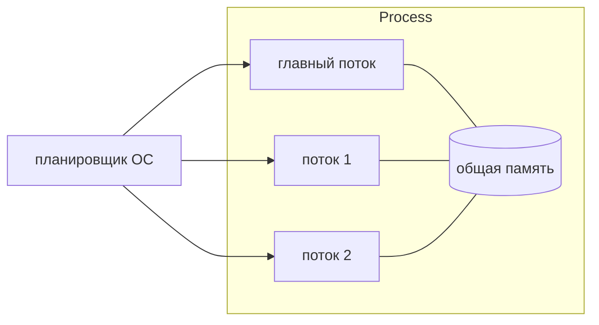

<!-- nav:top -->
[🏠 Начало](../START-HERE.md) · [← 05.9 Умные указатели](09-smart-pointers.md) · [📋 Этап 05](README.md) · [05.11 Практичные крейты: serde, clap, thiserror и anyhow →](11-practical-crates-serde-clap-errors.md) · [📖 Глоссарий](../GLOSSARY.md) · [🇬🇧 English](../../en/05-rust-intermediate/10-threads-channels-and-shared-state.md) <!-- nav -->

# Урок 05.10 — Потоки, каналы и общее состояние

> **Этап 05 — Rust: средний уровень** · Урок 10 из 14 · ⏱ около 3 часов (2 занятия)

## Что вы узнаете

- Что такое поток и как запустить его и дождаться его завершения с помощью `std::thread`.
- Почему потокам нужны замыкания `move` и как потоки с ограниченной областью (scoped threads) позволяют заимствовать вместо перемещения.
- Как потоки общаются, отправляя сообщения через канал.
- Как потоки безопасно делят данные через `Arc<Mutex<T>>` и что такое взаимная блокировка (deadlock) и «отравление» (poisoning).
- Что означают трейты `Send` и `Sync` и как Rust предотвращает гонки данных при компиляции.

## Перед началом

- Вы прошли [Урок 05.9 — Умные указатели](09-smart-pointers.md). Вам понадобятся `Rc`, `RefCell` и идея подсчёта ссылок.
- Вы знаете замыкания и ключевое слово `move`: [Урок 05.4 — Замыкания](04-closures.md).
- Вы знаете итераторы: [Урок 05.5 — Итераторы](05-iterators.md).
- Создайте проект: `cd ~/projects/rust/code && cargo new p05-threads && cd p05-threads`. Кладите каждый пример в `src/bin/<name>.rs` и запускайте командой `cargo run --bin <name>`, либо каждый раз заменяйте `src/main.rs`.

## Новые слова

| Слово | Значение |
|---|---|
| **процесс** (process) | Запущенная программа. У неё своя память, к которой другие процессы не могут прикоснуться. |
| **поток** (thread) | Одна линия выполнения внутри процесса. Все потоки процесса делят его память. |
| **конкурентность** (concurrency) | Несколько задач продвигаются в течение одного и того же периода времени (они могут по очереди работать на одном ядре процессора). |
| **параллелизм** (parallelism) | Несколько задач выполняются в один и тот же момент на разных ядрах процессора. |
| **CPU** (Central Processing Unit, центральный процессор) | Микросхема, которая выполняет инструкции программы. В современном CPU несколько **ядер**; каждое ядро выполняет один поток за раз. |
| **ОС** (операционная система, OS — Operating System) | Программа (macOS, Linux, Windows), которая запускает другие программы и решает, какой поток на каком ядре работает. |
| **`JoinHandle`** | Значение, которое возвращает `thread::spawn`. Вы вызываете у него `join()`, чтобы дождаться потока и получить его результат. |
| **поток с ограниченной областью** (scoped thread) | Поток, который гарантированно завершится до конца заданного блока, поэтому может заимствовать локальные переменные. |
| **канал** (channel) | Труба между потоками. Один конец отправляет значения, другой их получает. |
| **mpsc** (multiple producer, single consumer — много отправителей, один получатель) | Вид канала в стандартной библиотеке: много отправителей, один получатель. |
| **передача сообщений** (message passing) | Обмен информацией между потоками через отправку значений, а не через общую память. |
| **мьютекс** (mutex, mutual exclusion — взаимное исключение) | Блокировка, которая позволяет работать с данными внутри только одному потоку за раз. |
| **страж** (guard, `MutexGuard`) | Значение, которое вы получаете из `lock()`. Пока оно у вас, блокировка у вас. Когда оно уничтожается, блокировка открывается. |
| **`Arc<T>`** (Atomically Reference Counted, с атомарным счётчиком ссылок) | Как `Rc<T>`, но его счётчик безопасно использовать из многих потоков. |
| **гонка данных** (data race) | Два потока обращаются к одной и той же памяти одновременно, хотя бы один пишет, и ничто не задаёт порядок. Результат не определён. В безопасном Rust гонок данных быть не может. |
| **состояние гонки** (race condition) | Ошибка, при которой результат зависит от тайминга потоков. Она возможна и без гонки данных. |
| **взаимная блокировка** (deadlock) | Два или больше потоков ждут друг друга вечно. |
| **отравление** (poisoning) | Мьютекс помечается «отравленным», когда поток паникует, удерживая его блокировку. |
| **`Send`** | Маркерный трейт: значения этого типа можно переместить в другой поток. |
| **`Sync`** | Маркерный трейт: общую ссылку `&T` можно использовать из многих потоков. |
| **маркерный трейт** (marker trait) | Трейт без методов. Он лишь помечает тип свойством. |
| **атомарный тип** (atomic) | Числовой тип (например, `AtomicUsize`), операции которого выполняются одним неделимым шагом, поэтому потоки могут использовать его без блокировки. |

## 1. Зачем нужны потоки?

В вашем компьютере несколько ядер процессора. Запустите `cargo run --bin cpus` с этой программой, чтобы увидеть, сколько потоков ваш компьютер может выполнять одновременно:

```rust
use std::thread;

fn main() {
    let n = thread::available_parallelism().map(|n| n.get()).unwrap_or(1);
    println!("this computer can run {n} threads at the same time");
}
```

```text
this computer can run 12 threads at the same time
```

(У вас число будет другим; оно зависит от вашего CPU.) Программа с одним потоком использует одно ядро, а остальные простаивают. Если разделить работу на несколько потоков, ОС может выполнять их одновременно на разных ядрах, и программа закончит быстрее. Потоки также используют, чтобы ждать медленные операции (сеть, диск), не замораживая остальную программу.

Потоки мощны и опасны. Когда два потока одновременно меняют одни и те же данные, получается **гонка данных**, и программа может упасть или дать неверный ответ так, что ошибку невозможно повторить. Многие языки не мешают писать такие ошибки. Правила владения в Rust превращают большинство таких ошибок в **ошибки компиляции**. Это иногда называют *fearless concurrency* («бесстрашная конкурентность»).



## 2. Запуск потока

`thread::spawn` принимает замыкание и выполняет его в новом потоке. Он возвращает `JoinHandle`. Вызов `join()` ждёт завершения потока и отдаёт его возвращаемое значение.

```rust
use std::thread;

fn main() {
    let handle = thread::spawn(|| {
        println!("hello from the new thread");
        6 * 7
    });

    println!("hello from the main thread");
    let answer = handle.join().unwrap();
    println!("the thread returned {answer}");
}
```

```text
hello from the main thread
hello from the new thread
the thread returned 42
```

**Что происходит:**

1. `thread::spawn(|| { ... })` просит у ОС новый поток и выполняет в нём замыкание. Замыкание возвращает `42` (значение `6 * 7`).
2. Главный поток не ждёт. Он сразу печатает свою строку. Порядок первых двух строк **не гарантирован**: в этом запуске первой оказалась строка главного потока, но при другом запуске или на другом компьютере может быть наоборот.
3. `handle.join()` блокирует главный поток до завершения нового потока. Он возвращает `Result`: `Ok(value)`, если поток завершился нормально, и `Err(...)`, если он запаниковал.
4. `.unwrap()` достаёт значение из `Ok`. `answer` равно `42`.

> ⚠️ **Частая ошибка:** забыть `join()`. Когда `main` возвращается, программа завершается, а потоки, которые ещё работают, останавливаются на полпути. Если вам нужна работа потока, дождитесь его через `join`.

Если поток паникует, остальные потоки продолжают работу, а `join` сообщает вам об этом:

```rust
use std::thread;

fn main() {
    let handle = thread::spawn(|| {
        let v: Vec<i32> = Vec::new();
        v[0]
    });

    match handle.join() {
        Ok(value) => println!("value = {value}"),
        Err(_) => println!("the thread panicked, but main is still running"),
    }
}
```

```text
thread '<unnamed>' (3960248) panicked at src/main.rs:6:10:
index out of bounds: the len is 0 but the index is 0
note: run with `RUST_BACKTRACE=1` environment variable to display a backtrace
the thread panicked, but main is still running
```

Первые три строки — сообщение о панике потока (оно печатается в поток ошибок; число — идентификатор потока, у вас оно будет другим). Последняя строка — от `main`: он получил `Err` из `join` и сам решил, что делать.

## 3. Перемещение данных в поток

Поток может прожить дольше, чем функция, которая его запустила. Поэтому Rust по умолчанию не позволяет потоку **заимствовать** локальные переменные:

```rust
use std::thread;

fn main() {
    let numbers = vec![1, 2, 3];
    let handle = thread::spawn(|| {
        println!("{numbers:?}");
    });
    handle.join().unwrap();
}
```

```text
error[E0373]: closure may outlive the current function, but it borrows `numbers`, which is owned by the current function
 --> src/main.rs:5:32
  |
5 |     let handle = thread::spawn(|| {
  |                                ^^ may outlive borrowed value `numbers`
6 |         println!("{numbers:?}");
  |                    ------- `numbers` is borrowed here
  |
note: function requires argument type to outlive `'static`
...
help: to force the closure to take ownership of `numbers` (and any other referenced variables), use the `move` keyword
  |
5 |     let handle = thread::spawn(move || {
  |                                ++++
```

Что это значит: замыкание лишь заимствует `numbers`. Но новый поток может всё ещё работать после того, как `main` закончился и `numbers` освобождён. Тогда поток читал бы освобождённую память. Примечание `function requires argument type to outlive 'static` говорит: переданное в spawn замыкание не должно хранить заимствования, которые могут закончиться (про `'static` вы узнали в [уроке 05.3 — Времена жизни](03-lifetimes.md)). Подсказка компилятора даёт исправление: `move`, который перемещает владение переменными в замыкание.

```rust
use std::thread;

fn main() {
    let numbers = vec![1, 2, 3];
    let handle = thread::spawn(move || {
        let total: i32 = numbers.iter().sum();
        println!("sum = {total}");
    });
    handle.join().unwrap();
}
```

```text
sum = 6
```

**Что происходит:** `move` делает замыкание владельцем `numbers`. Вектор теперь живёт внутри потока. Главный поток больше не может использовать `numbers` (оно перемещено). Когда поток заканчивается, вектор освобождается.

### Потоки с ограниченной областью: заимствование без move

Часто нужно разделить работу над локальными данными и всё равно дождаться результата. Для этого `thread::scope` создаёт потоки, которые **гарантированно завершатся до конца области**. Поэтому они могут заимствовать:

```rust
use std::thread;

fn main() {
    let numbers = vec![1, 2, 3, 4, 5, 6, 7, 8];
    let (left, right) = numbers.split_at(4);

    let (a, b) = thread::scope(|s| {
        let h1 = s.spawn(|| left.iter().sum::<i32>());
        let h2 = s.spawn(|| right.iter().sum::<i32>());
        (h1.join().unwrap(), h2.join().unwrap())
    });

    println!("left = {a}, right = {b}, total = {}", a + b);
    println!("numbers is still ours: {}", numbers.len());
}
```

```text
left = 10, right = 26, total = 36
numbers is still ours: 8
```

**Что происходит:**

1. `numbers.split_at(4)` режет вектор на два среза: `[1, 2, 3, 4]` и `[5, 6, 7, 8]`. Они только **заимствуют** данные из `numbers`.
2. `thread::scope(|s| { ... })` открывает область. Внутри `s.spawn(...)` запускает потоки. `move` не нужен, потому что область не вернётся, пока не закончится каждый поток в ней.
3. Каждый поток одновременно суммирует свою половину. Поскольку они только **читают** данные, совместный доступ безопасен.
4. После области заимствования закончились, поэтому `numbers` снова полностью наш.

> 💡 **Совет:** используйте `thread::scope`, когда делите вычисление над уже имеющимися данными. Используйте `thread::spawn` для работы, которая должна пережить текущую функцию.

> ⚡ **Производительность:** поток стоит реальных ресурсов (от нескольких килобайт до мегабайт стека и время на запуск). Запускать поток ради крошечной работы медленнее, чем просто сделать эту работу. Делите работу на столько частей, сколько у вас ядер, а не на тысячи. Всегда измеряйте ([Урок 05.12](12-benchmarking-basics.md)).

## 4. Каналы: обмен через отправку

У **канала** два конца: **отправитель** (`tx`, «transmit») и **получатель** (`rx`, «receive»). Один поток кладёт значения через `send`; другой достаёт их через `recv`. Канал стандартной библиотеки — `std::sync::mpsc`: **m**ultiple **p**roducer, **s**ingle **c**onsumer («много отправителей, один получатель»). Отправителей может быть много, а получатель один.

Девиз такой: *«Не общайтесь через общую память; делитесь памятью через общение».* Вместо того чтобы два потока трогали одни и те же данные, один поток **отправляет** данные другому, и владение переходит вместе с ними.

```rust
use std::sync::mpsc;
use std::thread;

fn main() {
    let (tx, rx) = mpsc::channel();

    thread::spawn(move || {
        for word in ["one", "two", "three"] {
            tx.send(String::from(word)).unwrap();
        }
    });

    for received in rx {
        println!("got: {received}");
    }
    println!("channel closed");
}
```

```text
got: one
got: two
got: three
channel closed
```

**Что происходит:**

1. `mpsc::channel()` возвращает пару `(tx, rx)`. Тип сообщений (здесь `String`) компилятор выводит из последующего вызова `send`.
2. Новый поток владеет `tx` (из-за `move`). Он отправляет три строки одну за другой.
3. Главный поток перебирает `rx` в цикле. Цикл `for` по получателю ждёт каждое сообщение, передаёт его в тело цикла и **останавливается, когда канал закрыт**.
4. Канал закрывается, когда **уничтожены все отправители**. Здесь единственный `tx` уничтожается, когда заканчивается замыкание потока. Поэтому цикл завершается и печатается `channel closed`.

Основные методы:

| Метод | Что делает |
|---|---|
| `tx.send(value)` | Отправляет значение. Возвращает `Err`, если получателя уже нет. |
| `rx.recv()` | Ждёт значение. Возвращает `Err`, когда канал закрыт и пуст. |
| `rx.try_recv()` | Не ждёт. Сразу возвращает `Err`, если сейчас ничего нет. |
| `rx.recv_timeout(duration)` | Ждёт не дольше заданного времени. |
| `for x in rx` или `rx.iter()` | Получает, пока канал не закроется. |
| `tx.clone()` | Создаёт ещё одного отправителя для того же канала. |

`send` **перемещает** значение. После отправки использовать его нельзя, и это проверяет компилятор:

```rust
use std::sync::mpsc;
use std::thread;

fn main() {
    let (tx, rx) = mpsc::channel();

    thread::spawn(move || {
        let text = String::from("hi");
        tx.send(text).unwrap();
        println!("sent {text}");
    });

    println!("{}", rx.recv().unwrap());
}
```

```text
error[E0382]: borrow of moved value: `text`
  --> src/main.rs:10:25
   |
 8 |         let text = String::from("hi");
   |             ---- move occurs because `text` has type `String`, which does not implement the `Copy` trait
 9 |         tx.send(text).unwrap();
   |                 ---- value moved here
10 |         println!("sent {text}");
   |                         ^^^^ value borrowed here after move
```

Чем это вас защищает: после `send` другой поток владеет текстом и может изменить или освободить его. Если бы отправитель мог продолжать им пользоваться, получилась бы гонка данных. Правила владения из [Этапа 03](../03-ownership-and-borrowing/02-ownership-rules.md) этого не допускают.

### Много отправителей

Чтобы отправителей было несколько, клонируйте `tx` и дайте каждому потоку свою копию:

```rust
use std::sync::mpsc;
use std::thread;

fn main() {
    let (tx, rx) = mpsc::channel();

    let mut handles = Vec::new();
    for id in 1..=3 {
        let tx = tx.clone();
        handles.push(thread::spawn(move || {
            for n in 0..2 {
                tx.send((id, n)).unwrap();
            }
        }));
    }
    drop(tx);

    let mut all: Vec<(i32, i32)> = rx.iter().collect();
    all.sort();
    println!("{all:?}");

    for h in handles {
        h.join().unwrap();
    }
}
```

```text
[(1, 0), (1, 1), (2, 0), (2, 1), (3, 0), (3, 1)]
```

**Что происходит:**

1. Каждый из 3 потоков получает свой клон `tx` и отправляет два сообщения `(id потока, число)`.
2. `drop(tx)` уничтожает **исходного** отправителя. Это важно: канал закрывается, только когда исчезли **все** отправители, включая того, что остался в `main`. Если забыть эту строку, `rx.iter()` будет ждать вечно.
3. `rx.iter().collect()` собирает все сообщения в вектор. Порядок, в котором приходят сообщения, зависит от тайминга, поэтому мы вызываем `all.sort()`, чтобы получить стабильный результат. Тест никогда не должен зависеть от порядка прихода сообщений от потоков.
4. `join` для каждого handle гарантирует, что потоки завершились.

> ⚠️ **Частая ошибка:** программа зависает навсегда на `for x in rx`. Почти всегда какой-то отправитель ещё жив (часто это исходный `tx`, который вы забыли уничтожить через `drop`).

## 5. Общее состояние: Mutex и Arc

Иногда передача сообщений неудобна: много потоков должны обновлять один счётчик или одну таблицу. Тогда вы делите память, но с блокировкой. **Мьютекс** («взаимное исключение») разрешает работать с данными внутри только одному потоку за раз.

### Один Mutex

```rust
use std::sync::Mutex;

fn main() {
    let m = Mutex::new(5);

    {
        let mut guard = m.lock().unwrap();
        *guard += 1;
    }

    println!("m = {:?}", m);
    println!("value = {}", *m.lock().unwrap());
}
```

```text
m = Mutex { data: 6, poisoned: false, .. }
value = 6
```

**Что происходит:**

1. `Mutex::new(5)` оборачивает число `5`. Данные лежат **внутри** мьютекса; добраться до них без блокировки нельзя.
2. `m.lock()` ждёт, пока блокировка освободится, берёт её и возвращает `Result<MutexGuard<i32>, ...>`. `unwrap()` достаёт стража (случай ошибки объяснён ниже).
3. Страж ведёт себя как `&mut i32`. `*guard += 1` меняет число на 6.
4. В конце внутреннего блока страж **уничтожается**, и блокировка освобождается автоматически (здесь работает `Drop` из [Урока 05.9](09-smart-pointers.md)). Забыть разблокировать невозможно.

### Мьютекс на несколько потоков: Arc<Mutex<T>>

Чтобы использовать один мьютекс из нескольких потоков, все они должны им **владеть**. Идеально подошёл бы `Rc`, но он небезопасен для потоков. Потокобезопасная версия — `Arc<T>` (Atomically Reference Counted): та же идея, но счётчик меняется атомарными операциями, которые корректны, даже когда это делают одновременно несколько потоков.

```rust
use std::sync::{Arc, Mutex};
use std::thread;

fn main() {
    let counter = Arc::new(Mutex::new(0));
    let mut handles = Vec::new();

    for _ in 0..8 {
        let counter = Arc::clone(&counter);
        handles.push(thread::spawn(move || {
            for _ in 0..1000 {
                *counter.lock().unwrap() += 1;
            }
        }));
    }

    for h in handles {
        h.join().unwrap();
    }

    println!("counter = {}", *counter.lock().unwrap());
}
```

```text
counter = 8000
```

**Что происходит:**

1. `Arc::new(Mutex::new(0))` создаёт счётчик внутри мьютекса внутри `Arc`.
2. В цикле `Arc::clone(&counter)` создаёт нового владельца для каждого потока. Внутренняя переменная `counter` **затеняет** внешнюю; замыкание `move` забирает внутреннюю.
3. Каждый поток прибавляет 1 к числу 1000 раз. Каждый `lock()` даёт эксклюзивный доступ на одну инструкцию; страж — временное значение, которое уничтожается в конце инструкции.
4. После всех `join` сумма равна ровно 8 × 1000 = 8000. Без мьютекса это была бы гонка данных, и компилятор не позволил бы такой код написать.

```text
 thread 1 ─┐
 thread 2 ─┤        ┌─────────────────────────┐
   ...     ├──Arc──▶│ Mutex ── lock ── i32    │
 thread 8 ─┘        └─────────────────────────┘
 (only one thread inside the lock at a time)
```

А если использовать `Rc` вместо `Arc`? Компилятор вас остановит:

```rust
use std::rc::Rc;
use std::thread;

fn main() {
    let shared = Rc::new(5);
    let handle = thread::spawn(move || {
        println!("{shared}");
    });
    handle.join().unwrap();
}
```

```text
error[E0277]: `Rc<i32>` cannot be sent between threads safely
 --> src/main.rs:6:32
  |
6 |       let handle = thread::spawn(move || {
  |                    ------------- ^------
  |                    |             |
  |  __________________|_____________within this `{closure@src/main.rs:6:32: 6:39}`
  | |                  |
  | |                  required by a bound introduced by this call
7 | |         println!("{shared}");
8 | |     });
  | |_____^ `Rc<i32>` cannot be sent between threads safely
  |
  = help: within `{closure@src/main.rs:6:32: 6:39}`, the trait `Send` is not implemented for `Rc<i32>`
```

Главная фраза: *the trait `Send` is not implemented for `Rc<i32>`* («трейт `Send` не реализован для `Rc<i32>`»). `Send` объясняется в разделе 7.

### Отравление (poisoning)

Что, если поток паникует, пока держит блокировку? Данные могут оказаться изменены наполовину. Rust помечает мьютекс как **отравленный**, и последующие вызовы `lock()` возвращают `Err`:

```rust
use std::sync::{Arc, Mutex};
use std::thread;

fn main() {
    let data = Arc::new(Mutex::new(1));
    let d = Arc::clone(&data);
    let r = thread::spawn(move || {
        let _guard = d.lock().unwrap();
        panic!("oops while holding the lock");
    })
    .join();
    println!("thread result is_err = {}", r.is_err());
    println!("is poisoned = {}", data.is_poisoned());
    match data.lock() {
        Ok(_) => println!("lock ok"),
        Err(e) => println!("lock error: {e}"),
    }
}
```

```text
thread '<unnamed>' (3960473) panicked at src/main.rs:9:9:
oops while holding the lock
note: run with `RUST_BACKTRACE=1` environment variable to display a backtrace
thread result is_err = true
is poisoned = true
lock error: poisoned lock: another task failed inside
```

Вот почему `.lock().unwrap()` встречается повсюду: `unwrap` превращает отравленную блокировку в панику в текущем потоке. В простых программах это правильный выбор: если другой поток умер посреди обновления, данным доверять нельзя.

### Взаимная блокировка (deadlock)

**Взаимная блокировка** возникает, когда поток 1 держит блокировку A и ждёт блокировку B, а поток 2 держит B и ждёт A. Ни один не может продолжить. Эта программа делает именно так (с короткой паузой, чтобы это происходило каждый раз):

```rust
use std::sync::{Arc, Mutex};
use std::thread;
use std::time::Duration;

fn main() {
    let a = Arc::new(Mutex::new(0));
    let b = Arc::new(Mutex::new(0));

    let (a1, b1) = (Arc::clone(&a), Arc::clone(&b));
    let t1 = thread::spawn(move || {
        let _x = a1.lock().unwrap();
        thread::sleep(Duration::from_millis(100));
        let _y = b1.lock().unwrap();
        println!("thread 1 got both locks");
    });

    let (a2, b2) = (Arc::clone(&a), Arc::clone(&b));
    let t2 = thread::spawn(move || {
        let _y = b2.lock().unwrap();
        thread::sleep(Duration::from_millis(100));
        let _x = a2.lock().unwrap();
        println!("thread 2 got both locks");
    });

    t1.join().unwrap();
    t2.join().unwrap();
}
```

Она ничего не печатает и никогда не заканчивается (при запуске под `timeout` в 3 секунды её убили с кодом выхода 124). Если захотите попробовать, остановите её сочетанием `Ctrl+C`.

```text
 thread 1: holds A ──waits for──▶ B
 thread 2: holds B ──waits for──▶ A      (a circle: nobody can move)
```

Компилятор **не может** предотвратить взаимные блокировки. Как их избежать:

- Держите блокировки как можно меньше времени.
- Если нужны две блокировки, **всегда берите их в одном и том же порядке** во всех потоках.
- Не вызывайте неизвестный код (обратные вызовы, ввод-вывод), пока держите блокировку.
- Предпочитайте каналы, когда архитектура это позволяет.

> 📏 **Соглашение:** делайте критическую секцию (код между `lock()` и концом стража) маленькой. Сначала сделайте тяжёлую работу, потом заблокируйте, обновите и разблокируйте.

### Атомарные типы

Для простого счётчика мьютекс не нужен. **Атомарное** число выполняет `fetch_add` одним неделимым шагом:

```rust
use std::sync::atomic::{AtomicUsize, Ordering};
use std::sync::Arc;
use std::thread;

fn main() {
    let hits = Arc::new(AtomicUsize::new(0));
    let mut handles = Vec::new();

    for _ in 0..4 {
        let hits = Arc::clone(&hits);
        handles.push(thread::spawn(move || {
            for _ in 0..1000 {
                hits.fetch_add(1, Ordering::Relaxed);
            }
        }));
    }
    for h in handles {
        h.join().unwrap();
    }
    println!("hits = {}", hits.load(Ordering::Relaxed));
}
```

```text
hits = 4000
```

`Ordering::Relaxed` означает: «Мне нужно только, чтобы это одно число было верным; мне не нужно, чтобы оно упорядочивало другие операции с памятью». Другие порядки (`Acquire`, `Release`, `SeqCst`) тонкие. Используйте атомарные типы для простых счётчиков и флагов; подробная история — на Этапе 14 (Конкурентность и асинхронность подробно).

## 6. Какой инструмент выбрать?

| Ситуация | Инструмент |
|---|---|
| Разделить вычисление над имеющимися данными и собрать результаты | `thread::scope` + `join` |
| Работник, который работает долго | `thread::spawn` + `move` |
| Передавать работу или результаты между потоками | канал (`mpsc`) |
| Много потоков обновляют одно значение или таблицу | `Arc<Mutex<T>>` |
| Много читателей, мало писателей | `Arc<RwLock<T>>` (блокировка, которая допускает много читателей *или* одного писателя) |
| Простой счётчик или флаг | атомарный тип (`AtomicUsize`, `AtomicBool`) |
| Значение разделено и никогда не меняется | один `Arc<T>` (блокировка не нужна) |

## 7. Send и Sync: как Rust это знает

Правила потоков работают благодаря двум маркерным трейтам. Реализовывать их самому почти никогда не нужно; компилятор добавляет их автоматически, если они есть у всех полей вашего типа.

| Трейт | Значение | Пример |
|---|---|---|
| `Send` | Значение этого типа можно **переместить** в другой поток. | `i32`, `String`, `Vec<T>`, `Arc<T>`, `Mutex<T>`. **Не** `Rc<T>`. |
| `Sync` | **Общую ссылку** `&T` можно использовать из нескольких потоков. (`T` — `Sync`, если `&T` — `Send`.) | `i32`, `String`, `Arc<T>`, `Mutex<T>`. **Не** `Rc<T>`, **не** `RefCell<T>`. |

`thread::spawn` требует, чтобы замыкание было `Send` и `'static`. Когда вы захватили `Rc`, замыкание перестало быть `Send`, и вы увидели `E0277`. Эта же проверка объясняет, почему `RefCell` (из [Урока 05.9](09-smart-pointers.md)) нельзя делить между потоками: его счётчик заимствований не потокобезопасен. `Mutex` — потокобезопасный родственник `RefCell`.

Итак, вся система такова: **потокам можно передавать только типы с пометкой `Send`, а пометки выставляет компилятор.** Для гонки данных нужны общая память плюс изменение без блокировки; система типов запрещает именно это сочетание в безопасном коде.

> 🔒 **Безопасность:** гонки данных — классический источник дыр в безопасности в программах на языках, которые их не проверяют. В безопасном Rust их быть не может. Нарушить правила может только код `unsafe` (Этап 06), и тогда ответственность на вас.

## Частые ошибки

1. **Забыли `move`** — `E0373: closure may outlive the current function` (раздел 3). Добавьте `move` или используйте `thread::scope`.
2. **Использовали значение после `send`** — `E0382: borrow of moved value` (раздел 4). Клонируйте его перед отправкой или не используйте.
3. **`Rc` или `RefCell` между потоками** — `E0277: cannot be sent between threads safely` (раздел 5). Используйте `Arc` и `Mutex`.
4. **Программа зависает на `for x in rx`** — какой-то отправитель ещё жив. Уничтожьте исходный `tx` через `drop`.
5. **Программа зависает на двух блокировках** — взаимная блокировка. Берите блокировки везде в одном порядке.
6. **Не дождались потоков через `join`** — их работа может пропасть, когда закончится `main`.
7. **Удерживаете блокировку во время медленной работы** — другие потоки ждут. Заблокируйте, обновите, разблокируйте.
8. **Полагаетесь на порядок вывода между потоками** — он меняется от запуска к запуску. В тестах собирайте результаты и сортируйте их или сравнивайте множества.

> 🧪 **Тестирование:** хороший тест потоков не зависит от тайминга. Запустите потоки, дождитесь их через `join`, затем проверьте итоговый результат (сумму, отсортированный список, количество). Если тест падает один раз из 100 запусков, в вашем коде или в тесте есть состояние гонки.

## Попробуйте сами

1. Создайте `src/bin/parallel.rs`:

```rust
use std::thread;

fn main() {
    let numbers: Vec<u64> = (1..=1_000).collect();
    let (left, right) = numbers.split_at(numbers.len() / 2);

    let total = thread::scope(|s| {
        let a = s.spawn(|| left.iter().sum::<u64>());
        let b = s.spawn(|| right.iter().sum::<u64>());
        a.join().unwrap() + b.join().unwrap()
    });

    println!("total = {total}");
}
```

2. Запустите `cargo run --bin parallel`. Ожидаемый вывод:

```text
total = 500500
```

3. Замените `1_000` на `1_000_000`. Запустите снова. Ответ — `500000500000`. Обе половины суммировались параллельно.
4. Замените `thread::scope` на `thread::spawn` (и добавьте `move` и `.to_vec()` для срезов). Прочитайте сообщения компилятора, которые получите, если что-то забудете. Какие из ошибок этого урока вы узнали?

## Упражнения

### Упражнение 1 — Запустить и дождаться (легко)

Запустите поток, который считает сумму чисел `1..=100` и возвращает её. В `main` дождитесь потока через `join` и напечатайте результат. Ожидаемый вывод: `5050`.

<details>
<summary>Подсказка</summary>

`thread::spawn(|| (1..=100).sum::<i32>())` возвращает `JoinHandle<i32>`. Вызовите `.join().unwrap()`.

</details>

<details>
<summary>Ответ</summary>

```rust
use std::thread;

fn main() {
    let handle = thread::spawn(|| (1..=100).sum::<i32>());
    println!("{}", handle.join().unwrap());
}
```

```text
5050
```

Почему это работает: последнее выражение замыкания — его возвращаемое значение. `join` отдаёт его как `Ok(5050)`.

</details>

### Упражнение 2 — Канал от работника (легко)

Запустите поток, который отправляет числа `1`, `2`, `3` (как `i32`) через канал. В `main` получите их циклом `for` и напечатайте их сумму (`6`).

<details>
<summary>Подсказка</summary>

`let (tx, rx) = mpsc::channel();`, отправляйте в замыкании `move`, а сумму получите так: `let sum: i32 = rx.iter().sum();`.

</details>

<details>
<summary>Ответ</summary>

```rust
use std::sync::mpsc;
use std::thread;

fn main() {
    let (tx, rx) = mpsc::channel();

    thread::spawn(move || {
        for n in 1..=3 {
            tx.send(n).unwrap();
        }
    });

    let sum: i32 = rx.iter().sum();
    println!("{sum}");
}
```

```text
6
```

Почему это работает: единственный отправитель живёт в потоке. Когда поток заканчивается, отправитель уничтожается, канал закрывается, и `rx.iter()` останавливается.

</details>

### Упражнение 3 — Параллельная сумма с тестом (средне)

Напишите `pub fn parallel_sum(numbers: &[u64], parts: usize) -> u64`, которая делит срез примерно на `parts` частей, суммирует каждую часть в потоке с ограниченной областью и складывает результаты. Напишите **тест**, который проверяет сумму `1..=1000` (она равна `500500`) при 4 и при 7 частях, а также сумму пустого среза (`0`).

В ответах к упражнениям 3–5 нет `main`, потому что функцию используют только тесты. Поместите каждый ответ в отдельный файл в `src/bin/` и запускайте его командой `cargo test --bin <name>`. (`cargo run --bin <name>` остановится с ошибкой `error[E0601]: main function not found`; добавьте пустую `fn main() {}`, если хотите ещё и запускать файл.)

<details>
<summary>Подсказка</summary>

`numbers.chunks(size)` даёт срезы. Размер — `numbers.len().div_ceil(parts).max(1)` (`max(1)` избегает размера 0 для пустого среза, потому что `chunks(0)` паникует). Запустите по одному `s.spawn(move || chunk.iter().sum::<u64>())` на каждую часть и сложите результаты `join`.

</details>

<details>
<summary>Ответ</summary>

```rust
use std::thread;

pub fn parallel_sum(numbers: &[u64], parts: usize) -> u64 {
    let chunk_size = numbers.len().div_ceil(parts).max(1);
    thread::scope(|s| {
        let handles: Vec<_> = numbers
            .chunks(chunk_size)
            .map(|chunk| s.spawn(move || chunk.iter().sum::<u64>()))
            .collect();
        handles.into_iter().map(|h| h.join().unwrap()).sum()
    })
}

#[cfg(test)]
mod tests {
    use super::*;

    #[test]
    fn parallel_sum_matches_sequential() {
        let numbers: Vec<u64> = (1..=1000).collect();
        assert_eq!(parallel_sum(&numbers, 4), 500_500);
        assert_eq!(parallel_sum(&numbers, 7), 500_500);
        assert_eq!(parallel_sum(&[], 3), 0);
    }
}
```

Почему это работает: каждая часть — заимствованный срез, а внутри `thread::scope` это допустимо. `collect()` в `Vec` сначала запускает **все** потоки, и только потом мы делаем `join`. (Если бы мы делали `join` внутри `map`, мы ждали бы каждый поток до запуска следующего.) Ещё один крайний случай: `parts` должно быть не меньше 1, потому что `div_ceil(0)` делит на ноль и паникует. Настоящая библиотечная функция сначала проверила бы это, например так: `let parts = parts.max(1);`.

</details>

### Упражнение 4 — Конвейер с работником (средне)

Напишите `pub fn squares(input: Vec<u32>) -> Vec<u32>`. Она запускает рабочий поток, который читает числа из одного канала и отправляет их квадраты в другой канал. Функция отправляет все входные числа, закрывает первый канал, собирает квадраты из второго канала и возвращает их по порядку. Напишите **тест**: `vec![1, 2, 3, 4]` даёт `vec![1, 4, 9, 16]`.

<details>
<summary>Подсказка</summary>

Два канала: `(tx_in, rx_in)` и `(tx_out, rx_out)`. Работник владеет `rx_in` и `tx_out`. После отправки сделайте `drop(tx_in)`; иначе работник никогда не остановится, а `rx_out.iter()` никогда не закончится.

</details>

<details>
<summary>Ответ</summary>

```rust
use std::sync::mpsc;
use std::thread;

pub fn squares(input: Vec<u32>) -> Vec<u32> {
    let (tx_in, rx_in) = mpsc::channel::<u32>();
    let (tx_out, rx_out) = mpsc::channel::<u32>();

    let worker = thread::spawn(move || {
        for n in rx_in {
            tx_out.send(n * n).unwrap();
        }
    });

    for n in input {
        tx_in.send(n).unwrap();
    }
    drop(tx_in);

    let result: Vec<u32> = rx_out.iter().collect();
    worker.join().unwrap();
    result
}

#[cfg(test)]
mod tests {
    use super::*;

    #[test]
    fn squares_in_order() {
        assert_eq!(squares(vec![1, 2, 3, 4]), vec![1, 4, 9, 16]);
    }
}
```

Почему это работает: работник один, поэтому сообщения сохраняют порядок. Когда `tx_in` уничтожается, цикл `for` у работника заканчивается, работник завершается, и его `tx_out` уничтожается. Тогда заканчивается и `rx_out.iter()`.

</details>

### Упражнение 5 — Подсчёт слов в нескольких потоках (сложно)

Напишите `pub fn count_words(texts: Vec<String>) -> HashMap<String, usize>`. Запустите по одному потоку на каждый текст. Все потоки добавляют свои слова в **одну общую** `HashMap`, защищённую `Arc<Mutex<...>>`. В конце верните обычную `HashMap`. Напишите **тест** с текстами `"a b a"`, `"b c"` и `"a"`: ожидайте `a` = 3, `b` = 2, `c` = 1.

<details>
<summary>Подсказка</summary>

Внутри каждого потока используйте `*counts.lock().unwrap().entry(word.to_string()).or_insert(0) += 1;`. Чтобы достать карту из `Arc`, после `join` всех потоков (остался только один владелец) используйте `Arc::try_unwrap(counts).unwrap().into_inner().unwrap()`.

</details>

<details>
<summary>Ответ</summary>

```rust
use std::collections::HashMap;
use std::sync::{Arc, Mutex};
use std::thread;

pub fn count_words(texts: Vec<String>) -> HashMap<String, usize> {
    let counts = Arc::new(Mutex::new(HashMap::new()));
    let mut handles = Vec::new();

    for text in texts {
        let counts = Arc::clone(&counts);
        handles.push(thread::spawn(move || {
            for word in text.split_whitespace() {
                *counts.lock().unwrap().entry(word.to_string()).or_insert(0) += 1;
            }
        }));
    }
    for h in handles {
        h.join().unwrap();
    }

    Arc::try_unwrap(counts).unwrap().into_inner().unwrap()
}

#[cfg(test)]
mod tests {
    use super::*;

    #[test]
    fn counts_words_across_threads() {
        let texts = vec![
            String::from("a b a"),
            String::from("b c"),
            String::from("a"),
        ];
        let counts = count_words(texts);
        assert_eq!(counts["a"], 3);
        assert_eq!(counts["b"], 2);
        assert_eq!(counts["c"], 1);
        assert_eq!(counts.len(), 3);
    }
}
```

Почему это работает: каждый `lock()` даёт одному потоку эксклюзивный доступ на одну инструкцию, поэтому два потока никогда не меняют карту в один момент. `Arc::try_unwrap` срабатывает, только когда владелец ровно один; после `join` клоны внутри потоков исчезли. `into_inner()` достаёт карту из мьютекса (он возвращает `Result` из-за отравления). Тест не зависит от порядка потоков, потому что итоговые счётчики одинаковы при любом порядке.

</details>

## Вопросы для самопроверки

1. Что возвращает `join()` и почему?

<details>
<summary>Ответ</summary>

`Result`. `Ok(value)` содержит значение, которое вернул поток. `Err` означает, что поток запаниковал. Так паника в одном потоке не роняет остальные, а вы сами решаете, что делать.

</details>

2. Почему `thread::spawn` требует `move` для замыкания, использующего локальный `Vec`?

<details>
<summary>Ответ</summary>

Поток может пережить функцию, поэтому он не может заимствовать локальные данные, которые будут освобождены. `move` отдаёт замыканию владение данными.

</details>

3. Чем `thread::scope` отличается от `thread::spawn`?

<details>
<summary>Ответ</summary>

Все потоки с ограниченной областью гарантированно завершаются до конца области, поэтому могут заимствовать локальные переменные без `move`.

</details>

4. Когда заканчивается цикл `for x in rx`?

<details>
<summary>Ответ</summary>

Когда канал закрыт: все отправители (включая клоны) уничтожены, а очередь пуста.

</details>

5. Почему для потоков мы пишем `Arc<Mutex<T>>`, а не `Rc<RefCell<T>>`?

<details>
<summary>Ответ</summary>

`Rc` и `RefCell` не потокобезопасны: они не `Send`/`Sync`, и компилятор их отвергает. У `Arc` атомарный счётчик, а `Mutex` обеспечивает эксклюзивный доступ настоящей блокировкой.

</details>

6. Что такое взаимная блокировка и как её избежать?

<details>
<summary>Ответ</summary>

Потоки вечно ждут блокировки друг друга. Избегайте её: берите блокировки везде в одном порядке, держите их недолго и не вызывайте неизвестный код, пока блокировка удерживается.

</details>

7. Что означают `Send` и `Sync`?

<details>
<summary>Ответ</summary>

`Send`: значение можно переместить в другой поток. `Sync`: общую ссылку `&T` можно использовать из нескольких потоков. Это маркерные трейты, которые компилятор добавляет автоматически.

</details>

8. Предотвращает ли Rust состояния гонки?

<details>
<summary>Ответ</summary>

Он предотвращает **гонки данных** (в безопасном коде), но не каждое состояние гонки. Ошибка, при которой результат зависит от тайминга (например, проверить значение, а потом действовать на основе него в двух отдельных блокировках), всё ещё возможна. Об этом нужно думать при проектировании.

</details>

## Итоги

- Поток — это линия выполнения внутри процесса. `thread::spawn` запускает его; `join` ждёт и возвращает `Result`.
- Переданное в spawn замыкание должно владеть своими данными (`move`). `thread::scope` позволяет заимствовать, потому что потоки заканчиваются внутри области.
- Канал (`mpsc`) отправляет значения между потоками. `send` перемещает значение. Цикл получателя заканчивается, когда уничтожены все отправители.
- `Arc<Mutex<T>>` делит изменяемые данные. `lock()` даёт стража, а уничтожение стража разблокирует.
- Отравленные мьютексы (паника при удерживаемой блокировке) возвращают `Err`; `.lock().unwrap()` — обычная реакция.
- Взаимные блокировки компилятор не ловит. Берите блокировки в одном порядке и держите их недолго.
- `Send` и `Sync` — маркерные трейты, благодаря которым компилятор отвергает `Rc` и `RefCell` в потоках. В безопасном Rust не бывает гонок данных.
- Тесты многопоточного кода не должны зависеть от тайминга.
- Привычка Git: тест, который падает «иногда», — это сообщение об ошибке. Запустите его много раз перед коммитом (например, `for i in $(seq 1 20); do cargo test -q || break; done`) и напишите в сообщении коммита, что вы выяснили.

## Источники и что почитать

- [The Rust Programming Language — Chapter 16: Fearless Concurrency](https://doc.rust-lang.org/book/ch16-00-concurrency.html) — официальная глава: потоки, каналы, `Mutex`, `Arc`, `Send` и `Sync`.
- [std::thread](https://doc.rust-lang.org/std/thread/index.html) — `spawn`, `scope`, `JoinHandle`, `available_parallelism`.
- [std::sync::mpsc](https://doc.rust-lang.org/std/sync/mpsc/index.html) — API каналов.
- [std::sync::Mutex](https://doc.rust-lang.org/std/sync/struct.Mutex.html) — блокировка, отравление и примеры.
- [std::sync::atomic](https://doc.rust-lang.org/std/sync/atomic/index.html) — атомарные типы и порядки памяти.
- Mara Bos, *Rust Atomics and Locks* (O'Reilly, бесплатно онлайн на [marabos.nl/atomics](https://marabos.nl/atomics/)) — лучшая книга для глубокого изучения этой темы; прочитайте её на Этапе 14.

---

[🏠 Начало](../START-HERE.md) · [← 05.9 Умные указатели](09-smart-pointers.md) · [📋 Этап 05](README.md) · [05.11 Практичные крейты: serde, clap, thiserror и anyhow →](11-practical-crates-serde-clap-errors.md) · [📖 Глоссарий](../GLOSSARY.md) <!-- nav -->
<!-- nav:bottom -->
