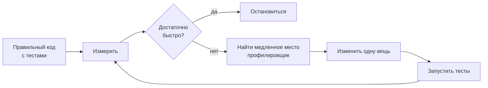

<!-- nav:top -->
[🏠 Начало](../START-HERE.md) · [← 05.11 Практичные крейты: serde, clap, thiserror и anyhow](11-practical-crates-serde-clap-errors.md) · [📋 Этап 05](README.md) · [05.13 Проект: minigrep →](13-project-minigrep.md) · [📖 Глоссарий](../GLOSSARY.md) · [🇬🇧 English](../../en/05-rust-intermediate/12-benchmarking-basics.md) <!-- nav -->

# Урок 05.12 — Основы бенчмарков

> **Этап 05 — Rust: средний уровень** · Урок 12 из 14 · ⏱ около 3 часов (2 занятия)

## Что вы узнаете

- Почему скорость сначала измеряют, а потом улучшают, и что вообще значит «медленно».
- Почему измерять нужно всегда в режиме release и насколько это важно.
- Как замерять код вручную через `std::time::Instant` и почему одного измерения мало.
- Как компилятор может «сжульничать» в бенчмарке и как `black_box` ему мешает.
- Как писать настоящие бенчмарки с `criterion`, сравнивать две версии и измерять целую программу с `hyperfine`.
- Как записывать результаты в Git, чтобы доказать, что изменение действительно помогло.

## Перед началом

- Вы прошли [Урок 05.11 — Практичные крейты: serde, clap, thiserror и anyhow](11-practical-crates-serde-clap-errors.md).
- Вы знаете dev-зависимости и `Cargo.lock`: [Урок 05.8 — Cargo: зависимости и версии](08-cargo-dependencies-and-versions.md).
- Вы знаете итераторы ([Урок 05.5](05-iterators.md)) и тесты ([Урок 05.6](06-testing-in-depth.md)).
- Вы знаете коммиты и ветки Git: [Урок 01.6 — Ветки и слияние](../01-git-and-version-control/06-branches-and-merging.md).
- Закройте тяжёлые программы (видео, игры, большие сборки), пока измеряете. Подключите ноутбук к питанию.

## Новые слова

| Слово | Значение |
|---|---|
| **бенчмарк** (benchmark) | Программа или тест, который измеряет, как быстро (или как расточительно по памяти) работает некоторый код. |
| **микробенчмарк** (micro-benchmark) | Бенчмарк одной небольшой функции или операции. |
| **реальное время** (wall-clock time) | Время, как его показывают настенные часы: от начала до конца, включая любое ожидание. |
| **задержка** (latency) | Сколько времени занимает одна операция — от начала до результата. |
| **пропускная способность** (throughput) | Сколько операций выполняется за единицу времени (например, запросов в секунду). |
| **нс**, **мкс**, **мс**, **с** (ns, µs, ms, s) | Наносекунда (миллиардная доля секунды), микросекунда (миллионная), миллисекунда (тысячная), секунда. |
| **оптимизация** (optimization) | Изменение кода (или настроек компилятора), чтобы он стал быстрее или меньше. |
| **профиль release** (release profile) | Настройки сборки Cargo для `cargo build --release`: компилятор старается сделать программу быстрой. |
| **профиль debug** (debug profile) | Настройки сборки Cargo по умолчанию: быстро компилируется, медленно работает, удобно отлаживать. |
| **LLVM** | Бэкенд компилятора, который Rust использует для получения машинного кода и его оптимизации. |
| **удаление мёртвого кода** (dead-code elimination) | Оптимизация, которая удаляет код, результат которого нигде не используется. |
| **`black_box`** | Функция (`std::hint::black_box`), которая прячет значение от оптимизатора, чтобы компилятор не мог удалить или упростить работу вокруг него. |
| **прогрев** (warm-up) | Несколько запусков кода перед измерением, чтобы кэши заполнились, а процессор работал на полной скорости. |
| **шум** (noise) | Случайный разброс между измерениями, вызванный ОС (операционной системой), другими программами, температурой и т. д. |
| **выброс** (outlier) | Измерение, далёкое от остальных. |
| **среднее / медиана** (mean / median) | Среднее арифметическое значений / среднее по порядку значение после сортировки. Медиана меньше зависит от выбросов. |
| **стандартное отклонение** (standard deviation, σ, «сигма») | Число, которое показывает, насколько измерения разбросаны вокруг среднего. |
| **базовая линия** (baseline) | Сохранённый набор результатов, с которым вы потом сравниваете. |
| **регрессия** (regression) | Изменение, из-за которого программа стала медленнее (или хуже в другом отношении), чем раньше. |
| **профилировщик** (profiler) | Инструмент, который показывает, *где* программа проводит время. (Вы воспользуетесь им на Этапе 19.) |
| **CPU** (Central Processing Unit, центральный процессор) | Микросхема, которая выполняет инструкции программы. |
| **RAM** (Random Access Memory, оперативная память) | Быстрая рабочая память компьютера. |

## 1. Сначала измеряйте

> «Преждевременная оптимизация — корень всех зол». — известное высказывание Дональда Кнута, учёного в области информатики.

«Преждевременная» значит *слишком ранняя*, до того как вы знаете, что именно медленно. Программисты очень плохо угадывают, куда уходит время. Лекарство простое:

1. **Сделайте код правильным** (с тестами, [Урок 05.6](06-testing-in-depth.md)).
2. **Измерьте** его. Он действительно слишком медленный для ваших нужд? Какая часть?
3. **Измените одну вещь.**
4. **Измерьте снова.** Сравните. Оставляйте изменение, только если цифры доказывают, что оно помогло.



Два слова, которые вы будете слышать постоянно:

- **Задержка** (latency): сколько времени занимает *одна* операция. «Этот запрос занял 12 мс».
- **Пропускная способность** (throughput): сколько операций в секунду. «Сервер обрабатывает 5 000 запросов в секунду».

Это не одно и то же. У программы может быть хорошая пропускная способность и плохая задержка, и наоборот. Бенчмарк должен указывать, что именно он измеряет. В этом уроке мы измеряем задержку небольших кусков кода.

> 📏 **Соглашение:** сначала оптимизируйте для читателя. Понятный код, который достаточно быстр, лучше хитрого кода, который чуть быстрее. KISS (Keep It Simple, Stupid — «делай проще») и измеряйте, прежде чем всё ломать.

## 2. Режим release: первое правило

В Rust два основных профиля сборки. `cargo run` использует **debug**. `cargo run --release` использует **release**. Разница огромна. Попробуйте эту программу:

```rust
use std::time::Instant;

fn sum_of_squares(n: u64) -> u64 {
    let mut total = 0;
    for i in 0..n {
        total += i * i % 7;
    }
    total
}

fn main() {
    let start = Instant::now();
    let result = sum_of_squares(100_000_000);
    let elapsed = start.elapsed();
    println!("result = {result}");
    println!("took {:?}", elapsed);
}
```

```bash
cargo run
cargo run --release
```

```text
result = 199999997
took 757.635667ms
result = 199999997
took 32.388708ms
```

**Что происходит:**

1. `Instant::now()` читает часы, которые идут только вперёд («монотонные»). `start.elapsed()` возвращает время, прошедшее с того момента, как `Duration`. `{:?}` печатает его с единицей измерения.
2. Тот же код, тот же результат, но режим release примерно **в 23 раза быстрее** на этом компьютере (ваши числа будут другими, а отношение будет большим).
3. В режиме debug компилятор почти не оптимизирует. Он держит каждую переменную в памяти, проверяет каждое переполнение и не упрощает циклы. Он готовится к отладчику, а не к скорости. В режиме release LLVM переписывает код: убирает проверки, которые может доказать ненужными, держит значения в регистрах процессора, разворачивает циклы и так далее.

Профилем release управляют в `Cargo.toml`. Это настройки, которые вы встретите чаще всего (показанные значения нужны для объяснения, а не как совет копировать):

```toml
[profile.release]
opt-level = 3        # 0 = no optimization ... 3 = most; "s"/"z" = small size
lto = "fat"          # optimize across all crates (slower build, faster program)
codegen-units = 1    # slower build, sometimes faster program
debug = true         # keep debug symbols (needed for profilers)
panic = "abort"      # no stack unwinding: smaller and a bit faster
```

> ⚠️ **Частая ошибка:** делать бенчмарки в режиме debug и делать по ним выводы. Бенчмарк в debug измеряет, насколько медленна неоптимизированная программа, а это почти не связано с реальной скоростью. **Всегда измеряйте с `--release`** (а `cargo bench` уже так и делает).

> 🔒 **Безопасность:** в режиме debug переполнение целого числа вызывает панику; в режиме release оно молча «заворачивается» (если не включить `overflow-checks = true`). Помните, что сборка release может вести себя иначе, чем debug-сборка, которую вы тестировали. Используйте `checked_add`, `wrapping_add` или `saturating_add` ([Урок 02.3](../02-programming-basics/03-operators-and-expressions.md)), когда переполнение возможно, чтобы поведение было одинаковым в обоих режимах.

## 3. Замер вручную

`Instant` — самый быстрый инструмент. Всегда замеряйте больше одного раза, потому что первый запуск обычно медленнее, а любой отдельный запуск могут потревожить:

```rust
use std::hint::black_box;
use std::time::{Duration, Instant};

fn work(n: u64) -> u64 {
    let mut x: u64 = 1;
    for _ in 0..n {
        x = x.wrapping_mul(6364136223846793005).wrapping_add(1442695040888963407);
        x ^= x >> 33;
    }
    x
}

fn main() {
    let mut times: Vec<Duration> = Vec::new();
    for _ in 0..11 {
        let start = Instant::now();
        black_box(work(black_box(20_000_000)));
        times.push(start.elapsed());
    }
    times.sort();
    println!("min    = {:?}", times[0]);
    println!("median = {:?}", times[times.len() / 2]);
    println!("max    = {:?}", times[times.len() - 1]);
}
```

```text
min    = 26.906083ms
median = 27.152708ms
max    = 43.216292ms
```

(Второй запуск на том же компьютере: min 27.07 мс, медиана 27.25 мс, max 38.67 мс.)

**Что происходит:**

1. `work` — небольшой цикл арифметики над одним числом (простой псевдослучайный «смеситель»). Он заменяет «какой-то код, который мы хотим измерить».
2. Мы замеряем его 11 раз и храним каждый `Duration` в векторе. `sort()` упорядочивает их от наименьшего к наибольшему.
3. **Минимум** — лучший случай (меньше всего помех). **Медиана** — среднее по порядку значение: типичный запуск. **Максимум** — худший, обычно результат какой-то помехи (здесь первый запуск или другая программа, использовавшая процессор).
4. Два запуска всей программы дают почти одинаковые минимум и медиану, но разный максимум. Это **шум**. В хорошем отчёте используют медиану (или минимум), а не максимум и не один запуск.

## 4. Когда компилятор жульничает

Оптимизатор умён. Если результат вашего кода нигде не используется, он может полностью удалить код. Тогда вы «измеряете» пустоту:

```rust
use std::hint::black_box;
use std::time::Instant;

fn mix(n: u64) -> u64 {
    let mut x: u64 = 1;
    for _ in 0..n {
        x = x.wrapping_mul(6364136223846793005).wrapping_add(1442695040888963407);
        x ^= x >> 33;
    }
    x
}

fn main() {
    let start = Instant::now();
    let _ = mix(200_000_000);
    println!("result not used : {:?}", start.elapsed());

    let start = Instant::now();
    let r = mix(200_000_000);
    println!("result printed  : {:?} (result {r})", start.elapsed());

    let start = Instant::now();
    let r = black_box(mix(black_box(200_000_000)));
    println!("with black_box  : {:?} (result {r})", start.elapsed());
}
```

```bash
cargo run --release
```

```text
result not used : 41ns
result printed  : 293.468791ms (result 12760341528350204533)
with black_box  : 293.270584ms (result 12760341528350204533)
```

**Что происходит:**

1. В первом блоке `let _ = mix(...)` выбрасывает ответ. У `mix` нет других эффектов (она ничего не печатает, не записывает и не меняет снаружи), поэтому оптимизатор удаляет весь вызов. 41 наносекунда — это стоимость чтения часов, а не работы. 200 миллионов итераций за 41 нс означали бы 5 миллиардов итераций в наносекунду: это невозможно.
2. Во втором блоке результат печатается, поэтому работа должна быть выполнена: около 293 мс.
3. В третьем блоке `black_box` оборачивает вход и выход. `black_box(x)` возвращает `x`, но компилятор должен считать, что это может быть что угодно и что оно используется. Поэтому он не может заранее вычислить или удалить работу. Здесь время такое же, как при печати, что показывает: работа действительно выполнена.

> 💡 **Совет:** простой тревожный признак: если бенчмарк показывает невозможно малое время (наносекунды для большого цикла), компилятор удалил ваш код. Используйте `std::hint::black_box` для входов и для результата.

Та же ловушка есть, когда компилятор может вычислить ответ при компиляции. Например, простую сумму `i * 3 + 1` по диапазону LLVM превращает в формулу, поэтому даже большое `n` занимает почти нулевое время. Делайте входные данные непредсказуемыми для оптимизатора (читайте их через `black_box` или снаружи).

## 5. criterion: настоящие бенчмарки

Замер вручную подходит для быстрого взгляда. Для решений нужна статистика: много выборок, прогрев, обнаружение выбросов и сравнение с прежними результатами. Это делает крейт `criterion`. (В Rust есть встроенный `#[bench]`, но он работает только на нестабильном компиляторе nightly, поэтому все используют `criterion` или более новый `divan`.)

Мы сравним способы заполнить вектор числами `0..n` и два способа просуммировать срез.

### Проект

```bash
cd ~/projects/rust/code
cargo new --lib fast-fill
cd fast-fill
cargo add --dev criterion@0.8
```

Добавьте в конец `Cargo.toml`:

```toml
[[bench]]
name = "fill"
harness = false
```

**Что происходит:** `[[bench]]` (двойные скобки: элемент списка) объявляет программу-бенчмарк, которая лежит в `benches/fill.rs`. `harness = false` отключает встроенную тестовую обвязку, потому что `criterion` приносит свою функцию `main`.

`src/lib.rs`:

```rust
/// Builds `0, 1, 2, ... n-1` by pushing into an empty vector.
pub fn fill_push(n: usize) -> Vec<usize> {
    let mut v = Vec::new();
    for i in 0..n {
        v.push(i);
    }
    v
}

/// The same, but reserves the room first.
pub fn fill_with_capacity(n: usize) -> Vec<usize> {
    let mut v = Vec::with_capacity(n);
    for i in 0..n {
        v.push(i);
    }
    v
}

/// The same, with an iterator.
pub fn fill_collect(n: usize) -> Vec<usize> {
    (0..n).collect()
}

/// Sum with an index loop.
pub fn sum_index(data: &[u64]) -> u64 {
    let mut total = 0;
    for i in 0..data.len() {
        total += data[i];
    }
    total
}

/// Sum with an iterator.
pub fn sum_iter(data: &[u64]) -> u64 {
    data.iter().sum()
}

#[cfg(test)]
mod tests {
    use super::*;

    #[test]
    fn all_fills_agree() {
        for n in [0, 1, 10, 1000] {
            assert_eq!(fill_push(n), fill_with_capacity(n));
            assert_eq!(fill_push(n), fill_collect(n));
        }
    }

    #[test]
    fn both_sums_agree() {
        let data: Vec<u64> = (1..=100).collect();
        assert_eq!(sum_index(&data), 5050);
        assert_eq!(sum_iter(&data), 5050);
        assert_eq!(sum_index(&[]), 0);
        assert_eq!(sum_iter(&[]), 0);
    }
}
```

`benches/fill.rs`:

```rust
use criterion::{criterion_group, criterion_main, Criterion};
use fast_fill::{fill_collect, fill_push, fill_with_capacity, sum_index, sum_iter};
use std::hint::black_box;

fn bench_fill(c: &mut Criterion) {
    let mut group = c.benchmark_group("fill 10_000");
    group.bench_function("push", |b| b.iter(|| fill_push(black_box(10_000))));
    group.bench_function("with_capacity", |b| {
        b.iter(|| fill_with_capacity(black_box(10_000)))
    });
    group.bench_function("collect", |b| b.iter(|| fill_collect(black_box(10_000))));
    group.finish();
}

fn bench_sum(c: &mut Criterion) {
    let data: Vec<u64> = (0..10_000).collect();
    let mut group = c.benchmark_group("sum 10_000");
    group.bench_function("index loop", |b| b.iter(|| sum_index(black_box(&data))));
    group.bench_function("iterator", |b| b.iter(|| sum_iter(black_box(&data))));
    group.finish();
}

criterion_group!(benches, bench_fill, bench_sum);
criterion_main!(benches);
```

**Что происходит:**

1. Имя крейта `fast-fill` в коде превращается в `fast_fill` (дефисы становятся подчёркиваниями). `benches/` — отдельный крейт, который может использовать только `pub`-элементы вашей библиотеки, как внешний пользователь.
2. `c.benchmark_group("...")` группирует связанные бенчмарки, чтобы отчёт их сравнивал. `bench_function("name", |b| b.iter(|| ...))` регистрирует один бенчмарк. `b.iter` запускает замыкание снова и снова, а сколько раз — решает `criterion`.
3. `black_box(10_000)` прячет вход от оптимизатора, а `criterion` автоматически прячет результат замыкания, так что работу нельзя удалить.
4. Модульные тесты проверяют, что все версии дают один и тот же результат. **Быстрая функция с неверным ответом бесполезна**, поэтому тест на правильность всегда держите рядом с бенчмарком. `cargo test` его запускает.
5. `criterion_group!` и `criterion_main!` — макросы, которые создают функцию `main` программы-бенчмарка.

Запустите бенчмарки (около минуты; `cargo bench` собирает с оптимизированным профилем `bench`, который похож на release):

```bash
cargo bench
```

```text
fill 10_000/push        time:   [4.6474 µs 4.7347 µs 4.8594 µs]
Found 2 outliers among 100 measurements (2.00%)
  1 (1.00%) high mild
  1 (1.00%) high severe
fill 10_000/with_capacity
                        time:   [3.4094 µs 3.4901 µs 3.5752 µs]
Found 4 outliers among 100 measurements (4.00%)
  1 (1.00%) high mild
  3 (3.00%) high severe
fill 10_000/collect     time:   [785.06 ns 792.68 ns 801.62 ns]
Found 3 outliers among 100 measurements (3.00%)
  3 (3.00%) high mild
sum 10_000/index loop   time:   [613.41 ns 616.35 ns 619.64 ns]
Found 3 outliers among 100 measurements (3.00%)
  2 (2.00%) high mild
  1 (1.00%) high severe
sum 10_000/iterator     time:   [609.91 ns 613.91 ns 620.49 ns]
Found 10 outliers among 100 measurements (10.00%)
  1 (1.00%) low severe
  1 (1.00%) low mild
  5 (5.00%) high mild
  3 (3.00%) high severe
```

(Между этими строками criterion печатает строки о ходе работы, например «Warming up for 3.0000 s» и «Collecting 100 samples»; здесь они опущены. Ваши числа будут другими; важны отношения между строками.)

**Как это читать:**

1. `time: [4.6474 µs 4.7347 µs 4.8594 µs]` — это **доверительный интервал**: нижняя оценка, лучшая оценка и верхняя оценка времени **одного вызова**. Чем уже интервал, тем надёжнее число.
2. Сначала `criterion` **прогревал** код 3 секунды, затем собрал 100 выборок, каждая из которых состоит из множества вызовов. Он сообщил о **выбросах**: выборках, далёких от остальных (вероятно, ОС занималась чем-то ещё). Несколько процентов — это нормально; много выбросов означает шумный компьютер.
3. **Результаты:** `push` медленнее всех (4.7 мкс); `with_capacity` примерно на 26% быстрее (3.5 мкс), потому что вектору не нужно несколько раз расти и копировать себя ([Урок 04.7 — Векторы](../04-structs-enums-collections-errors/07-vectors.md)); `collect` ещё намного быстрее (0.79 мкс), потому что итератор заранее знает точную длину, и компилятор может написать всё это одним быстрым циклом.
4. **Две суммы равны** (616 нс и 614 нс, внутри интервалов друг друга). Это обещание «абстракций с нулевой стоимостью»: версия с итератором не медленнее ручного цикла с индексом. (Цикл с индексом даже делает проверку границ на каждом `data[i]`, которую компилятору приходится «доказывать» ненужной.) Избегать итераторов «ради скорости» не нужно.

> ⚡ **Производительность:** урок из этих чисел: знание размера заранее (`with_capacity`, `collect`) помогает; итераторы не медленнее циклов. Но эти выигрыши измеряются микросекундами. Для программы, которая запускается один раз, они не важны. Они важны в коде, который выполняется миллионы раз. Поэтому мы измеряем, *где* уходит время, прежде чем что-либо менять.

### Сравнение «до» и «после» с Git

Вы хотите знать с числом, помогает ли изменение. `criterion` умеет **сохранять базовую линию** и сравнивать следующий запуск с ней. Git сохраняет код каждой версии. Вместе они дают доказательство.

Начните с чистого коммита (сначала закоммичены код бенчмарка и функции):

```bash
git add .
git commit -m "feat(p05): add fill and sum functions with benchmarks"
cargo bench --bench fill -- "fill 10_000/push" --save-baseline before
```

```text
fill 10_000/push        time:   [4.5979 µs 4.6680 µs 4.7442 µs]
```

Текст после `--` передаётся criterion: сначала **фильтр** (только бенчмарк, в имени которого есть этот текст), затем `--save-baseline before` сохраняет результаты под именем `before` (в `target/criterion`, который Git игнорирует).

Теперь сделайте **одно** изменение: `fill_push` начинается с `Vec::with_capacity(n)` вместо `Vec::new()`. Запустите тесты, затем сравните с базовой линией:

```bash
cargo test
cargo bench --bench fill -- "fill 10_000/push" --baseline before
```

```text
fill 10_000/push        time:   [3.3332 µs 3.4298 µs 3.5326 µs]
                        change: [−29.695% −27.197% −24.954%] (p = 0.00 < 0.05)
                        Performance has improved.
Found 2 outliers among 100 measurements (2.00%)
  1 (1.00%) high mild
  1 (1.00%) high severe
```

**Что происходит:** criterion сравнивает новые выборки с базовой линией и сообщает `change: [-29.7% -27.2% -25.0%]`: функция стала примерно на 27% быстрее. `p = 0.00 < 0.05` — это статистический критерий: вероятность того, что такая разница лишь шум, очень мала. Затем выводится «Performance has improved». Если бы p-значение было большим, вы увидели бы «No change in performance detected».

Когда мы запустили *один и тот же код дважды* (чтобы увидеть шум), criterion ответил `change: [-2.97% -1.70% -0.48%]` и «Change within noise threshold». Разница в 2% между одинаковыми запусками — это уровень шума этого компьютера. Никогда не верьте улучшению меньше шума.

Теперь сохраните доказательство в Git, с числами в сообщении:

```bash
git commit -am "perf(p05): reserve capacity in fill_push (4.67 us -> 3.43 us, about -27%)"
git log --oneline -2
```

```text
4defe17 perf(p05): reserve capacity in fill_push (4.67 us -> 3.43 us, about -27%)
6d661af feat(p05): add fill and sum functions with benchmarks
```

(Идентификаторы на вашем компьютере будут другими.) Изменение производительности должно быть **отдельным коммитом** с числами в сообщении. Если позже какое-то изменение замедлит программу, `git bisect` или просмотр `git log` найдут нужный коммит ([Урок 01.4](../01-git-and-version-control/04-viewing-history-and-changes.md)). Если хотите попробовать идею без риска, создайте ветку (`git switch -c try-faster-parse`), измерьте и удалите ветку, если не помогло.

> 📏 **Соглашение:** записывайте окружение вместе с числами: компьютер (например, «Apple M4 Pro, 12 ядер»), версию Rust (`rustc --version`), профиль (release) и дату. Числа без окружения нельзя сравнить позже.

## 6. hyperfine: измерение целой программы

`criterion` измеряет функцию внутри вашего кода. `hyperfine` измеряет **команду**: всю программу от запуска до завершения, включая старт и чтение файлов. Используйте его, когда нужно сравнить две программы, две сборки или два параметра. Установите один раз командой `cargo install hyperfine` (в этом курсе версия 2.0). Затем:

```bash
cargo build --release
hyperfine --warmup 3 './target/release/repeat'
```

```text
Benchmark 1: ./target/release/repeat (10 runs)
                mean     ±       σ          min     …     max
  Wall Time    301.9 ms  ±     1.4 ms     299.6 ms  …   303.6 ms
  Memory         1.9 MiB ±     0.0 MiB      1.9 MiB …     1.9 MiB
```

**Что происходит:**

1. `--warmup 3` запускает команду 3 раза до измерения, чтобы заполнить файловый кэш.
2. `hyperfine` запустил программу 10 раз. Он показывает среднее, стандартное отклонение (`σ`), а также минимум и максимум реального времени. Малое σ по сравнению со средним означает стабильное измерение. Он также показывает пиковую память (MiB — мебибайт: 1 048 576 байт). (Эта программа — пример замера из раздела 3 с 11 повторами; один запуск из 11 циклов занимает около 300 мс.)

Сравните debug и release одной командой:

```bash
hyperfine --warmup 1 --runs 5 './target/debug/repeat' './target/release/repeat'
```

```text
Benchmark 1: ./target/debug/repeat (5 runs)
                mean     ±       σ          min     …     max
  Wall Time    1.183 s   ±   0.010 s      1.168 s   …   1.193 s
  Memory         1.9 MiB ±     0.0 MiB      1.9 MiB …     1.9 MiB

Benchmark 2: ./target/release/repeat (5 runs)
                mean     ±       σ          min     …     max
  Wall Time    0.305 s   ±   0.001 s      0.304 s   …   0.306 s            -74.2%  (3.9x faster)
  Memory         1.9 MiB ±     0.0 MiB      1.9 MiB …     1.9 MiB           -1.6%
```

Вторая команда отмечена как более быстрая в 3,9 раза. (Для этой программы, которая тратит всё время на арифметику, release примерно в 4 раза быстрее; предыдущий пример `sum_of_squares` был быстрее в 23 раза. Коэффициент зависит от кода.)

## 7. Как измерять честно: чек-лист

1. **Только режим release** (`--release`, `cargo bench`).
2. **Сначала правильность.** Держите тест, который доказывает, что быстрая версия даёт тот же ответ, что и простая.
3. **Используйте `black_box`**, чтобы компилятор не мог удалить или заранее вычислить вашу работу.
4. **Много запусков, прогрев, медиана.** Никогда один запуск. Смотрите на разброс, а не только на среднее.
5. **Тихий компьютер.** Закройте другие программы. На ноутбуке подключите питание: от батареи процессор замедляется. После долгого запуска процессор тоже может нагреться и замедлиться (тепловое ограничение, thermal throttling).
6. **Реалистичные входные данные.** Функция может быть быстрой для 10 элементов и медленной для 10 миллионов. Тестируйте размеры, которые у вас действительно будут. Функция, читающая файл, измеряет диск, а не код.
7. **Меняйте одну вещь за раз** и сравнивайте с сохранённой базовой линией.
8. **Записывайте окружение** (компьютер, версия Rust, дата) вместе с числами и храните результаты в Git.
9. **Не доверяйте малым различиям.** Если изменение меньше шума (несколько процентов на ноутбуке), изменения нет.
10. **Измеряйте и целое.** Функция, ускоренная в 10 раз, но занимающая 1% времени программы, ускоряет программу на 0,9%. *Профилировщик* показывает, куда уходит время (Этап 19 научит им пользоваться).

> 🧪 **Тестирование:** относитесь к бенчмарку как к тесту: он живёт в репозитории, собирается в конвейере и запускается перед большими изменениями. Некоторые команды запускают бенчмарки автоматически в CI (Continuous Integration — непрерывная интеграция: сервер, который собирает и тестирует каждый коммит), чтобы ловить регрессии. Будьте осторожны: общие машины CI шумные, поэтому сравнивайте отношения, а не абсолютное время.

## Частые ошибки

1. **Бенчмарк в режиме debug.** Числа бессмысленны. Используйте `--release` или `cargo bench`.
2. **Результат нигде не используется.** Компилятор удаляет работу (раздел 4: 41 нс для задачи на 300 мс). Используйте `black_box`.
3. **Бенчмарк одного запуска.** Первый запуск медленный, а любой запуск могут потревожить. Используйте много запусков и медиану или `criterion`.
4. **Подготовка входит в измерение.** Если строить входные данные внутри измеряемого замыкания, измеряется и подготовка. Стройте входные данные снаружи `b.iter(...)`, как вектор `data` в `bench_sum`.
5. **Нет теста на правильность.** «Оптимизированная» версия быстро возвращает неверный ответ. Тестируйте обе версии на одних и тех же входных данных.
6. **Вера шуму.** «Улучшение» на 2% на ноутбуке — не улучшение. Запустите дважды; если тот же код даёт такую разницу, вы измерили шум.
7. **Оптимизация не того.** Функция, занимающая 5% времени, не может дать выигрыш больше 5%. Сначала найдите медленную часть.
8. **Сравнение чисел с разных компьютеров или режимов.** Сравнивайте только измерения в одном окружении.

## Попробуйте сами

1. Создайте `~/projects/rust/code/p05-bench` командой `cargo new p05-bench`. Поместите программу `sum_of_squares` из раздела 2 в `src/main.rs`.
2. Выполните `cargo run` и `cargo run --release`. Запишите оба времени и их отношение.
3. Замените `100_000_000` на `1_000` и запустите в режиме release. Какое время вы видите? (Вероятно, несколько микросекунд или меньше.) Один запуск крошечной задачи почти ничего не говорит. Поэтому `criterion` делает тысячи итераций.
4. Создайте `src/bin/dead.rs` с программой из раздела 4 и выполните `cargo run --release --bin dead`. Убедитесь, что первая строка показывает несколько наносекунд. (Теперь в пакете две программы, поэтому с этого момента `cargo run` требует `--bin <name>`; первая программа называется `p05-bench`.)
5. Сделайте коммит в Git: `git add . && git commit -m "perf(p05): time sum_of_squares in debug and release"`.
6. Создайте проект `fast-fill` из раздела 5 и выполните `cargo bench`. Совпадает ли порядок результатов с уроком?

## Упражнения

### Упражнение 1 — Замерьте функцию вручную (легко)

Напишите программу, которая замеряет через `Instant` функцию `fn count_primes(limit: u32) -> u32` (количество простых чисел меньше `limit`, проверкой делителей до квадратного корня). Замерьте её 5 раз для `limit = 200_000`, напечатайте медиану и используйте `black_box`, чтобы ничего не было оптимизировано. Запустите с `--release`.

<details>
<summary>Подсказка</summary>

Соберите 5 значений `Duration` в вектор, отсортируйте через `sort()` и напечатайте средний элемент (`times[2]`). Используйте `black_box(count_primes(black_box(200_000)))`.

</details>

<details>
<summary>Ответ</summary>

```rust
use std::hint::black_box;
use std::time::{Duration, Instant};

fn count_primes(limit: u32) -> u32 {
    let mut count = 0;
    for n in 2..limit {
        let mut is_prime = true;
        let mut d = 2;
        while d * d <= n {
            if n % d == 0 {
                is_prime = false;
                break;
            }
            d += 1;
        }
        if is_prime {
            count += 1;
        }
    }
    count
}

fn main() {
    let mut times: Vec<Duration> = Vec::new();
    for _ in 0..5 {
        let start = Instant::now();
        black_box(count_primes(black_box(200_000)));
        times.push(start.elapsed());
    }
    times.sort();
    println!("primes below 200000: {}", count_primes(200_000));
    println!("median time: {:?}", times[2]);
}
```

Программа печатает `primes below 200000: 17984` и медианное время (оно зависит от вашего компьютера; несколько миллисекунд в режиме release).

Почему это работает: `black_box` не даёт компилятору удалить вызовы, а медиана из 5 запусков меньше зависит от одного потревоженного запуска, чем единственное измерение. Число 17 984 — известное количество простых чисел меньше 200 000.

</details>

### Упражнение 2 — Объясните подозрительный результат (легко)

Приятель написал бенчмарк функции, которая сортирует вектор из миллиона чисел, и показывает результат: `time: 0.4 ns`. Бенчмарк вызывает `v.sort();` для вектора, который создаётся внутри цикла и больше нигде не читается. Назовите хотя бы две проблемы и скажите, как их исправить.

<details>
<summary>Подсказка</summary>

Подумайте о разделе 4 и о том, сколько должна стоить сортировка миллиона чисел. Подумайте также о том, что происходит, если один и тот же вектор сортировать дважды.

</details>

<details>
<summary>Ответ</summary>

1. **0,4 нс невозможно** для сортировки миллиона чисел (это были бы миллисекунды). Компилятор удалил работу, потому что отсортированный вектор нигде не используется (удаление мёртвого кода). Исправление: пропустите вход через `black_box` и возвращайте результат или оберните его в `black_box`.
2. Бенчмарк может создавать вектор внутри измеряемого кода, поэтому **измеряется подготовка** вместе с сортировкой. Исправление: создавайте входные данные вне измеряемой части. В `criterion` используйте `b.iter_batched(|| make_vector(), |mut v| { v.sort(); v }, BatchSize::SmallInput)`: он готовит свежий вектор для каждого запуска, не включая подготовку в замер.
3. Если сортировать один и тот же вектор снова и снова, реальную работу делает только первая сортировка (сортировка уже отсортированного вектора намного дешевле). Поэтому на каждый запуск нужна свежая неотсортированная копия (то же исправление через `iter_batched`).
4. Нет проверки правильности: нужен тест, что результат действительно отсортирован.

Почему это работает: каждое из этих исправлений заставляет бенчмарк измерять только ту работу, которую вы хотите сравнить, на реальных данных.

</details>

### Упражнение 3 — Бенчмарк criterion с тестом (средне)

Создайте библиотеку `joiner` с двумя функциями: `join_loop(words: &[&str]) -> String` (`String::new()` и `push_str` в цикле) и `join_concat(words: &[&str]) -> String` (стандартный `words.concat()`). Напишите **тест**, что обе дают `"rustisfun"` для `["rust", "is", "fun"]` и пустую строку для пустого списка. Напишите бенчмарк `criterion`, который сравнивает их на 1000 копий `"word"`. Есть ли явный победитель?

<details>
<summary>Подсказка</summary>

`cargo new --lib joiner`, `cargo add --dev criterion@0.8`, добавьте секцию `[[bench]]` с `name = "join"` и `harness = false`, создайте `benches/join.rs`. Входные данные постройте через `std::iter::repeat_n("word", 1000).collect::<Vec<&str>>()` снаружи замыкания `b.iter`.

</details>

<details>
<summary>Ответ</summary>

`src/lib.rs`:

```rust
/// Joins words one by one into a growing `String`.
pub fn join_loop(words: &[&str]) -> String {
    let mut out = String::new();
    for w in words {
        out.push_str(w);
    }
    out
}

/// Joins words with the standard `concat` method.
pub fn join_concat(words: &[&str]) -> String {
    words.concat()
}

#[cfg(test)]
mod tests {
    use super::*;

    #[test]
    fn both_ways_give_the_same_text() {
        let words = ["rust", "is", "fun"];
        assert_eq!(join_loop(&words), "rustisfun");
        assert_eq!(join_concat(&words), "rustisfun");
        assert_eq!(join_loop(&[]), "");
        assert_eq!(join_concat(&[]), "");
    }
}
```

`benches/join.rs`:

```rust
use criterion::{criterion_group, criterion_main, Criterion};
use joiner::{join_concat, join_loop};
use std::hint::black_box;

fn bench_join(c: &mut Criterion) {
    let words: Vec<&str> = std::iter::repeat_n("word", 1000).collect();
    let mut group = c.benchmark_group("join 1000 words");
    group.bench_function("loop", |b| b.iter(|| join_loop(black_box(&words))));
    group.bench_function("concat", |b| b.iter(|| join_concat(black_box(&words))));
    group.finish();
}

criterion_group!(benches, bench_join);
criterion_main!(benches);
```

И в `Cargo.toml`:

```toml
[dev-dependencies]
criterion = "0.8"

[[bench]]
name = "join"
harness = false
```

На компьютере автора: `loop` 2.39 мкс, `concat` 2.31 мкс. Интервалы близки (разница около 3%), поэтому явного победителя нет. `concat` сначала вычисляет итоговую длину и выделяет память один раз, а цикл наращивает буфер, но для такого размера разница мала.

Почему это работает: бенчмарк строит входные данные один раз, вне измеряемого замыкания, и прячет их через `black_box`. Тест гарантирует, что обе функции согласованы. Честный вывод — «значимой разницы нет»: выберите более понятный код (`concat`).

</details>

### Упражнение 4 — Сравните две сборки с hyperfine (средне)

Возьмите программу `repeat` из раздела 3 (или любую свою). Сравните сборки debug и release с помощью `hyperfine`. Сообщите средние времена и их отношение. Затем объясните, почему отношение разное для разных программ.

<details>
<summary>Подсказка</summary>

`cargo build` и `cargo build --release` создают два исполняемых файла в `target/debug` и `target/release`. Передайте оба пути одной команде `hyperfine` с `--warmup 1 --runs 5`.

</details>

<details>
<summary>Ответ</summary>

```bash
cargo build
cargo build --release
hyperfine --warmup 1 --runs 5 './target/debug/repeat' './target/release/repeat'
```

На компьютере автора: debug 1.183 с, release 0.305 с, то есть release быстрее в 3,9 раза (ваши числа будут другими).

Почему отношение разное для каждой программы: режим release помогает больше всего там, где оптимизатор может упростить код (маленькие циклы, цепочки итераторов, маленькие функции, которые можно встроить). Он почти не помогает, когда программа проводит время в ожидании диска или сети или в коде, который уже оптимизирован (например, функции стандартной библиотеки, которые всегда скомпилированы в режиме release). Предыдущий цикл `sum_of_squares` в режиме release был быстрее примерно в 23 раза, а эта программа — примерно в 4 раза.

</details>

### Упражнение 5 — Докажите оптимизацию с помощью Git и базовой линии (сложно)

В `fast-fill` функция `fill_push` начинается с `Vec::new()`. Докажите числами и Git, что `Vec::with_capacity(n)` делает её быстрее. Выполните все шаги: закоммитьте чистый код, сохраните базовую линию `before`, внесите изменение, запустите тесты, сравните с базовой линией и закоммитьте с числами в сообщении. Затем запустите сравнение второй раз без каких-либо изменений и объясните, что вы видите.

<details>
<summary>Подсказка</summary>

Сначала используйте `cargo bench --bench fill -- "fill 10_000/push" --save-baseline before`. После изменения используйте `--baseline before`. Второе сравнение на неизменённом коде должно вывести «within noise threshold» или «No change in performance detected».

</details>

<details>
<summary>Ответ</summary>

```bash
git add .
git commit -m "feat(p05): add fill and sum functions with benchmarks"
cargo bench --bench fill -- "fill 10_000/push" --save-baseline before
```

Отредактируйте `src/lib.rs`: в `fill_push` замените `let mut v = Vec::new();` на `let mut v = Vec::with_capacity(n);`.

```bash
cargo test
cargo bench --bench fill -- "fill 10_000/push" --baseline before
git commit -am "perf(p05): reserve capacity in fill_push (4.67 us -> 3.43 us, about -27%)"
```

Сравнение показывает `change: [-29.695% -27.197% -24.954%] (p = 0.00 < 0.05)` и «Performance has improved». (Ваши проценты будут другими, но знак и порядок величины должны быть похожими.)

Если запустить то же сравнение ещё раз без изменений, вы получите небольшое число (один-два процента) и «Change within noise threshold» или «No change in performance detected».

Почему это работает: базовая линия хранит старые выборки, поэтому criterion может провести статистический критерий «старое против нового». Два запуска идентичного кода показывают уровень шума компьютера: любой заявленный выигрыш должен быть заметно больше него. Тест, запущенный перед бенчмарком, доказывает, что более быстрая версия по-прежнему даёт тот же ответ. Сообщение коммита сохраняет доказательство в истории, так что никому не придётся повторять эксперимент, чтобы понять, зачем сделано изменение.

</details>

## Вопросы для самопроверки

1. Почему бенчмарки нужно запускать в режиме release?

<details>
<summary>Ответ</summary>

В режиме debug почти все оптимизации отключены, поэтому он может быть медленнее во много раз и не показывает реальной скорости программы. Реальные пользователи запускают сборки release.

</details>

2. Бенчмарк показывает 41 нс для цикла в 200 миллионов итераций. Что произошло?

<details>
<summary>Ответ</summary>

Компилятор удалил код, потому что результат нигде не использовался (удаление мёртвого кода), либо вычислил ответ при компиляции. Используйте `std::hint::black_box` для входа и результата.

</details>

3. Зачем запускать бенчмарк много раз и использовать медиану?

<details>
<summary>Ответ</summary>

Отдельные запуски шумят (ОС, другие программы, кэши, температура). Много запусков показывают разброс, а медиана мало зависит от нескольких выбросов.

</details>

4. Что означает `harness = false` в секции `[[bench]]`?

<details>
<summary>Ответ</summary>

Отключает встроенную тестовую обвязку Rust для этого бенчмарка, потому что `criterion` предоставляет собственную функцию `main`.

</details>

5. Что говорит вам `change: [-29.7% -27.2% -25.0%] (p = 0.00 < 0.05)`?

<details>
<summary>Ответ</summary>

По сравнению с сохранённой базовой линией код примерно на 27% быстрее (интервал от 25% до 30%), а статистический критерий говорит, что вероятность того, что это только шум, очень мала.

</details>

6. Когда использовать `hyperfine`, а не `criterion`?

<details>
<summary>Ответ</summary>

Когда нужно измерить целую программу или команду (от запуска до завершения, включая чтение файлов и старт), либо сравнить две сборки или две программы. `criterion` измеряет функцию внутри вашего кода.

</details>

7. Почему изменение производительности должно быть отдельным коммитом Git с числами в сообщении?

<details>
<summary>Ответ</summary>

Он фиксирует доказательство и причину. Позже можно найти коммит, из-за которого программа замедлилась, откатить только это изменение, и никому не придётся повторять измерение, чтобы понять историю.

</details>

8. Функция занимает 2% времени работы программы. Вы ускорили её в 10 раз. Насколько быстрее стала программа?

<details>
<summary>Ответ</summary>

Примерно на 1,8% (часть в 2% становится 0,2%, поэтому всё время падает со 100% до 98,2%). Оптимизация чего-то малого не может дать большого выигрыша; сначала найдите медленную часть с помощью профилировщика.

</details>

## Итоги

- Сделайте код правильным, потом измерьте, потом измените одну вещь, потом измерьте снова. Не угадывайте, куда уходит время.
- Всегда измеряйте в режиме release: он может быть быстрее debug в 4–25 раз и больше.
- Замеряйте вручную через `Instant`, много запусков и медиана. Один запуск — шум.
- Оптимизатор удаляет работу, результат которой не используется. `std::hint::black_box` делает бенчмарк честным. Время в несколько наносекунд для большой задачи — тревожный признак.
- `criterion` даёт прогрев, множество выборок, доверительные интервалы, обнаружение выбросов и сравнение с сохранённой базовой линией. `hyperfine` измеряет целые команды.
- Держите тест на правильность рядом с каждым бенчмарком. Быстрый неверный ответ бесполезен.
- Записывайте результаты в Git: один коммит на одну оптимизацию, с числами и окружением.
- Игнорируйте изменения меньше шума.

## Источники и что почитать

- [The Cargo Book — Profiles](https://doc.rust-lang.org/cargo/reference/profiles.html) — все настройки профилей `dev` и `release` (`opt-level`, `lto`, `debug`, `panic`).
- [std::hint::black_box](https://doc.rust-lang.org/std/hint/fn.black_box.html) — что `black_box` обещает и чего не обещает.
- [std::time::Instant](https://doc.rust-lang.org/std/time/struct.Instant.html) — монотонные часы.
- [The Criterion.rs book](https://bheisler.github.io/criterion.rs/book/) — руководство пользователя: группы, базовые линии, `iter_batched`, отчёты.
- [criterion on docs.rs](https://docs.rs/criterion/) — документация API.
- [hyperfine on GitHub](https://github.com/sharkdp/hyperfine) — инструмент бенчмарков для командной строки, со всеми параметрами.
- [The Rust Performance Book](https://nnethercote.github.io/perf-book/) — практическое руководство по ускорению программ на Rust, включая бенчмарки и профилирование.

---

[🏠 Начало](../START-HERE.md) · [← 05.11 Практичные крейты: serde, clap, thiserror и anyhow](11-practical-crates-serde-clap-errors.md) · [📋 Этап 05](README.md) · [05.13 Проект: minigrep →](13-project-minigrep.md) · [📖 Глоссарий](../GLOSSARY.md) <!-- nav -->
<!-- nav:bottom -->
