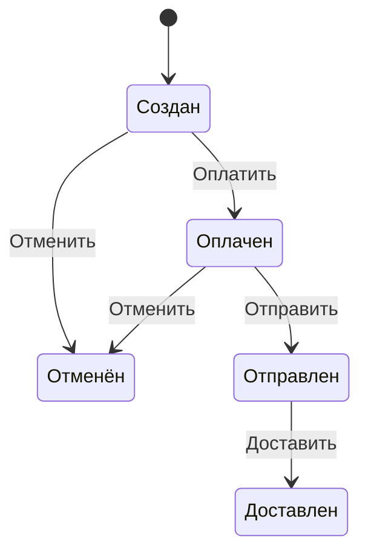

<!-- nav:top -->
[🏠 Начало](../START-HERE.md) · [← 08.7 RAII и guard-объекты](07-raii-and-guards.md) · [📋 Этап 08](README.md) · [08.9 Стратегия и внедрение зависимостей →](09-strategy-and-dependency-injection.md) · [📖 Глоссарий](../GLOSSARY.md) · [🇬🇧 English](../../en/08-software-design/08-state-machines-and-typestate.md) <!-- nav -->

# Урок 08.8 — Конечные автоматы и паттерн typestate

> **Этап 08 — Проектирование ПО: принципы, паттерны и соглашения** · Урок 8 из 17 · ⏱ около 2,5 часа (2 занятия)

## Что вы узнаете

- Что такое **конечный автомат** (state machine): состояния, события и переходы.
- Как написать его через `enum` и `match` и как протестировать каждый переход.
- Паттерн **typestate**: превращение каждого состояния в отдельный тип, так что неверный порядок операций не компилируется.
- Как `PhantomData` и обобщённые типы-маркеры дают typestate без затрат во время работы.
- Как выбирать между подходами через перечисление и через typestate.

## Перед началом

- Вы прошли [Урок 08.7 — RAII и guard-объекты](07-raii-and-guards.md).
- Вы знаете перечисления и `match` ([Уроки 04.3–04.5](../04-structs-enums-collections-errors/03-enums.md)), владение и перемещение ([Урок 03.3](../03-ownership-and-borrowing/03-move-copy-and-clone.md)) и обобщения ([Урок 05.1](../05-rust-intermediate/01-generics.md)).
- Вы помните «делайте недопустимые состояния невозможными» ([Урок 08.5](05-type-driven-design.md)) и строитель ([Урок 08.6](06-builder-pattern.md)).

## Новые слова

| Слово | Значение |
|---|---|
| **конечный автомат** (state machine; FSM — Finite State Machine) | Модель чего-то, что всегда находится ровно в одном из фиксированного списка **состояний** и переходит между ними, когда происходят **события**. |
| **состояние** (state) | Ситуация, в которой может быть объект: `Created`, `Paid`, `Shipped`. |
| **событие** (event) | Что-то, что происходит и может изменить состояние: `Pay`, `Ship`. |
| **переход** (transition) | Перемещение из одного состояния в другое, вызванное событием. Таблица переходов перечисляет допустимые. |
| **typestate** | Паттерн, в котором состояние — часть *типа* значения (`Door<Open>`, `Door<Closed>`). Операции, недопустимые в состоянии, для этого типа не существуют. |
| **тип-маркер** (marker type) | Пустая структура (`struct Open;`), которая используется только как имя состояния. Данных не несёт. |
| **`PhantomData<T>`** | Стандартный тип без данных и без размера. Он говорит компилятору «эта структура связана с типом `T`», хотя поля типа `T` нет. |
| **тип нулевого размера** (zero-sized type) | Тип, значения которого не занимают памяти, как `struct Open;` или `PhantomData<T>`. |

## 1. Конечные автоматы простыми словами

У многих вещей в программах есть жизнь со стадиями. Интернет-заказ создаётся, затем оплачивается, затем отправляется, затем доставляется. Сетевое соединение закрыто, устанавливается, открыто, снова закрыто. Дверь открыта, закрыта или заперта. Всё это **конечные автоматы**:

- Объект находится ровно в **одном состоянии** в каждый момент.
- **События** вызывают **переходы** в другое состояние.
- Некоторые переходы **запрещены**: нельзя отправить неоплаченный заказ или доставить отменённый.

Лучший способ спроектировать автомат — диаграмма:



Каждая стрелка — допустимый переход. Каждая пара (состояние, событие), у которой **нет стрелки**, запрещена. В Уроке 08.5 вы видели, что груда флагов `bool` (`paid`, `shipped`, `cancelled`) допускает невозможные сочетания, например оплачен, отменён и отправлен. Конечный автомат заменяет флаги одним значением, которое точно говорит, где вы находитесь.

## 2. Конечный автомат как перечисление

Самый простой способ записать его в Rust: `enum` для состояний, `enum` для событий и функция, которая принимает текущее состояние и событие и возвращает следующее состояние.

```rust
#[derive(Debug, Clone, PartialEq)]
enum Order {
    Created,
    Paid { amount_cents: u64 },
    Shipped { tracking: String },
    Delivered,
    Cancelled,
}

#[derive(Debug)]
enum Event {
    Pay(u64),
    Ship(String),
    Deliver,
    Cancel,
}

impl Order {
    fn next(&self, event: Event) -> Result<Order, String> {
        match (self, event) {
            (Order::Created, Event::Pay(amount_cents)) => Ok(Order::Paid { amount_cents }),
            (Order::Created | Order::Paid { .. }, Event::Cancel) => Ok(Order::Cancelled),
            (Order::Paid { .. }, Event::Ship(tracking)) => Ok(Order::Shipped { tracking }),
            (Order::Shipped { .. }, Event::Deliver) => Ok(Order::Delivered),
            (state, event) => Err(format!("cannot apply {event:?} to {state:?}")),
        }
    }
}

fn main() {
    let order = Order::Created;
    println!("{:?}", order.next(Event::Ship("X1".to_string())));

    let order = order.next(Event::Pay(1500)).unwrap();
    println!("{order:?}");
    let order = order.next(Event::Ship("X1".to_string())).unwrap();
    println!("{order:?}");
    let order = order.next(Event::Deliver).unwrap();
    println!("{order:?}");
    println!("{:?}", order.next(Event::Cancel));
}
```

**Что происходит:**

1. У `Order` по одному варианту на состояние. Данные, которые принадлежат состоянию, живут **внутри** варианта: оплаченная сумма существует только в `Paid`, номер отслеживания — только в `Shipped` (Урок 08.5).
2. `Event` перечисляет, что может произойти. `Pay` и `Ship` несут данные.
3. `next` сопоставляет **пару** `(self, event)`. Каждый допустимый переход — одна ветка. Образец `Order::Created | Order::Paid { .. }` разрешает `Cancel` из двух состояний.
4. Последняя ветка `(state, event)` ловит все остальные пары и возвращает `Err`, называющий обе части. Это и есть «запрещённое».
5. `next` принимает `&self` и возвращает новый `Order`, поэтому старое значение остаётся неизменным, если переход не удался.
6. `main` пробует отправить новый заказ (ошибка), затем проходит по счастливому пути, затем пробует отменить доставленный заказ (ошибка).

```text
Err("cannot apply Ship(\"X1\") to Created")
Paid { amount_cents: 1500 }
Shipped { tracking: "X1" }
Delivered
Err("cannot apply Cancel to Delivered")
```

> ⚠️ **Частая ошибка:** универсальная ветка удобна, но скрывает новые сочетания. Если позже вы добавите состояние `Refunded`, компилятор не напомнит вам решить, что делает каждое событие там, потому что последняя ветка его уже покрывает. В автомате со многими состояниями перечисляйте запрещённые пары явно или добавьте тест, проверяющий всю таблицу (см. ниже).

> 🧪 **Тестирование:** конечный автомат — это таблица, поэтому тестируйте его как таблицу. Напишите один тест для счастливого пути, один, который проходит по всем состояниям и проверяет, что запрещённое событие возвращает `Err`, и один для состояний, которые должны быть конечными.

## 3. Typestate: один тип на состояние

У перечисления есть предел: проверка происходит **во время работы программы**. Вызов `order.next(Event::Ship(..))` для нового заказа прекрасно компилируется и возвращает `Err`. Но часто порядок операций известен **когда вы пишете код**. Тогда компилятор может проверить его за вас.

Идея **typestate**: сделать каждое состояние отдельным типом. Метод, который переходит в следующее состояние, **принимает `self` по значению** и **возвращает следующий тип**. Методы существуют только у тех типов, где они допустимы.

```rust
struct Draft {
    items: Vec<String>,
}

struct Paid {
    items: Vec<String>,
    amount_cents: u64,
}

struct Shipped {
    tracking: String,
}

impl Draft {
    fn new() -> Draft {
        Draft { items: Vec::new() }
    }

    fn add(&mut self, item: &str) {
        self.items.push(item.to_string());
    }

    // Takes `self` by value: the Draft is gone after this call.
    fn pay(self, amount_cents: u64) -> Paid {
        Paid {
            items: self.items,
            amount_cents,
        }
    }
}

impl Paid {
    fn ship(self, tracking: &str) -> Shipped {
        println!(
            "shipping {} items, paid {}",
            self.items.len(),
            self.amount_cents
        );
        Shipped {
            tracking: tracking.to_string(),
        }
    }
}

impl Shipped {
    fn tracking(&self) -> &str {
        &self.tracking
    }
}

fn main() {
    let mut draft = Draft::new();
    draft.add("tea");
    draft.add("cake");
    let paid = draft.pay(650);
    let shipped = paid.ship("X1");
    println!("tracking: {}", shipped.tracking());
}
```

**Что происходит:**

1. `Draft`, `Paid` и `Shipped` — три разных типа. Каждый хранит только те данные, которые имеют смысл в его состоянии.
2. `Draft::pay(self, ...)` потребляет черновик и возвращает `Paid`. `items` перемещаются в новое значение.
3. `ship` существует только у `Paid`, а `tracking` — только у `Shipped`.
4. `main` может пройти только по законному пути: `draft.pay(650)`, затем `.ship("X1")`, затем `.tracking()`.

```text
shipping 2 items, paid 650
tracking: X1
```

Теперь ошибки. Отправка неоплаченного заказа — это не просто `Err` во время работы, это не компилируется:

```rust
struct Draft;
struct Paid;

impl Draft {
    fn pay(self) -> Paid {
        Paid
    }
}

impl Paid {
    fn ship(self) {}
}

fn main() {
    let draft = Draft;
    draft.ship(); // shipping an unpaid order
}
```

```text
error[E0599]: no method named `ship` found for struct `Draft` in the current scope
  --> src/main.rs:16:11
   |
 1 | struct Draft;
   | ------------ method `ship` not found for this struct
...
16 |     draft.ship(); // shipping an unpaid order
   |           ^^^^ method not found in `Draft`

For more information about this error, try `rustc --explain E0599`.
error: could not compile `demo` (bin "demo") due to 1 previous error
```

А поскольку `pay` принимает `self` по значению, старое состояние нельзя использовать снова:

```rust
struct Draft;
struct Paid;

impl Draft {
    fn pay(self) -> Paid {
        Paid
    }
}

fn main() {
    let draft = Draft;
    let _paid = draft.pay();
    let _again = draft.pay(); // paying the same draft twice
}
```

```text
error[E0382]: use of moved value: `draft`
  --> src/main.rs:13:18
   |
11 |     let draft = Draft;
   |         ----- move occurs because `draft` has type `Draft`, which does not implement the `Copy` trait
12 |     let _paid = draft.pay();
   |                       ----- `draft` moved due to this method call
13 |     let _again = draft.pay(); // paying the same draft twice
   ...

For more information about this error, try `rustc --explain E0382`.
error: could not compile `demo` (bin "demo") due to 1 previous error
```

Правила владения Rust (Урок 03.3) делают тяжёлую работу: после перехода старое значение **исчезает**. Без этого правила вам пришлось бы использовать флаги времени выполнения, чтобы предотвратить «использование после перехода».

## 4. Typestate с обобщениями и `PhantomData`

Когда три-четыре состояния делят большинство полей, повторять поля в каждой структуре скучно. Обычное решение — одна обобщённая структура, где состояние — параметр типа:

```rust
use std::marker::PhantomData;

struct Open;
struct Closed;
struct Locked;

struct Door<State> {
    times_opened: u32,
    _state: PhantomData<State>,
}

impl Door<Closed> {
    fn new() -> Door<Closed> {
        Door {
            times_opened: 0,
            _state: PhantomData,
        }
    }
    fn open(self) -> Door<Open> {
        Door {
            times_opened: self.times_opened + 1,
            _state: PhantomData,
        }
    }
    fn lock(self) -> Door<Locked> {
        Door {
            times_opened: self.times_opened,
            _state: PhantomData,
        }
    }
}

impl Door<Open> {
    fn close(self) -> Door<Closed> {
        Door {
            times_opened: self.times_opened,
            _state: PhantomData,
        }
    }
}

impl Door<Locked> {
    fn unlock(self) -> Door<Closed> {
        Door {
            times_opened: self.times_opened,
            _state: PhantomData,
        }
    }
}

// Methods that work in every state.
impl<State> Door<State> {
    fn times_opened(&self) -> u32 {
        self.times_opened
    }
}

fn main() {
    let door = Door::new(); // Door<Closed>
    let door = door.open(); // Door<Open>
    let door = door.close(); // Door<Closed>
    let door = door.lock(); // Door<Locked>
    println!("locked after {} opening(s)", door.times_opened());
    let door = door.unlock().open();
    println!("opened {} times", door.times_opened());
    println!(
        "size of Door<Open>: {} bytes",
        std::mem::size_of::<Door<Open>>()
    );
}
```

**Что происходит:**

1. `Open`, `Closed` и `Locked` — **типы-маркеры**: пустые структуры, используемые только как имена.
2. У `Door<State>` есть параметр типа `State`, но нет поля этого типа. Rust требует, чтобы параметр типа использовался, поэтому мы добавляем `_state: PhantomData<State>`. Он не занимает памяти.
3. Каждый блок `impl Door<Closed>` / `Door<Open>` / `Door<Locked>` содержит методы, допустимые в этом состоянии. `open` потребляет `Door<Closed>` и возвращает `Door<Open>`, поэтому метода `lock` у открытой двери нет.
4. В `impl<State> Door<State>` методы, которые работают в **любом** состоянии, как `times_opened`.
5. `main` проходит по законным переходам. Последняя строка печатает размер `Door<Open>`: 4 байта, ровно размер `u32`. Состояние во время работы ничего не стоит.

```text
locked after 1 opening(s)
opened 2 times
size of Door<Open>: 4 bytes
```

Попытка `Door::new().lock().open()` — ошибка компиляции (`open` не существует для `Door<Locked>`), как и в разделе 3.

> ⚡ **Производительность:** typestate — идея времени компиляции. После компиляции типы-маркеры и `PhantomData` исчезают; в программе нет проверок состояния, потому что их уже выполнил компилятор.

> 🧪 **Тестирование:** для typestate тест — это компилятор. Вы тестируете только код *внутри* каждого перехода (правильно ли `open` считает?). Если вы пишете библиотеку и хотите доказать, что запрещённый вызов не компилируется, поместите в комментарий документации пример с пометкой `compile_fail`, и `cargo test` проверит, что он не компилируется (документационные тесты были в Уроке 05.7).

## 5. Перечисление или typestate?

| | Автомат на перечислении | Typestate |
|---|---|---|
| Когда находятся неверные переходы? | Во время работы (`Err`) | Во время компиляции |
| Состояние определяется... | Данными, приходящими во время работы (сетевые сообщения, ввод пользователя, файл) | Порядком вызовов, записанных в вашем коде |
| Можно ли хранить объекты в разных состояниях в одном `Vec`? | Да, это один и тот же тип | Нет (разные типы), если не обернуть в перечисление |
| Объём кода | Один тип, один `match` | Один тип (или блок `impl`) на состояние |
| Сообщения об ошибках | Ваши собственные значения `Err` | Сообщения компилятора (E0599, E0382) |
| Лучше всего для | Парсеров, протоколов, управляемых входящими сообщениями, процессов, хранимых в базе данных | Строителей, протокольных рукопожатий в вашем коде, жизненных циклов ресурсов (открыть, использовать, закрыть) |

Их можно сочетать. Когда состояние соединения приходит снаружи, держите перечисление, варианты которого хранят значения typestate: `enum AnyDoor { Open(Door<Open>), Closed(Door<Closed>), Locked(Door<Locked>) }`. Код, обрабатывающий одно состояние, по-прежнему пользуется проверками компилятора, а перечисление обрабатывает часть, которая решается во время работы.

**Когда НЕ использовать typestate:**

- Состояние меняется из-за **данных, которые вы читаете во время работы**. Компилятор не может это знать.
- Состояний много или переходы идут по циклам многими способами. Каждому состоянию нужен тип, и код быстро растёт.
- Типы просачиваются в публичные сигнатуры и затрудняют использование API (Application Programming Interface, программного интерфейса: функций и типов, которые предлагает библиотека): `fn run(door: Door<Open>)` нормально, а обобщённая `fn process<S>(door: Door<S>)` со многими ограничениями неприятна.
- Правило порядка недостаточно важно. Перечисление с тестом проще (KISS, Keep It Simple, Stupid — «делай проще», Урок 08.1).

## Частые ошибки

**Ошибка 1: конечный автомат из `bool`.** `paid: bool, shipped: bool, cancelled: bool` допускает восемь сочетаний, когда осмысленны только четыре. Используйте одно перечисление.

**Ошибка 2: методы перехода с `&mut self` в typestate.** Без `self` по значению старое значение остаётся живым и пригодным после перехода, и паттерн теряет главное преимущество. Переходы typestate потребляют `self`.

**Ошибка 3: забыть, что универсальная ветка проглатывает новые состояния.** См. предупреждение в разделе 2.

**Ошибка 4: один большой `impl` для всех состояний.** В typestate помещайте каждый метод в блок `impl` того состояния, где он допустим. Метод в `impl<State> Door<State>` доступен в любом состоянии.

## Попробуйте сами

1. Создайте пакет:

```bash
cd ~/projects/rust
cargo new code/p08-typestate
cd code/p08-typestate
```

2. Скопируйте конечный автомат на enum из раздела 2 (`Order`, `Event`, `next` и `main`) в `src/main.rs` и запустите его.

3. Добавьте состояние `Order::Refunded`, событие `Event::Refund` и переход «доставленный заказ можно вернуть» (`Delivered` + `Refund` даёт `Refunded`). Измените `main` так, чтобы он проходил по счастливому пути до `Delivered`, затем оформлял возврат и пробовал отменить новый заказ.

4. Добавьте модуль с тестами из этих трёх тестов и запустите `cargo test`:

```rust
#[cfg(test)]
mod tests {
    use super::*;

    #[test]
    fn the_happy_path_ends_in_delivered() {
        let order = Order::Created
            .next(Event::Pay(100))
            .and_then(|o| o.next(Event::Ship("T".to_string())))
            .and_then(|o| o.next(Event::Deliver));
        assert_eq!(order, Ok(Order::Delivered));
    }

    #[test]
    fn only_delivered_orders_can_be_refunded() {
        let others = [
            Order::Created,
            Order::Paid { amount_cents: 1 },
            Order::Shipped {
                tracking: "T".to_string(),
            },
            Order::Cancelled,
        ];
        for state in others {
            assert!(
                state.next(Event::Refund).is_err(),
                "{state:?} must not be refundable"
            );
        }
        assert_eq!(Order::Delivered.next(Event::Refund), Ok(Order::Refunded));
    }

    #[test]
    fn finished_orders_accept_no_more_events() {
        for state in [Order::Delivered, Order::Cancelled, Order::Refunded] {
            assert!(state.next(Event::Cancel).is_err());
            assert!(state.next(Event::Pay(1)).is_err());
        }
    }
}
```

```text
running 3 tests
test tests::finished_orders_accept_no_more_events ... ok
test tests::only_delivered_orders_can_be_refunded ... ok
test tests::the_happy_path_ends_in_delivered ... ok

test result: ok. 3 passed; 0 failed; 0 ignored; 0 measured; 0 filtered out; finished in 0.00s
```

5. Сохраните:

```bash
cargo fmt
cargo clippy
git add .
git commit -m "feat(p08): order state machine"
```

**Что происходит:** важнее всего второй тест. Он проходит по всем остальным состояниям и проверяет, что `Refund` в них не удаётся, — человек, читающий `match`, легко мог бы это упустить.

## Упражнения

### Упражнение 1 — Нарисуйте таблицу (легко)

У торгового автомата есть состояния `Idle`, `HasCoin` и `Dispensing`. События: `InsertCoin`, `PressButton`, `TakeItem` и `RefundCoin`. Нарисуйте таблицу переходов (какие события допустимы в каком состоянии и какое следующее состояние). Сделайте автомат реалистичным: нельзя нажать кнопку без монеты.

<details>
<summary>Подсказка</summary>

Начните с `Idle`. Какое единственное событие там осмысленно? Затем задайте тот же вопрос для `HasCoin` и `Dispensing`.

</details>

<details>
<summary>Ответ</summary>

| Состояние | Событие | Следующее состояние |
|---|---|---|
| `Idle` | `InsertCoin` | `HasCoin` |
| `HasCoin` | `PressButton` | `Dispensing` |
| `HasCoin` | `RefundCoin` | `Idle` |
| `Dispensing` | `TakeItem` | `Idle` |

Каждая пара, которой нет в таблице, запрещена (например, `Idle` + `PressButton`).

Почему это работает: таблица допустимых переходов — это спецификация; код и его тесты — перевод таблицы.

</details>

### Упражнение 2 — Документ на typestate (средне)

Напишите `Document<State>` с состояниями `Draft`, `InReview` и `Published`. Черновик можно отправить (`submit`) на рецензию (становится `InReview`). Документ на рецензии можно одобрить (`approve`, становится `Published`) или отклонить (`reject`, обратно в `Draft`). Метод `text()` есть только у опубликованного документа. **Напишите тесты**.

<details>
<summary>Подсказка</summary>

Скопируйте структуру `Door<State>`: структуры-маркеры, `PhantomData<State>` и по блоку `impl` на состояние. Каждый переход принимает `self` и строит новый `Document` с тем же `text`.

</details>

<details>
<summary>Ответ</summary>

```rust
use std::marker::PhantomData;

struct Draft;
struct InReview;
struct Published;

struct Document<State> {
    text: String,
    _state: PhantomData<State>,
}

impl Document<Draft> {
    fn new(text: &str) -> Document<Draft> {
        Document {
            text: text.to_string(),
            _state: PhantomData,
        }
    }
    fn submit(self) -> Document<InReview> {
        Document {
            text: self.text,
            _state: PhantomData,
        }
    }
}

impl Document<InReview> {
    fn approve(self) -> Document<Published> {
        Document {
            text: self.text,
            _state: PhantomData,
        }
    }
    fn reject(self) -> Document<Draft> {
        Document {
            text: self.text,
            _state: PhantomData,
        }
    }
}

impl Document<Published> {
    fn text(&self) -> &str {
        &self.text
    }
}

fn main() {
    let doc = Document::new("hello").submit().approve();
    println!("{}", doc.text());

    // A rejected document goes back to the draft state and can be sent again.
    let again = Document::new("second try")
        .submit()
        .reject()
        .submit()
        .approve();
    println!("{}", again.text());
}

#[cfg(test)]
mod tests {
    use super::*;

    #[test]
    fn a_document_is_published_only_after_review() {
        let published = Document::new("hi").submit().approve();
        assert_eq!(published.text(), "hi");
    }

    #[test]
    fn a_rejected_document_goes_back_to_draft() {
        let draft_again = Document::new("hi").submit().reject();
        let published = draft_again.submit().approve();
        assert_eq!(published.text(), "hi");
    }
}
```

Почему это работает: `text()` существует только в `impl Document<Published>`, поэтому чтение неопубликованного документа не компилируется. Второй тест показывает, что цикл черновик, рецензия, черновик, рецензия, опубликован работает.

</details>

### Упражнение 3 — Строитель, который не может забыть хост (сложно)

В Уроке 08.6 пропущенный хост обнаруживался в `build()` во время работы. Превратите это в проверку во время компиляции: у `ServerBuilder<NoHost>` есть `host(self, ..) -> ServerBuilder<HasHost>`, `port` работает в обоих состояниях, а `build` существует только для `ServerBuilder<HasHost>` и не обязан возвращать `Result`. **Напишите тест** для счастливого пути.

<details>
<summary>Подсказка</summary>

Параметр состояния отмечает, задан ли хост. Поместите `port` в `impl<HostState> ServerBuilder<HostState>`, `host` — в `impl ServerBuilder<NoHost>`, а `build` — в `impl ServerBuilder<HasHost>`.

</details>

<details>
<summary>Ответ</summary>

```rust
use std::marker::PhantomData;

struct NoHost;
struct HasHost;

#[allow(dead_code)] // the fields are only printed with {:?}
#[derive(Debug)]
struct Server {
    host: String,
    port: u16,
}

struct ServerBuilder<HostState> {
    host: Option<String>,
    port: u16,
    _state: PhantomData<HostState>,
}

impl ServerBuilder<NoHost> {
    fn new() -> ServerBuilder<NoHost> {
        ServerBuilder {
            host: None,
            port: 8080,
            _state: PhantomData,
        }
    }

    fn host(self, host: &str) -> ServerBuilder<HasHost> {
        ServerBuilder {
            host: Some(host.to_string()),
            port: self.port,
            _state: PhantomData,
        }
    }
}

impl<HostState> ServerBuilder<HostState> {
    fn port(mut self, port: u16) -> ServerBuilder<HostState> {
        self.port = port;
        self
    }
}

impl ServerBuilder<HasHost> {
    // Only exists when the host is set: no Result needed.
    fn build(self) -> Server {
        Server {
            host: self.host.unwrap_or_default(),
            port: self.port,
        }
    }
}

fn main() {
    let server = ServerBuilder::new().port(9000).host("localhost").build();
    println!("{server:?}");
}

#[cfg(test)]
mod tests {
    use super::*;

    #[test]
    fn build_after_setting_the_host() {
        let server = ServerBuilder::new().host("h").port(1).build();
        assert_eq!((server.host.as_str(), server.port), ("h", 1));
    }
}
```

Почему это работает: `ServerBuilder::new().port(1).build()` — ошибка компиляции, потому что `build` не существует для `ServerBuilder<NoHost>`. Цена: три блока impl и два типа-маркера вместо одного `if` в `build`. Используйте это только для действительно важных обязательных полей.

</details>

## Вопросы для самопроверки

1. Из каких трёх вещей состоит конечный автомат?

<details>
<summary>Ответ</summary>

Из состояний, событий и переходов между состояниями (с таблицей допустимых переходов).

</details>

2. Почему метод перехода в typestate принимает `self` по значению?

<details>
<summary>Ответ</summary>

Чтобы старое значение было перемещено и его нельзя было использовать после перехода; использовать можно только новый тип.

</details>

3. Что делает `PhantomData<State>`?

<details>
<summary>Ответ</summary>

Связывает структуру с параметром типа `State`, не храня данных. Его размер нулевой.

</details>

4. Когда перечисление лучше, чем typestate?

<details>
<summary>Ответ</summary>

Когда состояние определяется данными, приходящими во время работы, когда много объектов в разных состояниях должны жить в одной коллекции или когда состояний много.

</details>

5. Как тестировать API на typestate?

<details>
<summary>Ответ</summary>

Вы тестируете код внутри переходов; порядок уже проверяет компилятор. Документационный тест `compile_fail` может доказать, что запрещённый вызов не компилируется.

</details>

## Итоги

- У **конечного автомата** есть состояния, события и переходы; сначала нарисуйте диаграмму и составьте таблицу.
- Запишите его как `enum` для состояний и функцию `next` с `match (state, event)`; помещайте данные в вариант, которому они нужны; тестируйте всю таблицу.
- **Typestate** даёт каждому состоянию свой тип; переходы принимают `self` и возвращают следующий тип; неверный порядок становится ошибкой компиляции (E0599 и E0382).
- `Door<State>` с структурами-маркерами и `PhantomData<State>` делит поля между состояниями и ничего не стоит во время работы.
- Используйте перечисление, когда состояние приходит из данных во время работы; используйте typestate, когда порядок вызовов записан в вашем коде. Сочетайте их, оборачивая значения typestate в перечисление.
- Typestate мощен, но тяжёл: применяйте его для обязательных полей строителя, рукопожатий и жизненных циклов ресурсов, а не ко всему подряд.

## Источники и что почитать

- [The Rust Programming Language — 18.3 Implementing an Object-Oriented Design Pattern](https://doc.rust-lang.org/book/ch18-03-oo-design-patterns.html) — паттерн «состояние» и то, как книга кодирует состояния типами.
- [Cliffle — The Typestate Pattern in Rust](http://cliffle.com/blog/rust-typestate/) — известная статья с практическими примерами.
- [std::marker::PhantomData](https://doc.rust-lang.org/std/marker/struct.PhantomData.html) — стандартная документация с примерами неиспользуемых параметров типа.
- [Rust API Guidelines — Type safety](https://rust-lang.github.io/api-guidelines/type-safety.html) — статические различия и строители.

---

[🏠 Начало](../START-HERE.md) · [← 08.7 RAII и guard-объекты](07-raii-and-guards.md) · [📋 Этап 08](README.md) · [08.9 Стратегия и внедрение зависимостей →](09-strategy-and-dependency-injection.md) · [📖 Глоссарий](../GLOSSARY.md) <!-- nav -->
<!-- nav:bottom -->
