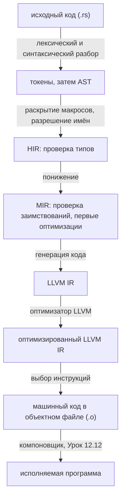

<!-- nav:top -->
[🏠 Начало](../START-HERE.md) · [← 12.7 Читаем ассемблер: arm64 и x86-64](07-reading-assembly.md) · [📋 Этап 12](README.md) · [12.9 Иерархия памяти и кэши →](09-memory-hierarchy-and-caches.md) · [📖 Глоссарий](../GLOSSARY.md) · [🇬🇧 English](../../en/12-computer-systems/08-from-rust-to-machine-code.md) <!-- nav -->

# Урок 12.8 — От Rust до машинного кода

> **Этап 12 — Компьютерные системы** · Урок 8 из 15 · ⏱ около 135 минут

## Что вы узнаете

- Через какие стадии проходит программа на Rust внутри компилятора: токены, синтаксическое дерево, HIR, MIR, LLVM IR и машинный код.
- Как самому посмотреть на MIR и LLVM IR и что они вам говорят.
- Что делает оптимизатор: свёртку констант, встраивание, замену умножений сдвигами, векторизацию.
- Как компилируются обобщения (мономорфизация) и чего это стоит.
- Где в машинном коде появляются проверки границ и проверки переполнения и как писать код, которому они не нужны.

## Перед началом

- Вы прошли [Урок 12.7 — Читаем ассемблер](07-reading-assembly.md). Продолжайте работать в библиотеке `code/p12-asm` и держите `cargo asm` установленным.
- Вы знаете обобщения и ограничения трейтов ([Урок 05.1 — Обобщённые типы](../05-rust-intermediate/01-generics.md)) и итераторы ([Урок 05.5 — Итераторы](../05-rust-intermediate/05-iterators.md)).
- Урок 05.1 упоминал слово *мономорфизация*; этот урок показывает её в машинном коде.

## Новые слова

| Слово | Значение |
|---|---|
| **фронтенд / бэкенд компилятора** (compiler front end / back end) | Фронтенд понимает язык (разбор, типы, проверка заимствований). Бэкенд превращает результат в машинный код для одного процессора. |
| **токен** (token) | Одно «слово» исходного кода: имя, число, символ вроде `{` или `+=`. Разрезание текста на токены называется *лексическим анализом* (lexing). |
| **AST** (Abstract Syntax Tree, абстрактное синтаксическое дерево) | Дерево, показывающее структуру кода: эта функция содержит этот цикл, который содержит это сложение. |
| **IR** (Intermediate Representation, промежуточное представление) | Форма программы между исходным кодом и машинным кодом, созданная для анализа и оптимизации. |
| **HIR** (High-level Intermediate Representation, высокоуровневое промежуточное представление) | Древовидная форма вашего кода в компиляторе после раскрытия макросов и разрешения имён. На ней работает проверка типов. |
| **MIR** (Mid-level Intermediate Representation, промежуточное представление среднего уровня) | Простая форма из небольших *базовых блоков* и переходов. На ней работает проверка заимствований. |
| **LLVM** | Большой открытый бэкенд компиляторов, который использует Rust (и не только). Когда-то название было сокращением от «Low Level Virtual Machine»; сегодня это просто имя. |
| **LLVM IR** | Собственное промежуточное представление LLVM — типизированный язык, похожий на ассемблер, но не зависящий от процессора. |
| **оптимизатор** (optimiser) | Часть компилятора, которая переписывает программу в более быструю равносильную. |
| **свёртка констант** (constant folding) | Вычисление во время компиляции того, что известно во время компиляции (`24 * 60 * 60` превращается в `86400`). |
| **встраивание** (inlining) | Копирование тела вызываемой функции в вызывающую, которое убирает вызов. Оно же открывает путь для других оптимизаций. |
| **мономорфизация** (monomorphisation) | Создание отдельной копии обобщённой функции для каждого конкретного типа, с которым она используется. |
| **векторизация** (vectorisation) | Переписывание цикла так, чтобы инструкции SIMD (Single Instruction, Multiple Data, «одна инструкция, много данных») обрабатывали сразу несколько элементов. |
| **проверка границ** (bounds check) | Проверка `index < len` перед индексированием; если она не проходит, программа паникует, а не читает чужую память. |

## 1. Путешествие программы

Когда вы запускаете `cargo build`, `rustc` проводит ваш код через цепочку форм. Каждая следующая форма проще и ближе к машине, чем предыдущая:



| Стадия | Кто её выполняет | Что там проверяется или меняется |
|---|---|---|
| Токены и AST | фронтенд `rustc` | Синтаксические ошибки («expected `;`») |
| HIR | фронтенд `rustc` | Имена, типы, ограничения трейтов (`error[E0308]: mismatched types`) |
| MIR | `rustc` | Проверка заимствований (`error[E0502]`), вставка проверок переполнения и границ, некоторые оптимизации |
| LLVM IR | LLVM | Большинство оптимизаций: встраивание, свёртка констант, векторизация |
| Машинный код | бэкенд LLVM для одной платформы | Инструкции для arm64 или x86-64, выбор регистров |

Такое разделение объясняет две вещи, которые вы уже видели. **Ошибки компиляции** приходят из фронтенда: проверка заимствований никогда не видит машинного кода. И **один фронтенд обслуживает много процессоров**: вплоть до LLVM IR программа одинакова для вашего Mac и для сервера x86-64; различается только последний шаг, поэтому в Уроке 12.7 вам хватило `--target`.

## 2. Смотрим на MIR и LLVM IR

`rustc` умеет записать в файл каждую промежуточную форму. В `code/p12-asm` начните заново с этих двух функций в `src/lib.rs`:

```rust
#[inline(never)]
pub fn add(a: u64, b: u64) -> u64 {
    a + b
}

#[inline(never)]
pub fn max_of(a: i64, b: i64) -> i64 {
    if a > b { a } else { b }
}
```

```bash
cargo rustc --release -- --emit=llvm-ir,mir
find target/release -name '*.mir' -o -name '*.ll'
```

```text
target/release/build/p12-asm/23f927fa6bcefef6/out/p12_asm-23f927fa6bcefef6.mir
target/release/build/p12-asm/23f927fa6bcefef6/out/p12_asm-23f927fa6bcefef6.ll
```

Файл `.mir` начинается с дружеского предупреждения: формат предназначен для людей и может измениться в любой момент. Вот `max_of` в MIR:

```text
fn max_of(_1: i64, _2: i64) -> i64 {
    debug a => _1;
    debug b => _2;
    let mut _0: i64;
    let mut _3: bool;

    bb0: {
        StorageLive(_3);
        _3 = Gt(copy _1, copy _2);
        switchInt(move _3) -> [0: bb2, otherwise: bb1];
    }

    bb1: {
        _0 = copy _1;
        goto -> bb3;
    }

    bb2: {
        _0 = copy _2;
        goto -> bb3;
    }

    bb3: {
        StorageDead(_3);
        return;
    }
}
```

**Что происходит:**

1. У переменных номера: `_0` — всегда возвращаемое значение, `_1` и `_2` — аргументы (`debug a => _1` связывает их с вашими именами), `_3` — временная переменная для условия.
2. Код разрезан на **базовые блоки** `bb0`–`bb3`: прямые последовательности операторов, которые заканчиваются переходом. `switchInt` переходит к `bb2`, если `_3` равно 0 (ложь), и к `bb1` в противном случае. Ваш `if` превратился в явное ветвление.
3. `StorageLive` / `StorageDead` отмечают, когда `_3` существует; такой информацией пользуется проверка заимствований.

В MIR ветвление ещё есть. Теперь посмотрите на ту же функцию в файле `.ll` (LLVM IR) после оптимизации:

```text
define noundef i64 @_RNvCs6NKwHiZURaG_7p12_asm6max_of(i64 noundef %a, i64 noundef %b) unnamed_addr #0 !guid !5 {
start:
  %a.b = tail call i64 @llvm.smax.i64(i64 %a, i64 %b)
  ret i64 %a.b
}
```

LLVM распознал шаблон «большее из двух знаковых чисел» и заменил весь `if` своей встроенной операцией `llvm.smax` (знаковый максимум). У значений в LLVM IR есть типы (`i64` — 64-битное целое; LLVM не различает знаковые и беззнаковые, это решает *операция*) и имена, начинающиеся с `%`. На последнем шаге бэкенд arm64 превратил `smax` в `cmp` + `csel`, которые вы видели в Уроке 12.7, а бэкенд x86-64 — в `cmp` + `cmov`.

`add` в LLVM IR — одна строка `%_0 = add i64 %b, %a`, которая стала `add x0, x1, x0`.

> 💡 **Совет:** читать MIR или LLVM IR вам придётся редко. Но когда вы гадаете «это виноват компилятор или я?», порядок стадий подсказывает, где искать: сообщение об ошибке приходит из фронтенда; неожиданно медленный цикл обычно сначала виден в ассемблере, а в LLVM IR — если нужно понять, почему так.

## 3. Отладка и релиз: две разные программы

`cargo build` и `cargo build --release` используют разные **профили**. Самые важные здесь настройки:

| Настройка | профиль `dev` (`cargo build`) | профиль `release` (`cargo build --release`) |
|---|---|---|
| `opt-level` | `0` (без оптимизации) | `3` (полная оптимизация) |
| `debug-assertions` | включены (`debug_assert!` выполняется) | выключены |
| `overflow-checks` | включены (паника при переполнении) | выключены (заворачивание) |
| `debug` | полная отладочная информация | нет |

Вот `add` в отладочной сборке. У `cargo asm` для этого есть параметр `--dev`:

```bash
cargo asm --lib --dev p12_asm::add
```

```text
p12_asm::add:
	sub sp, sp, #48
	stp x29, x30, [sp, #32]
	add x29, sp, #32
	str x0, [sp, #16]
	stur x1, [x29, #-8]
	add x8, x0, x1
	str x8, [sp, #8]
	subs x8, x8, x0
	b.lo LBB0_2
	b LBB0_1
LBB0_1:
	ldr x0, [sp, #8]
	ldp x29, x30, [sp, #32]
	add sp, sp, #48
	ret
LBB0_2:
	adrp x0, l_anon.f577d3d8f76b8b9f77c080ae11dfbdf2.1@PAGE
	add x0, x0, l_anon.f577d3d8f76b8b9f77c080ae11dfbdf2.1@PAGEOFF
	bl core::panicking::panic_const::panic_const_add_overflow
```

**Что происходит:**

1. Без оптимизации каждое значение получает своё место на стеке (`str x0, [sp, #16]` и так далее), чтобы отладчик всегда мог его показать. Поэтому отладочные сборки медленные — и поэтому их легко отлаживать.
2. `add x8, x0, x1` — настоящее сложение. Затем идёт **проверка переполнения**: `subs x8, x8, x0` сравнивает сумму с `a` (вычисляет `sum − a` и ставит флаги). Для беззнаковых чисел прибавление `b` может сделать результат *меньше* `a`, только если он завернулся. Поэтому `b.lo` («перейти, если ниже», беззнаковое условие из Урока 12.7) переходит к `LBB0_2` ровно тогда, когда сложение переполнилось.
3. `LBB0_2` загружает адрес сообщения (`adrp` + `add` собирают 64-битный адрес в два шага) и вызывает функцию, которая паникует с «attempt to add with overflow».

В MIR (отладка) видно, откуда взялась эта проверка. Её вписал в программу сам фронтенд:

```text
fn add(_1: u64, _2: u64) -> u64 {
    debug a => _1;
    debug b => _2;
    let mut _0: u64;
    let mut _3: (u64, bool);

    bb0: {
        _3 = AddWithOverflow(copy _1, copy _2);
        assert(!move (_3.1: bool), "attempt to compute `{} + {}`, which would overflow", copy _1, copy _2) -> [success: bb1, unwind continue];
    }

    bb1: {
        _0 = move (_3.0: u64);
        return;
    }
}
```

`AddWithOverflow` возвращает пару (завёрнутый результат, флаг переполнения) — ровно `overflowing_add` из Урока 12.2, — а `assert` паникует, если флаг установлен. В релизном MIR эта проверка просто не создаётся, потому что `overflow-checks` выключен.

> ⚡ **Производительность:** настройки профилей можно менять в `Cargo.toml`. Частая настройка для проектов с медленными отладочными сборками — `[profile.dev] opt-level = 1`: немного оптимизации, и всё ещё можно отлаживать. `opt-level = "s"` или `"z"` оптимизирует под маленький размер, а не под скорость. Урок 19.8 рассказывает о LTO (Link-Time Optimisation, оптимизации во время компоновки) и других настройках сборки для скорости.

## 4. Четыре оптимизации, которые можно увидеть

Добавьте эти функции в `src/lib.rs`. Обратите внимание: у `square` на этот раз **нет** `#[inline(never)]`:

```rust
fn square(x: u64) -> u64 {
    x.wrapping_mul(x)
}

#[inline(never)]
pub fn sum_of_squares(a: u64, b: u64) -> u64 {
    square(a).wrapping_add(square(b))
}

#[inline(never)]
pub fn sum_to_ten() -> u64 {
    (1..=10).sum()
}

#[inline(never)]
pub fn sum_first_slice(values: &[u64], n: usize) -> u64 {
    values[..n].iter().sum()
}
```

**Встраивание.** В Уроке 12.7 `sum_of_squares` дважды вызывала `square` через `bl`, и ей нужен был пролог для сохранения регистров. Теперь:

```text
p12_asm::sum_of_squares:
	mul x8, x0, x0
	madd x0, x1, x1, x8
	ret
```

Тело `square` скопировано в вызывающую функцию, вызовы и кадр стека исчезли, а второе умножение объединилось со сложением в одну `madd`. Встраивание часто самая важная оптимизация, потому что позволяет оптимизатору видеть вызывающую и вызываемую функции вместе.

**Свёртка констант.** Сумма чисел от 1 до 10 не зависит ни от какого входа:

```text
p12_asm::sum_to_ten:
	mov w0, #55
	ret
```

Итератор, диапазон и цикл были вычислены во время компиляции. От них ничего не осталось.

**Упрощение операций** (strength reduction). Вы видели это в Уроке 12.7: `x * 8` превратилось в `lsl x0, x0, #3` — дешёвый сдвиг вместо умножения.

**Векторизация.** `sum_first_slice` — это около 50 инструкций. Её основной цикл такой:

```text
LBB2_6:
	ldp q4, q5, [x8, #-32]
	ldp q6, q7, [x8], #64
	add.2d v0, v4, v0
	add.2d v1, v5, v1
	add.2d v2, v6, v2
	add.2d v3, v7, v3
	subs x10, x10, #8
	b.ne LBB2_6
```

**Что происходит:**

1. `ldp q4, q5, [x8, #-32]` загружает пару 128-битных регистров (`q4`, `q5` — это векторные регистры `v4`, `v5`, рассматриваемые как одно 128-битное значение): сразу четыре `u64`. Две такие загрузки читают **восемь** чисел за круг.
2. `add.2d v0, v4, v0` складывает две пары `u64` одной инструкцией (`.2d` = 2 дорожки по 64 бита).
3. Накопителей **четыре** и они независимы: `v0`–`v3`. Это приём из Урока 12.6, который вы писали вручную для чисел с плавающей точкой. Для целых компилятору разрешено переставлять сложения, поэтому он сделал это сам — и с векторами, по восемь чисел за круг.

После цикла четыре накопителя складываются вместе, а маленький скалярный цикл обрабатывает последние 0–7 чисел.

## 5. Обобщения: одна копия на каждый тип

Обобщённая функция — это ещё не машинный код: компилятор не знает размер `T` и какую инструкцию сравнения использовать. Поэтому он делает копию для каждого типа, с которым вы её используете. Это и есть **мономорфизация**:

```rust
#[inline(never)]
fn largest<T: PartialOrd + Copy>(a: T, b: T) -> T {
    if a > b { a } else { b }
}

#[inline(never)]
pub fn largest_byte(a: u8, b: u8) -> u8 {
    largest(a, b)
}

#[inline(never)]
pub fn largest_float(a: f64, b: f64) -> f64 {
    largest(a, b)
}
```

`cargo asm --lib` без имени выводит список функций. Теперь в нём два `largest`:

```text
0 "p12_asm::add" [9]
1 "p12_asm::largest::<f64>" [10]
2 "p12_asm::largest::<u8>" [16]
3 "p12_asm::largest_byte" [6]
4 "p12_asm::largest_float" [6]
5 "p12_asm::max_of" [10]
6 "p12_asm::sum_first_slice" [119]
7 "p12_asm::sum_of_squares" [13]
8 "p12_asm::sum_to_ten" [7]
```

Каждая копия использует инструкции своего типа. Без `#[inline(never)]` у `largest` копии встраиваются в вызывающие функции. Тогда `largest_byte` и `largest_float` выглядят так:

```text
p12_asm::largest_byte:
	and w8, w1, #0xff
	and w9, w0, #0xff
	cmp w9, w8
	csel w0, w9, w8, hi
	ret
```

```text
p12_asm::largest_float:
	fcmp d0, d1
	fcsel d0, d0, d1, gt
	ret
```

**Что происходит:**

1. Для `u8` аргументы приходят в 32-битных регистрах, поэтому код сначала обрезает их маской до 8 битов (`& 0xff`, Урок 12.4) и сравнивает как **беззнаковые** (`hi`).
2. Для `f64` аргументы приходят в **регистрах с плавающей точкой** `d0` и `d1` (соглашение о вызовах использует для таких чисел отдельные регистры), а `fcmp` / `fcsel` — версии сравнения и выбора для чисел с плавающей точкой.

Мономорфизация — причина, по которой обобщённый код на Rust так же быстр, как код, написанный для одного типа: каждая копия оптимизирована под свой тип. Цена — **размер кода** и **время компиляции**: обобщённая функция, используемая с 20 типами, существует 20 раз. (Трейт-объект `&dyn Trait` из Урока 06.1 делает обратный выбор: одна копия и вызов через таблицу указателей на функции во время выполнения.)

## 6. Проверки границ

Индексирование среза `v[i]` должно проверять `i < v.len()`. Вопрос в том, стоит ли эта проверка чего-нибудь. Часто компилятор может доказать, что проверка не нужна (вы видели это в Упражнении 3 Урока 12.7). Иногда не может. Сравните три версии «поэлементного сложения двух срезов»:

```rust
#[inline(never)]
pub fn add_into(out: &mut [u64], a: &[u64], b: &[u64]) {
    for i in 0..out.len() {
        out[i] = a[i] + b[i];
    }
}

#[inline(never)]
pub fn add_into_asserted(out: &mut [u64], a: &[u64], b: &[u64]) {
    assert!(a.len() >= out.len() && b.len() >= out.len());
    for i in 0..out.len() {
        out[i] = a[i] + b[i];
    }
}

#[inline(never)]
pub fn add_into_zip(out: &mut [u64], a: &[u64], b: &[u64]) {
    for ((o, x), y) in out.iter_mut().zip(a).zip(b) {
        *o = x + y;
    }
}
```

Найдите в ассемблере вызовы функций паники:

```bash
cargo asm --lib p12_asm::add_into 0 | grep panic
cargo asm --lib p12_asm::add_into_asserted | grep panic
cargo asm --lib p12_asm::add_into_zip | grep panic
```

(`add_into` — это ещё и начало двух других имён, поэтому `cargo asm` спрашивает, какую функцию вы имеете в виду; `0` выбирает первую в его списке.)

```text
	bl core::panicking::panic_bounds_check
	bl core::panicking::panic_bounds_check
```

```text
	bl core::panicking::panic
```

Третья команда ничего не печатает.

**Что происходит:**

1. В `add_into` ничто не говорит, что `a` и `b` не короче `out`. Если `a` короче, программа должна запаниковать **ровно на нужном индексе**, записав все элементы до него. Поэтому компилятор сохраняет проверки для `a[i]` и `b[i]` (он достаточно умён, чтобы использовать быстрый векторный цикл, когда видит, что всё помещается, но проверяемый путь ему всё равно нужен).
2. В `add_into_asserted` единственный `assert!` в начале доказывает компилятору, что каждое `a[i]` и `b[i]` в цикле в пределах границ. Обе проверки границ исчезают; остаётся только одна `panic` самого `assert`.
3. В `add_into_zip` индексов нет совсем. `zip` останавливается на конце самого короткого среза, так что проверять нечего. Учтите, что это **другое поведение**: при слишком коротком `a` функция молча обработает меньше элементов, вместо того чтобы паниковать. Сначала выберите нужное поведение, затем код.

> 🔒 **Безопасность:** проверки границ — причина, по которой неверный индекс в безопасном Rust приводит к панике, а не к дыре в безопасности. Не убирайте их ради скорости через `get_unchecked` (это `unsafe`, Урок 06.6). Используйте итераторы или `assert!` в начале: они дают компилятору нужное доказательство, а ваш код остаётся безопасным.

> 🧪 **Тестирование:** когда вы переписываете функцию ради скорости (например, с индексов на `zip`), оставьте старую версию в тестах как эталон и сравнивайте обе на множестве входов, включая пустые срезы и срезы разной длины. Упражнение 3 делает именно это.

## Частые ошибки

> ⚠️ **Частая ошибка: «итераторы медленные, циклы быстрые».** После оптимизации код на итераторах вроде `values.iter().sum()` компилируется в такой же или лучший машинный код, чем написанный вручную цикл с индексами, часто без проверок границ. Итераторы Rust — **абстракция с нулевой стоимостью** (zero-cost abstraction): за более приятный код вы не платите во время выполнения. В отладочной сборке итераторы *действительно* медленнее, потому что ничего не встраивается; это ещё одна причина никогда не измерять отладочные сборки.

> ⚠️ **Частая ошибка: верить микроизменению, не посмотрев.** «Я добавил `#[inline]`, значит, стало быстрее» — это догадка. `#[inline]` — лишь подсказка, а встраивание большой функции во множество вызывающих может сделать программу больше и медленнее. Посмотрите ассемблер или измерьте.

> ⚠️ **Частая ошибка: зависеть от деталей MIR или LLVM IR.** Их форматы меняются между версиями компилятора, и решения оптимизатора тоже меняются. Читайте их, чтобы понимать; никогда не стройте инструменты или тесты, сравнивающие их точный текст.

## Попробуйте сами

1. Посмотрите релизный LLVM IR функции `sum_to_ten` в файле `.ll`. Найдите строку `ret i64 55`.
2. Добавьте в `Cargo.toml` `[profile.release] opt-level = 1` и снова посмотрите на `sum_first_slice`. Векторизована ли она ещё? Затем уберите эту настройку.
3. Сделайте `largest` обобщённой по третьему типу (`i16`), добавив ещё одну вызывающую функцию, и проверьте список из `cargo asm --lib`.

## Упражнения

### Упражнение 1 — Неожиданная константа (легко)

Чего вы ждёте от этой функции? Проверьте через `cargo asm` и объясните две полученные инструкции.

```rust
#[inline(never)]
pub fn seconds_per_day() -> u64 {
    24 * 60 * 60
}
```

<details>
<summary>Подсказка</summary>

Инструкция arm64 занимает 4 байта, поэтому константа внутри неё не может быть очень большой. `movk` означает «move with keep», переместить с сохранением: она записывает 16 битов в заданную позицию и сохраняет остальные биты.

</details>

<details>
<summary>Ответ</summary>

```text
p12_asm::seconds_per_day:
	mov w0, #20864
	movk w0, #1, lsl #16
	ret
```

Почему это работает: свёртка констант вычислила 86 400 во время компиляции. Но 86 400 требует 17 битов, а `mov` может нести только 16. Поэтому значение собирается в два шага: `mov` записывает младшие 16 битов (20 864), `movk` записывает `1` в биты 16–31 и сохраняет остальное: 1 × 65 536 + 20 864 = 86 400. На x86-64, где инструкции могут нести 32-битные константы, это одна `mov eax, 86400`.

</details>

### Упражнение 2 — Найдите копии, проверьте поведение (средне)

Напишите обобщённую `pub fn clamp_value<T: PartialOrd>(x: T, lo: T, hi: T) -> T` (с `#[inline(never)]`) и две вызывающие функции: `clamp_percent(x: i32) -> i32` (диапазон от 0 до 100) и `clamp_unit(x: f32) -> f32` (диапазон от 0.0 до 1.0). Напишите тест для обеих, включая значения ниже, внутри и выше диапазона. Затем найдите обе копии `clamp_value` в списке `cargo asm --lib`.

<details>
<summary>Подсказка</summary>

`clamp_value` нужен только `PartialOrd`, потому что она возвращает один из своих аргументов по значению, ничего не копируя. В списке ищите `clamp_value::<`.

</details>

<details>
<summary>Ответ</summary>

```rust
#[inline(never)]
pub fn clamp_value<T: PartialOrd>(x: T, lo: T, hi: T) -> T {
    if x < lo {
        lo
    } else if x > hi {
        hi
    } else {
        x
    }
}

#[inline(never)]
pub fn clamp_percent(x: i32) -> i32 {
    clamp_value(x, 0, 100)
}

#[inline(never)]
pub fn clamp_unit(x: f32) -> f32 {
    clamp_value(x, 0.0, 1.0)
}

#[cfg(test)]
mod tests {
    use super::*;

    #[test]
    fn clamps_integers_and_floats() {
        assert_eq!(clamp_percent(-5), 0);
        assert_eq!(clamp_percent(50), 50);
        assert_eq!(clamp_percent(150), 100);
        assert_eq!(clamp_unit(0.25), 0.25);
        assert_eq!(clamp_unit(-1.0), 0.0);
        assert_eq!(clamp_unit(7.5), 1.0);
    }
}
```

Часть списка `cargo asm --lib` (номера в начале зависят от остальных функций в вашем файле):

```text
 4 "p12_asm::clamp_percent" [8]
 5 "p12_asm::clamp_unit" [8]
 6 "p12_asm::clamp_value::<f32>" [13]
 7 "p12_asm::clamp_value::<i32>" [17]
```

Почему это работает: в библиотеке нет копии `clamp_value` для неизвестного `T`; машинный код создают только два конкретных использования. `assert_eq!` с числами с плавающей точкой здесь безопасен, потому что никакой арифметики не происходит: функция возвращает один из своих входов без изменений. (В стандартной библиотеке уже есть `Ord::clamp` и `f32::clamp`; это упражнение — о том, чтобы увидеть копии.)

</details>

### Упражнение 3 — Убрать проверку границ, сохранив смысл (средне)

Напишите `pub fn dot_index(a: &[i32], b: &[i32]) -> i32` с циклом по индексам `for i in 0..a.len()` и `pub fn dot_zip` через `a.iter().zip(b).map(|(x, y)| x * y).sum()`. Напишите тест, что обе дают одинаковый результат на двух срезах по 1000 чисел, на пустых срезах и на `[1, 2, 3]` · `[4, 5, 6]` = 32. Затем найдите `panic` через `grep` в ассемблере обеих. На каких входах функции ведут себя по-разному?

<details>
<summary>Подсказка</summary>

Заполните тестовые срезы по формуле вроде `(i * 7 % 13) - 6`, чтобы значения были маленькими (без переполнения) и включали отрицательные числа. Подумайте, что делает каждая версия, когда `b` короче `a`.

</details>

<details>
<summary>Ответ</summary>

```rust
#[inline(never)]
pub fn dot_index(a: &[i32], b: &[i32]) -> i32 {
    let mut sum = 0;
    for i in 0..a.len() {
        sum += a[i] * b[i];
    }
    sum
}

#[inline(never)]
pub fn dot_zip(a: &[i32], b: &[i32]) -> i32 {
    a.iter().zip(b).map(|(x, y)| x * y).sum()
}

#[cfg(test)]
mod tests {
    use super::*;

    #[test]
    fn dot_versions_agree() {
        let a: Vec<i32> = (0..1000).map(|i| (i * 7 % 13) - 6).collect();
        let b: Vec<i32> = (0..1000).map(|i| (i * 5 % 11) - 5).collect();
        assert_eq!(dot_index(&a, &b), dot_zip(&a, &b));
        assert_eq!(dot_index(&[], &[]), 0);
        assert_eq!(dot_zip(&[1, 2, 3], &[4, 5, 6]), 32);
    }
}
```

```bash
cargo asm --lib p12_asm::dot_index | grep panic
cargo asm --lib p12_asm::dot_zip | grep panic
```

```text
	bl core::panicking::panic_bounds_check
```

Вторая команда ничего не печатает.

Почему это работает: `dot_index` проверяет `b[i]`, потому что ничто не обещает, что `b` не короче `a` (для `a[i]` проверка не нужна: цикл идёт до `a.len()`). В `dot_zip` индексов нет. Функции различаются, когда `b` короче: `dot_index` паникует, `dot_zip` возвращает сумму по общей части. Если разные длины — ошибка в вашей программе, добавьте `assert_eq!(a.len(), b.len());` в начало `dot_zip` и получите безопасность первой версии со скоростью второй.

</details>

### Упражнение 4 — Читаем LLVM IR до оптимизации (сложно)

Получите LLVM IR для **отладочной** сборки (`cargo rustc -- --emit=llvm-ir`) и найдите `max_of` в файле `.ll` в `target/debug`. Сравните его с релизной версией из раздела 2. Назовите инструкции, которые выполняют сравнение, ветвление и обращения к памяти.

<details>
<summary>Подсказка</summary>

Ищите `define` и `max_of`. В LLVM IR `alloca` выделяет место на стеке, `store` / `load` записывают и читают память, `icmp` сравнивает целые, а `br` выполняет переход. Строки `#dbg_declare` и пометки `!dbg` пропускайте: это отладочная информация.

</details>

<details>
<summary>Ответ</summary>

```text
define i64 @_RNvCs9aE0p4A2PHt_7p12_asm6max_of(i64 %a, i64 %b) unnamed_addr #0 !dbg !1247 !guid !1254 {
start:
  %b.dbg.spill = alloca [8 x i8], align 8
  %a.dbg.spill = alloca [8 x i8], align 8
  %_0 = alloca [8 x i8], align 8
  store i64 %a, ptr %a.dbg.spill, align 8
    #dbg_declare(ptr %a.dbg.spill, !1252, !DIExpression(), !1255)
  store i64 %b, ptr %b.dbg.spill, align 8
    #dbg_declare(ptr %b.dbg.spill, !1253, !DIExpression(), !1256)
  %_3 = icmp sgt i64 %a, %b, !dbg !1257
  br i1 %_3, label %bb1, label %bb2, !dbg !1257

bb2:                                              ; preds = %start
  store i64 %b, ptr %_0, align 8, !dbg !1258
  br label %bb3, !dbg !1259

bb1:                                              ; preds = %start
  store i64 %a, ptr %_0, align 8, !dbg !1260
  br label %bb3, !dbg !1259

bb3:                                              ; preds = %bb1, %bb2
  %0 = load i64, ptr %_0, align 8, !dbg !1261
  ret i64 %0, !dbg !1261
}
```

Почему это работает: это почти дословная копия MIR. `alloca` выделяет три 8-байтовые ячейки на стеке (две «spill»-ячейки, чтобы отладчик мог показать `a` и `b`, и `_0` для результата). `icmp sgt` — «integer compare, signed greater than», знаковое сравнение «больше», `br i1 %_3, label %bb1, label %bb2` — ветвление `if`, а инструкции `store` / `load` проводят результат через память. Позже оптимизатор убрал все обращения к памяти, ветвление и блоки и распознал `llvm.smax`. (Искажённое имя отличается от релизного, потому что отладочная и релизная сборки — отдельные компиляции с другим хешем.)

</details>

## Вопросы для самопроверки

1. На какой стадии работает проверка заимствований и на какой происходит большинство оптимизаций?

<details>
<summary>Ответ</summary>

Проверка заимствований работает на MIR, внутри `rustc`. Большинство оптимизаций происходит в LLVM, на LLVM IR.

</details>

2. Почему один фронтенд Rust может создавать код и для arm64, и для x86-64?

<details>
<summary>Ответ</summary>

Всё до LLVM IR не зависит от процессора. Только последний шаг, бэкенд LLVM для выбранной платформы, создаёт инструкции конкретного процессора.

</details>

3. Откуда берутся проверки переполнения и почему их нет в релизной сборке?

<details>
<summary>Ответ</summary>

Фронтенд вставляет их в MIR (`AddWithOverflow` плюс `assert`), когда включена настройка профиля `overflow-checks`, — по умолчанию она включена для профиля `dev` и выключена для `release`.

</details>

4. Что изменило встраивание в `sum_of_squares`?

<details>
<summary>Ответ</summary>

Два вызова `square` (с их `bl`, сохранёнными регистрами и кадром стека) исчезли; умножения стали частью функции, а одно из них объединилось со сложением в `madd`.

</details>

5. Что такое мономорфизация и чего она стоит?

<details>
<summary>Ответ</summary>

Компилятор создаёт отдельную копию обобщённой функции для каждого конкретного типа, с которым она используется, и оптимизирует её под этот тип. Это стоит размера кода и времени компиляции.

</details>

6. Почему в цикле `add_into_asserted` нет проверок границ?

<details>
<summary>Ответ</summary>

`assert!` в начале доказывает, что `a` и `b` не короче `out`, поэтому компилятор знает, что каждое `a[i]` и `b[i]` при `i < out.len()` находится в пределах границ.

</details>

7. Что означает «абстракция с нулевой стоимостью» для итераторов?

<details>
<summary>Ответ</summary>

После оптимизации код на итераторах компилируется в машинный код не хуже написанного вручную цикла, поэтому вы ничего не платите во время выполнения за более высокоуровневый код.

</details>

## Итоги

- `rustc` превращает исходный код в токены, AST, HIR (типы) и MIR (проверка заимствований, вставка проверок); LLVM оптимизирует LLVM IR и создаёт машинный код для одной платформы; компоновщик собирает программу.
- `cargo rustc --release -- --emit=mir,llvm-ir` записывает промежуточные формы; они для чтения, а не для того, чтобы от них зависеть.
- Отладочная и релизная сборки — разные программы: `opt-level`, `overflow-checks` и `debug-assertions` меняют машинный код.
- Оптимизатор сворачивает константы, встраивает функции, заменяет умножения сдвигами и векторизует циклы (для целых — даже с несколькими накопителями).
- Обобщения мономорфизируются: по одной оптимизированной копии на тип, за что платят размером кода и временем компиляции.
- Проверки границ остаются, когда компилятор не может доказать, что индекс допустим; `assert!` в начале или итераторы убирают их без `unsafe`. Сначала выберите поведение, затем оптимизируйте и сравнивайте с эталоном в тестах.

## Источники и что почитать

- [Rust Compiler Development Guide: Overview of the compiler](https://rustc-dev-guide.rust-lang.org/overview.html) — официальное описание стадий от исходного кода до машинного.
- [Rust Compiler Development Guide: The MIR](https://rustc-dev-guide.rust-lang.org/mir/index.html) — базовые блоки, операторы и как используется MIR.
- [The rustc book: Command-line arguments (`--emit`)](https://doc.rust-lang.org/rustc/command-line-arguments.html) — все формы, которые умеет записывать `rustc`.
- [The Cargo Book: Profiles](https://doc.rust-lang.org/cargo/reference/profiles.html) — `opt-level`, `overflow-checks`, `debug-assertions` и значения по умолчанию для `dev` и `release`.
- [LLVM Language Reference Manual](https://llvm.org/docs/LangRef.html) — справочник по каждой инструкции LLVM IR (`icmp`, `br`, `alloca`, …).

---

[🏠 Начало](../START-HERE.md) · [← 12.7 Читаем ассемблер: arm64 и x86-64](07-reading-assembly.md) · [📋 Этап 12](README.md) · [12.9 Иерархия памяти и кэши →](09-memory-hierarchy-and-caches.md) · [📖 Глоссарий](../GLOSSARY.md) <!-- nav -->
<!-- nav:bottom -->
