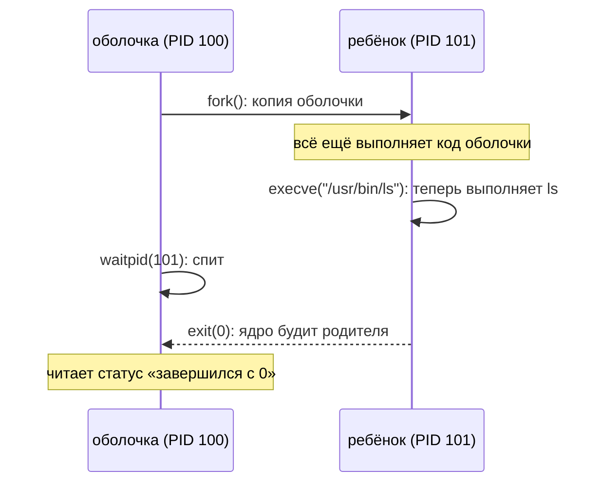

<!-- nav:top -->
[🏠 Начало](../START-HERE.md) · [← 13.4 Файлы и файловые дескрипторы](04-files-and-file-descriptors.md) · [📋 Этап 13](README.md) · [13.6 Конвейеры и перенаправление изнутри →](06-pipes-and-redirection-inside.md) · [📖 Глоссарий](../GLOSSARY.md) · [🇬🇧 English](../../en/13-operating-systems/05-fork-exec-and-wait.md) <!-- nav -->

# Урок 13.5 — Создание процессов: fork, exec и wait

> **Этап 13 — Операционные системы изнутри** · Урок 5 из 18 · ⏱ около 135 минут

## Что вы узнаете

- Как Unix запускает новую программу в два шага: `fork` копирует процесс, `exec` заменяет его программу.
- Почему `fork` «возвращается дважды» и почему `nix::unistd::fork` — функция `unsafe`.
- Как родитель ждёт ребёнка через `waitpid` и читает его код возврата или сигнал, который его убил.
- Что такое зомби и сироты, как создать и как убрать такой процесс.
- Что делает `std::process::Command` под капотом.

## Перед началом

- Вы прошли [Урок 13.4 — Файлы и файловые дескрипторы](04-files-and-file-descriptors.md).
- Вы знаете дерево процессов, PPID (parent process ID, идентификатор родительского процесса) и состояние `Z` из [Урока 13.2](02-processes-from-the-inside.md), а коды возврата и сигналы — с Этапа 11.
- Вы немного пользовались `std::process::Command`; здесь вы увидите, что он делает внутри.
- Вы знаете потоки из [Урока 05.10 — Потоки, каналы и общее состояние](../05-rust-intermediate/10-threads-channels-and-shared-state.md).

## Новые слова

| Слово | Значение |
|---|---|
| **`fork`** | Системный вызов, который делает копию вызывающего процесса. Копия — **ребёнок** (child), оригинал — **родитель** (parent). |
| **`exec`** (`execve`) | Системный вызов, который заменяет программу, работающую в процессе, другим файлом программы. PID остаётся прежним. |
| **`wait`** / **`waitpid`** | Системные вызовы, которыми родитель ждёт, пока ребёнок завершится, и забирает его статус завершения. |
| **статус завершения** (exit status) | То, что ядро хранит о завершившемся процессе: код возврата (0–255) или сигнал, который его убил. |
| **зомби** (zombie) | Завершившийся процесс, чей родитель ещё не вызвал `wait`. Он не занимает памяти, кроме своей записи в таблице процессов. |
| **сирота** (orphan) | Процесс, чей родитель завершился. Ядро даёт ему нового родителя, обычно PID 1. |
| **собрать** (reap) | Забрать зомби через `wait`; после этого он исчезает. |
| **копирование при записи** (copy-on-write, COW) | Приём ядра: после `fork` родитель и ребёнок делят страницы памяти, пока один из них не начнёт писать; только тогда страница копируется (Урок 13.10). |
| **async-signal-safe** (безопасная для сигналов) | Функция, которую можно вызывать в обработчике сигнала или в ребёнке сразу после `fork` в программе с потоками. `write` и `_exit` такие; `malloc` и `println!` — нет. |
| **`PATH`** | Переменная окружения со списком папок, где ищутся программы, например `/usr/local/bin:/usr/bin:/bin`. |
| **CPU**, **ВМ**, **API** | Известны из прошлых уроков: Central Processing Unit, центральный процессор; виртуальная машина (ваша ВМ `dev`); Application Programming Interface, программный интерфейс — функции, которые библиотека или система предлагает другому коду. |

> 📏 **Соглашение:** в этом уроке вы добавляете ещё одну фичу `nix`: `cargo add nix@0.32 --features signal`. Тогда в
> вашем `Cargo.toml` будет `features = ["fs", "process", "signal", "user"]`.

## 1. Два шага: скопировать, затем заменить

Как ваша командная оболочка запускает `ls`? Можно ожидать один системный вызов «запусти программу X». Unix делает это в
два шага:

1. **`fork`** — оболочка делает точную копию себя. Теперь работают две оболочки: родитель и ребёнок.
2. **`exec`** — ребёнок заменяет свою программу на `/usr/bin/ls`. Он сохраняет PID, открытые дескрипторы и текущую папку,
   но его код, данные, куча и стек выбрасываются и загружаются заново из файла `ls`.

Затем родитель вызывает **`wait`** и спит, пока ребёнок не закончит.



Почему два шага, а не один? Потому что промежуток между `fork` и `exec` очень полезен. В нём ребёнок всё ещё выполняет ваш
код и может подготовить мир для новой программы: изменить файловые дескрипторы для `> file` или `|` (Урок 13.6), сменить
папку, настроить поведение сигналов (Урок 13.7) или перейти в новые пространства имён (Урок 13.15). Новая программа всё это
унаследует.

## 2. `fork`: один вызов, два возврата

`fork` странный: вы вызываете его один раз, а он **возвращается дважды** — один раз в родителе и один раз в ребёнке. Их
различает возвращаемое значение: родитель получает PID ребёнка, ребёнок получает 0. В `nix` это перечисление `ForkResult`.
Создайте `src/bin/fork-basic.rs`:

```rust
use nix::sys::wait::waitpid;
use nix::unistd::{ForkResult, fork, getpid, getppid};

fn main() {
    let mut counter = 100;
    println!("before fork: I am {}", getpid());

    // SAFETY: this program has only one thread, so the child may do anything.
    match unsafe { fork() }.expect("fork failed") {
        ForkResult::Child => {
            counter += 1;
            println!(
                "child:  pid {}, parent {}, counter {counter}",
                getpid(),
                getppid()
            );
            std::process::exit(7);
        }
        ForkResult::Parent { child } => {
            counter -= 1;
            println!("parent: pid {}, child {child}, counter {counter}", getpid());
            let status = waitpid(child, None).expect("waitpid failed");
            println!("parent: child finished: {status:?}");
        }
    }
}
```

```text
before fork: I am 1424
parent: pid 1424, child 1425, counter 99
child:  pid 1425, parent 1424, counter 101
parent: child finished: Exited(Pid(1425), 7)
```

**Что происходит:**

1. «before fork» печатается один раз: в этот момент существует только один процесс.
2. После `fork` два процесса выполняют **один и тот же код** с одного и того же места. `match` отправляет каждого в свою ветку.
3. У каждого своя копия `counter`: ребёнок видит 101, родитель — 99. После `fork` у них нет ничего общего, что можно менять.
4. Порядок строк «parent» и «child» может меняться от запуска к запуску: кто работает первым, решает планировщик.
5. Ребёнок завершается через `std::process::exit(7)`. Без этой строки он продолжил бы после `match`, и оба процесса выполнили
   бы остаток `main`.
6. `waitpid(child, None)` усыпляет родителя, пока ребёнок не завершится, и возвращает `WaitStatus::Exited(pid, 7)`.

Копировать целый процесс кажется дорогим, но ядро хитрит: оно копирует только таблицы страниц и помечает всю память как
«только чтение, общая». Страница действительно копируется, только когда один из двух процессов в неё пишет. Это
**копирование при записи**, и Урок 13.10 покажет, как оно работает.

### Почему `fork` в `nix` — `unsafe`

Если у программы несколько потоков, `fork` копирует **только тот поток, который его вызвал**. Остальных потоков в ребёнке
просто нет, а их память есть, включая блокировки, которые они могли держать в этот момент. Если другой поток был посреди
`malloc` и держал блокировку аллокатора, первое выделение памяти в ребёнке может вечно ждать блокировку, которую ни один
поток никогда не отпустит.

Поэтому правило такое: в программе с потоками ребёнок до вызова `exec` может вызывать только функции **async-signal-safe**
(`execve`, `write`, `dup2`, `_exit` и ещё несколько). Никаких `println!`, `Vec::new`, `format!`. Компилятор не может
проверить это правило, поэтому `fork` — `unsafe`, и каждому вызову нужен комментарий `// SAFETY:`. Во всех примерах этого
урока один поток; упражнение 3 показывает аккуратный вариант для программ с потоками. Заметьте также, что `cargo test`
запускает тесты в потоках.

> ⚠️ **Частая ошибка:** забыть, что ребёнок продолжает работу после `match`. Если ветка ребёнка не заканчивается `exit`
> (или `exec`), ребёнок выполнит и код родителя: вы увидите строки, напечатанные дважды, или два процесса, делающих работу
> родителя.

## 3. `exec`: стать другой программой

`execvp(file, args)` заменяет программу вызывающего процесса. Если вызов удался, он **никогда не возвращается**, потому что
кода, который его вызвал, больше нет. Он возвращается только при неудаче. `p` означает «искать в `PATH`», как это делает
оболочка; `v` означает, что аргументы передаются списком (вектором). Создайте `src/bin/fork-exec.rs`:

```rust
use nix::sys::wait::{WaitStatus, waitpid};
use nix::unistd::{ForkResult, execvp, fork};
use std::ffi::CString;

fn main() {
    // Prepare the arguments as C strings before fork.
    let args: Vec<CString> = ["ls", "-l", "/etc/hostname"]
        .iter()
        .map(|s| CString::new(*s).unwrap())
        .collect();

    // SAFETY: single-threaded program.
    match unsafe { fork() }.expect("fork failed") {
        ForkResult::Child => {
            // On success execvp never returns: this process becomes `ls`.
            let err = execvp(&args[0], &args).unwrap_err();
            eprintln!("exec failed: {err}");
            std::process::exit(127);
        }
        ForkResult::Parent { child } => match waitpid(child, None) {
            Ok(WaitStatus::Exited(pid, code)) => println!("{pid} exited with code {code}"),
            Ok(WaitStatus::Signaled(pid, sig, _)) => println!("{pid} was killed by {sig}"),
            other => println!("unexpected: {other:?}"),
        },
    }
}
```

```text
-rw-r--r-- 1 root root 13 Nov 18 07:24 /etc/hostname
1427 exited with code 0
```

**Что происходит:**

1. Аргументы становятся `CString` (Урок 06.10): ядру нужны C-строки, заканчивающиеся NUL-байтом.
2. `args[0]` — одновременно файл для поиска и собственное имя программы, `argv[0]`. По соглашению они совпадают.
3. В ребёнке `execvp` удаётся, поэтому остаток ветки ребёнка никогда не выполняется. Строку вывода печатает `ls`, который
   теперь работает в процессе ребёнка с PID ребёнка и унаследованным стандартным выводом.
4. Если бы `ls` не существовало, `execvp` вернул бы `Err(ENOENT)`, и ребёнок завершился бы с кодом 127 — этим кодом
   оболочки обозначают «команда не найдена».
5. Родитель сопоставляет статус: обычное завершение с кодом или смерть от сигнала.

Посмотрите на весь этот танец через `strace -f` (следить за детьми):

```bash
strace -f -e trace=clone,execve,wait4,exit_group ./target/debug/fork-exec
```

Настоящий вывод, сокращённый:

```text
execve("./target/debug/fork-exec", ["./target/debug/fork-exec"], 0xffffccbaa6b8 /* 11 vars */) = 0
clone(child_stack=NULL, flags=CLONE_CHILD_CLEARTID|CLONE_CHILD_SETTID|SIGCHLDstrace: Process 1433 attached
, child_tidptr=0xffff956300f0) = 1433
[pid  1432] wait4(1433,  <unfinished ...>
[pid  1433] execve("/usr/local/cargo/bin/ls", ["ls", "-l", "/etc/hostname"], 0xfffff83a0db8 /* 11 vars */) = -1 ENOENT (No such file or directory)
...
[pid  1433] execve("/usr/bin/ls", ["ls", "-l", "/etc/hostname"], 0xfffff83a0db8 /* 11 vars */) = 0
[pid  1433] exit_group(0)               = ?
[pid  1433] +++ exited with 0 +++
<... wait4 resumed>[{WIFEXITED(s) && WEXITSTATUS(s) == 0}], 0, NULL) = 1433
--- SIGCHLD {si_signo=SIGCHLD, si_code=CLD_EXITED, si_pid=1433, si_uid=0, si_status=0, si_utime=0, si_stime=0} ---
```

**Что происходит:**

1. В Linux `fork` реализован через более общий системный вызов `clone`, который умеет создавать и потоки (Урок 13.9).
2. Родитель (1432) уходит в `wait4` — системный вызов, стоящий за `waitpid`.
3. Ребёнок (1433) пробует `execve` с каждой папкой из `PATH`, пока одна не сработает: это и есть `p` в `execvp`.
4. Когда ребёнок завершается, ядро будит родителя и вдобавок посылает ему сигнал `SIGCHLD` («ребёнок изменил состояние»).

## 4. Ожидание, статус завершения, зомби и сироты

Когда процесс завершается, ядро сразу освобождает его память и закрывает дескрипторы, но **хранит маленькую запись**: его
PID и статус завершения, чтобы родитель мог спросить «как он закончился?». Пока родитель не спросит через `wait`,
завершившийся процесс — **зомби** (состояние `Z`). Вызов `wait` называют **сбором** (reaping). Создайте `src/bin/zombie.rs`:

```rust
use nix::sys::wait::waitpid;
use nix::unistd::{ForkResult, fork};
use std::process::Command;
use std::{thread, time::Duration};

fn main() {
    // SAFETY: single-threaded program.
    match unsafe { fork() }.expect("fork failed") {
        ForkResult::Child => std::process::exit(0), // the child ends at once
        ForkResult::Parent { child } => {
            thread::sleep(Duration::from_millis(200));
            let pid = child.to_string();
            let ps = ["-o", "pid,ppid,stat,comm", "-p", pid.as_str()];
            println!("before waitpid:");
            Command::new("ps").args(ps).status().unwrap();
            waitpid(child, None).unwrap();
            println!("after waitpid:");
            Command::new("ps").args(ps).status().unwrap();
        }
    }
}
```

```text
before waitpid:
    PID    PPID STAT COMMAND
   1435    1434 Z    zombie
after waitpid:
    PID    PPID STAT COMMAND
```

Ребёнок завершился сразу, но оставался в таблице как `Z`, пока родитель его не собрал; после `waitpid` его нет. Один зомби
безвреден. Долго работающая программа, которая запускает детей и никогда их не ждёт, заполняет ими таблицу процессов: число
PID ограничено (`cat /proc/sys/kernel/pid_max`), и когда они кончаются, `fork` падает с `EAGAIN`.

Обратный случай — **сирота**: родитель завершается первым. Создайте `src/bin/orphan.rs`:

```rust
use nix::unistd::{ForkResult, fork, getppid};
use std::{thread, time::Duration};

fn main() {
    // SAFETY: single-threaded program.
    match unsafe { fork() }.expect("fork failed") {
        ForkResult::Child => {
            println!("child: my parent is {}", getppid());
            thread::sleep(Duration::from_millis(500)); // the parent exits meanwhile
            println!("child: my parent is now {}", getppid());
        }
        ForkResult::Parent { child } => {
            println!("parent: I exit now and leave {child} alone");
        }
    }
}
```

```bash
./target/debug/orphan; sleep 1
```

```text
parent: I exit now and leave 1440 alone
child: my parent is 1439
child: my parent is now 1
```

Ядро дало сироте нового родителя, PID 1, который соберёт её, когда она завершится. (В настольном Linux новым родителем может
оказаться не PID 1, а «subreaper» — процесс-сборщик вроде `systemd --user`.) `sleep 1` не даёт вашей оболочке напечатать
приглашение посреди вывода ребёнка: оболочка ждёт только своего ребёнка, то есть родителя.

> 💡 **Совет:** поэтому у PID 1 особая работа: он должен собирать сирот всей системы. В контейнере PID 1 — это ваша
> программа. Если она запускает детей и никогда их не ждёт, зомби накапливаются. Параметр Docker `--init` запускает крошечную
> программу init в роли PID 1 именно поэтому.

### Коды возврата и сигналы

`waitpid` сообщает одно из двух. `std::process::ExitStatus` в Rust даёт те же сведения через `code()` и, в Unix, `signal()`
(из трейта `std::os::unix::process::ExitStatusExt`):

| Как завершился ребёнок | `nix` | `std` | `$?` оболочки |
|---|---|---|---|
| `exit(3)` или `main` вернул 3 | `Exited(pid, 3)` | `code() == Some(3)` | 3 |
| убит `SIGKILL` (9) | `Signaled(pid, SIGKILL, false)` | `code() == None`, `signal() == Some(9)` | 137 = 128 + 9 |

В Rust `main`, вернувший `Err(..)`, даёт код возврата 1, а паника — 101.

## 5. Что делает `std::process::Command`

`Command::new("ls").status()` делает всё это за вас: ищет в `PATH`, создаёт ребёнка, настраивает его дескрипторы, вызывает
`exec`, ждёт и преобразует статус. Создайте `src/bin/command.rs`:

```rust
use std::process::Command;

fn main() -> std::io::Result<()> {
    let status = Command::new("ls").args(["-l", "/etc/hostname"]).status()?;
    println!("ls finished: {status}");
    Ok(())
}
```

```bash
strace -f -e trace=clone,clone3,execve,wait4 ./target/debug/command
```

Настоящий вывод, сокращённый:

```text
clone3({flags=CLONE_VM|CLONE_VFORK|CLONE_CLEAR_SIGHAND, exit_signal=SIGCHLD, stack=0xffff882d7000, stack_size=0x9000}, 88) = -1 ENOSYS (Function not implemented)
clone(child_stack=0xffff882e0000, flags=CLONE_VM|CLONE_VFORK|SIGCHLDstrace: Process 1445 attached
...
[pid  1445] execve("/usr/bin/ls", ["ls", "-l", "/etc/hostname"], 0xffffe4151f48 /* 11 vars */ <unfinished ...>
...
ls finished: exit status: 0
```

**Что происходит:**

1. `std` не использует простой `fork`. Он использует функцию библиотеки C `posix_spawn`, которая вызывает `clone` с
   `CLONE_VM` (разделять память, а не копировать её) и `CLONE_VFORK` (приостановить родителя, пока ребёнок не вызовет
   `exec`). Это гораздо быстрее, чем копировать таблицы страниц большого процесса.
2. Первая попытка, `clone3`, упала с `ENOSYS` только потому, что её блокирует фильтр безопасности проверочного контейнера;
   библиотека C затем откатилась на `clone`. В вашей ВМ `clone3` срабатывает.
3. Дальше та же схема: `execve` в ребёнке, `wait4` в родителе.

> 📏 **Соглашение:** в настоящих программах используйте `std::process::Command`. Он безопасен, быстр и справляется с
> хитрыми деталями (закрывает дескрипторы, сообщает родителю об ошибках exec). Вызывайте `fork` сами, только когда нужно
> то, чего `Command` не умеет, как в командной оболочке из Урока 13.8 и в среде выполнения контейнеров из Урока 13.17.

## Частые ошибки

> ⚠️ **Частая ошибка:** никогда не вызывать `wait`. Каждого запущенного ребёнка нужно дождаться, иначе он останется зомби,
> пока ваша программа не завершится. В `Command` методы `status()` и `output()` ждут за вас; `spawn()` даёт `Child`, для
> которого вы должны сами вызвать `wait()`. Уничтожение `Child` **не** ждёт.

> ⚠️ **Частая ошибка:** выделять память в ребёнке программы с потоками. В тестах это обычно работает, а потом однажды
> ребёнок навсегда зависает. Готовьте все `CString` и списки аргументов **до** `fork`, как в упражнении 3.

> ⚠️ **Частая ошибка:** забыть, что `argv[0]` — имя программы. `execvp("ls", ["-l"])` запускает `ls` с именем `-l` и **без**
> аргументов. Список должен начинаться с имени: `["ls", "-l"]`.

## Попробуйте сами

1. Запустите `fork-basic` десять раз: `for i in $(seq 10); do ./target/debug/fork-basic | head -3 | tail -2; done`. Меняется
   ли порядок «parent» и «child»?
2. Уберите `std::process::exit(7)` из ветки ребёнка и запустите. Какой статус теперь печатает родитель? (Ребёнок выходит из
   `match`, доходит до конца `main` и нормально завершается с кодом 0.)
3. В `fork-exec` замените `"ls"` на `"lss"` и посмотрите на сообщение и код возврата.
4. Выполните `strace -f -c ./target/debug/fork-exec > /dev/null` и найдите в сводке `clone` и `execve`.

## Упражнения

### Упражнение 1 — Коды возврата и сигналы через `Command` (легко)

Напишите `src/bin/exit-codes.rs`, который запускает `sh -c "<script>"` для скриптов `exit 0`, `exit 3` и `kill -9 $$` и
печатает для каждого `status.code()` и `status.signal()`. (`$$` — это PID этого `sh`, поэтому последний скрипт убивает сам
себя.)

<details>
<summary>Подсказка</summary>

`use std::os::unix::process::ExitStatusExt;` делает доступным метод `signal()`.

</details>

<details>
<summary>Ответ</summary>

```rust
use std::os::unix::process::ExitStatusExt;
use std::process::Command;

fn main() -> std::io::Result<()> {
    for script in ["exit 0", "exit 3", "kill -9 $$"] {
        let status = Command::new("sh").args(["-c", script]).status()?;
        println!(
            "{script:<12} -> code {:?}, signal {:?}",
            status.code(),
            status.signal()
        );
    }
    Ok(())
}
```

```text
exit 0       -> code Some(0), signal None
exit 3       -> code Some(3), signal None
kill -9 $$   -> code None, signal Some(9)
```

Почему это работает: у нормально завершившегося процесса есть код возврата и нет сигнала; у процесса, убитого сигналом, нет
кода возврата. `std` держит эти два случая раздельно, а не смешивает их в одно число, как `$?` оболочки.

</details>

### Упражнение 2 — Описание статуса ожидания, с тестами (средне)

Напишите `fn describe(status: WaitStatus) -> (String, i32)`, которая возвращает текст и значение, которое оболочка положила
бы в `$?`: `("exited with code 3", 3)` для `Exited(_, 3)` и `("killed by SIGKILL", 137)` для `Signaled(_, SIGKILL, _)`.
Протестируйте её на вручную созданных значениях `WaitStatus`. В `main` создайте через fork ребёнка, который ждёт вечно,
убейте его сигналом `SIGTERM` и напечатайте описание.

<details>
<summary>Подсказка</summary>

Тестовые значения можно создать без всякого процесса: `WaitStatus::Exited(Pid::from_raw(42), 3)`. `sig as i32` даёт номер
сигнала. В ребёнке `loop { std::thread::park(); }` ждёт вечно, не тратя процессор. `nix::sys::signal::kill(child,
Signal::SIGTERM)` посылает сигнал.

</details>

<details>
<summary>Ответ</summary>

```rust
use nix::sys::signal::Signal;
use nix::sys::wait::{WaitStatus, waitpid};
use nix::unistd::{ForkResult, fork};

/// Turns a wait status into the text a shell would show, plus the shell's `$?` value.
fn describe(status: WaitStatus) -> (String, i32) {
    match status {
        WaitStatus::Exited(_, code) => (format!("exited with code {code}"), code),
        WaitStatus::Signaled(_, sig, _) => (format!("killed by {sig}"), 128 + sig as i32),
        other => (format!("other status: {other:?}"), -1),
    }
}

fn main() {
    // SAFETY: single-threaded program.
    match unsafe { fork() }.expect("fork failed") {
        ForkResult::Child => loop {
            std::thread::park(); // wait forever, until killed
        },
        ForkResult::Parent { child } => {
            nix::sys::signal::kill(child, Signal::SIGTERM).unwrap();
            let (text, code) = describe(waitpid(child, None).unwrap());
            println!("child {child}: {text}; a shell would set $? = {code}");
        }
    }
}

#[cfg(test)]
mod tests {
    use super::*;
    use nix::unistd::Pid;

    #[test]
    fn normal_exit_keeps_the_code() {
        let st = WaitStatus::Exited(Pid::from_raw(42), 3);
        assert_eq!(describe(st), ("exited with code 3".to_string(), 3));
    }

    #[test]
    fn a_signal_gives_128_plus_its_number() {
        let st = WaitStatus::Signaled(Pid::from_raw(42), Signal::SIGKILL, false);
        assert_eq!(describe(st), ("killed by SIGKILL".to_string(), 137));
    }
}
```

```text
child 390: killed by SIGTERM; a shell would set $? = 143
test result: ok. 2 passed; 0 failed; 0 ignored; 0 measured; 0 filtered out; finished in 0.00s
```

Почему это работает: логика — чистая функция от `WaitStatus`, поэтому тестам не нужны настоящие процессы. `SIGTERM` — сигнал
15, поэтому значение оболочки равно 128 + 15 = 143. Именно эта функция понадобится вам для `$?` в командной оболочке из
Урока 13.8.

</details>

### Упражнение 3 — `run`, безопасный даже с потоками (сложно)

Напишите `fn run(argv: &[&str]) -> i32`, которая делает fork, запускает программу в ребёнке и возвращает код возврата
ребёнка (или 128 + сигнал). Если программу запустить нельзя, ребёнок печатает `run: command not found` и завершается с кодом
127. Ребёнок должен вызывать **только** функции async-signal-safe: соберите все `CString` и список указателей до `fork`, а в
ребёнке используйте `libc::execvp`, `libc::write` и `libc::_exit`. Напишите тесты: `true` даёт 0, `false` даёт 1,
`sh -c "exit 42"` даёт 42, а неизвестная программа — 127. Тесты работают в потоках, так что это именно та ситуация, о которой
говорит правило.

<details>
<summary>Подсказка</summary>

`libc::execvp` нужен `*const *const c_char`: список указателей на C-строки, оканчивающийся нулевым указателем. Соберите
`c_args.iter().map(|a| a.as_ptr())` в `Vec`, затем добавьте `std::ptr::null()`. Держите `c_args` живым, пока используются
указатели. `libc::_exit` завершает процесс сразу, не выполняя код очистки Rust или C, который небезопасен после `fork`.

</details>

<details>
<summary>Ответ</summary>

```rust
use nix::sys::wait::{WaitStatus, waitpid};
use nix::unistd::{ForkResult, fork};
use std::ffi::{CString, c_char};

/// Runs a program like a shell does and returns its exit code (127 if it cannot be started).
fn run(argv: &[&str]) -> i32 {
    // Everything that allocates memory happens BEFORE fork.
    let c_args: Vec<CString> = argv.iter().map(|a| CString::new(*a).unwrap()).collect();
    let mut ptrs: Vec<*const c_char> = c_args.iter().map(|a| a.as_ptr()).collect();
    ptrs.push(std::ptr::null()); // execvp wants a list that ends with a null pointer
    let msg = b"run: command not found\n";

    // SAFETY: the child only calls execvp, write and _exit, which are async-signal-safe.
    match unsafe { fork() }.expect("fork failed") {
        ForkResult::Child => unsafe {
            libc::execvp(ptrs[0], ptrs.as_ptr());
            // Only reached if execvp failed.
            libc::write(2, msg.as_ptr().cast(), msg.len());
            libc::_exit(127);
        },
        ForkResult::Parent { child } => match waitpid(child, None) {
            Ok(WaitStatus::Exited(_, code)) => code,
            Ok(WaitStatus::Signaled(_, sig, _)) => 128 + sig as i32,
            _ => -1,
        },
    }
}

fn main() {
    let args: Vec<String> = std::env::args().skip(1).collect();
    let argv: Vec<&str> = args.iter().map(String::as_str).collect();
    if argv.is_empty() {
        eprintln!("usage: run <program> [args...]");
        std::process::exit(2);
    }
    let code = run(&argv);
    println!("[exit code {code}]");
}

#[cfg(test)]
mod tests {
    use super::*;

    #[test]
    fn reports_exit_codes() {
        assert_eq!(run(&["true"]), 0);
        assert_eq!(run(&["false"]), 1);
        assert_eq!(run(&["sh", "-c", "exit 42"]), 42);
    }

    #[test]
    fn unknown_program_gives_127() {
        assert_eq!(run(&["no-such-program-xyz"]), 127);
    }
}
```

```bash
./target/debug/run echo hi there
./target/debug/run nope
cargo test -q --bin run
```

```text
hi there
[exit code 0]
run: command not found
[exit code 127]

running 2 tests
..
test result: ok. 2 passed; 0 failed; 0 ignored; 0 measured; 0 filtered out; finished in 0.00s
```

Почему это работает: все выделения памяти (`CString`, оба `Vec`, сообщение) происходят в родителе. Ребёнок трогает только
уже существующую память и вызывает только функции, которые не берут блокировок и не выделяют память, поэтому не может
зависнуть на блокировке, которую держал другой поток в момент `fork`. Одна честная деталь: официальный список POSIX (Portable Operating System Interface, переносимый интерфейс операционной системы) в
`signal-safety(7)` содержит `execve` и `execv`, но не `execvp`. `execvp` из glibc ищет программу по `PATH`, используя
только память стека, поэтому в Linux на практике он безопасен. Код, который должен следовать стандарту буквально, ищет
программу по `PATH` до `fork` и вызывает в ребёнке `libc::execv` с полным путём.

</details>

## Вопросы для самопроверки

1. Что `fork` возвращает в родителе и что — в ребёнке?

<details>
<summary>Ответ</summary>

В родителе — PID ребёнка (`ForkResult::Parent { child }`); в ребёнке — 0 (`ForkResult::Child`).

</details>

2. Когда `execvp` возвращается?

<details>
<summary>Ответ</summary>

Только при неудаче, например когда программа не найдена. При успехе вызывающая программа заменена, и возвращаться некуда.

</details>

3. Что программа сохраняет при `exec`, а что заменяется?

<details>
<summary>Ответ</summary>

Сохраняются PID, родитель, открытые файловые дескрипторы (кроме тех, у кого `FD_CLOEXEC`), текущая папка и пользователь.
Код, данные, куча и стек заменяются новой программой.

</details>

4. Что такое зомби и как от него избавиться?

<details>
<summary>Ответ</summary>

Завершившийся процесс, чей родитель ещё не забрал его статус завершения. Родитель убирает его вызовом `wait` или `waitpid`.
Если родитель завершится, зомби усыновит PID 1 и соберёт его.

</details>

5. Почему `nix::unistd::fork` — функция `unsafe`?

<details>
<summary>Ответ</summary>

Потому что в программе с потоками ребёнок получает только вызвавший поток, но всю память, включая блокировки, которые держали
другие потоки. До `exec` ребёнок может вызывать только функции async-signal-safe, а компилятор не может это проверить.

</details>

6. Ребёнка убил `SIGTERM` (15). Что сообщат `nix`, `std` и оболочка?

<details>
<summary>Ответ</summary>

`nix`: `WaitStatus::Signaled(pid, SIGTERM, false)`. `std`: `code()` равен `None`, а `signal()` — `Some(15)`. Оболочка: `$?`
равен 143 (128 + 15).

</details>

## Итоги

- Unix запускает программы в два шага: `fork` копирует процесс, `exec` заменяет его программу; в промежутке ребёнок готовит дескрипторы, папку и сигналы.
- `fork` возвращается дважды: PID ребёнка в родителе и 0 в ребёнке; копия дешёвая благодаря копированию при записи.
- В программе с потоками ребёнок до `exec` может вызывать только функции async-signal-safe; поэтому `fork` — `unsafe`.
- `exec` возвращается только при неудаче; по соглашению код возврата 127 означает «команда не найдена».
- `waitpid` возвращает `Exited(pid, code)` или `Signaled(pid, signal, core)`; оболочка показывает сигнал как 128 + его номер.
- Завершившийся ребёнок — зомби, пока его не собрали; сироту усыновляет PID 1.
- `std::process::Command` делает всё это безопасно, через `posix_spawn` и `clone(CLONE_VM | CLONE_VFORK)`; в обычном коде предпочитайте его.

## Источники и что почитать

- [fork(2) — Linux manual page](https://man7.org/linux/man-pages/man2/fork.2.html) — что копируется, а что нет.
- [execve(2) — Linux manual page](https://man7.org/linux/man-pages/man2/execve.2.html) — что переживает `exec`.
- [wait(2) — Linux manual page](https://man7.org/linux/man-pages/man2/wait.2.html) — `wait`, `waitpid` и зомби.
- [signal-safety(7) — Linux manual page](https://man7.org/linux/man-pages/man7/signal-safety.7.html) — список функций async-signal-safe.
- [std::process::Command — Rust documentation](https://doc.rust-lang.org/std/process/struct.Command.html) — безопасный способ запускать программы.
- [Operating Systems: Three Easy Pieces — Interlude: Process API](https://pages.cs.wisc.edu/~remzi/OSTEP/cpu-api.pdf) — `fork`, `exec` и `wait` на маленьких программах.

---

[🏠 Начало](../START-HERE.md) · [← 13.4 Файлы и файловые дескрипторы](04-files-and-file-descriptors.md) · [📋 Этап 13](README.md) · [13.6 Конвейеры и перенаправление изнутри →](06-pipes-and-redirection-inside.md) · [📖 Глоссарий](../GLOSSARY.md) <!-- nav -->
<!-- nav:bottom -->
