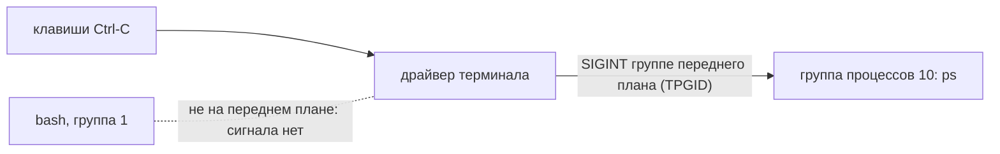

<!-- nav:top -->
[🏠 Начало](../START-HERE.md) · [← 13.6 Конвейеры и перенаправление изнутри](06-pipes-and-redirection-inside.md) · [📋 Этап 13](README.md) · [13.8 Проект: собственная командная оболочка →](08-project-your-own-shell.md) · [📖 Глоссарий](../GLOSSARY.md) · [🇬🇧 English](../../en/13-operating-systems/07-signals-in-your-programs.md) <!-- nav -->

# Урок 13.7 — Сигналы в ваших программах

> **Этап 13 — Операционные системы изнутри** · Урок 7 из 18 · ⏱ около 135 минут

## Что вы узнаете

- Что ядро хранит о сигналах для каждого процесса: действие для каждого сигнала, множество ожидающих сигналов и маску блокировки.
- Почему обработчик сигнала почти ничего не может делать, и безопасный шаблон: поставить флаг, действовать потом.
- Как один раз установить обработчик через `nix::sys::signal::sigaction` и почему `signal-hook` — лучший инструмент на каждый день.
- Что такое `EINTR` и что меняет `SA_RESTART`.
- Как на самом деле работает Ctrl-C (группы процессов, сеансы, терминал) и что происходит с настройками сигналов при `fork` и `exec`.

## Перед началом

- Вы прошли [Урок 13.6 — Конвейеры и перенаправление изнутри](06-pipes-and-redirection-inside.md).
- Вы знаете, что такое сигналы, основные из них (`SIGINT`, `SIGTERM`, `SIGKILL`, `SIGHUP`), `kill` и как корректно остановить программу через `signal_hook::iterator::Signals` из [Урока 11.5 — Процессы и сигналы](../11-linux-shell-and-containers/05-processes-and-signals.md). Этот урок показывает, что происходит внизу.
- Вы знаете атомарные типы вроде `AtomicBool` и общий указатель `Arc` из [Урока 05.10](../05-rust-intermediate/10-threads-channels-and-shared-state.md), а `unsafe` — из [Урока 06.6](../06-rust-advanced/06-unsafe-rust-and-miri.md).

## Новые слова

| Слово | Значение |
|---|---|
| **диспозиция** (disposition) | Что процесс делает, когда приходит сигнал: действие по умолчанию, игнорирование или запуск обработчика. |
| **обработчик сигнала** (signal handler) | Функция вашей программы, которую ядро вызывает при приходе сигнала, прерывая то, что программа делала. |
| **ожидающий сигнал** (pending signal) | Сигнал, который отправлен, но ещё не доставлен. |
| **маска сигналов** (signal mask, blocked set) | Множество сигналов, которые поток сейчас не хочет получать; они остаются ожидающими, пока их не разблокируют. |
| **`EINTR`** | «Interrupted system call», прерванный системный вызов: ошибка, которую возвращает блокирующий вызов, если во время ожидания сработал обработчик сигнала. |
| **`SA_RESTART`** | Флаг для `sigaction`: после обработчика перезапустить прерванный системный вызов, а не завершать его с `EINTR`. |
| **группа процессов** (process group) | Набор процессов, обычно одно задание оболочки (все программы одного конвейера), с общим идентификатором PGID (Process Group ID, идентификатор группы процессов). |
| **сеанс** (session) | Набор групп процессов, обычно всё, что запущено из одного входа в терминал, с идентификатором сеанса (SID). |
| **управляющий терминал** (controlling terminal) | Терминал, принадлежащий сеансу. Он отправляет Ctrl-C и Ctrl-Z как сигналы своей группе процессов **переднего плана**. |
| **TPGID** (Terminal Process Group ID, идентификатор группы процессов терминала) | Идентификатор группы процессов, которая сейчас на переднем плане терминала. |
| **CPU**, **ВМ**, **PID** | Известны из прошлых уроков: Central Processing Unit, центральный процессор; виртуальная машина (ваша ВМ `dev`); Process IDentifier, идентификатор процесса. |

## 1. Что ядро хранит о сигналах

Сигнал — крошечное сообщение от ядра процессу: только номер, никаких данных. С Этапа 11 вы знаете, как его *отправить*
(`kill -TERM 1234`) и что значат основные сигналы. Внутри ядро хранит для каждого процесса три вещи (строго говоря, маска —
своя у каждого потока):

```text
 for each process (in task_struct)
 +-----------------------------------------------------------+
 | disposition table: one entry per signal                   |
 |   SIGINT  -> default (terminate)                          |
 |   SIGPIPE -> ignore            (Rust sets this, 13.6)     |
 |   SIGTERM -> handler at 0xaaaa... (your function)         |
 | pending set:  signals that arrived but are not delivered  |
 | blocked mask: signals the thread does not accept now      |
 +-----------------------------------------------------------+
```

Отправка сигнала лишь ставит бит в множестве ожидающих и будит процесс, если он спит. **Доставка** происходит мгновением
позже: каждый раз, когда ядро собирается вернуться в процесс в пространство пользователя (после системного вызова,
прерывания или когда планировщик даёт ему процессор), оно проверяет множество ожидающих. Для каждого ожидающего
незаблокированного сигнала оно делает то, что говорит диспозиция:

| Действие по умолчанию | Сигналы (примеры) |
|---|---|
| завершить | `SIGTERM`, `SIGINT`, `SIGHUP`, `SIGPIPE`, `SIGALRM`, `SIGUSR1` |
| завершить и записать дамп памяти (core dump) | `SIGQUIT`, `SIGSEGV`, `SIGABRT`, `SIGILL` |
| игнорировать | `SIGCHLD`, `SIGWINCH` (изменился размер терминала) |
| остановить / продолжить | `SIGSTOP`, `SIGTSTP` (Ctrl-Z) / `SIGCONT` |

Два сигнала особые: `SIGKILL` и `SIGSTOP` нельзя ни перехватить, ни игнорировать, ни заблокировать. Ядро действует сразу
само, поэтому администратор всегда может остановить процесс.

Три множества любого процесса можно прочитать в `/proc/<pid>/status` как шестнадцатеричные битовые маски: `SigPnd`
(ожидающие), `SigBlk` (заблокированные), `SigIgn` (игнорируемые) и `SigCgt` (перехваченные: установлен обработчик). Бит 0
означает сигнал 1, бит 1 — сигнал 2 и так далее. Упражнение 2 их расшифровывает.

## 2. Обработчики срабатывают в любой момент, поэтому почти ничего не должны делать

Когда доставляется сигнал с обработчиком, ядро заставляет процесс прыгнуть в функцию-обработчик, где бы он ни был: посреди
`println!`, посреди `malloc`, удерживая блокировку. Когда обработчик возвращается, программа продолжает с прерванного места.

```text
 main:    ... let v = vec![1, 2, 3];  -- malloc takes the allocator lock --
                                             |
                                    SIGTERM delivered here
                                             v
 handler:                            println!("bye")  -> needs to allocate -> waits for the lock
                                                         that main holds -> waits forever
```

Это та же опасность, что и в ребёнке после `fork` (Урок 13.5), и правило то же: обработчик может вызывать только функции
**async-signal-safe**. В Rust безопасный и распространённый шаблон такой: **обработчик только ставит атомарный флаг; главный
цикл проверяет флаг и делает настоящую работу.**

### Один раз вручную: `sigaction`

`sigaction` — системный вызов, который задаёт диспозицию. `nix` его оборачивает; вызов `unsafe`, потому что компилятор не может
проверить, что делает ваш обработчик. Создайте `src/bin/raw-handler.rs`:

```rust
use nix::sys::signal::{SaFlags, SigAction, SigHandler, SigSet, Signal, sigaction};
use std::sync::atomic::{AtomicBool, Ordering};
use std::{thread, time::Duration};

static STOP: AtomicBool = AtomicBool::new(false);

/// The signal handler. It may interrupt `main` at ANY instruction, so it only sets a flag.
extern "C" fn on_sigterm(_signal: i32) {
    STOP.store(true, Ordering::SeqCst);
}

fn main() -> nix::Result<()> {
    let action = SigAction::new(
        SigHandler::Handler(on_sigterm),
        SaFlags::SA_RESTART,
        SigSet::empty(),
    );
    // SAFETY: the handler only touches an atomic, which is async-signal-safe.
    unsafe { sigaction(Signal::SIGTERM, &action) }?;

    println!("pid {}: working; send me SIGTERM", std::process::id());
    let mut done = 0;
    while !STOP.load(Ordering::SeqCst) {
        thread::sleep(Duration::from_millis(100)); // one "unit of work"
        done += 1;
    }
    println!("got SIGTERM after {done} units of work: saving and exiting cleanly");
    Ok(())
}
```

Запустите её в фоне и отправьте `SIGTERM` через секунду:

```bash
./target/debug/raw-handler & sleep 1; kill -TERM $!; wait $!; echo "exit code $?"
```

```text
pid 2109: working; send me SIGTERM
got SIGTERM after 11 units of work: saving and exiting cleanly
exit code 0
```

**Что происходит:**

1. У `extern "C" fn on_sigterm(_signal: i32)` соглашение о вызовах C (Урок 06.10), потому что ядро вызывает её как функцию на
   C. Она получает номер сигнала.
2. `SigAction::new(handler, flags, mask)` описывает новую диспозицию. `SA_RESTART` объясняется в разделе 4. `SigSet` — множество
   дополнительных сигналов, блокируемых, пока работает обработчик; здесь их нет.
3. `sigaction(Signal::SIGTERM, &action)` устанавливает её. Теперь `SIGTERM` не убивает процесс.
4. Главный цикл делает по одной единице работы и между ними проверяет флаг. После сигнала он доделывает текущую единицу,
   печатает сообщение и нормально возвращается: код возврата 0, а не 143.

> ⚠️ **Частая ошибка:** делать настоящую работу в обработчике: печатать, выделять память, захватывать `Mutex`, писать в
> журнал. В быстром тесте это работает, а в продакшене один раз из тысячи приводит к взаимной блокировке или порче памяти.
> Ограничивайте обработчики записью в атомарную переменную — или позвольте `signal-hook` написать обработчик за вас.

### На каждый день: `signal-hook`

`signal-hook` (Урок 11.5) устанавливает за вас аккуратно написанные обработчики, без `unsafe` в вашем коде.
`signal_hook::flag::register` — это ровно тот же шаблон. Создайте `src/bin/graceful.rs`:

```rust
use signal_hook::consts::{SIGINT, SIGTERM};
use std::sync::Arc;
use std::sync::atomic::{AtomicBool, Ordering};
use std::{thread, time::Duration};

fn main() -> std::io::Result<()> {
    let stop = Arc::new(AtomicBool::new(false));
    for signal in [SIGTERM, SIGINT] {
        // signal-hook installs a small, safe handler that only sets the flag.
        signal_hook::flag::register(signal, Arc::clone(&stop))?;
    }

    println!(
        "pid {}: working; press Ctrl-C or send SIGTERM",
        std::process::id()
    );
    let mut done = 0;
    while !stop.load(Ordering::Relaxed) {
        thread::sleep(Duration::from_millis(100));
        done += 1;
    }
    println!("stopping after {done} units of work");
    Ok(())
}
```

Сначала добавьте крейт: `cargo add signal-hook@0.4`. Затем:

```bash
./target/debug/graceful & sleep 0.5; kill -INT $!; wait $!; echo "exit code $?"
```

```text
pid 2112: working; press Ctrl-C or send SIGTERM
stopping after 5 units of work
exit code 0
```

`Signals::forever()` из Урока 11.5 — другой стиль: поток, который **ждёт** сигналы и обрабатывает их по одному. Внутри он
использует тот же приём: его обработчик лишь записывает один байт в конвейер (Урок 13.6), а ждущий поток читает из этого
конвейера. Используйте флаг, если у вас всё равно есть цикл; используйте итератор, если поток может просто ждать.

> 📏 **Соглашение:** для обработчиков используйте `signal-hook` (или `tokio::signal` в асинхронных программах, Этап 14).
> Пишите собственный обработчик через `sigaction`, только когда это необходимо, и тогда ограничивайтесь атомарными
> переменными и `write`.

## 3. Что перехватить нельзя

Создайте `src/bin/cannot-ignore.rs`:

```rust
use nix::sys::signal::{SigHandler, Signal, signal};

fn main() {
    for sig in [Signal::SIGTERM, Signal::SIGKILL, Signal::SIGSTOP] {
        // SAFETY: SIG_IGN installs no code of ours.
        let result = unsafe { signal(sig, SigHandler::SigIgn) };
        match result {
            Ok(_) => println!("{sig}: now ignored"),
            Err(e) => println!("{sig}: {e}"),
        }
    }
}
```

```text
SIGTERM: now ignored
SIGKILL: EINVAL: Invalid argument
SIGSTOP: EINVAL: Invalid argument
```

`nix::sys::signal::signal` — упрощённая форма `sigaction`. Ядро отклоняет любое изменение `SIGKILL` и `SIGSTOP` с ошибкой
`EINVAL`. (`signal-hook` проверяет это за вас и паникует, если вы пытаетесь их зарегистрировать.) Поэтому правильный способ
остановить службу — сначала `SIGTERM`, и `SIGKILL` только если она не завершилась через какое-то время: именно так поступают
systemd и Kubernetes.

## 4. Прерванные системные вызовы: `EINTR`

Что происходит, когда сигнал с обработчиком приходит, пока программа **заблокирована в системном вызове**, например в `read` из
пустого конвейера? Ядро должно выполнить обработчик, поэтому будит процесс и выходит из системного вызова. Дальше два варианта,
их выбирает флаг `SA_RESTART`. Создайте `src/bin/eintr.rs`:

```rust
use nix::sys::signal::{SaFlags, SigAction, SigHandler, SigSet, Signal, sigaction};
use nix::unistd::{alarm, pipe, read};

extern "C" fn on_alarm(_signal: i32) {} // does nothing; its only job is to exist

fn main() -> nix::Result<()> {
    let restart = std::env::args().any(|a| a == "--restart");
    let flags = if restart {
        SaFlags::SA_RESTART
    } else {
        SaFlags::empty()
    };
    let action = SigAction::new(SigHandler::Handler(on_alarm), flags, SigSet::empty());
    // SAFETY: the handler does nothing at all.
    unsafe { sigaction(Signal::SIGALRM, &action) }?;

    let (reader, _writer) = pipe()?; // nobody will ever write: read blocks
    alarm::set(1); // ask the kernel to send SIGALRM in 1 second
    let mut buf = [0_u8; 16];
    println!("blocking in read() ...");
    match read(&reader, &mut buf) {
        Ok(n) => println!("read returned {n}"),
        Err(e) => println!("read failed: {e:?} ({})", e.desc()),
    }
    Ok(())
}
```

```bash
./target/debug/eintr
timeout 3 ./target/debug/eintr --restart; echo "exit code $?"
```

```text
blocking in read() ...
read failed: EINTR (Interrupted system call)
blocking in read() ...
exit code 124
```

**Что происходит:**

1. `alarm::set(1)` просит ядро отправить этому процессу `SIGALRM` через секунду. Его действие по умолчанию завершило бы
   процесс, поэтому мы ставим пустой обработчик.
2. `read` блокируется: конвейер пуст, а конец для записи (`_writer`) всё ещё открыт.
3. **Без `SA_RESTART`:** после обработчика `read` возвращает ошибку `EINTR`. Программа должна решить, что делать.
4. **С `SA_RESTART`:** ядро перезапускает `read` после обработчика, и программа продолжает ждать. `timeout` убивает её через
   3 секунды (код возврата 124).

`EINTR` — причина, по которой аккуратные циклы повторяют вызов, как `write_all_fd` в Уроке 13.3. `std` в Rust помогает:
`read_exact`, `read_to_end`, `write_all` и `io::copy` сами повторяют вызов при `ErrorKind::Interrupted`, а обработчики, которые
ставит `signal-hook`, используют `SA_RESTART`. Простой вызов `read` или `write` всё же может вернуть `EINTR`, поэтому, если вы
их вызываете, обрабатывайте эту ошибку.

## 5. Ctrl-C, группы процессов и терминал

Кто отправляет `SIGINT`, когда вы нажимаете Ctrl-C? Не командная оболочка. **Драйвер терминала** в ядре видит нажатие и
отправляет `SIGINT` **группе процессов переднего плана** этого терминала. Чтобы это понять, нужны три идентификатора:

- **Группа процессов** — одно задание оболочки: все процессы `sleep 30 | sleep 30` имеют общий PGID, обычно PID первого из них.
- **Сеанс** — всё, что запущено из одного входа в терминал. Его первый процесс, обычно ваша оболочка входа, — **лидер сеанса**
  (та самая `s` в `Ss` у `ps` из Урока 13.2).
- Терминал помнит, какая группа процессов на **переднем плане** (TPGID). Сигналы с клавиатуры идут только этой группе.

Настоящий вывод в интерактивном bash в терминале контейнера (в вашей ВМ числа больше):

```bash
sleep 30 | sleep 30 &
ps -o pid,ppid,pgid,sid,tpgid,stat,comm
```

```text
[1] 8
    PID    PPID    PGID     SID   TPGID STAT COMMAND
      1       0       1       1      10 Ss   bash
      7       1       7       1      10 S    sleep
      8       1       7       1      10 S    sleep
     10       1      10       1      10 R+   ps
```

**Что происходит:**

1. Всё находится в сеансе 1, лидер которого — `bash` (здесь PID 1).
2. Фоновое задание `sleep 30 | sleep 30` — группа процессов 7: у обоих `sleep` PGID 7.
3. `ps` запущен на переднем плане, поэтому оболочка дала ему собственную группу 10 и сделала 10 группой переднего плана
   терминала: TPGID равен 10, а `+` в `R+` означает «в группе переднего плана». Ctrl-C сейчас пошёл бы только к `ps` — не к
   `sleep` и не к bash.



Интерактивная оболочка делает это тремя системными вызовами для каждого задания: `setpgid` (поместить ребёнка в новую
группу), `tcsetpgrp` (сделать эту группу группой переднего плана терминала) и, когда задание завершается, снова `tcsetpgrp`,
чтобы забрать терминал обратно. Это **управление заданиями** (job control). Более простая оболочка — вроде той, что вы
построите в Уроке 13.8, — может держать всё в одной группе и всё равно правильно обрабатывать Ctrl-C, если соблюдает правило из
следующего раздела.

### Настройки сигналов при `fork` и `exec`

| | после `fork` (ребёнок) | после `exec` (новая программа) |
|---|---|---|
| сигнал с действием **по умолчанию** | по умолчанию | по умолчанию |
| **игнорируемый** сигнал | игнорируется | **по-прежнему игнорируется** |
| сигнал с **обработчиком** | тот же обработчик | сброшен **на действие по умолчанию** (кода вашего обработчика больше нет) |
| маска блокировки | копируется | **сохраняется** |
| ожидающие сигналы | очищаются | сохраняются |

Вторая строка — ловушка. Создайте `src/bin/ignore-exec.rs`, который игнорирует `SIGINT` (только если попросили), а затем
становится `sleep 30`:

```rust
use nix::sys::signal::{SigHandler, Signal, signal};
use nix::unistd::execvp;
use std::ffi::CString;

fn main() -> nix::Result<()> {
    let mode = std::env::args().nth(1).unwrap_or_default();
    if mode == "ignore" {
        // SAFETY: SIG_IGN installs no code of ours.
        unsafe { signal(Signal::SIGINT, SigHandler::SigIgn) }?;
    }
    println!(
        "pid {}: becoming `sleep 30` (mode {mode:?})",
        std::process::id()
    );
    let args = [CString::new("sleep").unwrap(), CString::new("30").unwrap()];
    let err = execvp(&args[0], &args).unwrap_err();
    Err(err)
}
```

Запустите `./target/debug/ignore-exec ignore`, нажмите Ctrl-C — ничего не произойдёт: `sleep` унаследовал «игнорировать
SIGINT». Остановите его через Ctrl-\ (`SIGQUIT`). С `./target/debug/ignore-exec default` Ctrl-C завершает его сразу. Из второго
терминала видно почему (настоящий вывод: строка из `/proc/<pid sleep>/status` в каждом режиме):

```text
pid 393: becoming `sleep 30` (mode "ignore")
SigIgn:	0000000000001002
pid 400: becoming `sleep 30` (mode "default")
SigIgn:	0000000000001000
```

В `0x1002` установлены биты 1 и 12: сигналы 2 (`SIGINT`) и 13 (`SIGPIPE`). Даже в режиме по умолчанию `SIGPIPE` (бит 12,
`0x1000`) игнорируется: рантайм Rust поставил это до `main` (Урок 13.6), а сырой `execvp` передал настройку `sleep`.
(`std::process::Command` именно поэтому сбрасывает `SIGPIPE` на действие по умолчанию в своих детях.)

Отсюда правило для оболочки, которая должна пережить Ctrl-C:

1. Оболочка **игнорирует** (или перехватывает) `SIGINT`, поэтому Ctrl-C её не убивает.
2. Каждый ребёнок после `fork` и до `exec` возвращает `SIGINT` — и `SIGPIPE`, `SIGQUIT`, `SIGTSTP`, если оболочка их меняла —
   к действию **по умолчанию** через `signal(sig, SigHandler::SigDfl)`.
3. Теперь Ctrl-C идёт всей группе переднего плана: ребёнок умирает, оболочка его игнорирует и печатает новое приглашение.

> 🔒 **Безопасность:** маска блокировки и игнорируемые сигналы наследуются каждой программой, которую вы запускаете. Менеджер
> служб или среда выполнения контейнеров, которая забыла их сбросить, может запускать программы, которые нельзя остановить
> через `SIGTERM`. Сбрасывайте состояние сигналов в ребёнке до `exec`.

### `SIGCHLD`

Когда ребёнок меняет состояние, ядро посылает родителю `SIGCHLD` (вы видели его в выводе `strace` в Уроке 13.5). Его действие
по умолчанию — «игнорировать», поэтому простой родитель просто вызывает `waitpid`, когда ему нужно. Серверы, которые запускают
много детей, используют флаг для `SIGCHLD` или `waitpid` с `WaitPidFlag::WNOHANG` в главном цикле, чтобы собирать зомби, не
блокируясь.

## Частые ошибки

> ⚠️ **Частая ошибка:** ожидать, что обработчик сработает «сразу», пока программа занята долгим вычислением без системных
> вызовов. Доставка происходит, когда ядро возвращается в процесс; благодаря прерыванию таймера это бывает как минимум каждые
> несколько миллисекунд, так что на практике быстро. Но ваш **флаг** проверяется, только когда его проверяет цикл: шаг цикла
> длиной 10 секунд делает остановку длиной 10 секунд.

> ⚠️ **Частая ошибка:** забыть, что маска и игнорируемые сигналы переживают `exec`. Программа, которая «не реагирует на
> Ctrl-C», часто запущена родителем, который игнорировал `SIGINT`. Проверьте `SigIgn` в `/proc/<pid>/status`.

## Попробуйте сами

1. Запустите `graceful` на переднем плане и нажмите Ctrl-C. Затем запустите его в фоне и остановите через `kill -TERM %1`.
2. Запустите `sleep 300 &` и прочитайте `grep Sig /proc/$!/status`. Какие сигналы игнорирует фоновое задание **интерактивной**
   оболочки?
3. Выполните `ps -o pid,pgid,sid,tpgid,stat,comm`, пока работает `sleep 100 | cat &`. У каких процессов общий PGID?
4. Запустите `eintr` под `strace -e trace=read,rt_sigaction`. Найдите строку `read(...) = ? ERESTARTSYS` и сигнал.

## Упражнения

### Упражнение 1 — Убить, но аккуратно (легко)

Запустите `raw-handler` в фоне и отправьте ему по очереди, в трёх запусках, `SIGTERM`, `SIGINT` и `SIGKILL`. Каждый раз
запишите код возврата и объясните его.

<details>
<summary>Подсказка</summary>

`./target/debug/raw-handler & sleep 1; kill -INT $!; wait $!; echo $?`. Обработчик есть только у `SIGTERM`.

</details>

<details>
<summary>Ответ</summary>

`SIGTERM`: обработчик ставит флаг, программа печатает сообщение и завершается с 0. `SIGINT`: обработчика нет, действие по
умолчанию завершает процесс; но фоновое задание неинтерактивной оболочки (скрипта или `bash -c`) игнорирует `SIGINT`, поэтому
там программа продолжает работать — в интерактивной оболочке вы получите 130 (128 + 2). `SIGKILL`: перехватить нельзя; ядро
сразу завершает процесс, код возврата 137 (128 + 9), и сообщение об очистке так и не печатается.

</details>

### Упражнение 2 — Расшифровать маски сигналов, с тестами (средне)

Напишите `src/bin/sigmask.rs` с функцией `fn decode_mask(hex: &str) -> Vec<i32>`, которая превращает маску вроде
`0000000000001002` в номера сигналов `[2, 13]`, и `fn name(number: i32) -> String`, которая даёт `"SIGINT"` для 2. `main`
принимает необязательный PID (по умолчанию `self`) и печатает строки `SigIgn`, `SigCgt` и `SigBlk` в виде имён. Протестируйте обе
функции. Затем запустите программу для вашей интерактивной оболочки: `./target/debug/sigmask $$`.

<details>
<summary>Подсказка</summary>

`u64::from_str_radix(hex.trim(), 16)` разбирает маску. Установленный бит `b` означает сигнал `b + 1`:
`(0..64).filter(|bit| bits & (1 << bit) != 0)`. `nix::sys::signal::Signal::try_from(number)` даёт `Signal`, чей `Display` —
его имя.

</details>

<details>
<summary>Ответ</summary>

```rust
use nix::sys::signal::Signal;

/// Decodes a mask like the `SigIgn:` line of /proc/<pid>/status into signal numbers.
/// Bit 0 is signal 1, bit 1 is signal 2, and so on.
fn decode_mask(hex: &str) -> Vec<i32> {
    let bits = u64::from_str_radix(hex.trim(), 16).unwrap_or(0);
    (0..64)
        .filter(|bit| bits & (1 << bit) != 0)
        .map(|bit| bit + 1)
        .collect()
}

fn name(number: i32) -> String {
    match Signal::try_from(number) {
        Ok(sig) => sig.to_string(),
        Err(_) => format!("signal {number}"),
    }
}

fn main() -> std::io::Result<()> {
    let pid = std::env::args()
        .nth(1)
        .unwrap_or_else(|| "self".to_string());
    let status = std::fs::read_to_string(format!("/proc/{pid}/status"))?;
    for line in status.lines() {
        for key in ["SigIgn:", "SigCgt:", "SigBlk:"] {
            if let Some(hex) = line.strip_prefix(key) {
                let names: Vec<String> = decode_mask(hex).into_iter().map(name).collect();
                println!("{key} {}", names.join(" "));
            }
        }
    }
    Ok(())
}

#[cfg(test)]
mod tests {
    use super::*;

    #[test]
    fn decodes_single_and_multiple_bits() {
        assert_eq!(decode_mask("0000000000000000"), Vec::<i32>::new());
        assert_eq!(decode_mask("0000000000000002"), vec![2]);
        assert_eq!(decode_mask("0000000000001002"), vec![2, 13]);
    }

    #[test]
    fn names_known_signals() {
        assert_eq!(name(2), "SIGINT");
        assert_eq!(name(13), "SIGPIPE");
    }
}
```

Вывод для интерактивного bash (`./target/debug/sigmask $$`):

```text
SigBlk: SIGCHLD
SigIgn: SIGQUIT SIGTERM SIGTSTP SIGTTIN SIGTTOU
SigCgt: SIGHUP SIGINT SIGILL SIGTRAP SIGABRT SIGBUS SIGFPE SIGUSR1 SIGSEGV SIGUSR2 SIGPIPE SIGALRM SIGCHLD SIGXCPU SIGXFSZ SIGVTALRM SIGWINCH SIGSYS
```

Почему это работает: каждая маска — 64-битное число, напечатанное в шестнадцатеричном виде, по одному биту на сигнал. Вывод
объясняет поведение bash: он **игнорирует** `SIGTERM` (поэтому `kill $$` не завершает вашу оболочку входа), `SIGQUIT` и
сигналы остановки заданий, и **перехватывает** `SIGINT` (Ctrl-C в приглашении лишь очищает строку) и `SIGCHLD` (чтобы замечать
завершившиеся задания).

</details>

### Упражнение 3 — Двухступенчатое завершение (сложно)

Напишите `src/bin/two-stage.rs`: при первом `SIGTERM` или `SIGINT` программа начинает медленную очистку (3 секунды) и
завершается с 0; если во время очистки приходит второй сигнал, она завершается **сразу** с кодом 130. Используйте только
`signal_hook::flag`.

<details>
<summary>Подсказка</summary>

`signal_hook::flag::register_conditional_shutdown(signal, 130, Arc::clone(&stop))` завершает программу с 130, когда приходит
сигнал **и** `stop` уже равен true. Зарегистрируйте это **до** `flag::register(signal, Arc::clone(&stop))`: действия
выполняются в порядке регистрации, поэтому при первом сигнале условие ещё ложно, и только потом флаг становится true.

</details>

<details>
<summary>Ответ</summary>

```rust
use signal_hook::consts::{SIGINT, SIGTERM};
use std::sync::Arc;
use std::sync::atomic::{AtomicBool, Ordering};
use std::{thread, time::Duration};

fn main() -> std::io::Result<()> {
    let stop = Arc::new(AtomicBool::new(false));
    for signal in [SIGTERM, SIGINT] {
        // Registered FIRST: exit at once with code 130, but only if `stop` is already true.
        signal_hook::flag::register_conditional_shutdown(signal, 130, Arc::clone(&stop))?;
        // Registered SECOND: set `stop` to true.
        signal_hook::flag::register(signal, Arc::clone(&stop))?;
    }

    println!("pid {}: working", std::process::id());
    while !stop.load(Ordering::Relaxed) {
        thread::sleep(Duration::from_millis(100));
    }
    println!("first signal: cleaning up (this takes 3 seconds, signal again to skip it)");
    thread::sleep(Duration::from_secs(3));
    println!("clean-up finished");
    Ok(())
}
```

Один сигнал, затем два сигнала с интервалом в полсекунды:

```text
pid 273: working
first signal: cleaning up (this takes 3 seconds, signal again to skip it)
clean-up finished
exit code 0
pid 278: working
first signal: cleaning up (this takes 3 seconds, signal again to skip it)
exit code 130
```

Почему это работает: оба действия выполняются внутри обработчика, который поставил `signal-hook`, в порядке регистрации.
Действие завершения вызывает `_exit`, а она async-signal-safe. Так ведут себя многие серверы: первый Ctrl-C вежливо просит,
второй настаивает.

</details>

## Вопросы для самопроверки

1. Какие три вещи ядро хранит о сигналах для каждого процесса (или потока)?

<details>
<summary>Ответ</summary>

Диспозицию каждого сигнала (по умолчанию, игнорировать или обработчик), множество ожидающих сигналов и маску заблокированных
сигналов.

</details>

2. Почему обработчик сигнала должен только ставить атомарный флаг?

<details>
<summary>Ответ</summary>

Потому что он может прервать программу на любой инструкции, даже когда программа держит блокировку (например, внутри
`malloc`). Если обработчику нужна та же блокировка, он ждёт вечно. Безопасны только операции async-signal-safe, например запись
в атомарную переменную.

</details>

3. Заблокированный `read` вернул `EINTR`. Что произошло и что должна сделать программа?

<details>
<summary>Ответ</summary>

Во время ожидания был доставлен сигнал с обработчиком, установленным без `SA_RESTART`. Обычно программа проверяет свои флаги
(например, «не пора ли остановиться?») и, если нужно продолжать, просто снова вызывает `read`.

</details>

4. Вы нажимаете Ctrl-C, пока `sleep 100 | cat` работает на переднем плане bash. Кто отправляет `SIGINT` и каким процессам?

<details>
<summary>Ответ</summary>

Драйвер терминала в ядре отправляет его группе процессов переднего плана терминала: и `sleep`, и `cat`, которые образуют одно
задание. Bash находится в другой группе процессов и ничего не получает.

</details>

5. Родитель игнорирует `SIGINT`, затем делает fork и exec программы. Реагирует ли программа на Ctrl-C? А если бы у родителя
   был обработчик?

<details>
<summary>Ответ</summary>

Если родитель игнорировал `SIGINT`, новая программа наследует «игнорировать» и **не** реагирует. Если у родителя был
обработчик, диспозиция при `exec` сбрасывается на действие по умолчанию, поэтому Ctrl-C завершит программу.

</details>

6. Почему `kill -9` срабатывает всегда, а `kill` — иногда нет?

<details>
<summary>Ответ</summary>

`kill` отправляет `SIGTERM`, который программа может перехватить или игнорировать. `kill -9` отправляет `SIGKILL`, который
нельзя перехватить, игнорировать или заблокировать: ядро завершает процесс само. (Процесс, застрявший в состоянии `D`, умирает
только когда вернётся вызов к устройству.)

</details>

## Итоги

- Для каждого процесса ядро хранит диспозицию каждого сигнала, множество ожидающих и маску блокировки; `/proc/<pid>/status` показывает их как `SigPnd`, `SigBlk`, `SigIgn`, `SigCgt`.
- Сигналы доставляются, когда ядро возвращается в процесс; обработчик прерывает программу где угодно, поэтому может делать только работу async-signal-safe: поставить флаг.
- `sigaction` (`nix::sys::signal`) задаёт диспозиции вручную; `signal-hook` даёт безопасные обработчики (`flag::register`, `Signals`).
- `SIGKILL` и `SIGSTOP` нельзя перехватить, игнорировать или заблокировать.
- Обработчик прерывает заблокированные системные вызовы: они возвращают `EINTR`, если не установлен `SA_RESTART`; аккуратные циклы повторяют вызов.
- Ctrl-C отправляет драйвер терминала группе процессов переднего плана; оболочки используют группы процессов, сеансы и `tcsetpgrp` для управления заданиями.
- Обработчики при `exec` сбрасываются на действие по умолчанию, а игнорируемые сигналы и маска наследуются: ребёнок должен сбросить `SIGINT` (и `SIGPIPE`) до `exec`.

## Источники и что почитать

- [signal(7) — Linux manual page](https://man7.org/linux/man-pages/man7/signal.7.html) — диспозиции, действия по умолчанию, маски, `EINTR` и `SA_RESTART`.
- [sigaction(2) — Linux manual page](https://man7.org/linux/man-pages/man2/sigaction.2.html) — установка обработчиков и их флаги.
- [credentials(7) — Linux manual page](https://man7.org/linux/man-pages/man7/credentials.7.html) — группы процессов и сеансы.
- [signal-hook — docs.rs](https://docs.rs/signal-hook/0.4.6/signal_hook/) — крейт для безопасной обработки сигналов.
- [GNU C Library — Job Control](https://sourceware.org/glibc/manual/latest/html_node/Job-Control.html) — как оболочка использует группы процессов и терминал.

---

[🏠 Начало](../START-HERE.md) · [← 13.6 Конвейеры и перенаправление изнутри](06-pipes-and-redirection-inside.md) · [📋 Этап 13](README.md) · [13.8 Проект: собственная командная оболочка →](08-project-your-own-shell.md) · [📖 Глоссарий](../GLOSSARY.md) <!-- nav -->
<!-- nav:bottom -->
