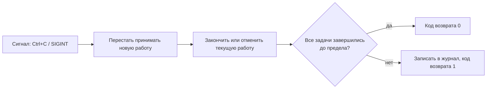

<!-- nav:top -->
[🏠 Начало](../START-HERE.md) · [← 14.13 Tokio подробно: задачи и каналы](13-tokio-tasks-and-channels.md) · [📋 Этап 14](README.md) · [14.15 Проект: конкурентная очередь заданий →](15-project-concurrent-job-queue.md) · [📖 Глоссарий](../GLOSSARY.md) · [🇬🇧 English](../../en/14-concurrency-and-async/14-cancellation-timeouts-and-graceful-shutdown.md) <!-- nav -->

# Урок 14.14 — Отмена, тайм-ауты и корректное завершение

> **Этап 14 — Конкурентность и асинхронность подробно** · Урок 14 из 16 · ⏱ около 2,5 часа (2 занятия)

## Что вы узнаете

- Что на самом деле происходит, когда future отменяют, и почему он может остановиться только на `.await`.
- Что такое *безопасность при отмене* (cancel safety) и как цикл с `select!` может потерять данные без единой ошибки.
- Как использовать тайм-ауты и один срок на несколько шагов и как мгновенно тестировать их с остановленными часами.
- Как сказать многим задачам «остановитесь» через `CancellationToken` и как дождаться их через `TaskTracker`.
- Шаги корректного завершения по Ctrl+C: перестать принимать работу, закончить или отменить текущую, подождать с ограничением, выйти с понятным кодом возврата.

## Перед началом

- Вы прошли [Урок 14.13 — Tokio подробно: задачи и каналы](13-tokio-tasks-and-channels.md).
- Вы знаете `select!` и `timeout` из [Урока 06.9](../06-rust-advanced/09-async-await-introduction.md), `Drop` из [Урока 05.9 — Умные указатели](../05-rust-intermediate/09-smart-pointers.md), а сигналы вроде SIGINT — из [Урока 13.7 — Сигналы в ваших программах](../13-operating-systems/07-signals-in-your-programs.md).
- Код этого урока находится в `~/projects/rust/code/p14-shutdown`:

```bash
cd ~/projects/rust
cargo new --lib code/p14-shutdown
cd code/p14-shutdown
cargo add tokio@1 --features full
cargo add tokio-util@0.7 --features rt
cargo add --dev tokio@1 --features test-util
mkdir src/bin
```

`tokio-util` — крейт проекта Tokio с дополнительными инструментами; фича `rt` включает `TaskTracker`. Зависимость для разработки добавляет фичу Tokio `test-util`, которая нужна только тестам: она позволяет тесту остановить часы.

## Новые слова

| Слово | Значение |
|---|---|
| **отмена** (cancellation) | Остановка future до его завершения. В Rust это значит — выбросить его. |
| **безопасность при отмене** (cancel safety) | Future *безопасен при отмене*, если его выбрасывание на любом `.await` ничего не теряет: ни данных, которые он уже забрал, ни наполовину сделанных изменений. |
| **срок** (deadline) | Фиксированный момент времени («в 12:00:05»), в отличие от длительности («5 секунд»). Один срок может покрывать несколько шагов. |
| **остановленные часы** (paused clock) | В тестах Tokio с `start_paused = true` время стоит на месте и перескакивает вперёд, когда все задачи ждут таймер, поэтому сон не занимает реального времени. |
| **`CancellationToken`** | Общий флаг из `tokio-util`: одно место вызывает `cancel()`, каждый владелец может ждать `cancelled()`. |
| **дочерний токен** (child token) | Токен, созданный через `child_token()`: отмена родителя отменяет его, а его отмена родителя не отменяет. |
| **`TaskTracker`** | Тип из `tokio-util`, который считает запущенные задачи и позволяет дождаться, пока все они закончатся. |
| **корректное завершение** (graceful shutdown) | Упорядоченная остановка программы: никакой новой работы, текущая работа закончена или аккуратно отменена, затем выход. |
| **SIGINT** | Сигнал прерывания (interrupt), который терминал посылает программе, когда вы нажимаете Ctrl+C. |
| **код возврата** (exit code) | Число, которое программа возвращает операционной системе при завершении: 0 — успех, другие числа — ошибка. |

## 1. Отмена — это выбрасывание

Из Урока 06.9 вы знаете правило: чтобы отменить future, выбросьте его. Посмотрим, что это значит для кода внутри. Создайте `src/bin/drop_cancels.rs`:

```rust
use std::time::Duration;
use tokio::time::{sleep, timeout};

/// Prints a line when it is dropped, so we can see cancellation.
struct Guard(&'static str);

impl Drop for Guard {
    fn drop(&mut self) {
        println!("  drop: {}", self.0);
    }
}

async fn three_steps() {
    let _guard = Guard("three_steps was cancelled or finished");
    for step in 1..=3 {
        println!("  step {step} starts");
        sleep(Duration::from_millis(100)).await;
        println!("  step {step} done");
    }
}

#[tokio::main]
async fn main() {
    println!("with enough time:");
    let result = timeout(Duration::from_millis(500), three_steps()).await;
    println!("  result: {result:?}");

    println!("with 150 ms:");
    let result = timeout(Duration::from_millis(150), three_steps()).await;
    println!("  result: {result:?}");
}
```

`cargo run --bin drop_cancels`:

```text
with enough time:
  step 1 starts
  step 1 done
  step 2 starts
  step 2 done
  step 3 starts
  step 3 done
  drop: three_steps was cancelled or finished
  result: Ok(())
with 150 ms:
  step 1 starts
  step 1 done
  step 2 starts
  drop: three_steps was cancelled or finished
  result: Err(Elapsed(()))
```

**Что происходит:**

1. С 500 мс future доходит до конца, `_guard` уничтожается при возврате из функции, и `timeout` даёт `Ok(())`.
2. С 150 мс future находится посреди шага 2 и ждёт в `sleep`. Когда время выходит, `timeout` **выбрасывает** future. Выбрасывание конечного автомата уничтожает всё, что в нём хранится, — в данном случае `_guard`, поэтому выполняется его `Drop`. «step 2 done» так и не печатается.
3. Ничто не «прерывается» посреди строки кода. Future может остановиться только там, где вернул `Pending`, то есть на `.await`. Код между двумя `.await` всегда выполняется полностью.

Это хорошая новость: `Drop` — ваша точка очистки, и он выполняется и при отмене. И это же предупреждение: любой `.await` — место, где функция может остановиться навсегда, и код после него не выполнится.

> 🔒 **Безопасность:** если функция меняет две вещи, которые должны оставаться согласованными («снять деньги со счёта A», `.await`, «зачислить на счёт B»), отмена между ними оставит систему в сломанном состоянии. Не ставьте `.await` между такими парами, делайте изменение одним шагом (например, одной транзакцией базы данных) или делайте его безопасным для повторения.

## 2. Безопасность при отмене и циклы с `select!`

`select!` выбрасывает каждую ветку, которая не победила. В цикле проигравшие ветки создаются заново на следующем круге. Для одних future это нормально, для других — тихая потеря данных. Вот цикл, который читает сообщения парами, пока таймер тикает для вывода состояния. Создайте `src/bin/cancel_unsafe.rs`:

```rust
use std::time::Duration;
use tokio::sync::mpsc;
use tokio::time::{interval, sleep};

/// Reads two messages and returns them as a pair.
async fn read_pair(rx: &mut mpsc::Receiver<u32>) -> Option<(u32, u32)> {
    let first = rx.recv().await?;
    let second = rx.recv().await?; // if we are cancelled here, `first` is lost
    Some((first, second))
}

#[tokio::main]
async fn main() {
    let (tx, mut rx) = mpsc::channel(16);
    tokio::spawn(async move {
        for n in 1..=6 {
            tx.send(n).await.unwrap();
            sleep(Duration::from_millis(30)).await;
        }
    });

    let mut status = interval(Duration::from_millis(20));
    loop {
        tokio::select! {
            pair = read_pair(&mut rx) => match pair {
                Some(pair) => println!("pair: {pair:?}"),
                None => break,
            },
            _ = status.tick() => {} // e.g. print a status line
        }
    }
    println!("channel closed");
}
```

```text
channel closed
```

Отправлено шесть чисел, и ни одна пара не напечатана. Ни ошибки, ни предупреждения.

**Что происходит:**

1. На каждом круге `select!` создаёт новый future `read_pair` и опрашивает его вместе с `status.tick()`.
2. `read_pair` получает число (например, 1) и сохраняет его в `first` внутри future. Затем ждёт второе число.
3. Следующее сообщение приходит только через 30 мс, а таймер состояния тикает каждые 20 мс. Таймер побеждает, и `select!` выбрасывает future `read_pair` **вместе с единицей, которую тот держал**.
4. Следующий круг начинает новый `read_pair`, который берёт следующее число и теряет его так же. В конце `recv()` возвращает `None`, и цикл останавливается.

Сам по себе `rx.recv()` **безопасен при отмене**: если его выбросили до того, как он вернул сообщение, ни одно сообщение не было взято из канала. `read_pair` **не** безопасен при отмене, потому что держит данные между двумя `.await`. Документация Tokio для каждого метода указывает, безопасен ли он при отмене; например, `mpsc::Receiver::recv` — да, а `AsyncReadExt::read_exact` — нет.

Исправление: кладите в `select!` только безопасные при отмене future, а состояние «наполовину сделано» храните в цикле, вне всякого future. `src/bin/cancel_safe.rs`:

```rust
use std::time::Duration;
use tokio::sync::mpsc;
use tokio::time::{interval, sleep};

#[tokio::main]
async fn main() {
    let (tx, mut rx) = mpsc::channel(16);
    tokio::spawn(async move {
        for n in 1..=6 {
            tx.send(n).await.unwrap();
            sleep(Duration::from_millis(30)).await;
        }
    });

    let mut status = interval(Duration::from_millis(20));
    let mut first: Option<u32> = None; // half a pair lives in the loop, not in a future
    loop {
        tokio::select! {
            message = rx.recv() => match message {
                Some(n) => match first.take() {
                    None => first = Some(n),
                    Some(a) => println!("pair: {:?}", (a, n)),
                },
                None => break,
            },
            _ = status.tick() => {}
        }
    }
    println!("channel closed");
}
```

```text
pair: (1, 2)
pair: (3, 4)
pair: (5, 6)
channel closed
```

Другое исправление, из Урока 14.12, — создать небезопасный future **один раз** до цикла, закрепить его через `pin!` и передавать в `select!` ссылку `&mut`: тогда он не выбрасывается, когда побеждает другая ветка, и сохраняет свой прогресс.

## 3. Тайм-ауты, сроки и остановленные часы

`timeout(duration, future)` ограничивает одну операцию. Когда у операции несколько шагов, отдельный тайм-аут на каждый шаг позволяет всей операции занять гораздо больше времени, чем вы хотели. Используйте **один срок** на все шаги с `timeout_at`. Создайте `src/bin/deadline.rs`:

```rust
use std::time::Duration;
use tokio::time::{Instant, sleep, timeout_at};

#[tokio::main]
async fn main() {
    // One deadline for the whole operation, not one timeout per step.
    let deadline = Instant::now() + Duration::from_millis(250);
    for step in 1..=3 {
        match timeout_at(deadline, sleep(Duration::from_millis(100))).await {
            Ok(()) => println!("step {step} done"),
            Err(_) => {
                println!("step {step}: out of time, giving up");
                break;
            }
        }
    }
}
```

```text
step 1 done
step 2 done
step 3: out of time, giving up
```

Каждому шагу нужно 100 мс. После двух шагов использовано 200 мс, и до срока остаётся только 50 мс, поэтому шаг 3 обрывается. (`tokio::time::Instant` — версия `std::time::Instant` от Tokio; в тестах она следует за остановленными часами.)

**Тестирование тайм-аутов.** Тест «сдаётся через 30 секунд» не должен ждать 30 настоящих секунд. Фича Tokio `test-util` добавляет `#[tokio::test(start_paused = true)]`: часы стоят, а когда каждая задача ждёт таймер, Tokio сразу переводит часы на ближайший срок. Поместите это в `src/lib.rs`:

```rust
//! Helpers for the lesson on cancellation and timeouts.

use std::time::Duration;
use tokio::time::{error::Elapsed, sleep, timeout};

/// Pretends to load a configuration that takes `delay` to arrive.
pub async fn load_config(delay: Duration) -> String {
    sleep(delay).await;
    "port = 8080".to_string()
}

/// Loads the configuration, but waits at most `limit`.
pub async fn load_with_limit(limit: Duration, delay: Duration) -> Result<String, Elapsed> {
    timeout(limit, load_config(delay)).await
}

#[cfg(test)]
mod tests {
    use super::*;

    #[tokio::test(start_paused = true)]
    async fn gives_up_after_the_limit() {
        let real_start = std::time::Instant::now();
        let result = load_with_limit(Duration::from_secs(30), Duration::from_secs(60)).await;
        assert!(result.is_err());
        // The test took no real time: the clock was paused and jumped forward.
        assert!(real_start.elapsed() < Duration::from_secs(1));
    }

    #[tokio::test(start_paused = true)]
    async fn returns_the_config_when_fast_enough() {
        let result = load_with_limit(Duration::from_secs(30), Duration::from_secs(5)).await;
        assert_eq!(result.unwrap(), "port = 8080");
    }
}
```

`cargo test --lib`:

```text
test result: ok. 2 passed; 0 failed; 0 ignored; 0 measured; 0 filtered out; finished in 0.00s
```

Загрузка на 60 секунд и предел в 30 секунд проверены за 0,00 секунды. Второе утверждение намеренно использует `std::time::Instant`: настоящие часы показывают, что реального времени не прошло.

> 🧪 **Тестирование:** остановленное время делает тесты со временем быстрыми **и** точными: никаких «чуть больше 150 мс». Используйте его в каждом тесте с `sleep`, `timeout` или `interval`. Это работает только с таймерами Tokio; `std::thread::sleep` по-прежнему занимает реальное время.

## 4. Как сказать многим задачам «стоп»: `CancellationToken`

`abort()` (Урок 14.13) отменяет задачу снаружи, на каком бы `.await` она ни ждала. Часто нужно что-то мягче: сказать задаче «пожалуйста, остановись» и дать ей закончить текущий шаг, сохранить состояние, закрыть соединение. `CancellationToken` — это такая просьба, общая для многих задач. Создайте `src/bin/workers.rs`:

```rust
use std::time::Duration;
use tokio::time::sleep;
use tokio_util::sync::CancellationToken;
use tokio_util::task::TaskTracker;

async fn worker(id: u32, token: CancellationToken) {
    let mut jobs = 0;
    loop {
        tokio::select! {
            _ = token.cancelled() => {
                println!("worker {id}: stopping after {jobs} jobs");
                return;
            }
            _ = sleep(Duration::from_millis(100)) => jobs += 1, // one "job"
        }
    }
}

#[tokio::main]
async fn main() {
    let token = CancellationToken::new();
    let tracker = TaskTracker::new();
    for id in 1..=3 {
        tracker.spawn(worker(id, token.child_token()));
    }
    tracker.close(); // no more tasks will be added

    sleep(Duration::from_millis(350)).await;
    println!("main: cancelling");
    token.cancel();
    tracker.wait().await;
    println!("main: all workers stopped");
}
```

```text
main: cancelling
worker 3: stopping after 3 jobs
worker 1: stopping after 3 jobs
worker 2: stopping after 3 jobs
main: all workers stopped
```

**Что происходит:**

1. Каждая рабочая задача (worker) получает **дочерний токен**. `token.cancel()` у родителя отменяет все дочерние. Дочерний токен можно отменить и отдельно (например, чтобы остановить одну рабочую задачу), не трогая остальных.
2. Внутри рабочей задачи `select!` устраивает гонку между работой и `token.cancelled()`. `cancelled()` безопасен при отмене, поэтому его можно создавать заново на каждом круге.
3. Когда токен отменён, каждая рабочая задача видит это на следующем `select!`, печатает своё сообщение и нормально возвращается. Это кооперативно: задача сама решает, как остановиться.
4. `TaskTracker` считает задачи, запущенные через него. `close()` говорит «новых задач не будет», а `wait()` завершается, когда трекер закрыт **и** все его задачи закончились. В отличие от `JoinSet`, он не хранит результаты, поэтому это простой инструмент для «дождаться всего перед выходом».

## 5. Корректное завершение

Сервис, который останавливают (через Ctrl+C на вашей машине или инструментом развёртывания, который посылает сигнал), не должен просто исчезать. Обычный план состоит из четырёх шагов:



Вот маленький сервис с очередью заданий: производитель добавляет задание каждые 100 мс, две рабочие задачи берут задания из очереди, и каждому заданию нужно 300 мс. По Ctrl+C производитель останавливается и закрывает очередь, а рабочие задачи доделывают каждое задание, которое уже стоит в очереди. Создайте `src/bin/service.rs`:

```rust
use std::process::ExitCode;
use std::sync::Arc;
use std::time::Duration;
use tokio::sync::{Mutex, mpsc};
use tokio::time::{sleep, timeout};
use tokio_util::sync::CancellationToken;
use tokio_util::task::TaskTracker;

/// Several workers share one receiver through a Tokio mutex.
type Jobs = Arc<Mutex<mpsc::Receiver<u32>>>;

/// Takes jobs from the queue until the queue is closed and empty.
async fn worker(id: u32, jobs: Jobs) {
    loop {
        let next = jobs.lock().await.recv().await; // the lock is released at `;`
        let Some(job) = next else { break };
        sleep(Duration::from_millis(300)).await; // the work itself
        println!("worker {id}: finished job {job}");
    }
    println!("worker {id}: queue is empty, exiting");
}

#[tokio::main]
async fn main() -> ExitCode {
    let shutdown = CancellationToken::new();
    let tracker = TaskTracker::new();
    let (tx, rx) = mpsc::channel::<u32>(8);
    let rx: Jobs = Arc::new(Mutex::new(rx));

    for id in 1..=2 {
        tracker.spawn(worker(id, Arc::clone(&rx)));
    }

    // The "accept loop": a new job every 100 ms until shutdown starts.
    let producer_token = shutdown.clone();
    tracker.spawn(async move {
        let mut next = 1;
        loop {
            tokio::select! {
                _ = producer_token.cancelled() => break,
                _ = sleep(Duration::from_millis(100)) => {
                    if tx.send(next).await.is_err() {
                        break;
                    }
                    next += 1;
                }
            }
        }
        println!("producer: stopped accepting jobs, queue closed");
        // `tx` is dropped here: workers finish what is queued, then exit.
    });
    tracker.close();

    // 1. Wait for the signal.
    tokio::signal::ctrl_c()
        .await
        .expect("cannot listen for Ctrl+C");
    println!("main: Ctrl+C received, shutting down");
    // 2. Tell everybody.
    shutdown.cancel();
    // 3. Wait, but not forever.
    match timeout(Duration::from_secs(5), tracker.wait()).await {
        Ok(()) => {
            println!("main: clean shutdown");
            ExitCode::SUCCESS
        }
        Err(_) => {
            println!("main: tasks did not stop in 5 s, exiting anyway");
            ExitCode::FAILURE
        }
    }
}
```

Выполните `cargo build --bin service`, затем `./target/debug/service`; подождите около секунды, нажмите Ctrl+C и напечатайте код возврата командой `echo "exit code: $?"`. (Терминал может ещё показать `^C`. Из скрипта тот же сигнал можно послать командой `kill -INT <pid>`.) Номера заданий у вас будут немного другими:

```text
worker 1: finished job 1
worker 2: finished job 2
worker 1: finished job 3
main: Ctrl+C received, shutting down
producer: stopped accepting jobs, queue closed
worker 2: finished job 4
worker 1: finished job 5
worker 2: finished job 6
worker 2: queue is empty, exiting
worker 1: finished job 7
worker 1: queue is empty, exiting
main: clean shutdown
exit code: 0
```

**Что происходит:**

1. `tokio::signal::ctrl_c()` устанавливает обработчик SIGINT и возвращает future, который завершается, когда приходит сигнал. Без него Ctrl+C сразу убил бы процесс (Урок 13.7) посреди задания.
2. **Перестать принимать.** `shutdown.cancel()` останавливает цикл производителя. Производитель выбрасывает `tx`, и это закрывает очередь.
3. **Закончить текущую работу.** Рабочие задачи вообще не смотрят на токен: они берут задания, пока `recv()` не вернёт `None`, а это происходит, только когда очередь закрыта **и** пуста. Задания 4–7 уже стояли в очереди и все доделаны. (Сервис, которому нужно останавливаться быстрее, дал бы токен и рабочим задачам и отменил бы задания в очереди.)
4. **Ждать с ограничением.** `timeout(5 s, tracker.wait())` ждёт производителя и обе рабочие задачи. Если что-то зависнет, программа всё равно закончится через 5 секунд с `ExitCode::FAILURE` (код возврата 1), чтобы тот, кто её остановил, видел, что завершение было некорректным.
5. `main` возвращает `ExitCode`, который становится кодом возврата процесса: здесь 0.
6. В `worker` строка `let next = jobs.lock().await.recv().await;` заканчивается на `;`, поэтому guard мьютекса уничтожается до выполнения задания. С `while let Some(job) = jobs.lock().await.recv().await { … }` guard жил бы всё тело цикла (Урок 14.11), и две рабочие задачи работали бы по очереди, а не одновременно.

> 💡 **Совет:** в Linux менеджеры служб (systemd из [Урока 11.6](../11-linux-shell-and-containers/06-services-with-systemd.md) и Kubernetes, который будет позже в курсе) останавливают программы сигналом SIGTERM (сигнал «пожалуйста, завершись»), а не SIGINT. Его слушает `tokio::signal::unix::signal(SignalKind::terminate())`; настоящий сервис ждёт любой из двух сигналов.

## Частые ошибки

**1. Небезопасный при отмене future внутри цикла с `select!`.** Он теряет данные без ошибки (раздел 2). Проверяйте раздел «cancel safety» в документации каждого метода, который кладёте в `select!`, или храните состояние вне future.

**2. Много тайм-аутов вместо одного срока.** Три шага с `timeout(5 s)` на каждом могут занять 15 секунд. Используйте `timeout_at` с одним сроком.

**3. Тесты, которые по-настоящему спят.** Они медленные и нестабильные. Используйте `#[tokio::test(start_paused = true)]` с функциями `tokio::time`.

**4. Бесконечное ожидание при завершении.** `tracker.wait().await` без ограничения зависнет, если одна задача игнорирует токен. Всегда оборачивайте его в `timeout` и решайте, что делать дальше (упражнение 3: прервать оставшиеся).

## Попробуйте сами

1. Создайте `code/p14-shutdown` и запустите `drop_cancels`, `cancel_unsafe` и `cancel_safe`.
2. В `cancel_unsafe.rs` замените интервал состояния с 20 мс на 50 мс и запустите. Теперь появляется одна пара, `(3, 4)`, а четыре числа всё равно теряются: результат зависит от времени, поэтому такую ошибку очень трудно найти в продакшене.
3. Запустите тесты командой `cargo test --lib` и посмотрите на время.
4. Запустите `service`, нажмите Ctrl+C рано (примерно через 0,3 с) и поздно (через 2 с) и сравните, сколько заданий из очереди доделывается после сигнала.
5. Запустите `cargo clippy --all-targets` и `cargo fmt`, затем сделайте коммит: `git add code/p14-shutdown && git commit -m "p14-shutdown: cancellation, timeouts and graceful shutdown"`.

## Упражнения

### Упражнение 1 — Отмена токеном (легко)

Запустите `three_steps` (с его `Guard`) внутри `tokio::select!` против `token.cancelled()`. Запустите задачу, которая отменяет токен через 250 мс. Предскажите вывод, затем запустите.

<details>
<summary>Подсказка</summary>

Токен нужно клонировать: один клон уходит в запущенную задачу, которая вызывает `cancel()`, другой остаётся в `main` для `cancelled()`.

</details>

<details>
<summary>Ответ</summary>

```rust
use std::time::Duration;
use tokio::time::sleep;
use tokio_util::sync::CancellationToken;

struct Guard(&'static str);

impl Drop for Guard {
    fn drop(&mut self) {
        println!("drop: {}", self.0);
    }
}

async fn three_steps() {
    let _guard = Guard("three_steps");
    for step in 1..=3 {
        println!("step {step} starts");
        sleep(Duration::from_millis(100)).await;
        println!("step {step} done");
    }
}

#[tokio::main]
async fn main() {
    let token = CancellationToken::new();
    let canceller = token.clone();
    tokio::spawn(async move {
        sleep(Duration::from_millis(250)).await;
        canceller.cancel();
    });

    tokio::select! {
        _ = three_steps() => println!("finished"),
        _ = token.cancelled() => println!("cancelled by the token"),
    }
}
```

```text
step 1 starts
step 1 done
step 2 starts
step 2 done
step 3 starts
drop: three_steps
cancelled by the token
```

Почему это работает: на 250 мс `three_steps` ждёт в третьем `sleep`. Побеждает ветка `cancelled()`, `select!` выбрасывает future `three_steps`, и его `Guard` срабатывает до кода победившей ветки.

</details>

### Упражнение 2 — Тест с остановленными часами (средне)

Напишите файл интеграционных тестов `tests/steps.rs` с версией `three_steps`, которая возвращает число законченных шагов (каждый шаг спит 100 мс). Тест 1: с `timeout(500 ms)` результат — `Ok(3)`. Тест 2: с `timeout(150 ms)` результат — ошибка, а остановленные часы показывают, что прошло **ровно** 150 мс.

<details>
<summary>Подсказка</summary>

Используйте `#[tokio::test(start_paused = true)]`. Измеряйте через `tokio::time::Instant::now()` и `start.elapsed()`: они следуют за остановленными часами. Поскольку часы перескакивают ровно на каждый срок, `assert_eq!` для длительности здесь допустим, чего никогда нельзя делать с реальным временем.

</details>

<details>
<summary>Ответ</summary>

```rust
use std::time::Duration;
use tokio::time::{sleep, timeout};

async fn three_steps() -> u32 {
    let mut done = 0;
    for _ in 1..=3 {
        sleep(Duration::from_millis(100)).await;
        done += 1;
    }
    done
}

#[tokio::test(start_paused = true)]
async fn three_steps_fit_into_500_ms() {
    let result = timeout(Duration::from_millis(500), three_steps()).await;
    assert_eq!(result.unwrap(), 3);
}

#[tokio::test(start_paused = true)]
async fn three_steps_do_not_fit_into_150_ms() {
    let start = tokio::time::Instant::now();
    let result = timeout(Duration::from_millis(150), three_steps()).await;
    assert!(result.is_err());
    // The paused clock moved exactly to the deadline.
    assert_eq!(start.elapsed(), Duration::from_millis(150));
}
```

`cargo test --test steps` показывает `test result: ok. 2 passed; 0 failed; … finished in 0.00s`. Почему это работает: при остановленных часах Tokio двигает время, только когда все задачи ждут таймеры, и двигает его ровно до следующего таймера: 100 мс (первый сон), затем 150 мс (тайм-аут), и больше ничего между ними не происходит.

</details>

### Упражнение 3 — Упрямая задача (сложно)

Запустите в `JoinSet` три задачи: две «вежливые», которые ждут `token.cancelled()` и печатают «stopped», и одну «упрямую», которая спит 60 секунд и игнорирует токен. Через 100 мс отмените токен и подождите все задачи не дольше 1 секунды. Если какие-то ещё работают, напечатайте, сколько их, прервите их и напечатайте, что сообщает каждая прерванная задача. Программа должна закончиться примерно через 1,1 секунды, а не через 60.

<details>
<summary>Подсказка</summary>

Оберните цикл «ждать всех» в блок `async` и передайте этот блок в `timeout`. После того как `timeout` вернул `Err`, блока уже нет, поэтому `JoinSet` снова можно использовать: `tasks.len()`, `tasks.abort_all()` и ещё один цикл `join_next`, чтобы собрать результаты прерванных задач.

</details>

<details>
<summary>Ответ</summary>

```rust
use std::time::Duration;
use tokio::task::JoinSet;
use tokio::time::{sleep, timeout};
use tokio_util::sync::CancellationToken;

async fn polite(id: u32, token: CancellationToken) {
    token.cancelled().await;
    println!("worker {id}: stopped");
}

async fn stubborn(id: u32) {
    // Ignores the token: maybe it is stuck in a slow call.
    sleep(Duration::from_secs(60)).await;
    println!("worker {id}: never printed");
}

#[tokio::main]
async fn main() {
    let token = CancellationToken::new();
    let mut tasks = JoinSet::new();
    tasks.spawn(polite(1, token.clone()));
    tasks.spawn(polite(2, token.clone()));
    tasks.spawn(stubborn(3));

    sleep(Duration::from_millis(100)).await;
    println!("main: shutting down");
    token.cancel();

    let all_done = timeout(Duration::from_secs(1), async {
        while tasks.join_next().await.is_some() {}
    })
    .await;
    if all_done.is_err() {
        println!(
            "main: {} task(s) did not stop in time, aborting",
            tasks.len()
        );
        tasks.abort_all();
        while let Some(result) = tasks.join_next().await {
            if let Err(error) = result {
                println!("main: aborted, is_cancelled = {}", error.is_cancelled());
            }
        }
    }
    println!("main: exit");
}
```

```text
main: shutting down
worker 1: stopped
worker 2: stopped
main: 1 task(s) did not stop in time, aborting
main: aborted, is_cancelled = true
main: exit
```

Почему это работает: токен — это просьба, а упрямая задача её никогда не проверяет. `timeout` даёт шанс вежливому пути, затем `abort_all` принуждает остальных: future каждой прерванной задачи выбрасывается на текущем `.await` (долгий `sleep`), и её `JoinError` сообщает `is_cancelled`. Порядок «сначала попросить, потом заставить» — основа любого корректного завершения.

</details>

## Вопросы для самопроверки

1. Future отменили, пока он ждал на своём втором `.await`. Какой его код ещё выполнится?

<details>
<summary>Ответ</summary>

Никакой код после этого `.await`. Выполнятся только реализации `Drop` значений, хранящихся в future, потому что выбрасывание future уничтожает их.

</details>

2. Что значит «безопасен при отмене»? Приведите один безопасный и один небезопасный пример.

<details>
<summary>Ответ</summary>

Выбрасывание future на любом `.await` ничего не теряет. `mpsc::Receiver::recv` безопасен при отмене (сообщение не забирается, пока он не вернулся). Future, который получает одно сообщение и затем ждёт второе, небезопасен: если его выбросить между ними, первое сообщение потеряется.

</details>

3. Почему один срок (`timeout_at`) лучше, чем тайм-аут на каждый шаг?

<details>
<summary>Ответ</summary>

Тайм-ауты на шаги складываются: три шага по 5 секунд могут занять 15 секунд. Один срок ограничивает всю операцию тем временем, которое вам действительно нужно.

</details>

4. Что меняет `start_paused = true` в тесте Tokio?

<details>
<summary>Ответ</summary>

Часы теста останавливаются; когда каждая задача ждёт таймер, Tokio переводит часы на ближайший срок. Сны и тайм-ауты не занимают реального времени, а измеренные длительности точны.

</details>

5. Чем `token.cancel()` отличается от `handle.abort()`?

<details>
<summary>Ответ</summary>

`cancel()` — просьба: задачи, которые следят за `cancelled()`, видят её и останавливаются по-своему, после очистки. `abort()` принуждает задачу: её future выбрасывается на следующем `.await`, что бы она ни делала.

</details>

## Итоги

- Отменить future — значит выбросить его; он останавливается на текущем `.await`, код после него никогда не выполнится, а `Drop` хранящихся в нём значений выполнится.
- Future безопасен при отмене, если его выбрасывание ничего не теряет; в циклах с `select!` используйте только такие future или храните частичное состояние вне future.
- `timeout` ограничивает одну операцию, `timeout_at` даёт нескольким шагам один срок; `#[tokio::test(start_paused = true)]` проверяет их мгновенно и точно.
- `CancellationToken` (с дочерними токенами) просит многие задачи остановиться; `TaskTracker` ждёт, пока все они закончатся.
- Корректное завершение: сигнал, перестать принимать работу, закончить или отменить текущую, подождать с ограничением, прервать оставшиеся, выйти с осмысленным кодом возврата.

## Источники и что почитать

- [Tokio — Graceful Shutdown](https://tokio.rs/tokio/topics/shutdown) — официальное руководство: как обнаружить завершение, сообщить задачам и дождаться их.
- [tokio::select! — cancellation safety](https://docs.rs/tokio/1.54.1/tokio/macro.select.html) — раздел со списком методов Tokio, безопасных при отмене.
- [tokio_util::sync::CancellationToken](https://docs.rs/tokio-util/0.7.20/tokio_util/sync/struct.CancellationToken.html) — токены, дочерние токены и `drop_guard`.
- [tokio_util::task::TaskTracker](https://docs.rs/tokio-util/0.7.20/tokio_util/task/task_tracker/struct.TaskTracker.html) — `spawn`, `close` и `wait`.
- [tokio::time::pause](https://docs.rs/tokio/1.54.1/tokio/time/fn.pause.html) — как работают остановленные часы в тестах.
- [tokio::signal](https://docs.rs/tokio/1.54.1/tokio/signal/index.html) — `ctrl_c` и сигналы Unix, такие как SIGTERM.

---

[🏠 Начало](../START-HERE.md) · [← 14.13 Tokio подробно: задачи и каналы](13-tokio-tasks-and-channels.md) · [📋 Этап 14](README.md) · [14.15 Проект: конкурентная очередь заданий →](15-project-concurrent-job-queue.md) · [📖 Глоссарий](../GLOSSARY.md) <!-- nav -->
<!-- nav:bottom -->
