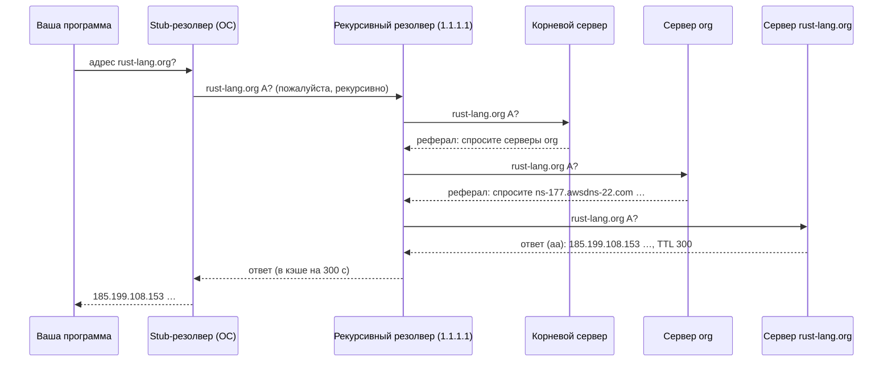

<!-- nav:top -->
[🏠 Начало](../START-HERE.md) · [← 15.9 HTTP с hyper и reqwest](09-http-with-hyper-and-reqwest.md) · [📋 Этап 15](README.md) · [15.11 Проект: DNS-резолвер →](11-project-dns-resolver.md) · [📖 Глоссарий](../GLOSSARY.md) · [🇬🇧 English](../../en/15-networking/10-dns-how-names-become-addresses.md) <!-- nav -->

# Урок 15.10 — DNS: как имена превращаются в адреса

> **Этап 15 — Сети** · Урок 10 из 16 · ⏱ около 2,5 часа (2 занятия)

## Что вы узнаете

- Как DNS-имена образуют дерево и какие серверы отвечают за какую его часть.
- Что делают stub-резолвер, рекурсивный резолвер и авторитативный сервер и как работает кэширование с TTL.
- Как пройти поиск вручную с `dig`: от корневых серверов до ответа.
- Распространённые типы записей: A, AAAA, CNAME, MX, NS, TXT и SOA.
- Как DNS-сообщение выглядит «на проводе», байт за байтом, на примере настоящего перехваченного пакета.
- Как разрешать имена в Rust: резолвер операционной системы и библиотека `hickory-resolver`.

## Перед началом

- Вы прошли [Урок 15.9 — HTTP с hyper и reqwest](09-http-with-hyper-and-reqwest.md).
- Вы знаете UDP (User Datagram Protocol, протокол пользовательских датаграмм) и TCP (Transmission Control Protocol, протокол управления передачей) из [Урока 15.3 — TCP и UDP](03-tcp-and-udp.md), а UDP-сокеты — из [Урока 15.5 — UDP-сокеты в Rust](05-udp-sockets-in-rust.md): UDP-датаграмма путешествует одна, без соединения, и может потеряться.
- Вы знаете учебный пакет `code/p15-net` и образ контейнера `p15-nettools` из [Урока 15.1](01-how-the-internet-works.md), а битовые маски вроде `bits & 0x8000` — из [Урока 12.4](../12-computer-systems/04-bitwise-operations.md).
- `dig` уже есть в macOS. Проверьте:

```bash
dig -v
```

```text
DiG 9.10.6
```

## Новые слова

| Слово | Значение |
|---|---|
| **DNS** (Domain Name System, система доменных имён) | Всемирная система, которая превращает имена вроде `rust-lang.org` в IP-адреса (Internet Protocol, межсетевой протокол) и другие данные. |
| **доменное имя** (domain name) | Имя из **меток** (labels), разделённых точками: `www`, `rust-lang`, `org`. Если читать справа налево, это путь в дереве. |
| **корень** (root) | Вершина дерева имён, записывается пустой меткой: последняя точка в `rust-lang.org.`. |
| **TLD** (Top-Level Domain, домен верхнего уровня) | Метка сразу под корнем: `org`, `com`, `uz`, `ru`. |
| **FQDN** (Fully Qualified Domain Name, полностью определённое доменное имя) | Полное имя, которое заканчивается корневой точкой, например `rust-lang.org.`. Дополнить его уже нельзя. |
| **зона** (zone) | Часть дерева, которой управляет одна организация. `org` — зона; `rust-lang.org` — другая зона внутри неё. |
| **ресурсная запись** (resource record, RR) | Одна единица данных DNS: имя, тип, класс, TTL и значение, например `rust-lang.org. 300 IN A 185.199.108.153`. |
| **TTL** (Time To Live, время жизни) | Сколько секунд запись можно хранить в кэше, прежде чем снова её запросить. |
| **stub-резолвер** (stub resolver) | Маленький резолвер внутри вашей операционной системы. Он спрашивает один рекурсивный резолвер и ждёт окончательного ответа. |
| **рекурсивный резолвер** (recursive resolver) | Сервер (например, `1.1.1.1` или сервер вашего интернет-провайдера), который находит ответ за вас, опрашивая другие серверы, и кэширует результаты. |
| **авторитативный сервер** (authoritative server) | Сервер, который хранит настоящие записи зоны и отвечает за неё. Его ответы несут флаг `aa`. |
| **реферал** (referral, отсылка) | Ответ вида «я не знаю, но за эту часть дерева отвечают вот эти серверы». |
| **glue-запись** (glue record) | Адрес, который приходит вместе с рефералом, чтобы до названного сервера можно было добраться без ещё одного поиска. |
| **сжатие имён** (name compression) | Приём в DNS-сообщениях: имя может заканчиваться 2-байтовым **указателем** на более раннюю позицию в том же сообщении вместо повторения меток. |
| **`dig`** | Утилита командной строки, которая отправляет DNS-запросы и подробно печатает ответы. |
| **UDP / TCP** (User Datagram Protocol / Transmission Control Protocol) | Два транспортных протокола из Урока 15.3: отдельные датаграммы без соединения / надёжный поток байтов поверх соединения. |
| **ОС** (OS, operating system, операционная система) | Здесь: macOS или Linux, встроенным stub-резолвером которых пользуются ваши программы. |
| **CNAME** (Canonical NAME, каноническое имя) | Запись, которая говорит: «это имя — псевдоним; настоящее (каноническое) имя — вон то». |
| **EDNS** (Extension Mechanisms for DNS, механизмы расширения DNS) | Дополнительная псевдозапись в сообщении, которая разрешает более крупные UDP-ответы и новые параметры. |
| **DNSSEC** (DNS Security Extensions, расширения безопасности DNS) | Цифровые подписи на DNS-записях, чтобы резолвер мог проверить, что ответ подлинный. |
| **DoT / DoH** (DNS over TLS / DNS over HTTPS, DNS поверх TLS / поверх HTTPS) | DNS-сообщения, отправляемые внутри зашифрованного соединения TLS (Transport Layer Security, протокол защиты транспортного уровня) — напрямую или в виде HTTPS-запросов. |
| **HTTP, HTTPS, ASCII** | HyperText Transfer Protocol (протокол передачи гипертекста, веб, Урок 15.8); HTTP Secure (защищённый HTTP: HTTP внутри TLS); American Standard Code for Information Interchange (американский стандартный код для обмена информацией: 128 классических символов, Урок 12.5). |
| **AD** (Authenticated Data, «данные проверены») | Флаг DNSSEC в заголовке: в ответе он означает «резолвер проверил подписи»; `dig` ставит его в запросе, чтобы попросить эту информацию. |
| **TXT** (text, текст) | Тип записи, которая хранит произвольный текст (раздел 4). |

## 1. Дерево имён

Доменное имя — это путь в дереве. Его читают **справа налево**: `www.rust-lang.org.` означает «начните с корня, перейдите в `org`, потом в `rust-lang`, потом в `www`».

```text
                          . (root)
            ┌─────────────┼──────────────┐
           org           com             uz
            │             │
        rust-lang      github
       ┌────┴────┐        │
      www     (A records)  …
```

Каждая метка — не больше 63 байт, а всё имя — не больше 253 символов. Традиционно в метках используются буквы, цифры и дефисы. Регистр не важен: `Rust-Lang.ORG` и `rust-lang.org` — одно и то же имя.

Дерево **разделено на зоны**, и каждой зоной управляет кто-то свой. Корневой зоной для всего интернета управляют 13 именованных групп серверов (от `a.root-servers.net` до `m.root-servers.net`; за каждым именем на самом деле сотни машин). Зоной `org` управляет регистратура `org`. Зоной `rust-lang.org` управляет проект Rust, который платит DNS-провайдеру за её размещение. Целиком дерево не хранит никто: каждая зона знает только свои записи и **кто отвечает за каждую дочернюю зону**.

## 2. Кто отвечает на ваш вопрос

Когда программе нужен адрес `rust-lang.org`, вместе работают три вида программ:



1. **Stub-резолвер** вашей операционной системы знает один-два рекурсивных резолвера (в Linux они перечислены в `/etc/resolv.conf`). Сначала он заглядывает в `/etc/hosts`, затем спрашивает резолвер и ждёт.
2. **Рекурсивный резолвер** делает настоящую работу. Он идёт по дереву сверху: корень отправляет его к серверам `org`, те — к серверам `rust-lang.org`, а они дают ответ.
3. У каждого ответа есть **TTL**. Рекурсивный резолвер хранит ответы в **кэше**, пока TTL не истечёт. Следующий, кто спросит `rust-lang.org` в течение 300 секунд, сразу получит ответ из кэша, а корень не будут спрашивать снова два дня (TTL реферала `org` — 172 800 секунд).

Кэш можно увидеть в работе: спросите один и тот же резолвер дважды с интервалом в несколько секунд и посмотрите, как TTL уменьшается.

```bash
dig +noall +answer @1.1.1.1 rust-lang.org | head -1
sleep 6
dig +noall +answer @1.1.1.1 rust-lang.org | head -1
```

```text
rust-lang.org.		300	IN	A	185.199.111.153
rust-lang.org.		294	IN	A	185.199.111.153
```

**Что происходит:** `@1.1.1.1` отправляет запрос публичному рекурсивному резолверу Cloudflare. `+noall +answer` скрывает всё, кроме раздела ответа. Первый ответ пришёл свежим от авторитативного сервера (TTL 300). Второй — из кэша, на шесть секунд старше.

> 💡 **Совет:** когда вы меняете DNS-запись своего сервиса, старое значение может жить в кэшах до истечения старого TTL. Уменьшите TTL за день *до* запланированного изменения, а потом меняйте запись.

## 3. Пройдите по дереву сами

`dig` может сыграть роль рекурсивного резолвера. `+norecurse` означает «не ищи за меня, просто скажи, что знаешь». Сначала спросите корневой сервер:

```bash
dig +noall +authority +norecurse @a.root-servers.net rust-lang.org
```

```text
org.			172800	IN	NS	v0n3.pir-ns.org.
org.			172800	IN	NS	v0n0.pir-ns.org.
org.			172800	IN	NS	v2n1.pir-ns.org.
org.			172800	IN	NS	v0n2.pir-ns.org.
org.			172800	IN	NS	v0n1.pir-ns.org.
org.			172800	IN	NS	v2n0.pir-ns.org.
```

Корень не знает `rust-lang.org`. Он отвечает **рефералом** в разделе *authority*: шесть записей NS (name server, сервер имён) для зоны `org`. (Он также присылает их адреса, glue-записи, в разделе *additional*; мы его скрыли.) Спросите один из них:

```bash
dig +noall +authority +norecurse @v0n0.pir-ns.org rust-lang.org
```

```text
rust-lang.org.		3600	IN	NS	ns-683.awsdns-21.net.
rust-lang.org.		3600	IN	NS	ns-177.awsdns-22.com.
rust-lang.org.		3600	IN	NS	ns-1800.awsdns-33.co.uk.
rust-lang.org.		3600	IN	NS	ns-1493.awsdns-58.org.
```

Ещё один реферал, на уровень глубже. Теперь спросите сервер самой зоны `rust-lang.org` и покажите ещё и заголовок (`+comments`):

```bash
dig +noall +comments +answer +norecurse @ns-177.awsdns-22.com rust-lang.org
```

```text
;; Got answer:
;; ->>HEADER<<- opcode: QUERY, status: NOERROR, id: 23708
;; flags: qr aa; QUERY: 1, ANSWER: 4, AUTHORITY: 4, ADDITIONAL: 1

;; ANSWER SECTION:
rust-lang.org.		300	IN	A	185.199.108.153
rust-lang.org.		300	IN	A	185.199.109.153
rust-lang.org.		300	IN	A	185.199.110.153
rust-lang.org.		300	IN	A	185.199.111.153
```

(В выводе есть ещё две строки про EDNS — расширение, с которым вы встретитесь в разделе 5; здесь мы их убрали.)

**Что происходит:** `flags: qr aa` означает «это ответ (`qr`), и я авторитативен для этого имени (`aa`)». `status: NOERROR` означает, что имя существует. Записей A четыре: у сайта четыре адреса, и клиенты могут использовать любой. Это ровно тот путь, который `1.1.1.1` проделал за вас в разделе 2.

Если имени не существует, статус говорит об этом:

```bash
dig +noall +comments no-such-name.rust-lang.org | grep status
```

```text
;; ->>HEADER<<- opcode: QUERY, status: NXDOMAIN, id: 64406
```

`NXDOMAIN` («non-existent domain», несуществующий домен) — это настоящий ответ, а не ошибка сети. Резолверы его тоже кэшируют.

## 4. Типы записей

**Тип** записи говорит, что означает её значение. Вот те, с которыми вы встречаетесь каждый день:

| Тип | Значение | Пример для `rust-lang.org` |
|---|---|---|
| **A** | адрес IPv4 (4 байта) | `185.199.108.153` |
| **AAAA** | адрес IPv6 (16 байт) | `2606:50c0:8000::153` |
| **CNAME** (Canonical NAME) | «это имя — псевдоним другого имени» | `www.rust-lang.org` → `rust-lang.github.io.` |
| **MX** (Mail eXchange, почтовый обмен) | почтовый сервер с числом предпочтения (меньше — предпочтительнее) | `10 mxa.mailgun.org.` |
| **NS** (Name Server, сервер имён) | сервер, авторитативный для зоны | `ns-177.awsdns-22.com.` |
| **TXT** | произвольный текст, используется для проверок вроде «этот домен принадлежит нам» | `"google-site-verification=…"` |
| **SOA** (Start Of Authority, начало полномочий) | служебные данные зоны, включая TTL отрицательных ответов | `ns-683.awsdns-21.net. … 86400` |

По CNAME резолвер переходит автоматически. Запросите запись A для `www.rust-lang.org`:

```bash
dig +noall +answer www.rust-lang.org
```

```text
www.rust-lang.org.	299	IN	CNAME	rust-lang.github.io.
rust-lang.github.io.	637	IN	A	185.199.109.153
rust-lang.github.io.	637	IN	A	185.199.110.153
rust-lang.github.io.	637	IN	A	185.199.111.153
rust-lang.github.io.	637	IN	A	185.199.108.153
```

**Что происходит:** резолвер нашёл CNAME, затем разрешил целевое имя и вернул оба шага в одном ответе. Обратите внимание на разные TTL: каждая запись кэшируется отдельно. `+short` печатает только значения, что удобно в скриптах:

```bash
dig +short rust-lang.org MX
```

```text
10 mxa.mailgun.org.
10 mxb.mailgun.org.
```

`IN` в каждой строке — это **класс**, «Internet». Другие классы существуют, но почти не используются.

## 5. DNS-сообщение на проводе

Обычно DNS использует **UDP, порт 53**: вопрос помещается в одну датаграмму, ответ — в другую, и устанавливать соединение не нужно. Перехватим один обмен. Запустите контейнер из Урока 15.1 и установите в нём `dig` (только в этом одноразовом контейнере; `--rm` удалит его после выхода):

```bash
docker run --rm -it --cap-add NET_RAW --cap-add NET_ADMIN p15-nettools bash
```

Внутри контейнера:

```bash
apt-get update -qq && apt-get install -y -qq --no-install-recommends bind9-dnsutils > /dev/null
tcpdump -i eth0 -n -X -c 2 udp port 53 &
sleep 1
dig @1.1.1.1 rust-lang.org A +noedns +noall +answer
```

`+noedns` делает запрос минимальным (раздел «Частые ошибки» объясняет EDNS). Вывод, сокращённый до двух пакетов:

```text
07:16:03.259104 IP 172.17.0.4.48314 > 1.1.1.1.53: 30871+ A? rust-lang.org. (31)
	0x0000:  4500 003b 0822 0000 4011 c479 ac11 0004  E..;."..@..y....
	0x0010:  0101 0101 bcba 0035 0027 ae4f 7897 0120  .......5.'.Ox...
	0x0020:  0001 0000 0000 0000 0972 7573 742d 6c61  .........rust-la
	0x0030:  6e67 036f 7267 0000 0100 01              ng.org.....
07:16:03.348948 IP 1.1.1.1.53 > 172.17.0.4.48314: 30871 4/0/0 A 185.199.110.153, A 185.199.111.153, A 185.199.109.153, A 185.199.108.153 (95)
	0x0000:  4500 007b 0000 4000 3f11 8d5b 0101 0101  E..{..@.?..[....
	0x0010:  ac11 0004 0035 bcba 0067 0000 7897 8180  .....5...g..x...
	0x0020:  0001 0004 0000 0000 0972 7573 742d 6c61  .........rust-la
	0x0030:  6e67 036f 7267 0000 0100 01c0 0c00 0100  ng.org..........
	0x0040:  0100 0001 0d00 04b9 c76e 99c0 0c00 0100  .........n......
	...
```

Как и в Уроке 15.1, первые 20 байт — заголовок IP, следующие 8 байт — заголовок UDP (порты `bcba` = 48314 и `0035` = 53). **DNS-сообщение** начинается со смещения `0x1c` (28) с байтов `7897`. Вот запрос, все 31 байт:

```text
 7897      ID (identifier) = 30871 (random; the answer must carry the same ID)
 0120      flags: RD = 1 (recursion desired), AD = 1 (see below)
 0001      QDCOUNT: 1 question
 0000      ANCOUNT: 0 answers
 0000      NSCOUNT: 0 authority records
 0000      ARCOUNT: 0 additional records
 09 72 75 73 74 2d 6c 61 6e 67    length 9, "rust-lang"
 03 6f 72 67                      length 3, "org"
 00                               length 0: the root, end of the name
 0001      QTYPE  = 1 (A)
 0001      QCLASS = 1 (IN)
```

**Что происходит:**

1. **Заголовок** всегда занимает 12 байт: ID, 16 бит флагов и четыре счётчика. Все числа — big-endian (сетевой порядок байтов, Урок 15.1).
2. Флаги `0x0120` выставляют RD («пожалуйста, ищи рекурсивно за меня») и AD — бит, которым `dig` просит информацию о проверке DNSSEC; его можно не учитывать.
3. **Вопрос** — это имя, тип и класс. Имя записывается **метками с байтом длины впереди** и заканчивается нулевым байтом. Точек на проводе нет: точки — только способ, которым имя пишут люди.

И начало ответа:

```text
 7897      same ID
 8180      flags: QR = 1 (response), RD = 1, RA = 1 (recursion available), RCODE = 0 (no error)
 0001 0004 0000 0000              1 question, 4 answers, 0, 0
 09 rust-lang 03 org 00 0001 0001 the question, copied back
 c0 0c     NAME: a pointer to offset 12 (the name in the question)
 0001      TYPE  = A
 0001      CLASS = IN
 0000 010d TTL   = 269 seconds
 0004      RDLENGTH = 4 bytes of data follow
 b9 c7 6e 99                      185.199.110.153
 c0 0c 0001 0001 …                the next answer
```

**Что происходит:**

1. Ответ повторяет вопрос. Резолвер проверяет, что ID **и** вопрос совпадают с тем, что он отправлял; иначе ответ выбрасывается.
2. Каждый ответ — это **ресурсная запись**: имя, тип, класс, 32-битный TTL, длина данных и сами данные. Для типа A данные — 4 байта адреса.
3. Имя каждого ответа — просто `c0 0c`. Байт длины никогда не бывает больше 63 (`0x3f`), поэтому байт, у которого два старших бита равны `11` (`0xc0` и выше), означает «это **указатель**»: оставшиеся 14 бит — смещение от начала DNS-сообщения. Смещение `0x0c` = 12 — место, где начинается имя из вопроса, сразу после 12-байтового заголовка. Такое **сжатие имён** экономит место: `rust-lang.org` записано один раз, а не пять.

Флаги в заголовке, бит за битом (бит 15 — крайний слева):

```text
  15  14 13 12 11  10   9   8   7   6  5  4   3  2  1  0
 ┌───┬───────────┬───┬───┬───┬───┬─────────┬───────────┐
 │QR │  OPCODE   │AA │TC │RD │RA │ Z AD CD │   RCODE   │
 └───┴───────────┴───┴───┴───┴───┴─────────┴───────────┘
  QR: 0 query, 1 response        TC: truncated (answer did not fit)
  OPCODE: 0 standard query       RD/RA: recursion desired/available
  AA: authoritative answer       RCODE: 0 no error, 2 server failure, 3 NXDOMAIN
```

Если ответ слишком велик для одной UDP-датаграммы, сервер отправляет то, что поместилось, и выставляет **TC** (truncated, усечено). Тогда клиент спрашивает снова по **TCP**, порт 53, где перед каждым сообщением идёт его длина в 2 байтах: та же идея фрейминга, что и в Уроке 15.7.

> 🔒 **Безопасность:** классический DNS не шифруется и не аутентифицируется. Любой на пути может прочитать, какие имена вы ищете, а злоумышленник, угадавший ID и порт источника, может первым прислать поддельный ответ (*DNS-спуфинг*, DNS spoofing); если резолвер его закэширует, всех за этим резолвером отправят к злоумышленнику (*отравление кэша*, cache poisoning). Защита: случайные ID **и** случайные порты источника (любой современный резолвер делает и то и другое), проверка совпадения вопроса, DNSSEC (подписанные записи) и зашифрованные транспорты, такие как DoT и DoH.

## 6. Разрешение имён в Rust

**Резолвер операционной системы.** Большинство программ никогда не отправляют DNS-пакеты сами: они спрашивают stub-резолвер операционной системы (функцию C-библиотеки `getaddrinfo`). В Rust это делают `std::net::ToSocketAddrs` и `tokio::net::lookup_host`. Добавьте пример в `code/p15-net` как `src/bin/lookup.rs` (с Tokio в зависимостях: `cargo add tokio@1 --features full`):

```rust
use std::env;

#[tokio::main]
async fn main() -> std::io::Result<()> {
    let name = env::args()
        .nth(1)
        .unwrap_or_else(|| "rust-lang.org".to_string());
    // lookup_host wants "host:port"; the port is not used for the lookup itself.
    for addr in tokio::net::lookup_host(format!("{name}:443")).await? {
        println!("{}", addr.ip());
    }
    Ok(())
}
```

```bash
cargo run -q --bin lookup
cargo run -q --bin lookup localhost
cargo run -q --bin lookup no-such-name.invalid
```

```text
185.199.110.153
185.199.108.153
185.199.111.153
185.199.109.153
::1
127.0.0.1
Error: Custom { kind: Uncategorized, error: "failed to lookup address information: nodename nor servname provided, or not known" }
```

**Что происходит:**

1. `lookup_host` возвращает адреса сокетов (IP плюс порт), поэтому ему нужен порт; мы печатаем только IP. Он выполняет блокирующий `getaddrinfo` во вспомогательном потоке, так что рантайм Tokio не блокируется.
2. `localhost` вообще не отправлялся в DNS: stub-резолвер нашёл его в `/etc/hosts`. Поэтому `dig localhost` и ваша программа могут давать разные ответы.
3. В сети без IPv6 ОС может вернуть для `rust-lang.org` только адреса IPv4, хотя записи AAAA существуют. У вас могут появиться и адреса IPv6.
4. Несуществующее имя даёт `io::Error` с системным сообщением (в Linux оно звучит как `Name or service not known`).

**DNS-библиотека.** Резолвер ОС даёт только адреса. Чтобы читать другие типы записей (MX, TXT) или выбирать сервер, нужна DNS-библиотека. `hickory-resolver` — полноценный резолвер, написанный на Rust. Добавьте его через `cargo add hickory-resolver@0.26` и создайте `src/bin/hickory.rs`:

```rust
use hickory_resolver::Resolver;
use hickory_resolver::config::{CLOUDFLARE, ResolverConfig};
use hickory_resolver::net::runtime::TokioRuntimeProvider;
use hickory_resolver::proto::rr::RecordType;

#[tokio::main]
async fn main() -> Result<(), Box<dyn std::error::Error>> {
    let config = ResolverConfig::udp_and_tcp(&CLOUDFLARE);
    let resolver =
        Resolver::builder_with_config(config, TokioRuntimeProvider::default()).build()?;

    for record_type in [RecordType::A, RecordType::MX] {
        let lookup = resolver.lookup("rust-lang.org.", record_type).await?;
        for record in lookup.answers() {
            println!(
                "{} {} {:?} {}",
                record.name,
                record.ttl,
                record.record_type(),
                record.data
            );
        }
    }
    Ok(())
}
```

```bash
cargo run -q --bin hickory
```

```text
rust-lang.org. 300 A 185.199.110.153
rust-lang.org. 300 A 185.199.108.153
rust-lang.org. 300 A 185.199.111.153
rust-lang.org. 300 A 185.199.109.153
rust-lang.org. 60 MX 10 mxa.mailgun.org.
rust-lang.org. 60 MX 10 mxb.mailgun.org.
```

**Что происходит:**

1. `ResolverConfig::udp_and_tcp(&CLOUDFLARE)` означает «отправляй запросы резолверам Cloudflare по UDP и переходи на TCP, если ответ усечён».
2. `lookup(name, type)` отправляет один запрос и возвращает записи ответа. Имя заканчивается точкой, значит, это FQDN, и библиотека не пытается дописывать к нему домены поиска.
3. У каждой записи есть публичные поля `name`, `ttl` и `data`; `data` печатается в обычном текстовом виде.

В Уроке 15.11 вы сами построите ядро такой библиотеки: вручную составите байты запроса, отправите их через `UdpSocket` и разберёте ответ вместе с указателями. `hickory` тогда станет хорошим эталоном для сравнения результатов.

## Частые ошибки

**1. Разрешить имя один раз и держать адрес вечно.** Программа, которая узнаёт адрес хоста базы данных при запуске и больше никогда, продолжает ходить на старый адрес после изменения DNS-записи — даже когда TTL давно истёк. Разрешайте имя заново, когда открываете новые соединения (пулы соединений и `reqwest` делают это за вас), и не кэшируйте дольше TTL.

**2. Использовать только первый адрес.** У имени часто несколько записей A и AAAA, и один из адресов может не работать. Если подключение не удалось, пробуйте следующий адрес. Хорошие клиенты даже пробуют IPv6 и IPv4 параллельно (алгоритм *Happy Eyeballs*).

**3. Проверять через `dig`, а отлаживать программу.** `dig` говорит на DNS напрямую и игнорирует `/etc/hosts`; ваша программа использует резолвер ОС, который сначала читает `/etc/hosts`, а в Linux — ещё и домены поиска из `/etc/resolv.conf`. Когда результаты расходятся, проверьте эти файлы. Внутри Kubernetes список поиска длинный, поэтому имя без последней точки может породить несколько запросов.

**4. Удивиться EDNS.** Без `+noedns` `dig` добавляет к запросу ещё одну запись: псевдозапись OPT из EDNS, которая говорит «я принимаю UDP-ответы до 1232 байт» (или 4096). Поэтому в ваших собственных экспериментах в перехвате может оказаться `ARCOUNT: 1` и `[1au]` в строке `tcpdump`. Это нормально; парсер из Урока 15.11 должен просто пропускать записи, которых не знает.

## Попробуйте сами

1. Выполните `dig +noall +answer @1.1.1.1 crates.io` дважды с интервалом в несколько секунд и посмотрите, как уменьшается TTL.
2. Пройдите дерево для `crates.io` вручную, как в разделе 3: спросите `a.root-servers.net`, затем один из серверов `io`, которые он назовёт, затем один из серверов `crates.io`. На каждом шаге запишите, был ли ответ рефералом или авторитативным ответом (`aa`).
3. Запросите несуществующее имя внутри `crates.io` и найдите `NXDOMAIN` в заголовке.

## Упражнения

### Упражнение 1 — Прочитайте реферал (легко)

Выполните `dig +noall +authority +additional +norecurse @a.root-servers.net rust-lang.org`. Что находится в разделе authority, что в разделе additional и почему раздел additional важен?

<details>
<summary>Подсказка</summary>

Посмотрите на типы записей в каждом разделе: в одном NS, в другом A и AAAA. Затем представьте, что у вас есть только имена серверов `org`, а вы хотите отправить им пакет.

</details>

<details>
<summary>Ответ</summary>

Раздел authority содержит записи NS для `org.` (например, `org. 172800 IN NS v0n0.pir-ns.org.`): это реферал. Раздел additional содержит записи A и AAAA для этих серверов (например, `v0n0.pir-ns.org. 172800 IN A 199.19.56.1`): это **glue**. Без glue вам понадобился бы адрес `v0n0.pir-ns.org`, прежде чем спрашивать про `org`, но это имя само находится внутри `org`, так что начать было бы невозможно. Glue разрывает этот круг.

</details>

### Упражнение 2 — Расшифруйте флаги (средне)

В `src/bin/dnsflags.rs` напишите `fn parse_flags(bits: u16) -> Flags`, где у `Flags` есть поля `response`, `opcode`, `authoritative`, `truncated`, `recursion_desired`, `recursion_available` и `rcode`. Напишите тесты для `0x8180` (обычный ответ рекурсивного резолвера), `0x8183` (NXDOMAIN) и `0x0100` (запрос).

<details>
<summary>Подсказка</summary>

Используйте битовую схему из раздела 5. Один бит: `bits & 0x8000 != 0`. Группа битов: сдвиньте её вниз и наложите маску, `(bits >> 11) & 0x0F`. Запускайте тесты через `cargo test --bin dnsflags`.

</details>

<details>
<summary>Ответ</summary>

```rust
/// The flag bits of a DNS header (the 16 bits after the ID).
#[derive(Debug, PartialEq)]
struct Flags {
    response: bool,            // QR
    opcode: u8,                // 4 bits, 0 = standard query
    authoritative: bool,       // AA
    truncated: bool,           // TC
    recursion_desired: bool,   // RD
    recursion_available: bool, // RA
    rcode: u8,                 // 4 bits, 0 = no error, 3 = name does not exist
}

fn parse_flags(bits: u16) -> Flags {
    Flags {
        response: bits & 0x8000 != 0,
        opcode: ((bits >> 11) & 0x0F) as u8,
        authoritative: bits & 0x0400 != 0,
        truncated: bits & 0x0200 != 0,
        recursion_desired: bits & 0x0100 != 0,
        recursion_available: bits & 0x0080 != 0,
        rcode: (bits & 0x000F) as u8,
    }
}

fn main() {
    println!("{:?}", parse_flags(0x8400));
}

#[cfg(test)]
mod tests {
    use super::*;

    #[test]
    fn a_normal_answer_from_a_recursive_resolver() {
        let f = parse_flags(0x8180);
        assert!(f.response && f.recursion_desired && f.recursion_available);
        assert!(!f.authoritative && !f.truncated);
        assert_eq!((f.opcode, f.rcode), (0, 0));
    }

    #[test]
    fn name_error_has_rcode_3() {
        assert_eq!(parse_flags(0x8183).rcode, 3);
    }

    #[test]
    fn a_query_is_not_a_response() {
        let f = parse_flags(0x0100);
        assert!(!f.response);
        assert!(f.recursion_desired);
    }
}
```

`cargo test --bin dnsflags` печатает `test result: ok. 3 passed`, а `cargo run -q --bin dnsflags` печатает:

```text
Flags { response: true, opcode: 0, authoritative: true, truncated: false, recursion_desired: false, recursion_available: false, rcode: 0 }
```

Почему это работает: в каждой маске установлен ровно бит одного флага (`0x8000` — бит 15, `0x0400` — бит 10, …). `0x8400` — то, что авторитативный сервер присылает на запрос без RD, как ответ с `aa` в разделе 3.

</details>

### Упражнение 3 — Допустимое ли это имя хоста? (средне)

В `src/bin/names.rs` напишите `fn is_valid_name(name: &str) -> bool` по правилам из раздела 1: необязательная последняя точка; общая длина без неё от 1 до 253; каждая метка от 1 до 63 байт; только ASCII-буквы, цифры и `-`; ни одна метка не начинается и не заканчивается на `-`. Напишите тесты для обычных имён, пустых меток, неправильных дефисов и обоих ограничений длины.

<details>
<summary>Подсказка</summary>

`strip_suffix('.')` убирает одну последнюю точку. `split('.')` даёт метки; `all(|label| …)` проверяет их. Имя из 64 меток `abc` содержит 64 × 4 − 1 = 255 символов.

</details>

<details>
<summary>Ответ</summary>

```rust
/// Checks the classic rules for a host name such as "www.rust-lang.org".
fn is_valid_name(name: &str) -> bool {
    let name = name.strip_suffix('.').unwrap_or(name);
    if name.is_empty() || name.len() > 253 {
        return false;
    }
    name.split('.').all(|label| {
        !label.is_empty()
            && label.len() <= 63
            && !label.starts_with('-')
            && !label.ends_with('-')
            && label
                .bytes()
                .all(|b| b.is_ascii_alphanumeric() || b == b'-')
    })
}

fn main() {
    for name in [
        "rust-lang.org",
        "rust-lang.org.",
        "-bad.org",
        "a..b",
        "ünicode.org",
    ] {
        println!("{name:16} {}", is_valid_name(name));
    }
}

#[cfg(test)]
mod tests {
    use super::*;

    #[test]
    fn accepts_normal_names_with_or_without_the_final_dot() {
        assert!(is_valid_name("www.rust-lang.org"));
        assert!(is_valid_name("www.rust-lang.org."));
    }

    #[test]
    fn rejects_empty_labels_and_bad_hyphens() {
        assert!(!is_valid_name(""));
        assert!(!is_valid_name("a..b"));
        assert!(!is_valid_name("-a.org"));
        assert!(!is_valid_name("a-.org"));
    }

    #[test]
    fn checks_the_length_limits() {
        assert!(is_valid_name(&"a".repeat(63)));
        assert!(!is_valid_name(&"a".repeat(64)));
        let long = vec!["abc"; 64].join("."); // 64 * 4 - 1 = 255 characters
        assert!(!is_valid_name(&long));
    }
}
```

```text
rust-lang.org    true
rust-lang.org.   true
-bad.org         false
a..b             false
ünicode.org      false
```

Почему это работает: `"a..b".split('.')` даёт пустую метку посередине, и `!label.is_empty()` её отвергает. `ü` — не ASCII, поэтому не проходит проверку байтов. (Имена с такими буквами существуют, но в DNS они передаются в ASCII-форме, которая называется *punycode* и начинается с `xn--`.) Эту проверку вы повторно используете в проекте, чтобы отвергать плохой ввод до построения запроса.

</details>

### Упражнение 4 — Пройдите по указателю вручную (сложно)

Вот часть настоящего ответа MX для `rust-lang.org`, которая идёт после вопроса (смещения отсчитываются от начала DNS-сообщения; имя вопроса начинается со смещения 12, а `org` внутри него — со смещения 22):

```text
offset 31: c0 0c 00 0f 00 01 00 00 00 3c 00 10 00 0a 03 6d 78 61 07 6d 61 69 6c 67 75 6e c0 16
```

Расшифруйте её: имя, тип, класс, TTL, длину данных, предпочтение и имя почтового сервера.

<details>
<summary>Подсказка</summary>

Идите поле за полем, как в разделе 5: имя (здесь 2 байта), тип (2), класс (2), TTL (4), RDLENGTH (2), затем данные. Для MX данные — это 2-байтовое предпочтение и имя, а это имя может заканчиваться указателем.

</details>

<details>
<summary>Ответ</summary>

- `c0 0c` — указатель на смещение 12: имя — `rust-lang.org`.
- `00 0f` — тип 15, MX. `00 01` — класс IN.
- `00 00 00 3c` — TTL 60 секунд.
- `00 10` — дальше 16 байт данных.
- `00 0a` — предпочтение 10.
- `03 6d 78 61` — метка `mxa`; `07 6d 61 69 6c 67 75 6e` — метка `mailgun`; `c0 16` — указатель на смещение 22 (`0x16`), где стоят метка `org` и затем нулевой байт.

Итак, запись — `rust-lang.org. 60 IN MX 10 mxa.mailgun.org.`, ровно то, что напечатал `dig`. Посчитайте данные: 2 + 4 + 8 + 2 = 16 байт, что совпадает с RDLENGTH. Обратите внимание: имя **внутри** данных тоже использовало указатель — ваш парсер должен обрабатывать указатели везде, где встречается имя.

</details>

## Вопросы для самопроверки

1. Чем рекурсивный резолвер отличается от авторитативного сервера?

<details>
<summary>Ответ</summary>

Авторитативный сервер хранит записи своих зон и отвечает только за них (с флагом `aa`). У рекурсивного резолвера своих зон нет: он находит ответы для своих клиентов, опрашивая корневые серверы, серверы TLD и авторитативные серверы, и кэширует то, что узнал.

</details>

2. Зачем DNS-ответ повторяет вопрос и что должен проверить клиент?

<details>
<summary>Ответ</summary>

Чтобы клиент мог сопоставить ответ со своим запросом. Клиент должен проверить, что ID **и** вопрос (имя, тип, класс) — те, что он отправлял; иначе пакет может оказаться запоздалым ответом на другой запрос или подделкой.

</details>

3. Что означают байты `c0 0c` там, где ожидается имя?

<details>
<summary>Ответ</summary>

Указатель сжатия: два старших бита `11` помечают указатель, а остальные 14 бит (`0x000c` = 12) — смещение в сообщении, где продолжается имя; здесь это имя из вопроса, сразу после 12-байтового заголовка.

</details>

4. Когда DNS использует TCP вместо UDP?

<details>
<summary>Ответ</summary>

Когда ответ не помещается в UDP-датаграмму: сервер выставляет флаг TC (усечено), и клиент повторяет запрос по TCP на порт 53, ставя 2-байтовую длину перед каждым сообщением. (Передача зон между серверами тоже идёт по TCP.)

</details>

5. `dig localhost` и ваша программа на Rust расходятся насчёт `localhost`. Почему?

<details>
<summary>Ответ</summary>

Ваша программа использует резолвер операционной системы, который сначала читает `/etc/hosts` и находит `localhost` там. `dig` отправляет настоящий DNS-запрос и игнорирует `/etc/hosts`.

</details>

## Итоги

- DNS-имена — это пути в дереве, читаемые справа налево; дерево разделено на зоны, и каждая зона знает только свои записи и тех, кто управляет её дочерними зонами.
- Stub-резолвер вашей ОС спрашивает рекурсивный резолвер; рекурсивный резолвер идёт от корня через рефералы к авторитативному серверу и кэширует каждый ответ на время его TTL.
- `dig` показывает всё это: `+norecurse` вместе с `@server` позволяет пройти по дереву самому; `aa` помечает авторитативный ответ, `NXDOMAIN` — несуществующее имя.
- Распространённые типы: A, AAAA, CNAME, MX, NS, TXT, SOA.
- DNS-сообщение — это 12-байтовый заголовок (ID, флаги, четыре счётчика), вопрос и ресурсные записи; имена — метки с префиксом длины и указателями сжатия (`c0 0c`).
- DNS использует UDP, порт 53, и переходит на TCP, когда выставлен флаг TC. Он не зашифрован; резолверы защищаются случайными ID и портами.
- В Rust `tokio::net::lookup_host` использует резолвер ОС (с `/etc/hosts`); `hickory-resolver` сам говорит на DNS и может запрашивать записи любого типа.

## Источники и что почитать

- [RFC 1034 — Domain Names: Concepts and Facilities](https://www.rfc-editor.org/rfc/rfc1034) — исходное описание дерева имён, зон и резолверов.
- [RFC 1035 — Domain Names: Implementation and Specification](https://www.rfc-editor.org/rfc/rfc1035) — раздел 4 определяет формат сообщений и сжатие имён, которые используются в Уроке 15.11.
- [IANA — Root Servers](https://www.iana.org/domains/root/servers) — список 13 имён корневых серверов и тех, кто ими управляет, от IANA (Internet Assigned Numbers Authority, администрация адресного пространства интернета: она ведёт корневую зону, номера протоколов и диапазоны адресов).
- [Документация hickory-resolver](https://docs.rs/hickory-resolver/latest/hickory_resolver/) — API резолвера на Rust из раздела 6.
- [tokio::net::lookup_host](https://docs.rs/tokio/latest/tokio/net/fn.lookup_host.html) — функция Tokio, которая спрашивает резолвер операционной системы.
- [Julia Evans — How DNS works (zine)](https://wizardzines.com/zines/dns/) — дружелюбное иллюстрированное объяснение тех же идей.

---

[🏠 Начало](../START-HERE.md) · [← 15.9 HTTP с hyper и reqwest](09-http-with-hyper-and-reqwest.md) · [📋 Этап 15](README.md) · [15.11 Проект: DNS-резолвер →](11-project-dns-resolver.md) · [📖 Глоссарий](../GLOSSARY.md) <!-- nav -->
<!-- nav:bottom -->
