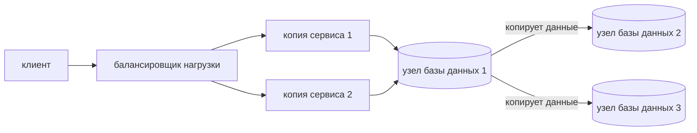

<!-- nav:top -->
[🏠 Начало](../START-HERE.md) · [← Этап 18 — Распределённые системы](README.md) · [📋 Этап 18](README.md) · [18.2 Сбои и тайм-ауты →](02-failures-and-timeouts.md) · [📖 Глоссарий](../GLOSSARY.md) · [🇬🇧 English](../../en/18-distributed-systems/01-what-a-distributed-system-is.md) <!-- nav -->

# Урок 18.1 — Что такое распределённая система

> **Этап 18 — Распределённые системы** · Урок 1 из 15 · ⏱ около 120 минут

## Что вы узнаете

- Что такое распределённая система и почему инженеры строят такие системы, хотя это трудно.
- Три вещи, которые отличают распределённую систему от одной программы: нет общей памяти, нет общих часов и бывают частичные сбои.
- Как запустить на вашем Mac крошечный «кластер» из трёх узлов и посмотреть, как один из них отказывает двумя разными способами.
- Почему клиент, не получивший ответа, не может знать, что произошло на другой стороне.
- Восемь «заблуждений о распределённых вычислениях»: ложных убеждений, из-за которых появляются настоящие ошибки.

## Перед началом

- Вы прошли [Этап 17 — Как устроены хранилища и базы данных](../17-storage-and-databases/README.md).
- Вы знаете `TcpListener`, `TcpStream`, очередь соединений (backlog) и тайм-ауты чтения из [Урока 15.4 — TCP-сокеты в Rust](../15-networking/04-tcp-sockets-in-rust.md), scoped-потоки из [Урока 14.4](../14-concurrency-and-async/04-thread-pools-scoped-threads-and-rayon.md) и сигнал остановки по Ctrl+Z из [Урока 13.7 — Сигналы в ваших программах](../13-operating-systems/07-signals-in-your-programs.md).
- **Как устроен код этого этапа.** У каждого урока свой пакет в `~/projects/rust/code/p18-<topic>`. Код для повторного использования лежит в `src/lib.rs`, каждый запускаемый пример — отдельный файл в `src/bin/` (запуск: `cargo run --bin <name>`), модульные тесты находятся в `src/lib.rs`, а тесты, которые используют пакет снаружи, — в `tests/`. Создайте пакет для этого урока:

```bash
cd ~/projects/rust
cargo new --lib code/p18-nodes
cd code/p18-nodes
mkdir src/bin
```

Для этого урока нужны три вкладки терминала. Во всех откройте папку `code/p18-nodes`.

## Новые слова

| Слово | Значение |
|---|---|
| **распределённая система** (distributed system) | Несколько программ на нескольких компьютерах, которые вместе делают одну работу и общаются только сообщениями по сети. |
| **узел** (node) | Один участник распределённой системы: обычно один процесс на одной машине. *Кластер* — группа узлов. |
| **сообщение** (message) | Порция данных, которую один узел отправляет другому по сети. Это единственный способ, которым узлы могут делиться информацией. |
| **частичный сбой** (partial failure) | Часть системы отказала, а другая часть продолжает работать. Одна программа обычно работает или падает целиком; в распределённой системе почти всегда что-то где-то сломано. |
| **сетевое разделение** (network partition) | Сеть разрезана так, что одни узлы не могут достучаться до других, хотя все узлы продолжают работать. |
| **задержка** (latency) | Сколько времени что-то занимает, например время от отправки запроса до получения ответа. |
| **RTT** (Round-Trip Time, время приёма-передачи) | Время, за которое сообщение доходит до другого узла и ответ возвращается обратно. |
| **масштабируемость** (scalability) | Способность справляться с большей работой, добавляя машины. |
| **отказоустойчивость** (fault tolerance) | Способность продолжать правильно работать, когда часть компонентов отказала. |
| **заблуждение** (fallacy) | Убеждение, которое звучит правдиво, но ложно. |
| **CPU** (Central Processing Unit, центральный процессор) | Микросхема, которая выполняет инструкции программ. |
| **TCP** (Transmission Control Protocol, протокол управления передачей) | Протокол, который даёт надёжный поток байтов между двумя программами (Урок 15.3). |
| **IP** (Internet Protocol, межсетевой протокол) / **DNS** (Domain Name System, система доменных имён) | Протокол, который доставляет пакеты между машинами по адресу / система, которая превращает имена в IP-адреса (Этап 15). |
| **TLS** (Transport Layer Security, протокол защиты транспортного уровня) | Шифрование и аутентификация сетевого соединения (Урок 15.12). |
| **SSD** (Solid-State Drive, твердотельный накопитель) | Устройство хранения на микросхемах флеш-памяти (Урок 17.1). |

## 1. Много компьютеров, одна работа

**Распределённая система** — это группа программ, работающих на разных компьютерах, которые сотрудничают
так, чтобы выглядеть как один сервис. Когда вы открываете веб-страницу, запрос может попасть на балансировщик
нагрузки, затем на одну из двадцати копий веб-сервиса, а тот читает из базы данных, которая хранит три копии
каждой строки на трёх машинах. Вы видите один сайт. За ним — десятки компьютеров, которые должны договариваться
друг с другом.

В этом курсе вы уже пользовались несколькими распределёнными системами:

- Сам интернет и DNS (Domain Name System, система доменных имён, Этап 15): миллионы серверов имён, и ни один из них не знает всего.
- Сервер NATS с JetStream (Урок 16.11) может работать как кластер из трёх серверов, которые хранят одни и те же сообщения.
- PostgreSQL (Этап 16) может держать копии базы данных на других машинах.

Зачем строить что-то настолько сложное? Есть четыре частые причины:

1. **Данные или работа не помещаются на одну машину.** Один диск вмещает несколько терабайт; один CPU
   может ответить лишь на ограниченное число запросов в секунду. Когда машин много, каждая делает свою часть.
   Это **масштабируемость**.
2. **Машины ломаются.** Диски умирают, пропадает питание, кто-то перезагружает не тот сервер. Если единственная
   копия ваших данных лежит на этой машине, сервис недоступен. Если копии есть на нескольких машинах, сервис
   выживает. Это **отказоустойчивость**.
3. **Пользователи далеко.** Сообщение до сервера в другой стране и обратно идёт десятки
   миллисекунд. Копия сервиса ближе к пользователю отвечает быстрее.
4. **Разными частями владеют разные команды.** Большая компания делит продукт на много сервисов, которые
   общаются по сети (Этап 16).



Каждая стрелка на этой картинке — сообщение по сети. И каждая стрелка может отказать.

## 2. Что делает это трудным

Внутри одной программы потоки делят общую память (Этап 14). Если один поток записал значение, другой может его
прочитать. Все потоки пользуются одними часами. Если программа упала, всё останавливается сразу, и вы её
перезапускаете.

Распределённая система лишена всех трёх удобств:

| Одна программа на одной машине | Распределённая система |
|---|---|
| Потоки делят память. | Узлы не делят **ничего**. Единственный способ что-то узнать — получить **сообщение**. |
| Одни часы на всех. | У каждой машины свои часы, и они расходятся (Урок 18.4). |
| Работает или упала. | **Частичный сбой**: одни узлы работают, другие упали, третьи медленные, четвёртые не могут достучаться друг до друга (**сетевое разделение**). |
| Вызов функции занимает наносекунды и всегда возвращается. | Сообщение идёт от микро- до миллисекунд и может вообще не дойти. |

Последние две строки — сердце этого этапа. Вызов функции либо возвращает значение, либо паникует. Сообщение
может потеряться, надолго задержаться, прийти дважды или прийти на узел, который вот-вот упадёт. Отправитель
обычно не может сказать, что из этого случилось. Давайте увидим это своими глазами.

## 3. Кластер на вашем Mac

Мы построим самую маленькую распределённую систему: несколько **узлов**, которые отвечают на `ping` словом
`pong`, и клиента, который опрашивает их всех. Каждый узел — отдельный процесс со своим портом, как будто он
стоит на своей машине. Поместите это в `src/lib.rs`:

```rust
//! A tiny "node" that answers pings over TCP (Lesson 18.1).

use std::io::{BufRead, BufReader, Write};
use std::net::{SocketAddr, TcpListener, TcpStream};
use std::time::Duration;

/// Answers each connection: reads one line, and if it is "ping", replies "pong from <name>".
pub fn serve(listener: TcpListener, name: &str) {
    for stream in listener.incoming() {
        let result = stream.and_then(|stream| answer(stream, name));
        if let Err(error) = result {
            eprintln!("node {name}: {error}");
        }
    }
}

fn answer(mut stream: TcpStream, name: &str) -> std::io::Result<()> {
    let mut line = String::new();
    BufReader::new(&stream).read_line(&mut line)?;
    if line.trim() == "ping" {
        writeln!(stream, "pong from {name}")?;
        println!("node {name}: answered a ping");
    }
    Ok(())
}

/// Sends "ping" to the node at `addr` and waits at most `limit` for each step.
pub fn ping(addr: SocketAddr, limit: Duration) -> std::io::Result<String> {
    let mut stream = TcpStream::connect_timeout(&addr, limit)?;
    stream.set_read_timeout(Some(limit))?;
    writeln!(stream, "ping")?;
    let mut reply = String::new();
    BufReader::new(&stream).read_line(&mut reply)?;
    Ok(reply.trim().to_string())
}
```

**Что происходит:**

1. `serve` принимает соединения по одному (`listener.incoming()`). Для каждого вызывает `answer`. Ошибка в одном
   соединении печатается, и узел продолжает обслуживать остальные: один плохой клиент не должен убивать узел.
2. `answer` читает одну строку. Если это `ping`, он отправляет обратно `pong from <name>` и печатает строку лога,
   чтобы в терминале узла было видно, когда он сделал работу.
3. `ping` — сторона клиента. `connect_timeout` ограничивает ожидание соединения, а `set_read_timeout` —
   ожидание ответа. Без этих двух ограничений клиент мог бы ждать вечно (см. «Частые ошибки» ниже).

Теперь программа узла, `src/bin/node.rs`:

```rust
use std::net::TcpListener;

fn main() -> std::io::Result<()> {
    let args: Vec<String> = std::env::args().collect();
    if args.len() != 3 {
        eprintln!("usage: node <name> <port>");
        std::process::exit(2);
    }
    let (name, port) = (&args[1], &args[2]);
    let listener = TcpListener::bind(format!("127.0.0.1:{port}"))?;
    println!("node {name} listening on {}", listener.local_addr()?);
    p18_nodes::serve(listener, name);
    Ok(())
}
```

И клиент, `src/bin/client.rs`, который пингует три порта и измеряет каждый ответ:

```rust
use std::net::SocketAddr;
use std::time::{Duration, Instant};

fn main() {
    let limit = Duration::from_millis(500);
    for port in [7001, 7002, 7003] {
        let addr = SocketAddr::from(([127, 0, 0, 1], port));
        let start = Instant::now();
        let result = p18_nodes::ping(addr, limit);
        let micros = start.elapsed().as_micros();
        match result {
            Ok(reply) => println!("{port}: {reply} ({micros} µs)"),
            Err(error) => println!("{port}: error: {error} ({micros} µs)"),
        }
    }
}
```

Запустите два узла, каждый в своём терминале. На порту 7003 мы специально не запускаем никого.

```bash
# терминал 1
cargo run --bin node -- a 7001
```

```bash
# терминал 2
cargo run --bin node -- b 7002
```

```text
node a listening on 127.0.0.1:7001
```

```text
node b listening on 127.0.0.1:7002
```

Затем запустите клиента в третьем терминале:

```bash
# терминал 3
cargo run --bin client
```

```text
7001: pong from a (157 µs)
7002: pong from b (75 µs)
7003: error: Connection refused (os error 61) (55 µs)
```

Каждый узел печатает в своём терминале `node a: answered a ping` (или `b`). Ваши микросекунды (µs, миллионные
доли секунды) будут другими; важен порядок величины. Путь туда и обратно (RTT) через loopback-сеть внутри
одного Mac занимает от десятков до сотен микросекунд. Вызов функции занимает несколько наносекунд: примерно
в десять тысяч раз меньше.

Ответ с порта 7003 интересен. Там никто не слушает, поэтому операционная система «другой машины» (здесь — вашего
же Mac) ответила на попытку соединения отказом. В каком-то смысле это хорошая новость: мы **знаем**, что там
не работает ни один узел. (В Linux та же ошибка говорит `os error 111`.)

## 4. Частичный сбой в действии

Теперь заморозим узел `b`, не убивая его. В терминале 2 нажмите **Ctrl+Z**. Терминал отправит сигнал `SIGTSTP`,
который приостанавливает процесс (Урок 13.7). Процесс всё ещё существует, и его порт всё ещё открыт, но он не
выполняет никакого кода. Именно так выглядит узел, когда его машина перегружена, когда он ждёт медленный диск
или когда хост приостановил виртуальную машину.

Снова запустите клиента:

```text
7001: pong from a (90 µs)
7002: error: Resource temporarily unavailable (os error 35) (500124 µs)
7003: error: Connection refused (os error 61) (67 µs)
```

Соединение с узлом `b` **удалось**: ядро завершает рукопожатие TCP (Transmission Control Protocol) и кладёт
соединение в очередь (backlog), даже когда программа приостановлена (Урок 15.4). Наш `ping` тоже ушёл в буфер
ядра. Но ответ не пришёл, поэтому через 500 мс истёк тайм-аут чтения. В macOS тайм-аут чтения выглядит как
`Resource temporarily unavailable` (вид ошибки `WouldBlock`; в Linux — `os error 11`).

Теперь возобновите узел `b`: наберите `fg` и нажмите Enter в терминале 2. Сразу посмотрите в терминал 2:

```text
node b: answered a ping
```

Узел `b` проснулся, нашёл в очереди наш старый `ping` и **сделал работу** — для клиента, который уже сдался и
сообщил об ошибке. Ответа никто не увидел.

Подумайте, что знал клиент в каждый момент:

| Что увидел клиент | Что он может заключить |
|---|---|
| `pong from a` | Узел `a` был жив и сделал работу. |
| `Connection refused` | На порту никто не слушал: узел не работает (или не был запущен). Запрос не обработан. |
| Тайм-аут | **Ничего определённого.** Узел может быть мёртв, приостановлен, медленен, или сеть могла потерять запрос или ответ. Работа могла случиться, может случиться позже или не случиться никогда. |

Третья строка — самая важная идея всего этапа. Замените «ping» на «перевести 100 евро», и вы увидите проблему:
после тайм-аута клиент не знает, ушли ли деньги. Урок 18.2 подробно разбирает сбои и тайм-ауты, а Урок 18.3
показывает, как безопасно повторять запросы.

> 💡 **Совет:** Ctrl+Z (пауза) и Ctrl+C (остановка) имитируют два разных сбоя. Ctrl+C убивает узел: порт
> закрывается, и новые клиенты сразу получают `Connection refused`. Ctrl+Z оставляет узел, который выглядит
> живым: он принимает соединения, но никогда не отвечает. Второй вид гораздо опаснее, потому что он
> похож на работающий.

## 5. Восемь заблуждений о распределённых вычислениях

В 1990-х инженеры Sun Microsystems записали ложные предположения о сетях, которые делают новички. Список верен
и сегодня. Каждый пункт уже становился причиной настоящих аварий.

| Заблуждение (ложное убеждение) | Как на самом деле |
|---|---|
| 1. Сеть надёжна. | Сообщения теряются, соединения рвутся, узел может замереть, как вы только что видели. |
| 2. Задержка равна нулю. | Каждое сообщение стоит времени: микросекунды на одной машине, миллисекунды внутри дата-центра, около ста миллисекунд через полмира. |
| 3. Пропускная способность бесконечна. | Сетевой канал передаёт ограниченное число байтов в секунду. Пересылка целой копии базы данных занимает время. |
| 4. Сеть безопасна. | Сообщения могут прочитать или изменить посторонние, если вы не используете TLS (Transport Layer Security, протокол защиты транспортного уровня, Урок 15.12). |
| 5. Топология не меняется. | Машины добавляют, убирают и переносят. IP-адреса (Internet Protocol, межсетевой протокол) меняются. |
| 6. Администратор один. | Разными частями управляют разные команды и компании с разными правилами. |
| 7. Передача ничего не стоит. | Превращение данных в байты и их отправка стоят процессорного времени и денег. |
| 8. Сеть однородна. | Машины различаются: разное железо, операционные системы и версии вашей же программы. |

Большинство уроков этого этапа — это аккуратный ответ на заблуждения 1 и 2.

## 6. Примерная шкала времени

Инженеры держат в голове несколько чисел, чтобы оценивать проекты. Точные значения зависят от железа;
важен порядок величины. (ns — наносекунда, миллиардная доля секунды; µs — микросекунда, миллионная;
ms — миллисекунда, тысячная.)

| Операция | Примерное время |
|---|---|
| Чтение значения из кэша процессора | около 1 ns |
| Чтение из основной памяти ([Урок 12.9](../12-computer-systems/09-memory-hierarchy-and-caches.md)) | около 100 ns |
| Путь туда и обратно через loopback на одной машине | 10–200 µs |
| Путь туда и обратно внутри одного дата-центра | около 0,5 ms |
| Запись на SSD и ожидание `fsync` (Урок 17.2) | 0,1–10 ms |
| Путь туда и обратно между континентами | 100–200 ms |

Один сетевой путь туда и обратно может стоить столько же, сколько миллион чтений из памяти. Поэтому
распределённые проекты изо всех сил стараются отправлять **меньше** сообщений, и поэтому «просто спросить
другой узел» никогда не бесплатно.

> ⚡ **Производительность:** когда запросу нужно дождаться нескольких узлов, спрашивайте их **параллельно**, а не
> по очереди. Тогда общее время равно времени самого медленного узла, а не сумме. Это делает Упражнение 3.

## Частые ошибки

> ⚠️ **Частая ошибка: нет тайм-аута.** Если написать клиента через `TcpStream::connect(addr)` без
> `set_read_timeout`, клиент будет ждать приостановленный узел **вечно**. Ничего не печатается, и программа
> не завершается; остаётся только нажать Ctrl+C. Каждому сетевому вызову в распределённой системе нужен
> предел по времени.

> ⚠️ **Частая ошибка: «тайм-аут значит, что не получилось».** Тайм-аут значит «я перестал ждать». Как показал
> раздел 4, другой узел может сделать работу позже. Код, который, например, снова списывает деньги с карты после
> тайм-аута, может списать их дважды. Урок 18.3 решает это как следует.

**Забытый `move` при запуске потока на каждый узел.** В Упражнении 3 вы запускаете по scoped-потоку на каждый
порт. Без `move` замыкание лишь заимствует `port`, который живёт только одну итерацию цикла:

```text
error[E0373]: closure may outlive the current function, but it borrows `port`, which is owned by the current function
  --> src/bin/parallel.rs:9:25
   |
 9 |             scope.spawn(|| {
   |                         ^^ may outlive borrowed value `port`
10 |                 let addr = SocketAddr::from(([127, 0, 0, 1], port));
   |                                                              ---- `port` is borrowed here
...
help: to force the closure to take ownership of `port` (and any other referenced variables), use the `move` keyword
   |
 9 |             scope.spawn(move || {
   |                         ++++
```

Исправление — в строке help: `scope.spawn(move || { ... })`. `port` — маленькое число с `Copy`, поэтому `move`
просто копирует его в каждый поток.

## Попробуйте сами

1. Запустите узлы `a` и `b`, как в разделе 3, а также узел `c` на порту 7003. Запустите клиента: три ответа pong.
2. Нажмите **Ctrl+C** в терминале узла `c`. Запустите клиента: `7003` сразу получает отказ.
3. Нажмите **Ctrl+Z** в терминале узла `a`. Запустите клиента: `7001` ждёт 500 мс и завершается ошибкой.
4. Запустите клиента ещё два раза, затем наберите `fg` в терминале узла `a`. Посчитайте строки
   `answered a ping`, которые сразу появятся. Узел `a` ответил на каждый ping, ждавший в его очереди, хотя
   клиенты давно ушли.

## Упражнения

### Упражнение 1 — Назовите исход, с тестом (легко)

Добавьте в `src/lib.rs` перечисление `Outcome` с вариантами `Answered`, `Refused`, `NoAnswer` и `Other` и функцию
`pub fn classify(result: &std::io::Result<String>) -> Outcome`. У тайм-аута чтения вид ошибки `WouldBlock` в macOS
и Linux и `TimedOut` в некоторых других системах; оба означают `NoAnswer`. Напишите модульный тест, который
проверяет все четыре исхода **без** сети: создавайте ошибки через `std::io::Error::from(kind)`.

<details>
<summary>Подсказка</summary>

Используйте `match` с условиями: `Err(e) if e.kind() == ErrorKind::ConnectionRefused => ...`. Для двух видов в
одной ветке удобен `matches!(e.kind(), ErrorKind::WouldBlock | ErrorKind::TimedOut)`.

</details>

<details>
<summary>Ответ</summary>

```rust
/// What we can say about a node after one ping.
#[derive(Debug, PartialEq)]
pub enum Outcome {
    /// It replied: it is alive and it did the work.
    Answered,
    /// The other machine said "nobody listens on this port": the node is down.
    Refused,
    /// Nothing came back in time: we do not know what happened.
    NoAnswer,
    /// Something else went wrong.
    Other,
}

pub fn classify(result: &std::io::Result<String>) -> Outcome {
    use std::io::ErrorKind;
    match result {
        Ok(_) => Outcome::Answered,
        Err(e) if e.kind() == ErrorKind::ConnectionRefused => Outcome::Refused,
        Err(e) if matches!(e.kind(), ErrorKind::WouldBlock | ErrorKind::TimedOut) => {
            Outcome::NoAnswer
        }
        Err(_) => Outcome::Other,
    }
}

#[cfg(test)]
mod tests {
    use super::*;
    use std::io::{Error, ErrorKind};

    #[test]
    fn classifies_each_kind_of_result() {
        assert_eq!(classify(&Ok("pong from a".to_string())), Outcome::Answered);
        let refused = Err(Error::from(ErrorKind::ConnectionRefused));
        assert_eq!(classify(&refused), Outcome::Refused);
        assert_eq!(classify(&Err(Error::from(ErrorKind::WouldBlock))), Outcome::NoAnswer);
        assert_eq!(classify(&Err(Error::from(ErrorKind::TimedOut))), Outcome::NoAnswer);
        assert_eq!(classify(&Err(Error::from(ErrorKind::BrokenPipe))), Outcome::Other);
    }
}
```

`cargo test --lib`:

```text
test tests::classifies_each_kind_of_result ... ok

test result: ok. 1 passed; 0 failed; 0 ignored; 0 measured; 0 filtered out; finished in 0.00s
```

Почему это работает: функция смотрит только на **вид** ошибки, который одинаков во всех операционных системах,
а не на текст или номер ошибки операционной системы, которые различаются.

</details>

### Упражнение 2 — Тест живого и замёрзшего узла (средне)

Напишите интеграционный тест `tests/ping.rs` с двумя тестами. Первый запускает настоящий узел на порту `0` в
фоновом потоке и проверяет, что `ping` возвращает `"pong from test"`. Второй имитирует **замёрзший** узел без
всяких сигналов: создайте `TcpListener`, но не обслуживайте его, отправьте ping с пределом 200 мс и проверьте, что
`classify` (из Упражнения 1) говорит `NoAnswer`.

<details>
<summary>Подсказка</summary>

Порт `0` просит операционную систему выдать любой свободный порт; `listener.local_addr()` говорит, какой вы
получили (Урок 15.4). Слушающий сокет, из которого никто не читает, всё равно завершает рукопожатия и кладёт
соединения в очередь — точно как приостановленный узел в разделе 4.

</details>

<details>
<summary>Ответ</summary>

```rust
use std::net::TcpListener;
use std::time::Duration;

use p18_nodes::{Outcome, classify, ping, serve};

#[test]
fn a_running_node_answers() {
    let listener = TcpListener::bind("127.0.0.1:0").unwrap();
    let addr = listener.local_addr().unwrap();
    std::thread::spawn(move || serve(listener, "test"));

    let reply = ping(addr, Duration::from_secs(1)).unwrap();
    assert_eq!(reply, "pong from test");
}

#[test]
fn a_node_that_never_answers_gives_no_answer() {
    // The port is open, but nobody ever reads from the connection.
    let listener = TcpListener::bind("127.0.0.1:0").unwrap();
    let addr = listener.local_addr().unwrap();

    let result = ping(addr, Duration::from_millis(200));
    assert_eq!(classify(&result), Outcome::NoAnswer);
    drop(listener);
}
```

`cargo test --test ping`:

```text
test a_running_node_answers ... ok
test a_node_that_never_answers_gives_no_answer ... ok

test result: ok. 2 passed; 0 failed; 0 ignored; 0 measured; 0 filtered out; finished in 0.20s
```

Почему это работает: второй тест держит `listener` живым до конца (явный `drop` показывает намерение), поэтому
порт остаётся открытым и ядро принимает соединения, но никакой код их не читает. Тест длится 0,20 с — ровно
тайм-аут.

</details>

### Упражнение 3 — Спросить всех сразу (сложно)

Напишите `src/bin/parallel.rs`: отправьте ping на порты 7001, 7002 и 7003 **одновременно**, по одному
scoped-потоку на порт, напечатайте каждый ответ, а в конце — сколько длился весь раунд. Запустите его, когда узел
`a` работает, узел `b` приостановлен через Ctrl+Z, а на 7003 никого нет. Итог должен быть около 500 мс, а не
1000 мс или больше.

<details>
<summary>Подсказка</summary>

`std::thread::scope(|scope| { for port in ... { scope.spawn(move || { ... }); } });` ждёт все потоки, прежде чем
вернуть управление. Не забудьте `move` (см. «Частые ошибки»).

</details>

<details>
<summary>Ответ</summary>

```rust
use std::net::SocketAddr;
use std::time::{Duration, Instant};

fn main() {
    let limit = Duration::from_millis(500);
    let start = Instant::now();
    std::thread::scope(|scope| {
        for port in [7001, 7002, 7003] {
            scope.spawn(move || {
                let addr = SocketAddr::from(([127, 0, 0, 1], port));
                match p18_nodes::ping(addr, limit) {
                    Ok(reply) => println!("{port}: {reply}"),
                    Err(error) => println!("{port}: error: {error}"),
                }
            });
        }
    });
    println!("all answers in {} ms", start.elapsed().as_millis());
}
```

```text
7003: error: Connection refused (os error 61)
7001: pong from a
7002: error: Resource temporarily unavailable (os error 35)
all answers in 501 ms
```

Почему это работает: три ping ждут одновременно, поэтому раунд длится столько же, сколько самый медленный из
них (приостановленный узел, 500 мс). Заметьте, что ответы пришли не в порядке портов: порядок событий зависит от
времени. В распределённых системах это нормально, и Уроки 18.4 и 18.5 занимаются именно этим.

</details>

## Вопросы для самопроверки

1. Назовите три удобства одной программы, которых нет у распределённой системы.

<details>
<summary>Ответ</summary>

Общая память (узлы общаются только сообщениями), одни общие часы (у каждой машины свои) и сбой по принципу
«всё или ничего» (в распределённой системе бывают частичные сбои).

</details>

2. Клиент получил `Connection refused`. Был ли запрос обработан?

<details>
<summary>Ответ</summary>

Нет. Удалённая операционная система отказала в соединении, потому что на порту никто не слушал, так что ни одна
программа запрос не видела. Это один из немногих сбоев, которые дают определённый ответ.

</details>

3. У клиента истёк тайм-аут чтения. Перечислите хотя бы три вещи, которые могли случиться на другой стороне.

<details>
<summary>Ответ</summary>

Запрос потерялся; узел упал до или после выполнения работы; узел приостановлен или перегружен и сделает работу
позже; работа сделана, но ответ потерялся или ещё в пути. Клиент не может сказать, что именно.

</details>

4. Почему соединение с приостановленным узлом удалось?

<details>
<summary>Ответ</summary>

Рукопожатие TCP выполняет ядро, а не программа. Ядро кладёт готовое соединение в очередь слушающего сокета, даже
пока процесс приостановлен, и хранит отправленные нами байты в своём буфере.

</details>

5. Почему приостановленный (замёрзший) узел опаснее упавшего?

<details>
<summary>Ответ</summary>

Упавший узел обнаруживается быстро (соединения отклоняются). Замёрзший узел выглядит живым: он принимает
соединения, поэтому клиенты ждут до своего тайм-аута, а позже он может проснуться и выполнить старые запросы.

</details>

## Итоги

- Распределённая система — несколько узлов на нескольких машинах, которые сотрудничают, отправляя сообщения.
  Их строят ради масштаба, отказоустойчивости, близости к пользователям и границ между командами.
- Узлы не делят ни память, ни часы и отказывают **частично**: одни работают, другие упали, третьи замёрзли.
- Каждому сетевому вызову нужен тайм-аут. Отказ в соединении — ясный ответ; тайм-аут — вообще не ответ.
- После тайм-аута другой узел может всё же сделать работу позже, как это сделал приостановленный узел.
- Сетевой путь туда и обратно в тысячи и миллионы раз медленнее обращения к памяти, поэтому хорошие проекты
  отправляют мало сообщений и отправляют их параллельно.
- Восемь заблуждений — список ложных убеждений для проверки себя: сеть не надёжна, не мгновенна, не
  бесконечна, не безопасна и не постоянна.

## Источники и что почитать

- [Designing Data-Intensive Applications](https://dataintensive.net/) — книга Martin Kleppmann; глава «The Trouble with Distributed Systems» подробно разбирает этот урок и два следующих.
- [Fallacies of distributed computing](https://en.wikipedia.org/wiki/Fallacies_of_distributed_computing) — история восьми заблуждений и объяснение каждого.
- [Notes on Distributed Systems for Young Bloods](https://www.somethingsimilar.com/2013/01/14/notes-on-distributed-systems-for-young-bloods/) — короткое практическое эссе Jeff Hodges об уроках, выученных на собственных ошибках.
- [MIT 6.5840 Distributed Systems](https://pdos.csail.mit.edu/6.824/) — университетский курс с бесплатными конспектами лекций и лабораторными; хороший спутник на весь этап.
- [`std::net::TcpStream`](https://doc.rust-lang.org/std/net/struct.TcpStream.html) — `connect_timeout`, `set_read_timeout` и другие методы из этого урока.
- [`std::thread::scope`](https://doc.rust-lang.org/std/thread/fn.scope.html) — scoped-потоки для Упражнения 3.

---

[🏠 Начало](../START-HERE.md) · [← Этап 18 — Распределённые системы](README.md) · [📋 Этап 18](README.md) · [18.2 Сбои и тайм-ауты →](02-failures-and-timeouts.md) · [📖 Глоссарий](../GLOSSARY.md) <!-- nav -->
<!-- nav:bottom -->
