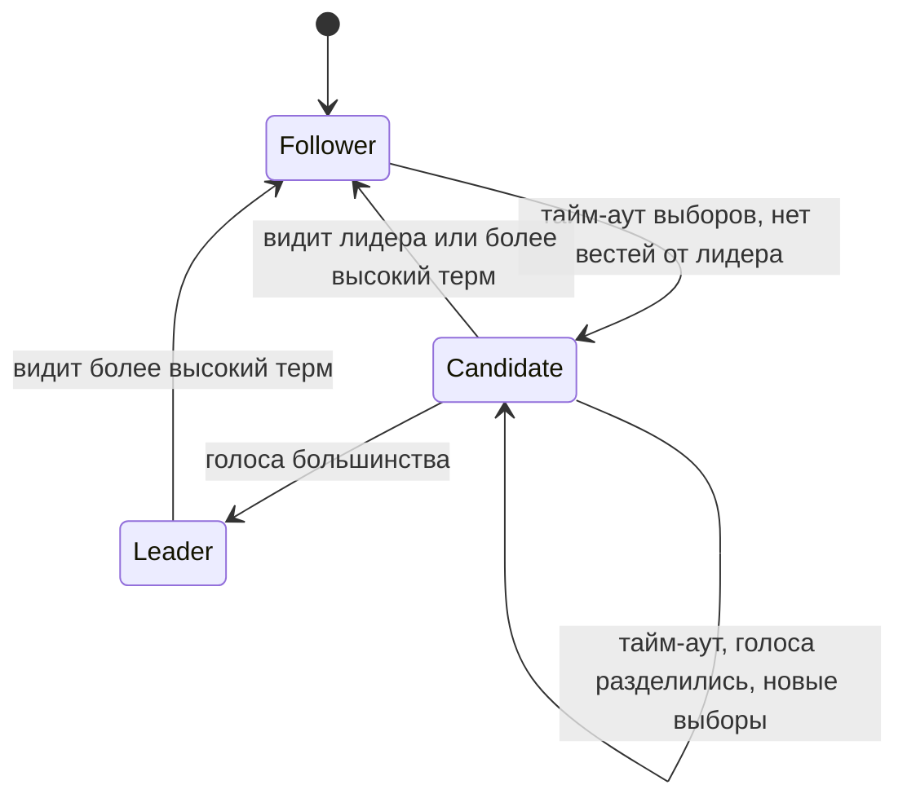

<!-- nav:top -->
[🏠 Начало](../START-HERE.md) · [← 18.8 Партиционирование и согласованное хеширование](08-partitioning-and-consistent-hashing.md) · [📋 Этап 18](README.md) · [18.10 Raft: выбор лидера →](10-raft-leader-election.md) · [📖 Глоссарий](../GLOSSARY.md) · [🇬🇧 English](../../en/18-distributed-systems/09-consensus-and-raft.md) <!-- nav -->

# Урок 18.9 — Консенсус и обзор Raft

> **Этап 18 — Распределённые системы** · Урок 9 из 15 · ⏱ около 135 минут

## Что вы узнаете

- Что такое задача *консенсуса* и почему она сложна, когда сообщения опаздывают или теряются, а машины падают.
- Идею *реплицированного конечного автомата*: одни и те же команды в одном и том же порядке дают одно и то же состояние на каждой машине.
- Почему консенсус опирается на *большинство* и сколько сбоев переживает кластер из 3, 5 или 7 машин.
- Общую картину Raft: роли, термы, журнал, два нужных ему сообщения и пять обещаний, которые он выполняет.
- Как в следующих уроках вы шаг за шагом построите собственное маленькое ядро Raft.

## Перед началом

- Вы прошли [Урок 18.8 — Партиционирование и согласованное хеширование](08-partitioning-and-consistent-hashing.md).
- Вы помните, почему тайм-аут не может отличить *медленную* машину от *мёртвой* ([Урок 18.2 — Сбои и тайм-ауты](02-failures-and-timeouts.md)), что делают лидер и последователи при репликации ([Урок 18.6 — Репликация](06-replication.md)) и что значит *линеаризуемость* ([Урок 18.7 — Модели согласованности](07-consistency-models.md)).
- Вы знаете журнал упреждающей записи из [Урока 17.4 — Журнал упреждающей записи (WAL)](../17-storage-and-databases/04-write-ahead-log.md): файл команд, который заново проигрывают после сбоя. Журнал Raft — та же идея, только общая для многих машин.
- Создайте пакет для этого урока. Как и везде на этом этапе, каждый пример — отдельный файл в `src/bin/`, запускается командой `cargo run --bin <name>`:

```bash
cd ~/projects/rust
cargo new --lib code/p18-consensus
mkdir code/p18-consensus/src/bin
```

## Новые слова

| Слово | Значение |
|---|---|
| **консенсус** (consensus) | Несколько машин договариваются об одном значении (или одной последовательности значений) и никогда не меняют решения, даже если часть машин падает или сообщения теряются. |
| **узел** (node) | Одна машина (или один процесс) в кластере. В этом этапе узел, сервер и реплика означают одно и то же. |
| **реплицированный конечный автомат** (replicated state machine) | Программа, которая работает на каждом узле и меняет своё состояние только применяя команды из общего журнала, по одной, по порядку. |
| **детерминированный** (deterministic) | Всегда дающий один и тот же результат для одного и того же входа. Реплицированный конечный автомат обязан быть детерминированным. |
| **большинство** (majority) | Больше половины узлов: 2 из 3, 3 из 5, 4 из 7. |
| **кворум** (quorum) | Группа узлов, достаточно большая, чтобы принять решение. В Raft кворум — это большинство. |
| **безопасность** (safety) | «Ничего плохого никогда не происходит»: например, два узла никогда не принимают разные решения. |
| **живучесть** (liveness) | «Что-то хорошее в конце концов происходит»: например, кластер в конце концов принимает решение. |
| **отказ с остановкой** (crash fault) | Узел перестаёт работать (падение, отключение питания, выдернутый сетевой кабель). Он не лжёт. Raft справляется с такими отказами. |
| **византийский отказ** (Byzantine fault) | Узел ведёт себя как угодно, даже злонамеренно: шлёт неверные или противоречивые сообщения. Raft с такими отказами **не** справляется. |
| **разделение мозга** (split brain) | Две части кластера одновременно считают себя главными и принимают противоречащие друг другу записи. Консенсус это предотвращает. |
| **Raft** | Алгоритм консенсуса, созданный так, чтобы его было легко понять (Ongaro и Ousterhout, 2014). Используется в etcd, Consul, NATS JetStream, TiKV и многих других системах. |
| **Paxos** | Более старый алгоритм консенсуса Лесли Лэмпорта (Leslie Lamport). Корректный, но известен тем, что его трудно понять и реализовать. |
| **терм** (term) | «Номер эпохи» в Raft. Время делится на термы 1, 2, 3, …; в каждом терме не больше одного лидера. |
| **запись журнала** (log entry) | Одна команда в журнале Raft вместе с термом, в котором лидер её получил, на пронумерованной позиции (*индексе*). |
| **зафиксированная** (committed) | Запись журнала зафиксирована, когда она сохранена на большинстве узлов. С этого момента она никогда не потеряется и не будет заменена, и узлы могут её применять. |
| **RPC** (Remote Procedure Call, удалённый вызов процедуры) | Запрос, который одна программа отправляет другой по сети, прося что-то сделать и ответить, — как вызов функции на другой машине. |
| **результат FLP** (FLP result) | Доказательство Фишера, Линч и Патерсона (Fischer, Lynch, Paterson, 1985): если сообщения могут задерживаться без ограничения, никакой алгоритм не может *гарантировать*, что консенсус всегда завершится, когда хотя бы один узел может упасть. |

## 1. Задача: много машин, одно решение

В [Уроке 18.6](06-replication.md) вы видели лидера, который копирует записи последователям. Отсюда возникают вопросы, на которые одна только репликация не отвечает:

- Лидер упал. Кто новый лидер? Все последователи должны прийти к **одному** ответу.
- Два клиента записали в один и тот же момент. В каком порядке произошли записи? Каждая реплика должна использовать **один и тот же** порядок.
- Старый лидер был не мёртв, а просто медленен, и вернулся. Он всё ещё считает себя лидером. Что мешает ему принимать записи?

Все эти вопросы — одна и та же задача: **несколько машин должны о чём-то договориться и оставаться при этом решении**. Это и есть консенсус. У корректного алгоритма консенсуса три свойства:

1. **Согласие (agreement):** никакие два узла не принимают разные решения.
2. **Обоснованность (validity):** выбранное значение действительно кто-то предложил (алгоритм не придумывает значения).
3. **Завершение (termination):** каждый не упавший узел в конце концов принимает решение.

Почему это сложно? Вспомните [Урок 18.2](02-failures-and-timeouts.md): узел, который не отвечает, может быть мёртв, медленен или отрезан сетью, и **вы не можете узнать, что именно**. Если узел A решит «B мёртв, лидер теперь я», а B просто медленный, у вас два лидера: разделение мозга.

Результат FLP даже доказывает, что в сети, где сообщения могут задерживаться сколь угодно долго, никакой алгоритм не может *гарантировать* завершение, если один узел может упасть. Практические алгоритмы вроде Raft принимают это: они **никогда не нарушают безопасность**, а живучесть получают *на практике* с помощью тайм-аутов и случайности. Когда сеть совсем плоха, Raft может на время перестать продвигаться, но он никогда не примет неверное решение.

> 💡 **Совет:** читая о любом распределённом алгоритме, сначала спросите «какое у него свойство безопасности?», а потом «когда он продвигается?». Путаница между этими двумя вопросами — самый частый источник недоразумений.

## 2. Реплицированные конечные автоматы

Договориться об *одном* значении для базы данных мало. Нам нужно договориться о целой **последовательности** команд: «установить apples в 10», затем «прибавить 5 к apples» и так далее. Приём, который делает это полезным, — реплицированный конечный автомат:

```text
  client commands
        |
        v
  +-----------+   same log on every node   +-----------+   +-----------+
  |  log:     |  ------------------------> |  log:     |   |  log:     |
  | 1 set a=10|                            | 1 set a=10|   | 1 set a=10|
  | 2 add a 5 |                            | 2 add a 5 |   | 2 add a 5 |
  +-----------+                            +-----------+   +-----------+
        |                                        |               |
        v  apply in order                        v               v
  state: a = 15                            state: a = 15   state: a = 15
       node 1                                   node 2          node 3
```

Если каждый узел начинает с одного и того же пустого состояния и применяет одни и те же команды в одном и том же порядке, каждый узел приходит к одному и тому же состоянию. Консенсус нужен только для **журнала**; состояние получается само. Напишите `src/bin/rsm.rs`:

```rust
use std::collections::BTreeMap;

/// One command in the replicated log.
#[derive(Debug, Clone)]
enum Command {
    Set(String, i64),
    Add(String, i64),
    Delete(String),
}

/// The state machine: a tiny key-value map.
#[derive(Debug, Default, PartialEq)]
struct Store {
    data: BTreeMap<String, i64>,
}

impl Store {
    fn apply(&mut self, cmd: &Command) {
        match cmd {
            Command::Set(k, v) => {
                self.data.insert(k.clone(), *v);
            }
            Command::Add(k, v) => {
                *self.data.entry(k.clone()).or_insert(0) += v;
            }
            Command::Delete(k) => {
                self.data.remove(k);
            }
        }
    }
}

fn main() {
    let log = vec![
        Command::Set("apples".to_string(), 10),
        Command::Add("apples".to_string(), 5),
        Command::Set("pears".to_string(), 3),
        Command::Delete("pears".to_string()),
        Command::Add("plums".to_string(), 7),
    ];

    // Three replicas start empty and apply the same log in the same order.
    let mut replicas = [Store::default(), Store::default(), Store::default()];
    for replica in replicas.iter_mut() {
        for cmd in &log {
            replica.apply(cmd);
        }
    }

    for (i, r) in replicas.iter().enumerate() {
        println!("replica {i}: {:?}", r.data);
    }
    println!(
        "all equal: {}",
        replicas[0] == replicas[1] && replicas[1] == replicas[2]
    );

    // Same commands, different order: a different result.
    let mut other = Store::default();
    for cmd in [&log[1], &log[0], &log[2], &log[3], &log[4]] {
        other.apply(cmd);
    }
    println!("other order: {:?}", other.data);
}
```

**Что происходит:**

1. `Command` — то, что передаётся через журнал. `Store` — конечный автомат; он меняется только внутри `apply`.
2. `BTreeMap` хранит ключи отсортированными, поэтому вывод одинаков при каждом запуске (`HashMap` печатал бы в случайном порядке).
3. Три реплики применяют одни и те же пять команд в одном порядке и получаются равными.
4. Последняя часть применяет первые две команды в обратном порядке: «прибавить 5» выполняется на пустом ключе (0 + 5), затем «установить 10» его перезаписывает. Результат другой. **Порядок важен**, поэтому узлы должны договориться о порядке, а не только о наборе команд.

```text
replica 0: {"apples": 15, "plums": 7}
replica 1: {"apples": 15, "plums": 7}
replica 2: {"apples": 15, "plums": 7}
all equal: true
other order: {"apples": 10, "plums": 7}
```

Кроме того, конечный автомат должен быть **детерминированным**. Представьте команду `TouchNow(key)`, чей `apply` сохраняет текущее время из `SystemTime::now()`. Каждая реплика применяет её в чуть-чуть другой момент, поэтому каждая сохраняет другое число, и реплики молча расходятся, хотя журналы у них одинаковые. Исправление — команда `TouchAt(key, time)`: лидер читает часы **один раз**, когда создаёт команду, а каждая реплика лишь копирует значение. (В Упражнении 4 вы увидите обе версии в работе.)

> 📏 **Соглашение:** всё недетерминированное (время, случайные числа, сгенерированные идентификаторы) решается **один раз**, до того как команда попадёт в журнал, и хранится в самой команде.

## 3. Большинство: почему консенсусу нужно больше половины

Решение должно пережить сбои, поэтому его надо хранить на нескольких узлах. На скольких? Raft (и Paxos) используют **большинство**. Причина — один простой факт: **любые два большинства одного кластера имеют хотя бы один общий узел**. Если значение принято большинством, в любом следующем большинстве найдётся хотя бы один узел, который о нём знает, поэтому значение не может быть тихо забыто.

Проверим этот факт перебором. Напишите `src/bin/quorum.rs`:

```rust
/// The smallest group that is more than half of `n` nodes.
fn majority(n: usize) -> usize {
    n / 2 + 1
}

/// Every group of exactly `size` nodes, out of `n` nodes, as a bit mask.
fn groups(n: usize, size: usize) -> Vec<u32> {
    (0..(1u32 << n))
        .filter(|mask| mask.count_ones() as usize == size)
        .collect()
}

/// True if every two groups of `size` nodes share at least one node.
fn always_overlap(n: usize, size: usize) -> bool {
    let all = groups(n, size);
    for a in &all {
        for b in &all {
            if a & b == 0 {
                return false;
            }
        }
    }
    true
}

fn main() {
    println!("nodes  majority  can lose");
    for n in 1..=7 {
        let m = majority(n);
        println!("{n:>5}  {m:>8}  {:>8}", n - m);
    }

    let n = 5;
    println!();
    for size in 1..=n {
        println!(
            "n = {n}, group size {size}: {:>2} possible groups, every two overlap: {}",
            groups(n, size).len(),
            always_overlap(n, size)
        );
    }
}
```

**Что происходит:**

1. Группа узлов — это *битовая маска*: бит `i` равен 1, когда узел `i` входит в группу. При 5 узлах числа `0..32` — все возможные группы.
2. `count_ones()` считает единичные биты, то есть размер группы. `groups` оставляет группы нужного размера.
3. У двух групп есть общий узел ровно тогда, когда у их масок есть общий единичный бит, то есть `a & b != 0`. Если для какой-то пары `a & b == 0`, две группы такого размера могли бы принять решение, ничего не зная друг о друге.
4. Таблица показывает размер большинства и сколько узлов может отказать, пока большинство ещё живо.

```text
nodes  majority  can lose
    1         1         0
    2         2         0
    3         2         1
    4         3         1
    5         3         2
    6         4         2
    7         4         3

n = 5, group size 1:  5 possible groups, every two overlap: false
n = 5, group size 2: 10 possible groups, every two overlap: false
n = 5, group size 3: 10 possible groups, every two overlap: true
n = 5, group size 4:  5 possible groups, every two overlap: true
n = 5, group size 5:  1 possible groups, every two overlap: true
```

Внимательно прочитайте таблицу. Из неё следуют два вывода:

- **Чтобы пережить `f` отказов, нужно `2f + 1` узлов.** 3 узла переживают 1 отказ, 5 — 2, 7 — 3.
- **Чётные числа не помогают.** 4 узла переживают только 1 отказ, как и 3, но требуют ещё одну машину и ещё один ответ на каждое решение. Два узла переживают **ноль** отказов: если любой из них лежит, большинства нет. Настоящие кластеры используют 3 или 5 узлов.

Тот же факт пересечения защищает от разделения мозга при **сетевом разделении** (partition). Если 5 узлов разделились на группу из 3 и группу из 2, большинство есть только у группы из 3. Группа из 2 не может выбрать лидера и не может фиксировать записи. Она недоступна, но она никогда не *ошибается*. Это компромисс из [Урока 18.7](07-consistency-models.md): на стороне меньшинства консенсус выбирает согласованность, а не доступность.

> ⚡ **Производительность:** каждая запись ждёт ответа большинства, поэтому стоит как минимум одного сетевого круга от лидера до «среднего» последователя. Больше узлов — больше устойчивости к сбоям, но записи от этого не ускоряются. Поэтому кластеры остаются маленькими (3 или 5), а для масштабирования используют партиционирование ([Урок 18.8](08-partitioning-and-consistent-hashing.md)): много маленьких групп Raft, по одной на партицию.

## 4. Raft на одной картинке

Raft делит консенсус на три задачи поменьше; следующие два урока разбирают первые две:

1. **Выбор лидера** ([Урок 18.10](10-raft-leader-election.md)): выбрать одного лидера и выбрать нового, когда он откажет.
2. **Репликация журнала** ([Урок 18.11](11-raft-log-replication.md)): лидер принимает команды, добавляет их в свой журнал и копирует журнал последователям.
3. **Безопасность**: несколько дополнительных правил гарантируют, что зафиксированная запись никогда не потеряется, даже после многих смен лидера.

### Роли

Каждый узел находится в одной из трёх ролей:



- **Последователь** (follower) пассивен. Он отвечает на сообщения лидера и кандидатов.
- **Кандидат** (candidate) — это последователь, который какое-то время (свой *тайм-аут выборов*) ничего не слышал от лидера и просит остальных проголосовать за него.
- **Лидер** (leader) обрабатывает все записи клиентов и регулярно шлёт *пульс* (heartbeat), чтобы последователи знали, что он жив.

### Термы

Время делится на **термы** с номерами 1, 2, 3, … Каждый терм начинается с выборов. Если кандидат побеждает, он остаётся лидером до конца терма. Если голоса разделились, терм заканчивается без лидера, и вскоре начинается новый.

```text
 term:   |   1   |    2    | 3 |      4        |
         | elect | normal  |   | elect normal  |
         | L = A | L = A   | (no leader:       |
         |       |         |  split vote)  L = C
```

Термы работают как **логические часы** ([Урок 18.5 — Логические часы](05-logical-clocks.md)). Каждое сообщение несёт терм отправителя. Правило простое и строгое: **если узел видит более высокий терм, он обновляет свой терм и становится последователем**. Старый лидер, который был отрезан и вернулся, видит более высокий терм в первом же полученном ответе и уходит с поста. Это ответ на третий вопрос из раздела 1.

### Журнал

У каждого узла есть журнал. У каждой записи есть **индекс** (её позиция, начиная с 1), **терм**, в котором лидер её создал, и **команда**:

```text
index:    1     2     3     4     5
term:   [ 1 ] [ 1 ] [ 2 ] [ 3 ] [ 3 ]
cmd:     a=1   b=2   a=3   c=4   b=5
                            ^
                    commit index = 4: entries 1..4 are on a majority
```

Лидер отправляет новые записи последователям. Когда запись сохранена на большинстве, лидер помечает её **зафиксированной** (с ещё одним условием, которое объясняет [Урок 18.11](11-raft-log-replication.md): лидер считает копии только для записей своего текущего терма), применяет к своему конечному автомату и сообщает последователям, а те тоже её применяют.

### Два сообщения

Базовому Raft нужны всего два вида RPC:

| RPC | Кто отправляет | Назначение |
|---|---|---|
| `RequestVote` | кандидаты | «Проголосуй за меня в терме T. Мой журнал кончается индексом I с термом X.» |
| `AppendEntries` | лидер | «Вот новые записи после индекса I (его терм X). Фиксируй до индекса C.» Без записей это пульс. |

(Полный алгоритм добавляет третий вид, `InstallSnapshot`, — для отправки снимка последователю, который сильно отстал. Нам он не понадобится.)

### Что каждый узел обязан помнить на диске

Три вещи должны пережить падение, поэтому узел записывает их на диск ([Урок 17.2](../17-storage-and-databases/02-durability-and-fsync.md)) **до** того, как ответит на сообщение:

| Постоянное состояние | Зачем |
|---|---|
| `current_term` | Чтобы перезапущенный узел не вернулся в старый терм. |
| `voted_for` | Чтобы узел никогда не голосовал дважды в одном терме, даже после перезапуска. |
| `log` | Сами записи. |

Всё остальное (кто лидер, индекс фиксации, полученные голоса) можно восстановить после перезапуска.

### Пять обещаний

В статье о Raft перечислены пять свойств, которые верны в любой момент. Простыми словами:

1. **Безопасность выборов:** не больше одного лидера на терм.
2. **Лидер только дописывает:** лидер никогда не удаляет и не перезаписывает записи в своём журнале, он только добавляет новые.
3. **Совпадение журналов:** если в двух журналах есть запись с одним и тем же индексом и одним и тем же термом, эти журналы совпадают вплоть до этого индекса.
4. **Полнота лидера:** зафиксированная запись есть в журнале каждого следующего лидера.
5. **Безопасность конечного автомата:** если узел применил запись с индексом `i`, ни один узел никогда не применит другую запись с индексом `i`.

Обещание 5 — то, что важно пользователям: все реплики применяют одни и те же команды в одном порядке, поэтому (раздел 2) у всех одинаковое состояние. Остальные четыре — шаги доказательства. В следующих двух уроках вы увидите, какое правило в коде даёт какое обещание.

> 🔒 **Безопасность:** Raft доверяет каждому узлу. Узел с ошибкой или с злоумышленником внутри может нарушить все пять обещаний, соврав о своём терме или журнале. Защищайте трафик кластера с помощью TLS (Transport Layer Security, протокол защиты транспортного уровня — слой шифрования из Этапа 15) и взаимной аутентификации ([Урок 15.12](../15-networking/12-tls-in-rust-servers.md)) и никогда не открывайте порт Raft клиентам.

## 5. Где вы встречаете консенсус и как мы его построим

Вы пользуетесь Raft каждый день, не замечая этого. **etcd**, база данных, в которой Kubernetes хранит состояние всего кластера, — это группа Raft. **NATS JetStream** ([Урок 16.11](../16-backend-services/11-messaging-with-nats.md)) реплицирует каждый поток собственной реализацией Raft. **TiKV**, **CockroachDB** и **Consul** тоже используют Raft. В Rust две известные библиотеки — `raft` (из проекта TiKV) и `openraft`.

В этом этапе вы не будете пользоваться библиотекой. Реализовать маленькое ядро Raft самому — лучший способ по-настоящему его понять. Мы используем устройство, которое легко тестировать:

- Ядро Raft — это **обычная структура без сети, без потоков и без часов**. Вы вызываете `node.tick()`, чтобы сказать «прошла одна единица времени», и `node.step(message)`, чтобы доставить сообщение. В ответ она возвращает сообщения, которые хочет отправить.
- Крошечный тестовый *кластер* в том же крейте держит несколько узлов и очередь сообщений «в пути». Тест решает, когда проходит время, какие сообщения доходят и какие узлы отрезаны.

Поскольку ничего настоящего нет, каждый тест быстр и каждый раз даёт один и тот же результат. Это основная идея **детерминированного тестирования симуляцией**, которую [Урок 18.12](12-deterministic-simulation-testing.md) применяет к настоящему сетевому коду с крейтом `turmoil`. В проекте ([Урок 18.14](14-project-replicated-key-value-store.md)) вы подключите то же ядро к настоящей сети и к своему хранилищу «ключ-значение» из [Урока 17.14](../17-storage-and-databases/14-project-key-value-store.md).

## Частые ошибки

> ⚠️ **Частая ошибка:** «два узла надёжнее одного». У двух узлов большинство равно 2, поэтому если любой из них откажет, кластер встанет. Два узла *менее* доступны, чем один. Используйте 3 или 5.

> ⚠️ **Частая ошибка:** недетерминированный `apply`. Чтение часов, случайного числа или порядка обхода `HashMap` внутри `apply` заставляет реплики молча расходиться (раздел 2). Ошибка ничего не роняет; она просто даёт разные ответы на разных узлах. Кладите такие значения в команду.

> ⚠️ **Частая ошибка:** «тайм-аут говорит мне, что лидер мёртв, значит, я могу занять его место». Тайм-аут говорит только «я ничего не слышал». Raft использует тайм-ауты, чтобы *начать выборы*, но узел становится лидером только с голосами большинства, а термы заставляют старого лидера уйти. Никогда не позволяйте одному узлу решать в одиночку.

> ⚠️ **Частая ошибка:** путать репликацию с консенсусом. Копировать данные последователям ([Урок 18.6](06-replication.md)) легко. Трудно договориться о порядке и о том, кто главный, когда что-то ломается. Именно это добавляет консенсус.

## Попробуйте сами

1. Запустите оба примера: `cargo run --bin rsm` и `cargo run --bin quorum`. Сравните с выводом выше.
2. В `quorum.rs` замените `let n = 5;` на `let n = 4;`. Какие размеры групп теперь всегда пересекаются? (Ответ: 3 и 4, потому что большинство из 4 — это 3.)
3. В `rsm.rs` добавьте четвёртую реплику, которая применяет только первые три команды. Напечатайте её. Это *отстающая* реплика: у неё то состояние, которое было у остальных три шага назад. Она не ошибается, она просто опаздывает. Последователи Raft часто оказываются в таком положении.
4. Откройте интерактивную визуализацию Raft из источников («The Secret Lives of Data») и посмотрите, как проходят выборы и репликация журнала. Остановите узел и посмотрите, что произойдёт.

## Упражнения

### Упражнение 1 — Большинство с тестом (легко)

Поместите `majority` в `src/lib.rs` как `pub fn majority(n: usize) -> usize` (замените код, который там сгенерировал `cargo new`). Напишите два теста: первый проверяет значения для 1, 3, 4 и 5 узлов; второй проверяет для каждого `n` от 1 до 100, что два большинства вместе больше всего кластера (`2 * majority(n) > n`).

<details>
<summary>Подсказка</summary>

Если `2 * majority(n) > n`, два большинства не помещаются в кластер, не разделив узел (как два человека, каждый из которых берёт больше половины торта, обязаны поделить какой-то кусок).

</details>

<details>
<summary>Ответ</summary>

```rust
/// The smallest group that is more than half of `n` nodes.
pub fn majority(n: usize) -> usize {
    n / 2 + 1
}

#[cfg(test)]
mod tests {
    use super::*;

    #[test]
    fn majority_of_small_clusters() {
        assert_eq!(majority(1), 1);
        assert_eq!(majority(3), 2);
        assert_eq!(majority(4), 3);
        assert_eq!(majority(5), 3);
    }

    #[test]
    fn two_majorities_are_more_than_the_cluster() {
        for n in 1..=100 {
            assert!(2 * majority(n) > n, "n = {n}");
        }
    }
}
```

```text
test tests::majority_of_small_clusters ... ok
test tests::two_majorities_are_more_than_the_cluster ... ok
```

Почему это работает: целочисленное деление округляет вниз, поэтому `n / 2 + 1` — наименьшее число, строго большее половины.

</details>

### Упражнение 2 — Какая сторона разделения может работать? (средне)

Напишите `pub fn side_can_commit(side: usize, n: usize) -> bool`: на одной стороне сетевого разделения оказалось `side` из `n` узлов; может ли она ещё фиксировать записи? Проверьте её тестом: кластер из 5 узлов разделён на 3 + 2, кластер из 4 узлов — на 2 + 2. Затем добавьте тест, который для каждого `n` от 1 до 9 и каждого разделения проверяет, что **обе** стороны никогда не могут фиксировать одновременно.

<details>
<summary>Подсказка</summary>

Сторона может фиксировать, если у неё хотя бы `majority(n)` узлов. На другой стороне `n - side` узлов.

</details>

<details>
<summary>Ответ</summary>

Функция идёт рядом с `majority` в `src/lib.rs`; тест — в `mod tests`.

```rust
pub fn side_can_commit(side: usize, n: usize) -> bool {
    side >= majority(n)
}

#[test]
fn splits_of_five_and_four() {
    // 5 nodes split 3 + 2: only the side with 3 can commit.
    assert!(side_can_commit(3, 5));
    assert!(!side_can_commit(2, 5));
    // 4 nodes split 2 + 2: nobody can commit.
    assert!(!side_can_commit(2, 4));
    // A split never lets both sides commit.
    for n in 1..=9 {
        for side in 0..=n {
            assert!(!(side_can_commit(side, n) && side_can_commit(n - side, n)));
        }
    }
}
```

Почему это работает: разделение 2 + 2 показывает цену чётных размеров кластера: весь кластер останавливается. Цикл — это гарантия от разделения мозга в виде кода.

</details>

### Упражнение 3 — Пересекаются ровно тогда, когда… (сложно)

Скопируйте `groups` и `always_overlap` в `src/lib.rs` (сделайте `always_overlap` публичной). Напишите тест, который для каждого `n` от 1 до 10 и каждого размера группы `q` от 1 до `n` проверяет, что `always_overlap(n, q)` истинно **ровно** тогда, когда `2 * q > n`. Так вы докажете (для маленьких кластеров), что большинства — *самые маленькие* группы, которые всегда пересекаются.

<details>
<summary>Подсказка</summary>

Используйте `assert_eq!(always_overlap(n, q), 2 * q > n, "n = {n}, q = {q}")`. Двойной цикл в `always_overlap` можно переписать через `iter().all(...)`.

</details>

<details>
<summary>Ответ</summary>

Обе функции идут в `src/lib.rs`; тест — в `mod tests`.

```rust
fn groups(n: usize, size: usize) -> Vec<u32> {
    (0..(1u32 << n))
        .filter(|mask| mask.count_ones() as usize == size)
        .collect()
}

pub fn always_overlap(n: usize, size: usize) -> bool {
    let all = groups(n, size);
    all.iter().all(|a| all.iter().all(|b| a & b != 0))
}

#[test]
fn overlap_exactly_when_twice_the_size_is_more_than_n() {
    for n in 1..=10 {
        for q in 1..=n {
            assert_eq!(always_overlap(n, q), 2 * q > n, "n = {n}, q = {q}");
        }
    }
}
```

```text
test tests::overlap_exactly_when_twice_the_size_is_more_than_n ... ok
```

Почему это работает: если `2q <= n`, можно выбрать две группы без общего узла (первые `q` узлов и следующие `q` узлов), и перебор их находит. Если `2q > n`, места для двух непересекающихся групп нет.

</details>

### Упражнение 4 — Увидеть недетерминированность (средне)

Напишите `src/bin/stamp.rs` с перечислением `Command` из двух вариантов: `TouchNow(String)` (его `apply` сохраняет текущее время в наносекундах из `SystemTime::now()`) и `TouchAt(String, u128)` (его `apply` сохраняет переданное время). Напишите функцию `run(log: &[Command]) -> bool`, которая применяет журнал к двум пустым хранилищам, ко второму на 1 миллисекунду позже, и возвращает, равны ли они. Вызовите её для журнала с одной командой `TouchNow` и для журнала с одной командой `TouchAt`.

Ожидаемый вывод:

```text
TouchNow: replicas equal = false
TouchAt:  replicas equal = true
```

<details>
<summary>Подсказка</summary>

`SystemTime::now().duration_since(UNIX_EPOCH).unwrap().as_nanos()` даёт `u128`. Между двумя репликами вызовите `std::thread::sleep(Duration::from_millis(1))`.

</details>

<details>
<summary>Ответ</summary>

```rust
use std::collections::BTreeMap;
use std::time::{SystemTime, UNIX_EPOCH};

#[derive(Debug, Clone)]
enum Command {
    // Wrong: every replica reads its own clock while applying.
    TouchNow(String),
    // Right: the leader read the clock once and put the value into the command.
    TouchAt(String, u128),
}

#[derive(Debug, Default, PartialEq)]
struct Store {
    data: BTreeMap<String, u128>,
}

impl Store {
    fn apply(&mut self, cmd: &Command) {
        match cmd {
            Command::TouchNow(k) => {
                let now = SystemTime::now()
                    .duration_since(UNIX_EPOCH)
                    .unwrap()
                    .as_nanos();
                self.data.insert(k.clone(), now);
            }
            Command::TouchAt(k, t) => {
                self.data.insert(k.clone(), *t);
            }
        }
    }
}

fn run(log: &[Command]) -> bool {
    let mut a = Store::default();
    let mut b = Store::default();
    for cmd in log {
        a.apply(cmd);
    }
    std::thread::sleep(std::time::Duration::from_millis(1)); // replica b is a little later
    for cmd in log {
        b.apply(cmd);
    }
    a == b
}

fn main() {
    let bad = vec![Command::TouchNow("session".to_string())];
    let good = vec![Command::TouchAt("session".to_string(), 1_763_000_000_000)];
    println!("TouchNow: replicas equal = {}", run(&bad));
    println!("TouchAt:  replicas equal = {}", run(&good));
}
```

Почему это работает: `TouchNow` читает часы каждой реплики внутри `apply`, поэтому реплики сохраняют разные числа. `TouchAt` несёт одно значение, выбранное заранее, поэтому `apply` детерминирован, и обе реплики совпадают.

</details>

## Вопросы для самопроверки

1. Назовите три свойства алгоритма консенсуса и скажите, какое из них относится к *безопасности*, а какое к *живучести*.

<details>
<summary>Ответ</summary>

Согласие, обоснованность и завершение. Согласие и обоснованность — безопасность («ничего плохого не происходит»); завершение — живучесть («что-то хорошее в конце концов происходит»).

</details>

2. Сколько узлов нужно, чтобы пережить 2 упавших узла? Почему не 4?

<details>
<summary>Ответ</summary>

5 узлов (`2f + 1` при `f = 2`): большинство из 5 — это 3, и оно живо, когда 2 узла лежат. У 4 узлов большинство — 3, поэтому отказать может только 1 узел.

</details>

3. Почему реплицированный конечный автомат должен быть детерминированным?

<details>
<summary>Ответ</summary>

Raft делает одинаковыми только **журналы**. Состояния одинаковы, только если применение одних и тех же команд в одном порядке всегда даёт один и тот же результат. Часы, случайность или порядок обхода внутри `apply` это ломают.

</details>

4. Кластер из 5 узлов разделился на 2 + 3. Что может каждая сторона?

<details>
<summary>Ответ</summary>

У стороны из 3 узлов есть большинство: она может выбрать лидера и фиксировать записи. Сторона из 2 узлов не может ни выбрать лидера, ни что-либо зафиксировать; она недоступна, но никогда не рассогласована.

</details>

5. Старый лидер был отрезан минуту и вернулся. Почему это не приводит к разделению мозга?

<details>
<summary>Ответ</summary>

За это время остальные выбрали нового лидера в более высоком терме. Записи старого лидера не могут быть зафиксированы (он не может собрать большинство, которое примет его старый терм), а первое же сообщение с более высоким термом заставляет его стать последователем.

</details>

6. Какие три части состояния узел Raft обязан сохранить на диск до ответа?

<details>
<summary>Ответ</summary>

`current_term`, `voted_for` и `log`.

</details>

7. Какой вид отказов Raft **не** обрабатывает?

<details>
<summary>Ответ</summary>

Византийские отказы: узлы, которые лгут или шлют произвольные сообщения. Raft предполагает, что узлы либо работают правильно, либо останавливаются (отказы с остановкой).

</details>

## Итоги

- Консенсус — это когда несколько узлов договариваются о значении или последовательности значений и никогда не меняют решения. Он всегда должен быть безопасным и живучим, когда сеть ведёт себя достаточно хорошо.
- Реплицированный конечный автомат превращает согласованный **журнал** в одинаковое **состояние** на каждом узле, если `apply` детерминирован.
- Raft принимает решения **большинством**, потому что любые два большинства пересекаются. `2f + 1` узлов переживают `f` отказов; чётные размеры добавляют затрат, не добавляя устойчивости.
- В Raft три роли (последователь, кандидат, лидер), пронумерованные **термы** с не более чем одним лидером в каждом и **журнал** записей с индексом и термом.
- Достаточно двух RPC: `RequestVote` для выборов и `AppendEntries` для репликации и пульса.
- `current_term`, `voted_for` и журнал должны быть на диске до того, как узел ответит.
- Мы построим Raft как чистую структуру, управляемую через `tick()` и `step()`, и будем тестировать её в симулированном кластере.

## Источники и что почитать

- [In Search of an Understandable Consensus Algorithm (статья о Raft)](https://raft.github.io/raft.pdf) — оригинальная статья Diego Ongaro и John Ousterhout. Рисунок 2 — сводка всего алгоритма на одной странице; держите его открытым в следующих двух уроках.
- [The Raft Consensus Algorithm](https://raft.github.io/) — официальный сайт с интерактивным кластером, с которым можно поиграть, и списком реализаций.
- [The Secret Lives of Data: Raft](https://thesecretlivesofdata.com/raft/) — анимированное пошаговое наглядное объяснение выборов и репликации.
- [Consensus: Bridging Theory and Practice (диссертация Ongaro)](https://web.stanford.edu/~ouster/cgi-bin/papers/OngaroPhD.pdf) — расширенная версия статьи: смена состава кластера, снимки и взаимодействие с клиентами.
- [Paxos Made Simple](https://lamport.azurewebsites.net/pubs/paxos-simple.pdf) — короткое описание Paxos, более старого алгоритма, от Leslie Lamport.
- [Designing Data-Intensive Applications](https://dataintensive.net/) — книга Martin Kleppmann; её глава «Consistency and Consensus» ставит консенсус рядом с линеаризуемостью и транзакциями.

---

[🏠 Начало](../START-HERE.md) · [← 18.8 Партиционирование и согласованное хеширование](08-partitioning-and-consistent-hashing.md) · [📋 Этап 18](README.md) · [18.10 Raft: выбор лидера →](10-raft-leader-election.md) · [📖 Глоссарий](../GLOSSARY.md) <!-- nav -->
<!-- nav:bottom -->
