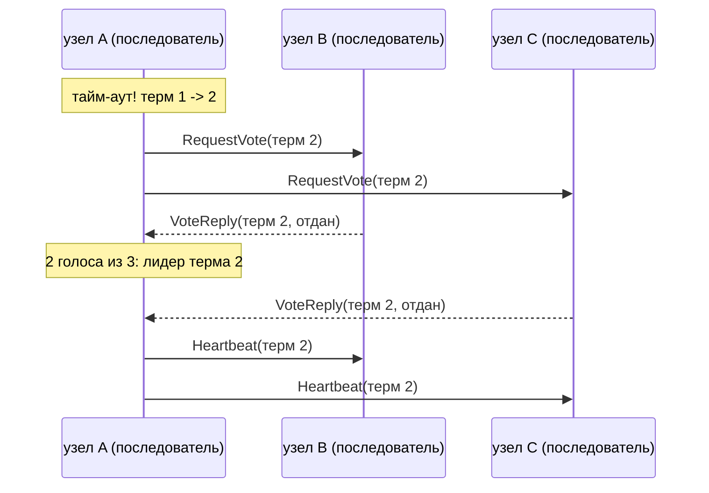

<!-- nav:top -->
[🏠 Начало](../START-HERE.md) · [← 18.9 Консенсус и обзор Raft](09-consensus-and-raft.md) · [📋 Этап 18](README.md) · [18.11 Raft: репликация журнала →](11-raft-log-replication.md) · [📖 Глоссарий](../GLOSSARY.md) · [🇬🇧 English](../../en/18-distributed-systems/10-raft-leader-election.md) <!-- nav -->

# Урок 18.10 — Raft: выбор лидера

> **Этап 18 — Распределённые системы** · Урок 10 из 15 · ⏱ около 3 часов (2 занятия)

## Что вы узнаете

- Как проходят выборы в Raft, шаг за шагом: тайм-ауты выборов, термы, голоса и пульс.
- Почему тайм-аут выборов должен быть *случайным* и что бывает, если это не так.
- Два правила голосования: один голос на терм и только за кандидата с актуальным журналом.
- Как написать «выборную» половину Raft в виде чистой структуры, которой вы управляете через `tick()` и `step()`.
- Как проверить правило безопасности «не больше одного лидера на терм» на сотнях симулированных запусков и увидеть, как тест ловит настоящую ошибку.

## Перед началом

- Вы прошли [Урок 18.9 — Консенсус и обзор Raft](09-consensus-and-raft.md). Держите в голове его картинку ролей и термов.
- Вы знаете случайные числа с зерном из [Урока 09.4 — Тестирование на основе свойств](../09-testing-debugging-benchmarking/04-property-based-testing.md): одно и то же зерно даёт одну и ту же «случайную» последовательность.
- Создайте пакет. Он растёт в этом и следующем уроке, а проект в Уроке 18.14 использует его снова:

```bash
cd ~/projects/rust
cargo new --lib code/p18-raft
cd code/p18-raft
cargo add rand@0.10
mkdir src/bin tests
```

## Новые слова

| Слово | Значение |
|---|---|
| **тайм-аут выборов** (election timeout) | Сколько последователь ждёт без вестей от лидера, прежде чем начать выборы. В Raft он выбирается случайно из диапазона, заново для каждого ожидания. |
| **тик** (tick) | Одна единица симулированного времени. Наш узел не читает часы; вызывающий код сообщает ему «прошёл один тик». Настоящий код тикает каждые несколько миллисекунд. |
| **голос** (vote) | Ответ узла на `RequestVote`: отдан или нет. Каждый узел отдаёт не больше одного голоса за терм. |
| **разделение голосов** (split vote) | Выборы, на которых ни один кандидат не набрал большинства, потому что несколько кандидатов поделили голоса. Терм заканчивается без лидера. |
| **актуальный журнал** (up-to-date log) | Журнал, чья последняя запись имеет более высокий терм или тот же терм и не меньший индекс по сравнению с другим журналом. Узлы голосуют только за кандидатов с актуальным журналом. |
| **уйти с поста** (step down) | Лидер или кандидат снова становится последователем, потому что увидел более высокий терм или законного лидера. |
| **sans-IO** | Стиль написания кода протокола без ввода-вывода внутри: код получает события и возвращает то, что хочет отправить, а настоящей сетью занимается другой код. |
| **исходящие** (outbox) | Список внутри узла, куда он кладёт сообщения, которые хочет отправить. Вызывающий код опустошает его через `take_outbox()`. |
| **ГСЧ** (RNG, Random Number Generator, генератор случайных чисел) | Код, который выдаёт последовательность чисел, выглядящих случайными. ГСЧ *с зерном* выдаёт одну и ту же последовательность для одного и того же зерна. |
| **мешающий сервер** (disruptive server) | Узел, который был отрезан, поднимал свой терм в бесконечных выборах и, вернувшись, вынуждает провести новые выборы. |

## 1. Выборы шаг за шагом

Каждый последователь ведёт обратный отсчёт — свой **тайм-аут выборов**. Каждое сообщение от законного лидера запускает отсчёт заново. Если отсчёт дошёл до нуля, последователь решает, что лидера нет, и делает вот что:

1. Увеличивает свой терм (скажем, с 1 до 2) и становится **кандидатом**.
2. Голосует за себя.
3. Отправляет `RequestVote { term: 2, … }` всем остальным узлам.

Каждый узел, получивший запрос, отвечает. Он **отдаёт** голос, если ещё не голосовал за кого-то другого в терме 2 и журнал кандидата не менее актуален, чем его собственный (второе правило объясняет раздел 4). Как только кандидат набрал голоса большинства (включая свой), он становится **лидером** и сразу шлёт пульс, чтобы остальные остановили свои отсчёты.



А если два последователя истекут в один и тот же момент? Оба станут кандидатами в терме 2 и проголосуют за себя. В кластере из 3 узлов третий узел может проголосовать только за одного из них, поэтому один побеждает. При 4 или 5 узлах голоса могут разделиться: никто не набирает большинства. Тогда кандидаты просто снова ждут свой тайм-аут, начинают терм 3 и пробуют ещё раз.

Вот почему тайм-аут **случайный**: когда тайм-ауты разбросаны по диапазону (статья предлагает 150–300 миллисекунд), обычно один узел истекает заметно раньше других, собирает голоса и рассылает пульс прежде, чем кто-то ещё проснётся. В разделе 6 тест показывает, что при *одинаковых* тайм-аутах кластер вообще никогда не выбирает лидера.

Насколько широким должен быть диапазон? Узкий диапазон (скажем, 10–11 тиков) даёт много разделённых голосований; очень широкий (10–40) избегает их, но последователи дольше ждут, прежде чем заметят мёртвого лидера. Диапазон от минимума примерно до удвоенного минимума — хороший компромисс.

> 💡 **Совет:** интервал пульса должен быть намного короче наименьшего тайм-аута выборов (у нас 3 тика против 10–20 тиков). Иначе последователи будут истекать между двумя ударами пульса совершенно здорового лидера и начинать бесполезные выборы.

## 2. Сообщения и настройки

Мы пишем Raft в стиле **sans-IO**. Узел ничего не знает о сокетах, потоках и часах. Поэтому он маленький, детерминированный и легко тестируется; проект в Уроке 18.14 подключает его к настоящей сети.

Создайте `src/node.rs` и начните с типов:

```rust
use rand::rngs::StdRng;
use rand::{RngExt, SeedableRng};
use std::collections::BTreeSet;

pub type NodeId = u64;

#[derive(Debug, Clone, Copy, PartialEq, Eq)]
pub enum Role {
    Follower,
    Candidate,
    Leader,
}

/// One entry of the replicated log.
#[derive(Debug, Clone, PartialEq)]
pub struct Entry {
    pub term: u64,
    pub command: String,
}

#[derive(Debug, Clone, PartialEq)]
pub enum Message {
    RequestVote {
        term: u64,
        last_log_index: u64,
        last_log_term: u64,
    },
    VoteReply {
        term: u64,
        granted: bool,
    },
    Heartbeat {
        term: u64,
    },
    HeartbeatReply {
        term: u64,
    },
}

impl Message {
    pub fn term(&self) -> u64 {
        match self {
            Message::RequestVote { term, .. }
            | Message::VoteReply { term, .. }
            | Message::Heartbeat { term }
            | Message::HeartbeatReply { term } => *term,
        }
    }
}

/// A message on its way from one node to another.
#[derive(Debug, Clone, PartialEq)]
pub struct Envelope {
    pub from: NodeId,
    pub to: NodeId,
    pub msg: Message,
}

/// Timing settings, counted in ticks.
#[derive(Debug, Clone, Copy)]
pub struct Config {
    pub election_min: u32,
    pub election_max: u32,
    pub heartbeat: u32,
}

impl Default for Config {
    fn default() -> Self {
        Config {
            election_min: 10,
            election_max: 20,
            heartbeat: 3,
        }
    }
}
```

**Что происходит:**

1. `NodeId` — простое число. Узлу нужно знать только идентификаторы своих соседей (`peers`).
2. `Entry` — одна запись журнала. В этом уроке журналы остаются пустыми (кроме одного теста); Урок 18.11 их заполнит.
3. У `Message` четыре вида. `RequestVote` несёт терм кандидата, а также индекс и терм его **последней** записи журнала. `Heartbeat` — это лидер, говорящий «я жив в этом терме». `HeartbeatReply` позволяет старому лидеру узнать о более новом терме. (В Уроке 18.11 пульс вырастет в `AppendEntries`.)
4. `Message::term` возвращает терм любого сообщения. Одна ветка `match` с `|` покрывает все четыре вида, потому что у каждого есть поле `term`.
5. `Envelope` добавляет «от кого» и «кому». Узел ничего не отправляет сам; он лишь создаёт конверты.
6. `Config` хранит настройки времени в тиках. `Default` даёт пульс каждые 3 тика и тайм-ауты выборов от 10 до 19 тиков.

## 3. Узел и его таймер

Добавьте в `src/node.rs` структуру `Node` и первый блок `impl` с маленькими вспомогательными методами:

```rust
pub struct Node {
    pub id: NodeId,
    peers: Vec<NodeId>,
    config: Config,
    pub role: Role,
    pub term: u64,
    voted_for: Option<NodeId>,
    pub log: Vec<Entry>,
    votes: BTreeSet<NodeId>,
    elapsed: u32,
    timeout: u32,
    rng: StdRng,
    outbox: Vec<Envelope>,
}

impl Node {
    pub fn new(id: NodeId, peers: Vec<NodeId>, config: Config, seed: u64) -> Node {
        let mut node = Node {
            id,
            peers,
            config,
            role: Role::Follower,
            term: 0,
            voted_for: None,
            log: Vec::new(),
            votes: BTreeSet::new(),
            elapsed: 0,
            timeout: 0,
            rng: StdRng::seed_from_u64(seed),
            outbox: Vec::new(),
        };
        node.reset_election_timer();
        node
    }

    /// Messages produced since the last call.
    pub fn take_outbox(&mut self) -> Vec<Envelope> {
        std::mem::take(&mut self.outbox)
    }

    fn send(&mut self, to: NodeId, msg: Message) {
        self.outbox.push(Envelope {
            from: self.id,
            to,
            msg,
        });
    }

    fn majority(&self) -> usize {
        let cluster_size = self.peers.len() + 1;
        cluster_size / 2 + 1
    }

    fn reset_election_timer(&mut self) {
        self.elapsed = 0;
        let (min, max) = (self.config.election_min, self.config.election_max);
        self.timeout = if min == max {
            min
        } else {
            self.rng.random_range(min..max)
        };
    }

    /// Index and term of the last log entry, (0, 0) for an empty log.
    fn last_log(&self) -> (u64, u64) {
        let index = self.log.len() as u64;
        let term = self.log.last().map_or(0, |e| e.term);
        (index, term)
    }
}
```

**Что происходит:**

1. `term`, `voted_for` и `log` — три значения, которые Raft обязан хранить на диске (Урок 18.9). Здесь они живут в памяти; проект добавит сохранение.
2. `votes` хранит идентификаторы узлов, проголосовавших за нас в текущем терме. `BTreeSet` игнорирует повторы, поэтому повторный ответ не засчитается дважды.
3. `elapsed` считает тики с момента сброса таймера; `timeout` — текущий случайный предел.
4. У каждого узла **свой** генератор случайных чисел с зерном, `StdRng::seed_from_u64(seed)`. При одних и тех же зёрнах весь кластер ведёт себя одинаково при каждом запуске. Никогда не используйте `rand::rng()` (его зерно берётся у операционной системы) в коде, который хотите тестировать таким способом.
5. `random_range(min..max)` выбирает число от `min` до `max`, не включая `max`. На пустом диапазоне он паникует, поэтому `min == max` обрабатывается отдельно: фиксированный тайм-аут, который мы используем в тесте.
6. `last_log` возвращает `(index, term)` последней записи. Индекс 0 с термом 0 означает «журнал пуст». Raft нумерует записи с 1, поэтому индекс `i` — это `self.log[i - 1]`.

Теперь таймер. Второй блок `impl` в том же файле (Rust разрешает несколько блоков `impl` для одного типа):

```rust
// Time: ticks, timeouts and elections.
impl Node {
    /// One unit of time has passed.
    pub fn tick(&mut self) {
        self.elapsed += 1;
        match self.role {
            Role::Leader => {
                if self.elapsed >= self.config.heartbeat {
                    self.elapsed = 0;
                    self.send_heartbeats();
                }
            }
            Role::Follower | Role::Candidate => {
                if self.elapsed >= self.timeout {
                    self.start_election();
                }
            }
        }
    }

    fn start_election(&mut self) {
        self.term += 1;
        self.role = Role::Candidate;
        self.voted_for = Some(self.id);
        self.votes = BTreeSet::from([self.id]);
        self.reset_election_timer();
        let (last_log_index, last_log_term) = self.last_log();
        for peer in self.peers.clone() {
            let msg = Message::RequestVote {
                term: self.term,
                last_log_index,
                last_log_term,
            };
            self.send(peer, msg);
        }
        self.check_votes();
    }

    fn check_votes(&mut self) {
        if self.role == Role::Candidate && self.votes.len() >= self.majority() {
            self.role = Role::Leader;
            self.elapsed = 0;
            self.send_heartbeats();
        }
    }

    fn send_heartbeats(&mut self) {
        for peer in self.peers.clone() {
            self.send(peer, Message::Heartbeat { term: self.term });
        }
    }
}
```

**Что происходит:**

1. `tick` добавляет один тик. Лидер шлёт пульс каждые `config.heartbeat` тиков. Последователь или кандидат, чей таймер истёк, начинает выборы. (Кандидат, чьи выборы не удались, просто снова истекает и начинает следующий терм.)
2. `start_election` выполняет три шага из раздела 1: следующий терм, стать кандидатом, проголосовать за себя. Ещё он выбирает **новый** случайный тайм-аут, чтобы следующая попытка снова была разнесена во времени.
3. `self.peers.clone()` нужен потому, что `self.send` изменяемо заимствует `self`, пока мы обходим `self.peers`. Клон — это короткий вектор чисел, его стоимость не стоит беспокойства.
4. `check_votes` вызывается после каждого полученного голоса и один раз сразу после начала выборов. Второй вызов важен для кластера из одного узла, где ваш собственный голос уже большинство.
5. Новый лидер сбрасывает `elapsed` и рассылает пульс **сразу**, чтобы остановить чужие отсчёты, пока они не сработали.

## 4. Правила голосования

Третий блок `impl` обрабатывает сообщения. Здесь живёт безопасность Raft:

```rust
// Messages: the rules for voting and following.
impl Node {
    fn become_follower(&mut self, term: u64) {
        self.term = term;
        self.role = Role::Follower;
        self.voted_for = None;
        self.votes.clear();
    }

    /// Deliver one message to this node.
    pub fn step(&mut self, from: NodeId, msg: Message) {
        // The rule for every message: a higher term wins.
        if msg.term() > self.term {
            self.become_follower(msg.term());
        }
        match msg {
            Message::RequestVote {
                term,
                last_log_index,
                last_log_term,
            } => {
                let (my_index, my_term) = self.last_log();
                let log_ok = (last_log_term, last_log_index) >= (my_term, my_index);
                let free = self.voted_for.is_none() || self.voted_for == Some(from);
                let granted = term == self.term && free && log_ok;
                if granted {
                    self.voted_for = Some(from);
                    self.reset_election_timer();
                }
                self.send(
                    from,
                    Message::VoteReply {
                        term: self.term,
                        granted,
                    },
                );
            }
            Message::VoteReply { term, granted } => {
                if granted && term == self.term {
                    self.votes.insert(from);
                    self.check_votes();
                }
            }
            Message::Heartbeat { term } => {
                if term == self.term {
                    // A leader exists in our term: follow it.
                    self.role = Role::Follower;
                    self.reset_election_timer();
                }
                self.send(from, Message::HeartbeatReply { term: self.term });
            }
            Message::HeartbeatReply { .. } => {
                // Nothing to do: a higher term was handled above.
            }
        }
    }
}
```

**Что происходит:**

1. Первый `if` — правило Raft для **всех** сообщений: если у сообщения более высокий терм, принять этот терм и стать последователем. `become_follower` ещё и забывает старый голос, потому что голос принадлежит терму. Одно это правило заставляет старых лидеров уходить с поста. Это идея токена ограждения из [Урока 18.4](04-time-and-clocks.md): терм — это токен, и узел никогда не подчиняется сообщению, терм которого ниже уже увиденного.
2. `RequestVote`: чтобы отдать голос, должны выполниться все три условия.
   - `term == self.term`: запрос относится к текущему терму (после шага 1 единственный другой случай — более старый терм, и ему отказывают).
   - `free`: мы ещё не голосовали в этом терме или уже голосовали за этого же кандидата (повторный запрос должен получить тот же ответ).
   - `log_ok`: журнал кандидата не менее актуален, чем наш.
3. `log_ok` сравнивает кортежи. Rust сравнивает кортежи поэлементно: сначала последние термы; только если они равны — индексы. Поэтому журнал, кончающийся термом 3, побеждает любой журнал, кончающийся термом 2, какой бы длины тот ни был.
4. Отдав голос, узел сбрасывает свой таймер выборов: кто-то другой пытается стать лидером, надо дать ему время.
5. `VoteReply` засчитывает только отданные голоса **текущего терма**. Опоздавший ответ со старых выборов игнорируется.
6. `Heartbeat` с нашим термом означает, что существует законный лидер. Кандидат того же терма сдаётся и следует за ним. На каждый пульс мы отвечаем своим термом, поэтому старый лидер, пославший пульс узлу с более новым термом, получает `HeartbeatReply` с этим новым термом, и шаг 1 превращает его в последователя.

Зачем правило актуальности? Зафиксированная запись хранится на большинстве. Чтобы победить, кандидату нужны голоса большинства. Эти два большинства пересекаются (Урок 18.9), поэтому хотя бы у одного голосующего есть зафиксированная запись, и он отказывает кандидату с более старым журналом. Следовательно, **кандидат без зафиксированной записи не может победить**. Это даёт обещание *полноты лидера*. Почему это важно, вы увидите в следующем уроке, когда журналы заполнятся.

> 🔒 **Безопасность:** узел доверяет полю `term` в каждом полученном сообщении. Одно поддельное сообщение с термом 1 000 000 заставит каждый узел перескочить в этот терм. Это ещё одна причина, почему с портом Raft могут общаться только аутентифицированные члены кластера.

## 5. Симулированный кластер

Узлу нужен кто-то, кто доставляет его сообщения. Для тестов мы напишем крошечную сеть внутри крейта. Создайте `src/cluster.rs`:

```rust
//! A simulated cluster for tests: the test decides when time passes
//! and which messages arrive.

use crate::{Config, Envelope, Node, NodeId, Role};
use std::collections::{BTreeMap, BTreeSet, VecDeque};

pub struct Cluster {
    pub nodes: BTreeMap<NodeId, Node>,
    in_flight: VecDeque<Envelope>,
    cut_off: BTreeSet<NodeId>,
}

impl Cluster {
    /// `n` nodes with ids 1..=n. The seed decides all random timeouts.
    pub fn new(n: u64, config: Config, seed: u64) -> Cluster {
        let mut nodes = BTreeMap::new();
        for id in 1..=n {
            let peers = (1..=n).filter(|&p| p != id).collect();
            nodes.insert(id, Node::new(id, peers, config, seed * 1000 + id));
        }
        Cluster {
            nodes,
            in_flight: VecDeque::new(),
            cut_off: BTreeSet::new(),
        }
    }

    /// Drop every message to or from `id` until `heal` is called.
    pub fn isolate(&mut self, id: NodeId) {
        self.cut_off.insert(id);
    }

    pub fn heal(&mut self, id: NodeId) {
        self.cut_off.remove(&id);
    }

    /// One tick for every node, then deliver messages until none are left.
    pub fn tick(&mut self) {
        for node in self.nodes.values_mut() {
            node.tick();
        }
        self.collect();
        while let Some(env) = self.in_flight.pop_front() {
            if self.cut_off.contains(&env.from) || self.cut_off.contains(&env.to) {
                continue; // the network loses it
            }
            let node = self.nodes.get_mut(&env.to).expect("unknown node");
            node.step(env.from, env.msg);
            self.collect();
        }
    }

    fn collect(&mut self) {
        for node in self.nodes.values_mut() {
            self.in_flight.extend(node.take_outbox());
        }
    }

    /// (id, term) of every node that currently believes it is the leader.
    pub fn leaders(&self) -> Vec<(NodeId, u64)> {
        self.nodes
            .values()
            .filter(|n| n.role == Role::Leader)
            .map(|n| (n.id, n.term))
            .collect()
    }
}
```

И сделайте оба файла частью библиотеки, в `src/lib.rs`:

```rust
//! A small Raft core: no network, no threads, no clock.

pub mod cluster;
mod node;

pub use node::{Config, Entry, Envelope, Message, Node, NodeId, Role};
```

**Что происходит:**

1. `Cluster::new` создаёт узлы с 1 по `n`. Каждый узел получает своё зерно, выведенное из зерна кластера, поэтому тайм-ауты различаются, но весь запуск зависит только от `seed`.
2. `isolate` помещает узел в `cut_off`. Сообщения от него и к нему молча отбрасываются, как будто выдернули сетевой кабель. `heal` возвращает кабель на место.
3. `tick` продвигает каждый узел на один тик, затем доставляет сообщения по одному. Доставка сообщения может породить новые сообщения (запрос голоса порождает ответ), поэтому после каждого `step` мы снова вызываем `collect`, пока очередь не опустеет. В этой простой сети сообщения приходят мгновенно; Урок 18.11 добавит потерю сообщений.
4. `leaders` перечисляет все узлы, которые *считают* себя лидером, вместе с их термом. Изолированный старый лидер всё ещё так считает, поэтому записей может быть две, но они обязаны быть в **разных термах**.

Теперь посмотрим на выборы. Создайте `src/bin/election.rs`:

```rust
use p18_raft::cluster::Cluster;
use p18_raft::{Config, Role};

fn main() {
    let mut cluster = Cluster::new(3, Config::default(), 7);
    let mut old_leader = 0;
    let mut roles: Vec<Role> = cluster.nodes.values().map(|n| n.role).collect();

    for tick in 1..=60 {
        if tick == 20 {
            old_leader = cluster.leaders()[0].0;
            println!("tick {tick}: cut node {old_leader} off the network");
            cluster.isolate(old_leader);
        }
        if tick == 45 {
            println!("tick {tick}: node {old_leader} is back");
            cluster.heal(old_leader);
        }
        cluster.tick();
        for (i, node) in cluster.nodes.values().enumerate() {
            if node.role != roles[i] {
                println!(
                    "tick {tick}: node {} {:?} -> {:?} (term {})",
                    node.id, roles[i], node.role, node.term
                );
                roles[i] = node.role;
            }
        }
    }
    println!("leaders at the end: {:?}", cluster.leaders());
}
```

**Что происходит:**

1. Запуск использует зерно 7. Через 20 тиков программа отрезает текущего лидера; на тике 45 возвращает его.
2. После каждого тика она печатает узлы, чья роль изменилась.

Запустите `cargo run --bin election`:

```text
tick 10: node 1 Follower -> Leader (term 1)
tick 20: cut node 1 off the network
tick 31: node 2 Follower -> Candidate (term 2)
tick 31: node 3 Follower -> Candidate (term 2)
tick 41: node 2 Candidate -> Follower (term 3)
tick 41: node 3 Candidate -> Leader (term 3)
tick 45: node 1 is back
tick 46: node 1 Leader -> Follower (term 3)
leaders at the end: [(3, 3)]
```

Прочитайте построчно. На тике 10 узел 1 истёк первым, и голоса, и пульс были доставлены в том же тике, поэтому он перешёл от последователя к лидеру за один шаг. На тике 31 узлы 2 и 3 истекли **в одном и том же тике** (неудача с этим зерном): оба стали кандидатами в терме 2, каждый проголосовал за себя и отказал другому, а узел 1, единственный другой голосующий, был отрезан. Голоса разделились. Через десять тиков узел 3 истёк первым, начал терм 3 и победил. Узел 1 всё это время считал себя лидером терма 1. Когда он вернулся, на его следующий пульс пришёл ответ с термом 3, и он ушёл с поста.

> 🧪 **Тестирование:** поскольку запуск зависит только от зерна, этот вывод одинаков на любом компьютере и при любом запуске. Когда тест падает на зерне 43, вы можете перезапускать зерно 43 и смотреть на тот же сбой сколько угодно раз.

## 6. Тестируем безопасность выборов

Теперь превратим запуск в тесты. Создайте `tests/election.rs`:

```rust
use p18_raft::Config;
use p18_raft::cluster::Cluster;
use rand::rngs::StdRng;
use rand::{RngExt, SeedableRng};
use std::collections::BTreeMap;

#[test]
fn elects_exactly_one_leader() {
    let mut cluster = Cluster::new(3, Config::default(), 1);
    for _ in 0..50 {
        cluster.tick();
    }
    assert_eq!(cluster.leaders().len(), 1);
}

#[test]
fn a_new_leader_takes_over_and_the_old_one_steps_down() {
    let mut cluster = Cluster::new(5, Config::default(), 2);
    for _ in 0..50 {
        cluster.tick();
    }
    let (old, old_term) = cluster.leaders()[0];

    cluster.isolate(old);
    for _ in 0..50 {
        cluster.tick();
    }
    cluster.heal(old);
    for _ in 0..10 {
        cluster.tick();
    }

    let leaders = cluster.leaders();
    assert_eq!(leaders.len(), 1);
    let (new, new_term) = leaders[0];
    assert_ne!(new, old);
    assert!(new_term > old_term);
}

#[test]
fn equal_timeouts_never_elect_a_leader() {
    let config = Config {
        election_min: 10,
        election_max: 10,
        heartbeat: 3,
    };
    let mut cluster = Cluster::new(3, config, 3);
    for _ in 0..500 {
        cluster.tick();
    }
    assert!(cluster.leaders().is_empty());
}

#[test]
fn never_two_leaders_in_one_term() {
    for seed in 0..300 {
        let mut cluster = Cluster::new(5, Config::default(), seed);
        let mut chaos = StdRng::seed_from_u64(seed);
        let mut leader_of_term: BTreeMap<u64, u64> = BTreeMap::new();

        for _ in 0..300 {
            // Now and then, cut a random node off or bring one back.
            if chaos.random_range(0..10) == 0 {
                let id = chaos.random_range(1..=5);
                if chaos.random_bool(0.5) {
                    cluster.isolate(id);
                } else {
                    cluster.heal(id);
                }
            }
            cluster.tick();
            for (id, term) in cluster.leaders() {
                let first = *leader_of_term.entry(term).or_insert(id);
                assert_eq!(first, id, "seed {seed}: two leaders in term {term}");
            }
        }
    }
}
```

**Что происходит:**

1. `elects_exactly_one_leader`: у здорового кластера из 3 узлов через 50 тиков ровно один лидер (живучесть).
2. `a_new_leader_takes_over_and_the_old_one_steps_down`: отрезать лидера кластера из 5 узлов, подождать, вернуть его; лидер один, это другой узел, и его терм выше.
3. `equal_timeouts_never_elect_a_leader`: при `election_min == election_max` все узлы всегда истекают в одном и том же тике, каждые выборы заканчиваются разделением голосов, и через 500 тиков лидера всё ещё нет. Тест документирует, *почему* тайм-аут случайный.
4. `never_two_leaders_in_one_term` — главный тест, тест **безопасности**. Для 300 зёрен он прогоняет 300 тиков, пока второй генератор с зерном, `chaos`, отрезает случайные узлы и возвращает их. После каждого тика он запоминает первого лидера, увиденного в каждом терме, и падает, если какой-то другой узел когда-либо претендует на тот же терм.

```text
test elects_exactly_one_leader ... ok
test a_new_leader_takes_over_and_the_old_one_steps_down ... ok
test equal_timeouts_never_elect_a_leader ... ok
test never_two_leaders_in_one_term ... ok
test result: ok. 4 passed; 0 failed; 0 ignored; 0 measured; 0 filtered out; finished in 1.01s
```

Действительно ли тест безопасности ловит ошибки? Проверьте. В `step` уберите условие `free`, чтобы узлы могли голосовать дважды за терм:

```rust
let granted = term == self.term && log_ok;
```

Снова запустите `cargo test --test election` (компилятор ещё и предупредит, что `free` не используется):

```text
test never_two_leaders_in_one_term ... FAILED

---- never_two_leaders_in_one_term stdout ----

thread 'never_two_leaders_in_one_term' (6200810) panicked at tests/election.rs:74:17:
assertion `left == right` failed: seed 43: two leaders in term 4
  left: 2
 right: 3
```

Ошибку вызывают только 7 из 300 зёрен, и первое из них — 43. Там два кандидата начали терм 4 в одном тике, остальные узлы проголосовали за обоих, и узлы 2 и 3 оба стали лидерами терма 4. Тест с несколькими подобранными вручную запусками, скорее всего, прошёл бы. **Верните условие на место**, прежде чем продолжать.

> ⚡ **Производительность:** 300 зёрен × 300 тиков × 5 узлов — это 450 000 тиков узлов, и всё выполняется примерно за секунду, потому что ничто не ждёт настоящей сети или настоящих часов. Именно симулированное время делает такое тестирование практичным.

## Частые ошибки

> ⚠️ **Частая ошибка:** забыть сбросить `voted_for` при смене терма. Тогда узел, голосовавший в терме 2, отказывает всем в терме 3, и выборы могут застрять. В нашем коде его очищает `become_follower`.

> ⚠️ **Частая ошибка:** сбрасывать таймер выборов на **каждое** сообщение. Таймер должен перезапускаться, только когда вы отдаёте голос или слышите текущего лидера. Если его сбрасывает любое сообщение (например, отклонённый запрос голоса), кандидат, который никогда не сможет победить, не даёт остальным начать собственные выборы.

> ⚠️ **Частая ошибка:** считать голоса без проверки терма. Опоздавший `VoteReply` со старых выборов засчитался бы для новых. Всегда сравнивайте `term == self.term`, прежде чем использовать ответ.

> ⚠️ **Частая ошибка:** сравнивать журналы только по длине. Более длинный журнал **не** более актуален, если его последняя запись имеет более старый терм. Сравнивайте `(last_term, last_index)` как кортеж, терм первым.

## Попробуйте сами

1. Запустите `cargo run --bin election`, затем поменяйте зерно с `7` на `1`. Выборы после отключения теперь проходят чисто (без разделения голосов), и побеждает другой узел.
2. Поменяйте в `election.rs` кластер на 5 узлов и запустите снова. Теперь вместе могут истечь больше кандидатов; поищите разделение голосов.
3. Запустите `cargo test`. Затем увеличьте тест безопасности до 1000 зёрен и посмотрите, как растёт время работы.
4. Сломайте правило актуальности (`let log_ok = true;`) и запустите `cargo test`. Тесты всё ещё проходят: в этом уроке журналы пусты, поэтому это правило пока не может проявиться. Верните его; Урок 18.11 добавит тест, которому оно нужно.

## Упражнения

### Упражнение 1 — Кластер из одного узла (легко)

Напишите тест в новом файле `tests/exercises.rs`: кластер из 1 узла должен быть лидером терма 1 через 20 тиков. Используйте `assert_eq!(cluster.leaders(), vec![(1, 1)])`.

<details>
<summary>Подсказка</summary>

Его первый тайм-аут — не больше 19 тиков. Когда выборы начинаются, его собственный голос уже большинство из 1, а `check_votes` вызывается в конце `start_election`.

</details>

<details>
<summary>Ответ</summary>

```rust
use p18_raft::Config;
use p18_raft::cluster::Cluster;

#[test]
fn a_single_node_elects_itself() {
    let mut cluster = Cluster::new(1, Config::default(), 1);
    for _ in 0..20 {
        cluster.tick();
    }
    assert_eq!(cluster.leaders(), vec![(1, 1)]);
}
```

Почему это работает: у кластера из 1 узла нет соседей, поэтому `start_election` ничего не отправляет, а `check_votes` находит 1 голос при большинстве из 1.

</details>

### Упражнение 2 — Правило актуальности в модульном тесте (средне)

Напишите тест, который создаёт один `Node` (id 1, соседи 2 и 3), кладёт в его `log` одну `Entry` с термом 2, а затем доставляет через `step` два запроса голоса, оба для терма 3:

- от узла 2, с `last_log_index: 5, last_log_term: 1`: ему должны **отказать** (журнал длиннее, но терм старше);
- от узла 3, с `last_log_index: 1, last_log_term: 2`: голос должен быть **отдан**.

Читайте каждый ответ через `take_outbox()`.

<details>
<summary>Подсказка</summary>

После каждого `step` первый конверт в `node.take_outbox()` содержит ответ. Маленькая вспомогательная функция `ask`, которая отправляет запрос и возвращает ответ, делает тест коротким. Почему второй голос всё ещё свободен? Потому что первому запросу отказали.

</details>

<details>
<summary>Ответ</summary>

Добавьте это в тот же файл, `tests/exercises.rs` (первая строка добавляет новые импорты):

```rust
use p18_raft::{Entry, Message, Node, Role};

/// Deliver a vote request for term 3 and return the node's answer.
fn ask(node: &mut Node, from: u64, last_log_index: u64, last_log_term: u64) -> Message {
    let request = Message::RequestVote {
        term: 3,
        last_log_index,
        last_log_term,
    };
    node.step(from, request);
    node.take_outbox().remove(0).msg
}

#[test]
fn refuses_a_candidate_with_an_older_log() {
    let mut node = Node::new(1, vec![2, 3], Config::default(), 1);
    let entry = Entry {
        term: 2,
        command: "x=1".to_string(),
    };
    node.log.push(entry);

    let refused = Message::VoteReply {
        term: 3,
        granted: false,
    };
    let granted = Message::VoteReply {
        term: 3,
        granted: true,
    };
    // Candidate 2: a longer log, but its last entry has an older term.
    assert_eq!(ask(&mut node, 2, 5, 1), refused);
    // Candidate 3: the same last term and index as ours.
    assert_eq!(ask(&mut node, 3, 1, 2), granted);
    assert_eq!(node.role, Role::Follower);
```

Почему это работает: `(1, 5) >= (2, 1)` ложно, потому что всё решают уже первые элементы (1 < 2); `(2, 1) >= (2, 1)` истинно. Первый запрос к тому же перевёл узел в терм 3 последователем, а раз он отказал, его голос в терме 3 всё ещё свободен.

</details>

### Упражнение 3 — Мешающий сервер (сложно)

Напишите тест, показывающий известную слабость базового Raft. В здоровом кластере из 3 узлов изолируйте **последователя** на 100 тиков. Проверьте, что его терм вырос больше чем на 3 (он раз за разом начинает выборы в одиночку). Верните его, прогоните ещё 50 тиков и проверьте, что терм лидера теперь не меньше терма одинокого узла: весь кластер был вынужден перескочить в его терм и провести новые выборы, хотя со старым лидером всё было в порядке.

<details>
<summary>Подсказка</summary>

Терм узла читается как `cluster.nodes[&id].term`. Чтобы выбрать последователя, возьмите любой id, который не равен id лидера.

</details>

<details>
<summary>Ответ</summary>

Добавьте его в `tests/exercises.rs`:

```rust

#[test]
fn a_returning_node_disrupts_the_leader() {
    let mut cluster = Cluster::new(3, Config::default(), 4);
    for _ in 0..50 {
        cluster.tick();
    }
    let (leader, term_before) = cluster.leaders()[0];
    let follower = if leader == 1 { 2 } else { 1 };

    cluster.isolate(follower);
    for _ in 0..100 {
        cluster.tick();
    }
    let lonely_term = cluster.nodes[&follower].term;
    assert!(lonely_term > term_before + 3, "it kept starting elections");

    cluster.heal(follower);
    for _ in 0..50 {
        cluster.tick();
    }
    let (_, term_after) = cluster.leaders()[0];
    assert!(
        term_after >= lonely_term,
        "the whole cluster jumped to its term"
    );
}
```

Почему это работает: одинокий узел увеличивает терм на каждом тайм-ауте. Когда он возвращается, его `RequestVote` несёт этот высокий терм, и правило «более высокий терм побеждает» заставляет лидера уйти с поста. Настоящие реализации добавляют фазу **Pre-Vote** (она описана в диссертации Ongaro): узел сначала спрашивает «проголосовал бы ты за меня?», не меняя никакого терма, и начинает настоящие выборы, только если большинство отвечает «да». Одинокий узел никогда не получает такого большинства, поэтому не может помешать кластеру.

</details>

## Вопросы для самопроверки

1. Что делает последователь, когда истекает его тайм-аут выборов?

<details>
<summary>Ответ</summary>

Увеличивает свой терм, становится кандидатом, голосует за себя, сбрасывает таймер на новое случайное значение и отправляет `RequestVote` всем остальным узлам.

</details>

2. Почему тайм-ауты выборов случайные?

<details>
<summary>Ответ</summary>

Чтобы обычно один узел истекал заметно раньше остальных и побеждал, пока никто другой не стал кандидатом. При одинаковых тайм-аутах кандидаты стартуют вместе и делят голоса снова и снова (наш тест показывает, что лидера не бывает никогда).

</details>

3. При каких трёх условиях узел отдаёт голос?

<details>
<summary>Ответ</summary>

Запрос относится к его текущему терму (после принятия более высокого терма), он не голосовал за другого кандидата в этом терме, и журнал кандидата не менее актуален, чем его собственный.

</details>

4. Журнал A кончается записью терма 3 с индексом 4. Журнал B кончается термом 2 с индексом 9. Какой из них актуальнее?

<details>
<summary>Ответ</summary>

Журнал A: сначала сравниваются последние термы, а 3 > 2. Индексы важны, только когда последние термы равны.

</details>

5. Старый лидер терма 4 возвращается после разделения сети; кластер уже в терме 6. Что заставляет его уйти с поста?

<details>
<summary>Ответ</summary>

На его следующий пульс приходит `HeartbeatReply` с термом 6. Правило для всех сообщений, «более высокий терм побеждает», заставляет его принять терм 6 и стать последователем.

</details>

6. Почему в `cluster.leaders()` в один момент могут оказаться два узла, и безопасность при этом не нарушена?

<details>
<summary>Ответ</summary>

Безопасность — это «не больше одного лидера **на терм**». Изолированный старый лидер может всё ещё считать, что ведёт терм 4, пока настоящий лидер ведёт терм 6. Старый ничего не может зафиксировать, потому что не может достучаться до большинства, и уходит с поста, как только услышит остальных.

</details>

## Итоги

- Последователь, который ничего не слышит в течение своего тайм-аута выборов, начинает выборы: следующий терм, голос за себя, `RequestVote` всем. Большинство голосов делает его лидером; он сразу рассылает пульс.
- Случайные тайм-ауты делают разделение голосов редким; одинаковые тайм-ауты могут навсегда помешать любым выборам.
- Узел отдаёт не больше одного голоса за терм и только кандидату с не менее актуальным журналом (сначала последний терм, потом последний индекс). Благодаря этому каждый новый лидер содержит все зафиксированные записи.
- «Более высокий терм побеждает» относится к каждому сообщению и заставляет старых лидеров и кандидатов уходить с поста.
- Узел в стиле sans-IO, управляемый через `tick()` и `step()` с ГСЧ с зерном, делает каждый запуск детерминированным и повторяемым.
- Тест хаоса с зерном на сотнях запусков проверяет «один лидер на терм» и находит ошибки, которые пропускают подобранные вручную тесты.

## Источники и что почитать

- [In Search of an Understandable Consensus Algorithm (статья о Raft)](https://raft.github.io/raft.pdf) — раздел 5.2 (выбор лидера) и 5.4.1 (ограничение на выборах); рисунок 2 перечисляет все правила, использованные в этом уроке.
- [Consensus: Bridging Theory and Practice (диссертация Ongaro)](https://web.stanford.edu/~ouster/cgi-bin/papers/OngaroPhD.pdf) — глава 9 подробнее разбирает выбор лидера, включая Pre-Vote и выбор тайм-аутов.
- [The Raft Consensus Algorithm](https://raft.github.io/) — интерактивный кластер на главной странице позволяет останавливать узлы и смотреть на выборы.
- [raft-rs](https://github.com/tikv/raft-rs) — промышленная реализация на Rust в том же стиле sans-IO: вы вызываете `tick` и `step` и отправляете сообщения, которые она возвращает.
- [Документация rand](https://docs.rs/rand) — `StdRng`, `SeedableRng` и `random_range`.

---

[🏠 Начало](../START-HERE.md) · [← 18.9 Консенсус и обзор Raft](09-consensus-and-raft.md) · [📋 Этап 18](README.md) · [18.11 Raft: репликация журнала →](11-raft-log-replication.md) · [📖 Глоссарий](../GLOSSARY.md) <!-- nav -->
<!-- nav:bottom -->
