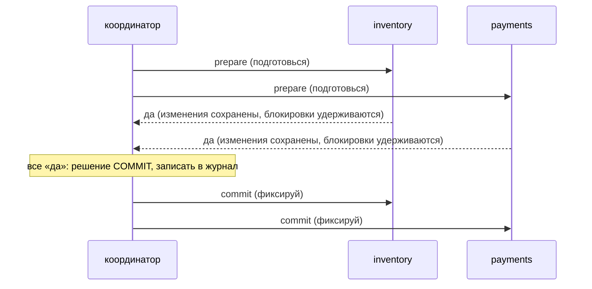

<!-- nav:top -->
[🏠 Начало](../START-HERE.md) · [← 18.12 Детерминированное тестирование симуляцией](12-deterministic-simulation-testing.md) · [📋 Этап 18](README.md) · [18.14 Проект: реплицированное хранилище «ключ-значение» →](14-project-replicated-key-value-store.md) · [📖 Глоссарий](../GLOSSARY.md) · [🇬🇧 English](../../en/18-distributed-systems/13-distributed-transactions-and-sagas.md) <!-- nav -->

# Урок 18.13 — Распределённые транзакции и саги

> **Этап 18 — Распределённые системы** · Урок 13 из 15 · ⏱ около 135 минут

## Что вы узнаете

- Почему одну бизнес-операцию, которая затрагивает несколько сервисов или партиций, трудно сделать «всё или ничего».
- Как работает *двухфазная фиксация* (2PC) и почему падение координатора может заставить всех ждать.
- Как *сага* заменяет одну большую транзакцию цепочкой маленьких плюс *компенсации* и от чего она при этом отказывается.
- Как написать и протестировать маленький оркестратор саг на Rust.
- Как *транзакционный outbox* отправляет сообщение и меняет базу данных, не теряя ни того, ни другого.

## Перед началом

- Вы прошли [Урок 18.12 — Детерминированное тестирование симуляцией](12-deterministic-simulation-testing.md).
- Вы знаете, что такое транзакция и ACID (Atomicity, Consistency, Isolation, Durability — атомарность, согласованность, изоляция, долговечность) ([Урок 17.10 — Транзакции и ACID](../17-storage-and-databases/10-transactions-and-acid.md)), и пользовались транзакциями в PostgreSQL ([Урок 16.7 — Миграции и транзакции](../16-backend-services/07-migrations-and-transactions.md)).
- Вы помните ключи идемпотентности ([Урок 18.3](03-retries-backoff-and-idempotency.md)) и обмен сообщениями через NATS ([Урок 16.11](../16-backend-services/11-messaging-with-nats.md)).
- Создайте пакет:

```bash
cd ~/projects/rust
cargo new --lib code/p18-saga
mkdir code/p18-saga/src/bin code/p18-saga/tests
```

## Новые слова

| Слово | Значение |
|---|---|
| **распределённая транзакция** (distributed transaction) | Транзакция, изменения которой живут на нескольких машинах (сервисах, базах данных или партициях), но которая всё равно должна быть «всё или ничего». |
| **атомарная фиксация** (atomic commit) | Задача добиться, чтобы все участники либо зафиксировали, либо отменили, и никогда не вышло смеси. |
| **2PC** (two-phase commit, двухфазная фиксация) | Протокол атомарной фиксации: фаза 1 спрашивает каждого участника «можешь зафиксировать?», фаза 2 сообщает всем решение. |
| **координатор** (coordinator) | Процесс, который выполняет 2PC: рассылает вопросы, собирает голоса и принимает решение. |
| **участник** (participant) | Сервис или база данных, которая участвует в транзакции и голосует. |
| **в неопределённости** (in doubt) | Состояние участника, который проголосовал «да» и ещё не услышал решения. Он не может ни зафиксировать, ни отменить сам. |
| **сага** (saga) | Длинная операция, разбитая на последовательность локальных транзакций; если одна из них не удалась, завершённые отменяются компенсациями. |
| **компенсация** (compensation) | Действие, которое по смыслу отменяет более ранний шаг: возврат денег за списание, снятие резерва за резервирование. |
| **оркестрация** (orchestration) | Стиль саги, при котором один компонент (оркестратор) говорит каждому сервису, что делать дальше. |
| **хореография** (choreography) | Стиль саги, при котором каждый сервис реагирует на события остальных; центрального компонента нет. |
| **транзакционный outbox** (transactional outbox) | Таблица в собственной базе сервиса, куда он записывает исходящие сообщения в той же транзакции, что и изменение данных; отдельный процесс отправляет их позже. |

## 1. Один заказ, три сервиса

Интернет-магазин принимает заказ. Действовать должны три сервиса:

1. **inventory** (склад) резервирует один товар;
2. **payments** (платежи) списывает деньги с карты покупателя;
3. **shipping** (доставка) заказывает курьера.

У каждого сервиса своя база данных, поэтому никакая одна транзакция базы данных не охватывает все три. А теперь в середине что-то ломается: деньги с карты списаны, но свободного курьера нет. Если не позаботиться, покупатель заплатил за заказ, который никогда не отправят, а товар зарезервирован навсегда. Мы хотим, чтобы весь заказ был **атомарным**: все три изменения или ни одного.

Внутри одной базы данных эту задачу решают транзакции ACID (Урок 17.10) с журналом и блокировками. Между машинами есть два классических ответа: заставить машины **договориться** до того, как кто-то зафиксирует (двухфазная фиксация), или **дать каждому шагу зафиксироваться самостоятельно и откатить** более ранние шаги, если более поздний не удался (сага).

## 2. Двухфазная фиксация

2PC добавляет **координатора**. Он работает в две фазы:



1. **Подготовка** (prepare). Координатор спрашивает каждого участника: «можешь зафиксировать?» Участник, который отвечает **да**, даёт обещание: он надёжно записывает все свои изменения и удерживает блокировки, чтобы позже суметь зафиксировать, что бы ни случилось, даже после собственного падения. Участник, ответивший **нет**, сразу отменяет транзакцию.
2. **Фиксация или отмена.** Если все голоса «да», координатор решает **фиксировать**, записывает решение в свой журнал и сообщает всем. Если хоть один голос «нет» (или участник не ответил вовремя), он решает **отменить**.

Просимулируем три интересных случая. Напишите `src/bin/two_phase.rs`:

```rust
#[derive(Debug, Clone, Copy, PartialEq)]
enum State {
    Working,
    Prepared,
    Committed,
    Aborted,
}

struct Participant {
    name: &'static str,
    state: State,
    can_commit: bool,
}

impl Participant {
    /// Phase 1: "can you commit?" A yes is a promise: store the changes durably first.
    fn prepare(&mut self) -> bool {
        if self.can_commit {
            self.state = State::Prepared;
            true
        } else {
            self.state = State::Aborted; // a "no" may abort at once
            false
        }
    }
}

/// The coordinator. `crash` makes it die between the two phases.
fn two_phase_commit(parts: &mut [Participant], crash: bool) -> &'static str {
    // Phase 1: collect votes.
    let mut all_yes = true;
    for p in parts.iter_mut() {
        if !p.prepare() {
            all_yes = false;
        }
    }
    if crash {
        return "coordinator crashed";
    }
    // Phase 2: tell everyone the decision.
    for p in parts.iter_mut() {
        if all_yes {
            p.state = State::Committed;
        } else if p.state == State::Prepared {
            p.state = State::Aborted;
        }
    }
    if all_yes { "committed" } else { "aborted" }
}

fn run(title: &str, can_commit: [bool; 3], crash: bool) {
    let names = ["inventory", "payments", "shipping"];
    let mut parts: Vec<Participant> = names
        .iter()
        .zip(can_commit)
        .map(|(&name, can_commit)| Participant {
            name,
            state: State::Working,
            can_commit,
        })
        .collect();
    let outcome = two_phase_commit(&mut parts, crash);
    println!("{title}: {outcome}");
    for p in &parts {
        println!("  {:<9} {:?}", p.name, p.state);
    }
}

fn main() {
    run("all vote yes", [true, true, true], false);
    run("payments votes no", [true, false, true], false);
    run("crash after the votes", [true, true, true], true);
}
```

**Что происходит:**

1. У каждого участника есть состояние. `prepare` переводит его либо в `Prepared` (голос «да»: обещание суметь зафиксировать), либо в `Aborted` (голос «нет»).
2. `two_phase_commit` собирает все голоса, затем либо фиксирует всех, либо отменяет всех, кто ещё в `Prepared`.
3. `crash: true` останавливает координатора между фазами, как будто его машина потеряла питание сразу после подсчёта голосов.

Запустите `cargo run --bin two_phase`:

```text
all vote yes: committed
  inventory Committed
  payments  Committed
  shipping  Committed
payments votes no: aborted
  inventory Aborted
  payments  Aborted
  shipping  Aborted
crash after the votes: coordinator crashed
  inventory Prepared
  payments  Prepared
  shipping  Prepared
```

Первые два случая в порядке: все фиксируют или все отменяют. Третий — знаменитая слабость 2PC. Все три участника **в неопределённости**. Они пообещали зафиксировать, если их попросят, поэтому никто не может отменить сам (координатор мог решить «фиксировать» и уже кому-то сообщить). Никто не может и зафиксировать сам (координатор мог решить «отменить»). Они обязаны удерживать блокировки и ждать, пока координатор не вернётся. Пока они ждут, ждёт и каждая другая транзакция, которой нужен зарезервированный товар или счёт покупателя. 2PC — **блокирующий** протокол.

> 💡 **Совет:** 2PC — это *атомарная фиксация*, а не консенсус. В консенсусе (Raft) продвигаться может любое большинство; в 2PC «да» должен проголосовать **каждый** участник, а выжить должен **тот самый** координатор. Системы вроде Google Spanner и CockroachDB делают 2PC пригодным к использованию, превращая координатора и каждого участника в реплицированную группу Raft или Paxos, так что «координатор упал» означает «упало большинство его реплик».

Базы данных поддерживают 2PC напрямую: в PostgreSQL `PREPARE TRANSACTION 'order-1'` выполняет фазу 1, а `COMMIT PREPARED 'order-1'` — фазу 2. Используют это редко, потому что забытая подготовленная транзакция удерживает свои блокировки вечно.

> 🔒 **Безопасность:** участник в неопределённости держит блокировки, пока не услышит решение. Злоумышленник, способный сделать координатора недоступным (или начинающий много транзакций и никогда их не завершающий), может заморозить часть ваших данных. Ограничивайте, сколько может жить подготовленная транзакция, и поднимайте тревогу о старых.

## 3. Саги: фиксировать каждый шаг, откатывать при сбое

**Сага** отказывается от идеи одной транзакции. Заказ становится последовательностью **локальных** транзакций, по одной на сервис, и каждая фиксируется сразу. Для каждого шага мы пишем ещё и **компенсацию** — действие, которое по смыслу его отменяет:

| Шаг | Действие | Компенсация |
|---|---|---|
| 1 | зарезервировать один товар | снять резерв |
| 2 | списать 30 с карты | вернуть 30 |
| 3 | заказать курьера | отменить курьера |

Если шаг `k` не удался, сага выполняет компенсации шагов `k - 1`, …, 1 **в обратном порядке**. Никто никого не ждёт, и между шагами не удерживается никаких блокировок.

Компонент, который выполняет шаги и компенсации, называется **оркестратором**. Напишите его в `src/lib.rs`:

```rust
//! A tiny saga: steps with compensations, run by an orchestrator.

/// The "world" our three services change. In real life these are three
/// databases owned by three services.
#[derive(Debug, Clone, PartialEq)]
pub struct Shop {
    pub stock: u32,
    pub balance: i64,
    pub shipments: Vec<String>,
    /// For tests: the name of the step that should fail.
    pub fail_step: Option<&'static str>,
}

impl Shop {
    pub fn new() -> Shop {
        Shop {
            stock: 5,
            balance: 100,
            shipments: Vec::new(),
            fail_step: None,
        }
    }

    fn check(&self, step: &str) -> Result<(), String> {
        match self.fail_step {
            Some(name) if name == step => Err(format!("{step} is unavailable")),
            _ => Ok(()),
        }
    }
}

impl Default for Shop {
    fn default() -> Self {
        Shop::new()
    }
}

/// One local transaction and the action that undoes it.
pub struct Step {
    pub name: &'static str,
    pub action: fn(&mut Shop) -> Result<(), String>,
    pub compensate: fn(&mut Shop),
}

pub fn reserve_stock(shop: &mut Shop) -> Result<(), String> {
    shop.check("reserve")?;
    if shop.stock == 0 {
        return Err("out of stock".to_string());
    }
    shop.stock -= 1;
    Ok(())
}

pub fn release_stock(shop: &mut Shop) {
    shop.stock += 1;
}

pub fn charge_card(shop: &mut Shop) -> Result<(), String> {
    shop.check("charge")?;
    if shop.balance < 30 {
        return Err("card declined".to_string());
    }
    shop.balance -= 30;
    Ok(())
}

pub fn refund_card(shop: &mut Shop) {
    shop.balance += 30;
}

pub fn book_courier(shop: &mut Shop) -> Result<(), String> {
    shop.check("ship")?;
    shop.shipments.push("order-1".to_string());
    Ok(())
}

pub fn cancel_courier(shop: &mut Shop) {
    shop.shipments.retain(|s| s != "order-1");
}

/// The order saga: reserve, charge, ship.
pub fn order_saga() -> Vec<Step> {
    vec![
        Step {
            name: "reserve",
            action: reserve_stock,
            compensate: release_stock,
        },
        Step {
            name: "charge",
            action: charge_card,
            compensate: refund_card,
        },
        Step {
            name: "ship",
            action: book_courier,
            compensate: cancel_courier,
        },
    ]
}

/// Run the steps in order. If one fails, undo the finished ones in reverse order.
/// Returns what happened, as a list of log lines.
pub fn run_saga(shop: &mut Shop, steps: &[Step]) -> Result<Vec<String>, Vec<String>> {
    let mut log = Vec::new();
    for (i, step) in steps.iter().enumerate() {
        match (step.action)(shop) {
            Ok(()) => log.push(format!("done {}", step.name)),
            Err(e) => {
                log.push(format!("failed {}: {e}", step.name));
                for finished in steps[..i].iter().rev() {
                    (finished.compensate)(shop);
                    log.push(format!("undone {}", finished.name));
                }
                return Err(log);
            }
        }
    }
    Ok(log)
}
```

**Что происходит:**

1. `Shop` заменяет три базы данных: остаток на складе (inventory), баланс покупателя (payments) и список отправок (shipping). `fail_step` позволяет тесту заставить один сервис отказать.
2. `Step` хранит два обычных указателя на функции: `action` может не удаться и возвращает `Result`; `compensate` ничего не возвращает, потому что компенсация **не должна давать сбой** (об этом ниже).
3. Каждое действие — маленькая локальная транзакция: проверить, затем изменить. `check` возвращает ошибку, если тест выбрал этот шаг для сбоя; `?` передаёт её дальше.
4. `run_saga` выполняет шаги по порядку и записывает каждый в журнал. Когда шаг не удаётся, она проходит назад по завершённым шагам, `steps[..i]`, в обратном порядке (`.rev()`), и выполняет их компенсации.

Покажите это в `src/bin/saga.rs`:

```rust
use p18_saga::{Shop, order_saga, run_saga};

fn main() {
    let steps = order_saga();

    let mut shop = Shop::new();
    let result = run_saga(&mut shop, &steps);
    println!("{result:?}");
    println!(
        "stock {}, balance {}, shipments {:?}",
        shop.stock, shop.balance, shop.shipments
    );

    let mut shop = Shop::new();
    shop.fail_step = Some("ship");
    let result = run_saga(&mut shop, &steps);
    println!("{result:?}");
    println!(
        "stock {}, balance {}, shipments {:?}",
        shop.stock, shop.balance, shop.shipments
    );
}
```

Запустите `cargo run --bin saga`:

```text
Ok(["done reserve", "done charge", "done ship"])
stock 4, balance 70, shipments ["order-1"]
Err(["done reserve", "done charge", "failed ship: ship is unavailable", "undone charge", "undone reserve"])
stock 5, balance 100, shipments []
```

Второй запуск списал деньги с карты, а затем вернул их. В итоге магазин выглядит как раньше, но покупатель мог на мгновение **увидеть** списание в банковском приложении, а другому заказу могли ответить «нет в наличии», пока товар был зарезервирован. Сага атомарна в конечном счёте, но у неё **нет изоляции** (буквы «I» в ACID): другие операции могут видеть её промежуточные шаги. Это цена за то, что блокировки не удерживаются.

## 4. Тестируем сагу

Правила саги легко выразить тестами. Напишите `tests/saga.rs`:

```rust
use p18_saga::{Shop, order_saga, run_saga};

#[test]
fn a_successful_order_changes_all_three_services() {
    let mut shop = Shop::new();
    assert!(run_saga(&mut shop, &order_saga()).is_ok());
    assert_eq!(shop.stock, 4);
    assert_eq!(shop.balance, 70);
    assert_eq!(shop.shipments, ["order-1"]);
}

#[test]
fn compensations_run_in_reverse_order() {
    let mut shop = Shop::new();
    shop.fail_step = Some("ship");
    let log = run_saga(&mut shop, &order_saga()).unwrap_err();
    assert_eq!(
        log,
        [
            "done reserve",
            "done charge",
            "failed ship: ship is unavailable",
            "undone charge",
            "undone reserve",
        ]
    );
}

#[test]
fn a_failure_at_any_step_leaves_the_shop_as_it_was() {
    for step in ["reserve", "charge", "ship"] {
        let mut shop = Shop::new();
        shop.fail_step = Some(step);
        let before = shop.clone();
        assert!(run_saga(&mut shop, &order_saga()).is_err());
        assert_eq!(shop, before, "failure at {step}");
    }
}
```

**Что происходит:**

1. Тест успеха проверяет все три сервиса.
2. Тест порядка проверяет точный журнал: неудавшийся шаг, затем компенсации в обратном порядке.
3. Последний тест — свойство по всем точкам сбоя: какой бы шаг ни отказал, магазин в итоге равен тому, каким был в начале.

```text
test a_failure_at_any_step_leaves_the_shop_as_it_was ... ok
test a_successful_order_changes_all_three_services ... ok
test compensations_run_in_reverse_order ... ok
```

> 🧪 **Тестирование:** в настоящей системе запускайте оркестратор и фейковые сервисы в симуляции `turmoil` (Урок 18.12) и роняйте оркестратор между шагами. Именно оттуда берутся правила следующего раздела.

## 5. Как сагам пережить сбои

Наш оркестратор живёт в памяти. Настоящий должен пережить собственное падение, а сеть между ним и сервисами ломается, как любая сеть. Отсюда четыре правила:

1. **Записывайте прогресс саги в надёжный журнал перед каждым шагом.** «Заказ 17: начинаю шаг 2», затем «заказ 17: шаг 2 выполнен». Перезапущенный оркестратор читает журнал и продолжает: вперёд, если ни один шаг не отказал, или назад, с компенсациями, если отказал. Это снова журнал упреждающей записи из Урока 17.4.
2. **Делайте каждое действие идемпотентным.** После падения оркестратор не знает, произошло ли «списать с карты» до падения, поэтому отправляет его снова. С ключом идемпотентности на сагу и шаг (`order-17-charge`) сервис платежей распознаёт повтор (Урок 18.3).
3. **Делайте каждую компенсацию идемпотентной и повторяйте её, пока она не удастся.** Компенсация — последняя линия обороны; «возврат не удался» — недопустимое конечное состояние. Поэтому оркестратор повторяет её с задержками, возможно часами, и её должно быть безопасно выполнить дважды (Упражнение 2).
4. **Ставьте шаги, которые нельзя отменить, в конец.** Отправку письма или передачу посылки курьеру нельзя компенсировать. Делайте их после всех шагов, которые ещё могут не удаться.

Соединить шаги можно двумя способами. При **оркестрации** (наш код) один компонент по очереди вызывает каждый сервис: весь процесс в одном месте, за ним легко следить. При **хореографии** центрального компонента нет: inventory публикует «товар зарезервирован», payments слушает и списывает деньги, затем публикует «деньги списаны», и так далее, например через NATS JetStream (Урок 16.11). У хореографии меньше центральных частей, но процесс размазан по сервисам, и его труднее увидеть. Движки рабочих процессов (известный пример — Temporal) — это оркестраторы, которые хранят журнал саги за вас.

## 6. Транзакционный outbox

Одна проблема остаётся в каждой саге и каждом событийно-ориентированном сервисе: сервис должен **изменить свою базу данных и отправить сообщение**, и должно произойти либо и то и другое, либо ничего. Если он зафиксирует и упадёт до публикации, сообщение потеряно; если он сначала опубликует, а фиксация не удастся, сообщение лжёт.

**Транзакционный outbox** решает это одной локальной транзакцией:

```text
BEGIN;
  UPDATE stock SET count = count - 1 WHERE item = 'book';
  INSERT INTO outbox (id, topic, payload) VALUES ('order-17-reserved', 'orders', '...');
COMMIT;

-- a separate relay process, in a loop:
--   read unsent rows from outbox -> publish to NATS -> mark them sent
```

Изменение данных и исходящее сообщение теперь — одна атомарная транзакция базы данных. Ретранслятор может упасть после публикации, но до того, как пометит строку отправленной; тогда он опубликует строку снова. Поэтому потребители могут увидеть сообщение **дважды** и должны устранять дубли по идентификатору сообщения. Опять: доставка «хотя бы один раз» плюс идемпотентные потребители.

## 7. Что выбрать?

| Подход | Атомарность | Изоляция | Блокируется при падении | Типичное применение |
|---|---|---|---|---|
| Одна транзакция базы данных | да | да | нет | Всё, что помещается в одну базу данных. Предпочитайте это. |
| 2PC | да | да (блокировки) | да, пока не вернётся координатор | Внутри одной системы баз данных между её собственными партициями, с реплицированными координаторами. |
| Сага | в конечном счёте | нет | нет | Длинные бизнес-процессы через сервисы, которыми вы не управляете. |

Лучшая распределённая транзакция — та, которая вам не нужна. Если данные, меняющиеся вместе, живут в одной партиции (Урок 18.8) или в одном сервисе, с задачей справляется обычная транзакция ACID.

## Частые ошибки

> ⚠️ **Частая ошибка:** компенсация, которая может не удаться и не повторяется. Тогда неудавшаяся сага может закончиться наполовину откаченной: деньги возвращены, а товар всё ещё зарезервирован. Компенсации нужно повторять, пока они не удадутся, поэтому они должны быть идемпотентными.

> ⚠️ **Частая ошибка:** считать компенсацию стиранием. Возврат денег — новая транзакция; списание всё равно было, и покупатель мог его видеть. Тесты, ожидающие «всё в точности как раньше», должны уточнять, что значит «раньше» (Упражнение 2 показывает такой случай).

> ⚠️ **Частая ошибка:** публиковать сообщение и фиксировать в базе данных двумя отдельными шагами. Рано или поздно одно из них не удастся без другого. Используйте outbox.

> ⚠️ **Частая ошибка:** использовать 2PC между сервисами, принадлежащими разным командам или компаниям. Тогда один медленный или упавший участник блокирует всех. Через такие границы используйте саги.

## Попробуйте сами

1. Запустите `cargo run --bin two_phase`, затем добавьте в `main` четвёртый случай: inventory голосует «нет» **и** координатор падает. Какие получаются состояния? Какие участники теперь в неопределённости?
2. Запустите `cargo run --bin saga` с `fail_step = Some("charge")`. Какие компенсации выполняются?
3. Поставьте `stock: 0` в `Shop::new` и запустите сагу. Какую ошибку вы получаете и что откатывается?
4. Добавьте четвёртый шаг «отправить письмо с подтверждением» с пустой компенсацией. Куда в списке его поставить и почему?

## Упражнения

### Упражнение 1 — Нечего откатывать (легко)

Напишите тест в `tests/exercises.rs`: если отказал самый первый шаг, журнал содержит только строку о сбое и ни одной строки «undone».

<details>
<summary>Подсказка</summary>

Поставьте `shop.fail_step = Some("reserve")`. `run_saga` возвращает `Err(log)`; используйте `unwrap_err()`.

</details>

<details>
<summary>Ответ</summary>

```rust
use p18_saga::{Shop, order_saga, run_saga};

#[test]
fn a_failure_at_the_first_step_undoes_nothing() {
    let mut shop = Shop::new();
    shop.fail_step = Some("reserve");
    let log = run_saga(&mut shop, &order_saga()).unwrap_err();
    assert_eq!(log, ["failed reserve: reserve is unavailable"]);
}
```

Почему это работает: когда отказывает шаг 0, `steps[..0]` пуст, поэтому цикл по завершённым шагам ничего не делает.

</details>

### Упражнение 2 — Идемпотентный возврат (средне)

Компенсация может выполниться дважды (оркестратор упал после возврата, но до того, как записал его в журнал). Напишите тест, который списывает деньги с карты, затем вызывает `refund_card` **дважды** и ожидает баланс 100. С текущим кодом он падает (баланс 130). Исправьте `refund_card`, запоминая, какие заказы уже возвращены, в новом поле `refunds: Vec<String>`. Затем запустите все тесты: один из старых тестов падает. Почему и как его изменить?

<details>
<summary>Подсказка</summary>

В `refund_card` выходите сразу, если `"order-1"` уже есть в `shop.refunds`. Падающий старый тест сравнивает весь `Shop` до и после.

</details>

<details>
<summary>Ответ</summary>

Тест (в `tests/exercises.rs`; импортируйте `charge_card` и `refund_card`):

```rust
#[test]
fn refunding_twice_refunds_once() {
    let mut shop = Shop::new();
    charge_card(&mut shop).unwrap();
    refund_card(&mut shop);
    refund_card(&mut shop); // a retried compensation
    assert_eq!(shop.balance, 100);
}
```

Исправление в `src/lib.rs`: добавьте `pub refunds: Vec<String>,` в `Shop`, `refunds: Vec::new(),` в `Shop::new` и измените `refund_card`:

```rust
pub fn refund_card(shop: &mut Shop) {
    if shop.refunds.iter().any(|r| r == "order-1") {
        return; // already refunded: doing it again would pay twice
    }
    shop.refunds.push("order-1".to_string());
    shop.balance += 30;
}
```

Теперь `a_failure_at_any_step_leaves_the_shop_as_it_was` падает для сбоя на `ship`:

```text
assertion `left == right` failed: failure at ship
  left: Shop { stock: 5, balance: 100, shipments: [], refunds: ["order-1"], fail_step: Some("ship") }
 right: Shop { stock: 5, balance: 100, shipments: [], refunds: [], fail_step: Some("ship") }
```

Почему: компенсация — новое действие, а не стирание. Возврат оставил запись, как оставил бы в настоящей платёжной системе. Тест должен сравнивать то, что может увидеть покупатель, а не каждое внутреннее поле:

```rust
        // A compensation is a new action, not an erase: it may leave a record.
        let visible = |s: &Shop| (s.stock, s.balance, s.shipments.clone());
        assert_eq!(visible(&shop), visible(&before), "failure at {step}");
```

</details>

### Упражнение 3 — Ожидание в неопределённости (средне)

После падения в `two_phase.rs` участник `payments` находится в `Prepared`. Объясните, почему он не может отменить транзакцию сам по тайм-ауту, даже прождав час. Затем назовите одну информацию, которая позволила бы ему безопасно завершиться без координатора.

<details>
<summary>Подсказка</summary>

Что мог сделать координатор в самую последнюю миллисекунду перед падением?

</details>

<details>
<summary>Ответ</summary>

Координатор мог решить **фиксировать**, записать это в свой журнал и сообщить `inventory`, который затем зафиксировал, и только потом упасть. Если бы `payments` отменил, транзакция была бы зафиксирована в одном месте и отменена в другом: атомарность нарушена. `payments` мог бы безопасно завершиться, если бы узнал решение: из надёжного журнала координатора (когда тот перезапустится, или от его реплики) или от другого участника, который уже получил решение (если `inventory` зафиксировал, решение было «фиксировать»). Если все участники подготовлены и никто не знает решения, ждать должны все.

</details>

### Упражнение 4 — Журнал саги для перезапуска (сложно)

Наш оркестратор всё забывает при падении. Спроектируйте (на бумаге или в виде типов) записи, которые он должен писать в надёжный журнал, и опишите, что делает перезапущенный оркестратор, когда последняя запись для заказа — (а) «шаг 2 начат», (б) «шаг 2 выполнен», (в) «шаг 3 не удался, компенсирую», (г) «компенсация шага 1 выполнена».

<details>
<summary>Подсказка</summary>

Пишите запись **до** каждого действия и **после** него. Если есть «начат» без «выполнен», шаг мог произойти, а мог и нет. Какое свойство действия делает это безвредным?

</details>

<details>
<summary>Ответ</summary>

Один из возможных типов:

```rust
enum SagaRecord {
    StepStarted { order: u64, step: usize },
    StepDone { order: u64, step: usize },
    StepFailed { order: u64, step: usize },
    CompensationDone { order: u64, step: usize },
}
```

Каждая запись надёжно записывается (`fsync`), прежде чем оркестратор двинется дальше. При перезапуске:

(а) «шаг 2 начат»: шаг мог произойти, а мог и нет. Выполните шаг 2 снова с **тем же** ключом идемпотентности (например, `order-17-step-2`); сервис либо выполнит его, либо распознает повтор. Затем продолжайте с шага 3.

(б) «шаг 2 выполнен»: продолжайте с шага 3.

(в) «шаг 3 не удался, компенсирую»: выполните компенсации шагов 2 и 1, в таком порядке. Каждая идемпотентна, поэтому выполнить уже произошедшую безвредно.

(г) «компенсация шага 1 выполнена»: шаг 1 был последним, который нужно было откатить; сага завершена (отменена). Сообщите результат клиенту.

Это тот же приём, что и журнал упреждающей записи (Урок 17.4), и причина, по которой идемпотентность появляется в каждом уроке этого этапа.

</details>

## Вопросы для самопроверки

1. Каковы две фазы 2PC и что обещает голос «да»?

<details>
<summary>Ответ</summary>

Подготовка (сбор голосов) и фиксация/отмена (объявление решения). Голос «да» обещает, что участник надёжно сохранил свои изменения и сможет зафиксировать, когда бы координатор ни сказал, даже после собственного падения.

</details>

2. Почему 2PC называют блокирующим протоколом?

<details>
<summary>Ответ</summary>

Если координатор падает после того, как участники проголосовали «да», они оказываются в неопределённости: не могут сами ни зафиксировать, ни отменить, поэтому удерживают блокировки и ждут, пока координатор не вернётся.

</details>

3. Что такое компенсация и почему она должна быть идемпотентной?

<details>
<summary>Ответ</summary>

Действие, которое по смыслу отменяет более ранний шаг саги (возврат денег за списание). Она должна быть идемпотентной, потому что оркестратор повторяет её, пока она не удастся, например после падения, и она может выполниться больше одного раза.

</details>

4. От какого свойства ACID отказывается сага и что это значит для других пользователей?

<details>
<summary>Ответ</summary>

От изоляции. Другие операции могут видеть промежуточные состояния, например товар, зарезервированный заказом, который позже будет компенсирован, или списание, которое потом вернут.

</details>

5. Чем оркестрация отличается от хореографии?

<details>
<summary>Ответ</summary>

При оркестрации один компонент по порядку вызывает каждый сервис и выполняет компенсации. При хореографии сервисы реагируют на события друг друга (например, через NATS), и центрального компонента нет.

</details>

6. Какую проблему решает транзакционный outbox и что должны делать потребители?

<details>
<summary>Ответ</summary>

Он делает «изменить базу данных» и «отправить сообщение» атомарными, записывая сообщение в таблицу outbox в той же локальной транзакции; ретранслятор отправляет его позже. Ретранслятор может отправить сообщение дважды, поэтому потребители должны устранять дубли по идентификатору сообщения.

</details>

## Итоги

- Бизнес-операции через несколько сервисов нужно поведение «всё или ничего», но никакая одна транзакция базы данных не охватывает несколько машин.
- 2PC спрашивает всех «можешь зафиксировать?», а затем объявляет одно решение. Она атомарна и изолирована, но блокируется, если координатор падает после голосования; реплицированные координаторы делают её практичной внутри одной системы баз данных.
- Сага фиксирует каждый шаг локально и при сбое выполняет компенсации в обратном порядке. Она не блокируется, но и не изолирована.
- Компенсации не могут окончательно не удаться: повторяйте их и делайте их, как и каждое действие, идемпотентными. Записывайте прогресс саги в надёжный журнал, чтобы перезапущенный оркестратор мог продолжить.
- Транзакционный outbox записывает изменение данных и исходящее сообщение в одной локальной транзакции; потребители устраняют дубли.
- Предпочитайте устройство, при котором данные, меняющиеся вместе, живут в одной партиции, чтобы хватало обычной транзакции.

## Источники и что почитать

- [Sagas (Garcia-Molina и Salem, 1987)](https://www.cs.cornell.edu/andru/cs711/2002fa/reading/sagas.pdf) — оригинальная статья, в которой саги были предложены для долгоживущих транзакций.
- [Pattern: Saga](https://microservices.io/patterns/data/saga.html) — оркестрация и хореография в микросервисной архитектуре, с примерами.
- [Pattern: Transactional outbox](https://microservices.io/patterns/data/transactional-outbox.html) — паттерн outbox и его ретранслятор.
- [PostgreSQL: PREPARE TRANSACTION](https://www.postgresql.org/docs/current/sql-prepare-transaction.html) — двухфазная фиксация в PostgreSQL с предупреждениями о забытых подготовленных транзакциях.
- [Spanner: Google's Globally-Distributed Database](https://research.google/pubs/spanner-googles-globally-distributed-database-2/) — 2PC поверх групп, реплицированных через Paxos.
- [Designing Data-Intensive Applications](https://dataintensive.net/) — книга Martin Kleppmann; её глава о согласованности и консенсусе подробно объясняет атомарную фиксацию и 2PC.

---

[🏠 Начало](../START-HERE.md) · [← 18.12 Детерминированное тестирование симуляцией](12-deterministic-simulation-testing.md) · [📋 Этап 18](README.md) · [18.14 Проект: реплицированное хранилище «ключ-значение» →](14-project-replicated-key-value-store.md) · [📖 Глоссарий](../GLOSSARY.md) <!-- nav -->
<!-- nav:bottom -->
